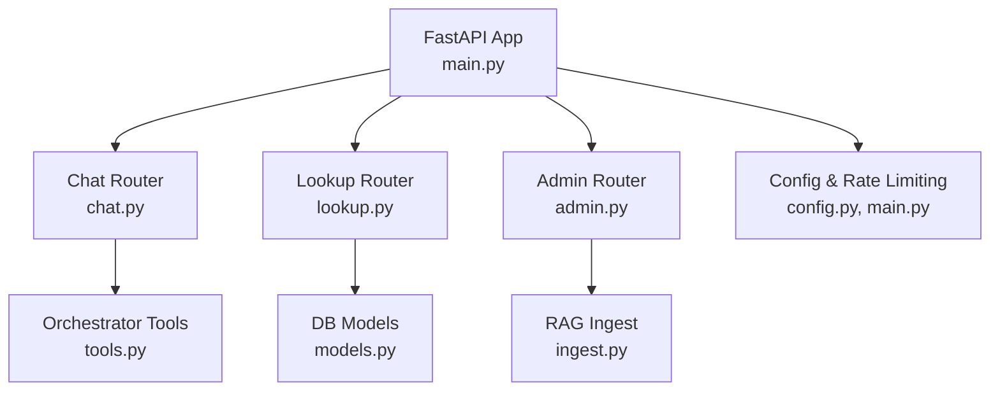
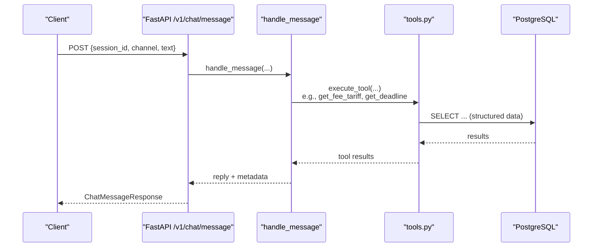
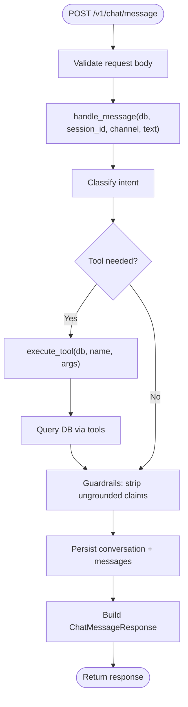
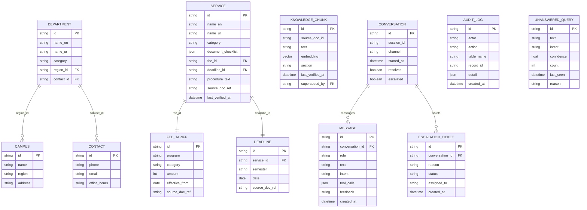
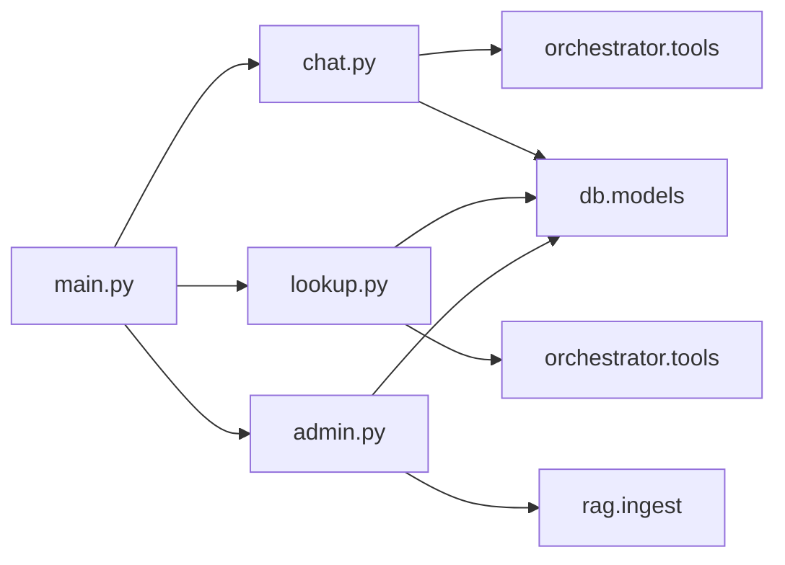

# API Reference

<cite>
**Referenced Files in This Document**
- [main.py](file://uaea-backend/app/main.py)
- [chat.py](file://uaea-backend/app/api/chat.py)
- [lookup.py](file://uaea-backend/app/api/lookup.py)
- [admin.py](file://uaea-backend/app/api/admin.py)
- [schemas.py](file://uaea-backend/app/schemas.py)
- [models.py](file://uaea-backend/app/db/models.py)
- [config.py](file://uaea-backend/app/config.py)
- [tools.py](file://uaea-backend/app/orchestrator/tools.py)
- [ingest.py](file://uaea-backend/app/rag/ingest.py)
- [api.js](file://src/lib/api.js)
- [README.md](file://uaea-backend/README.md)
</cite>

## Table of Contents
1. [Introduction](#introduction)
2. [Project Structure](#project-structure)
3. [Core Components](#core-components)
4. [Architecture Overview](#architecture-overview)
5. [Detailed Component Analysis](#detailed-component-analysis)
6. [Dependency Analysis](#dependency-analysis)
7. [Performance Considerations](#performance-considerations)
8. [Troubleshooting Guide](#troubleshooting-guide)
9. [Conclusion](#conclusion)
10. [Appendices](#appendices)

## Introduction
This document provides comprehensive API reference documentation for the UAEA Console backend, covering:
- Chat API: message processing endpoints, session retrieval, escalation, and real-time integration patterns.
- Admin API: content management operations for knowledge chunks and fee tariffs, plus analytics and queue endpoints.
- Lookup API: public data retrieval with filtering and search capabilities for departments, fees, deadlines, and service checklists.
- Authentication, rate limiting, error handling, versioning strategy, deprecation policy, and client integration guidelines including SDK usage examples and best practices.

The backend is a FastAPI application exposing REST endpoints under /v1/*, with CORS and per-IP rate limiting enabled. Admin endpoints require an API key via header.

**Section sources**
- [main.py:1-104](file://uaea-backend/app/main.py#L1-L104)
- [README.md:77-154](file://uaea-backend/README.md#L77-L154)

## Project Structure
The backend organizes functionality by feature:
- API routers: chat, lookup, admin
- Data models: SQLAlchemy ORM definitions
- Schemas: Pydantic request/response models
- Orchestrator: LLM tool definitions and execution
- RAG: ingestion and retrieval utilities
- Configuration: environment-driven settings

**Diagram sources**
- [main.py:75-79](file://uaea-backend/app/main.py#L75-L79)
- [chat.py:18-115](file://uaea-backend/app/api/chat.py#L18-L115)
- [lookup.py:23-104](file://uaea-backend/app/api/lookup.py#L23-L104)
- [admin.py:26-161](file://uaea-backend/app/api/admin.py#L26-L161)
- [tools.py:18-235](file://uaea-backend/app/orchestrator/tools.py#L18-L235)
- [ingest.py:75-122](file://uaea-backend/app/rag/ingest.py#L75-L122)
- [models.py:18-228](file://uaea-backend/app/db/models.py#L18-L228)
- [config.py:6-38](file://uaea-backend/app/config.py#L6-L38)

**Section sources**
- [main.py:1-104](file://uaea-backend/app/main.py#L1-L104)
- [README.md:158-197](file://uaea-backend/README.md#L158-L197)

## Core Components
- Chat API: POST /v1/chat/message, GET /v1/chat/session/{session_id}, POST /v1/chat/escalate
- Lookup API: GET /v1/lookup/departments, /v1/lookup/fee-tariff, /v1/lookup/deadlines, /v1/lookup/document-checklist
- Admin API: POST /v1/admin/content/faq, POST /v1/admin/content/fee-tariff, GET /v1/admin/analytics/intents, GET /v1/admin/queue/unanswered
- Health: GET /health

Authentication:
- Public endpoints (chat, lookup): no auth required
- Admin endpoints: require X-API-Key header matching configured admin_api_key

Rate Limiting:
- Per-IP limiter via slowapi; default 60 requests per minute (configurable)
- Per-session placeholder middleware exists for chat/message

CORS:
- Configured via cors_origins; development allows all origins if none provided

Versioning:
- All routes are prefixed with /v1 to support future versioning

Error Handling:
- Standard HTTPException responses; rate limit returns 429

**Section sources**
- [chat.py:21-115](file://uaea-backend/app/api/chat.py#L21-L115)
- [lookup.py:26-104](file://uaea-backend/app/api/lookup.py#L26-L104)
- [admin.py:31-48](file://uaea-backend/app/api/admin.py#L31-L48)
- [admin.py:67-161](file://uaea-backend/app/api/admin.py#L67-L161)
- [main.py:25-58](file://uaea-backend/app/main.py#L25-L58)
- [main.py:61-73](file://uaea-backend/app/main.py#L61-L73)
- [config.py:20-28](file://uaea-backend/app/config.py#L20-L28)

## Architecture Overview
The chat pipeline normalizes input, classifies intent, runs guided flows, calls tools (database queries), applies guardrails, and persists conversation history. Lookup endpoints reuse the same tool implementations to expose structured data publicly. Admin endpoints manage content and provide analytics.

**Diagram sources**
- [chat.py:21-39](file://uaea-backend/app/api/chat.py#L21-L39)
- [tools.py:218-235](file://uaea-backend/app/orchestrator/tools.py#L218-L235)
- [models.py:71-122](file://uaea-backend/app/db/models.py#L71-L122)

**Section sources**
- [README.md:199-216](file://uaea-backend/README.md#L199-L216)
- [tools.py:18-87](file://uaea-backend/app/orchestrator/tools.py#L18-L87)

## Detailed Component Analysis

### Chat API
Endpoints:
- POST /v1/chat/message
  - Request body: session_id (string), channel (string, default "web"), text (string)
  - Response: reply (string), intent (string|null), tool_calls (array of {name, args, result}), escalated (bool), confidence (float), language (string), sources (array of objects)
  - Behavior: orchestrates message handling, may call tools, persists messages, returns assistant reply and metadata
- GET /v1/chat/session/{session_id}
  - Path param: session_id (string)
  - Response: SessionOut with id, session_id, channel, started_at, resolved, escalated, messages array
  - Behavior: retrieves latest conversation for session and its messages
- POST /v1/chat/escalate
  - Request body: session_id (string), reason (string)
  - Response: ticket_id (string), status ("open")
  - Behavior: creates escalation ticket for active conversation

Real-time communication patterns:
- The API is synchronous REST. For real-time updates, clients can poll /v1/chat/session/{session_id} or use WebSocket if implemented later. Current implementation does not include WebSocket endpoints.

Request/Response Examples:
- See example curl commands in README for sending messages, retrieving sessions, and escalating.

Error Codes:
- 404 when session not found or no active conversation
- 429 when rate limit exceeded
- 400 on validation errors (Pydantic)

Authentication:
- No authentication required for chat endpoints

Rate Limiting:
- Per-IP rate limiting applied globally; per-session placeholder middleware present

**Section sources**
- [chat.py:21-115](file://uaea-backend/app/api/chat.py#L21-L115)
- [schemas.py:81-122](file://uaea-backend/app/schemas.py#L81-L122)
- [README.md:107-154](file://uaea-backend/README.md#L107-L154)

#### Chat Message Processing Flow

**Diagram sources**
- [chat.py:21-39](file://uaea-backend/app/api/chat.py#L21-L39)
- [tools.py:218-235](file://uaea-backend/app/orchestrator/tools.py#L218-L235)
- [models.py:144-178](file://uaea-backend/app/db/models.py#L144-L178)

### Lookup API
Endpoints:
- GET /v1/lookup/departments
  - Query params: region (optional), query (optional)
  - Filters by campus region and searches department names/categories
  - Response: list of DepartmentOut
- GET /v1/lookup/fee-tariff
  - Query params: program (optional), category (optional)
  - Response: list of FeeTariffOut
- GET /v1/lookup/deadlines
  - Query params: service (optional)
  - Joins Service to filter by service name
  - Response: list of DeadlineOut
- GET /v1/lookup/document-checklist
  - Query param: service (required)
  - Uses tool_get_document_checklist
  - Response: object with service, checklist, procedure, source, last_verified

Filtering and Search:
- Departments: region filters by campus region; query performs case-insensitive substring match across English/Urdu names and category
- Fees: program and category substring matches
- Deadlines: service substring match via join
- Checklist: exact service name match via tool

Request/Response Examples:
- See README for curl examples listing departments, filtering by region, fetching fees, deadlines, and checklists.

Error Codes:
- 422 on missing required parameters (e.g., service for checklist)
- 429 on rate limit exceeded

Authentication:
- No authentication required

Rate Limiting:
- Per-IP rate limiting applies

**Section sources**
- [lookup.py:26-104](file://uaea-backend/app/api/lookup.py#L26-L104)
- [schemas.py:13-77](file://uaea-backend/app/schemas.py#L13-L77)
- [tools.py:92-197](file://uaea-backend/app/orchestrator/tools.py#L92-L197)
- [README.md:107-154](file://uaea-backend/README.md#L107-L154)

### Admin API
Authentication:
- Requires X-API-Key header matching configured admin_api_key
- Also supports Authorization: Bearer token (stub)

Endpoints:
- POST /v1/admin/content/faq
  - Request: FAQCreate (source_doc_id, text, section optional)
  - Creates KnowledgeChunk with embedding via RAG ingest
  - Audits write via AuditLog
  - Response: AdminWriteResponse (id, status)
- POST /v1/admin/content/fee-tariff
  - Request: FeeTariffCreate (program, category, amount, effective_from, source_doc_ref optional)
  - Creates FeeTariff record
  - Audits write
  - Response: AdminWriteResponse
- GET /v1/admin/analytics/intents
  - Returns counts grouped by intent from messages where role=user and intent is set
  - Response: list of IntentCount
- GET /v1/admin/queue/unanswered
  - Returns UnansweredQuery records ordered by count descending
  - Response: list of UnansweredQueryOut

CRUD Operations:
- Create-only endpoints currently exposed for FAQ and fee tariff
- Read endpoints for analytics and queue
- Update/Delete not exposed; consider adding PATCH/DELETE for full CRUD

Request/Response Examples:
- See README for creating FAQ and querying analytics/queue.

Error Codes:
- 403 if invalid or missing API key
- 422 on validation errors
- 429 on rate limit exceeded

Audit Logging:
- All admin writes log actor, action, table_name, record_id, detail

**Section sources**
- [admin.py:31-48](file://uaea-backend/app/api/admin.py#L31-L48)
- [admin.py:53-63](file://uaea-backend/app/api/admin.py#L53-L63)
- [admin.py:67-161](file://uaea-backend/app/api/admin.py#L67-L161)
- [schemas.py:126-167](file://uaea-backend/app/schemas.py#L126-L167)
- [models.py:198-228](file://uaea-backend/app/db/models.py#L198-L228)
- [README.md:96-154](file://uaea-backend/README.md#L96-L154)

### Data Models and Relationships
Key entities:
- Contact, Campus, Department, FeeTariff, Service, Deadline, KnowledgeChunk, Conversation, Message, EscalationTicket, AuditLog, UnansweredQuery

Relationships:
- Department belongs to Campus and has optional Contact
- Service references FeeTariff and Deadline
- Conversation has many Messages
- EscalationTicket belongs to Conversation
- KnowledgeChunk stores embeddings for RAG

**Diagram sources**
- [models.py:30-228](file://uaea-backend/app/db/models.py#L30-L228)

**Section sources**
- [models.py:30-228](file://uaea-backend/app/db/models.py#L30-L228)

## Dependency Analysis
- Chat endpoint depends on orchestrator and tools which query DB models
- Lookup endpoints reuse tool implementations for consistency
- Admin endpoints depend on RAG ingest for embeddings and audit logging
- Main app wires routers, CORS, rate limiting, and health endpoint

**Diagram sources**
- [main.py:75-79](file://uaea-backend/app/main.py#L75-L79)
- [chat.py:18-115](file://uaea-backend/app/api/chat.py#L18-L115)
- [lookup.py:23-104](file://uaea-backend/app/api/lookup.py#L23-L104)
- [admin.py:26-161](file://uaea-backend/app/api/admin.py#L26-L161)
- [tools.py:18-235](file://uaea-backend/app/orchestrator/tools.py#L18-L235)
- [ingest.py:75-122](file://uaea-backend/app/rag/ingest.py#L75-L122)
- [models.py:18-228](file://uaea-backend/app/db/models.py#L18-L228)

**Section sources**
- [main.py:75-79](file://uaea-backend/app/main.py#L75-L79)
- [tools.py:218-235](file://uaea-backend/app/orchestrator/tools.py#L218-L235)
- [ingest.py:75-122](file://uaea-backend/app/rag/ingest.py#L75-L122)

## Performance Considerations
- Database queries:
  - Use indexes on frequently filtered columns (e.g., services.category, fee_tariffs.program)
  - Avoid N+1 queries; joined relationships are configured with lazy="joined" in some cases
- Rate limiting:
  - Per-IP limiter prevents abuse; tune rate_limit_per_ip based on expected traffic
- Embeddings:
  - RAG ingest batches embeddings; ensure embedding provider keys are configured to avoid zero vectors in dev/test
- Pagination:
  - Not implemented in current lookup endpoints; consider adding pagination for large datasets

[No sources needed since this section provides general guidance]

## Troubleshooting Guide
Common issues:
- 403 Admin access denied: Ensure X-API-Key matches configured admin_api_key
- 404 Session not found: Verify session_id exists and conversation is active
- 422 Validation errors: Check request body fields against schemas
- 429 Rate limit exceeded: Reduce request frequency or adjust rate_limit_per_ip
- Empty results: Verify query parameters and data existence in database

Debugging steps:
- Check logs for errors and warnings
- Validate environment variables (.env) for database and API keys
- Use /health endpoint to verify service status
- Inspect DB tables for expected data

**Section sources**
- [admin.py:31-48](file://uaea-backend/app/api/admin.py#L31-L48)
- [chat.py:42-85](file://uaea-backend/app/api/chat.py#L42-L85)
- [main.py:51-58](file://uaea-backend/app/main.py#L51-L58)
- [config.py:6-38](file://uaea-backend/app/config.py#L6-L38)

## Conclusion
The UAEA Console backend provides a robust set of APIs for chat interactions, public lookups, and administrative content management. It leverages structured data, RAG, and guardrails to ensure accurate responses. Clients should integrate using the provided frontend API client or direct HTTP calls, adhere to rate limits, and secure admin endpoints with API keys. Future enhancements may include additional CRUD operations, pagination, and real-time features.

[No sources needed since this section summarizes without analyzing specific files]

## Appendices

### Authentication Requirements
- Admin endpoints require X-API-Key header
- Chat and Lookup endpoints are public

**Section sources**
- [admin.py:31-48](file://uaea-backend/app/api/admin.py#L31-L48)
- [config.py:27-28](file://uaea-backend/app/config.py#L27-L28)

### Rate Limiting Policies
- Global per-IP limiter via slowapi
- Default: 60 requests per minute (configurable)
- Custom handler returns 429 with detail

**Section sources**
- [main.py:25-58](file://uaea-backend/app/main.py#L25-L58)
- [config.py:23-25](file://uaea-backend/app/config.py#L23-L25)

### API Versioning Strategy
- All endpoints under /v1 prefix
- Backward compatibility maintained by avoiding breaking changes within v1
- Deprecation policy: announce deprecations with migration windows before introducing new versions

[No sources needed since this section provides general guidance]

### Client Integration Guidelines
- Use src/lib/api.js for typed functions
- Configure VITE_API_URL to point to backend
- Handle errors by catching thrown Error with detail message
- For admin endpoints, pass API key in headers

SDK Usage Example:
- Import api from './lib/api'
- Call chatMessage(sessionId, text, channel)
- Call getDepartments({ region, query })
- Call createFAQ(data, apiKey)

**Section sources**
- [api.js:1-169](file://src/lib/api.js#L1-L169)
- [README.md:265-279](file://uaea-backend/README.md#L265-L279)

### Best Practices for API Consumption
- Implement retry logic with exponential backoff for transient errors
- Cache static lookup data (departments, fees) locally when appropriate
- Respect rate limits to avoid 429 responses
- Validate inputs on client side to reduce server load
- Log errors with context for debugging

[No sources needed since this section provides general guidance]