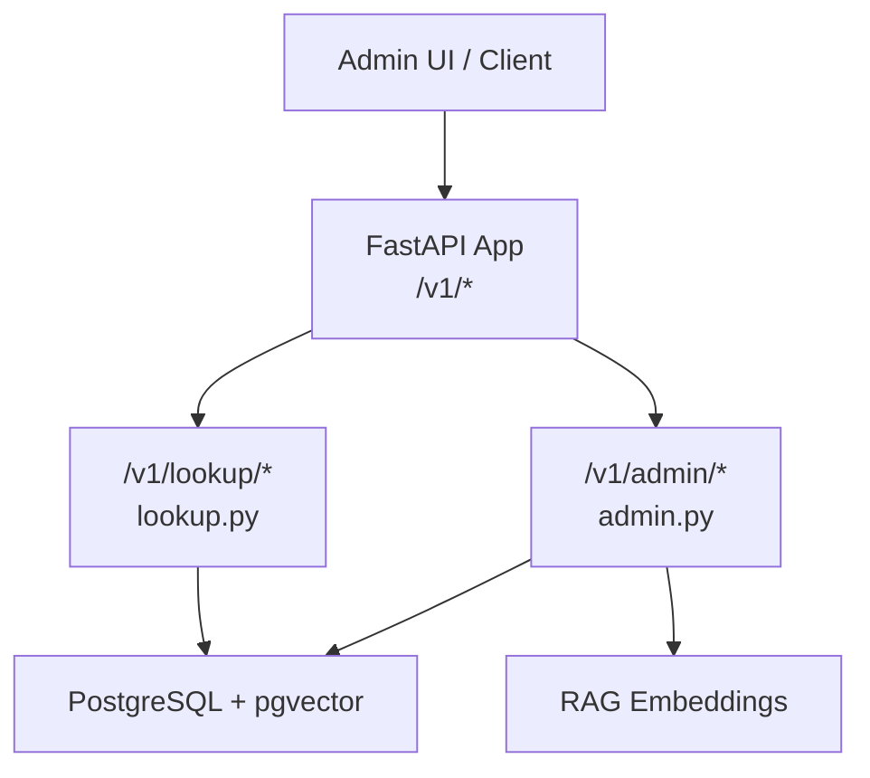
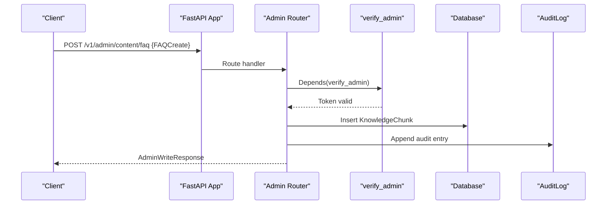
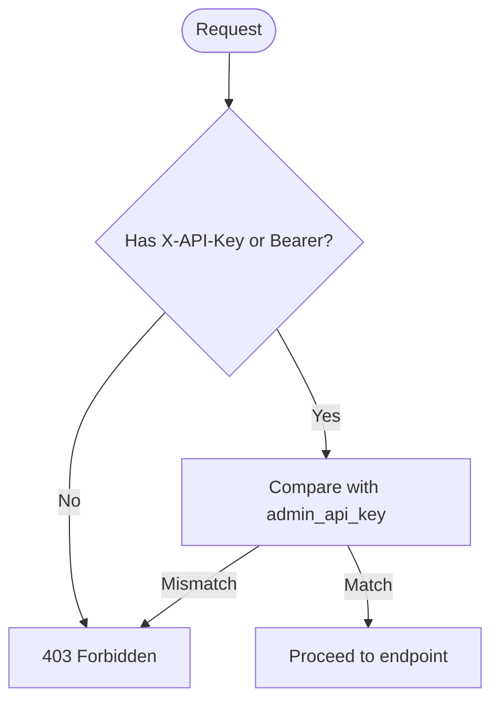
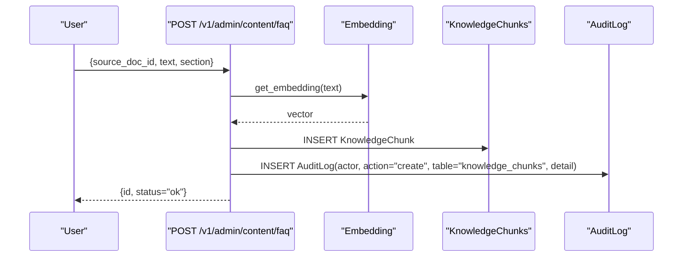
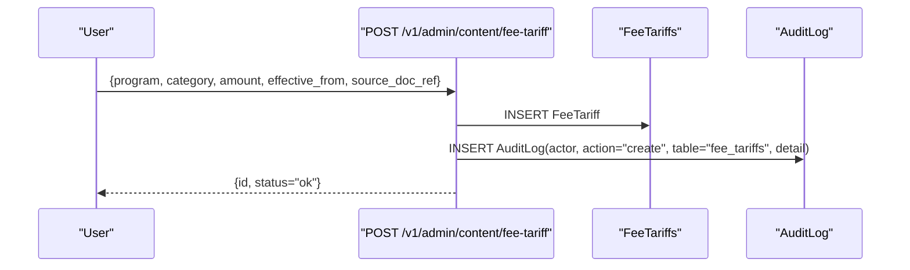
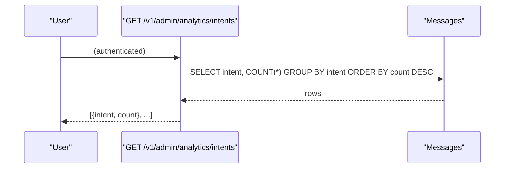
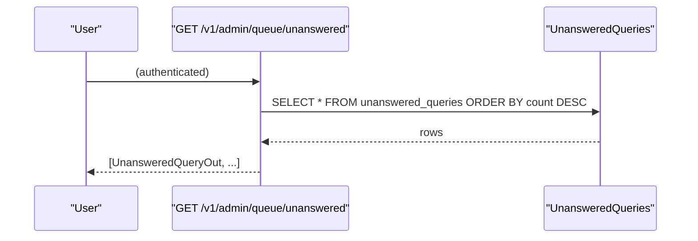
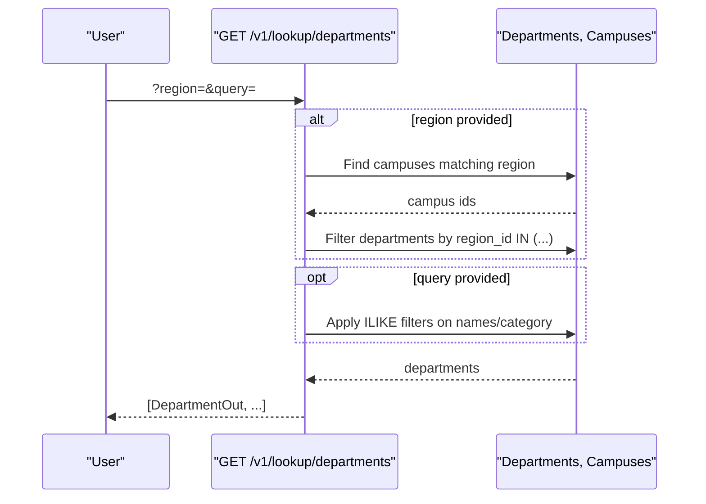
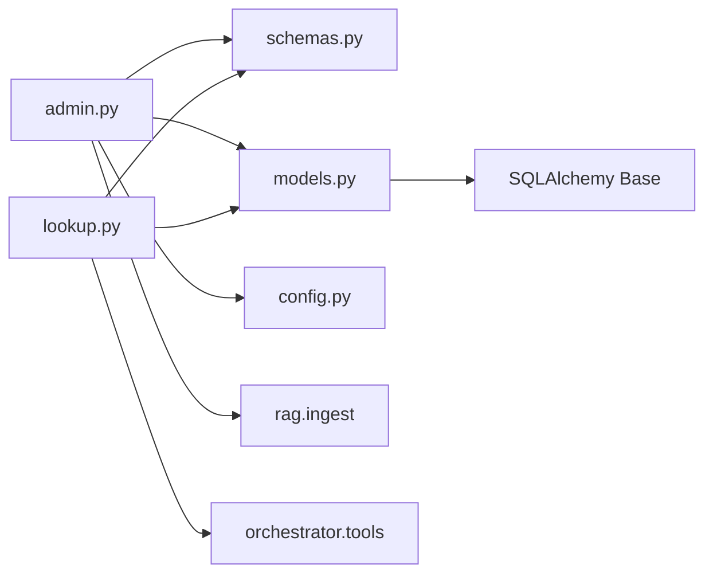

# Admin API

<cite>
**Referenced Files in This Document**
- [admin.py](file://uaea-backend/app/api/admin.py)
- [lookup.py](file://uaea-backend/app/api/lookup.py)
- [schemas.py](file://uaea-backend/app/schemas.py)
- [models.py](file://uaea-backend/app/db/models.py)
- [main.py](file://uaea-backend/app/main.py)
- [config.py](file://uaea-backend/app/config.py)
- [api.js](file://src/lib/api.js)
- [ContentLibrary/index.jsx](file://src/pages/ContentLibrary/index.jsx)
- [useRecordForm.js](file://src/components/content/useRecordForm.js)
- [rbac.js](file://src/lib/rbac.js)
</cite>

## Table of Contents
1. [Introduction](#introduction)
2. [Project Structure](#project-structure)
3. [Core Components](#core-components)
4. [Architecture Overview](#architecture-overview)
5. [Detailed Component Analysis](#detailed-component-analysis)
6. [Dependency Analysis](#dependency-analysis)
7. [Performance Considerations](#performance-considerations)
8. [Troubleshooting Guide](#troubleshooting-guide)
9. [Conclusion](#conclusion)
10. [Appendices](#appendices)

## Introduction
This document provides detailed API documentation for the Admin API endpoints used for content management operations in the UAEA backend. It covers authentication, authorization, available endpoints, request/response schemas, error handling, and guidance for building admin interfaces. The current implementation includes:
- Content creation endpoints for FAQ knowledge chunks and fee tariffs
- Analytics and queue endpoints for administrative oversight
- Read-only lookup endpoints for departments, fees, deadlines, and document checklists

The repository also documents a planned future state where all CRUD operations (create, read, update, delete) will be exposed under a unified /v1/admin/content/{table} interface with audit logging and role-based access control.

## Project Structure
The backend is a FastAPI application that mounts routers for chat, lookup, and admin functionality. The admin router defines protected endpoints under /v1/admin. Lookup endpoints provide read-only access to core entities used by students and the assistant. Frontend code demonstrates how admin endpoints are called from the client using an API key header.

**Diagram sources**
- [main.py:75-79](file://uaea-backend/app/main.py#L75-L79)
- [admin.py:26-26](file://uaea-backend/app/api/admin.py#L26-L26)
- [lookup.py:23-23](file://uaea-backend/app/api/lookup.py#L23-L23)

**Section sources**
- [main.py:1-104](file://uaea-backend/app/main.py#L1-L104)
- [admin.py:1-161](file://uaea-backend/app/api/admin.py#L1-L161)
- [lookup.py:1-104](file://uaea-backend/app/api/lookup.py#L1-L104)

## Core Components
- Authentication and Authorization
  - Admin endpoints require an API key or bearer token via the verify_admin dependency.
  - The configured admin API key is validated against settings.
- Schemas
  - Pydantic models define request and response shapes for admin operations and lookup responses.
- Data Models
  - SQLAlchemy models define tables for services, fees, deadlines, departments, knowledge chunks, messages, audit logs, and unanswered queries.
- Admin Endpoints
  - Create FAQ knowledge chunk
  - Create fee tariff
  - Get intent analytics
  - Get unanswered query queue
- Lookup Endpoints
  - List departments with optional region and search filters
  - List fee tariffs with optional program and category filters
  - List deadlines with optional service filter
  - Get document checklist for a service

**Section sources**
- [admin.py:31-48](file://uaea-backend/app/api/admin.py#L31-L48)
- [schemas.py:124-178](file://uaea-backend/app/schemas.py#L124-L178)
- [models.py:55-122](file://uaea-backend/app/db/models.py#L55-L122)
- [lookup.py:26-103](file://uaea-backend/app/api/lookup.py#L26-L103)

## Architecture Overview
The admin API is protected by a simple RBAC stub that validates an API key or bearer token. Write operations create records and log them to an audit table. Read operations expose curated views over the database for administrative oversight.

**Diagram sources**
- [admin.py:67-94](file://uaea-backend/app/api/admin.py#L67-L94)
- [admin.py:53-62](file://uaea-backend/app/api/admin.py#L53-L62)
- [models.py:126-140](file://uaea-backend/app/db/models.py#L126-L140)
- [models.py:200-211](file://uaea-backend/app/db/models.py#L200-L211)

## Detailed Component Analysis

### Authentication and Authorization
- Header-based authentication:
  - Accepts X-API-Key or Authorization: Bearer <token>.
  - Compares provided token with configured admin_api_key.
- Error on invalid credentials:
  - Returns HTTP 403 with a descriptive detail message.
- Role-based access control (RBAC):
  - Frontend enforces permissions via roles and perms map; server-side enforcement is noted as a Phase 2 requirement.

**Diagram sources**
- [admin.py:31-48](file://uaea-backend/app/api/admin.py#L31-L48)
- [config.py:27-28](file://uaea-backend/app/config.py#L27-L28)

**Section sources**
- [admin.py:31-48](file://uaea-backend/app/api/admin.py#L31-L48)
- [config.py:1-38](file://uaea-backend/app/config.py#L1-L38)
- [rbac.js:10-48](file://src/lib/rbac.js#L10-L48)

### Content: FAQ Knowledge Chunk
- Endpoint: POST /v1/admin/content/faq
- Purpose: Create a new FAQ knowledge chunk and embed it for retrieval.
- Request schema: FAQCreate
  - source_doc_id: string
  - text: string
  - section: string | null
- Response schema: AdminWriteResponse
  - id: string
  - status: string ("ok")
- Behavior:
  - Generates a unique ID
  - Computes embedding via RAG pipeline
  - Persists KnowledgeChunk
  - Writes audit log entry
  - Commits transaction
- Notes:
  - Requires admin authentication
  - Audit trail captures actor, action, table, record id, and summary details

**Diagram sources**
- [admin.py:67-94](file://uaea-backend/app/api/admin.py#L67-L94)
- [schemas.py:126-139](file://uaea-backend/app/schemas.py#L126-L139)
- [models.py:126-140](file://uaea-backend/app/db/models.py#L126-L140)
- [models.py:200-211](file://uaea-backend/app/db/models.py#L200-L211)

**Section sources**
- [admin.py:67-94](file://uaea-backend/app/api/admin.py#L67-L94)
- [schemas.py:126-139](file://uaea-backend/app/schemas.py#L126-L139)
- [models.py:126-140](file://uaea-backend/app/db/models.py#L126-L140)

### Content: Fee Tariff
- Endpoint: POST /v1/admin/content/fee-tariff
- Purpose: Create a new fee tariff entry.
- Request schema: FeeTariffCreate
  - program: string
  - category: string
  - amount: integer
  - effective_from: date
  - source_doc_ref: string | null
- Response schema: AdminWriteResponse
- Behavior:
  - Generates a unique ID
  - Persists FeeTariff
  - Writes audit log entry
  - Commits transaction

**Diagram sources**
- [admin.py:99-125](file://uaea-backend/app/api/admin.py#L99-L125)
- [schemas.py:141-147](file://uaea-backend/app/schemas.py#L141-L147)
- [models.py:73-82](file://uaea-backend/app/db/models.py#L73-L82)
- [models.py:200-211](file://uaea-backend/app/db/models.py#L200-L211)

**Section sources**
- [admin.py:99-125](file://uaea-backend/app/api/admin.py#L99-L125)
- [schemas.py:141-147](file://uaea-backend/app/schemas.py#L141-L147)
- [models.py:73-82](file://uaea-backend/app/db/models.py#L73-L82)

### Analytics: Intent Counts
- Endpoint: GET /v1/admin/analytics/intents
- Purpose: Retrieve counts of user messages grouped by intent.
- Response schema: list[IntentCount]
  - intent: string
  - count: integer
- Behavior:
  - Queries Message table for user intents
  - Groups and orders by count descending

**Diagram sources**
- [admin.py:130-144](file://uaea-backend/app/api/admin.py#L130-L144)
- [schemas.py:154-157](file://uaea-backend/app/schemas.py#L154-L157)
- [models.py:162-178](file://uaea-backend/app/db/models.py#L162-L178)

**Section sources**
- [admin.py:130-144](file://uaea-backend/app/api/admin.py#L130-L144)
- [schemas.py:154-157](file://uaea-backend/app/schemas.py#L154-L157)
- [models.py:162-178](file://uaea-backend/app/db/models.py#L162-L178)

### Queue: Unanswered Queries
- Endpoint: GET /v1/admin/queue/unanswered
- Purpose: Retrieve the queue of unanswered or low-confidence queries.
- Response schema: list[UnansweredQueryOut]
  - id: string
  - text: string
  - intent: string | null
  - confidence: float | null
  - count: integer
  - reason: string | null
- Behavior:
  - Orders by count descending

**Diagram sources**
- [admin.py:149-160](file://uaea-backend/app/api/admin.py#L149-L160)
- [schemas.py:159-167](file://uaea-backend/app/schemas.py#L159-L167)
- [models.py:216-228](file://uaea-backend/app/db/models.py#L216-L228)

**Section sources**
- [admin.py:149-160](file://uaea-backend/app/api/admin.py#L149-L160)
- [schemas.py:159-167](file://uaea-backend/app/schemas.py#L159-L167)
- [models.py:216-228](file://uaea-backend/app/db/models.py#L216-L228)

### Lookup: Departments
- Endpoint: GET /v1/lookup/departments
- Query parameters:
  - region: string | null — filters by campus region (case-insensitive substring match)
  - query: string | null — filters by department name_en, name_ur, or category (case-insensitive substring match)
- Response schema: list[DepartmentOut]
- Behavior:
  - Joins campuses when filtering by region
  - Applies ILIKE filters for search

**Diagram sources**
- [lookup.py:26-53](file://uaea-backend/app/api/lookup.py#L26-L53)
- [schemas.py:30-38](file://uaea-backend/app/schemas.py#L30-L38)
- [models.py:32-68](file://uaea-backend/app/db/models.py#L32-L68)

**Section sources**
- [lookup.py:26-53](file://uaea-backend/app/api/lookup.py#L26-L53)
- [schemas.py:30-38](file://uaea-backend/app/schemas.py#L30-L38)
- [models.py:32-68](file://uaea-backend/app/db/models.py#L32-L68)

### Lookup: Fee Tariffs
- Endpoint: GET /v1/lookup/fee-tariff
- Query parameters:
  - program: string | null — case-insensitive substring match
  - category: string | null — case-insensitive substring match
- Response schema: list[FeeTariffOut]

**Section sources**
- [lookup.py:56-71](file://uaea-backend/app/api/lookup.py#L56-L71)
- [schemas.py:40-48](file://uaea-backend/app/schemas.py#L40-L48)
- [models.py:73-82](file://uaea-backend/app/db/models.py#L73-L82)

### Lookup: Deadlines
- Endpoint: GET /v1/lookup/deadlines
- Query parameters:
  - service: string | null — joins with Service and filters by service name_en (case-insensitive substring match)
- Response schema: list[DeadlineOut]

**Section sources**
- [lookup.py:74-90](file://uaea-backend/app/api/lookup.py#L74-L90)
- [schemas.py:70-77](file://uaea-backend/app/schemas.py#L70-L77)
- [models.py:108-122](file://uaea-backend/app/db/models.py#L108-L122)

### Lookup: Document Checklist
- Endpoint: GET /v1/lookup/document-checklist
- Query parameters:
  - service: string (required)
- Response schema: depends on tool_get_document_checklist result

**Section sources**
- [lookup.py:93-103](file://uaea-backend/app/api/lookup.py#L93-L103)

### Client Integration Examples
- Admin endpoints are called with an API key header from the frontend.
- Example functions:
  - createFAQ(data, apiKey)
  - createFeeTariff(data, apiKey)
  - getIntentAnalytics(apiKey)
  - getUnansweredQueue(apiKey)

**Section sources**
- [api.js:108-150](file://src/lib/api.js#L108-L150)

## Dependency Analysis
- Admin router depends on:
  - Database session provider
  - Config settings for admin API key
  - Schemas for validation and serialization
  - RAG ingestion utilities for embeddings
- Lookup router depends on:
  - Database session provider
  - Schemas for output models
  - Orchestrator tools for document checklist logic
- Models define relationships between entities such as Service, FeeTariff, Deadline, Department, Campus, Contact, KnowledgeChunk, Messages, AuditLog, and UnansweredQueries.

**Diagram sources**
- [admin.py:14-24](file://uaea-backend/app/api/admin.py#L14-L24)
- [lookup.py:13-21](file://uaea-backend/app/api/lookup.py#L13-L21)
- [models.py:1-19](file://uaea-backend/app/db/models.py#L1-L19)

**Section sources**
- [admin.py:14-24](file://uaea-backend/app/api/admin.py#L14-L24)
- [lookup.py:13-21](file://uaea-backend/app/api/lookup.py#L13-L21)
- [models.py:1-19](file://uaea-backend/app/db/models.py#L1-L19)

## Performance Considerations
- Rate limiting:
  - Global per-IP rate limiter is configured at the app level.
  - Chat endpoints have additional per-session considerations in middleware.
- Database queries:
  - Lookup endpoints use efficient filtering and joins.
  - Analytics queries group and order results; consider indexing on frequently filtered columns if datasets grow large.
- Embeddings:
  - Creating FAQ chunks triggers embedding generation; ensure embedding provider capacity and caching strategies are considered.

**Section sources**
- [main.py:25-58](file://uaea-backend/app/main.py#L25-L58)
- [lookup.py:33-53](file://uaea-backend/app/api/lookup.py#L33-L53)
- [admin.py:73-94](file://uaea-backend/app/api/admin.py#L73-L94)

## Troubleshooting Guide
- Authentication failures:
  - Missing or invalid API key/bearer token returns 403 with a detail message.
  - Ensure the correct header is set and matches the configured admin_api_key.
- Validation errors:
  - Pydantic schemas enforce required fields and types; malformed requests will return appropriate validation errors.
- Database errors:
  - Integrity constraints (e.g., foreign keys) may cause errors; ensure referenced entities exist before creating dependent records.
- Rate limiting:
  - Exceeding rate limits returns 429 with a detail message.

**Section sources**
- [admin.py:31-48](file://uaea-backend/app/api/admin.py#L31-L48)
- [schemas.py:124-178](file://uaea-backend/app/schemas.py#L124-L178)
- [main.py:51-58](file://uaea-backend/app/main.py#L51-L58)

## Conclusion
The Admin API currently supports creating FAQ knowledge chunks and fee tariffs, along with analytics and queue inspection endpoints. All admin write operations are authenticated and audited. Read-only lookup endpoints provide flexible filtering for departments, fees, deadlines, and document checklists. Future phases should expand CRUD coverage across all administrative entities, implement robust server-side RBAC, and standardize bulk operations and search capabilities.

## Appendices

### Planned Unified Admin CRUD Interface
- The repository documents a future pattern where all writes go through a single mutate function mapping to:
  - POST /v1/admin/content/{table} for create
  - PATCH /v1/admin/content/{table}/{id} for update
  - DELETE /v1/admin/content/{table}/{id} for delete
- This approach centralizes permissions, validation, and audit logging.

**Section sources**
- [README.md:163-193](file://README.md#L163-L193)

### Frontend Admin Patterns
- Role-based UI gating:
  - Permissions map controls visibility of actions like adding records, verifying content, and exporting data.
- Bulk operations:
  - Selection and bulk verification are supported in the content library UI.
- Search and filtering:
  - Debounced search and category/freshness filters are implemented client-side; server-side equivalents can be added to lookup endpoints.

**Section sources**
- [rbac.js:10-48](file://src/lib/rbac.js#L10-L48)
- [ContentLibrary/index.jsx:21-131](file://src/pages/ContentLibrary/index.jsx#L21-L131)
- [useRecordForm.js:53-82](file://src/components/content/useRecordForm.js#L53-L82)