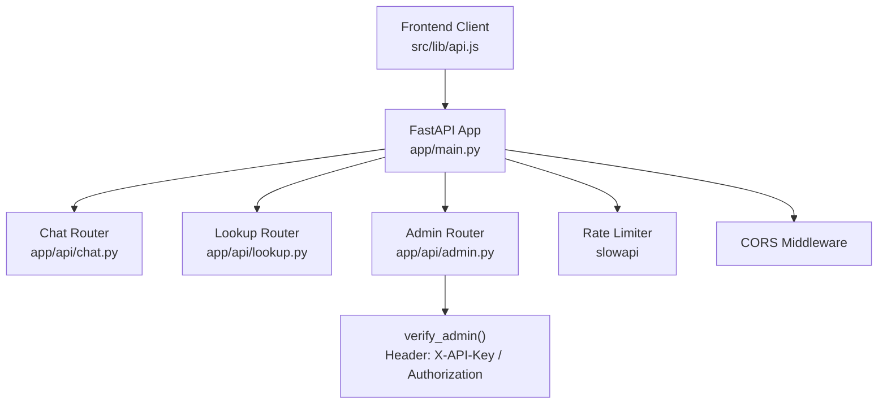
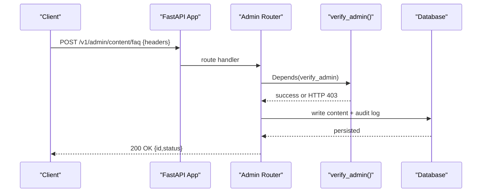
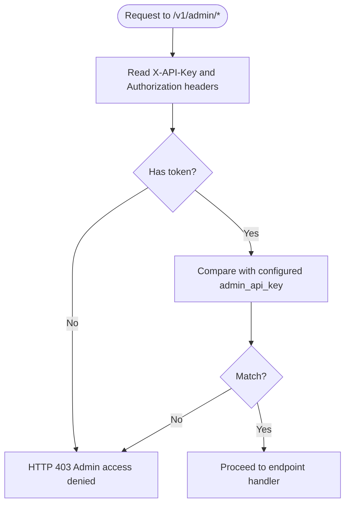
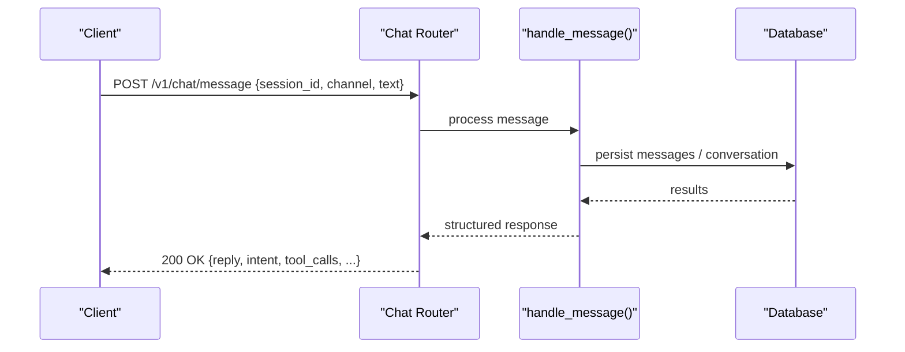
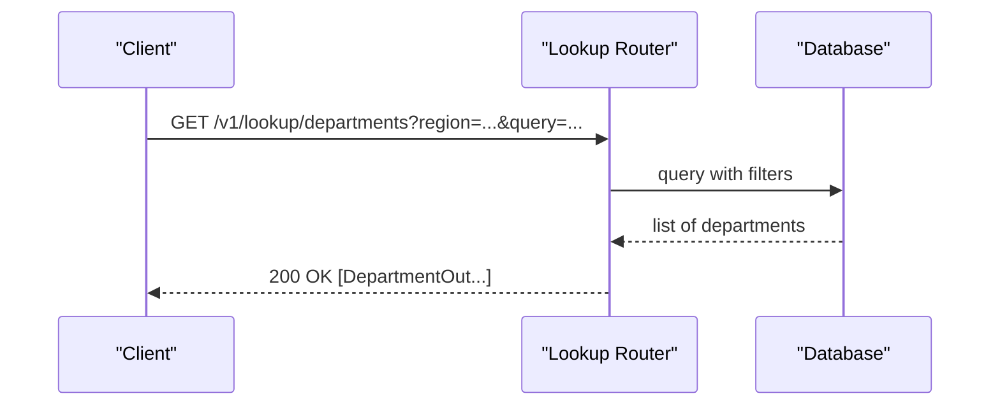
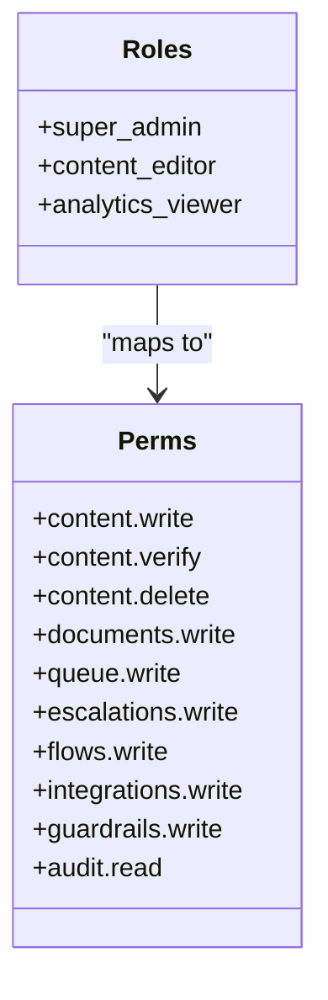
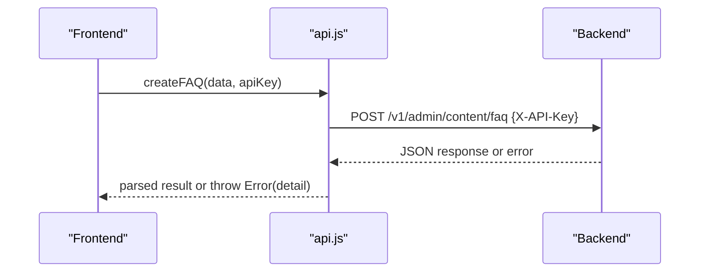
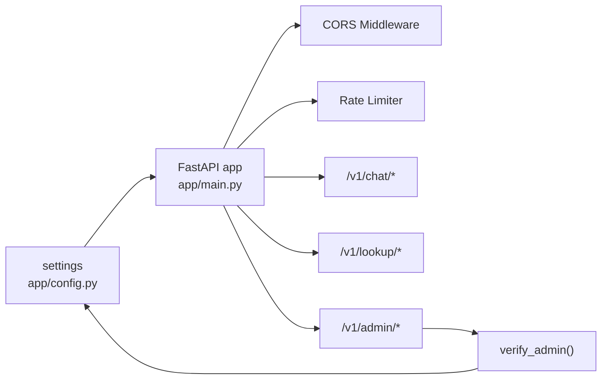

# Authentication & Authorization

<cite>
**Referenced Files in This Document**
- [main.py](file://uaea-backend/app/main.py)
- [config.py](file://uaea-backend/app/config.py)
- [admin.py](file://uaea-backend/app/api/admin.py)
- [chat.py](file://uaea-backend/app/api/chat.py)
- [lookup.py](file://uaea-backend/app/api/lookup.py)
- [schemas.py](file://uaea-backend/app/schemas.py)
- [models.py](file://uaea-backend/app/db/models.py)
- [api.js](file://src/lib/api.js)
- [rbac.js](file://src/lib/rbac.js)
</cite>

## Table of Contents
1. [Introduction](#introduction)
2. [Project Structure](#project-structure)
3. [Core Components](#core-components)
4. [Architecture Overview](#architecture-overview)
5. [Detailed Component Analysis](#detailed-component-analysis)
6. [Dependency Analysis](#dependency-analysis)
7. [Performance Considerations](#performance-considerations)
8. [Troubleshooting Guide](#troubleshooting-guide)
9. [Conclusion](#conclusion)
10. [Appendices](#appendices)

## Introduction
This document explains the authentication and authorization mechanisms for the UAEA console backend and its frontend client. It covers:
- API key management for admin endpoints
- Session handling via session IDs for chat conversations
- Token-based authentication stubs (Bearer token support)
- Role-based access control (RBAC) definitions used by the UI and intended for server-side enforcement
- CORS configuration, rate limiting, and security headers
- Integration guidelines for secure API consumption, error handling, and session state across requests

## Project Structure
The backend is a FastAPI application with three routers:
- Chat endpoints (/v1/chat/*) — public, session-scoped
- Lookup endpoints (/v1/lookup/*) — public read-only
- Admin endpoints (/v1/admin/*) — protected by API key or Bearer token

CORS and rate limiting are configured at the application level. The frontend uses a centralized API client that attaches an API key header for admin calls.

**Diagram sources**
- [main.py:61-79](file://uaea-backend/app/main.py#L61-L79)
- [admin.py:29-48](file://uaea-backend/app/api/admin.py#L29-L48)
- [chat.py:18-40](file://uaea-backend/app/api/chat.py#L18-L40)
- [lookup.py:23-53](file://uaea-backend/app/api/lookup.py#L23-L53)

**Section sources**
- [main.py:1-104](file://uaea-backend/app/main.py#L1-L104)
- [admin.py:1-161](file://uaea-backend/app/api/admin.py#L1-L161)
- [chat.py:1-115](file://uaea-backend/app/api/chat.py#L1-L115)
- [lookup.py:1-104](file://uaea-backend/app/api/lookup.py#L1-L104)

## Core Components
- Admin authentication: verify_admin reads X-API-Key or Authorization: Bearer <token> and compares against the configured admin_api_key. Unauthorized requests receive 403.
- Public endpoints: chat and lookup do not enforce authentication; they rely on session_id to scope data.
- RBAC: Frontend defines roles and permissions; server-side enforcement is planned as a Phase 2 enhancement.
- Configuration: Settings include CORS origins, rate limits, and admin API key.

**Section sources**
- [admin.py:29-48](file://uaea-backend/app/api/admin.py#L29-L48)
- [config.py:20-32](file://uaea-backend/app/config.py#L20-L32)
- [rbac.js:10-50](file://src/lib/rbac.js#L10-L50)

## Architecture Overview
Authentication and authorization flow:
- Admin endpoints require either:
  - Header: X-API-Key set to the configured admin_api_key
  - Header: Authorization: Bearer <token> equal to the configured admin_api_key
- Public endpoints accept requests without credentials but use session_id to scope conversation data.
- CORS is enabled based on settings; development allows all origins if none configured.
- Rate limiting is applied per IP using slowapi.

**Diagram sources**
- [admin.py:67-94](file://uaea-backend/app/api/admin.py#L67-L94)
- [admin.py:29-48](file://uaea-backend/app/api/admin.py#L29-L48)
- [models.py:198-211](file://uaea-backend/app/db/models.py#L198-L211)

## Detailed Component Analysis

### Admin Authentication (API Key and Bearer Token)
- verify_admin extracts credentials from:
  - X-API-Key header
  - Authorization header with Bearer scheme
- Compares token to settings.admin_api_key
- Returns 403 with a detail message when invalid or missing

**Diagram sources**
- [admin.py:29-48](file://uaea-backend/app/api/admin.py#L29-L48)
- [config.py:27-32](file://uaea-backend/app/config.py#L27-L32)

**Section sources**
- [admin.py:29-48](file://uaea-backend/app/api/admin.py#L29-L48)
- [config.py:27-32](file://uaea-backend/app/config.py#L27-L32)

### Chat Endpoints (Session-Based)
- No authentication required
- Uses session_id to locate or create conversation context
- Responses include assistant reply, intent, tool calls, escalation flag, confidence, language, and sources

**Diagram sources**
- [chat.py:21-39](file://uaea-backend/app/api/chat.py#L21-L39)
- [schemas.py:81-100](file://uaea-backend/app/schemas.py#L81-L100)
- [models.py:144-178](file://uaea-backend/app/db/models.py#L144-L178)

**Section sources**
- [chat.py:21-39](file://uaea-backend/app/api/chat.py#L21-L39)
- [schemas.py:81-100](file://uaea-backend/app/schemas.py#L81-L100)
- [models.py:144-178](file://uaea-backend/app/db/models.py#L144-L178)

### Lookup Endpoints (Public Read)
- No authentication required
- Provide filtered lists of departments, fee tariffs, deadlines, and document checklists

**Diagram sources**
- [lookup.py:26-53](file://uaea-backend/app/api/lookup.py#L26-L53)
- [schemas.py:30-37](file://uaea-backend/app/schemas.py#L30-L37)

**Section sources**
- [lookup.py:26-53](file://uaea-backend/app/api/lookup.py#L26-L53)
- [schemas.py:30-37](file://uaea-backend/app/schemas.py#L30-L37)

### RBAC Definitions (Frontend and Planned Server Enforcement)
- Roles: super_admin, content_editor, analytics_viewer
- Permissions map controls which actions each role can perform
- Current implementation gates UI visibility; server-side enforcement is intended for Phase 2

**Diagram sources**
- [rbac.js:10-50](file://src/lib/rbac.js#L10-L50)

**Section sources**
- [rbac.js:10-50](file://src/lib/rbac.js#L10-L50)

### API Client and Headers
- Base URL configurable via environment variable
- All requests set Content-Type: application/json
- Admin methods attach X-API-Key header
- Errors thrown with detail from server responses

**Diagram sources**
- [api.js:16-31](file://src/lib/api.js#L16-L31)
- [api.js:108-141](file://src/lib/api.js#L108-L141)

**Section sources**
- [api.js:16-31](file://src/lib/api.js#L16-L31)
- [api.js:108-141](file://src/lib/api.js#L108-L141)

## Dependency Analysis
- Application-level dependencies:
  - CORS middleware depends on settings.cors_origins and app_env
  - Rate limiter depends on slowapi and get_remote_address
  - Routers depend on schemas and database models
- Admin router depends on verify_admin dependency for protection
- Frontend api.js depends on environment variables and sends appropriate headers

**Diagram sources**
- [main.py:61-79](file://uaea-backend/app/main.py#L61-L79)
- [admin.py:29-48](file://uaea-backend/app/api/admin.py#L29-L48)
- [config.py:20-32](file://uaea-backend/app/config.py#L20-L32)

**Section sources**
- [main.py:61-79](file://uaea-backend/app/main.py#L61-L79)
- [admin.py:29-48](file://uaea-backend/app/api/admin.py#L29-L48)
- [config.py:20-32](file://uaea-backend/app/config.py#L20-L32)

## Performance Considerations
- Rate limiting is enforced per IP; consider adding per-session limits for high-volume chat usage.
- Database queries in lookup endpoints use filtering and joins; ensure indexes exist on frequently filtered columns.
- Admin writes trigger embedding generation and audit logging; batch operations where possible.

[No sources needed since this section provides general guidance]

## Troubleshooting Guide
Common errors and resolutions:
- 403 Admin access denied: Ensure X-API-Key or Authorization: Bearer matches the configured admin_api_key.
- 404 Session not found: Verify session_id exists and is active.
- 429 Rate limit exceeded: Reduce request frequency or adjust rate_limit_per_ip in settings.

Error response examples:
- Admin auth failure returns a JSON body with detail describing the issue.
- Chat session retrieval returns 404 with a descriptive detail when no conversation is found.

**Section sources**
- [admin.py:29-48](file://uaea-backend/app/api/admin.py#L29-L48)
- [chat.py:42-55](file://uaea-backend/app/api/chat.py#L42-L55)
- [main.py:51-58](file://uaea-backend/app/main.py#L51-L58)

## Conclusion
The backend currently enforces authentication on admin endpoints via a static API key or bearer token, while chat and lookup endpoints are public and scoped by session_id. CORS and rate limiting are configured centrally. RBAC is defined in the frontend and intended for future server-side enforcement. For production, replace the static key with a robust token issuance and validation system, enforce HTTPS, restrict CORS origins, and add comprehensive input validation and audit logging.

[No sources needed since this section summarizes without analyzing specific files]

## Appendices

### API Endpoints and Security Summary
- /v1/chat/message (POST): Public; requires session_id in body
- /v1/chat/session/{session_id} (GET): Public; requires valid session_id
- /v1/chat/escalate (POST): Public; requires session_id and reason
- /v1/lookup/* (GET): Public; optional query parameters
- /v1/admin/* (POST/GET): Protected; requires X-API-Key or Authorization: Bearer matching admin_api_key

**Section sources**
- [chat.py:21-115](file://uaea-backend/app/api/chat.py#L21-L115)
- [lookup.py:26-104](file://uaea-backend/app/api/lookup.py#L26-L104)
- [admin.py:67-161](file://uaea-backend/app/api/admin.py#L67-L161)

### Security Best Practices
- Use HTTPS in production; configure reverse proxy to terminate TLS.
- Restrict CORS origins to trusted domains; avoid wildcard in production.
- Rotate admin_api_key regularly and store securely via environment variables.
- Validate all inputs using Pydantic schemas; sanitize strings and enforce length/type constraints.
- Log and monitor failed authentication attempts and rate limit triggers.
- Implement token refresh flows using short-lived access tokens and long-lived refresh tokens stored securely.

[No sources needed since this section provides general guidance]

### Integration Guidelines
- Include X-API-Key header for all admin requests.
- Handle 403 and 429 responses gracefully; prompt users to retry or contact support.
- Maintain session_id across requests to preserve conversation context.
- Set Content-Type: application/json on all requests.
- Respect rate limits; implement exponential backoff on retries.

**Section sources**
- [api.js:16-31](file://src/lib/api.js#L16-L31)
- [api.js:108-141](file://src/lib/api.js#L108-L141)