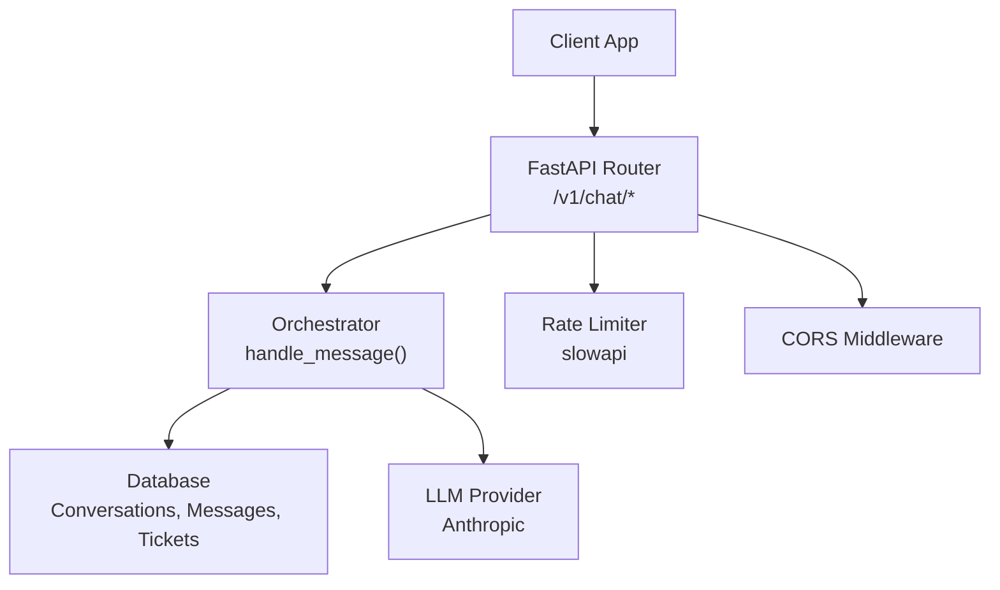
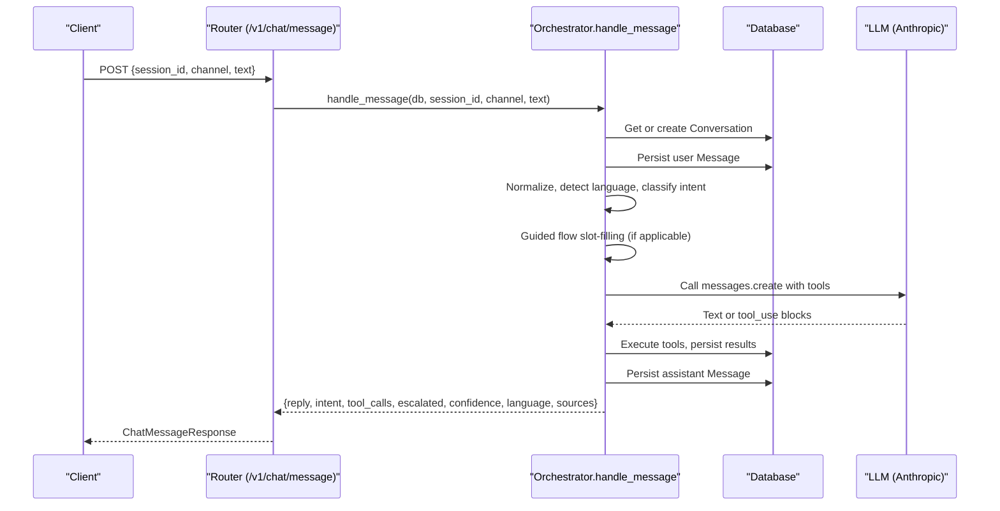
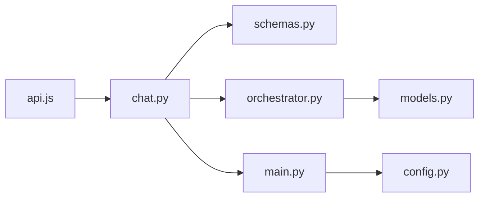

# Chat API

<cite>
**Referenced Files in This Document**
- [chat.py](file://uaea-backend/app/api/chat.py)
- [schemas.py](file://uaea-backend/app/schemas.py)
- [main.py](file://uaea-backend/app/main.py)
- [orchestrator.py](file://uaea-backend/app/orchestrator/orchestrator.py)
- [models.py](file://uaea-backend/app/db/models.py)
- [config.py](file://uaea-backend/app/config.py)
- [api.js](file://src/lib/api.js)
</cite>

## Table of Contents
1. [Introduction](#introduction)
2. [Project Structure](#project-structure)
3. [Core Components](#core-components)
4. [Architecture Overview](#architecture-overview)
5. [Detailed Component Analysis](#detailed-component-analysis)
6. [Dependency Analysis](#dependency-analysis)
7. [Performance Considerations](#performance-considerations)
8. [Troubleshooting Guide](#troubleshooting-guide)
9. [Conclusion](#conclusion)
10. [Appendices](#appendices)

## Introduction
This document provides comprehensive API documentation for the Chat API endpoints that power real-time student assistance. It covers:
- POST /v1/chat/message: Send a chat message and receive an AI response with metadata, tool calls, and escalation flags.
- GET /v1/chat/session/{session_id}: Retrieve conversation history including messages and session metadata.
- POST /v1/chat/escalate: Create an escalation ticket from an active conversation.

It includes request/response schemas, authentication notes, error handling, rate limiting, input validation, security considerations, and client integration guidance for building robust chat experiences.

## Project Structure
The Chat API is implemented in the FastAPI backend under uaea-backend/app/api/chat.py and uses Pydantic schemas defined in app/schemas.py. The orchestrator in app/orchestrator/orchestrator.py processes each message through normalization, intent classification, guided flows, LLM tool use, guardrails, and persistence. Database models are defined in app/db/models.py. Rate limiting and CORS are configured in app/main.py, and environment settings (including rate limits and keys) are managed via app/config.py. The frontend client utilities in src/lib/api.js demonstrate how to call these endpoints from the UI.

**Diagram sources**
- [chat.py:18-115](file://uaea-backend/app/api/chat.py#L18-L115)
- [orchestrator.py:46-143](file://uaea-backend/app/orchestrator/orchestrator.py#L46-L143)
- [main.py:47-79](file://uaea-backend/app/main.py#L47-L79)
- [models.py:144-195](file://uaea-backend/app/db/models.py#L144-L195)

**Section sources**
- [chat.py:1-115](file://uaea-backend/app/api/chat.py#L1-L115)
- [schemas.py:81-122](file://uaea-backend/app/schemas.py#L81-L122)
- [main.py:1-104](file://uaea-backend/app/main.py#L1-L104)
- [orchestrator.py:1-405](file://uaea-backend/app/orchestrator/orchestrator.py#L1-L405)
- [models.py:144-195](file://uaea-backend/app/db/models.py#L144-L195)
- [config.py:1-38](file://uaea-backend/app/config.py#L1-L38)
- [api.js:1-169](file://src/lib/api.js#L1-L169)

## Core Components
- ChatMessageRequest: Identifies the session, channel, and message text.
- ChatMessageResponse: Returns assistant reply, detected intent, confidence, language, tool calls, escalation flag, and source references.
- SessionOut: Returns session metadata and ordered messages for retrieval.
- EscalateRequest/EscalateResponse: Creates and returns an escalation ticket for an active conversation.

These schemas enforce field types and defaults, ensuring consistent payloads across requests and responses.

**Section sources**
- [schemas.py:81-122](file://uaea-backend/app/schemas.py#L81-L122)

## Architecture Overview
The message flow:
- Client sends a POST /v1/chat/message with session_id, channel, and text.
- The router validates the request using ChatMessageRequest and delegates to handle_message.
- Orchestrator normalizes input, classifies intent, manages guided flows, calls LLM tools, applies guardrails, persists user and assistant messages, and tracks unanswered queries when confidence is low.
- Response includes reply, intent, tool_calls, escalated flag, confidence, language, and sources.

**Diagram sources**
- [chat.py:21-39](file://uaea-backend/app/api/chat.py#L21-L39)
- [orchestrator.py:46-143](file://uaea-backend/app/orchestrator/orchestrator.py#L46-L143)
- [models.py:144-178](file://uaea-backend/app/db/models.py#L144-L178)

## Detailed Component Analysis

### Endpoint: POST /v1/chat/message
- Purpose: Send a chat message and receive an AI response with metadata.
- Request body schema:
  - session_id: string (required)
  - channel: string (default "web")
  - text: string (required)
- Response schema:
  - reply: string
  - intent: string | null
  - tool_calls: list of {name, args?, result?}
  - escalated: boolean (default false)
  - confidence: float (default 0.0)
  - language: string (default "en")
  - sources: list of dicts (e.g., {tool, source}, {tool, source, section})
- Authentication: Not required by this endpoint. Admin endpoints require X-API-Key; chat endpoints do not.
- Error handling:
  - Validation errors return 422 (Pydantic).
  - Internal errors may return 500 if unhandled exceptions occur.
  - Rate limit exceeded returns 429 with detail.
- Input validation rules:
  - text must be present and non-empty after trimming.
  - Input sanitization and language detection are performed server-side.
- Security considerations:
  - Input is sanitized against injection before processing.
  - Guardrails applied to assistant replies.
  - No secrets in request/response payloads.
- Rate limiting:
  - Global per-IP limiter enabled; per-session limiter placeholder exists in middleware.
- Streaming:
  - This endpoint returns a single JSON response. For streaming, implement SSE or WebSocket on top of this flow.

Example request payload:
{
  "session_id": "sess_abc123",
  "channel": "web",
  "text": "What is the fee for BS Computer Science?"
}

Example success response:
{
  "reply": "The current fee for BS Computer Science is PKR 120,000 per semester, verified on 2025-01-15.",
  "intent": "fee_inquiry",
  "tool_calls": [{"name": "get_fee_tariff", "args": {"program": "BS Computer Science"}, "result": {...}}],
  "escalated": false,
  "confidence": 0.92,
  "language": "en",
  "sources": [{"tool": "get_fee_tariff", "source": "fee_policy_v3.pdf"}]
}

Common error scenarios:
- 422: Missing or invalid fields in request body.
- 429: Rate limit exceeded.
- 500: Unexpected server error.

Integration notes:
- Use the provided client function chatMessage(sessionId, text, channel) to send messages.
- Handle thinking states locally while awaiting the response.
- Display tool_calls and sources to show provenance and actions taken.

**Section sources**
- [chat.py:21-39](file://uaea-backend/app/api/chat.py#L21-L39)
- [schemas.py:81-100](file://uaea-backend/app/schemas.py#L81-L100)
- [orchestrator.py:46-143](file://uaea-backend/app/orchestrator/orchestrator.py#L46-L143)
- [main.py:51-58](file://uaea-backend/app/main.py#L51-L58)
- [api.js:42-47](file://src/lib/api.js#L42-L47)

### Endpoint: GET /v1/chat/session/{session_id}
- Purpose: Retrieve full conversation history for a session.
- Path parameter:
  - session_id: string (required)
- Response schema:
  - id: string (conversation id)
  - session_id: string
  - channel: string
  - started_at: datetime
  - resolved: boolean
  - escalated: boolean
  - messages: list of message objects with id, role, text, intent, tool_calls, feedback, created_at
- Error handling:
  - 404: Session not found.
  - 422: Invalid session_id format (if enforced by framework).
  - 429: Rate limit exceeded.
- Data model mapping:
  - Messages include role (user, assistant, tool), optional intent, tool_calls, feedback, and timestamps.

Example success response:
{
  "id": "conv_xxx",
  "session_id": "sess_abc123",
  "channel": "web",
  "started_at": "2025-01-15T10:00:00Z",
  "resolved": false,
  "escalated": false,
  "messages": [
    {"id": "m1", "role": "user", "text": "Fee for BS CS?", "intent": "fee_inquiry", "tool_calls": [], "feedback": null, "created_at": "2025-01-15T10:00:01Z"},
    {"id": "m2", "role": "assistant", "text": "PKR 120,000...", "intent": "fee_inquiry", "tool_calls": [...], "feedback": null, "created_at": "2025-01-15T10:00:05Z"}
  ]
}

Common error scenarios:
- 404: No active conversation for the given session_id.
- 429: Rate limit exceeded.

Integration notes:
- Use getSession(sessionId) to load history on page open or resume a conversation.
- Render messages in chronological order; tool_calls can be expanded for auditability.

**Section sources**
- [chat.py:42-85](file://uaea-backend/app/api/chat.py#L42-L85)
- [schemas.py:113-122](file://uaea-backend/app/schemas.py#L113-L122)
- [models.py:144-178](file://uaea-backend/app/db/models.py#L144-L178)
- [api.js:54-56](file://src/lib/api.js#L54-L56)

### Endpoint: POST /v1/chat/escalate
- Purpose: Create an escalation ticket for an active conversation.
- Request body schema:
  - session_id: string (required)
  - reason: string (required)
- Response schema:
  - ticket_id: string
  - status: string (default "open")
- Error handling:
  - 404: No active conversation for this session.
  - 422: Missing or invalid fields.
  - 429: Rate limit exceeded.
- Behavior:
  - Finds the latest unresolved conversation for session_id.
  - Creates an EscalationTicket with status "open".
  - Marks conversation as escalated.

Example request payload:
{
  "session_id": "sess_abc123",
  "reason": "Student requires human assistance for fee dispute."
}

Example success response:
{
  "ticket_id": "ticket_xyz",
  "status": "open"
}

Common error scenarios:
- 404: Active conversation not found.
- 422: Validation error.
- 429: Rate limit exceeded.

Integration notes:
- Use escalate(sessionId, reason) to submit escalations.
- After creation, update UI to reflect escalation state and provide next steps.

**Section sources**
- [chat.py:88-115](file://uaea-backend/app/api/chat.py#L88-L115)
- [schemas.py:103-111](file://uaea-backend/app/schemas.py#L103-L111)
- [models.py:183-195](file://uaea-backend/app/db/models.py#L183-L195)
- [api.js:64-69](file://src/lib/api.js#L64-L69)

## Dependency Analysis
The Chat API depends on:
- Schemas for validation and serialization.
- Orchestrator for end-to-end message processing.
- Database models for conversations, messages, and tickets.
- Configuration for rate limits, CORS, and API keys.
- Frontend client utilities for calling endpoints.

**Diagram sources**
- [chat.py:1-115](file://uaea-backend/app/api/chat.py#L1-L115)
- [schemas.py:81-122](file://uaea-backend/app/schemas.py#L81-L122)
- [orchestrator.py:46-143](file://uaea-backend/app/orchestrator/orchestrator.py#L46-L143)
- [models.py:144-195](file://uaea-backend/app/db/models.py#L144-L195)
- [main.py:47-79](file://uaea-backend/app/main.py#L47-L79)
- [config.py:20-32](file://uaea-backend/app/config.py#L20-L32)
- [api.js:42-69](file://src/lib/api.js#L42-L69)

**Section sources**
- [chat.py:1-115](file://uaea-backend/app/api/chat.py#L1-L115)
- [schemas.py:81-122](file://uaea-backend/app/schemas.py#L81-L122)
- [orchestrator.py:46-143](file://uaea-backend/app/orchestrator/orchestrator.py#L46-L143)
- [models.py:144-195](file://uaea-backend/app/db/models.py#L144-L195)
- [main.py:47-79](file://uaea-backend/app/main.py#L47-L79)
- [config.py:20-32](file://uaea-backend/app/config.py#L20-L32)
- [api.js:42-69](file://src/lib/api.js#L42-L69)

## Performance Considerations
- LLM rounds: The orchestrator limits tool-call loops to a maximum number of rounds to prevent excessive latency and cost.
- Message history: Only recent messages are sent to the LLM to reduce context size and improve performance.
- Database queries: Efficient selection of the latest conversation and ordered message retrieval.
- Rate limiting: Per-IP limiter protects against abuse; consider enabling per-session limiting for high-volume clients.
- Caching: Introduce caching for repeated lookups (e.g., fees, deadlines) to reduce LLM/tool calls.
- Backpressure: Implement client-side retries with exponential backoff for transient failures.

[No sources needed since this section provides general guidance]

## Troubleshooting Guide
Common issues and resolutions:
- 422 Validation Error: Ensure session_id and text are present and correctly typed. Check channel default behavior.
- 404 Session Not Found: Verify session_id corresponds to an existing active conversation. Use GET /v1/chat/session/{session_id} to inspect.
- 429 Rate Limit Exceeded: Reduce request frequency or adjust rate_limit_per_ip in configuration.
- LLM Errors: If the LLM provider is unreachable, the orchestrator returns a graceful fallback message; retry later.
- Low Confidence: Unanswered queries are tracked; review analytics to improve knowledge base or routing.

Operational checks:
- Health endpoint: GET /health returns service status.
- Logs: Inspect application logs for orchestrator and database errors.

**Section sources**
- [main.py:51-58](file://uaea-backend/app/main.py#L51-L58)
- [chat.py:42-85](file://uaea-backend/app/api/chat.py#L42-L85)
- [orchestrator.py:229-318](file://uaea-backend/app/orchestrator/orchestrator.py#L229-L318)
- [main.py:84-86](file://uaea-backend/app/main.py#L84-L86)

## Conclusion
The Chat API provides a robust, secure, and scalable foundation for real-time student assistance. Endpoints support message sending, conversation retrieval, and escalation workflows with clear schemas, error handling, and rate limiting. Clients should manage session state, handle errors gracefully, and leverage tool_calls and sources to enhance transparency and trust.

[No sources needed since this section summarizes without analyzing specific files]

## Appendices

### Client Integration Guidelines
- Base URL: Configure via VITE_API_URL or default to localhost:8000.
- Sending messages:
  - Use chatMessage(sessionId, text, channel) to post messages.
  - Show a thinking indicator while awaiting response.
  - Display reply, tool_calls, and sources for provenance.
- Retrieving history:
  - Use getSession(sessionId) to load conversation history on resume.
  - Render messages chronologically; expand tool_calls as needed.
- Escalations:
  - Use escalate(sessionId, reason) to create tickets.
  - Update UI to reflect escalation status and guide next steps.
- Real-time enhancements:
  - For streaming, implement Server-Sent Events or WebSockets on top of the orchestrator’s handle_message loop.
  - Emit incremental updates for tool execution and final reply.
- State management:
  - Maintain session_id per conversation thread.
  - Persist last seen messages to avoid duplicates.
  - Handle offline scenarios with local queueing and retry logic.

**Section sources**
- [api.js:12-69](file://src/lib/api.js#L12-L69)
- [orchestrator.py:46-143](file://uaea-backend/app/orchestrator/orchestrator.py#L46-L143)

### Rate Limiting Policies
- Global per-IP limiter: Enabled via slowapi; returns 429 when exceeded.
- Per-session limiter: Placeholder in middleware; can be enabled to restrict per-session message rates.
- Configuration: Adjust rate_limit_per_ip and rate_limit_per_session in settings.

**Section sources**
- [main.py:25-58](file://uaea-backend/app/main.py#L25-L58)
- [config.py:23-25](file://uaea-backend/app/config.py#L23-L25)

### Security Considerations
- Input sanitization: Strip injection attempts before processing.
- Guardrails: Apply content filters to assistant replies.
- Secrets: Do not expose API keys in client code; keep them server-side.
- CORS: Configure allowed origins appropriately for production.

**Section sources**
- [orchestrator.py:56-59](file://uaea-backend/app/orchestrator/orchestrator.py#L56-L59)
- [orchestrator.py:98-100](file://uaea-backend/app/orchestrator/orchestrator.py#L98-L100)
- [main.py:61-73](file://uaea-backend/app/main.py#L61-L73)
- [config.py:20-21](file://uaea-backend/app/config.py#L20-L21)