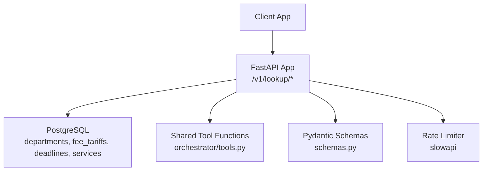
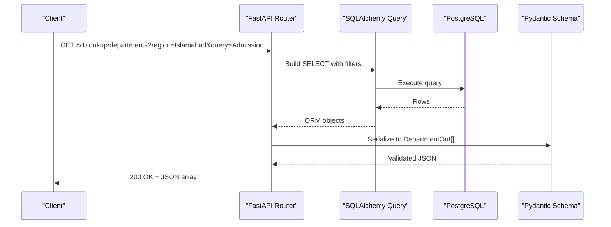
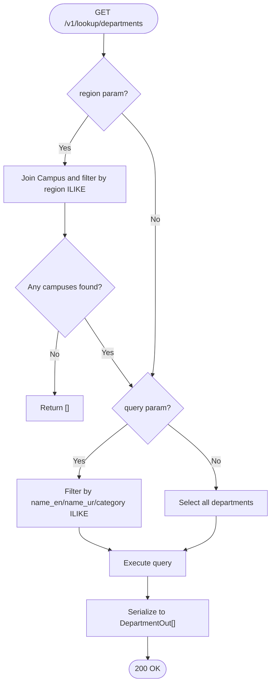
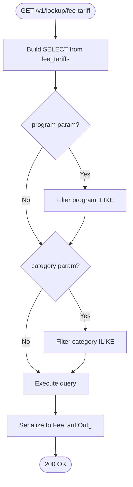
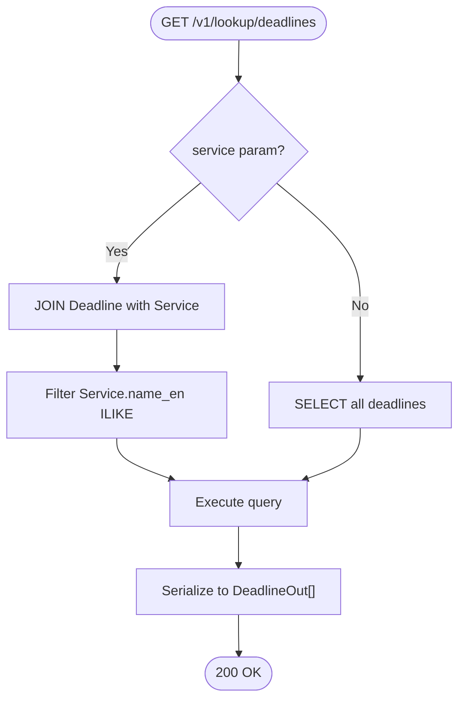
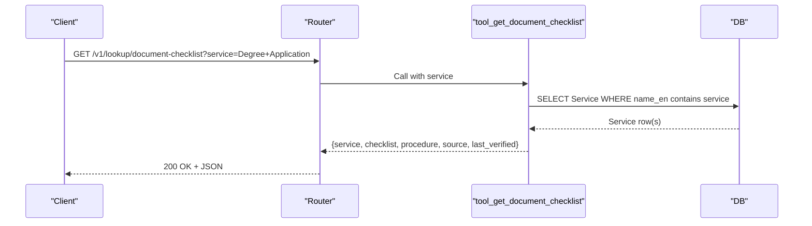
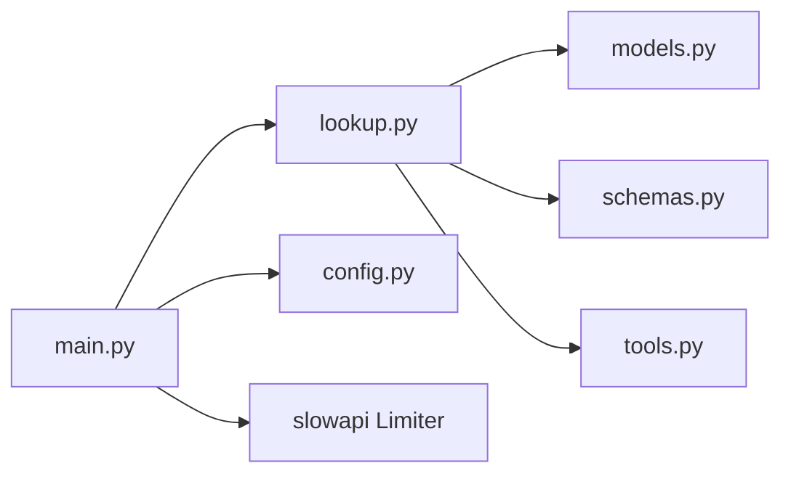

# Lookup API

<cite>
**Referenced Files in This Document**
- [lookup.py](file://uaea-backend/app/api/lookup.py)
- [schemas.py](file://uaea-backend/app/schemas.py)
- [models.py](file://uaea-backend/app/db/models.py)
- [main.py](file://uaea-backend/app/main.py)
- [config.py](file://uaea-backend/app/config.py)
- [tools.py](file://uaea-backend/app/orchestrator/tools.py)
- [api.js](file://src/lib/api.js)
- [test_lookup_api.py](file://uaea-backend/tests/test_lookup_api.py)
- [README.md](file://uaea-backend/README.md)
</cite>

## Table of Contents
1. [Introduction](#introduction)
2. [Project Structure](#project-structure)
3. [Core Components](#core-components)
4. [Architecture Overview](#architecture-overview)
5. [Detailed Component Analysis](#detailed-component-analysis)
6. [Dependency Analysis](#dependency-analysis)
7. [Performance Considerations](#performance-considerations)
8. [Troubleshooting Guide](#troubleshooting-guide)
9. [Conclusion](#conclusion)
10. [Appendices](#appendices)

## Introduction
This document provides comprehensive API documentation for the Lookup API endpoints used for data retrieval operations related to university services, departments, fee structures, and deadlines. It covers query parameters, filtering options, response schemas, integration examples from the frontend client, caching strategies, performance considerations, rate limiting, data freshness indicators, versioning, and fallback mechanisms.

The Lookup API is a public FastAPI router under /v1/lookup that exposes read-only endpoints backed by PostgreSQL via SQLAlchemy async queries. The same underlying tools are also used internally by the LLM orchestrator, ensuring consistency between chat-driven flows and direct API usage.

## Project Structure
The Lookup API lives in the backend FastAPI application:
- Router and endpoints: uaea-backend/app/api/lookup.py
- Response schemas: uaea-backend/app/schemas.py
- Data models: uaea-backend/app/db/models.py
- Application setup (CORS, rate limiting, routers): uaea-backend/app/main.py
- Configuration (rate limits, CORS origins): uaea-backend/app/config.py
- Shared tool implementations (used by both chat and lookup): uaea-backend/app/orchestrator/tools.py
- Frontend client helpers: src/lib/api.js
- Tests validating behavior: uaea-backend/tests/test_lookup_api.py
- Documentation overview and examples: uaea-backend/README.md

**Diagram sources**
- [lookup.py:1-23](file://uaea-backend/app/api/lookup.py#L1-L23)
- [main.py:40-79](file://uaea-backend/app/main.py#L40-L79)
- [models.py:55-121](file://uaea-backend/app/db/models.py#L55-L121)
- [schemas.py:30-77](file://uaea-backend/app/schemas.py#L30-L77)
- [tools.py:92-197](file://uaea-backend/app/orchestrator/tools.py#L92-L197)

**Section sources**
- [lookup.py:1-23](file://uaea-backend/app/api/lookup.py#L1-L23)
- [main.py:40-79](file://uaea-backend/app/main.py#L40-L79)
- [README.md:77-103](file://uaea-backend/README.md#L77-L103)

## Core Components
- Endpoints:
  - GET /v1/lookup/departments — list or filter departments by region and search query
  - GET /v1/lookup/fee-tariff — list or filter fee tariffs by program and category
  - GET /v1/lookup/deadlines — list deadlines, optionally filtered by service name
  - GET /v1/lookup/document-checklist — get checklist for a specific service (service required)
- Schemas define structured responses for each endpoint, including nested campus/contact info and timestamps where applicable.
- Database models define tables and relationships used by the endpoints.
- Shared tools implement consistent logic for lookups across chat and API contexts.

**Section sources**
- [lookup.py:26-103](file://uaea-backend/app/api/lookup.py#L26-L103)
- [schemas.py:30-77](file://uaea-backend/app/schemas.py#L30-L77)
- [models.py:55-121](file://uaea-backend/app/db/models.py#L55-L121)
- [tools.py:92-197](file://uaea-backend/app/orchestrator/tools.py#L92-L197)

## Architecture Overview
The Lookup API uses FastAPI routers with async SQLAlchemy queries against PostgreSQL. Responses are validated and serialized using Pydantic schemas. Rate limiting is enforced at the application level per IP address. The same tool functions are reused by the LLM orchestrator to ensure consistent results.

**Diagram sources**
- [lookup.py:26-53](file://uaea-backend/app/api/lookup.py#L26-L53)
- [schemas.py:30-38](file://uaea-backend/app/schemas.py#L30-L38)
- [models.py:55-69](file://uaea-backend/app/db/models.py#L55-L69)

**Section sources**
- [lookup.py:26-53](file://uaea-backend/app/api/lookup.py#L26-L53)
- [schemas.py:30-38](file://uaea-backend/app/schemas.py#L30-L38)
- [models.py:55-69](file://uaea-backend/app/db/models.py#L55-L69)

## Detailed Component Analysis

### Endpoint: GET /v1/lookup/departments
- Purpose: List departments, optionally filtered by region or search query.
- Query Parameters:
  - region (optional): Filters departments by campus region using case-insensitive substring match.
  - query (optional): Searches department names (English and Urdu) and category using case-insensitive substring match.
- Filtering Logic:
  - If region provided, joins Campus table and filters by region substring; returns empty if no matching campuses found.
  - If query provided, applies ILIKE filters on name_en, name_ur, and category fields.
- Sorting: Not implemented server-side. Clients should sort locally if needed.
- Pagination: Not implemented server-side. Clients should paginate locally.
- Response: Array of DepartmentOut objects including nested CampusOut and ContactOut when available.
- Error Handling: Returns empty array when region filter yields no campuses; otherwise standard 200 OK.

**Diagram sources**
- [lookup.py:26-53](file://uaea-backend/app/api/lookup.py#L26-L53)
- [models.py:43-69](file://uaea-backend/app/db/models.py#L43-L69)

**Section sources**
- [lookup.py:26-53](file://uaea-backend/app/api/lookup.py#L26-L53)
- [models.py:43-69](file://uaea-backend/app/db/models.py#L43-L69)
- [schemas.py:21-38](file://uaea-backend/app/schemas.py#L21-L38)
- [test_lookup_api.py:8-38](file://uaea-backend/tests/test_lookup_api.py#L8-L38)

### Endpoint: GET /v1/lookup/fee-tariff
- Purpose: List fee tariffs, optionally filtered by program and category.
- Query Parameters:
  - program (optional): Case-insensitive substring match on program field.
  - category (optional): Case-insensitive substring match on category field.
- Filtering Logic: Applies ILIKE filters independently for program and category.
- Sorting: Not implemented server-side.
- Pagination: Not implemented server-side.
- Response: Array of FeeTariffOut objects including effective_from date and optional source reference.
- Error Handling: Returns empty array if no matches; otherwise standard 200 OK.

**Diagram sources**
- [lookup.py:56-71](file://uaea-backend/app/api/lookup.py#L56-L71)
- [models.py:73-82](file://uaea-backend/app/db/models.py#L73-L82)

**Section sources**
- [lookup.py:56-71](file://uaea-backend/app/api/lookup.py#L56-L71)
- [models.py:73-82](file://uaea-backend/app/db/models.py#L73-L82)
- [schemas.py:40-48](file://uaea-backend/app/schemas.py#L40-L48)
- [test_lookup_api.py:41-63](file://uaea-backend/tests/test_lookup_api.py#L41-L63)

### Endpoint: GET /v1/lookup/deadlines
- Purpose: List deadlines, optionally filtered by service name.
- Query Parameters:
  - service (optional): Case-insensitive substring match on Service.name_en via join.
- Filtering Logic: Joins Deadline with Service and filters by service name substring; returns all deadlines if no service provided.
- Sorting: Not implemented server-side.
- Pagination: Not implemented server-side.
- Response: Array of DeadlineOut objects including service_id, semester, date, and optional source reference.
- Error Handling: Returns empty array if no matches; otherwise standard 200 OK.

**Diagram sources**
- [lookup.py:74-90](file://uaea-backend/app/api/lookup.py#L74-L90)
- [models.py:108-121](file://uaea-backend/app/db/models.py#L108-L121)

**Section sources**
- [lookup.py:74-90](file://uaea-backend/app/api/lookup.py#L74-L90)
- [models.py:108-121](file://uaea-backend/app/db/models.py#L108-L121)
- [schemas.py:70-77](file://uaea-backend/app/schemas.py#L70-L77)
- [test_lookup_api.py:65-82](file://uaea-backend/tests/test_lookup_api.py#L65-L82)

### Endpoint: GET /v1/lookup/document-checklist
- Purpose: Get the document checklist for a specific service.
- Query Parameters:
  - service (required): Exact or substring match on Service.name_en.
- Behavior: Uses shared tool function to find service and return checklist items, procedure text, source reference, and last verified timestamp.
- Sorting: N/A (returns single service object).
- Pagination: N/A.
- Response: Object containing service name, checklist array, procedure text, source reference, and last_verified timestamp.
- Error Handling: Returns error object if service not found.

**Diagram sources**
- [lookup.py:93-103](file://uaea-backend/app/api/lookup.py#L93-L103)
- [tools.py:181-197](file://uaea-backend/app/orchestrator/tools.py#L181-L197)
- [models.py:86-104](file://uaea-backend/app/db/models.py#L86-L104)

**Section sources**
- [lookup.py:93-103](file://uaea-backend/app/api/lookup.py#L93-L103)
- [tools.py:181-197](file://uaea-backend/app/orchestrator/tools.py#L181-L197)
- [models.py:86-104](file://uaea-backend/app/db/models.py#L86-L104)
- [test_lookup_api.py:84-103](file://uaea-backend/tests/test_lookup_api.py#L84-L103)

### Request/Response Examples
- Departments:
  - List all: GET /v1/lookup/departments
  - Filter by region: GET /v1/lookup/departments?region=Islamabad
  - Search by query: GET /v1/lookup/departments?query=Admission
- Fee Tariffs:
  - List all: GET /v1/lookup/fee-tariff
  - Filter by program: GET /v1/lookup/fee-tariff?program=BS+Computer+Science
  - Filter by category: GET /v1/lookup/fee-tariff?category=Semester+%28new%29
- Deadlines:
  - List all: GET /v1/lookup/deadlines
  - Filter by service: GET /v1/lookup/deadlines?service=Admission
- Document Checklist:
  - Required service: GET /v1/lookup/document-checklist?service=Degree+Application

These examples align with tests and README examples.

**Section sources**
- [test_lookup_api.py:8-103](file://uaea-backend/tests/test_lookup_api.py#L8-L103)
- [README.md:107-154](file://uaea-backend/README.md#L107-L154)

### Integration Examples (Frontend)
The frontend client exposes helper functions for each endpoint:
- getDepartments(params) — supports region and query
- getFeeTariffs(params) — supports program and category
- getDeadlines(params) — supports service
- getDocumentChecklist(service) — requires service

Usage pattern:
- Construct params object and pass to helper
- Handle Promise resolution and errors via try/catch
- Use returned arrays/objects to render UI components

Example scenarios:
- Search by category: call getDepartments({ query: "Admissions" })
- Filter by campus location: call getDepartments({ region: "Islamabad" })
- Load deadlines for a service: call getDeadlines({ service: "Admission" })
- Fetch checklist: call getDocumentChecklist("Degree Application")

**Section sources**
- [api.js:71-106](file://src/lib/api.js#L71-L106)
- [test_lookup_api.py:8-103](file://uaea-backend/tests/test_lookup_api.py#L8-L103)

## Dependency Analysis
- Router depends on:
  - SQLAlchemy models for Department, FeeTariff, Deadline, Service, Campus
  - Pydantic schemas for response validation
  - Shared tool functions for document checklist
- Application-level dependencies:
  - Rate limiter configured via slowapi
  - CORS middleware enabled based on settings
  - Health check endpoint for service status

**Diagram sources**
- [lookup.py:1-23](file://uaea-backend/app/api/lookup.py#L1-L23)
- [main.py:40-79](file://uaea-backend/app/main.py#L40-L79)
- [config.py:20-25](file://uaea-backend/app/config.py#L20-L25)

**Section sources**
- [lookup.py:1-23](file://uaea-backend/app/api/lookup.py#L1-L23)
- [main.py:40-79](file://uaea-backend/app/main.py#L40-L79)
- [config.py:20-25](file://uaea-backend/app/config.py#L20-L25)

## Performance Considerations
- Server-side sorting and pagination are not implemented; clients should handle local sorting and pagination for large result sets.
- Queries use ILIKE for substring matching which can be slower on large datasets; consider adding database indexes on frequently filtered columns if needed.
- No built-in caching layer; consider implementing client-side caching or reverse proxy caching for high-frequency lookups.
- Rate limiting is enforced per IP address via slowapi; default limit is configurable via environment variables.

[No sources needed since this section provides general guidance]

## Troubleshooting Guide
- Common issues:
  - Empty results: Ensure query parameters match expected substrings; verify data exists in database.
  - Rate limit exceeded: Client receives 429 with detail message; reduce request frequency or adjust rate limits.
  - Missing service: For document-checklist, ensure service name matches exactly or use substring matching supported by the endpoint.
- Debugging steps:
  - Use health endpoint to verify service availability.
  - Test endpoints directly with curl or browser to isolate client issues.
  - Review logs for SQL execution and errors.

**Section sources**
- [main.py:51-58](file://uaea-backend/app/main.py#L51-L58)
- [test_lookup_api.py:106-112](file://uaea-backend/tests/test_lookup_api.py#L106-L112)

## Conclusion
The Lookup API provides straightforward, filterable endpoints for retrieving departments, fee tariffs, deadlines, and document checklists. While it lacks server-side sorting and pagination, it offers robust filtering via substring matching and integrates seamlessly with the frontend client. Rate limiting and CORS are configured at the application level, and shared tool functions ensure consistency with chat-driven flows. For high-frequency scenarios, consider implementing client-side caching and monitoring query performance.

[No sources needed since this section summarizes without analyzing specific files]

## Appendices

### Data Freshness Indicators
- Services include a last_verified_at timestamp indicating when the record was last verified.
- Deadlines and fee tariffs include effective dates and source references to trace data provenance.

**Section sources**
- [models.py:86-104](file://uaea-backend/app/db/models.py#L86-L104)
- [schemas.py:56-77](file://uaea-backend/app/schemas.py#L56-L77)

### Versioning Considerations
- The API is versioned under /v1; maintain backward compatibility when extending endpoints.
- Schemas are defined explicitly to ensure consistent responses.

**Section sources**
- [lookup.py:1-23](file://uaea-backend/app/api/lookup.py#L1-L23)
- [schemas.py:1-77](file://uaea-backend/app/schemas.py#L1-L77)

### Fallback Mechanisms
- When region filter yields no campuses, the departments endpoint returns an empty array.
- Document checklist endpoint returns an error object if service not found.
- Shared tools provide fallback matching logic for fees and deadlines.

**Section sources**
- [lookup.py:35-43](file://uaea-backend/app/api/lookup.py#L35-L43)
- [tools.py:155-197](file://uaea-backend/app/orchestrator/tools.py#L155-L197)