# Admin Console

<cite>
**Referenced Files in This Document**
- [App.jsx](file://src/App.jsx)
- [AppShell.jsx](file://src/components/layout/AppShell.jsx)
- [Dashboard/index.jsx](file://src/pages/Dashboard/index.jsx)
- [FreshnessPanel.jsx](file://src/pages/Dashboard/FreshnessPanel.jsx)
- [ContentLibrary/index.jsx](file://src/pages/ContentLibrary/index.jsx)
- [Conversations/index.jsx](file://src/pages/Conversations/index.jsx)
- [Transcript.jsx](file://src/pages/Conversations/Transcript.jsx)
- [GuidedFlows/index.jsx](file://src/pages/GuidedFlows/index.jsx)
- [FlowCanvas.jsx](file://src/pages/GuidedFlows/FlowCanvas.jsx)
- [StepEditor.jsx](file://src/pages/GuidedFlows/StepEditor.jsx)
- [FlowSimulator.jsx](file://src/pages/GuidedFlows/FlowSimulator.jsx)
- [Guardrails/index.jsx](file://src/pages/Guardrails/index.jsx)
- [Integrations/index.jsx](file://src/pages/Integrations/index.jsx)
- [AuditLog/index.jsx](file://src/pages/AuditLog/index.jsx)
- [AppContext.jsx](file://src/context/AppContext.jsx)
- [rbac.js](file://src/lib/rbac.js)
</cite>

## Table of Contents
1. Introduction
2. Project Structure
3. Core Components
4. Architecture Overview
5. Detailed Component Analysis
6. Dependency Analysis
7. Performance Considerations
8. Troubleshooting Guide
9. Conclusion

## Introduction
This document describes the staff governance console that powers administration, quality assurance, and operational oversight for a student-facing assistant. It covers:
- Dashboard metrics, conversation volume tracking, intent distribution, freshness, and guardrail interventions
- Content management for services, fee tariffs, deadlines, and departments
- Conversation monitoring with transcript viewing and tool call inspection
- Guided flow builder with visual editor, step validation, and simulation
- Quality assurance features including freshness tracking, audit logging, and verification workflows
- Integration management and guardrail configuration
- Role-based access control, change impact analysis, and bulk operations

## Project Structure
The console is a React application with a dual entry strategy: a student shell at the root and an admin shell under /admin. The App component wires routes to pages such as Dashboard, Content Library, Conversations, Guided Flows, Guardrails, Integrations, and Audit Log. The AppShell provides chrome (sidebar, topbar, command palette) and mounts page content via Outlet.

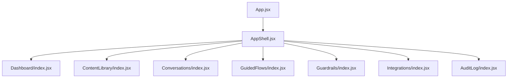

**Diagram sources**
- [App.jsx:34-64](file://src/App.jsx#L34-L64)
- [AppShell.jsx:14-48](file://src/components/layout/AppShell.jsx#L14-L48)

**Section sources**
- [App.jsx:34-64](file://src/App.jsx#L34-L64)
- [AppShell.jsx:14-48](file://src/components/layout/AppShell.jsx#L14-L48)

## Core Components
- Global state and mutations are centralized in AppContext, which exposes store, mutate, verifyRecord, audit, logAudit, role, and user. All write paths go through mutate to ensure consistent updates and audit entries.
- Role-based access control is enforced via rbac.js using a permissions map and a can helper used across pages to gate UI actions.

Key responsibilities:
- AppContext: single source of truth for catalog data, flows, adapters, and audit log; orchestrates create/update/delete semantics and appends audit entries.
- RBAC: defines roles and permissions; gates UI affordances like editing, publishing, and deleting.

**Section sources**
- [AppContext.jsx:24-103](file://src/context/AppContext.jsx#L24-L103)
- [rbac.js:1-51](file://src/lib/rbac.js#L1-L51)

## Architecture Overview
The console follows a clear separation between UI pages and shared state. Pages read from store and trigger changes via mutate or specific helpers like verifyRecord. Guardrails and integrations configure runtime behavior without touching catalog data directly. Auditing is append-only and attached to every mutation path.

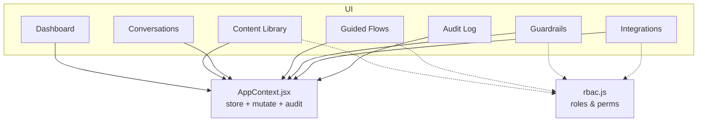

**Diagram sources**
- [AppContext.jsx:24-103](file://src/context/AppContext.jsx#L24-L103)
- [rbac.js:1-51](file://src/lib/rbac.js#L1-L51)

## Detailed Component Analysis

### Dashboard
Provides high-level metrics, conversation volume over time, top intents, catalogue freshness, and recent guardrail interventions. Supports exporting volume data and selecting date ranges. Freshness panel links to the catalogue for overdue items.

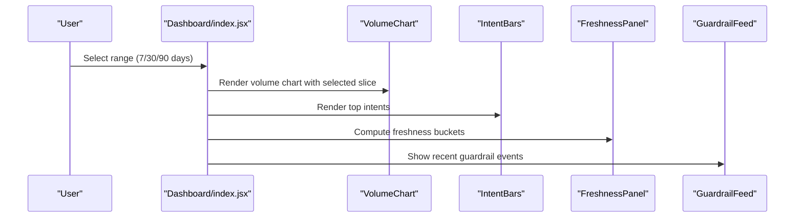

**Diagram sources**
- [Dashboard/index.jsx:23-151](file://src/pages/Dashboard/index.jsx#L23-L151)
- [FreshnessPanel.jsx:16-74](file://src/pages/Dashboard/FreshnessPanel.jsx#L16-L74)

**Section sources**
- [Dashboard/index.jsx:23-151](file://src/pages/Dashboard/index.jsx#L23-L151)
- [FreshnessPanel.jsx:16-74](file://src/pages/Dashboard/FreshnessPanel.jsx#L16-L74)

### Content Management System (Services, Fees, Deadlines, Departments)
A unified table interface with tabs per entity type. Features include search, category filters, freshness filters, sorting, export, add/edit/delete records, bulk verification, and record history. Verification marks a record as checked today by the current user and updates freshness indicators.

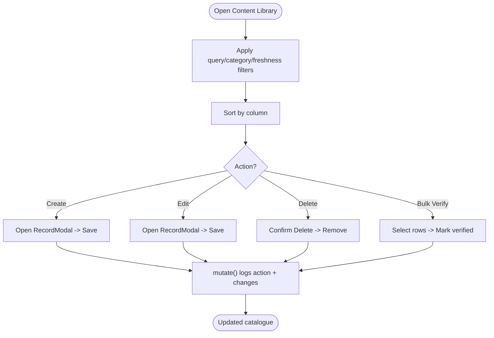

**Diagram sources**
- [ContentLibrary/index.jsx:25-254](file://src/pages/ContentLibrary/index.jsx#L25-L254)
- [AppContext.jsx:69-116](file://src/context/AppContext.jsx#L69-L116)

**Section sources**
- [ContentLibrary/index.jsx:25-254](file://src/pages/ContentLibrary/index.jsx#L25-L254)
- [AppContext.jsx:69-116](file://src/context/AppContext.jsx#L69-L116)

### Conversation Monitoring (Transcripts and Tool Calls)
Lists recent conversations filtered by channel and shows full transcripts with system messages, user turns, assistant responses, and tool calls. Outcome badges indicate resolved, escalated, or unresolved cases.

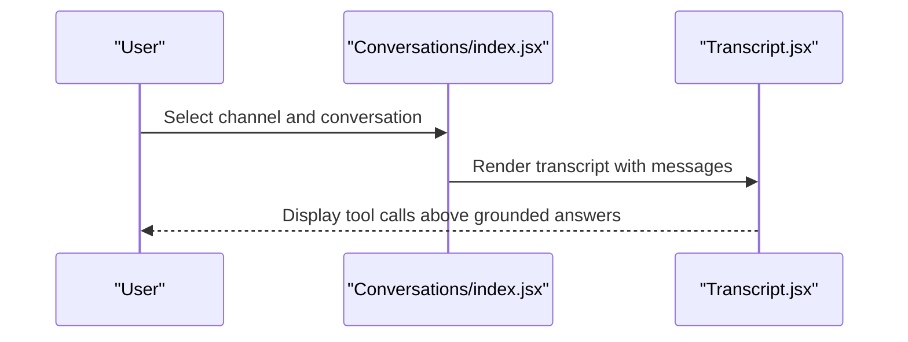

**Diagram sources**
- [Conversations/index.jsx:12-85](file://src/pages/Conversations/index.jsx#L12-L85)
- [Transcript.jsx:11-86](file://src/pages/Conversations/Transcript.jsx#L11-L86)

**Section sources**
- [Conversations/index.jsx:12-85](file://src/pages/Conversations/index.jsx#L12-L85)
- [Transcript.jsx:11-86](file://src/pages/Conversations/Transcript.jsx#L11-L86)

### Guided Flow Builder (Visual Editor, Validation, Simulation)
Manages multi-turn journeys as explicit state machines. The canvas lists steps in order, supports moving, adding, and editing steps, and displays tool calls when present. Publishing is gated by validation checks. The simulator walks through steps, fills slots, and shows tool results.

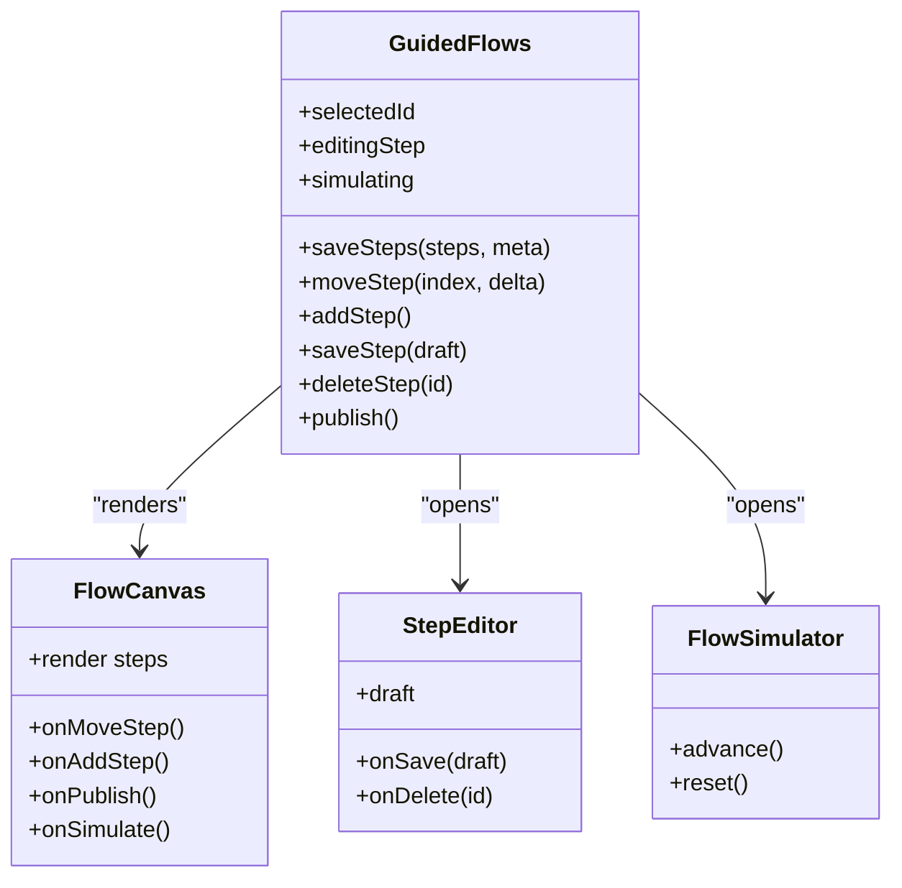

**Diagram sources**
- [GuidedFlows/index.jsx:21-152](file://src/pages/GuidedFlows/index.jsx#L21-L152)
- [FlowCanvas.jsx:16-157](file://src/pages/GuidedFlows/FlowCanvas.jsx#L16-L157)
- [StepEditor.jsx:16-161](file://src/pages/GuidedFlows/StepEditor.jsx#L16-L161)
- [FlowSimulator.jsx:27-160](file://src/pages/GuidedFlows/FlowSimulator.jsx#L27-L160)

Validation and publish flow:

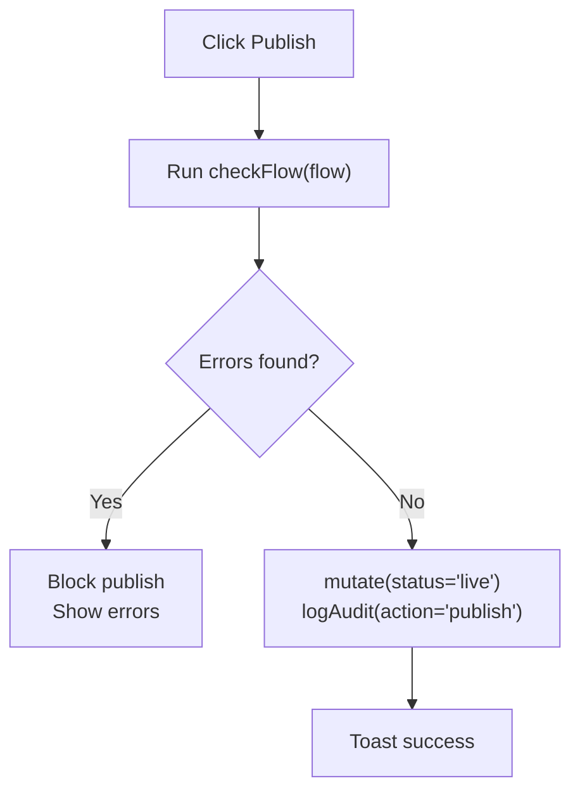

**Diagram sources**
- [GuidedFlows/index.jsx:91-105](file://src/pages/GuidedFlows/index.jsx#L91-L105)
- [FlowCanvas.jsx:26-54](file://src/pages/GuidedFlows/FlowCanvas.jsx#L26-L54)

**Section sources**
- [GuidedFlows/index.jsx:21-152](file://src/pages/GuidedFlows/index.jsx#L21-L152)
- [FlowCanvas.jsx:16-157](file://src/pages/GuidedFlows/FlowCanvas.jsx#L16-L157)
- [StepEditor.jsx:16-161](file://src/pages/GuidedFlows/StepEditor.jsx#L16-L161)
- [FlowSimulator.jsx:27-160](file://src/pages/GuidedFlows/FlowSimulator.jsx#L27-L160)

### Quality Assurance: Freshness, Audit Logging, Verification Workflows
- Freshness: Aggregates verification dates across services, fees, deadlines, and departments to show overall health and list overdue items.
- Audit log: Append-only view of all changes with actor, role, action, table, record, and changes. Exportable to CSV.
- Verification: One-click or bulk marking of records as verified by the current user, updating freshness immediately.

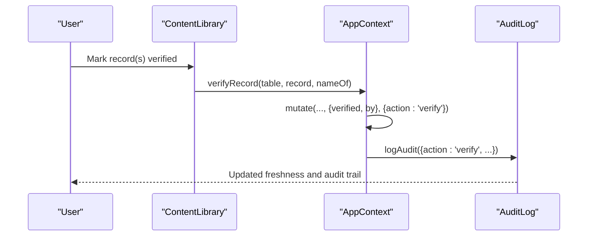

**Diagram sources**
- [FreshnessPanel.jsx:16-74](file://src/pages/Dashboard/FreshnessPanel.jsx#L16-L74)
- [ContentLibrary/index.jsx:81-113](file://src/pages/ContentLibrary/index.jsx#L81-L113)
- [AppContext.jsx:105-116](file://src/context/AppContext.jsx#L105-L116)
- [AuditLog/index.jsx:20-150](file://src/pages/AuditLog/index.jsx#L20-L150)

**Section sources**
- [FreshnessPanel.jsx:16-74](file://src/pages/Dashboard/FreshnessPanel.jsx#L16-L74)
- [ContentLibrary/index.jsx:81-113](file://src/pages/ContentLibrary/index.jsx#L81-L113)
- [AppContext.jsx:105-116](file://src/context/AppContext.jsx#L105-L116)
- [AuditLog/index.jsx:20-150](file://src/pages/AuditLog/index.jsx#L20-L150)

### Integration Management Interface
Displays available adapters, their status, and allows running health checks and switching the active adapter. Changes are audited and immediately affect routing.

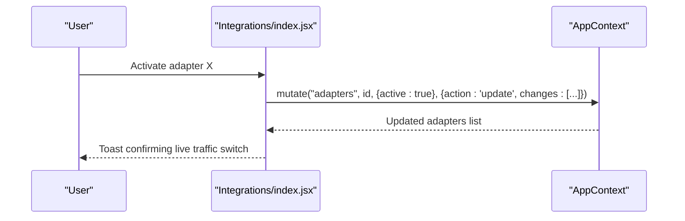

**Diagram sources**
- [Integrations/index.jsx:18-99](file://src/pages/Integrations/index.jsx#L18-L99)
- [AppContext.jsx:69-103](file://src/context/AppContext.jsx#L69-L103)

**Section sources**
- [Integrations/index.jsx:18-99](file://src/pages/Integrations/index.jsx#L18-L99)

### Guardrail Configuration System
Controls answer rules, handover threshold, and model selection. Saving writes an audit entry and applies changes to new conversations immediately.

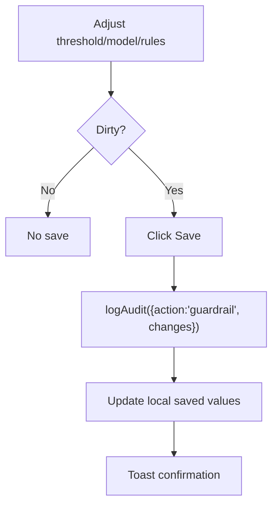

**Diagram sources**
- [Guardrails/index.jsx:17-165](file://src/pages/Guardrails/index.jsx#L17-L165)

**Section sources**
- [Guardrails/index.jsx:17-165](file://src/pages/Guardrails/index.jsx#L17-L165)

### Role-Based Access Control, Change Impact Analysis, and Bulk Operations
- RBAC: Roles and permissions defined centrally; pages use can(role, perm) to enable/disable controls (e.g., writing flows, content, integrations, guardrails).
- Change impact: Every mutation goes through mutate with metadata describing action, record, and field-level changes, enabling precise audit trails and impact review.
- Bulk operations: Content Library supports bulk verification of selected records; each triggers individual verification updates and audit entries.

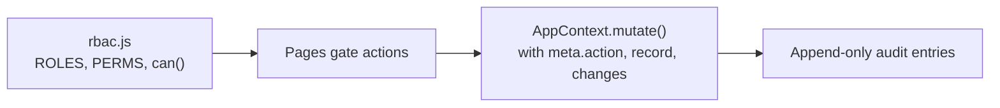

**Diagram sources**
- [rbac.js:1-51](file://src/lib/rbac.js#L1-L51)
- [AppContext.jsx:69-103](file://src/context/AppContext.jsx#L69-L103)

**Section sources**
- [rbac.js:1-51](file://src/lib/rbac.js#L1-L51)
- [AppContext.jsx:69-103](file://src/context/AppContext.jsx#L69-L103)
- [ContentLibrary/index.jsx:87-113](file://src/pages/ContentLibrary/index.jsx#L87-L113)

## Dependency Analysis
- Pages depend on AppContext for data and mutations; they do not touch data directly.
- RBAC is consumed by multiple pages to gate UI affordances.
- Audit logging is invoked indirectly via mutate and explicitly via logAudit for non-mutation events (e.g., guardrail saves).

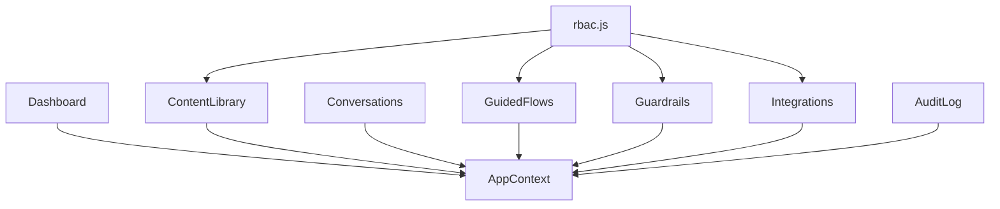

**Diagram sources**
- [AppContext.jsx:24-103](file://src/context/AppContext.jsx#L24-L103)
- [rbac.js:1-51](file://src/lib/rbac.js#L1-L51)

**Section sources**
- [AppContext.jsx:24-103](file://src/context/AppContext.jsx#L24-L103)
- [rbac.js:1-51](file://src/lib/rbac.js#L1-L51)

## Performance Considerations
- Debounced search in Content Library reduces re-renders during typing.
- Skeleton placeholders provide perceived performance during simulated loading states.
- Local state-driven charts avoid unnecessary network calls in Phase 1; future server-backed state should paginate large datasets.
- Avoid deep re-renders by keeping heavy computations memoized where possible (e.g., filtered lists).

[No sources needed since this section provides general guidance]

## Troubleshooting Guide
- Export blocked: If CSV downloads are blocked, try outside sandboxed frames; toasts inform users of browser restrictions.
- Cannot publish flow: Errors returned by flow validation block publishing until fixed; resolve issues shown in the canvas notes.
- Adapter not configured: Health checks surface missing credentials; configure endpoint/service account before activation.
- Guardrails not applying: Ensure dirty state is true and save is clicked; changes are logged and applied to new conversations.

**Section sources**
- [Dashboard/index.jsx:48-65](file://src/pages/Dashboard/index.jsx#L48-L65)
- [GuidedFlows/index.jsx:91-105](file://src/pages/GuidedFlows/index.jsx#L91-L105)
- [Integrations/index.jsx:27-42](file://src/pages/Integrations/index.jsx#L27-L42)
- [Guardrails/index.jsx:44-70](file://src/pages/Guardrails/index.jsx#L44-L70)

## Conclusion
The admin console centralizes governance over content, flows, guardrails, integrations, and quality assurance. Its design emphasizes traceability (audit), safety (validation and guardrails), and clarity (transcripts and freshness). With role-based gating and bulk operations, it supports both day-to-day editorial work and operational oversight while preparing for a server-backed Phase 2 via a stable mutation API seam.