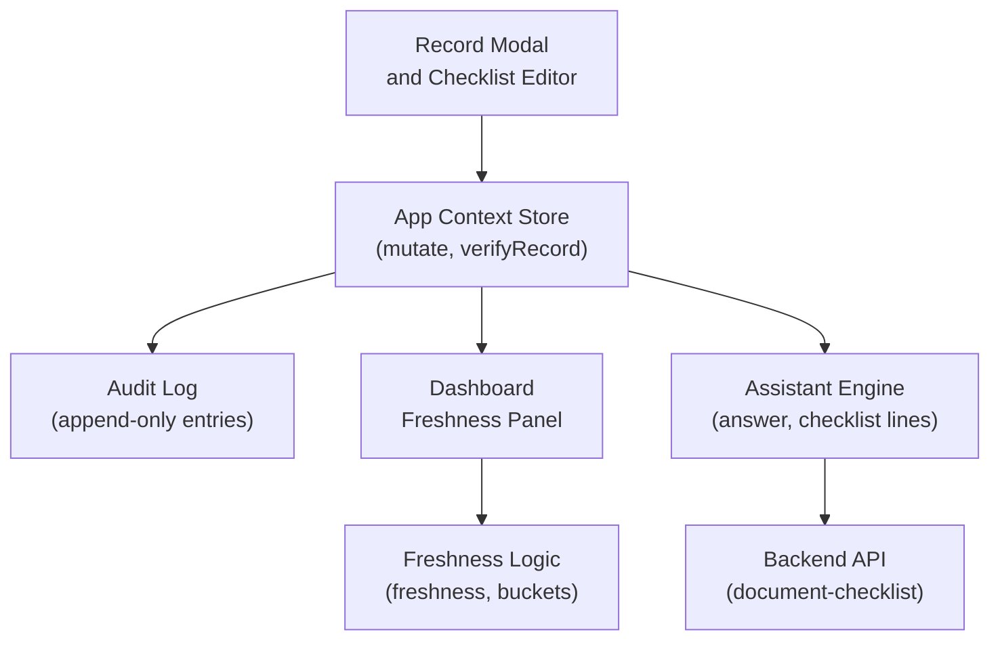
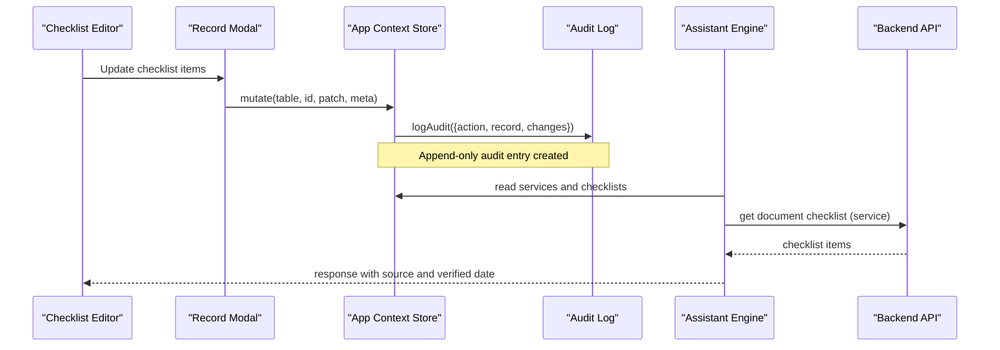
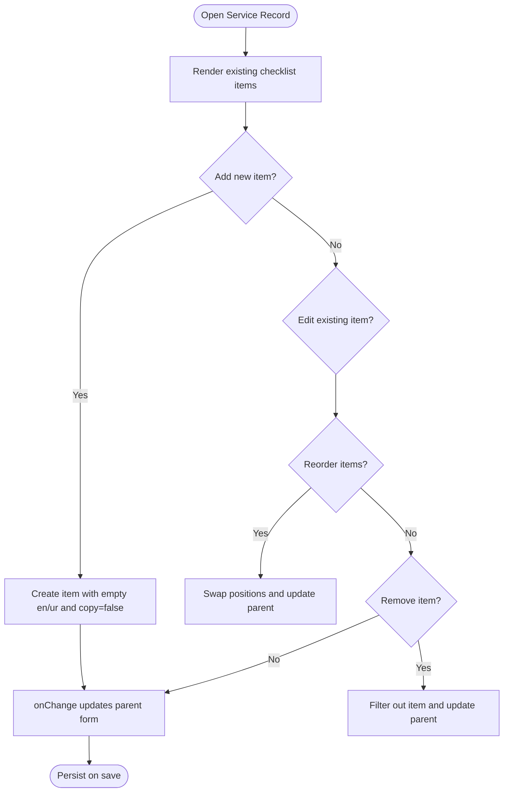
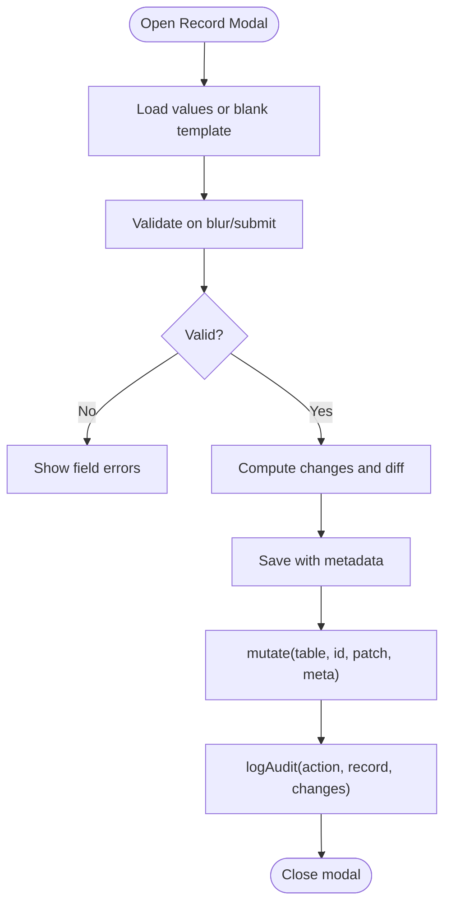
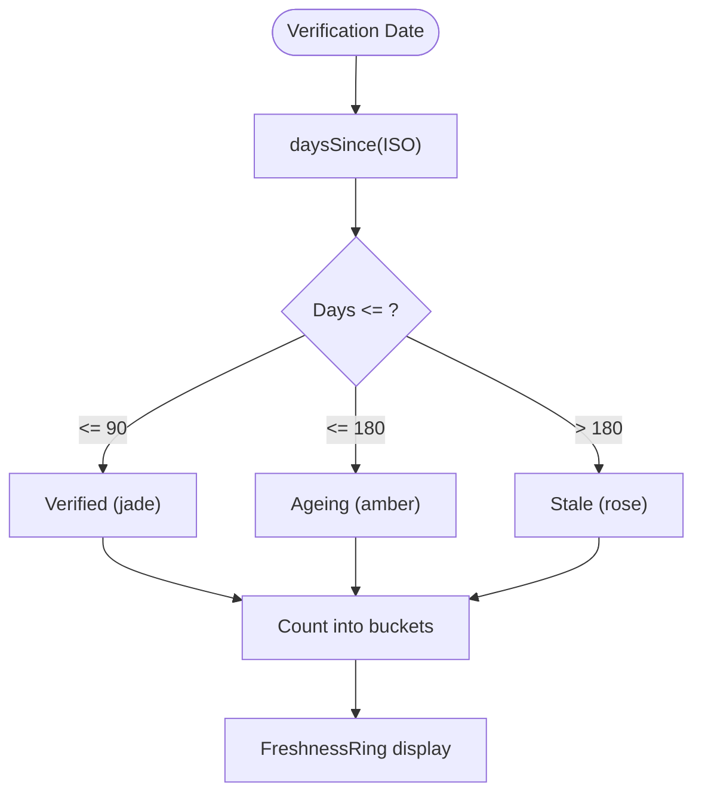
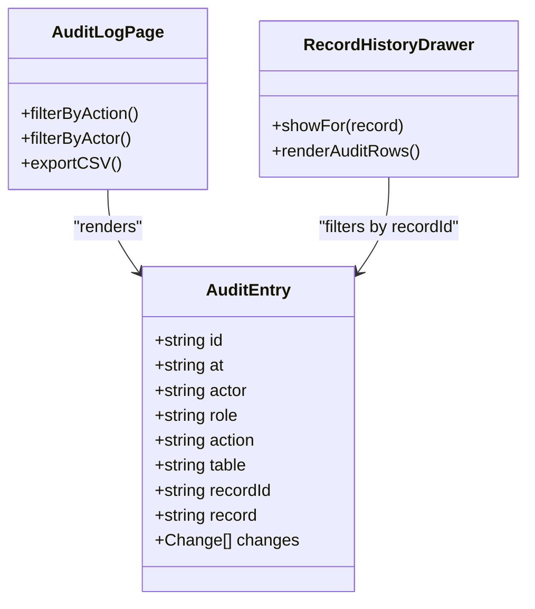
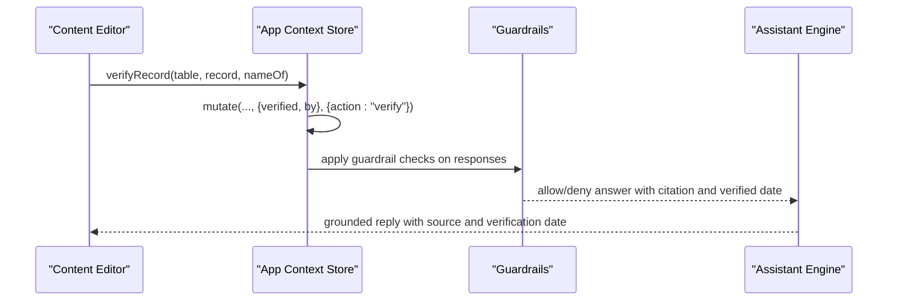
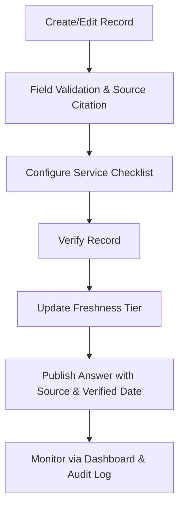
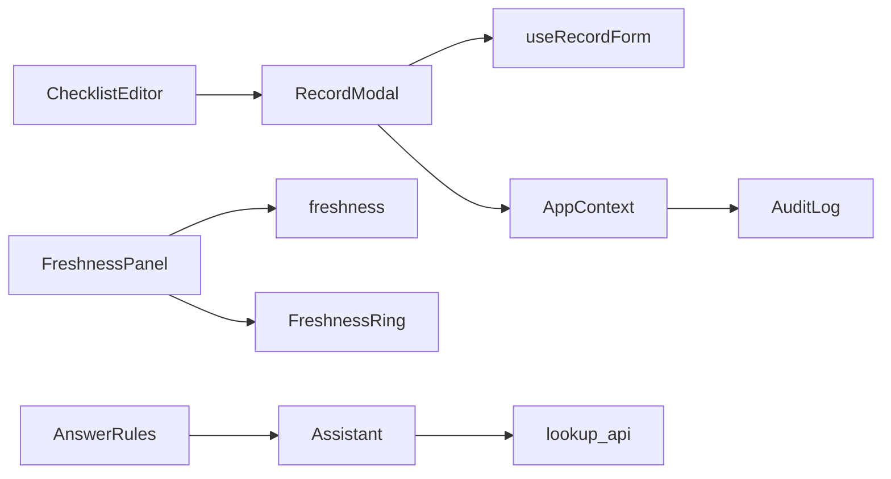

# Checklist Editor and Validation

<cite>
**Referenced Files in This Document**
- [ChecklistEditor.jsx](file://src/components/content/ChecklistEditor.jsx)
- [RecordModal.jsx](file://src/components/content/RecordModal.jsx)
- [useRecordForm.js](file://src/components/content/useRecordForm.js)
- [freshness.js](file://src/lib/freshness.js)
- [FreshnessPanel.jsx](file://src/pages/Dashboard/FreshnessPanel.jsx)
- [FreshnessRing.jsx](file://src/components/charts/FreshnessRing.jsx)
- [AppContext.jsx](file://src/context/AppContext.jsx)
- [AuditLog/index.jsx](file://src/pages/AuditLog/index.jsx)
- [AuditRow.jsx](file://src/pages/AuditLog/AuditRow.jsx)
- [constants.js](file://src/lib/constants.js)
- [format.js](file://src/lib/format.js)
- [assistant.js](file://src/lib/assistant.js)
- [lookup.py](file://uaea-backend/app/api/lookup.py)
- [AnswerRules.jsx](file://src/pages/Guardrails/AnswerRules.jsx)
- [flowChecks.js](file://src/pages/GuidedFlows/flowChecks.js)
</cite>

## Table of Contents
1. Introduction
2. Project Structure
3. Core Components
4. Architecture Overview
5. Detailed Component Analysis
6. Dependency Analysis
7. Performance Considerations
8. Troubleshooting Guide
9. Conclusion
10. Appendices

## Introduction
This document explains the checklist editor and validation system used to manage content verification workflows. It covers how checklists are created, edited, and published; how item types and validation rules ensure data quality; how freshness tracking determines accuracy based on verification dates; and how audit trails and versioning support accountability. It also outlines the end-to-end workflow from content creation to verification and publication, including automated guardrails and manual review processes.

## Project Structure
The checklist editor is part of a broader content management surface that includes:
- A checklist editor for service records
- A record modal with form validation and change diffs
- Freshness metrics and dashboards
- An append-only audit log
- Guardrail rules that enforce answer quality
- Backend endpoints that expose checklists to the assistant

**Diagram sources**
- [RecordModal.jsx:20-41](file://src/components/content/RecordModal.jsx#L20-L41)
- [ChecklistEditor.jsx:11-26](file://src/components/content/ChecklistEditor.jsx#L11-L26)
- [AppContext.jsx:69-116](file://src/context/AppContext.jsx#L69-L116)
- [FreshnessPanel.jsx:16-34](file://src/pages/Dashboard/FreshnessPanel.jsx#L16-L34)
- [freshness.js:17-36](file://src/lib/freshness.js#L17-L36)
- [assistant.js:120-161](file://src/lib/assistant.js#L120-L161)
- [lookup.py:93-103](file://uaea-backend/app/api/lookup.py#L93-L103)

**Section sources**
- [RecordModal.jsx:20-41](file://src/components/content/RecordModal.jsx#L20-L41)
- [ChecklistEditor.jsx:11-26](file://src/components/content/ChecklistEditor.jsx#L11-L26)
- [AppContext.jsx:69-116](file://src/context/AppContext.jsx#L69-L116)
- [FreshnessPanel.jsx:16-34](file://src/pages/Dashboard/FreshnessPanel.jsx#L16-L34)
- [freshness.js:17-36](file://src/lib/freshness.js#L17-L36)
- [assistant.js:120-161](file://src/lib/assistant.js#L120-L161)
- [lookup.py:93-103](file://uaea-backend/app/api/lookup.py#L93-L103)

## Core Components
- Checklist Editor: Adds, edits, reorders, and removes checklist items per service. Each item has English and Urdu labels and an original/copy flag.
- Record Modal: Orchestrates editing across tables (services, fees, deadlines, departments), integrates the checklist editor, and enforces field-level validation.
- Form Hook: Centralizes validation, change detection, and user-friendly diff generation for saved changes.
- Freshness System: Computes freshness tiers based on verification dates and aggregates counts for dashboard visualization.
- Audit Trail: Records every create/update/verify/delete/publish/guardrail action with actor, timestamp, table, record, and changes.
- Guardrails: Automated rules that prevent ungrounded answers, require citations, block promises, and show verified dates.

**Section sources**
- [ChecklistEditor.jsx:11-26](file://src/components/content/ChecklistEditor.jsx#L11-L26)
- [RecordModal.jsx:20-41](file://src/components/content/RecordModal.jsx#L20-L41)
- [useRecordForm.js:34-123](file://src/components/content/useRecordForm.js#L34-L123)
- [freshness.js:17-36](file://src/lib/freshness.js#L17-L36)
- [AuditLog/index.jsx:20-67](file://src/pages/AuditLog/index.jsx#L20-L67)
- [AnswerRules.jsx:4-36](file://src/pages/Guardrails/AnswerRules.jsx#L4-L36)

## Architecture Overview
The system combines a React-based console with a backend API. Editors mutate local store state and emit audit entries. The assistant reads stored services and their checklists to respond to student queries. Freshness is computed client-side using verification dates and displayed on the dashboard.

**Diagram sources**
- [ChecklistEditor.jsx:11-26](file://src/components/content/ChecklistEditor.jsx#L11-L26)
- [RecordModal.jsx:20-41](file://src/components/content/RecordModal.jsx#L20-L41)
- [AppContext.jsx:69-116](file://src/context/AppContext.jsx#L69-L116)
- [assistant.js:120-161](file://src/lib/assistant.js#L120-L161)
- [lookup.py:93-103](file://uaea-backend/app/api/lookup.py#L93-L103)

## Detailed Component Analysis

### Checklist Editor
- Purpose: Edit a service’s document checklist that is read verbatim by the assistant.
- Item model: Each item contains English name, Urdu name, and a boolean indicating whether it must be original or attested copy.
- Operations: Add, remove, reorder (move up/down), and inline edit fields.
- Integration: Embedded in the Services tab of the record modal; changes propagate via onChange to the parent form.

**Diagram sources**
- [ChecklistEditor.jsx:11-26](file://src/components/content/ChecklistEditor.jsx#L11-L26)
- [RecordModal.jsx:246-254](file://src/components/content/RecordModal.jsx#L246-L254)

**Section sources**
- [ChecklistEditor.jsx:11-26](file://src/components/content/ChecklistEditor.jsx#L11-L26)
- [RecordModal.jsx:246-254](file://src/components/content/RecordModal.jsx#L246-L254)

### Record Modal and Form Validation
- Purpose: Unified interface to add/edit records across multiple tables, including services with checklists.
- Validation: Field-specific rules per tab (e.g., amounts numeric and within ceiling, dates via picker, required names). Every record requires a source citation.
- Change Diff: Generates a human-readable diff of changed fields, including checklist length/content changes.
- Save Behavior: On save, stamps the record with today’s date and current user, then triggers mutation and audit logging.

**Diagram sources**
- [useRecordForm.js:34-123](file://src/components/content/useRecordForm.js#L34-L123)
- [RecordModal.jsx:20-41](file://src/components/content/RecordModal.jsx#L20-L41)
- [AppContext.jsx:69-116](file://src/context/AppContext.jsx#L69-L116)

**Section sources**
- [useRecordForm.js:34-123](file://src/components/content/useRecordForm.js#L34-L123)
- [RecordModal.jsx:20-41](file://src/components/content/RecordModal.jsx#L20-L41)
- [AppContext.jsx:69-116](file://src/context/AppContext.jsx#L69-L116)

### Freshness Tracking System
- Purpose: Quantify content trustworthiness based on last verification date relative to academic cycles.
- Tiers:
  - Verified (jade): 0–90 days since verification
  - Ageing (amber): 91–180 days
  - Stale (rose): 181+ days
- Aggregation: Counts per tier for dashboard ring visualization.
- Display: Dashboard lists overdue records and shows last verifier and date.

**Diagram sources**
- [freshness.js:17-36](file://src/lib/freshness.js#L17-L36)
- [FreshnessPanel.jsx:16-34](file://src/pages/Dashboard/FreshnessPanel.jsx#L16-L34)
- [FreshnessRing.jsx:6-66](file://src/components/charts/FreshnessRing.jsx#L6-L66)
- [format.js:3-4](file://src/lib/format.js#L3-L4)

**Section sources**
- [freshness.js:17-36](file://src/lib/freshness.js#L17-L36)
- [FreshnessPanel.jsx:16-34](file://src/pages/Dashboard/FreshnessPanel.jsx#L16-L34)
- [FreshnessRing.jsx:6-66](file://src/components/charts/FreshnessRing.jsx#L6-L66)
- [format.js:3-4](file://src/lib/format.js#L3-L4)

### Audit Trail and Version Control
- Purpose: Maintain an append-only history of all changes and verifications for compliance and troubleshooting.
- Capabilities: Filterable list by action and actor; export to CSV; per-record history drawer showing latest verification and ladder.
- Actions: Create, update, verify, delete, publish, guardrail events recorded with actor, role, timestamp, table, record, and changes.

**Diagram sources**
- [AuditLog/index.jsx:20-67](file://src/pages/AuditLog/index.jsx#L20-L67)
- [AuditRow.jsx:4-16](file://src/pages/AuditLog/AuditRow.jsx#L4-L16)
- [RecordHistory.jsx:13-58](file://src/components/content/RecordHistory.jsx#L13-L58)

**Section sources**
- [AuditLog/index.jsx:20-67](file://src/pages/AuditLog/index.jsx#L20-L67)
- [AuditRow.jsx:4-16](file://src/pages/AuditLog/AuditRow.jsx#L4-L16)
- [RecordHistory.jsx:13-58](file://src/components/content/RecordHistory.jsx#L13-L58)

### Automated Validation Rules and Manual Review
- Automated guardrails:
  - Block ungrounded numbers
  - Require source citations on knowledge answers
  - Block outcome promises
  - Decline academic dishonesty requests
  - Refuse personal lookups without authentication
  - Show verified date beside facts
- Manual review:
  - Editors validate and update records
  - Verification stamps the record with today’s date and verifier name
  - Per-record history provides transparency

**Diagram sources**
- [AppContext.jsx:105-116](file://src/context/AppContext.jsx#L105-L116)
- [AnswerRules.jsx:4-36](file://src/pages/Guardrails/AnswerRules.jsx#L4-L36)
- [assistant.js:120-161](file://src/lib/assistant.js#L120-L161)

**Section sources**
- [AnswerRules.jsx:4-36](file://src/pages/Guardrails/AnswerRules.jsx#L4-L36)
- [AppContext.jsx:105-116](file://src/context/AppContext.jsx#L105-L116)
- [assistant.js:120-161](file://src/lib/assistant.js#L120-L161)

### Workflow: From Creation to Publication
- Content creation:
  - Add or edit records via the modal; fill required fields and cite sources.
  - For services, configure the document checklist with bilingual labels and original/copy requirements.
- Validation:
  - Inline validation prevents invalid submissions.
  - Change diffs highlight what students will see.
- Verification:
  - Mark records as verified to refresh freshness status.
  - Freshness tiers influence dashboard visibility and trust signals.
- Publication:
  - Assistant surfaces verified content with source and verification date.
  - Backend exposes checklists for tool calls.

[No sources needed since this diagram shows conceptual workflow, not actual code structure]

## Dependency Analysis
- ChecklistEditor depends on RecordModal for integration and uses shared UI primitives.
- useRecordForm centralizes validation and change detection used by RecordModal.
- AppContext coordinates mutations and audit logging; verifyRecord updates freshness-related fields.
- Freshness logic consumes verification dates and formats them for display.
- Assistant composes answers using stored services and checklists; backend provides checklist retrieval.
- Guardrails constrain assistant behavior and ensure verified dates are shown.

**Diagram sources**
- [ChecklistEditor.jsx:11-26](file://src/components/content/ChecklistEditor.jsx#L11-L26)
- [RecordModal.jsx:20-41](file://src/components/content/RecordModal.jsx#L20-L41)
- [useRecordForm.js:34-123](file://src/components/content/useRecordForm.js#L34-L123)
- [AppContext.jsx:69-116](file://src/context/AppContext.jsx#L69-L116)
- [FreshnessPanel.jsx:16-34](file://src/pages/Dashboard/FreshnessPanel.jsx#L16-L34)
- [freshness.js:17-36](file://src/lib/freshness.js#L17-L36)
- [assistant.js:120-161](file://src/lib/assistant.js#L120-L161)
- [lookup.py:93-103](file://uaea-backend/app/api/lookup.py#L93-L103)
- [AnswerRules.jsx:4-36](file://src/pages/Guardrails/AnswerRules.jsx#L4-L36)

**Section sources**
- [ChecklistEditor.jsx:11-26](file://src/components/content/ChecklistEditor.jsx#L11-L26)
- [RecordModal.jsx:20-41](file://src/components/content/RecordModal.jsx#L20-L41)
- [useRecordForm.js:34-123](file://src/components/content/useRecordForm.js#L34-L123)
- [AppContext.jsx:69-116](file://src/context/AppContext.jsx#L69-L116)
- [FreshnessPanel.jsx:16-34](file://src/pages/Dashboard/FreshnessPanel.jsx#L16-L34)
- [freshness.js:17-36](file://src/lib/freshness.js#L17-L36)
- [assistant.js:120-161](file://src/lib/assistant.js#L120-L161)
- [lookup.py:93-103](file://uaea-backend/app/api/lookup.py#L93-L103)
- [AnswerRules.jsx:4-36](file://src/pages/Guardrails/AnswerRules.jsx#L4-L36)

## Performance Considerations
- Client-side freshness computation is lightweight and runs on memoized selections to avoid unnecessary recalculations.
- Audit filtering uses debounced search and memoization to keep interactions responsive.
- Checklist operations are simple array manipulations; large checklists should be monitored for rendering performance.
- Exporting audit logs generates CSVs in-memory; consider pagination or server-side export if datasets grow significantly.

[No sources needed since this section provides general guidance]

## Troubleshooting Guide
- Checklist not appearing in assistant responses:
  - Ensure the service record has a populated checklist and valid bilingual labels.
  - Confirm backend endpoint returns checklist for the service.
- Freshness stuck on stale:
  - Verify that records have a recent verification date set by a verify action.
  - Check dashboard “Catalogue freshness” panel for overdue items.
- Validation errors preventing save:
  - Use date pickers for date fields; ensure amounts are digits only and within allowed ceilings.
  - Provide a source citation for every record.
- Missing audit entries:
  - Confirm mutations include metadata with action, record, and changes.
  - Check filters on the audit page and export functionality.

**Section sources**
- [assistant.js:120-161](file://src/lib/assistant.js#L120-L161)
- [lookup.py:93-103](file://uaea-backend/app/api/lookup.py#L93-L103)
- [FreshnessPanel.jsx:16-34](file://src/pages/Dashboard/FreshnessPanel.jsx#L16-L34)
- [useRecordForm.js:53-82](file://src/components/content/useRecordForm.js#L53-L82)
- [AuditLog/index.jsx:20-67](file://src/pages/AuditLog/index.jsx#L20-L67)

## Conclusion
The checklist editor and validation system provide a robust framework for managing content verification workflows. By combining structured editors, strict validation, freshness tracking, and an append-only audit trail, the system ensures high-quality, trustworthy content delivery to students. Automated guardrails and manual verification reinforce accountability and accuracy throughout the lifecycle from creation to publication.

[No sources needed since this section summarizes without analyzing specific files]

## Appendices

### Example Checklist Configurations
- Typical service checklist items include bilingual names and clear indication of whether an original or attested copy is required.
- Reordering matters because the assistant reads items verbatim; maintain logical sequence for clarity.

**Section sources**
- [ChecklistEditor.jsx:11-26](file://src/components/content/ChecklistEditor.jsx#L11-L26)
- [assistant.js:120-124](file://src/lib/assistant.js#L120-L124)

### How Checklists Ensure Data Quality
- Bilingual labels reduce ambiguity for diverse users.
- Original/copy flags clarify physical document requirements, minimizing follow-up confusion.
- Source citations and verification dates accompany answers, enabling traceability.

**Section sources**
- [RecordModal.jsx:246-254](file://src/components/content/RecordModal.jsx#L246-L254)
- [AnswerRules.jsx:31-35](file://src/pages/Guardrails/AnswerRules.jsx#L31-L35)

### Automated vs Manual Processes
- Automated: Guardrails block risky outputs and enforce citation and verified date display.
- Manual: Editors create and update records; verification stamps refresh freshness and signal trust.

**Section sources**
- [AnswerRules.jsx:4-36](file://src/pages/Guardrails/AnswerRules.jsx#L4-L36)
- [AppContext.jsx:105-116](file://src/context/AppContext.jsx#L105-L116)