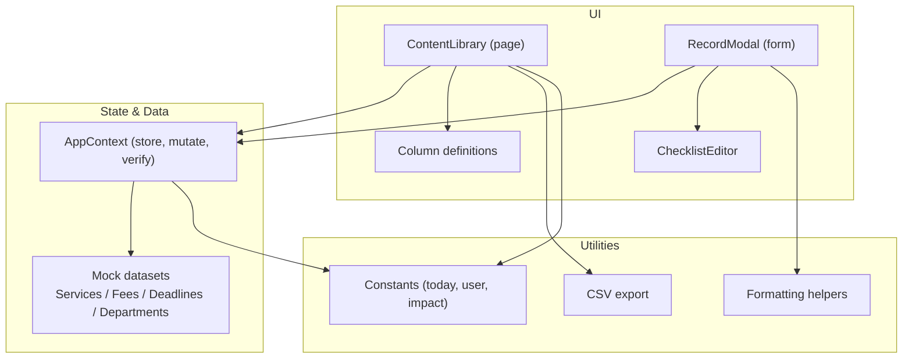
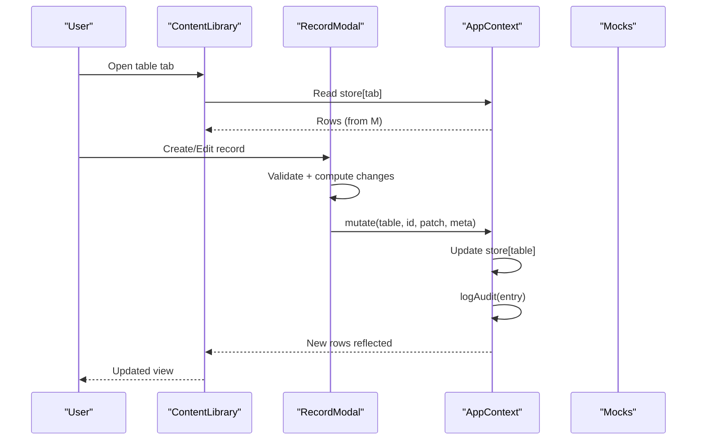
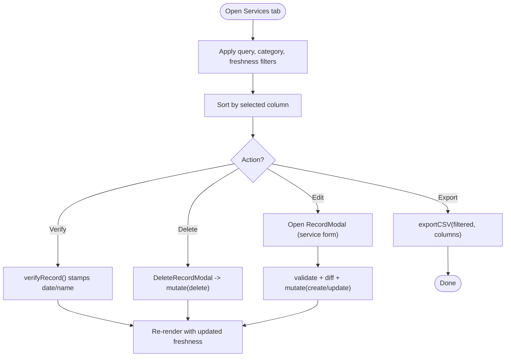
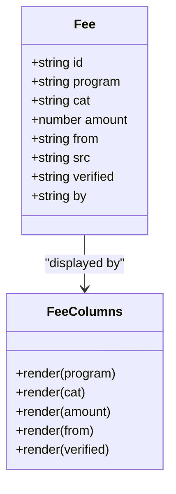
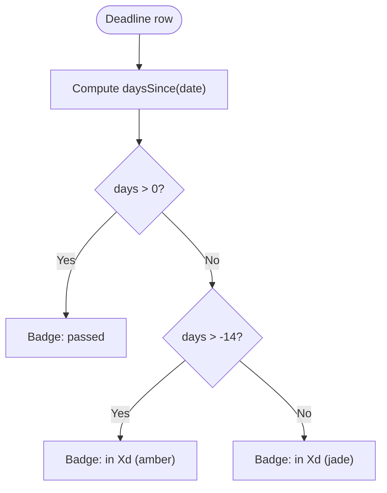
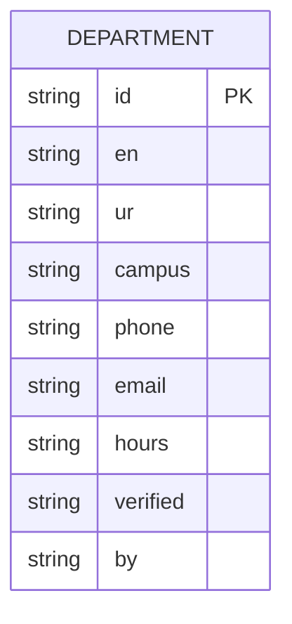
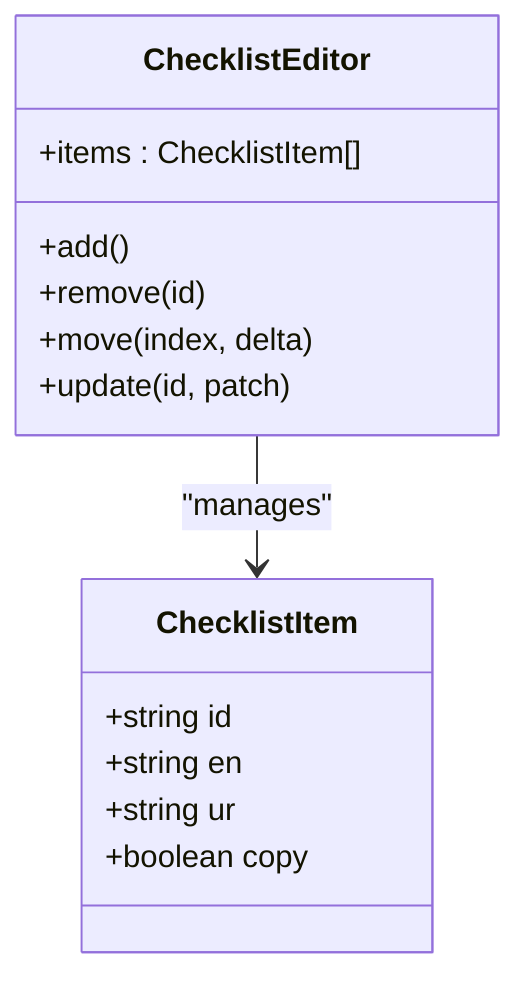
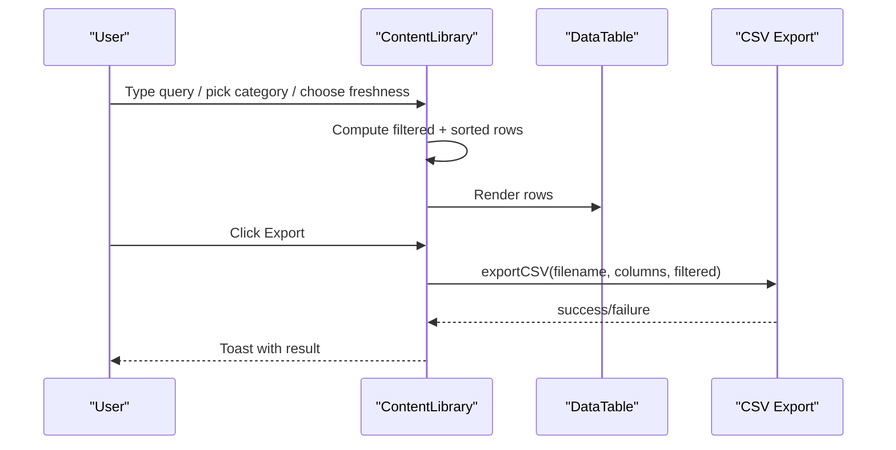
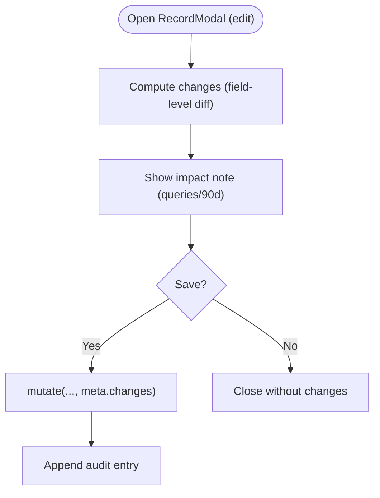
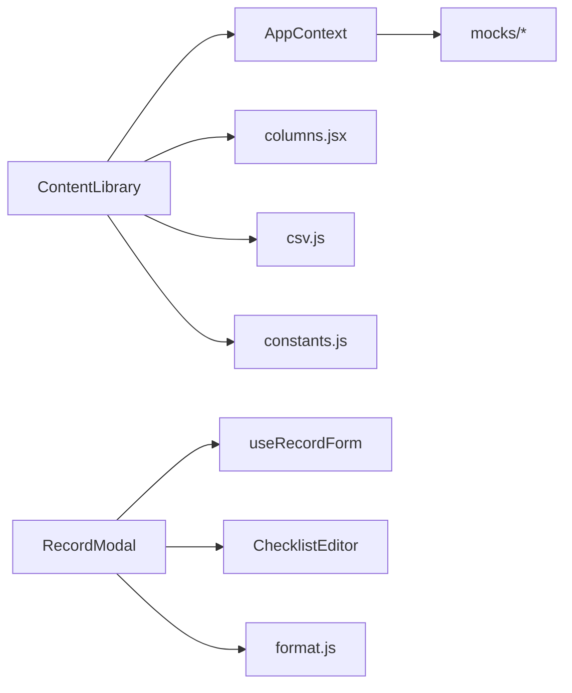

# Content Management System

<cite>
**Referenced Files in This Document**
- [index.jsx](file://src/pages/ContentLibrary/index.jsx)
- [tabs.js](file://src/pages/ContentLibrary/tabs.js)
- [RecordModal.jsx](file://src/components/content/RecordModal.jsx)
- [ChecklistEditor.jsx](file://src/components/content/ChecklistEditor.jsx)
- [useRecordForm.js](file://src/components/content/useRecordForm.js)
- [columns.jsx](file://src/components/content/columns.jsx)
- [AppContext.jsx](file://src/context/AppContext.jsx)
- [constants.js](file://src/lib/constants.js)
- [format.js](file://src/lib/format.js)
- [csv.js](file://src/lib/csv.js)
- [services.js](file://src/mocks/services.js)
- [fees.js](file://src/mocks/fees.js)
- [deadlines.js](file://src/mocks/deadlines.js)
- [departments.js](file://src/mocks/departments.js)
</cite>

## Table of Contents
1. Introduction
2. Project Structure
3. Core Components
4. Architecture Overview
5. Detailed Component Analysis
6. Dependency Analysis
7. Performance Considerations
8. Troubleshooting Guide
9. Conclusion

## Introduction
This document explains the content management system that powers deterministic, verifiable answers for students. It covers:
- Service catalog management with CRUD operations, categorization, and metadata editing
- Fee tariff administration including pricing rules, currency support, and bulk updates
- Deadline tracking with calendar-aware status indicators and category organization
- Department management with contact information and verification
- Checklist editor for validation workflows and approval processes
- Search, filtering, CSV export, and change impact analysis to guide safe edits

The system is designed so that all student-facing facts are sourced from explicit records rather than model memory, ensuring accuracy and auditability.

## Project Structure
The console organizes content around four primary tables: Services, Fee tariff, Deadlines, and Departments. A unified library page provides search, filters, sorting, and actions across these tables. Editing occurs via a shared modal with per-tab forms and validation. State and mutations are centralized in a context provider, with mocks serving as the data layer until Phase 2 replaces them with server calls.

**Diagram sources**
- [index.jsx:1-254](file://src/pages/ContentLibrary/index.jsx#L1-L254)
- [RecordModal.jsx:1-316](file://src/components/content/RecordModal.jsx#L1-L316)
- [ChecklistEditor.jsx:1-114](file://src/components/content/ChecklistEditor.jsx#L1-L114)
- [columns.jsx:1-171](file://src/components/content/columns.jsx#L1-L171)
- [AppContext.jsx:1-135](file://src/context/AppContext.jsx#L1-L135)
- [constants.js:1-35](file://src/lib/constants.js#L1-L35)
- [format.js:1-32](file://src/lib/format.js#L1-L32)
- [csv.js:1-32](file://src/lib/csv.js#L1-L32)
- [services.js:1-309](file://src/mocks/services.js#L1-L309)
- [fees.js:1-21](file://src/mocks/fees.js#L1-L21)
- [deadlines.js:1-17](file://src/mocks/deadlines.js#L1-L17)
- [departments.js:1-18](file://src/mocks/departments.js#L1-L18)

**Section sources**
- [index.jsx:1-254](file://src/pages/ContentLibrary/index.jsx#L1-L254)
- [tabs.js:1-10](file://src/pages/ContentLibrary/tabs.js#L1-L10)
- [AppContext.jsx:1-135](file://src/context/AppContext.jsx#L1-L135)

## Core Components
- Content Library page: Central hub for browsing, searching, filtering, sorting, verifying, exporting, and editing records across all tables.
- Record Modal: Unified form for creating/editing records with per-tab fields, validation, and change preview.
- Checklist Editor: Inline editor for service document checklists with reorder, bilingual labels, and original/copy selection.
- App Context: Single source of truth for store, mutations (create/update/delete), verification stamping, and audit logging.
- Column Definitions: Reusable column renderers for consistent display and sorting across tables.
- Utilities: Date and currency formatting, CSV export, constants for today/user/impact, and mock data.

**Section sources**
- [index.jsx:1-254](file://src/pages/ContentLibrary/index.jsx#L1-L254)
- [RecordModal.jsx:1-316](file://src/components/content/RecordModal.jsx#L1-L316)
- [ChecklistEditor.jsx:1-114](file://src/components/content/ChecklistEditor.jsx#L1-L114)
- [AppContext.jsx:1-135](file://src/context/AppContext.jsx#L1-L135)
- [columns.jsx:1-171](file://src/components/content/columns.jsx#L1-L171)
- [format.js:1-32](file://src/lib/format.js#L1-L32)
- [csv.js:1-32](file://src/lib/csv.js#L1-L32)
- [constants.js:1-35](file://src/lib/constants.js#L1-L35)

## Architecture Overview
The system uses a unidirectional data flow:
- UI components read from AppContext.store and dispatch mutations through AppContext.mutate or verifyRecord.
- Mutations update local state and append audit entries; they are designed to be replaced by API calls in Phase 2 without changing consumers.
- Mock datasets provide initial data for services, fees, deadlines, and departments.
- Formatting utilities standardize dates, currencies, and counts; constants pin “today” and current user for consistent behavior.

**Diagram sources**
- [index.jsx:1-254](file://src/pages/ContentLibrary/index.jsx#L1-L254)
- [RecordModal.jsx:1-316](file://src/components/content/RecordModal.jsx#L1-L316)
- [AppContext.jsx:1-135](file://src/context/AppContext.jsx#L1-L135)
- [services.js:1-309](file://src/mocks/services.js#L1-L309)
- [fees.js:1-21](file://src/mocks/fees.js#L1-L21)
- [deadlines.js:1-17](file://src/mocks/deadlines.js#L1-L17)
- [departments.js:1-18](file://src/mocks/departments.js#L1-L18)

## Detailed Component Analysis

### Service Catalog Management
- CRUD: Create new services, edit existing ones, delete via row actions, and mark verified in bulk or individually.
- Categorization: Services are grouped by category (e.g., Admissions, Finance, Examinations). Category filter is dynamic based on available values.
- Metadata editing: Bilingual names, procedure text in English and Urdu, source citation, and checklist items.
- Verification: Stamps verified date and verifier name; freshness indicator shows staleness.

**Diagram sources**
- [index.jsx:1-254](file://src/pages/ContentLibrary/index.jsx#L1-L254)
- [RecordModal.jsx:1-316](file://src/components/content/RecordModal.jsx#L1-L316)
- [columns.jsx:1-171](file://src/components/content/columns.jsx#L1-L171)
- [csv.js:1-32](file://src/lib/csv.js#L1-L32)
- [AppContext.jsx:1-135](file://src/context/AppContext.jsx#L1-L135)

**Section sources**
- [index.jsx:1-254](file://src/pages/ContentLibrary/index.jsx#L1-L254)
- [RecordModal.jsx:1-316](file://src/components/content/RecordModal.jsx#L1-L316)
- [columns.jsx:1-171](file://src/components/content/columns.jsx#L1-L171)
- [services.js:1-309](file://src/mocks/services.js#L1-L309)

### Fee Tariff Administration
- Pricing rules: Program-based entries with basis categories (semester, per credit hour, annual, per paper, normal/urgent service). Amounts validated as digits only with a ceiling. Effective-from date required.
- Currency support: All amounts formatted as PKR using a dedicated formatter; exports include numeric values suitable for spreadsheets.
- Bulk updates: Select multiple fee rows and use bulk verify to stamp verification date/name across selections.

**Diagram sources**
- [fees.js:1-21](file://src/mocks/fees.js#L1-L21)
- [columns.jsx:1-171](file://src/components/content/columns.jsx#L1-L171)

**Section sources**
- [RecordModal.jsx:83-121](file://src/components/content/RecordModal.jsx#L83-L121)
- [useRecordForm.js:53-82](file://src/components/content/useRecordForm.js#L53-L82)
- [columns.jsx:73-103](file://src/components/content/columns.jsx#L73-L103)
- [format.js:16-18](file://src/lib/format.js#L16-L18)
- [index.jsx:87-94](file://src/pages/ContentLibrary/index.jsx#L87-L94)

### Deadline Tracking
- Calendar integration: Dates are compared against a pinned “today” to show passed vs upcoming badges; negative days indicate future deadlines.
- Notification scheduling: Not implemented in this codebase; however, the deadline list exposes clear status indicators that can be used by external schedulers.
- Category organization: Deadlines are grouped by semester badge and sorted by date; searchable by any field.

**Diagram sources**
- [columns.jsx:105-136](file://src/components/content/columns.jsx#L105-L136)
- [format.js:3-4](file://src/lib/format.js#L3-L4)
- [deadlines.js:1-17](file://src/mocks/deadlines.js#L1-L17)

**Section sources**
- [columns.jsx:105-136](file://src/components/content/columns.jsx#L105-L136)
- [format.js:1-32](file://src/lib/format.js#L1-L32)
- [deadlines.js:1-17](file://src/mocks/deadlines.js#L1-L17)

### Department Management
- Contact information: Fields for English/Urdu names, phone, email, campus/address, office hours.
- Hierarchy: Campus grouping via the campus field; no explicit parent-child hierarchy is modeled.
- Access controls: Verified-by and last-verified fields track accountability; role-based write access is enforced at the UI level.

**Diagram sources**
- [departments.js:1-18](file://src/mocks/departments.js#L1-L18)
- [columns.jsx:138-166](file://src/components/content/columns.jsx#L138-L166)
- [RecordModal.jsx:149-204](file://src/components/content/RecordModal.jsx#L149-L204)

**Section sources**
- [departments.js:1-18](file://src/mocks/departments.js#L1-L18)
- [columns.jsx:138-166](file://src/components/content/columns.jsx#L138-L166)
- [RecordModal.jsx:149-204](file://src/components/content/RecordModal.jsx#L149-L204)

### Checklist Editor for Validation Workflows
- Purpose: Edits a service’s document checklist, which is read verbatim by the assistant when guiding students.
- Features: Add/remove/reorder items; bilingual labels (English/Urdu); select whether an item requires original or attested copy.
- Approval process: Changes appear in the change preview before saving; verification stamps ensure freshness.

**Diagram sources**
- [ChecklistEditor.jsx:1-114](file://src/components/content/ChecklistEditor.jsx#L1-L114)
- [RecordModal.jsx:246-254](file://src/components/content/RecordModal.jsx#L246-L254)

**Section sources**
- [ChecklistEditor.jsx:1-114](file://src/components/content/ChecklistEditor.jsx#L1-L114)
- [RecordModal.jsx:246-254](file://src/components/content/RecordModal.jsx#L246-L254)

### Search, Filtering, Sorting, and Export
- Search: Debounced full-text search across all fields of the active table.
- Filters: Dynamic category filter derived from data; freshness filter based on verification age.
- Sorting: Per-column sort with ascending/descending direction; null handling pushes undefined values to bottom.
- Export: CSV export of filtered rows with custom column mapping; includes verification metadata; handles blocked downloads gracefully.

**Diagram sources**
- [index.jsx:29-79](file://src/pages/ContentLibrary/index.jsx#L29-L79)
- [index.jsx:115-131](file://src/pages/ContentLibrary/index.jsx#L115-L131)
- [csv.js:1-32](file://src/lib/csv.js#L1-L32)

**Section sources**
- [index.jsx:29-79](file://src/pages/ContentLibrary/index.jsx#L29-L79)
- [index.jsx:115-131](file://src/pages/ContentLibrary/index.jsx#L115-L131)
- [csv.js:1-32](file://src/lib/csv.js#L1-L32)

### Change Impact Analysis
- Before saving edits, the modal shows a plain-language diff of changed fields and how many students asked about the record recently.
- Impact estimates are provided per table via a constant map; services use per-record query counts, while other tables use aggregate estimates.

**Diagram sources**
- [RecordModal.jsx:287-305](file://src/components/content/RecordModal.jsx#L287-L305)
- [useRecordForm.js:84-109](file://src/components/content/useRecordForm.js#L84-L109)
- [constants.js:18-24](file://src/lib/constants.js#L18-L24)
- [AppContext.jsx:92-100](file://src/context/AppContext.jsx#L92-L100)

**Section sources**
- [RecordModal.jsx:287-305](file://src/components/content/RecordModal.jsx#L287-L305)
- [useRecordForm.js:84-109](file://src/components/content/useRecordForm.js#L84-L109)
- [constants.js:18-24](file://src/lib/constants.js#L18-L24)
- [AppContext.jsx:92-100](file://src/context/AppContext.jsx#L92-L100)

## Dependency Analysis
- The ContentLibrary depends on:
  - AppContext for store and mutations
  - Column definitions for rendering
  - CSV utility for export
  - Constants for today/user/impact
- RecordModal depends on:
  - useRecordForm for validation and change detection
  - ChecklistEditor for checklist editing
  - Formatting utilities for display
- AppContext initializes from mock datasets and centralizes mutation logic.

**Diagram sources**
- [index.jsx:1-254](file://src/pages/ContentLibrary/index.jsx#L1-L254)
- [RecordModal.jsx:1-316](file://src/components/content/RecordModal.jsx#L1-L316)
- [AppContext.jsx:1-135](file://src/context/AppContext.jsx#L1-L135)
- [columns.jsx:1-171](file://src/components/content/columns.jsx#L1-L171)
- [csv.js:1-32](file://src/lib/csv.js#L1-L32)
- [constants.js:1-35](file://src/lib/constants.js#L1-L35)
- [format.js:1-32](file://src/lib/format.js#L1-L32)
- [services.js:1-309](file://src/mocks/services.js#L1-L309)
- [fees.js:1-21](file://src/mocks/fees.js#L1-L21)
- [deadlines.js:1-17](file://src/mocks/deadlines.js#L1-L17)
- [departments.js:1-18](file://src/mocks/departments.js#L1-L18)

**Section sources**
- [index.jsx:1-254](file://src/pages/ContentLibrary/index.jsx#L1-L254)
- [RecordModal.jsx:1-316](file://src/components/content/RecordModal.jsx#L1-L316)
- [AppContext.jsx:1-135](file://src/context/AppContext.jsx#L1-L135)

## Performance Considerations
- Debounced search reduces re-renders during typing.
- Memoized filtering and sorting prevent unnecessary recalculations.
- Null-safe sorting avoids unstable order when fields are missing.
- CSV export uses Blob URLs and revokes them promptly to free memory.
- Pinned “today” ensures deterministic date calculations without frequent recomputation.

[No sources needed since this section provides general guidance]

## Troubleshooting Guide
- Export blocked: If the browser blocks downloads (e.g., sandboxed frames), the export function returns false and surfaces a toast instead of throwing.
- Invalid amounts: Fee amounts must be digits only and within a defined ceiling; errors surface after blurring the field.
- Missing source citations: Every record requires a source; saving is disabled until it is provided.
- Email format: Department emails are validated against a basic pattern.
- Date pickers: Use the date picker inputs to avoid invalid formats.

**Section sources**
- [csv.js:1-32](file://src/lib/csv.js#L1-L32)
- [useRecordForm.js:53-82](file://src/components/content/useRecordForm.js#L53-L82)
- [RecordModal.jsx:277-285](file://src/components/content/RecordModal.jsx#L277-L285)

## Conclusion
The content management system provides a robust, auditable foundation for managing university service information, fees, deadlines, and department contacts. Its design emphasizes:
- Deterministic, sourced facts over model memory
- Clear verification and freshness indicators
- Safe editing with change previews and impact awareness
- Consistent presentation and export capabilities
A planned Phase 2 will replace the mock data layer with server-backed APIs while preserving the same consumer interfaces.