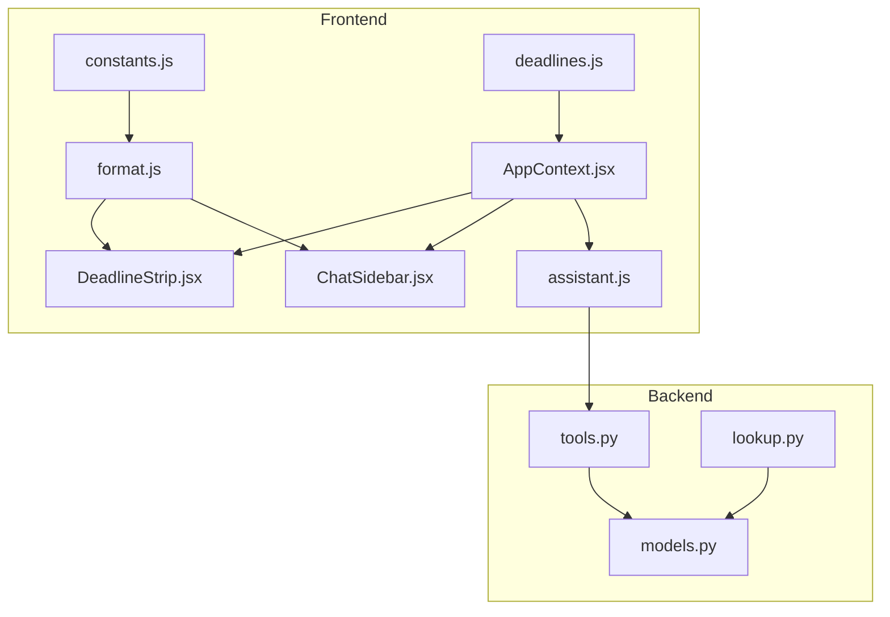
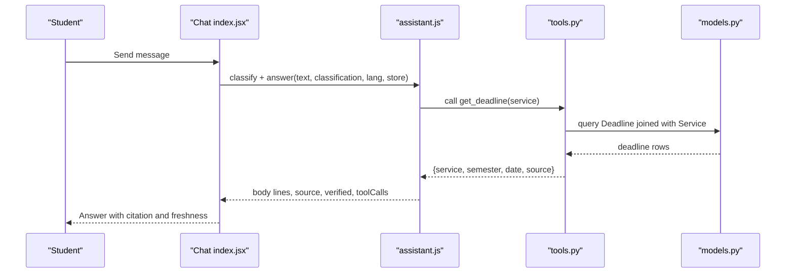
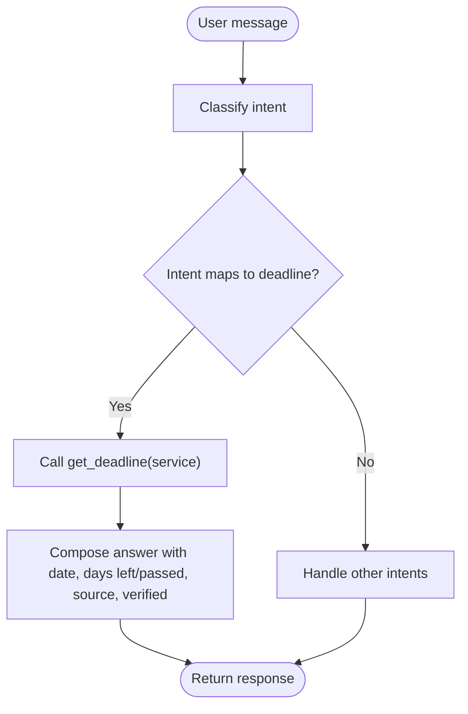
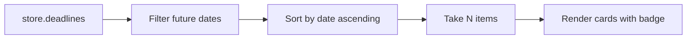
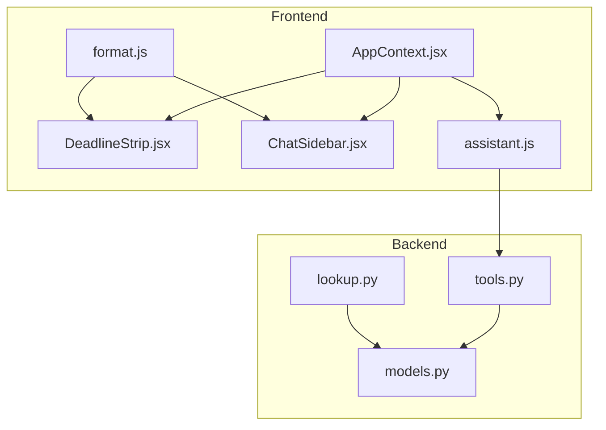

# Deadline Tracking System

<cite>
**Referenced Files in This Document**
- [deadlines.js](file://src/mocks/deadlines.js)
- [AppContext.jsx](file://src/context/AppContext.jsx)
- [format.js](file://src/lib/format.js)
- [constants.js](file://src/lib/constants.js)
- [assistant.js](file://src/lib/assistant.js)
- [DeadlineStrip.jsx](file://src/pages/student/Landing/DeadlineStrip.jsx)
- [ChatSidebar.jsx](file://src/pages/student/Chat/ChatSidebar.jsx)
- [Chat index.jsx](file://src/pages/student/Chat/index.jsx)
- [tools.py](file://uaea-backend/app/orchestrator/tools.py)
- [models.py](file://uaea-backend/app/db/models.py)
- [lookup.py](file://uaea-backend/app/api/lookup.py)
</cite>

## Table of Contents
1. Introduction
2. Project Structure
3. Core Components
4. Architecture Overview
5. Detailed Component Analysis
6. Dependency Analysis
7. Performance Considerations
8. Troubleshooting Guide
9. Conclusion

## Introduction
This document explains the deadline tracking system that powers academic deadlines across the student portal and chat assistant. It covers how deadlines are created, stored, scheduled, surfaced to students, and used by the assistant to answer questions about registration windows, exam dates, assignment submissions, and fee payment deadlines. It also describes notification-like behaviors (upcoming-date highlights), recurring patterns via semesters, exception handling when data is missing, timezone considerations, and integration points for calendar export.

## Project Structure
The deadline system spans frontend state, UI surfaces, assistant logic, backend tools, and database models:
- Frontend mock data defines deadlines with service, semester, date, source, and verification metadata.
- The React context holds a global store including deadlines consumed by landing pages and chat sidebars.
- Formatting utilities compute days since a deadline and format dates consistently.
- The assistant maps intents to deadlines and composes answers with citations and freshness cues.
- Backend tools expose a get_deadline tool backed by SQLAlchemy models and queries.
- Database models define the Deadline entity and its relationship to Service.



**Diagram sources**
- [AppContext.jsx:39-47](file://src/context/AppContext.jsx#L39-L47)
- [DeadlineStrip.jsx:15-18](file://src/pages/student/Landing/DeadlineStrip.jsx#L15-L18)
- [ChatSidebar.jsx:18-23](file://src/pages/student/Chat/ChatSidebar.jsx#L18-L23)
- [assistant.js:209-249](file://src/lib/assistant.js#L209-L249)
- [format.js:3-14](file://src/lib/format.js#L3-L14)
- [constants.js:1-8](file://src/lib/constants.js#L1-L8)
- [deadlines.js:6-16](file://src/mocks/deadlines.js#L6-L16)
- [tools.py:155-178](file://uaea-backend/app/orchestrator/tools.py#L155-L178)
- [models.py:108-121](file://uaea-backend/app/db/models.py#L108-L121)
- [lookup.py:80-90](file://uaea-backend/app/api/lookup.py#L80-L90)

**Section sources**
- [deadlines.js:6-16](file://src/mocks/deadlines.js#L6-L16)
- [AppContext.jsx:39-47](file://src/context/AppContext.jsx#L39-L47)
- [format.js:3-14](file://src/lib/format.js#L3-L14)
- [constants.js:1-8](file://src/lib/constants.js#L1-L8)
- [assistant.js:209-249](file://src/lib/assistant.js#L209-L249)
- [tools.py:155-178](file://uaea-backend/app/orchestrator/tools.py#L155-L178)
- [models.py:108-121](file://uaea-backend/app/db/models.py#L108-L121)
- [lookup.py:80-90](file://uaea-backend/app/api/lookup.py#L80-L90)

## Core Components
- Deadline data model: Stores service linkage, semester, date, and source reference.
- Mock deadlines: Seed data covering admission, fees, assignments, rechecking, degree, date sheet, and scholarships.
- Global store: Provides deadlines to UI components and assistant logic.
- Assistant routing: Maps user intent to specific services and returns deadline info with citations and freshness.
- UI surfaces: Landing strip shows upcoming deadlines; chat sidebar shows related or upcoming deadlines.
- Backend tool: get_deadline resolves deadlines by service name or fallback matching.

Key responsibilities:
- Creation and storage: Admins add deadlines via the console’s mutate API seam; mock seed provides initial entries.
- Scheduling and visibility: Filtering by future dates and sorting by date drives “coming up” lists.
- Notifications: Badge-based urgency indicators act as lightweight notifications within the UI.
- Chat integration: Assistant composes answers grounded in tool results and cites sources.

**Section sources**
- [models.py:108-121](file://uaea-backend/app/db/models.py#L108-L121)
- [deadlines.js:6-16](file://src/mocks/deadlines.js#L6-L16)
- [AppContext.jsx:39-47](file://src/context/AppContext.jsx#L39-L47)
- [assistant.js:209-249](file://src/lib/assistant.js#L209-L249)
- [DeadlineStrip.jsx:15-18](file://src/pages/student/Landing/DeadlineStrip.jsx#L15-L18)
- [ChatSidebar.jsx:18-23](file://src/pages/student/Chat/ChatSidebar.jsx#L18-L23)
- [tools.py:155-178](file://uaea-backend/app/orchestrator/tools.py#L155-L178)

## Architecture Overview
The system uses a hybrid approach during development:
- Frontend uses mock deadlines seeded into the app context.
- Backend exposes a get_deadline tool that queries the database through SQLAlchemy models.
- The assistant orchestrates tool calls and formats responses with citations and freshness.



**Diagram sources**
- [Chat index.jsx:62-136](file://src/pages/student/Chat/index.jsx#L62-L136)
- [assistant.js:135-161](file://src/lib/assistant.js#L135-L161)
- [assistant.js:209-249](file://src/lib/assistant.js#L209-L249)
- [tools.py:155-178](file://uaea-backend/app/orchestrator/tools.py#L155-L178)
- [models.py:108-121](file://uaea-backend/app/db/models.py#L108-L121)

## Detailed Component Analysis

### Data Model and Storage
- Deadline entity links to a Service, records semester, date, and source document reference.
- Services can optionally link to a fee tariff and have procedure text and checklists.
- The backend tool joins Deadline with Service to return human-readable service names alongside deadline details.

```mermaid
classDiagram
class Service {
+string id
+string name_en
+string name_ur
+string category
+text description
+json document_checklist
+string fee_id
+string deadline_id
+text procedure_text
+string source_doc_ref
+datetime last_verified_at
}
class Deadline {
+string id
+string service_id
+string semester
+date date
+string source_doc_ref
}
Service ||--o{ Deadline : "has many"
```

**Diagram sources**
- [models.py:86-103](file://uaea-backend/app/db/models.py#L86-L103)
- [models.py:108-121](file://uaea-backend/app/db/models.py#L108-L121)

**Section sources**
- [models.py:86-103](file://uaea-backend/app/db/models.py#L86-L103)
- [models.py:108-121](file://uaea-backend/app/db/models.py#L108-L121)

### Mock Deadlines and Categories
Mock deadlines cover key academic categories:
- Registration deadlines: Admission & Enrolment, Late admission (with surcharge).
- Exam dates: Paper Rechecking window, Date Sheet publication.
- Assignment submissions: Assignment 1, Assignment 2.
- Fee payment deadlines: Fee Challan.
- Other academic milestones: Degree Application, Scholarship applications.

Each entry includes service, semester, date, source, verification date, and verifier.

**Section sources**
- [deadlines.js:6-16](file://src/mocks/deadlines.js#L6-L16)

### Global Store and State Management
- The app context initializes a store containing deadlines along with other tables.
- Mutate function supports creating, updating, and deleting records, enabling admin workflows to manage deadlines.
- Verification updates timestamp and verifier fields for auditability.

**Section sources**
- [AppContext.jsx:39-47](file://src/context/AppContext.jsx#L39-L47)
- [AppContext.jsx:79-116](file://src/context/AppContext.jsx#L79-L116)

### Assistant Logic and Intent Mapping
- The assistant maps recognized intents to specific services (e.g., admission, fee_challan, assignments, degree, date_sheet, rechecking, scholarships).
- For deadline-led intents, it triggers get_deadline and composes localized messages indicating the deadline date, whether it has passed, and days remaining.
- Responses include tool calls, source citations, and verification timestamps.



**Diagram sources**
- [assistant.js:209-249](file://src/lib/assistant.js#L209-L249)
- [tools.py:155-178](file://uaea-backend/app/orchestrator/tools.py#L155-L178)

**Section sources**
- [assistant.js:209-249](file://src/lib/assistant.js#L209-L249)
- [tools.py:155-178](file://uaea-backend/app/orchestrator/tools.py#L155-L178)

### UI Surfaces: Landing Strip and Chat Sidebar
- Landing page displays the next four upcoming deadlines, sorted by date, with badges indicating urgency (within 21 days vs further out).
- Chat sidebar shows either related deadlines for the current service or the three most urgent upcoming deadlines when no service is selected.
- Both surfaces use consistent date formatting and day-difference calculations.



**Diagram sources**
- [DeadlineStrip.jsx:15-18](file://src/pages/student/Landing/DeadlineStrip.jsx#L15-L18)
- [ChatSidebar.jsx:18-23](file://src/pages/student/Chat/ChatSidebar.jsx#L18-L23)
- [format.js:3-14](file://src/lib/format.js#L3-L14)

**Section sources**
- [DeadlineStrip.jsx:15-18](file://src/pages/student/Landing/DeadlineStrip.jsx#L15-L18)
- [ChatSidebar.jsx:18-23](file://src/pages/student/Chat/ChatSidebar.jsx#L18-L23)
- [format.js:3-14](file://src/lib/format.js#L3-L14)

### Backend Tool: get_deadline
- Joins Deadline with Service to match by service name or fall back to service_id matching.
- Returns structured result with service name, semester, date, and source reference.
- If no match is found, returns an error object indicating no deadline was found.

**Section sources**
- [tools.py:155-178](file://uaea-backend/app/orchestrator/tools.py#L155-L178)
- [models.py:108-121](file://uaea-backend/app/db/models.py#L108-L121)

### API Exposure for Deadlines
- An endpoint allows querying deadlines optionally filtered by service name using case-insensitive matching.
- Uses the same join pattern as the tool to ensure consistency between assistant and external consumers.

**Section sources**
- [lookup.py:80-90](file://uaea-backend/app/api/lookup.py#L80-L90)
- [models.py:108-121](file://uaea-backend/app/db/models.py#L108-L121)

## Dependency Analysis
- Frontend dependencies:
  - AppContext provides deadlines to all consumer components.
  - Format utilities drive date display and urgency calculation.
  - Assistant depends on store.deadlines and routes to backend tools for grounding.
- Backend dependencies:
  - Tools depend on SQLAlchemy models for Deadline and Service.
  - Lookup API reuses tool logic for consistency.



**Diagram sources**
- [AppContext.jsx:39-47](file://src/context/AppContext.jsx#L39-L47)
- [DeadlineStrip.jsx:15-18](file://src/pages/student/Landing/DeadlineStrip.jsx#L15-L18)
- [ChatSidebar.jsx:18-23](file://src/pages/student/Chat/ChatSidebar.jsx#L18-L23)
- [assistant.js:209-249](file://src/lib/assistant.js#L209-L249)
- [format.js:3-14](file://src/lib/format.js#L3-L14)
- [tools.py:155-178](file://uaea-backend/app/orchestrator/tools.py#L155-L178)
- [models.py:108-121](file://uaea-backend/app/db/models.py#L108-L121)
- [lookup.py:80-90](file://uaea-backend/app/api/lookup.py#L80-L90)

**Section sources**
- [AppContext.jsx:39-47](file://src/context/AppContext.jsx#L39-L47)
- [assistant.js:209-249](file://src/lib/assistant.js#L209-L249)
- [tools.py:155-178](file://uaea-backend/app/orchestrator/tools.py#L155-L178)
- [models.py:108-121](file://uaea-backend/app/db/models.py#L108-L121)
- [lookup.py:80-90](file://uaea-backend/app/api/lookup.py#L80-L90)

## Performance Considerations
- Client-side filtering and sorting of deadlines are efficient for the dataset size shown in mocks.
- Backend queries use joins and simple string matching; consider indexing service.name_en if datasets grow significantly.
- Avoid excessive re-renders by memoizing computed lists in components if needed.
- Keep date computations centralized in format utilities to reduce duplication.

[No sources needed since this section provides general guidance]

## Troubleshooting Guide
Common issues and resolutions:
- No deadline shown in chat or landing:
  - Verify the service name matches the stored service or service_id.
  - Check that the deadline date is in the future relative to TODAY constant.
- Incorrect urgency badge:
  - Ensure daysSince uses the correct reference date (TODAY) and that dates are ISO strings.
- Assistant not answering deadline questions:
  - Confirm intent mapping exists for the user’s phrasing.
  - Validate that get_deadline tool receives a valid service parameter and returns a result.
- Missing source or verification:
  - Ensure each deadline has source_doc_ref and verify that verification metadata is present in the store.

**Section sources**
- [constants.js:1-8](file://src/lib/constants.js#L1-L8)
- [format.js:3-14](file://src/lib/format.js#L3-L14)
- [assistant.js:209-249](file://src/lib/assistant.js#L209-L249)
- [tools.py:155-178](file://uaea-backend/app/orchestrator/tools.py#L155-L178)

## Conclusion
The deadline tracking system integrates mock data, React state, assistant logic, and backend tools to deliver accurate, cited, and timely deadline information to students. It supports multiple academic categories, surfaces upcoming deadlines prominently, and provides contextual reminders in the chat interface. With clear data models and tooling, it is straightforward to extend for recurring patterns, advanced notifications, and calendar integrations while maintaining grounded answers and traceable sources.

[No sources needed since this section summarizes without analyzing specific files]