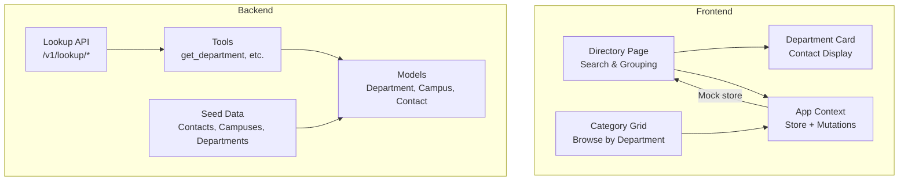
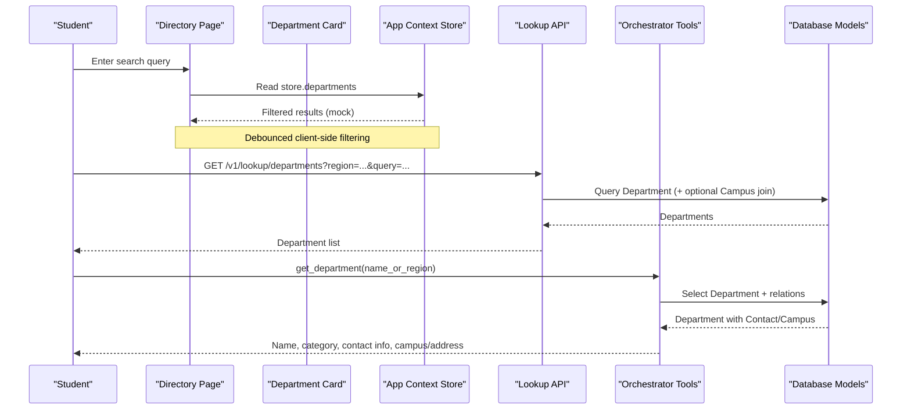
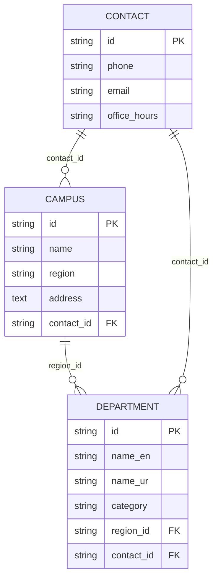
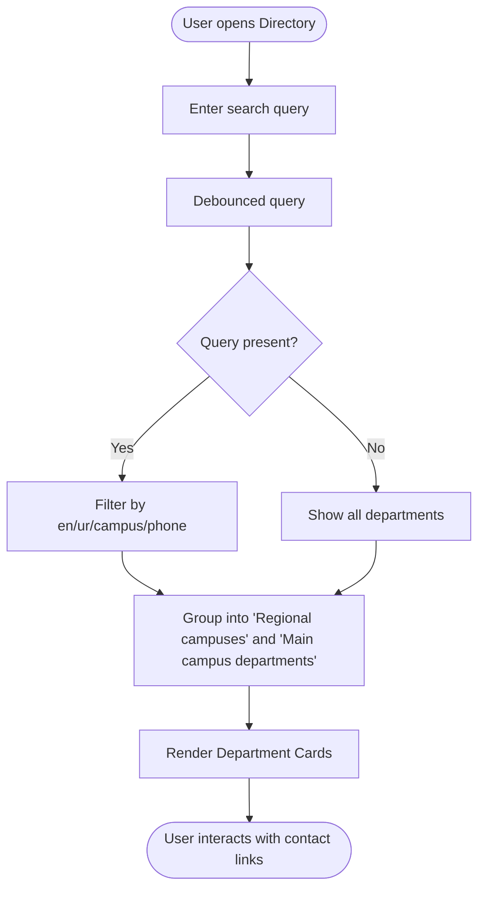
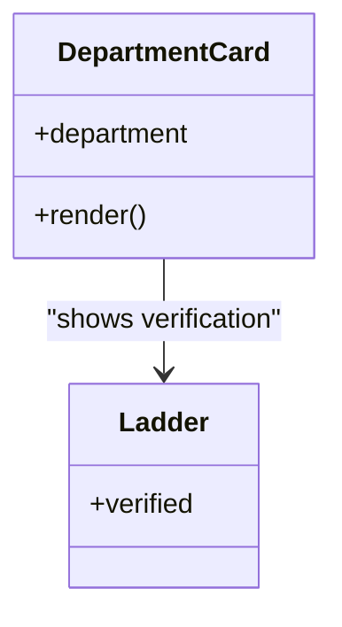
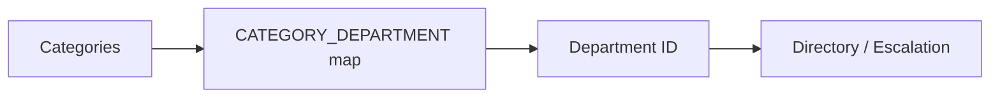
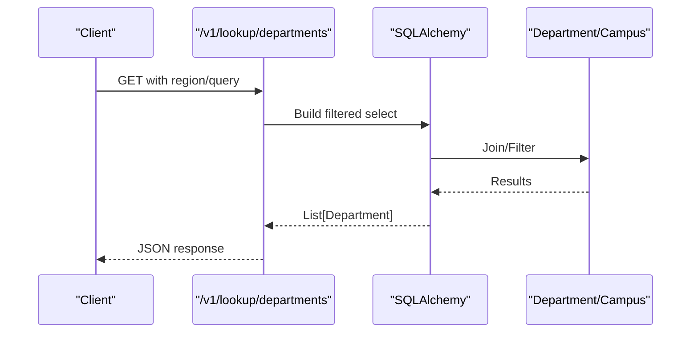
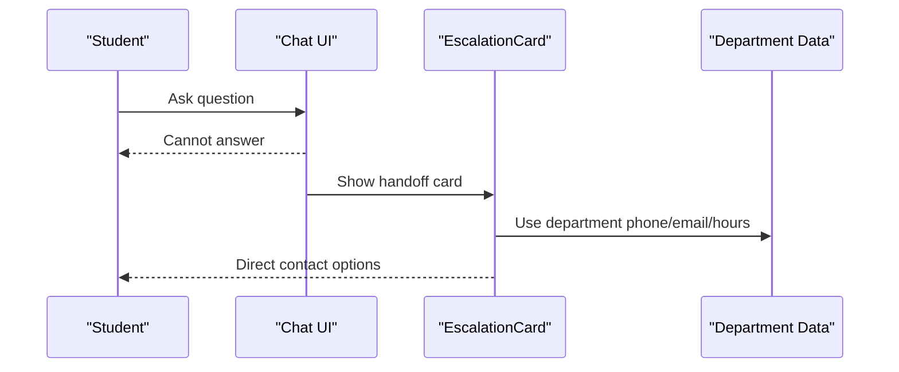
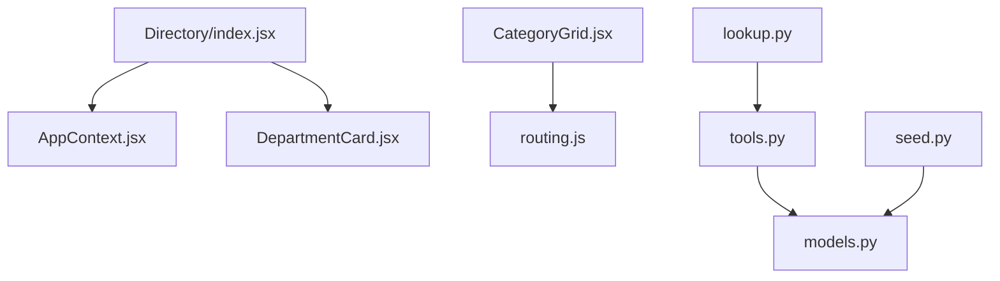

# Department Management

<cite>
**Referenced Files in This Document**
- [departments.js](file://src/mocks/departments.js)
- [DepartmentCard.jsx](file://src/components/student/DepartmentCard.jsx)
- [Directory/index.jsx](file://src/pages/student/Directory/index.jsx)
- [routing.js](file://src/mocks/routing.js)
- [services.js](file://src/mocks/services.js)
- [AppContext.jsx](file://src/context/AppContext.jsx)
- [CategoryGrid.jsx](file://src/pages/student/Landing/CategoryGrid.jsx)
- [EscalationCard.jsx](file://src/pages/student/Chat/EscalationCard.jsx)
- [models.py](file://uaea-backend/app/db/models.py)
- [tools.py](file://uaea-backend/app/orchestrator/tools.py)
- [lookup.py](file://uaea-backend/app/api/lookup.py)
- [seed.py](file://uaea-backend/app/db/seed.py)
</cite>

## Table of Contents
1. [Introduction](#introduction)
2. [Project Structure](#project-structure)
3. [Core Components](#core-components)
4. [Architecture Overview](#architecture-overview)
5. [Detailed Component Analysis](#detailed-component-analysis)
6. [Dependency Analysis](#dependency-analysis)
7. [Performance Considerations](#performance-considerations)
8. [Troubleshooting Guide](#troubleshooting-guide)
9. [Conclusion](#conclusion)
10. [Appendices](#appendices)

## Introduction
This document explains the department management functionality that powers student-facing directory and routing features across multiple campuses. It covers:
- Organizational structure: departments, faculties/categories, and administrative units (campuses).
- Contact information management: email addresses, phone numbers, office hours, and campus locations.
- Hierarchy relationships between organizational levels.
- Access controls and permissions for department-specific content.
- Search and directory functionality enabling students to find relevant contacts.
- Examples of department structures and how they integrate with the student directory feature.
- Multi-campus considerations and location-based routing.

## Project Structure
The system comprises a frontend React application and a Python backend API. The frontend provides the student directory UI and service browsing; the backend exposes lookup endpoints and tools used by both the assistant and APIs.

**Diagram sources**
- [Directory/index.jsx:1-80](file://src/pages/student/Directory/index.jsx#L1-L80)
- [DepartmentCard.jsx:1-42](file://src/components/student/DepartmentCard.jsx#L1-L42)
- [CategoryGrid.jsx:1-38](file://src/pages/student/Landing/CategoryGrid.jsx#L1-L38)
- [AppContext.jsx:1-135](file://src/context/AppContext.jsx#L1-L135)
- [lookup.py:1-104](file://uaea-backend/app/api/lookup.py#L1-L104)
- [tools.py:92-126](file://uaea-backend/app/orchestrator/tools.py#L92-L126)
- [models.py:30-68](file://uaea-backend/app/db/models.py#L30-L68)
- [seed.py:26-46](file://uaea-backend/app/db/seed.py#L26-L46)

**Section sources**
- [Directory/index.jsx:1-80](file://src/pages/student/Directory/index.jsx#L1-L80)
- [DepartmentCard.jsx:1-42](file://src/components/student/DepartmentCard.jsx#L1-L42)
- [CategoryGrid.jsx:1-38](file://src/pages/student/Landing/CategoryGrid.jsx#L1-L38)
- [AppContext.jsx:1-135](file://src/context/AppContext.jsx#L1-L135)
- [lookup.py:1-104](file://uaea-backend/app/api/lookup.py#L1-L104)
- [tools.py:92-126](file://uaea-backend/app/orchestrator/tools.py#L92-L126)
- [models.py:30-68](file://uaea-backend/app/db/models.py#L30-L68)
- [seed.py:26-46](file://uaea-backend/app/db/seed.py#L26-L46)

## Core Components
- Department data model and seed:
  - Backend models define Department, Campus, and Contact entities with relationships.
  - Seed script populates initial contacts, campuses, and departments.
- Frontend department directory:
  - Directory page groups departments into “Regional campuses” and “Main campus departments,” supports debounced search across name, region, and phone.
  - Department card renders contact details (phone, email, campus, hours) and verification metadata.
- Routing and services:
  - Category-to-department mapping routes student queries to the correct department.
  - Services are grouped by category and linked to owning departments.
- App context:
  - Centralized store holds departments, services, fees, deadlines, documents, flows, and adapters.
  - Provides mutate and verifyRecord utilities for admin operations and audit logging.

**Section sources**
- [models.py:30-68](file://uaea-backend/app/db/models.py#L30-L68)
- [seed.py:26-46](file://uaea-backend/app/db/seed.py#L26-L46)
- [Directory/index.jsx:1-80](file://src/pages/student/Directory/index.jsx#L1-L80)
- [DepartmentCard.jsx:1-42](file://src/components/student/DepartmentCard.jsx#L1-L42)
- [routing.js:1-77](file://src/mocks/routing.js#L1-L77)
- [services.js:1-309](file://src/mocks/services.js#L1-L309)
- [AppContext.jsx:1-135](file://src/context/AppContext.jsx#L1-L135)

## Architecture Overview
The architecture uses deterministic lookups rather than model-generated answers for critical data like phone numbers and office hours. Students can browse or search departments directly, or be routed via categories to the responsible department.

**Diagram sources**
- [Directory/index.jsx:1-80](file://src/pages/student/Directory/index.jsx#L1-L80)
- [lookup.py:26-53](file://uaea-backend/app/api/lookup.py#L26-L53)
- [tools.py:92-126](file://uaea-backend/app/orchestrator/tools.py#L92-L126)
- [models.py:30-68](file://uaea-backend/app/db/models.py#L30-L68)

## Detailed Component Analysis

### Department Data Model and Relationships
- Contact: stores phone, email, office_hours.
- Campus: stores name, region, address, and links to a Contact.
- Department: stores name_en, name_ur, category, and links to a Campus (region) and a Contact.

**Diagram sources**
- [models.py:30-68](file://uaea-backend/app/db/models.py#L30-L68)

**Section sources**
- [models.py:30-68](file://uaea-backend/app/db/models.py#L30-L68)
- [seed.py:26-46](file://uaea-backend/app/db/seed.py#L26-L46)

### Student Directory: Search and Grouping
- Groups:
  - Regional campuses vs Main campus departments based on department names.
- Search:
  - Debounced filter across English name, Urdu name, campus, and phone fields.
- Empty state:
  - Guidance to try city names or section names when no matches are found.

**Diagram sources**
- [Directory/index.jsx:1-80](file://src/pages/student/Directory/index.jsx#L1-L80)

**Section sources**
- [Directory/index.jsx:1-80](file://src/pages/student/Directory/index.jsx#L1-L80)

### Department Card: Contact Information Display
- Renders bilingual names, clickable phone (tel), mailto email, campus location, and office hours.
- Shows verification status with a visual indicator.

**Diagram sources**
- [DepartmentCard.jsx:1-42](file://src/components/student/DepartmentCard.jsx#L1-L42)

**Section sources**
- [DepartmentCard.jsx:1-42](file://src/components/student/DepartmentCard.jsx#L1-L42)

### Routing from Categories to Departments
- Category-to-department mapping ensures students are directed to the correct office regardless of how they phrase their question.
- Category grid shows counts per category and links to department-owned services.

**Diagram sources**
- [routing.js:1-77](file://src/mocks/routing.js#L1-L77)
- [CategoryGrid.jsx:1-38](file://src/pages/student/Landing/CategoryGrid.jsx#L1-L38)

**Section sources**
- [routing.js:1-77](file://src/mocks/routing.js#L1-L77)
- [CategoryGrid.jsx:1-38](file://src/pages/student/Landing/CategoryGrid.jsx#L1-L38)

### Backend Lookup API and Tools
- API endpoint lists departments with optional filters by region or query.
- Tool function performs case-insensitive matching across department names and region identifiers, returning contact and campus details.

**Diagram sources**
- [lookup.py:26-53](file://uaea-backend/app/api/lookup.py#L26-L53)
- [models.py:30-68](file://uaea-backend/app/db/models.py#L30-L68)

**Section sources**
- [lookup.py:26-53](file://uaea-backend/app/api/lookup.py#L26-L53)
- [tools.py:92-126](file://uaea-backend/app/orchestrator/tools.py#L92-L126)

### Escalation Handoff to Human Support
- When the assistant cannot resolve a query, it escalates to a human with a specific department’s contact details.

**Diagram sources**
- [EscalationCard.jsx:1-41](file://src/pages/student/Chat/EscalationCard.jsx#L1-L41)

**Section sources**
- [EscalationCard.jsx:1-41](file://src/pages/student/Chat/EscalationCard.jsx#L1-L41)

## Dependency Analysis
- Frontend dependencies:
  - Directory depends on AppContext store for departments and uses debounced search.
  - DepartmentCard depends on icons and verification component.
  - CategoryGrid depends on routing configuration and services catalog.
- Backend dependencies:
  - Lookup API depends on SQLAlchemy models and optional region filtering.
  - Orchestrator tools depend on models to return enriched department info including contact and campus.
  - Seed script initializes Contacts, Campuses, and Departments.

**Diagram sources**
- [Directory/index.jsx:1-80](file://src/pages/student/Directory/index.jsx#L1-L80)
- [AppContext.jsx:1-135](file://src/context/AppContext.jsx#L1-L135)
- [DepartmentCard.jsx:1-42](file://src/components/student/DepartmentCard.jsx#L1-L42)
- [CategoryGrid.jsx:1-38](file://src/pages/student/Landing/CategoryGrid.jsx#L1-L38)
- [routing.js:1-77](file://src/mocks/routing.js#L1-L77)
- [lookup.py:1-104](file://uaea-backend/app/api/lookup.py#L1-L104)
- [tools.py:92-126](file://uaea-backend/app/orchestrator/tools.py#L92-L126)
- [models.py:30-68](file://uaea-backend/app/db/models.py#L30-L68)
- [seed.py:26-46](file://uaea-backend/app/db/seed.py#L26-L46)

**Section sources**
- [Directory/index.jsx:1-80](file://src/pages/student/Directory/index.jsx#L1-L80)
- [AppContext.jsx:1-135](file://src/context/AppContext.jsx#L1-L135)
- [DepartmentCard.jsx:1-42](file://src/components/student/DepartmentCard.jsx#L1-L42)
- [CategoryGrid.jsx:1-38](file://src/pages/student/Landing/CategoryGrid.jsx#L1-L38)
- [routing.js:1-77](file://src/mocks/routing.js#L1-L77)
- [lookup.py:1-104](file://uaea-backend/app/api/lookup.py#L1-L104)
- [tools.py:92-126](file://uaea-backend/app/orchestrator/tools.py#L92-L126)
- [models.py:30-68](file://uaea-backend/app/db/models.py#L30-L68)
- [seed.py:26-46](file://uaea-backend/app/db/seed.py#L26-L46)

## Performance Considerations
- Client-side search is debounced to reduce re-renders and improve responsiveness during typing.
- Filtering operates on in-memory arrays for fast response times in the current mock setup.
- Backend queries use selective joins and ILIKE filters; ensure indexes on frequently searched columns (e.g., name_en, name_ur, category) if scaling to large datasets.
- Avoid unnecessary re-fetches by caching department lists at the app level where appropriate.

[No sources needed since this section provides general guidance]

## Troubleshooting Guide
- No results in Directory:
  - Verify the query includes terms present in English/Urdu names, campus, or phone fields.
  - Clear the search to reset filters.
- Wrong department routing:
  - Confirm CATEGORY_DEPARTMENT mappings align with service categories.
  - Ensure services have correct category values.
- Missing contact details:
  - Check that departments have associated contacts and campuses in seed data or database.
  - Validate that lookup API filters do not exclude expected records due to region mismatches.
- Escalation not showing:
  - Ensure escalation path has a valid department object with phone, email, and hours.

**Section sources**
- [Directory/index.jsx:1-80](file://src/pages/student/Directory/index.jsx#L1-L80)
- [routing.js:1-77](file://src/mocks/routing.js#L1-L77)
- [lookup.py:26-53](file://uaea-backend/app/api/lookup.py#L26-L53)
- [seed.py:26-46](file://uaea-backend/app/db/seed.py#L26-L46)
- [EscalationCard.jsx:1-41](file://src/pages/student/Chat/EscalationCard.jsx#L1-L41)

## Conclusion
The department management system provides a robust, deterministic foundation for student support:
- Clear hierarchy through departments, campuses, and contacts.
- Reliable contact information displayed in a student-friendly directory.
- Deterministic routing from categories to departments to ensure accurate handoffs.
- Scalable backend with flexible lookup capabilities and seed data for quick setup.
- Multi-campus support with region-based filtering and location-aware routing.

[No sources needed since this section summarizes without analyzing specific files]

## Appendices

### Example Department Structures
- Main campus departments:
  - Directorate of Admissions
  - Examinations Department
  - Degree & Transcript Section
  - Directorate of Finance
  - Records & Registration Section
  - Student Affairs & Scholarships
- Regional campuses:
  - Regional Campus Rawalpindi
  - Regional Campus Lahore
  - Regional Campus Karachi
  - Regional Campus Peshawar
  - Regional Campus Multan

These entries include phone, email, campus location, and office hours, and are searchable by city or department name.

**Section sources**
- [departments.js:1-18](file://src/mocks/departments.js#L1-L18)

### Integration with Student Directory Feature
- The directory page groups departments and enables search across key fields.
- Department cards provide direct actions (call, email) and display verified status.
- Category grid helps students discover services by department ownership.

**Section sources**
- [Directory/index.jsx:1-80](file://src/pages/student/Directory/index.jsx#L1-L80)
- [DepartmentCard.jsx:1-42](file://src/components/student/DepartmentCard.jsx#L1-L42)
- [CategoryGrid.jsx:1-38](file://src/pages/student/Landing/CategoryGrid.jsx#L1-L38)

### Multi-Campus Considerations and Location-Based Routing
- Backend supports filtering departments by region using campus region matching.
- Tools return campus name and address alongside contact details for precise routing.
- Seed data defines multiple campuses with distinct regions and contacts.

**Section sources**
- [lookup.py:26-53](file://uaea-backend/app/api/lookup.py#L26-L53)
- [tools.py:92-126](file://uaea-backend/app/orchestrator/tools.py#L92-L126)
- [seed.py:35-46](file://uaea-backend/app/db/seed.py#L35-L46)