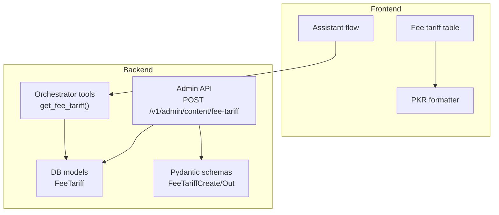
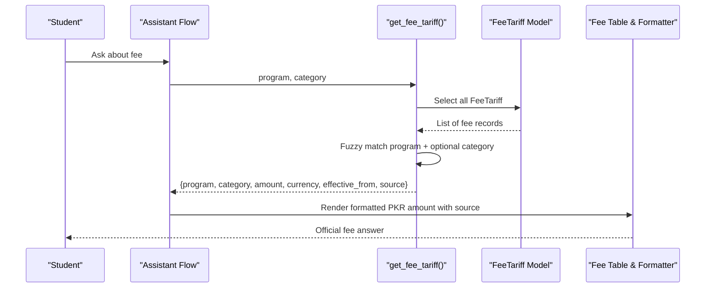
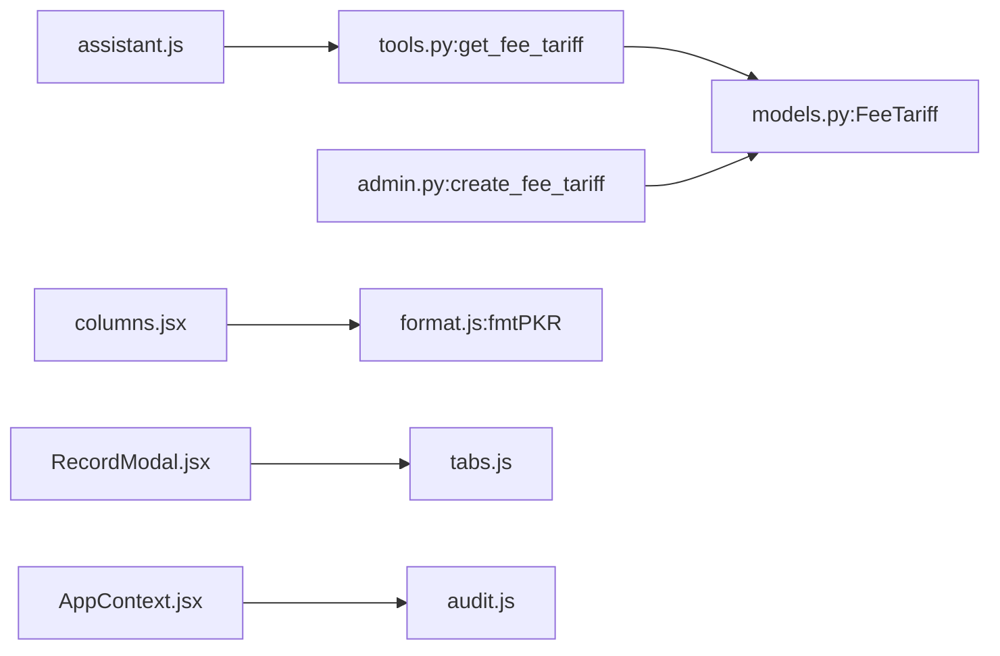

# Fee Tariff Administration

<cite>
**Referenced Files in This Document**
- [models.py](file://uaea-backend/app/db/models.py)
- [schemas.py](file://uaea-backend/app/schemas.py)
- [tools.py](file://uaea-backend/app/orchestrator/tools.py)
- [admin.py](file://uaea-backend/app/api/admin.py)
- [seed.py](file://uaea-backend/app/db/seed.py)
- [test_rag_retrieval.py](file://uaea-backend/tests/test_rag_retrieval.py)
- [assistant.js](file://src/lib/assistant.js)
- [format.js](file://src/lib/format.js)
- [columns.jsx](file://src/components/content/columns.jsx)
- [RecordModal.jsx](file://src/components/content/RecordModal.jsx)
- [tabs.js](file://src/pages/ContentLibrary/tabs.js)
- [fees.js](file://src/mocks/fees.js)
- [audit.js](file://src/mocks/audit.js)
- [AppContext.jsx](file://src/context/AppContext.jsx)
- [RecordHistory.jsx](file://src/components/content/RecordHistory.jsx)
</cite>

## Table of Contents
1. Introduction
2. Project Structure
3. Core Components
4. Architecture Overview
5. Detailed Component Analysis
6. Dependency Analysis
7. Performance Considerations
8. Troubleshooting Guide
9. Conclusion

## Introduction
This document explains how fee tariffs are administered, stored, queried, and presented to students through the assistant. It covers:
- Fee structure (tuition, examination, library, and other service charges)
- Currency support and multi-currency handling
- Pricing rules, discount mechanisms, and calculation logic
- Bulk operations for updating multiple fee records
- Fee categories, payment schedules, due date management
- Examples of fee structures and student-facing presentation
- Versioning and historical tracking of fee changes

## Project Structure
Fee tariff administration spans backend data models, API endpoints, orchestrator tools, and frontend tables and flows:
- Backend stores fee records and exposes admin creation endpoints; the orchestrator provides a tool to look up fees by program and category.
- Frontend displays fee tables, formats amounts in PKR, and uses the same deterministic data sources as the assistant.
- Audit trails record who changed what and when.

**Diagram sources**
- [admin.py:99-125](file://uaea-backend/app/api/admin.py#L99-L125)
- [tools.py:125-152](file://uaea-backend/app/orchestrator/tools.py#L125-L152)
- [models.py:73-82](file://uaea-backend/app/db/models.py#L73-L82)
- [schemas.py:141-147](file://uaea-backend/app/schemas.py#L141-L147)
- [columns.jsx:73-103](file://src/components/content/columns.jsx#L73-L103)
- [format.js:16-18](file://src/lib/format.js#L16-L18)
- [assistant.js:198-237](file://src/lib/assistant.js#L198-L237)

**Section sources**
- [models.py:73-82](file://uaea-backend/app/db/models.py#L73-L82)
- [schemas.py:141-147](file://uaea-backend/app/schemas.py#L141-L147)
- [admin.py:99-125](file://uaea-backend/app/api/admin.py#L99-L125)
- [tools.py:125-152](file://uaea-backend/app/orchestrator/tools.py#L125-L152)
- [columns.jsx:73-103](file://src/components/content/columns.jsx#L73-L103)
- [format.js:16-18](file://src/lib/format.js#L16-L18)
- [assistant.js:198-237](file://src/lib/assistant.js#L198-L237)

## Core Components
- FeeTariff model: Stores program, category, amount, effective_from, and source reference.
- Admin API: Creates fee tariff entries with audit logging.
- Orchestrator tool get_fee_tariff: Fuzzy matches program and optional category to return the official fee.
- Frontend fee table: Displays program, basis (category), amount (PKR), effective from, source, and verification status.
- Assistant integration: Maps intents to specific fee rows and calls the tool to present exact amounts with source citations.

Key responsibilities:
- Data integrity: Amount is an integer representing PKR; effective_from controls validity.
- Query accuracy: Tool returns the first matching row after fuzzy matching; category narrows results.
- Presentation: UI consistently formats amounts as PKR and shows effective dates.

**Section sources**
- [models.py:73-82](file://uaea-backend/app/db/models.py#L73-L82)
- [admin.py:99-125](file://uaea-backend/app/api/admin.py#L99-L125)
- [tools.py:125-152](file://uaea-backend/app/orchestrator/tools.py#L125-L152)
- [columns.jsx:73-103](file://src/components/content/columns.jsx#L73-L103)
- [assistant.js:198-237](file://src/lib/assistant.js#L198-L237)

## Architecture Overview
The fee lookup path ensures authoritative answers:
- The assistant identifies the intent and maps it to a program/category pair.
- It invokes the get_fee_tariff tool with those parameters.
- The tool queries the database, applies fuzzy matching, and returns the official amount, currency, effective date, and source.
- The frontend renders amounts in PKR and includes source references.

**Diagram sources**
- [assistant.js:198-237](file://src/lib/assistant.js#L198-L237)
- [tools.py:125-152](file://uaea-backend/app/orchestrator/tools.py#L125-L152)
- [models.py:73-82](file://uaea-backend/app/db/models.py#L73-L82)
- [format.js:16-18](file://src/lib/format.js#L16-L18)

## Detailed Component Analysis

### Fee Data Model and Schema
- FeeTariff fields: id, program, category, amount (integer), effective_from (date), source_doc_ref (string).
- Schemas: FeeTariffCreate for input validation; FeeTariffOut for responses.

Complexity:
- Lookup is O(n) over all fee records with simple string comparisons.

Optimization opportunities:
- Add indexes on program and category for faster filtering.
- Introduce versioning or supersession fields to manage historical versions explicitly.

Error handling:
- If no match is found, the tool returns an error object indicating no fee was found.

**Section sources**
- [models.py:73-82](file://uaea-backend/app/db/models.py#L73-L82)
- [schemas.py:40-48](file://uaea-backend/app/schemas.py#L40-L48)
- [schemas.py:141-147](file://uaea-backend/app/schemas.py#L141-L147)

### Admin Creation Endpoint
- POST /v1/admin/content/fee-tariff creates a new fee tariff entry.
- Requires admin authentication via API key or bearer token.
- Logs an audit entry with actor, action, table name, record id, and detail.

Bulk operations:
- Currently supports single-record creation. For bulk updates, wrap multiple calls in a transaction or implement a dedicated batch endpoint.

**Section sources**
- [admin.py:31-48](file://uaea-backend/app/api/admin.py#L31-L48)
- [admin.py:99-125](file://uaea-backend/app/api/admin.py#L99-L125)

### Fee Lookup Tool
- Reads all FeeTariff records and performs fuzzy matching on program name.
- Optionally filters by category substring match.
- Returns the first match with amount, currency (hardcoded to PKR), effective_from, and source.

Pricing rules and discounts:
- No built-in discount logic; amounts are stored as final values per category.
- Effective_from indicates when a fee becomes valid; current implementation does not filter by today’s date during lookup.

**Section sources**
- [tools.py:125-152](file://uaea-backend/app/orchestrator/tools.py#L125-L152)

### Frontend Fee Table and Formatting
- Columns: Programme, Basis (category), Amount (formatted as PKR), Effective from, Source, Last verified.
- Uses fmtPKR to render amounts consistently.

Presentation examples:
- Semester-based tuition for new enrolments.
- Per credit hour for repeats.
- Annual fees for matric/intermediate programs.
- Service fees for transcripts, degrees, rechecking, migration, NOC, and record correction.

**Section sources**
- [columns.jsx:73-103](file://src/components/content/columns.jsx#L73-L103)
- [format.js:16-18](file://src/lib/format.js#L16-L18)
- [fees.js:5-20](file://src/mocks/fees.js#L5-L20)

### Assistant Integration and Student-Facing Answers
- Intent-to-fee mapping: Certain intents map directly to program/category pairs (e.g., transcript urgent service, degree normal service).
- The assistant calls get_fee_tariff with mapped parameters and presents the exact amount with source citation.
- Deadlines are handled separately via get_deadline and can be combined with fee answers in guided flows.

**Section sources**
- [assistant.js:198-237](file://src/lib/assistant.js#L198-L237)
- [tools.py:125-152](file://uaea-backend/app/orchestrator/tools.py#L125-L152)

### Payment Schedules and Due Date Management
- Deadlines are modeled separately and linked to services.
- The assistant can retrieve deadlines for services such as “Fee Challan” and display them alongside fee information.
- Effective dates for fees are recorded but not enforced at query time; ensure effective_from aligns with policy.

**Section sources**
- [models.py:108-121](file://uaea-backend/app/db/models.py#L108-L121)
- [tools.py:155-178](file://uaea-backend/app/orchestrator/tools.py#L155-L178)

### Versioning and Historical Tracking
- Audit trail: Every admin write to fee tariffs is logged with actor, action, table, record id, and details.
- Frontend audit views show append-only history; per-record history drawer filters by record id.
- Current model lacks explicit version fields; consider adding superseded_by or version number for richer history.

**Section sources**
- [admin.py:53-63](file://uaea-backend/app/api/admin.py#L53-L63)
- [admin.py:117-121](file://uaea-backend/app/api/admin.py#L117-L121)
- [audit.js:1-12](file://src/mocks/audit.js#L1-L12)
- [RecordHistory.jsx:1-39](file://src/components/content/RecordHistory.jsx#L1-L39)
- [AppContext.jsx:51-67](file://src/context/AppContext.jsx#L51-L67)

### Examples of Fee Structures
Examples include:
- Tuition: BS Computer Science semester (new), B.Ed (1.5 Year) semester (new), MA Urdu semester (new), MSc Mathematics semester (new).
- Examination: Rechecking per paper.
- Services: Transcript urgent service, Degree normal service, Migration Certificate normal service, NOC normal service, Record Correction normal service.
- Other: Matric and Intermediate annual fees.

These are represented in mock data and seed data and surfaced via the assistant and tables.

**Section sources**
- [fees.js:5-20](file://src/mocks/fees.js#L5-L20)
- [seed.py:48-57](file://uaea-backend/app/db/seed.py#L48-L57)

## Dependency Analysis

**Diagram sources**
- [assistant.js:198-237](file://src/lib/assistant.js#L198-L237)
- [tools.py:125-152](file://uaea-backend/app/orchestrator/tools.py#L125-L152)
- [models.py:73-82](file://uaea-backend/app/db/models.py#L73-L82)
- [admin.py:99-125](file://uaea-backend/app/api/admin.py#L99-L125)
- [columns.jsx:73-103](file://src/components/content/columns.jsx#L73-L103)
- [format.js:16-18](file://src/lib/format.js#L16-L18)
- [RecordModal.jsx:98-119](file://src/components/content/RecordModal.jsx#L98-L119)
- [tabs.js:1-9](file://src/pages/ContentLibrary/tabs.js#L1-L9)
- [AppContext.jsx:51-67](file://src/context/AppContext.jsx#L51-L67)
- [audit.js:1-12](file://src/mocks/audit.js#L1-L12)

**Section sources**
- [assistant.js:198-237](file://src/lib/assistant.js#L198-L237)
- [tools.py:125-152](file://uaea-backend/app/orchestrator/tools.py#L125-L152)
- [models.py:73-82](file://uaea-backend/app/db/models.py#L73-L82)
- [admin.py:99-125](file://uaea-backend/app/api/admin.py#L99-L125)
- [columns.jsx:73-103](file://src/components/content/columns.jsx#L73-L103)
- [format.js:16-18](file://src/lib/format.js#L16-L18)
- [RecordModal.jsx:98-119](file://src/components/content/RecordModal.jsx#L98-L119)
- [tabs.js:1-9](file://src/pages/ContentLibrary/tabs.js#L1-L9)
- [AppContext.jsx:51-67](file://src/context/AppContext.jsx#L51-L67)
- [audit.js:1-12](file://src/mocks/audit.js#L1-L12)

## Performance Considerations
- Fee lookup scans all records; consider indexing program and category columns to reduce query time.
- Avoid loading large datasets into memory if the fee table grows significantly.
- Keep assistant mappings minimal and centralized to prevent redundant lookups.

[No sources needed since this section provides general guidance]

## Troubleshooting Guide
Common issues and resolutions:
- No fee found: Ensure program name matches stored values or use keywords that exist in the program field; verify category spelling if provided.
- Incorrect amount returned: Confirm effective_from alignment with policy; consider enforcing effective date at query time.
- Missing source citation: Verify source_doc_ref is set when creating fee entries.
- Audit gaps: Confirm admin writes trigger audit logging; check RBAC configuration to allow authorized actors.

Validation references:
- Tests assert correct fee retrieval by program and category, including error cases.

**Section sources**
- [tools.py:125-152](file://uaea-backend/app/orchestrator/tools.py#L125-L152)
- [test_rag_retrieval.py:36-57](file://uaea-backend/tests/test_rag_retrieval.py#L36-L57)
- [admin.py:31-48](file://uaea-backend/app/api/admin.py#L31-L48)

## Conclusion
Fee tariff administration in this system centers on a clear data model, robust admin creation with audit trails, and a deterministic lookup tool used by the assistant. Fees are presented in PKR with consistent formatting and source citations. While versioning and effective-date enforcement are not fully implemented, the foundation supports future enhancements such as indexed queries, explicit versioning, and stricter effective-date checks. Bulk operations can be added via a dedicated batch endpoint or transactional wrappers around existing create calls.

[No sources needed since this section summarizes without analyzing specific files]