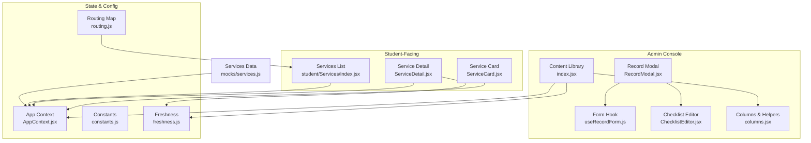
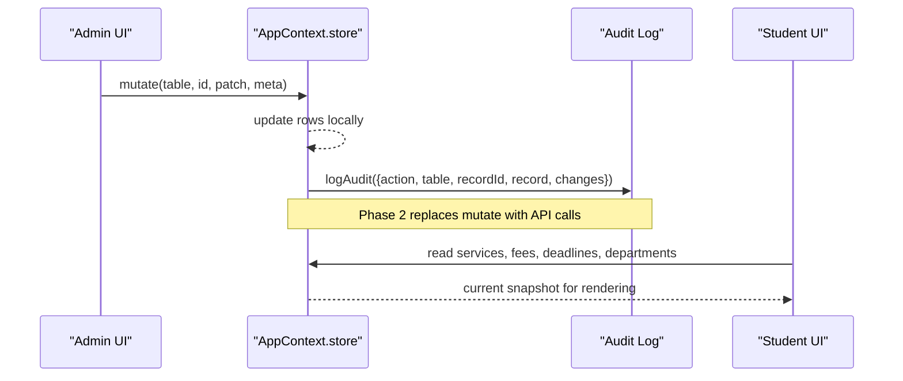
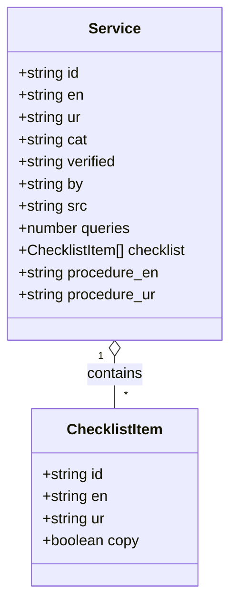
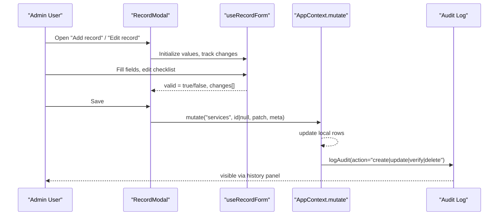
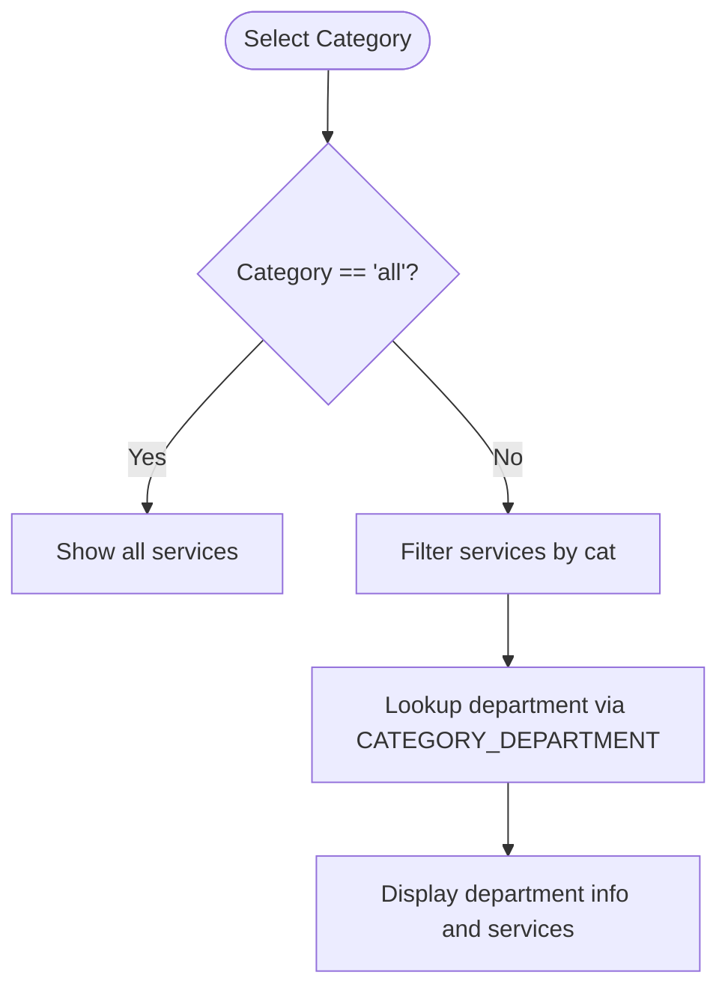
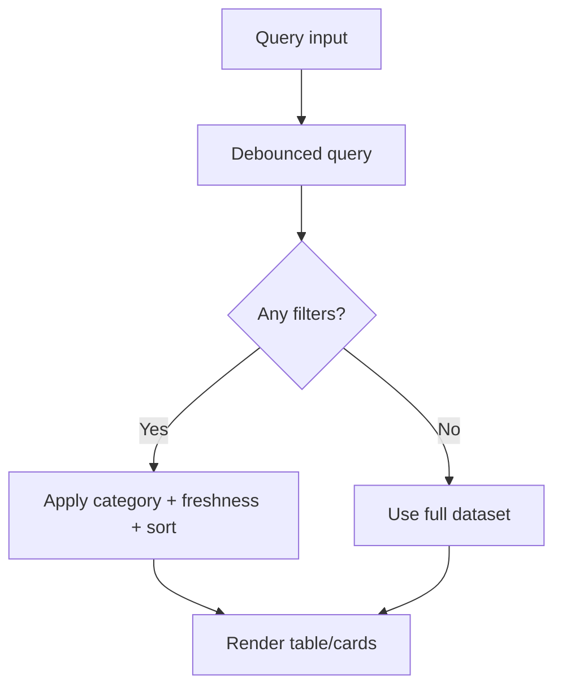
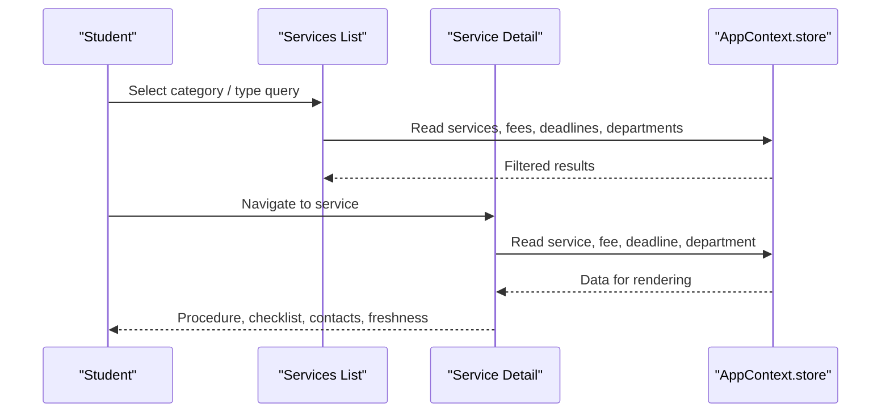
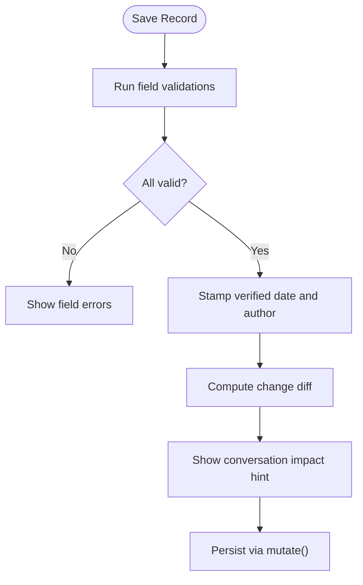
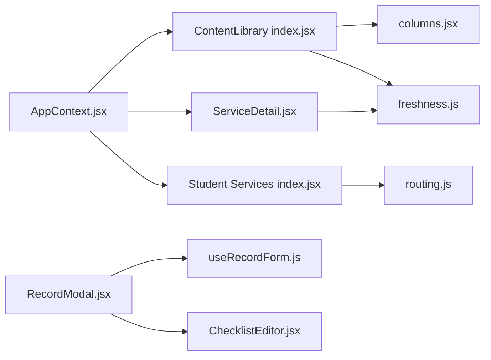

# Service Catalog Management

<cite>
**Referenced Files in This Document**
- [services.js](file://src/mocks/services.js)
- [index.jsx](file://src/pages/ContentLibrary/index.jsx)
- [RecordModal.jsx](file://src/components/content/RecordModal.jsx)
- [useRecordForm.js](file://src/components/content/useRecordForm.js)
- [columns.jsx](file://src/components/content/columns.jsx)
- [AppContext.jsx](file://src/context/AppContext.jsx)
- [routing.js](file://src/mocks/routing.js)
- [freshness.js](file://src/lib/freshness.js)
- [constants.js](file://src/lib/constants.js)
- [index.jsx (Student Services)](file://src/pages/student/Services/index.jsx)
- [ServiceDetail.jsx](file://src/pages/student/Services/ServiceDetail.jsx)
- [ServiceCard.jsx](file://src/components/student/ServiceCard.jsx)
- [ChecklistEditor.jsx](file://src/components/content/ChecklistEditor.jsx)
</cite>

## Table of Contents
1. [Introduction](#introduction)
2. [Project Structure](#project-structure)
3. [Core Components](#core-components)
4. [Architecture Overview](#architecture-overview)
5. [Detailed Component Analysis](#detailed-component-analysis)
6. [Dependency Analysis](#dependency-analysis)
7. [Performance Considerations](#performance-considerations)
8. [Troubleshooting Guide](#troubleshooting-guide)
9. [Conclusion](#conclusion)

## Introduction
This document explains the service catalog management system that powers both the admin console and the student-facing assistant. It covers how services are defined, categorized, edited, verified, searched, and presented to students. It also documents the data model, validation rules, categorization system, search and filtering, and integration points with the assistant.

## Project Structure
The service catalog spans several modules:
- Data model and sample services live in a mock dataset used by the app state.
- The content library provides CRUD operations for services and related tables.
- A form hook enforces validation and change tracking.
- Student pages render service listings and details, integrating fees and deadlines.
- Freshness logic governs trust levels based on verification dates.

**Diagram sources**
- [index.jsx:1-254](file://src/pages/ContentLibrary/index.jsx#L1-L254)
- [RecordModal.jsx:1-316](file://src/components/content/RecordModal.jsx#L1-L316)
- [useRecordForm.js:1-123](file://src/components/content/useRecordForm.js#L1-L123)
- [columns.jsx:1-171](file://src/components/content/columns.jsx#L1-L171)
- [AppContext.jsx:1-135](file://src/context/AppContext.jsx#L1-L135)
- [routing.js:1-77](file://src/mocks/routing.js#L1-L77)
- [freshness.js:1-37](file://src/lib/freshness.js#L1-L37)
- [constants.js:1-35](file://src/lib/constants.js#L1-L35)
- [index.jsx (Student Services):1-125](file://src/pages/student/Services/index.jsx#L1-L125)
- [ServiceDetail.jsx:1-174](file://src/pages/student/Services/ServiceDetail.jsx#L1-L174)
- [ServiceCard.jsx:1-57](file://src/components/student/ServiceCard.jsx#L1-L57)
- [services.js:1-309](file://src/mocks/services.js#L1-L309)

**Section sources**
- [index.jsx:1-254](file://src/pages/ContentLibrary/index.jsx#L1-L254)
- [AppContext.jsx:1-135](file://src/context/AppContext.jsx#L1-L135)

## Core Components
- Service data model: Each service includes identifiers, bilingual names, category, verification metadata, query counts, document checklist, procedures in two languages, and source citation.
- Content library: Central table view with search, category filter, freshness filter, sorting, export, and bulk verify.
- Record modal: Add/edit forms per tab with validation, diff preview, and audit stamping.
- Checklist editor: Manage required documents with bilingual labels and original/copy flags.
- Student services: Browseable directory with category chips, search, and detail pages showing procedure, checklist, fee, deadline, department contact, and freshness status.

**Section sources**
- [services.js:1-309](file://src/mocks/services.js#L1-L309)
- [index.jsx:1-254](file://src/pages/ContentLibrary/index.jsx#L1-L254)
- [RecordModal.jsx:1-316](file://src/components/content/RecordModal.jsx#L1-L316)
- [ChecklistEditor.jsx:1-114](file://src/components/content/ChecklistEditor.jsx#L1-L114)
- [index.jsx (Student Services):1-125](file://src/pages/student/Services/index.jsx#L1-L125)
- [ServiceDetail.jsx:1-174](file://src/pages/student/Services/ServiceDetail.jsx#L1-L174)

## Architecture Overview
The system uses a single client-side store for all content tables. Admin actions mutate this store and log changes to an audit trail. Student views read from the same store to present consistent information.

**Diagram sources**
- [AppContext.jsx:69-116](file://src/context/AppContext.jsx#L69-L116)

**Section sources**
- [AppContext.jsx:1-135](file://src/context/AppContext.jsx#L1-L135)

## Detailed Component Analysis

### Service Data Model
- Fields include:
  - Identifier and bilingual names (English and Urdu)
  - Category (e.g., Admissions, Finance, Examinations, Academics, Certification, Records)
  - Verification date and verifier name
  - Source citation
  - Query count over last 90 days
  - Document checklist items with bilingual names and original/copy flag
  - Procedures in English and Urdu
- Categories map to owning departments for routing and display.

**Diagram sources**
- [services.js:10-309](file://src/mocks/services.js#L10-L309)

**Section sources**
- [services.js:1-309](file://src/mocks/services.js#L1-L309)
- [routing.js:11-18](file://src/mocks/routing.js#L11-L18)

### CRUD Operations for Services
- Create: Open “Add record” modal, fill fields, validate, save; store adds a new row with generated id and stamps verification date and author.
- Read: Content library lists services; student pages list and navigate to details.
- Update: Edit modal pre-fills existing values, shows diff of changed fields, validates, saves; store updates row in place.
- Delete: Confirm delete modal removes the row from the store.
- Verify: Mark one or multiple records as verified today under the current user’s name.

**Diagram sources**
- [RecordModal.jsx:21-46](file://src/components/content/RecordModal.jsx#L21-L46)
- [useRecordForm.js:34-123](file://src/components/content/useRecordForm.js#L34-L123)
- [AppContext.jsx:69-116](file://src/context/AppContext.jsx#L69-L116)

**Section sources**
- [index.jsx:96-113](file://src/pages/ContentLibrary/index.jsx#L96-L113)
- [RecordModal.jsx:21-46](file://src/components/content/RecordModal.jsx#L21-L46)
- [useRecordForm.js:34-123](file://src/components/content/useRecordForm.js#L34-L123)
- [AppContext.jsx:69-116](file://src/context/AppContext.jsx#L69-L116)

### Categorization System
- Services are grouped by category strings such as Admissions, Finance, Examinations, Academics, Certification, Records.
- Categories drive:
  - Filtering in the content library and student directory
  - Department ownership mapping for contact info and routing
  - Landing page descriptions and quick asks

**Diagram sources**
- [routing.js:11-18](file://src/mocks/routing.js#L11-L18)
- [index.jsx (Student Services):30-44](file://src/pages/student/Services/index.jsx#L30-L44)

**Section sources**
- [routing.js:1-77](file://src/mocks/routing.js#L1-L77)
- [index.jsx (Student Services):1-125](file://src/pages/student/Services/index.jsx#L1-L125)

### Search and Filtering
- Content library supports:
  - Debounced text search across all fields
  - Category dropdown filter
  - Freshness filter (Verified/Ageing/Stale)
  - Sorting by any column key
  - Export filtered results to CSV
- Student services support:
  - Debounced search across bilingual names, category, and checklist items
  - Category chips with URL-synced state
  - Optional active department banner

**Diagram sources**
- [index.jsx:61-79](file://src/pages/ContentLibrary/index.jsx#L61-L79)
- [index.jsx (Student Services):30-39](file://src/pages/student/Services/index.jsx#L30-L39)

**Section sources**
- [index.jsx:56-79](file://src/pages/ContentLibrary/index.jsx#L56-L79)
- [index.jsx (Student Services):30-39](file://src/pages/student/Services/index.jsx#L30-L39)

### Student Integration
- Students browse services, see costs, deadlines, required documents, and last-checked freshness.
- Detail page shows:
  - Procedure text in selected language
  - Checklist with original/copy badges
  - Fee and deadline if linked
  - Department contact and hours
  - Freshness warning if not recently verified
- Quick action to ask the assistant about a specific service.

**Diagram sources**
- [index.jsx (Student Services):30-44](file://src/pages/student/Services/index.jsx#L30-L44)
- [ServiceDetail.jsx:24-44](file://src/pages/student/Services/ServiceDetail.jsx#L24-L44)

**Section sources**
- [ServiceDetail.jsx:1-174](file://src/pages/student/Services/ServiceDetail.jsx#L1-L174)
- [ServiceCard.jsx:1-57](file://src/components/student/ServiceCard.jsx#L1-L57)

### Validation Rules and Data Quality
- Required fields:
  - Services: English name, Urdu name, category, source citation
  - Fees: Programme name, amount (digits only, within ceiling), effective date
  - Deadlines: Service name, semester, date
  - Departments: English name, phone format, optional email format
- Additional checks:
  - Every record must have a source citation
  - Amounts validated against a maximum threshold
  - Dates validated via date picker inputs
  - Email format checked when provided
- Change impact:
  - Editing shows a plain-language diff of what students will notice
  - Impact hint displays approximate number of recent conversations referencing the record
- Freshness governance:
  - Records are classified into Verified, Ageing, or Stale based on days since last verification
  - Stale records warn students to confirm details before visiting

**Diagram sources**
- [useRecordForm.js:53-82](file://src/components/content/useRecordForm.js#L53-L82)
- [RecordModal.jsx:26-46](file://src/components/content/RecordModal.jsx#L26-L46)
- [freshness.js:17-23](file://src/lib/freshness.js#L17-L23)

**Section sources**
- [useRecordForm.js:1-123](file://src/components/content/useRecordForm.js#L1-L123)
- [RecordModal.jsx:1-316](file://src/components/content/RecordModal.jsx#L1-L316)
- [freshness.js:1-37](file://src/lib/freshness.js#L1-L37)

## Dependency Analysis
- AppContext holds the canonical store and exposes mutate and verifyRecord.
- Content library depends on columns definitions for rendering and on freshness for filtering.
- Student pages depend on routing configuration to map categories to departments and on store data for fees and deadlines.
- Checklist editor is embedded in the record modal and affects service checklists rendered in student detail.

**Diagram sources**
- [AppContext.jsx:1-135](file://src/context/AppContext.jsx#L1-L135)
- [index.jsx:1-254](file://src/pages/ContentLibrary/index.jsx#L1-L254)
- [index.jsx (Student Services):1-125](file://src/pages/student/Services/index.jsx#L1-L125)
- [ServiceDetail.jsx:1-174](file://src/pages/student/Services/ServiceDetail.jsx#L1-L174)
- [columns.jsx:1-171](file://src/components/content/columns.jsx#L1-L171)
- [freshness.js:1-37](file://src/lib/freshness.js#L1-L37)
- [routing.js:1-77](file://src/mocks/routing.js#L1-L77)
- [RecordModal.jsx:1-316](file://src/components/content/RecordModal.jsx#L1-L316)
- [useRecordForm.js:1-123](file://src/components/content/useRecordForm.js#L1-L123)
- [ChecklistEditor.jsx:1-114](file://src/components/content/ChecklistEditor.jsx#L1-L114)

**Section sources**
- [AppContext.jsx:1-135](file://src/context/AppContext.jsx#L1-L135)
- [index.jsx:1-254](file://src/pages/ContentLibrary/index.jsx#L1-L254)
- [routing.js:1-77](file://src/mocks/routing.js#L1-L77)

## Performance Considerations
- Debounced search reduces re-renders during typing.
- Memoized filtering and sorting minimize recomputation.
- Column rendering is separated from page logic to keep components lean.
- Freshness calculations are lightweight and reused across views.
- Bulk operations (verify selected) batch updates and reduce repeated work.

[No sources needed since this section provides general guidance]

## Troubleshooting Guide
- Empty results: Reset filters or clear search to restore visibility.
- Validation errors: Ensure required fields are filled and formats match expectations (dates via pickers, numeric amounts without symbols, phone/email formats).
- Stale data warnings: If freshness is amber or rose, confirm details with the department before visiting.
- Export blocked: Some browsers block downloads in sandboxed frames; retry outside restricted environments.
- Audit visibility: Use the history panel to review who changed what and when.

**Section sources**
- [index.jsx:219-231](file://src/pages/ContentLibrary/index.jsx#L219-L231)
- [useRecordForm.js:53-82](file://src/components/content/useRecordForm.js#L53-L82)
- [freshness.js:17-23](file://src/lib/freshness.js#L17-L23)

## Conclusion
The service catalog system provides a robust, governed way to define, manage, and present university services to students. It enforces data quality through validation and freshness controls, offers powerful search and filtering, and integrates seamlessly with the student-facing assistant and directory. The modular design separates concerns between data, UI, and governance, enabling future migration to server-backed APIs while preserving the same interface contracts.