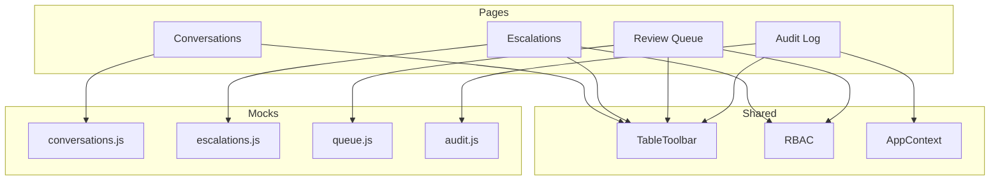
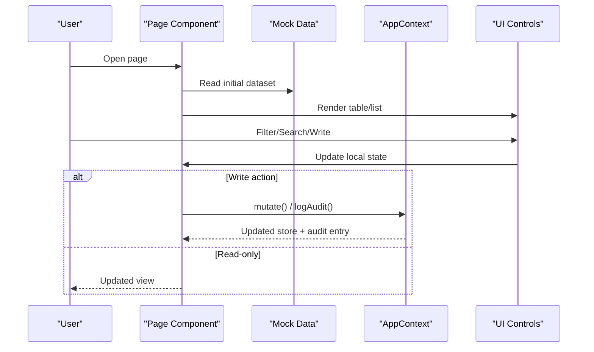
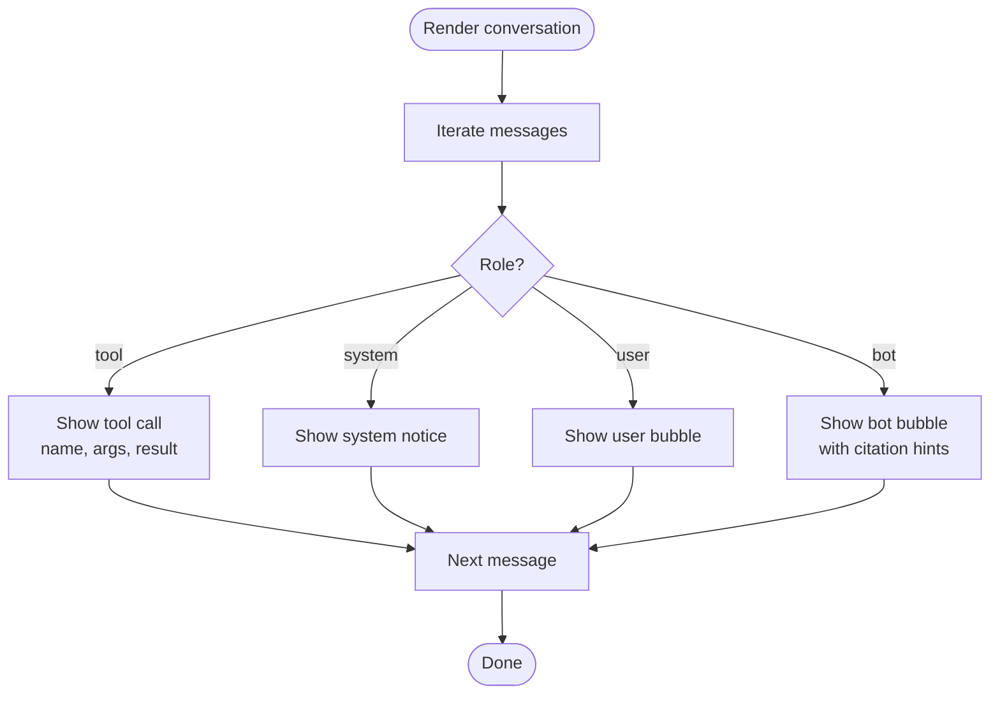
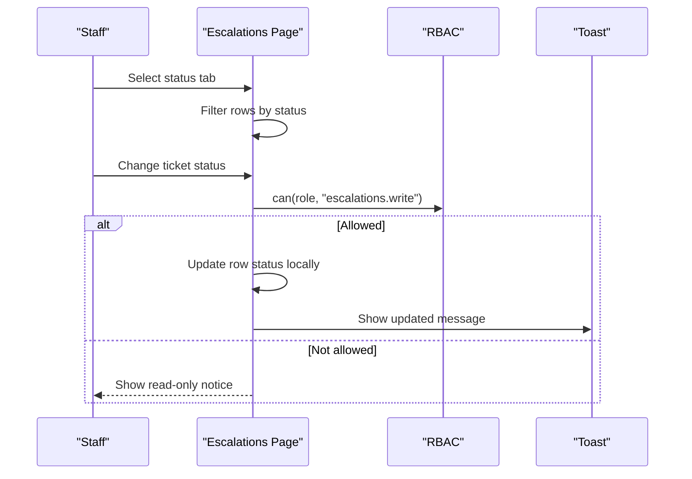
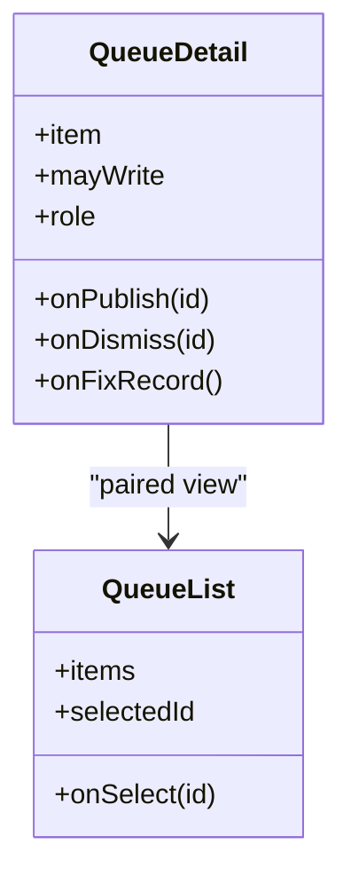
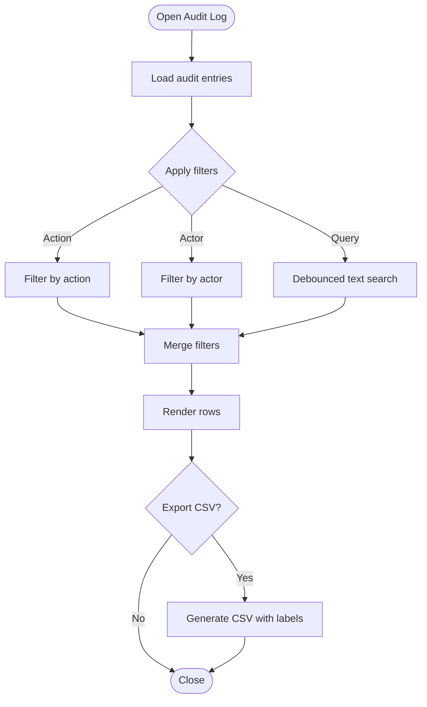
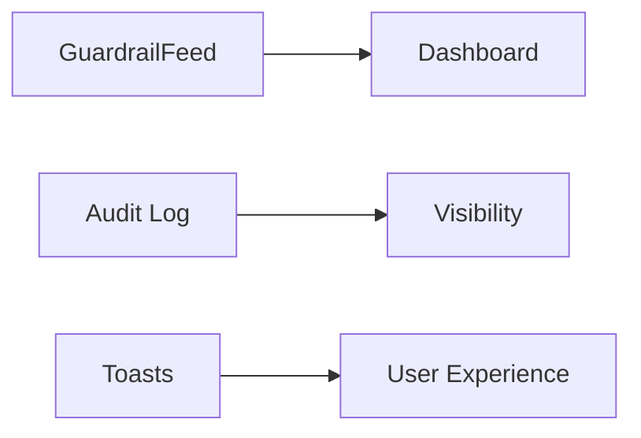
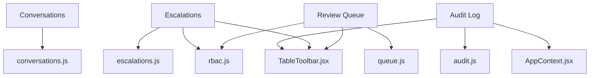

# Conversation Monitoring

<cite>
**Referenced Files in This Document**
- [Conversations/index.jsx](file://src/pages/Conversations/index.jsx)
- [Conversations/Transcript.jsx](file://src/pages/Conversations/Transcript.jsx)
- [Escalations/index.jsx](file://src/pages/Escalations/index.jsx)
- [ReviewQueue/index.jsx](file://src/pages/ReviewQueue/index.jsx)
- [ReviewQueue/QueueList.jsx](file://src/pages/ReviewQueue/QueueList.jsx)
- [ReviewQueue/QueueDetail.jsx](file://src/pages/ReviewQueue/QueueDetail.jsx)
- [AuditLog/index.jsx](file://src/pages/AuditLog/index.jsx)
- [conversations.js](file://src/mocks/conversations.js)
- [escalations.js](file://src/mocks/escalations.js)
- [queue.js](file://src/mocks/queue.js)
- [audit.js](file://src/mocks/audit.js)
- [TableToolbar.jsx](file://src/components/data/TableToolbar.jsx)
- [rbac.js](file://src/lib/rbac.js)
- [AppContext.jsx](file://src/context/AppContext.jsx)
</cite>

## Table of Contents
1. Introduction
2. Project Structure
3. Core Components
4. Architecture Overview
5. Detailed Component Analysis
6. Dependency Analysis
7. Performance Considerations
8. Troubleshooting Guide
9. Conclusion

## Introduction
This document explains the conversation monitoring and review system implemented in the console. It covers:
- Transcript viewing with message threading, tool call inspection, and citation verification
- Escalation handling including priority routing, assignment workflows, and resolution tracking
- A review queue for quality assurance, moderation tasks, and approval processes
- Search and filtering by date, user, topic, or sentiment-like signals (confidence and feedback)
- Annotation capabilities via citations and tags, plus reporting through CSV export
- Real-time monitoring and alerting mechanisms surfaced on dashboards and audit trails

The system is built as a React frontend with mock data and clear API seams for Phase 2 server integration.

## Project Structure
The monitoring features are organized by page-level components under src/pages, supported by shared UI and utilities:
- Conversations: list and transcript viewer
- Escalations: ticket management with status transitions
- Review Queue: items flagged for content growth and moderation
- Audit Log: append-only change history with search/export
- Shared: TableToolbar for search/filter strips, RBAC for permissions, AppContext for global state and audit logging

**Diagram sources**
- [Conversations/index.jsx:1-85](file://src/pages/Conversations/index.jsx#L1-L85)
- [Escalations/index.jsx:1-167](file://src/pages/Escalations/index.jsx#L1-L167)
- [ReviewQueue/index.jsx:1-103](file://src/pages/ReviewQueue/index.jsx#L1-L103)
- [AuditLog/index.jsx:1-150](file://src/pages/AuditLog/index.jsx#L1-L150)
- [TableToolbar.jsx:1-71](file://src/components/data/TableToolbar.jsx#L1-L71)
- [rbac.js:1-51](file://src/lib/rbac.js#L1-L51)
- [AppContext.jsx:1-135](file://src/context/AppContext.jsx#L1-L135)
- [conversations.js:1-107](file://src/mocks/conversations.js#L1-L107)
- [escalations.js:1-11](file://src/mocks/escalations.js#L1-L11)
- [queue.js:1-22](file://src/mocks/queue.js#L1-L22)
- [audit.js:1-22](file://src/mocks/audit.js#L1-L22)

**Section sources**
- [Conversations/index.jsx:1-85](file://src/pages/Conversations/index.jsx#L1-L85)
- [Escalations/index.jsx:1-167](file://src/pages/Escalations/index.jsx#L1-L167)
- [ReviewQueue/index.jsx:1-103](file://src/pages/ReviewQueue/index.jsx#L1-L103)
- [AuditLog/index.jsx:1-150](file://src/pages/AuditLog/index.jsx#L1-L150)

## Core Components
- Transcript Viewer: Displays threaded messages, highlights tool calls used to ground answers, and shows outcomes and feedback indicators.
- Escalations Manager: Lists tickets, filters by status, updates statuses with write permissions, and indicates high-priority items.
- Review Queue: Shows unanswered or low-confidence questions, allows filtering by script, and supports publishing answers or fixing records.
- Audit Log: Append-only history with search, role/action filters, and CSV export.

Key behaviors:
- Tool-grounded answers: every numeric or factual response should be preceded by a tool call in the transcript.
- Permission gating: write actions require appropriate roles; read-only users see disabled controls.
- Reporting: CSV export from audit log; counts and badges for quick triage.

**Section sources**
- [Conversations/Transcript.jsx:1-86](file://src/pages/Conversations/Transcript.jsx#L1-L86)
- [Escalations/index.jsx:1-167](file://src/pages/Escalations/index.jsx#L1-L167)
- [ReviewQueue/index.jsx:1-103](file://src/pages/ReviewQueue/index.jsx#L1-L103)
- [AuditLog/index.jsx:1-150](file://src/pages/AuditLog/index.jsx#L1-L150)
- [rbac.js:1-51](file://src/lib/rbac.js#L1-L51)

## Architecture Overview
The system uses a client-side state model with mock data and explicit API seams for future server integration. Pages consume mocks directly and use shared utilities for search/filter and permissions. Global context provides audit logging and mutation hooks.

**Diagram sources**
- [AppContext.jsx:39-103](file://src/context/AppContext.jsx#L39-L103)
- [AuditLog/index.jsx:20-67](file://src/pages/AuditLog/index.jsx#L20-L67)
- [Escalations/index.jsx:35-48](file://src/pages/Escalations/index.jsx#L35-L48)

## Detailed Component Analysis

### Transcript Viewer
- Message threading: Renders user, bot, system, and tool messages in chronological order with visual distinction.
- Tool call inspection: Tool messages show name, arguments, and result, enabling verification that answers are grounded.
- Citation verification: Bot responses include references to source documents; reviewers can validate these against tool results.
- Outcome and feedback: Badges indicate resolved/escalated/unresolved states; thumbs-up/down feedback shown in list.

**Diagram sources**
- [Conversations/Transcript.jsx:19-85](file://src/pages/Conversations/Transcript.jsx#L19-L85)
- [conversations.js:8-106](file://src/mocks/conversations.js#L8-L106)

**Section sources**
- [Conversations/index.jsx:12-81](file://src/pages/Conversations/index.jsx#L12-L81)
- [Conversations/Transcript.jsx:1-86](file://src/pages/Conversations/Transcript.jsx#L1-L86)
- [conversations.js:1-107](file://src/mocks/conversations.js#L1-L107)

### Escalation Handling
- Priority routing: High-priority tickets are visually highlighted; status tabs filter open/in-progress/resolved/waiting.
- Assignment workflows: Assigned-to field visible; status dropdown allows progression when permitted.
- Resolution tracking: Status changes update local state and show toast confirmation; counts per status displayed.

**Diagram sources**
- [Escalations/index.jsx:35-48](file://src/pages/Escalations/index.jsx#L35-L48)
- [rbac.js:25-50](file://src/lib/rbac.js#L25-L50)

**Section sources**
- [Escalations/index.jsx:1-167](file://src/pages/Escalations/index.jsx#L1-L167)
- [escalations.js:1-11](file://src/mocks/escalations.js#L1-L11)
- [rbac.js:1-51](file://src/lib/rbac.js#L1-L51)

### Review Queue System
- Quality assurance: Items represent gaps where the assistant could not answer confidently; sorted by recency.
- Moderation tasks: Each item shows reason, intent match confidence, channel, and last asked date.
- Approval processes: Authorized users can publish an answer (with citation), fix the underlying record, or dismiss the item.

**Diagram sources**
- [ReviewQueue/QueueList.jsx:1-46](file://src/pages/ReviewQueue/QueueList.jsx#L1-L46)
- [ReviewQueue/QueueDetail.jsx:1-128](file://src/pages/ReviewQueue/QueueDetail.jsx#L1-L128)

**Section sources**
- [ReviewQueue/index.jsx:1-103](file://src/pages/ReviewQueue/index.jsx#L1-L103)
- [ReviewQueue/QueueList.jsx:1-46](file://src/pages/ReviewQueue/QueueList.jsx#L1-L46)
- [ReviewQueue/QueueDetail.jsx:1-128](file://src/pages/ReviewQueue/QueueDetail.jsx#L1-L128)
- [queue.js:1-22](file://src/mocks/queue.js#L1-L22)

### Audit Trail and Reporting
- Append-only history: Entries cannot be edited or removed; includes actor, role, timestamp, action, table, record, and changes.
- Search and filtering: Debounced text search across record, actor, and table; dropdowns for action and actor.
- Reporting: Export filtered entries to CSV with labeled columns.

**Diagram sources**
- [AuditLog/index.jsx:20-67](file://src/pages/AuditLog/index.jsx#L20-L67)
- [audit.js:1-22](file://src/mocks/audit.js#L1-L22)
- [TableToolbar.jsx:1-71](file://src/components/data/TableToolbar.jsx#L1-L71)

**Section sources**
- [AuditLog/index.jsx:1-150](file://src/pages/AuditLog/index.jsx#L1-L150)
- [audit.js:1-22](file://src/mocks/audit.js#L1-L22)
- [TableToolbar.jsx:1-71](file://src/components/data/TableToolbar.jsx#L1-L71)

### Search and Filtering
- By date: Dates appear in transcripts and queue items; filtering by exact dates can be added using the debounced query pattern.
- By user: Audit log filters by actor; conversations list shows channel and language which can be extended to user-based filters.
- By topic: Review queue lists intents; escalation reasons map to topics; add topic filters using the TableToolbar pattern.
- By sentiment: Feedback indicators (thumbs up/down) and confidence badges provide sentiment-like signals; extend filters accordingly.

**Section sources**
- [AuditLog/index.jsx:24-41](file://src/pages/AuditLog/index.jsx#L24-L41)
- [TableToolbar.jsx:8-67](file://src/components/data/TableToolbar.jsx#L8-L67)
- [ReviewQueue/QueueList.jsx:17-41](file://src/pages/ReviewQueue/QueueList.jsx#L17-L41)
- [Conversations/index.jsx:6-17](file://src/pages/Conversations/index.jsx#L6-L17)

### Annotation Capabilities and Tagging
- Citations: Review queue detail includes a “Source citation” field pre-filled based on intent; transcripts embed source references in bot responses.
- Tags: Confidence badges and outcome/status pills act as lightweight tags for triage; extend with custom tag fields using existing Badge patterns.

**Section sources**
- [ReviewQueue/QueueDetail.jsx:78-123](file://src/pages/ReviewQueue/QueueDetail.jsx#L78-L123)
- [Conversations/Transcript.jsx:33-81](file://src/pages/Conversations/Transcript.jsx#L33-L81)

### Real-Time Monitoring and Alerting
- Guardrail activity feed: Dashboard component surfaces safety layer events that prevented unsafe answers from reaching students.
- Audit trail: Append-only log captures all administrative changes, providing real-time visibility into system modifications.
- Toast notifications: Immediate feedback for status changes and exports.

**Diagram sources**
- [GuardrailFeed.jsx:1-44](file://src/pages/Dashboard/GuardrailFeed.jsx#L1-L44)
- [AuditLog/index.jsx:43-67](file://src/pages/AuditLog/index.jsx#L43-L67)
- [Escalations/index.jsx:44-48](file://src/pages/Escalations/index.jsx#L44-L48)

**Section sources**
- [AuditLog/index.jsx:1-150](file://src/pages/AuditLog/index.jsx#L1-L150)
- [Escalations/index.jsx:1-167](file://src/pages/Escalations/index.jsx#L1-L167)

## Dependency Analysis
- Pages depend on mock datasets for initial data and on shared components for consistent UI behavior.
- Permissions gate write operations; AppContext centralizes mutations and audit logging.
- TableToolbar abstracts search/filter logic reused across pages.

**Diagram sources**
- [Conversations/index.jsx:1-85](file://src/pages/Conversations/index.jsx#L1-L85)
- [Escalations/index.jsx:1-167](file://src/pages/Escalations/index.jsx#L1-L167)
- [ReviewQueue/index.jsx:1-103](file://src/pages/ReviewQueue/index.jsx#L1-L103)
- [AuditLog/index.jsx:1-150](file://src/pages/AuditLog/index.jsx#L1-L150)
- [rbac.js:1-51](file://src/lib/rbac.js#L1-L51)
- [AppContext.jsx:1-135](file://src/context/AppContext.jsx#L1-L135)
- [TableToolbar.jsx:1-71](file://src/components/data/TableToolbar.jsx#L1-L71)

**Section sources**
- [rbac.js:1-51](file://src/lib/rbac.js#L1-L51)
- [AppContext.jsx:1-135](file://src/context/AppContext.jsx#L1-L135)

## Performance Considerations
- Debounced search reduces re-renders during typing in large tables.
- Local state filtering avoids network calls; consider pagination for large datasets.
- Memoization with useMemo in audit log improves performance when applying multiple filters.
- Avoid heavy computations in render loops; keep message iteration minimal and rely on stable keys.

[No sources needed since this section provides general guidance]

## Troubleshooting Guide
- No items in review queue: Empty state informs that recent questions matched known intents; new gaps will appear automatically.
- Cannot edit escalations: Check role permissions; read-only notices indicate insufficient privileges.
- Audit export blocked: Browser may block downloads in sandboxed frames; retry outside restricted environments.
- Transcript missing tool call: Indicates potential guardrail gap; investigate whether the answer contains numbers without grounding.

**Section sources**
- [ReviewQueue/index.jsx:78-84](file://src/pages/ReviewQueue/index.jsx#L78-L84)
- [Escalations/index.jsx:73-74](file://src/pages/Escalations/index.jsx#L73-L74)
- [AuditLog/index.jsx:60-67](file://src/pages/AuditLog/index.jsx#L60-L67)
- [Conversations/Transcript.jsx:11-18](file://src/pages/Conversations/Transcript.jsx#L11-L18)

## Conclusion
The console provides a comprehensive set of tools for monitoring conversations, managing escalations, and driving content improvements through a review queue. The transcript viewer makes tool-grounding visible, the audit log ensures compliance and traceability, and the review queue closes knowledge gaps efficiently. With clear API seams and permission controls, the system is ready for server-backed integration while maintaining a robust, user-friendly interface.