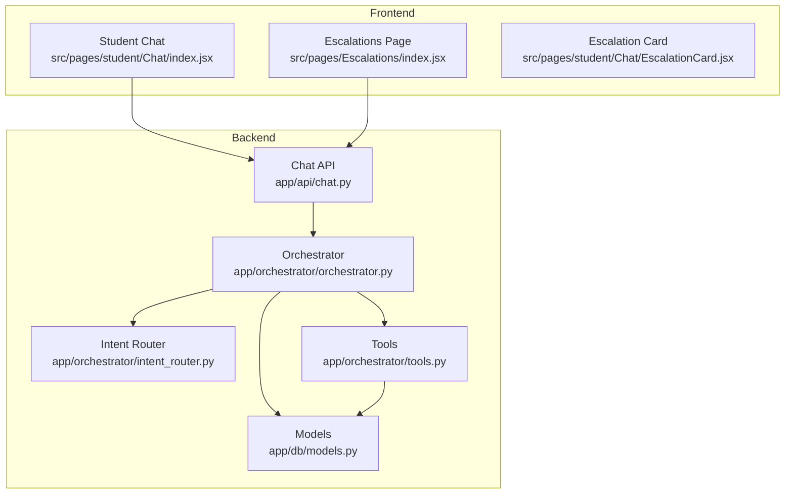
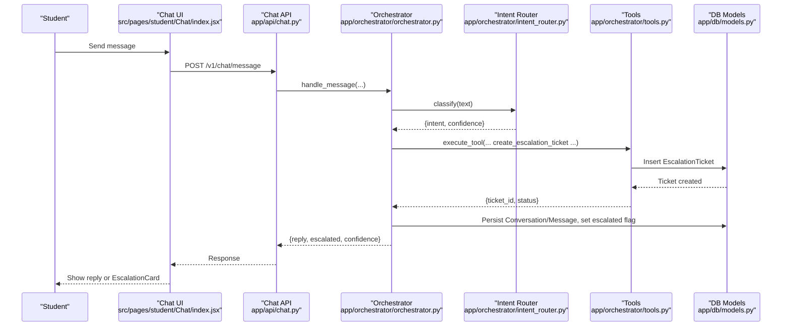
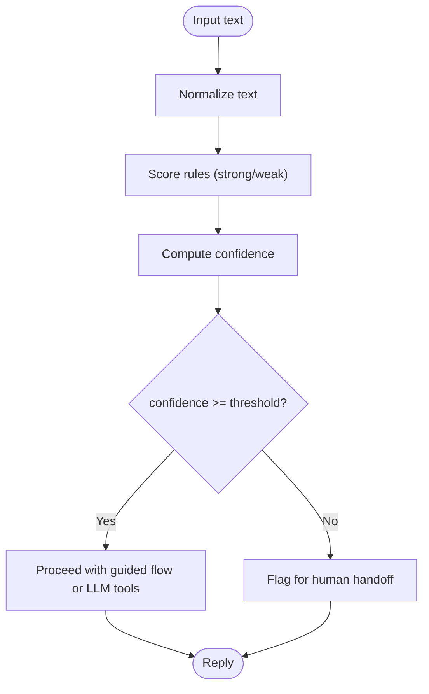
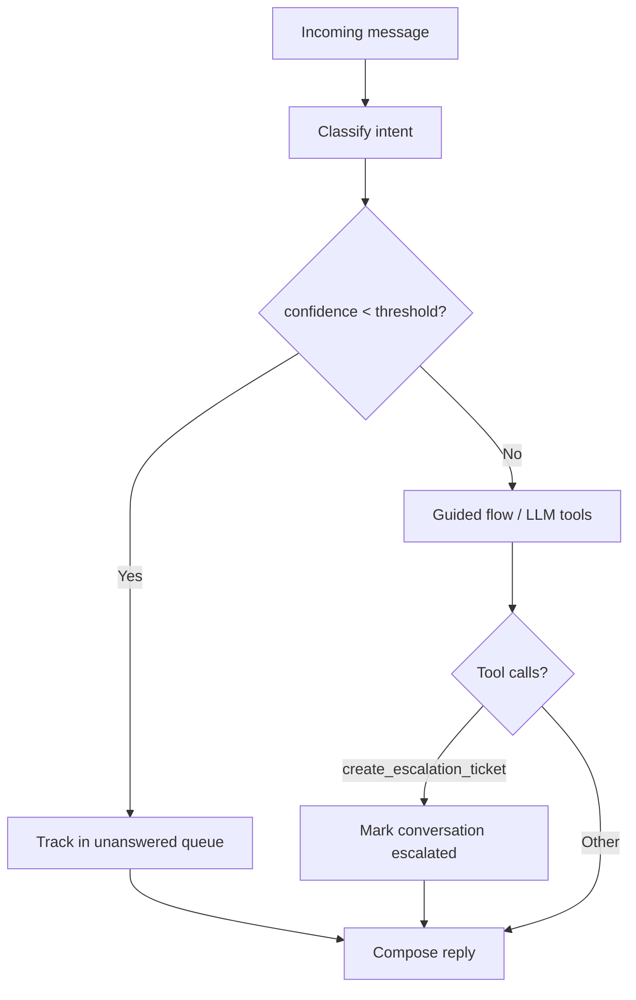
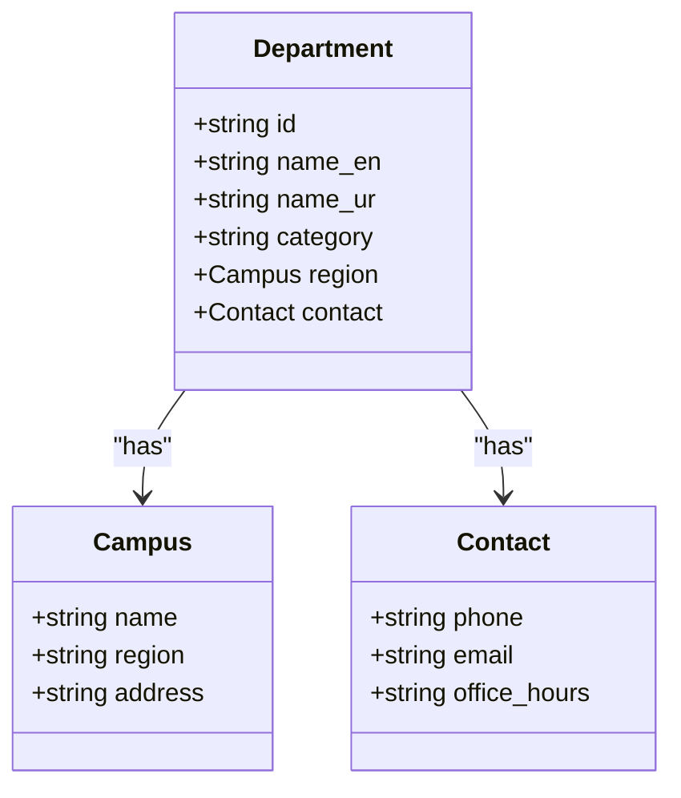
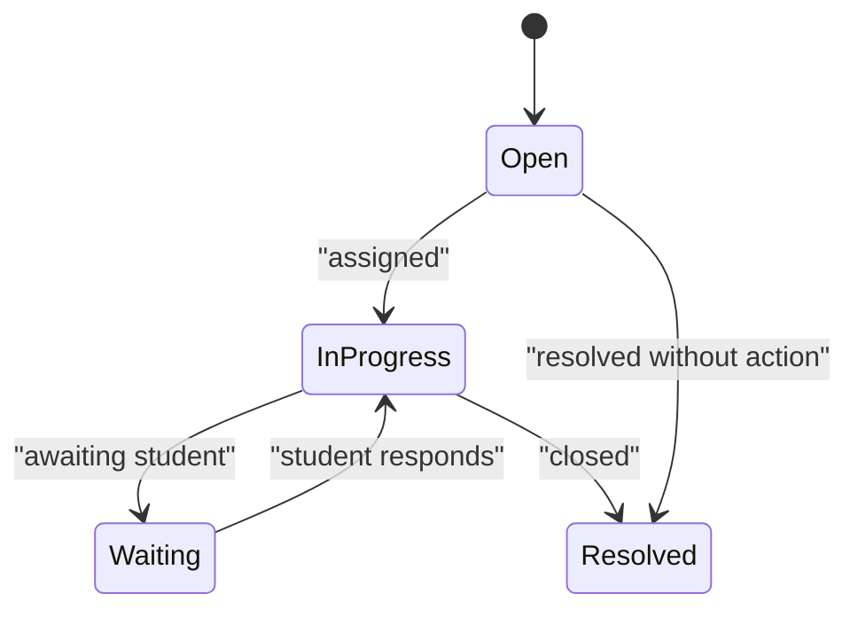
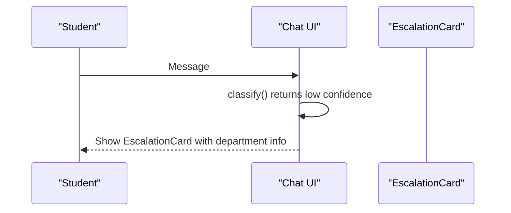
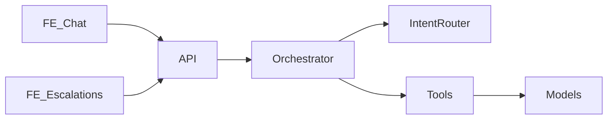

# Escalation Handling

<cite>
**Referenced Files in This Document**
- [orchestrator.py](file://uaea-backend/app/orchestrator/orchestrator.py)
- [intent_router.py](file://uaea-backend/app/orchestrator/intent_router.py)
- [tools.py](file://uaea-backend/app/orchestrator/tools.py)
- [chat.py](file://uaea-backend/app/api/chat.py)
- [models.py](file://uaea-backend/app/db/models.py)
- [schemas.py](file://uaea-backend/app/schemas.py)
- [index.jsx](file://src/pages/Escalations/index.jsx)
- [escalations.js](file://src/mocks/escalations.js)
- [classify.js](file://src/lib/classify.js)
- [EscalationCard.jsx](file://src/pages/student/Chat/EscalationCard.jsx)
- [routing.js](file://src/mocks/routing.js)
- [index.jsx](file://src/pages/student/Chat/index.jsx)
</cite>

## Table of Contents
1. [Introduction](#introduction)
2. [Project Structure](#project-structure)
3. [Core Components](#core-components)
4. [Architecture Overview](#architecture-overview)
5. [Detailed Component Analysis](#detailed-component-analysis)
6. [Dependency Analysis](#dependency-analysis)
7. [Performance Considerations](#performance-considerations)
8. [Troubleshooting Guide](#troubleshooting-guide)
9. [Conclusion](#conclusion)

## Introduction
This document explains the escalation handling system that automatically routes conversations to human agents when the assistant cannot safely or accurately resolve a query. It covers:
- Priority routing based on intent classification and confidence thresholds
- Assignment workflows for escalations to departments and staff
- Resolution tracking with status updates, time-to-resolution metrics, and follow-up actions
- Escalation triggers such as low-confidence intents, repeated failures, sensitive topics, or explicit user requests
- Notifications, SLA monitoring hooks, and performance analytics for escalated conversations

## Project Structure
The escalation system spans both frontend and backend:
- Backend orchestrates message processing, intent classification, tool execution (including ticket creation), and persistence
- Frontend provides an admin view for managing tickets and a student-facing handoff UI when escalation is needed

**Diagram sources**
- [orchestrator.py:46-143](file://uaea-backend/app/orchestrator/orchestrator.py#L46-L143)
- [intent_router.py:65-103](file://uaea-backend/app/orchestrator/intent_router.py#L65-L103)
- [tools.py:18-87](file://uaea-backend/app/orchestrator/tools.py#L18-L87)
- [chat.py:21-39](file://uaea-backend/app/api/chat.py#L21-L39)
- [models.py:144-195](file://uaea-backend/app/db/models.py#L144-L195)

**Section sources**
- [orchestrator.py:46-143](file://uaea-backend/app/orchestrator/orchestrator.py#L46-L143)
- [chat.py:21-39](file://uaea-backend/app/api/chat.py#L21-L39)
- [index.jsx:1-167](file://src/pages/Escalations/index.jsx#L1-L167)
- [index.jsx:1-200](file://src/pages/student/Chat/index.jsx#L1-L200)

## Core Components
- Intent classification and routing: deterministic keyword-based classifier with confidence scoring; below threshold, conversation is flagged for human handoff
- Guided flows: structured slot-filling for complex tasks before escalation
- Tool execution: includes creating escalation tickets and retrieving department/service data
- Persistence: conversations, messages, and escalation tickets stored with timestamps and flags
- Admin management: escalation queue with status transitions and assignment visibility
- Student handoff: displays department contact details when escalation is required

**Section sources**
- [classify.js:1-270](file://src/lib/classify.js#L1-L270)
- [intent_router.py:65-103](file://uaea-backend/app/orchestrator/intent_router.py#L65-L103)
- [tools.py:200-215](file://uaea-backend/app/orchestrator/tools.py#L200-L215)
- [models.py:144-195](file://uaea-backend/app/db/models.py#L144-L195)
- [index.jsx:1-167](file://src/pages/Escalations/index.jsx#L1-L167)
- [EscalationCard.jsx:1-42](file://src/pages/student/Chat/EscalationCard.jsx#L1-L42)

## Architecture Overview
End-to-end flow from student message to escalation ticket and admin review:

**Diagram sources**
- [orchestrator.py:46-143](file://uaea-backend/app/orchestrator/orchestrator.py#L46-L143)
- [intent_router.py:65-103](file://uaea-backend/app/orchestrator/intent_router.py#L65-L103)
- [tools.py:200-215](file://uaea-backend/app/orchestrator/tools.py#L200-L215)
- [chat.py:21-39](file://uaea-backend/app/api/chat.py#L21-L39)
- [models.py:144-195](file://uaea-backend/app/db/models.py#L144-L195)

## Detailed Component Analysis

### Intent Classification and Confidence Thresholds
- The classifier normalizes input, scores rules by strong/weak keywords, and computes a confidence score capped at 0.96
- A floor threshold determines whether to answer directly or escalate; below threshold, the system avoids guessing and offers human assistance
- Frontend mirrors this behavior for local demo mode, while backend enforces it in production via orchestrator logic

**Diagram sources**
- [classify.js:18-44](file://src/lib/classify.js#L18-L44)
- [classify.js:195-270](file://src/lib/classify.js#L195-L270)
- [intent_router.py:65-103](file://uaea-backend/app/orchestrator/intent_router.py#L65-L103)

**Section sources**
- [classify.js:18-44](file://src/lib/classify.js#L18-L44)
- [classify.js:195-270](file://src/lib/classify.js#L195-L270)
- [intent_router.py:65-103](file://uaea-backend/app/orchestrator/intent_router.py#L65-L103)

### Escalation Triggers
- Low-confidence classification: orchestrator tracks unanswered queries and marks conversations escalated when necessary
- Explicit user request: API endpoint allows creating escalation tickets with a reason
- Tool-driven escalation: orchestrator sets escalated flag when create_escalation_ticket is executed
- Repeated failures: unanswered queries are aggregated with counts to identify recurring issues requiring attention

**Diagram sources**
- [orchestrator.py:123-143](file://uaea-backend/app/orchestrator/orchestrator.py#L123-L143)
- [orchestrator.py:367-383](file://uaea-backend/app/orchestrator/orchestrator.py#L367-L383)
- [chat.py:88-115](file://uaea-backend/app/api/chat.py#L88-L115)

**Section sources**
- [orchestrator.py:123-143](file://uaea-backend/app/orchestrator/orchestrator.py#L123-L143)
- [orchestrator.py:367-383](file://uaea-backend/app/orchestrator/orchestrator.py#L367-L383)
- [chat.py:88-115](file://uaea-backend/app/api/chat.py#L88-L115)

### Assignment Workflows and Department Routing
- Category-to-department mapping ensures escalations route to the correct office
- Frontend mock routing defines categories and their owning departments
- Tools can retrieve department details including phone, email, and office hours for student handoff
- Admin escalation page shows department and assigned staff fields for triage

**Diagram sources**
- [models.py:32-68](file://uaea-backend/app/db/models.py#L32-L68)
- [routing.js:11-18](file://src/mocks/routing.js#L11-L18)
- [tools.py:92-122](file://uaea-backend/app/orchestrator/tools.py#L92-L122)

**Section sources**
- [routing.js:11-18](file://src/mocks/routing.js#L11-L18)
- [models.py:32-68](file://uaea-backend/app/db/models.py#L32-L68)
- [tools.py:92-122](file://uaea-backend/app/orchestrator/tools.py#L92-L122)

### Resolution Tracking and Status Management
- Escalation tickets persist with status values: open, in_progress, waiting, resolved
- Admin UI allows updating status and viewing counts per status
- Mock data demonstrates typical ticket lifecycle and assignment patterns
- Time-to-resolution can be derived from created_at timestamps and status changes

**Diagram sources**
- [index.jsx:9-21](file://src/pages/Escalations/index.jsx#L9-L21)
- [escalations.js:1-11](file://src/mocks/escalations.js#L1-L11)
- [models.py:183-195](file://uaea-backend/app/db/models.py#L183-L195)

**Section sources**
- [index.jsx:9-21](file://src/pages/Escalations/index.jsx#L9-L21)
- [escalations.js:1-11](file://src/mocks/escalations.js#L1-L11)
- [models.py:183-195](file://uaea-backend/app/db/models.py#L183-L195)

### Notification Systems, SLA Monitoring, and Performance Analytics
- Notifications: current implementation does not include automated notifications; however, the escalation ticket creation and status updates provide clear audit points for integrating alerts
- SLA monitoring: timestamps on conversations and tickets enable calculating time-to-resolution; status transitions support SLA compliance checks
- Performance analytics: unanswered queries are tracked with counts and reasons; intent distribution and confidence levels can inform model tuning and staffing needs

[No sources needed since this section provides general guidance]

### Student-Facing Escalation Handoff
- When classification fails or data is missing, the chat UI surfaces an escalation card with department contact details
- The card includes phone, email, and office hours to guide students to the right office

**Diagram sources**
- [index.jsx:77-110](file://src/pages/student/Chat/index.jsx#L77-L110)
- [EscalationCard.jsx:10-41](file://src/pages/student/Chat/EscalationCard.jsx#L10-L41)

**Section sources**
- [index.jsx:77-110](file://src/pages/student/Chat/index.jsx#L77-L110)
- [EscalationCard.jsx:10-41](file://src/pages/student/Chat/EscalationCard.jsx#L10-L41)

## Dependency Analysis
Key dependencies between components:
- Orchestrator depends on intent router for classification and tools for execution
- Tools depend on database models for reading/writing department, service, deadline, and ticket data
- API exposes endpoints that orchestrate message handling and escalation creation
- Frontend relies on classification and answer composition for local demo mode; backend enforces production behavior

**Diagram sources**
- [orchestrator.py:46-143](file://uaea-backend/app/orchestrator/orchestrator.py#L46-L143)
- [intent_router.py:65-103](file://uaea-backend/app/orchestrator/intent_router.py#L65-L103)
- [tools.py:218-235](file://uaea-backend/app/orchestrator/tools.py#L218-L235)
- [chat.py:21-39](file://uaea-backend/app/api/chat.py#L21-L39)

**Section sources**
- [orchestrator.py:46-143](file://uaea-backend/app/orchestrator/orchestrator.py#L46-L143)
- [tools.py:218-235](file://uaea-backend/app/orchestrator/tools.py#L218-L235)
- [chat.py:21-39](file://uaea-backend/app/api/chat.py#L21-L39)

## Performance Considerations
- Classifier efficiency: rule-based scoring is fast and deterministic; ensure rule sets remain concise to minimize overhead
- LLM tool loops: maximum rounds limit prevents excessive API calls; monitor round usage to balance accuracy and latency
- Database queries: department and service lookups should leverage indexes where applicable; consider caching frequent queries
- Unanswered query aggregation: track counts to prioritize areas needing model improvements or content updates

[No sources needed since this section provides general guidance]

## Troubleshooting Guide
Common issues and resolutions:
- Low-confidence classifications: review unmatched intents and expand rule sets or improve normalization
- Missing department data: verify department records and category mappings; ensure contact information is populated
- Escalation tickets not created: confirm tool execution paths and database commits; check orchestrator escalation flags
- Admin UI not reflecting status changes: validate status options and write permissions; ensure toast notifications indicate updates

**Section sources**
- [classify.js:195-270](file://src/lib/classify.js#L195-L270)
- [tools.py:92-122](file://uaea-backend/app/orchestrator/tools.py#L92-L122)
- [orchestrator.py:123-143](file://uaea-backend/app/orchestrator/orchestrator.py#L123-L143)
- [index.jsx:44-48](file://src/pages/Escalations/index.jsx#L44-L48)

## Conclusion
The escalation handling system integrates intent classification, guided flows, and tool-driven ticket creation to ensure difficult or sensitive queries are routed to appropriate human agents. With robust status tracking, department routing, and analytics on unanswered queries, the system supports efficient triage, SLA monitoring, and continuous improvement. Future enhancements may include automated notifications, advanced SLA enforcement, and richer performance dashboards.