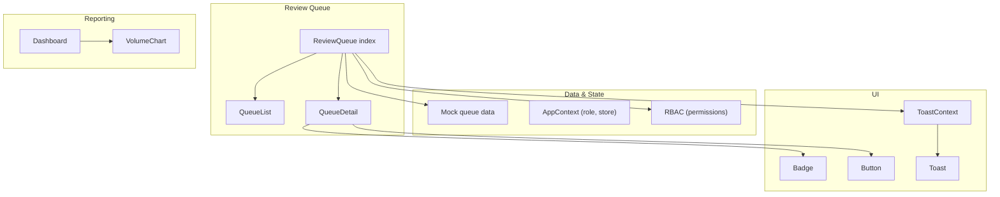
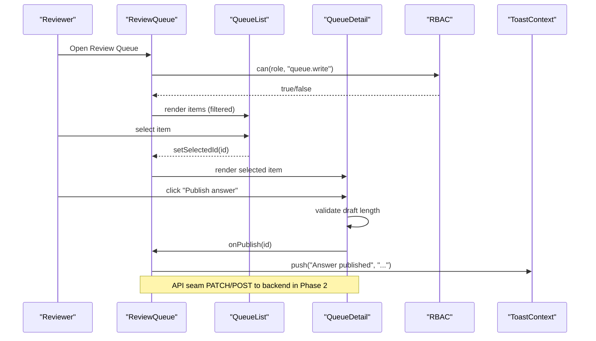
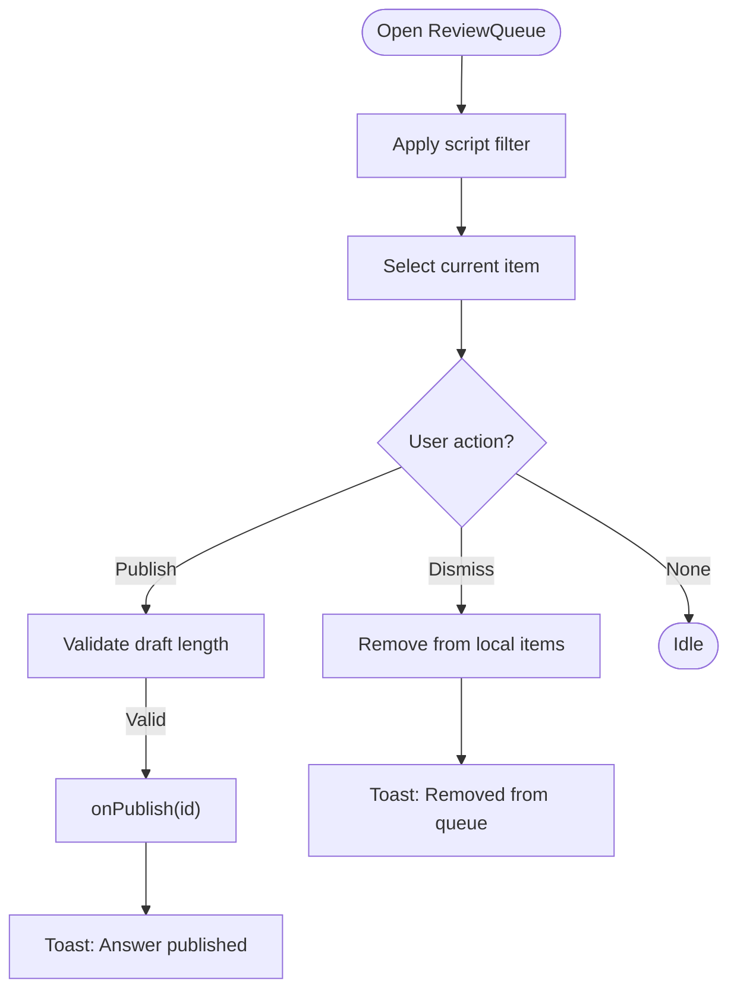
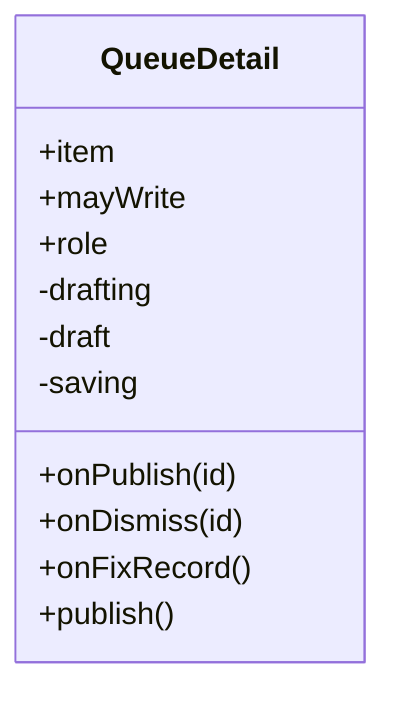
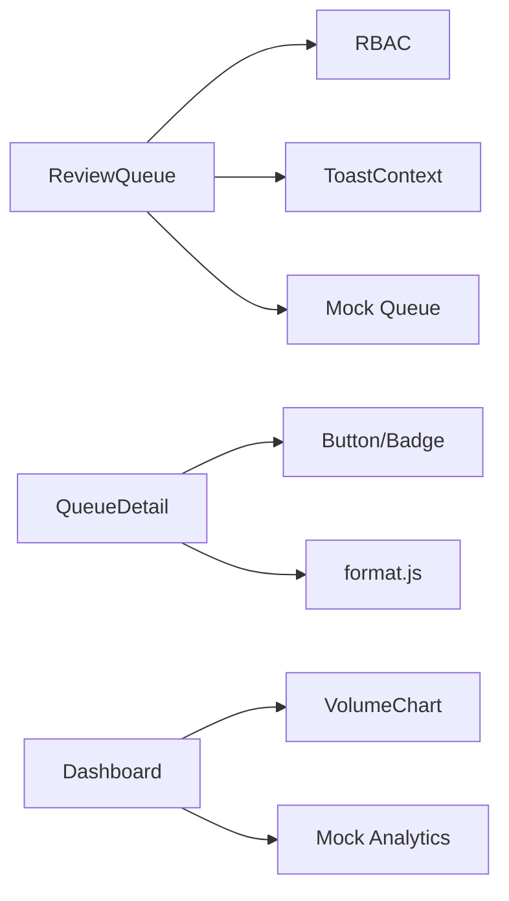

# Review Queue

<cite>
**Referenced Files in This Document**
- [index.jsx](file://src/pages/ReviewQueue/index.jsx)
- [QueueList.jsx](file://src/pages/ReviewQueue/QueueList.jsx)
- [QueueDetail.jsx](file://src/pages/ReviewQueue/QueueDetail.jsx)
- [queue.js](file://src/mocks/queue.js)
- [AppContext.jsx](file://src/context/AppContext.jsx)
- [rbac.js](file://src/lib/rbac.js)
- [ToastContext.jsx](file://src/context/ToastContext.jsx)
- [Toast.jsx](file://src/components/ui/Toast.jsx)
- [Badge.jsx](file://src/components/ui/Badge.jsx)
- [Button.jsx](file://src/components/ui/Button.jsx)
- [format.js](file://src/lib/format.js)
- [constants.js](file://src/lib/constants.js)
- [Dashboard/index.jsx](file://src/pages/Dashboard/index.jsx)
- [VolumeChart.jsx](file://src/components/charts/VolumeChart.jsx)
</cite>

## Table of Contents
1. [Introduction](#introduction)
2. [Project Structure](#project-structure)
3. [Core Components](#core-components)
4. [Architecture Overview](#architecture-overview)
5. [Detailed Component Analysis](#detailed-component-analysis)
6. [Dependency Analysis](#dependency-analysis)
7. [Performance Considerations](#performance-considerations)
8. [Troubleshooting Guide](#troubleshooting-guide)
9. [Conclusion](#conclusion)
10. [Appendices](#appendices)

## Introduction
This document explains the review queue system used for quality assurance and moderation. It covers how low-confidence or unanswered student questions are surfaced, reviewed, annotated, and resolved by publishing answers or fixing source records. It also documents reporting features that provide quality metrics, trend analysis, and performance dashboards, along with notes on real-time updates, notifications, and integration points to content management systems.

The review queue is designed as a content growth loop: when the assistant cannot answer confidently, the question lands in the queue for human review. Reviewers can publish new answers or correct underlying records, improving future responses automatically.

## Project Structure
The review queue spans a small set of focused components and utilities:
- Pages: ReviewQueue entry, list, and detail views
- Mock data: sample queue items representing unanswered or low-confidence queries
- Contexts: application state (roles, permissions), toast notifications
- UI primitives: badges, buttons, toasts
- Utilities: formatting helpers and constants
- Dashboard: analytics and charts for volume and intent trends

**Diagram sources**
- [index.jsx:1-103](file://src/pages/ReviewQueue/index.jsx#L1-L103)
- [QueueList.jsx:1-46](file://src/pages/ReviewQueue/QueueList.jsx#L1-L46)
- [QueueDetail.jsx:1-128](file://src/pages/ReviewQueue/QueueDetail.jsx#L1-L128)
- [queue.js:1-22](file://src/mocks/queue.js#L1-L22)
- [AppContext.jsx:1-135](file://src/context/AppContext.jsx#L1-L135)
- [rbac.js:1-51](file://src/lib/rbac.js#L1-L51)
- [ToastContext.jsx:1-33](file://src/context/ToastContext.jsx#L1-L33)
- [Toast.jsx:1-16](file://src/components/ui/Toast.jsx#L1-L16)
- [Badge.jsx:1-12](file://src/components/ui/Badge.jsx#L1-L12)
- [Button.jsx:1-29](file://src/components/ui/Button.jsx#L1-L29)
- [Dashboard/index.jsx:1-151](file://src/pages/Dashboard/index.jsx#L1-L151)
- [VolumeChart.jsx:1-128](file://src/components/charts/VolumeChart.jsx#L1-L128)

**Section sources**
- [index.jsx:1-103](file://src/pages/ReviewQueue/index.jsx#L1-L103)
- [queue.js:1-22](file://src/mocks/queue.js#L1-L22)

## Core Components
- ReviewQueue page: orchestrates filtering, selection, and actions (publish/dismiss). It exposes API seams for backend integration and uses role-based permissions to gate write actions.
- QueueList: displays open queue items sorted by recency, showing confidence scores and frequency counts.
- QueueDetail: shows why an item was flagged, user and bot messages, and provides actions to draft/publish an answer, fix the underlying record, or dismiss the item.
- Toast notifications: provide immediate feedback for actions like removing from queue or publishing answers.
- RBAC: controls who can perform write operations in the queue.

Key responsibilities:
- Task assignment: implicit via role-based access; only users with queue.write permission can modify queue state.
- Priority sorting: items are presented most recent first; confidence badges help prioritize attention.
- Batch processing: not implemented in this view; however, the structure supports adding batch actions at the list level.

**Section sources**
- [index.jsx:11-103](file://src/pages/ReviewQueue/index.jsx#L11-L103)
- [QueueList.jsx:1-46](file://src/pages/ReviewQueue/QueueList.jsx#L1-L46)
- [QueueDetail.jsx:1-128](file://src/pages/ReviewQueue/QueueDetail.jsx#L1-L128)
- [rbac.js:25-51](file://src/lib/rbac.js#L25-L51)
- [ToastContext.jsx:13-33](file://src/context/ToastContext.jsx#L13-L33)

## Architecture Overview
The review queue follows a clear separation between presentation, state, and data:
- Presentation layer: React components render lists and details, handle user interactions, and show feedback via toasts.
- State layer: AppContext holds global state such as roles and stores; it includes a mutate function intended for Phase 2 server integration.
- Data layer: Mock data simulates queue items; comments mark where API calls will be integrated later.

**Diagram sources**
- [index.jsx:31-50](file://src/pages/ReviewQueue/index.jsx#L31-L50)
- [QueueDetail.jsx:19-27](file://src/pages/ReviewQueue/QueueDetail.jsx#L19-L27)
- [rbac.js:50-51](file://src/lib/rbac.js#L50-L51)
- [ToastContext.jsx:16-20](file://src/context/ToastContext.jsx#L16-L20)

## Detailed Component Analysis

### ReviewQueue Page
Responsibilities:
- Filters queue items by script (all, Roman Urdu, Urdu script).
- Maintains selection state and ensures selection remains valid after filter changes.
- Exposes action handlers for publishing answers and dismissing items, with toast feedback.
- Integrates RBAC to conditionally enable write actions.

API seams:
- Dismiss action references PATCH /v1/admin/queue/{id}/dismiss.
- Publish action references POST /v1/admin/content/faq.

**Diagram sources**
- [index.jsx:27-50](file://src/pages/ReviewQueue/index.jsx#L27-L50)

**Section sources**
- [index.jsx:11-103](file://src/pages/ReviewQueue/index.jsx#L11-L103)

### QueueList
Responsibilities:
- Displays open queue items with text, confidence badge, and ask count.
- Supports selection to highlight the active item.

Sorting and priority:
- Items are rendered in order provided by the parent; typically most recent first.
- Confidence badge color indicates urgency: lower confidence gets more attention.

**Section sources**
- [QueueList.jsx:1-46](file://src/pages/ReviewQueue/QueueList.jsx#L1-L46)

### QueueDetail
Responsibilities:
- Shows reason for flagging, channel, last asked date, and intent status.
- Displays user and bot messages for context.
- Provides drafting interface for writing answers with character limits and citation fields.
- Offers actions: write an answer, fix the record, dismiss.

Validation and UX:
- Draft must meet minimum length before publishing.
- Loading state prevents duplicate submissions during publish.

**Diagram sources**
- [QueueDetail.jsx:14-27](file://src/pages/ReviewQueue/QueueDetail.jsx#L14-L27)
- [QueueDetail.jsx:78-123](file://src/pages/ReviewQueue/QueueDetail.jsx#L78-L123)

**Section sources**
- [QueueDetail.jsx:1-128](file://src/pages/ReviewQueue/QueueDetail.jsx#L1-L128)

### Mock Queue Data
Purpose:
- Simulates unanswered or low-confidence queries with fields for text, script, channel, intent, confidence, count, last asked date, reason, and answer.

Usage:
- Populates the queue list and detail views for demonstration and testing.

**Section sources**
- [queue.js:1-22](file://src/mocks/queue.js#L1-L22)

### Role-Based Access Control (RBAC)
Purpose:
- Defines roles and permissions, including queue.write for modifying queue state.
- Provides a can utility to check permissions based on the current role.

Integration:
- ReviewQueue uses can(role, "queue.write") to determine if write actions are allowed.

**Section sources**
- [rbac.js:10-51](file://src/lib/rbac.js#L10-L51)
- [index.jsx:31-31](file://src/pages/ReviewQueue/index.jsx#L31-L31)

### Notifications (Toasts)
Purpose:
- Provide immediate feedback for user actions (e.g., publishing answers, removing items).
- Auto-dismiss after a short duration.

Integration:
- Used by ReviewQueue to confirm actions and by other pages for general feedback.

**Section sources**
- [ToastContext.jsx:13-33](file://src/context/ToastContext.jsx#L13-L33)
- [Toast.jsx:1-16](file://src/components/ui/Toast.jsx#L1-L16)
- [index.jsx:41-50](file://src/pages/ReviewQueue/index.jsx#L41-L50)

### Reporting and Analytics
Purpose:
- Dashboard displays conversation volume over time and top intents.
- Volume chart visualizes daily totals and WhatsApp-specific volume.

Integration:
- Uses mock datasets for volume and intents; export functionality allows CSV download.

**Section sources**
- [Dashboard/index.jsx:1-151](file://src/pages/Dashboard/index.jsx#L1-L151)
- [VolumeChart.jsx:1-128](file://src/components/charts/VolumeChart.jsx#L1-L128)

## Dependency Analysis
Component relationships and coupling:
- ReviewQueue depends on RBAC for permissions, ToastContext for feedback, and mock queue data for initial state.
- QueueDetail depends on UI primitives (Button, Badge) and formatting utilities.
- Dashboard depends on chart components and mock analytics data.

Potential circular dependencies:
- None observed; components import utilities and contexts without circular imports.

External integrations:
- API seams marked for Phase 2 backend integration (PATCH/POST endpoints).
- Audit logging via AppContext mutate function for change tracking.

**Diagram sources**
- [index.jsx:1-103](file://src/pages/ReviewQueue/index.jsx#L1-L103)
- [QueueDetail.jsx:1-128](file://src/pages/ReviewQueue/QueueDetail.jsx#L1-L128)
- [Dashboard/index.jsx:1-151](file://src/pages/Dashboard/index.jsx#L1-L151)

**Section sources**
- [index.jsx:1-103](file://src/pages/ReviewQueue/index.jsx#L1-L103)
- [QueueDetail.jsx:1-128](file://src/pages/ReviewQueue/QueueDetail.jsx#L1-L128)
- [Dashboard/index.jsx:1-151](file://src/pages/Dashboard/index.jsx#L1-L151)

## Performance Considerations
- Local state management: The queue list and detail use React state for filtering and selection; this is efficient for small datasets. For large queues, consider virtualization or pagination.
- Debouncing inputs: Not currently used in the queue; could be added for search or filter inputs to reduce re-renders.
- Chart rendering: VolumeChart uses SVG paths; ensure data arrays are sized appropriately to avoid heavy computations.
- Toast auto-dismiss: Prevents memory leaks by cleaning up toasts after a timeout.

[No sources needed since this section provides general guidance]

## Troubleshooting Guide
Common issues and resolutions:
- Write actions disabled: Ensure the current role has queue.write permission; check RBAC configuration.
- Draft cannot be published: Verify the draft meets the minimum length requirement enforced in QueueDetail.
- No items shown: Confirm filters are not excluding all items; reset to "all" to verify.
- Toast not appearing: Ensure ToastProvider wraps the app tree; check console for errors related to missing context.

**Section sources**
- [rbac.js:25-51](file://src/lib/rbac.js#L25-L51)
- [QueueDetail.jsx:78-123](file://src/pages/ReviewQueue/QueueDetail.jsx#L78-L123)
- [index.jsx:62-75](file://src/pages/ReviewQueue/index.jsx#L62-L75)
- [ToastContext.jsx:13-33](file://src/context/ToastContext.jsx#L13-L33)

## Conclusion
The review queue system provides a focused workflow for identifying, reviewing, and resolving gaps in the assistant’s knowledge base. It integrates role-based permissions, immediate feedback through toasts, and reporting dashboards for monitoring performance. With planned Phase 2 backend integration, the system will support robust task assignment, priority sorting, batch processing, annotation capabilities, and real-time updates.

[No sources needed since this section summarizes without analyzing specific files]

## Appendices

### Moderation Workflows
- Content approval: Reviewers publish answers to address low-confidence or unanswered queries.
- Response validation: Drafts are validated for minimum length before publishing.
- Policy compliance: Reasons for flagging include policy-related issues; reviewers can fix underlying records to align with policy.

**Section sources**
- [QueueDetail.jsx:78-123](file://src/pages/ReviewQueue/QueueDetail.jsx#L78-L123)
- [queue.js:1-22](file://src/mocks/queue.js#L1-L22)

### Annotation Capabilities
- Comments: Not explicitly implemented; could be added via additional fields in QueueDetail.
- Tags: Not implemented; could be derived from intent or reason fields.
- Ratings: Not implemented; confidence scores serve as proxy ratings.

[No sources needed since this section discusses conceptual enhancements]

### Real-Time Updates and Notifications
- Real-time updates: Not implemented; relies on local state. Could integrate WebSocket or polling for live queue changes.
- Notification systems: Toast notifications provide immediate feedback for actions.

**Section sources**
- [ToastContext.jsx:13-33](file://src/context/ToastContext.jsx#L13-L33)

### Integration with Content Management Systems
- API seams: Marked for PATCH/POST endpoints to integrate with backend services.
- Audit logging: AppContext mutate function logs changes for audit trails.

**Section sources**
- [index.jsx:40-50](file://src/pages/ReviewQueue/index.jsx#L40-L50)
- [AppContext.jsx:79-103](file://src/context/AppContext.jsx#L79-L103)