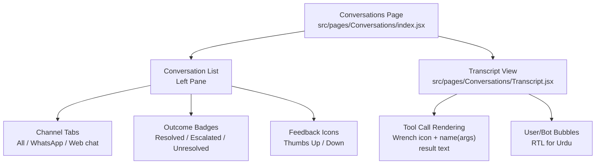
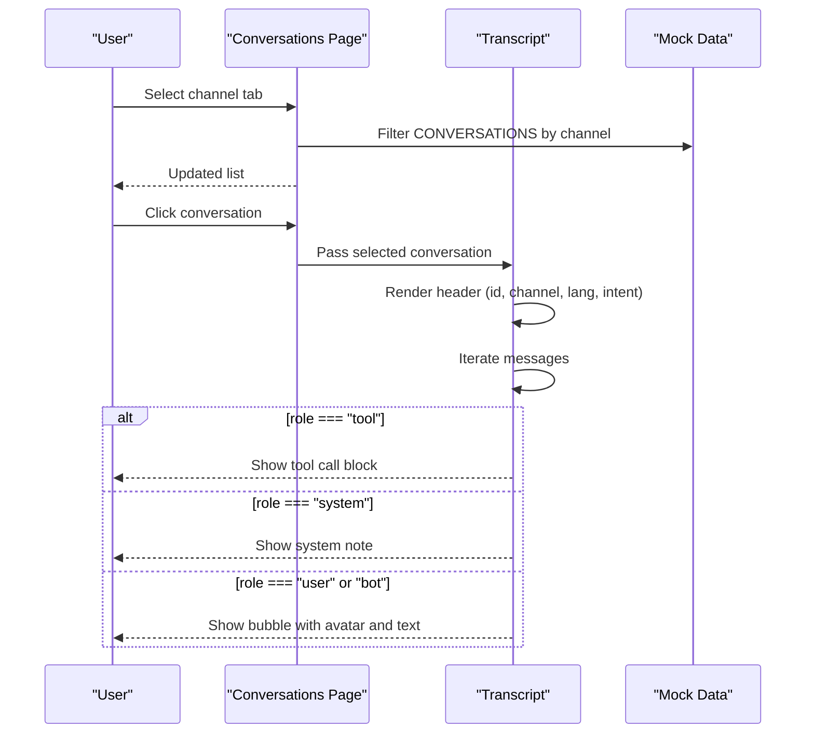
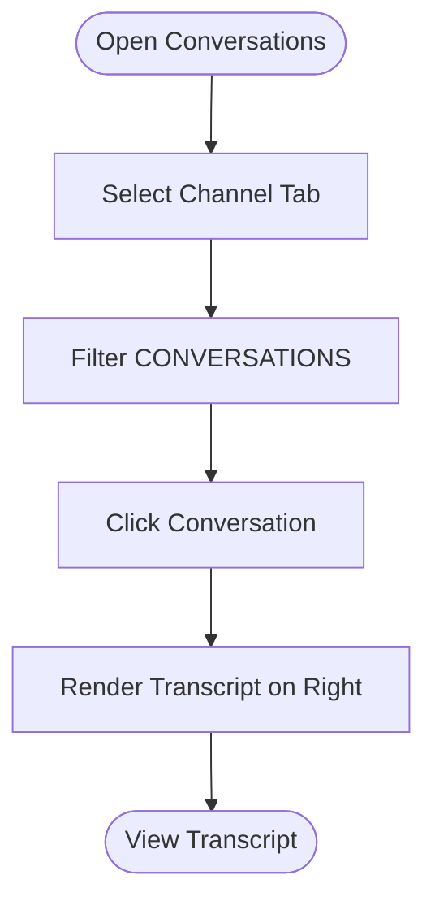
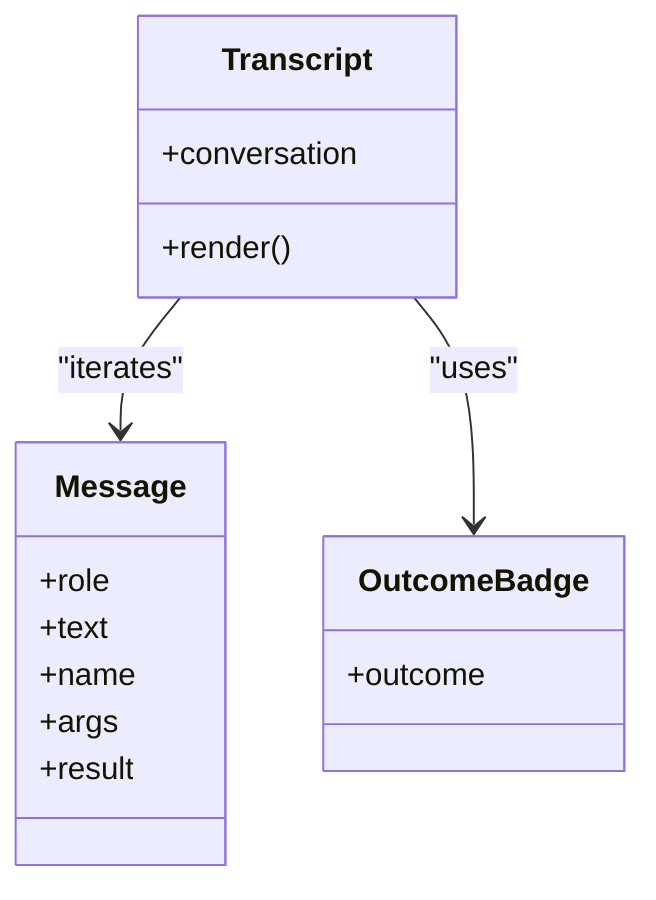
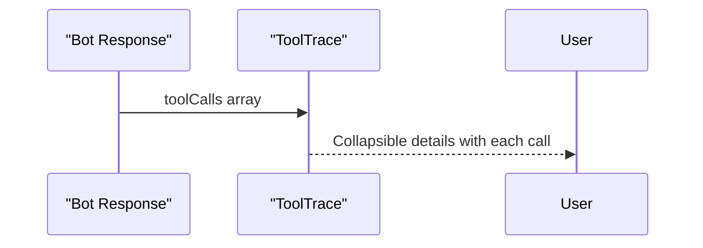
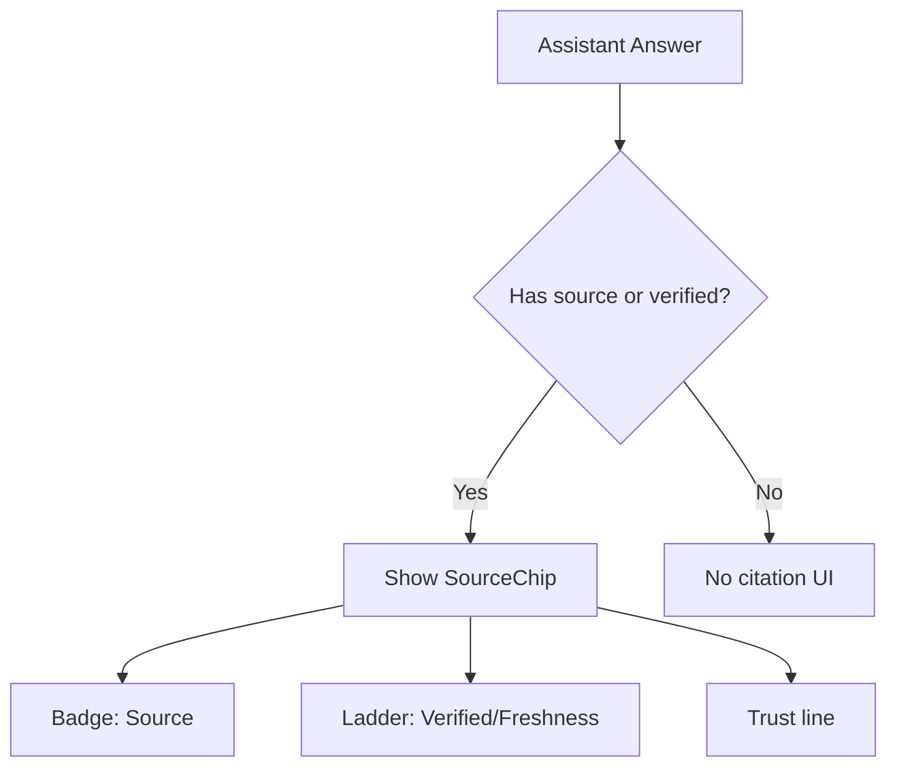
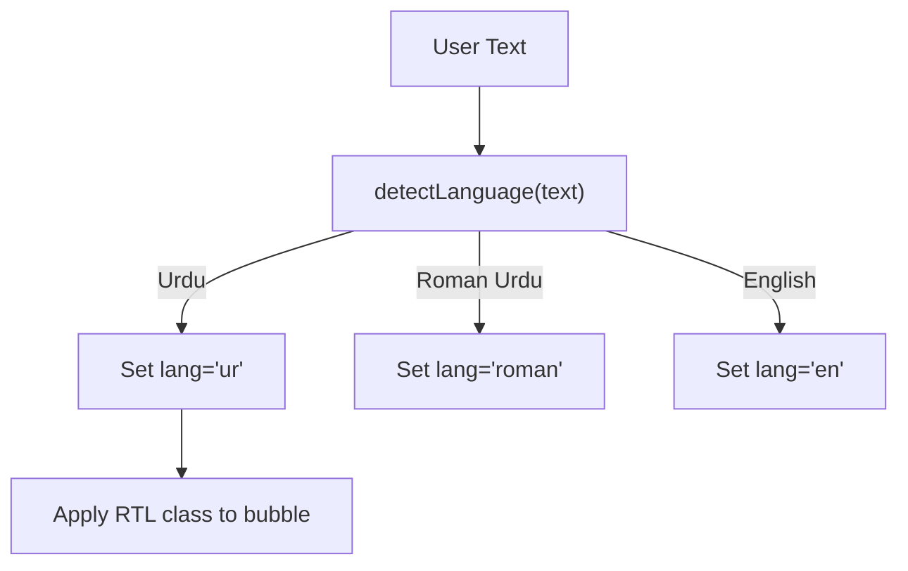
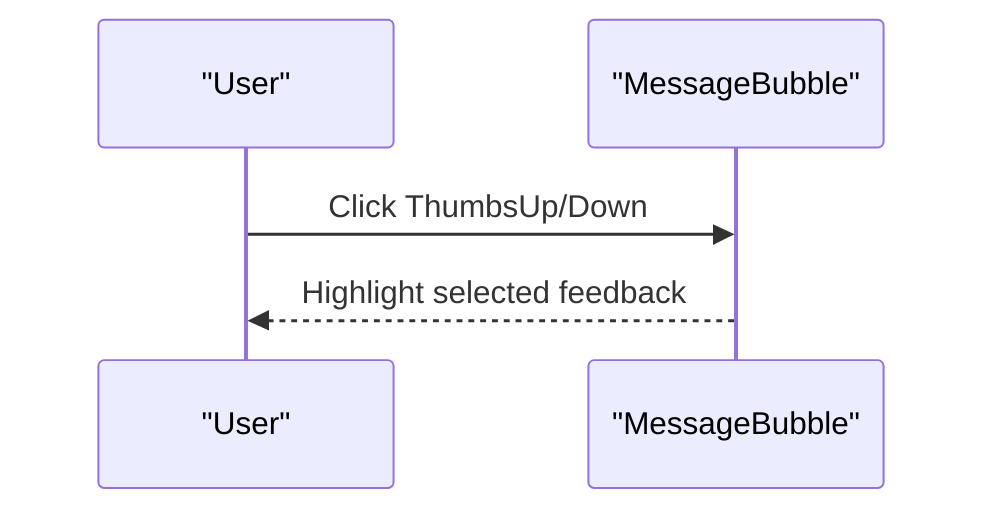
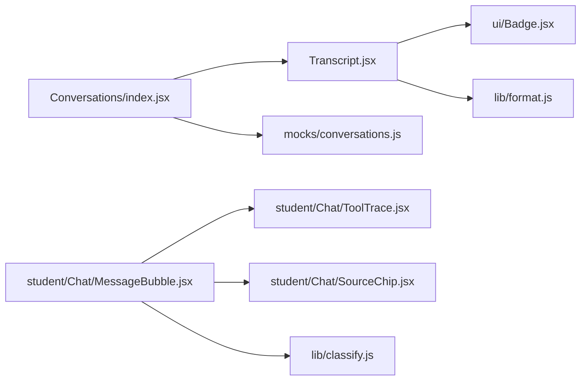

# Transcript Viewer

<cite>
**Referenced Files in This Document**
- [index.jsx](file://src/pages/Conversations/index.jsx)
- [Transcript.jsx](file://src/pages/Conversations/Transcript.jsx)
- [conversations.js](file://src/mocks/conversations.js)
- [MessageBubble.jsx](file://src/pages/student/Chat/MessageBubble.jsx)
- [ToolTrace.jsx](file://src/pages/student/Chat/ToolTrace.jsx)
- [SourceChip.jsx](file://src/pages/student/Chat/SourceChip.jsx)
- [classify.js](file://src/lib/classify.js)
- [format.js](file://src/lib/format.js)
- [Badge.jsx](file://src/components/ui/Badge.jsx)
- [components.css](file://src/styles/components.css)
- [layout.css](file://src/styles/layout.css)
- [student.css](file://src/styles/student.css)
</cite>

## Table of Contents
1. Introduction
2. Project Structure
3. Core Components
4. Architecture Overview
5. Detailed Component Analysis
6. Dependency Analysis
7. Performance Considerations
8. Troubleshooting Guide
9. Conclusion

## Introduction
This document explains the transcript viewer component that displays conversation history with clear formatting, timestamps, and tool-call transparency. It covers message threading, tool call inspection, citation verification, filtering by channel (WhatsApp, Web chat), outcome badges, feedback indicators, language detection, split-pane layout, search, sorting, and export considerations based on the codebase.

## Project Structure
The transcript viewer is implemented as a split-pane page:
- Left pane: a scrollable list of conversations filtered by channel, showing id, outcome badge, language, turn count, start time, and feedback icons.
- Right pane: the selected conversation’s transcript, including user messages, bot responses, system notes, and tool calls.

**Diagram sources**
- [index.jsx:12-80](file://src/pages/Conversations/index.jsx#L12-L80)
- [Transcript.jsx:19-83](file://src/pages/Conversations/Transcript.jsx#L19-L83)
- [components.css:574-646](file://src/styles/components.css#L574-L646)
- [layout.css:424-433](file://src/styles/layout.css#L424-L433)

**Section sources**
- [index.jsx:12-80](file://src/pages/Conversations/index.jsx#L12-L80)
- [Transcript.jsx:19-83](file://src/pages/Conversations/Transcript.jsx#L19-L83)
- [layout.css:424-433](file://src/styles/layout.css#L424-L433)

## Core Components
- Conversations page: manages channel filter state, selects current conversation, renders left list and right transcript.
- Transcript: renders conversation header (id, channel label, language, intent), outcome badge, and iterates messages to show tool calls, system notes, and user/bot bubbles.
- MessageBubble (student chat): shows classification, message lines, options, source chip, tool trace, escalation card, and feedback buttons.
- ToolTrace: collapsible “How I found this” panel listing tool calls behind an answer.
- SourceChip: displays source badge, verification ladder, trust line, and stale-data warning.
- Badge: reusable status pill with semantic tones.
- Utilities: language detection and Urdu text detection; date formatting helpers.

Key responsibilities:
- Threading: ordered rendering of messages with role-based styling and RTL support for Urdu.
- Tool grounding: explicit display of tool calls preceding answers to ensure traceability.
- Citations: visible source, freshness, and trust signals under assistant answers.
- Filtering: channel tabs to narrow the conversation list.
- Feedback: thumbs up/down indicators per conversation or message.

**Section sources**
- [index.jsx:12-80](file://src/pages/Conversations/index.jsx#L12-L80)
- [Transcript.jsx:19-83](file://src/pages/Conversations/Transcript.jsx#L19-L83)
- [MessageBubble.jsx:8-81](file://src/pages/student/Chat/MessageBubble.jsx#L8-L81)
- [ToolTrace.jsx:9-29](file://src/pages/student/Chat/ToolTrace.jsx#L9-L29)
- [SourceChip.jsx:12-39](file://src/pages/student/Chat/SourceChip.jsx#L12-L39)
- [Badge.jsx:5-11](file://src/components/ui/Badge.jsx#L5-L11)
- [classify.js:51-57](file://src/lib/classify.js#L51-L57)
- [format.js:22-23](file://src/lib/format.js#L22-L23)

## Architecture Overview
The transcript viewer composes UI components around a simple data model of conversations and messages. The Conversations page holds state for channel filtering and selection, then passes the selected conversation into Transcript. Transcript renders each message according to its role:
- tool: rendered as a monospaced callout with name, args, and result.
- system: centered note.
- user/bot: bubble with avatar and RTL alignment when needed.

In the student chat flow, MessageBubble integrates classification, source citations, tool traces, and feedback.

**Diagram sources**
- [index.jsx:12-80](file://src/pages/Conversations/index.jsx#L12-L80)
- [Transcript.jsx:19-83](file://src/pages/Conversations/Transcript.jsx#L19-L83)
- [conversations.js:8-106](file://src/mocks/conversations.js#L8-L106)

## Detailed Component Analysis

### Conversation List and Split Layout
- Channel tabs: All, WhatsApp, Web chat. Filtering updates shown list.
- List items: show id, outcome badge, language, turns, started timestamp, and feedback icons.
- Split layout: CSS grid switches from single column to two columns at wider breakpoints.

**Diagram sources**
- [index.jsx:12-80](file://src/pages/Conversations/index.jsx#L12-L80)
- [layout.css:424-433](file://src/styles/layout.css#L424-L433)

**Section sources**
- [index.jsx:12-80](file://src/pages/Conversations/index.jsx#L12-L80)
- [layout.css:424-433](file://src/styles/layout.css#L424-L433)

### Transcript Rendering and Message Threading
- Header: conversation id, channel label (“WhatsApp Business” vs “Web chat widget”), language, intent.
- Outcome badge: resolved (jade), escalated (amber), unresolved (rose).
- Message loop:
  - tool: wrench icon, bold name, args, and result displayed in a styled callout.
  - system: small centered note.
  - user/bot: bubble with avatar tile; user messages align right; bot messages align left; Urdu text triggers RTL class.

**Diagram sources**
- [Transcript.jsx:19-83](file://src/pages/Conversations/Transcript.jsx#L19-L83)
- [Badge.jsx:5-11](file://src/components/ui/Badge.jsx#L5-L11)

**Section sources**
- [Transcript.jsx:19-83](file://src/pages/Conversations/Transcript.jsx#L19-L83)
- [components.css:610-646](file://src/styles/components.css#L610-L646)

### Tool Call Inspection
- In the transcript view, tool messages are rendered inline above related answers, making tool-grounding visible.
- In the student chat, ToolTrace provides a collapsible section titled “How I found this — N lookup(s)” listing tool calls with name, args, and result.

**Diagram sources**
- [ToolTrace.jsx:9-29](file://src/pages/student/Chat/ToolTrace.jsx#L9-L29)
- [conversations.js:18-25](file://src/mocks/conversations.js#L18-L25)

**Section sources**
- [ToolTrace.jsx:9-29](file://src/pages/student/Chat/ToolTrace.jsx#L9-L29)
- [conversations.js:18-25](file://src/mocks/conversations.js#L18-L25)

### Citation Verification and Freshness
- SourceChip displays:
  - Source badge with shield icon.
  - Verification ladder indicating freshness.
  - Trust line text.
  - Stale record warning when applicable.
- Transcript uses these signals to help users validate answers and understand recency.

**Diagram sources**
- [SourceChip.jsx:12-39](file://src/pages/student/Chat/SourceChip.jsx#L12-L39)

**Section sources**
- [SourceChip.jsx:12-39](file://src/pages/student/Chat/SourceChip.jsx#L12-L39)

### Language Detection and Formatting
- Language detection distinguishes Urdu script, Roman Urdu, and English using keyword markers and Unicode ranges.
- Urdu text is detected for RTL formatting in bubbles.
- Date formatting utilities provide consistent date presentation.

**Diagram sources**
- [classify.js:51-57](file://src/lib/classify.js#L51-L57)
- [format.js:22-23](file://src/lib/format.js#L22-L23)

**Section sources**
- [classify.js:51-57](file://src/lib/classify.js#L51-L57)
- [format.js:22-23](file://src/lib/format.js#L22-L23)

### Feedback Indicators
- Conversation list shows thumbs up/down icons when feedback is present.
- Student chat message includes feedback buttons to mark helpfulness; state updates reflect selection.

**Diagram sources**
- [index.jsx:73-75](file://src/pages/Conversations/index.jsx#L73-L75)
- [MessageBubble.jsx:53-75](file://src/pages/student/Chat/MessageBubble.jsx#L53-L75)

**Section sources**
- [index.jsx:73-75](file://src/pages/Conversations/index.jsx#L73-L75)
- [MessageBubble.jsx:53-75](file://src/pages/student/Chat/MessageBubble.jsx#L53-L75)

### Search, Sorting, and Export Capabilities
- Search: The shared search input styles exist in the component styles, but no search implementation is present in the Conversations page.
- Sorting: No sorting controls are implemented in the Conversations page.
- Export: No export functionality is implemented in the Conversations page.

These features can be added by integrating existing UI primitives (search input, sortable headers, export actions) into the Conversations page.

**Section sources**
- [components.css:283-298](file://src/styles/components.css#L283-L298)
- [index.jsx:12-80](file://src/pages/Conversations/index.jsx#L12-L80)

## Dependency Analysis
- Conversations page depends on:
  - Transcript component for detail view.
  - Mock data for conversations.
  - OutcomeBadge for status pills.
  - ThumbsUp/Down icons for feedback.
- Transcript depends on:
  - Badge for outcomes.
  - format utility for Urdu detection.
  - lucide-react icons for tool/user/bot visuals.
- Student chat components depend on:
  - classify for language detection and routing.
  - SourceChip and ToolTrace for evidence and provenance.
  - Assistant library for answer composition and trust lines.

**Diagram sources**
- [index.jsx:1-80](file://src/pages/Conversations/index.jsx#L1-L80)
- [Transcript.jsx:1-83](file://src/pages/Conversations/Transcript.jsx#L1-L83)
- [MessageBubble.jsx:1-81](file://src/pages/student/Chat/MessageBubble.jsx#L1-L81)
- [ToolTrace.jsx:1-29](file://src/pages/student/Chat/ToolTrace.jsx#L1-L29)
- [SourceChip.jsx:1-39](file://src/pages/student/Chat/SourceChip.jsx#L1-L39)
- [classify.js:1-57](file://src/lib/classify.js#L1-L57)
- [format.js:1-23](file://src/lib/format.js#L1-L23)

**Section sources**
- [index.jsx:1-80](file://src/pages/Conversations/index.jsx#L1-L80)
- [Transcript.jsx:1-83](file://src/pages/Conversations/Transcript.jsx#L1-L83)
- [MessageBubble.jsx:1-81](file://src/pages/student/Chat/MessageBubble.jsx#L1-L81)
- [ToolTrace.jsx:1-29](file://src/pages/student/Chat/ToolTrace.jsx#L1-L29)
- [SourceChip.jsx:1-39](file://src/pages/student/Chat/SourceChip.jsx#L1-L39)
- [classify.js:1-57](file://src/lib/classify.js#L1-L57)
- [format.js:1-23](file://src/lib/format.js#L1-L23)

## Performance Considerations
- Rendering efficiency: The transcript iterates over messages once; keep message arrays reasonably sized. For large histories, consider virtualization.
- Language detection: Lightweight regex checks; avoid repeated heavy computations by caching results if needed.
- Styling: CSS classes handle RTL and bubble layouts efficiently without JS overhead.

[No sources needed since this section provides general guidance]

## Troubleshooting Guide
- Missing tool calls: If an answer contains numbers or facts without a preceding tool call, review the mock data structure to ensure tool messages are included before bot responses.
- Incorrect RTL: Ensure Urdu text is detected via the helper; verify the bubble receives the correct class.
- Stale citations: When SourceChip indicates staleness, prompt users to confirm with the department before relying on the information.
- Feedback not updating: Confirm that feedback state is tied to message id and that handlers update local state correctly.

**Section sources**
- [conversations.js:18-25](file://src/mocks/conversations.js#L18-L25)
- [format.js:22-23](file://src/lib/format.js#L22-L23)
- [SourceChip.jsx:28-36](file://src/pages/student/Chat/SourceChip.jsx#L28-L36)
- [MessageBubble.jsx:53-75](file://src/pages/student/Chat/MessageBubble.jsx#L53-L75)

## Conclusion
The transcript viewer provides a clear, grounded view of conversation history with explicit tool calls, citations, and freshness indicators. The split-pane layout supports efficient browsing and inspection. While channel filtering, outcome badges, feedback, and language-aware formatting are implemented, search, sorting, and export capabilities are not yet present and can be added using existing UI primitives.

[No sources needed since this section summarizes without analyzing specific files]