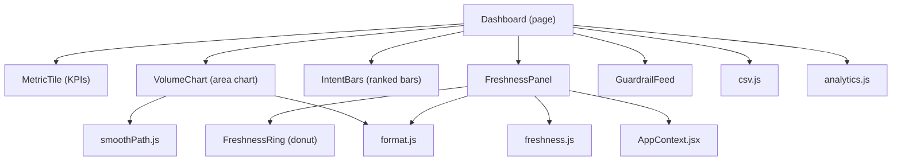
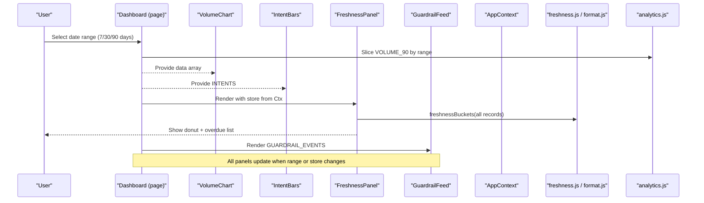
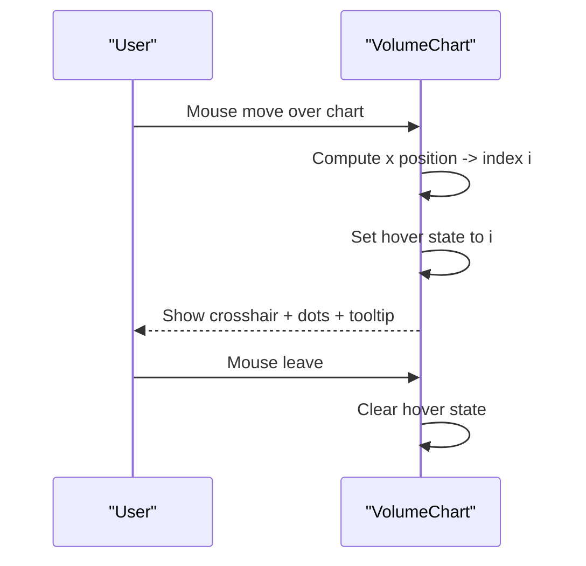
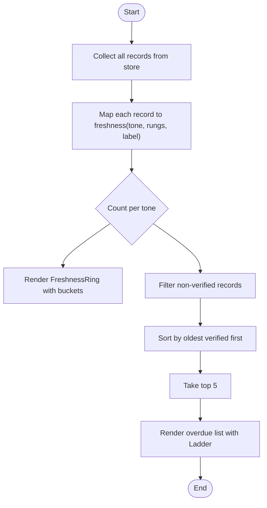
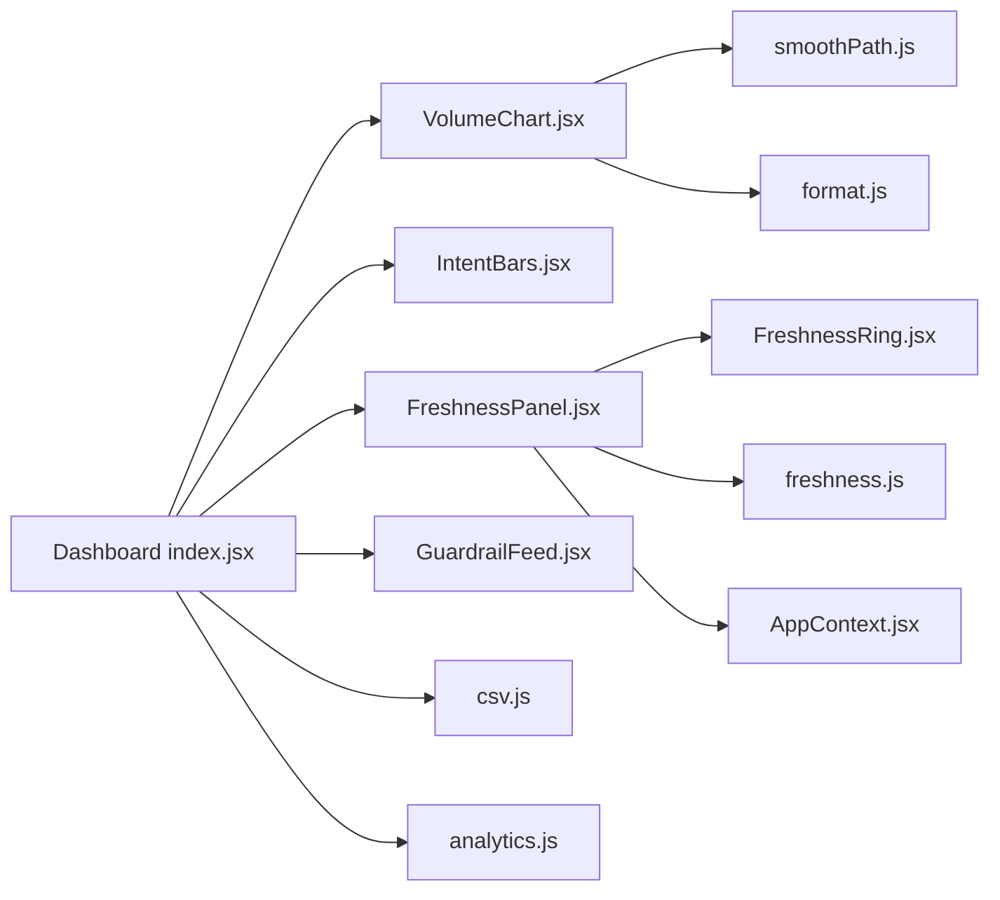

# Dashboard & Analytics

<cite>
**Referenced Files in This Document**
- [Dashboard index](file://src/pages/Dashboard/index.jsx)
- [MetricTile](file://src/pages/Dashboard/MetricTile.jsx)
- [FreshnessPanel](file://src/pages/Dashboard/FreshnessPanel.jsx)
- [GuardrailFeed](file://src/pages/Dashboard/GuardrailFeed.jsx)
- [VolumeChart](file://src/components/charts/VolumeChart.jsx)
- [IntentBars](file://src/components/charts/IntentBars.jsx)
- [FreshnessRing](file://src/components/charts/FreshnessRing.jsx)
- [smoothPath](file://src/components/charts/smoothPath.js)
- [freshness utilities](file://src/lib/freshness.js)
- [format utilities](file://src/lib/format.js)
- [CSV export](file://src/lib/csv.js)
- [AppContext](file://src/context/AppContext.jsx)
- [constants](file://src/lib/constants.js)
- [analytics mocks](file://src/mocks/analytics.js)
- [mocks barrel](file://src/mocks/index.js)
- [content columns](file://src/components/content/columns.jsx)
- [Ladder](file://src/components/ui/Ladder.jsx)
</cite>

## Table of Contents
1. Introduction
2. Project Structure
3. Core Components
4. Architecture Overview
5. Detailed Component Analysis
6. Dependency Analysis
7. Performance Considerations
8. Troubleshooting Guide
9. Conclusion

## Introduction
This document explains the admin dashboard and analytics system that provides a single view of key performance indicators, conversation volumes, response quality metrics, content freshness, and AI safety guardrails. It covers:
- Metric tiles for KPIs such as containment rate, factual accuracy, intent coverage, and escalations
- Conversation volume visualization across channels with real-time-like interactivity
- Intent breakdown using ranked bars
- A freshness panel that tracks verification status and highlights overdue records
- A guardrail feed that monitors AI response safety and policy compliance
- Filtering by date range and CSV export functionality
- Performance considerations for large datasets and frequent updates

## Project Structure
The dashboard is implemented as a React page composed of focused components:
- Page orchestration and data binding live in the dashboard page
- Charts are reusable components under charts
- Freshness logic is centralized in a utility module
- Mock data simulates analytics until Phase 2 connects to a backend API seam

**Diagram sources**
- [Dashboard index:1-151](file://src/pages/Dashboard/index.jsx#L1-L151)
- [FreshnessPanel:1-74](file://src/pages/Dashboard/FreshnessPanel.jsx#L1-L74)
- [FreshnessRing:1-66](file://src/components/charts/FreshnessRing.jsx#L1-L66)
- [VolumeChart:1-128](file://src/components/charts/VolumeChart.jsx#L1-L128)
- [IntentBars:1-52](file://src/components/charts/IntentBars.jsx#L1-L52)
- [freshness utilities:1-37](file://src/lib/freshness.js#L1-L37)
- [format utilities:1-32](file://src/lib/format.js#L1-L32)
- [CSV export:1-32](file://src/lib/csv.js#L1-L32)
- [analytics mocks:1-44](file://src/mocks/analytics.js#L1-L44)
- [AppContext:1-135](file://src/context/AppContext.jsx#L1-L135)

**Section sources**
- [Dashboard index:1-151](file://src/pages/Dashboard/index.jsx#L1-L151)
- [mocks barrel:1-19](file://src/mocks/index.js#L1-L19)

## Core Components
- MetricTile: Displays a KPI value with animated counting, delta direction, and contextual note. Supports percentage and integer formatting.
- VolumeChart: Two-series area chart showing total conversations and WhatsApp-only channel over time, with crosshair tooltip and grid lines.
- IntentBars: Ranked horizontal bars showing top intents with counts and percentages; opacity encodes rank.
- FreshnessPanel: Aggregates catalogue records into freshness buckets and renders a donut ring plus a list of the five most overdue records.
- GuardrailFeed: Lists recent safety interventions with severity tone and timestamps.

Key capabilities:
- Date range selection via tabs (7, 30, 90 days)
- CSV export of volume data with bilingual-safe encoding
- Real-time-like interactions (hover tooltips, animated draws)

**Section sources**
- [MetricTile:1-33](file://src/pages/Dashboard/MetricTile.jsx#L1-L33)
- [VolumeChart:1-128](file://src/components/charts/VolumeChart.jsx#L1-L128)
- [IntentBars:1-52](file://src/components/charts/IntentBars.jsx#L1-L52)
- [FreshnessPanel:1-74](file://src/pages/Dashboard/FreshnessPanel.jsx#L1-L74)
- [GuardrailFeed:1-45](file://src/pages/Dashboard/GuardrailFeed.jsx#L1-L45)
- [Dashboard index:1-151](file://src/pages/Dashboard/index.jsx#L1-L151)

## Architecture Overview
The dashboard composes UI components around shared utilities and mock data. The page orchestrates state (range, loading), binds charts to data slices, and wires export and navigation actions.

**Diagram sources**
- [Dashboard index:23-94](file://src/pages/Dashboard/index.jsx#L23-L94)
- [VolumeChart:1-128](file://src/components/charts/VolumeChart.jsx#L1-L128)
- [IntentBars:1-52](file://src/components/charts/IntentBars.jsx#L1-L52)
- [FreshnessPanel:1-74](file://src/pages/Dashboard/FreshnessPanel.jsx#L1-L74)
- [GuardrailFeed:1-45](file://src/pages/Dashboard/GuardrailFeed.jsx#L1-L45)
- [freshness utilities:1-37](file://src/lib/freshness.js#L1-L37)
- [analytics mocks:1-44](file://src/mocks/analytics.js#L1-L44)
- [AppContext:1-135](file://src/context/AppContext.jsx#L1-L135)

## Detailed Component Analysis

### Dashboard Page Orchestration
Responsibilities:
- Manage selected date range and loading state
- Compute totals and slice time series for charts
- Wire export action and toast feedback
- Compose metric tiles, charts, freshness panel, and guardrail feed

Interactions:
- Uses mock analytics for volume and intents
- Reads app context for language preference
- Navigates to content management from freshness panel

Performance notes:
- Loading states prevent janky reflows during simulated data fetches
- Range change triggers lightweight recomputation

**Section sources**
- [Dashboard index:23-94](file://src/pages/Dashboard/index.jsx#L23-L94)
- [Dashboard index:96-147](file://src/pages/Dashboard/index.jsx#L96-L147)

### Metric Tiles (KPIs)
Behavior:
- Animated count-up on mount
- Delta indicator with up/down arrow and percentage
- Formatting adapts to unit type (percent vs integer)

Data source:
- METRICS from analytics mocks

Accessibility:
- Icons convey meaning alongside text labels

**Section sources**
- [MetricTile:1-33](file://src/pages/Dashboard/MetricTile.jsx#L1-L33)
- [analytics mocks:28-34](file://src/mocks/analytics.js#L28-L34)

### Conversation Volume Chart
Features:
- Area fill for total conversations
- Dashed line for WhatsApp-only channel
- Grid lines and axis labels
- Crosshair hover with tooltip showing daily totals and per-channel values
- Smooth curves via Catmull-Rom to cubic bezier conversion

Implementation details:
- Computes max scale dynamically
- Maps indices to coordinates and builds SVG paths
- Tooltip positioned relative to mouse movement

**Section sources**
- [VolumeChart:1-128](file://src/components/charts/VolumeChart.jsx#L1-L128)
- [smoothPath:1-27](file://src/components/charts/smoothPath.js#L1-L27)
- [format utilities:1-32](file://src/lib/format.js#L1-L32)

#### Sequence: Hover Interaction

**Diagram sources**
- [VolumeChart:32-47](file://src/components/charts/VolumeChart.jsx#L32-L47)
- [VolumeChart:86-124](file://src/components/charts/VolumeChart.jsx#L86-L124)

### Intent Bars
Behavior:
- Renders ranked items with proportional bar widths
- Shows count and percentage of total
- Opacity decreases down the list to reinforce ranking

Data source:
- INTENTS from analytics mocks

**Section sources**
- [IntentBars:1-52](file://src/components/charts/IntentBars.jsx#L1-L52)
- [analytics mocks:17-26](file://src/mocks/analytics.js#L17-L26)

### Freshness Panel
Purpose:
- Summarize how much of the catalogue has been recently verified
- Highlight overdue records for quick remediation

Logic:
- Aggregates services, fees, deadlines, departments from AppContext store
- Groups records into freshness buckets (verified, ageing, stale)
- Sorts and shows top 5 overdue entries with last-checked metadata

Visualization:
- Donut ring rendered by FreshnessRing
- Ladder component shows rung-based freshness per record

Navigation:
- Opens content management to act on overdue items

**Section sources**
- [FreshnessPanel:1-74](file://src/pages/Dashboard/FreshnessPanel.jsx#L1-L74)
- [freshness utilities:1-37](file://src/lib/freshness.js#L1-L37)
- [AppContext:1-135](file://src/context/AppContext.jsx#L1-L135)
- [content columns:1-171](file://src/components/content/columns.jsx#L1-L171)
- [Ladder:1-32](file://src/components/ui/Ladder.jsx#L1-L32)

#### Flow: Freshness Bucketing

**Diagram sources**
- [FreshnessPanel:20-34](file://src/pages/Dashboard/FreshnessPanel.jsx#L20-L34)
- [freshness utilities:17-36](file://src/lib/freshness.js#L17-L36)

### Guardrail Feed
Purpose:
- Surface recent safety interventions before they reach students
- Help detect drift in source documents through rising ungrounded numbers

Behavior:
- Renders events with severity tone icons and short descriptions
- Includes conversation ID and timestamp

Data source:
- GUARDRAIL_EVENTS from analytics mocks

**Section sources**
- [GuardrailFeed:1-45](file://src/pages/Dashboard/GuardrailFeed.jsx#L1-L45)
- [analytics mocks:36-43](file://src/mocks/analytics.js#L36-L43)

### Export Functionality
Capabilities:
- Exports current volume data to CSV with UTF-8 BOM for Excel compatibility
- Returns success/failure to surface honest user feedback

Usage:
- Triggered by Export button on the dashboard header
- Provides toast messages based on result

**Section sources**
- [Dashboard index:48-65](file://src/pages/Dashboard/index.jsx#L48-L65)
- [CSV export:1-32](file://src/lib/csv.js#L1-L32)

## Dependency Analysis
High-level dependencies:
- Dashboard page depends on charts, panels, mocks, and utilities
- FreshnessPanel depends on AppContext store and freshness utilities
- VolumeChart depends on smoothing algorithm and number formatting
- Export depends on CSV utility and toast context

**Diagram sources**
- [Dashboard index:1-151](file://src/pages/Dashboard/index.jsx#L1-L151)
- [FreshnessPanel:1-74](file://src/pages/Dashboard/FreshnessPanel.jsx#L1-L74)
- [VolumeChart:1-128](file://src/components/charts/VolumeChart.jsx#L1-L128)
- [IntentBars:1-52](file://src/components/charts/IntentBars.jsx#L1-L52)
- [FreshnessRing:1-66](file://src/components/charts/FreshnessRing.jsx#L1-L66)
- [freshness utilities:1-37](file://src/lib/freshness.js#L1-L37)
- [smoothPath:1-27](file://src/components/charts/smoothPath.js#L1-L27)
- [format utilities:1-32](file://src/lib/format.js#L1-L32)
- [CSV export:1-32](file://src/lib/csv.js#L1-L32)
- [analytics mocks:1-44](file://src/mocks/analytics.js#L1-L44)
- [AppContext:1-135](file://src/context/AppContext.jsx#L1-L135)

**Section sources**
- [mocks barrel:1-19](file://src/mocks/index.js#L1-L19)
- [constants:1-35](file://src/lib/constants.js#L1-L35)

## Performance Considerations
- Rendering large datasets:
  - VolumeChart computes scales and paths per render; consider memoizing derived arrays if data grows significantly.
  - Use requestAnimationFrame or virtualization for very large lists in future expansions.
- Re-renders:
  - Keep chart props stable; avoid recreating arrays inside render unless necessary.
  - Debounce heavy computations if adding server-driven updates.
- Animations:
  - CSS transitions are used for draw effects; ensure animate flags are controlled to avoid unnecessary recalculations.
- Memory:
  - Revoke object URLs after CSV downloads to free memory.
- Real-time updates:
  - Replace mock data with streaming or polling endpoints behind the existing API seam comments in AppContext and Dashboard.
  - Throttle incoming updates to reduce churn on charts.

[No sources needed since this section provides general guidance]

## Troubleshooting Guide
Common issues and resolutions:
- Export blocked in sandboxed environments:
  - The CSV utility returns false when downloads are blocked; show an informative message instead of assuming success.
- Incorrect freshness display:
  - Ensure records have valid ISO dates in the verified field; invalid dates will not compute correctly against TODAY.
- Chart misalignment:
  - Verify data length is at least two points for smooth path generation; empty or single-point arrays produce no curve.
- Toast not visible:
  - Confirm ToastContext is provided at the app root so toasts can be displayed from the dashboard.

**Section sources**
- [CSV export:1-32](file://src/lib/csv.js#L1-L32)
- [freshness utilities:1-37](file://src/lib/freshness.js#L1-L37)
- [smoothPath:1-27](file://src/components/charts/smoothPath.js#L1-L27)
- [Dashboard index:48-65](file://src/pages/Dashboard/index.jsx#L48-L65)

## Conclusion
The dashboard consolidates critical operational signals—KPIs, conversation volumes, intent distribution, content freshness, and safety interventions—into a cohesive interface. It leverages reusable chart components, centralized freshness logic, and a clear separation between presentation and data sources. With the planned API seam replacement, the same UI will seamlessly connect to live data while preserving performance and clarity.

[No sources needed since this section summarizes without analyzing specific files]