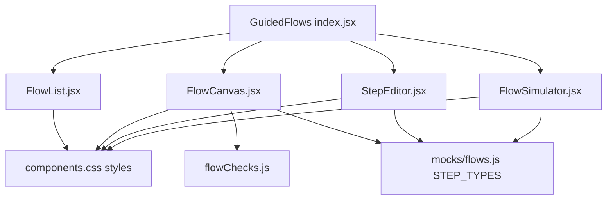
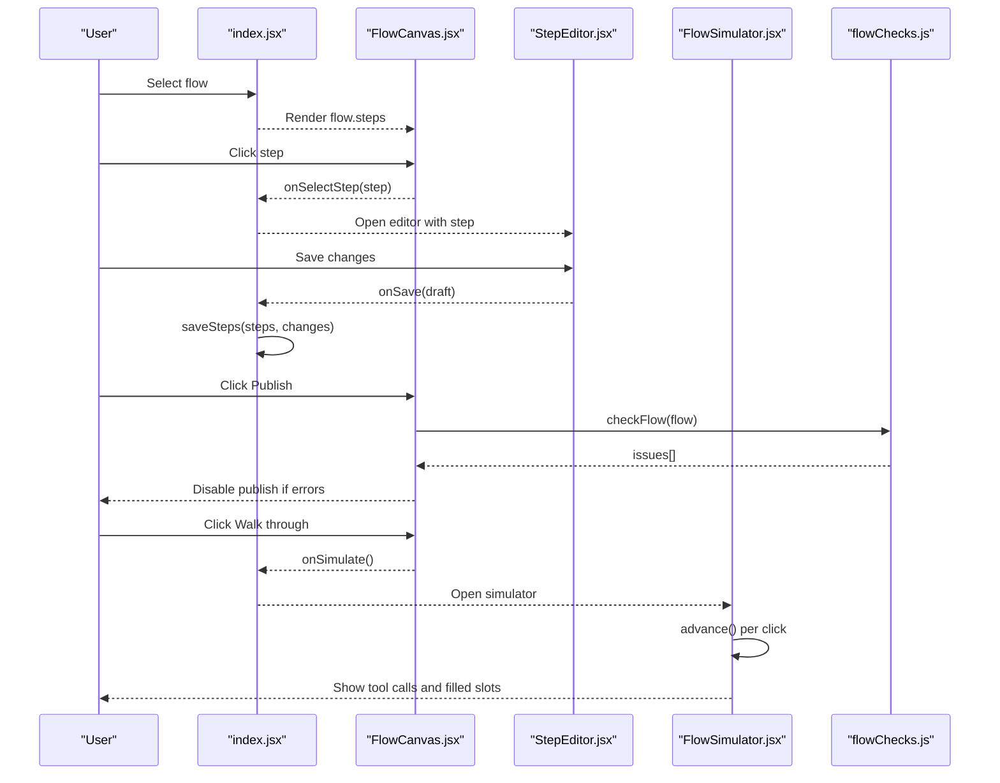
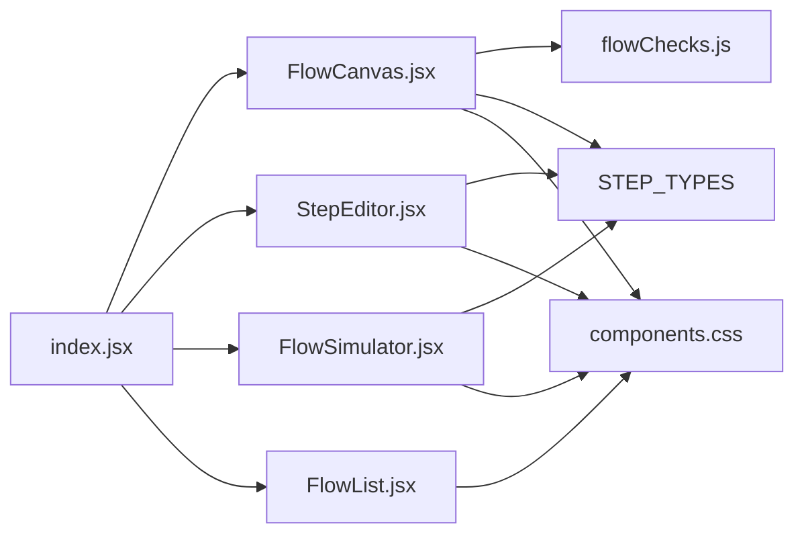

# Flow Canvas

<cite>
**Referenced Files in This Document**
- [FlowCanvas.jsx](file://src/pages/GuidedFlows/FlowCanvas.jsx)
- [StepEditor.jsx](file://src/pages/GuidedFlows/StepEditor.jsx)
- [flowChecks.js](file://src/pages/GuidedFlows/flowChecks.js)
- [index.jsx](file://src/pages/GuidedFlows/index.jsx)
- [flows.js](file://src/mocks/flows.js)
- [FlowList.jsx](file://src/pages/GuidedFlows/FlowList.jsx)
- [FlowSimulator.jsx](file://src/pages/GuidedFlows/FlowSimulator.jsx)
- [components.css](file://src/styles/components.css)
</cite>

## Table of Contents
1. [Introduction](#introduction)
2. [Project Structure](#project-structure)
3. [Core Components](#core-components)
4. [Architecture Overview](#architecture-overview)
5. [Detailed Component Analysis](#detailed-component-analysis)
6. [Dependency Analysis](#dependency-analysis)
7. [Performance Considerations](#performance-considerations)
8. [Troubleshooting Guide](#troubleshooting-guide)
9. [Conclusion](#conclusion)
10. [Appendices](#appendices)

## Introduction
This document explains the Flow Canvas feature that lets authors build and validate guided flows as explicit state machines. The canvas renders a vertical, ordered list of steps with metadata, tool calls, and prompts. It provides step reordering, adding steps, publishing controls, and live validation feedback. A simulator walks through the flow to verify behavior before publishing.

The current implementation is a linear, ordered editor rather than a freeform node graph with drag-and-drop connections. Steps are arranged top-to-bottom; connections are implicit by order. Validation ensures flows end in confirm or handoff, include at least one handoff, collect required slots before use, and surface warnings when tools are missing.

## Project Structure
The Guided Flows feature lives under pages/GuidedFlows and composes several focused components:
- FlowList: lists available flows and selects the active one.
- FlowCanvas: renders the ordered steps and actions (move, add, simulate, publish).
- StepEditor: edits fields for the selected step based on its type.
- FlowSimulator: walks through the flow step-by-step to visualize execution and slot filling.
- flowChecks: validates publishability rules against the current flow.
- mocks/flows.js: defines sample flows, step types, and tools used across the UI.

**Diagram sources**
- [index.jsx:1-152](file://src/pages/GuidedFlows/index.jsx#L1-L152)
- [FlowCanvas.jsx:1-157](file://src/pages/GuidedFlows/FlowCanvas.jsx#L1-L157)
- [StepEditor.jsx:1-161](file://src/pages/GuidedFlows/StepEditor.jsx#L1-L161)
- [FlowSimulator.jsx:1-160](file://src/pages/GuidedFlows/FlowSimulator.jsx#L1-L160)
- [flowChecks.js:1-68](file://src/pages/GuidedFlows/flowChecks.js#L1-L68)
- [flows.js:1-137](file://src/mocks/flows.js#L1-L137)
- [components.css:917-967](file://src/styles/components.css#L917-L967)

**Section sources**
- [index.jsx:1-152](file://src/pages/GuidedFlows/index.jsx#L1-L152)
- [FlowCanvas.jsx:1-157](file://src/pages/GuidedFlows/FlowCanvas.jsx#L1-L157)
- [StepEditor.jsx:1-161](file://src/pages/GuidedFlows/StepEditor.jsx#L1-L161)
- [FlowSimulator.jsx:1-160](file://src/pages/GuidedFlows/FlowSimulator.jsx#L1-L160)
- [flowChecks.js:1-68](file://src/pages/GuidedFlows/flowChecks.js#L1-L68)
- [flows.js:1-137](file://src/mocks/flows.js#L1-L137)
- [components.css:917-967](file://src/styles/components.css#L917-L967)

## Core Components
- FlowCanvas: Renders the ordered steps, shows labels, badges, tool calls, and prompts. Provides move up/down buttons, add step, simulate, and publish. Displays validation issues below the list.
- StepEditor: Opens a drawer to edit step fields. Fields vary by step type (ask requires slot and validation; lookup/inform/confirm show tool and args; all except lookup show bilingual prompts).
- FlowSimulator: Step-through mode that fills slots for ask steps and displays tool calls and responses.
- flowChecks: Validates flow publishability: last step must be confirm/handoff, at least one handoff exists, asks have slots and validations, lookups consume slots only after they are collected, and warns if no tool call exists.
- FlowList: Lists flows with status badges and metrics; selection drives which flow is edited.

Key behaviors:
- Step positioning: strictly ordered; users reorder via move-up/move-down buttons.
- Connection management: implicit by order; no visual connection lines or nodes.
- Real-time validation: computed from checkFlow and shown as notes; Publish button disabled while errors exist.
- Publishing: guarded by validation; updates flow status to live.

**Section sources**
- [FlowCanvas.jsx:16-156](file://src/pages/GuidedFlows/FlowCanvas.jsx#L16-L156)
- [StepEditor.jsx:16-161](file://src/pages/GuidedFlows/StepEditor.jsx#L16-L161)
- [flowChecks.js:8-67](file://src/pages/GuidedFlows/flowChecks.js#L8-L67)
- [index.jsx:33-105](file://src/pages/GuidedFlows/index.jsx#L33-L105)
- [FlowSimulator.jsx:27-159](file://src/pages/GuidedFlows/FlowSimulator.jsx#L27-L159)
- [FlowList.jsx:5-52](file://src/pages/GuidedFlows/FlowList.jsx#L5-L52)

## Architecture Overview
The GuidedFlows page orchestrates state and side effects:
- State: selected flow ID, editing step, simulation open flag.
- Mutations: save steps, publish flow, delete step, move step.
- Validation: run checkFlow before publish and display issues in FlowCanvas.
- Simulation: opens FlowSimulator to walk through steps and fill slots.

**Diagram sources**
- [index.jsx:21-149](file://src/pages/GuidedFlows/index.jsx#L21-L149)
- [FlowCanvas.jsx:16-156](file://src/pages/GuidedFlows/FlowCanvas.jsx#L16-L156)
- [StepEditor.jsx:16-161](file://src/pages/GuidedFlows/StepEditor.jsx#L16-L161)
- [FlowSimulator.jsx:27-159](file://src/pages/GuidedFlows/FlowSimulator.jsx#L27-L159)
- [flowChecks.js:8-67](file://src/pages/GuidedFlows/flowChecks.js#L8-L67)

## Detailed Component Analysis

### FlowCanvas
Responsibilities:
- Display flow header with intent, step count, completions, drop-off.
- Render each step with label, badge (type), optional slot badge, tool call line, and prompt preview.
- Provide move-up/move-down controls to reorder steps.
- Add new step button.
- Run checkFlow and render issues as notes; disable Publish when errors exist.

Visual feedback:
- Selected step highlighted via CSS class.
- Issues displayed with tone-based notes (error/warn).
- Publish button disabled when errors are present.

Interaction model:
- No drag-and-drop; reordering uses discrete move buttons.
- Connections are implicit by step order.

Accessibility:
- Move buttons include aria-labels.
- Notes convey error/warn context.

**Section sources**
- [FlowCanvas.jsx:16-156](file://src/pages/GuidedFlows/FlowCanvas.jsx#L16-L156)
- [components.css:917-967](file://src/styles/components.css#L917-L967)

### StepEditor
Responsibilities:
- Edit step fields based on type:
  - ask: slot name and validation rule.
  - lookup/inform/confirm: tool selection and arguments.
  - All except lookup: bilingual prompts (English/Urdu).
- Save, cancel, and delete operations.
- Show contextual note for lookup steps.

Validation hints:
- Field-level placeholders guide input.
- Type-specific fields reduce misconfiguration.

**Section sources**
- [StepEditor.jsx:16-161](file://src/pages/GuidedFlows/StepEditor.jsx#L16-L161)

### flowChecks
Rules enforced:
- Empty flow: error.
- Last step must be confirm or handoff: error otherwise.
- At least one handoff required: error if missing.
- Each ask must have a slot: error if missing.
- Each ask should have a validation rule: warning if missing.
- Lookup toolArgs referencing an ask’s slot must appear after that ask: error if not.
- Warn if no tool call anywhere in the flow.

Output:
- Array of issues with level (error/warn) and text.

**Section sources**
- [flowChecks.js:8-67](file://src/pages/GuidedFlows/flowChecks.js#L8-L67)

### FlowSimulator
Responsibilities:
- Step through the flow incrementally.
- For ask steps, simulate filling the slot.
- For lookup steps, display tool call and sample result.
- Show bilingual prompts based on app language setting.
- Indicate completion when final step reached.

Behavior:
- Cursor tracks progress; reset clears state.
- Advance fills slots and moves to next step.

**Section sources**
- [FlowSimulator.jsx:27-159](file://src/pages/GuidedFlows/FlowSimulator.jsx#L27-L159)

### FlowList
Responsibilities:
- Display flows with Live/Draft badges.
- Show step counts, completions, update date.
- Selection highlights the active flow.

**Section sources**
- [FlowList.jsx:5-52](file://src/pages/GuidedFlows/FlowList.jsx#L5-L52)

### Data Model and Types
- Flow: id, en, ur, intent, serviceId, status, updated, by, completions, dropOff, steps[].
- Step: id, type, label, slot?, validation?, tool?, toolArgs?, prompt_en?, prompt_ur?, terminal?
- Step types: ask, lookup, inform, confirm, handoff.
- Tools: get_fee_tariff, get_deadline, get_document_checklist, get_department, get_eligibility, search_knowledge_base, create_escalation_ticket.

These definitions drive rendering and validation logic across components.

**Section sources**
- [flows.js:19-137](file://src/mocks/flows.js#L19-L137)

## Dependency Analysis
Component relationships:
- index.jsx coordinates state and mutations; passes props to FlowCanvas, StepEditor, FlowSimulator, and FlowList.
- FlowCanvas depends on flowChecks for validation and STEP_TYPES for labels/tone.
- StepEditor depends on STEP_TYPES and TOOLS for field options.
- FlowSimulator depends on STEP_TYPES and app language context.
- Styles provide consistent theming and layout for steps, notes, badges, and overlays.

**Diagram sources**
- [index.jsx:1-152](file://src/pages/GuidedFlows/index.jsx#L1-L152)
- [FlowCanvas.jsx:1-157](file://src/pages/GuidedFlows/FlowCanvas.jsx#L1-L157)
- [StepEditor.jsx:1-161](file://src/pages/GuidedFlows/StepEditor.jsx#L1-L161)
- [FlowSimulator.jsx:1-160](file://src/pages/GuidedFlows/FlowSimulator.jsx#L1-L160)
- [flowChecks.js:1-68](file://src/pages/GuidedFlows/flowChecks.js#L1-L68)
- [flows.js:118-137](file://src/mocks/flows.js#L118-L137)
- [components.css:917-967](file://src/styles/components.css#L917-L967)

**Section sources**
- [index.jsx:1-152](file://src/pages/GuidedFlows/index.jsx#L1-L152)
- [FlowCanvas.jsx:1-157](file://src/pages/GuidedFlows/FlowCanvas.jsx#L1-L157)
- [StepEditor.jsx:1-161](file://src/pages/GuidedFlows/StepEditor.jsx#L1-L161)
- [FlowSimulator.jsx:1-160](file://src/pages/GuidedFlows/FlowSimulator.jsx#L1-L160)
- [flowChecks.js:1-68](file://src/pages/GuidedFlows/flowChecks.js#L1-L68)
- [flows.js:118-137](file://src/mocks/flows.js#L118-L137)
- [components.css:917-967](file://src/styles/components.css#L917-L967)

## Performance Considerations
- Rendering: FlowCanvas maps over flow.steps; for large flows, consider virtualization or pagination to avoid heavy DOM updates.
- Validation: checkFlow runs on every render; memoize results or debounce if flow data changes frequently.
- Simulation: FlowSimulator maintains cursor and slots; keep state minimal and avoid unnecessary re-renders.
- Styling: CSS classes are lightweight; ensure animations do not trigger layout thrashing on large lists.
- Accessibility: Ensure keyboard navigation for step reordering and focus management when opening/closing editors and simulators.

[No sources needed since this section provides general guidance]

## Troubleshooting Guide
Common issues surfaced by validation:
- Flow has no steps: add at least one step.
- Last step is not confirm or handoff: ensure terminal step is set appropriately.
- No hand-off step: add a handoff to offer human assistance.
- Ask without slot: configure slot for each ask.
- Ask without validation: add a validation rule to prevent invalid inputs.
- Lookup uses slot before collection: reorder steps so asks precede lookups that consume those slots.
- No tool call: add lookup or confirm steps grounded in tools to ensure answers are accurate.

Publish gating:
- Publish button is disabled when any error exists; fix issues first.

Simulation debugging:
- Use FlowSimulator to verify slot filling order and tool outputs before publishing.

**Section sources**
- [flowChecks.js:8-67](file://src/pages/GuidedFlows/flowChecks.js#L8-L67)
- [FlowCanvas.jsx:145-153](file://src/pages/GuidedFlows/FlowCanvas.jsx#L145-L153)
- [index.jsx:91-105](file://src/pages/GuidedFlows/index.jsx#L91-L105)
- [FlowSimulator.jsx:40-48](file://src/pages/GuidedFlows/FlowSimulator.jsx#L40-L48)

## Conclusion
The Flow Canvas provides a clear, ordered editor for building guided flows with strong validation and a simulator to verify behavior. While it does not implement a freeform node graph with drag-and-drop connections, it offers robust controls for ordering, editing, and validating flows. The design emphasizes clarity and safety: flows must end in confirm or handoff, include human handoff, and respect slot collection order. With careful scaling strategies and accessibility enhancements, this component can support complex flows effectively.

[No sources needed since this section summarizes without analyzing specific files]

## Appendices

### Visual Feedback and Styling
- Step rows use consistent styling with hover states and selection highlighting.
- Notes display error/warn messages with distinct tones.
- Tool calls are rendered in a monospaced style for clarity.

**Section sources**
- [components.css:917-967](file://src/styles/components.css#L917-L967)
- [components.css:628-647](file://src/styles/components.css#L628-L647)

### Example Workflows
- Admission & Enrolment: collects programme and campus, checks eligibility, fetches deadline and fee, reads checklist, then offers human handoff.
- Fee Challan: collects programme and enrolment type, fetches amount and due date, explains payment, then offers human handoff.
- Result Enquiry: informs about results portal, points to portal, then offers human handoff.
- Degree Application: collects semester, fetches deadline and fee, reads checklist, states processing time, then offers human handoff.

These examples demonstrate how ask, lookup, inform, confirm, and handoff steps compose into complete journeys.

**Section sources**
- [flows.js:19-116](file://src/mocks/flows.js#L19-L116)