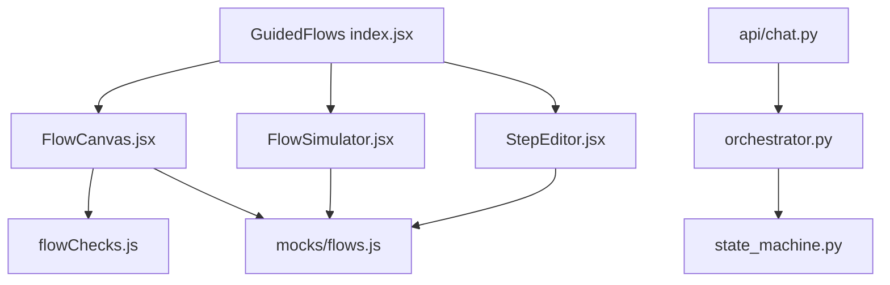
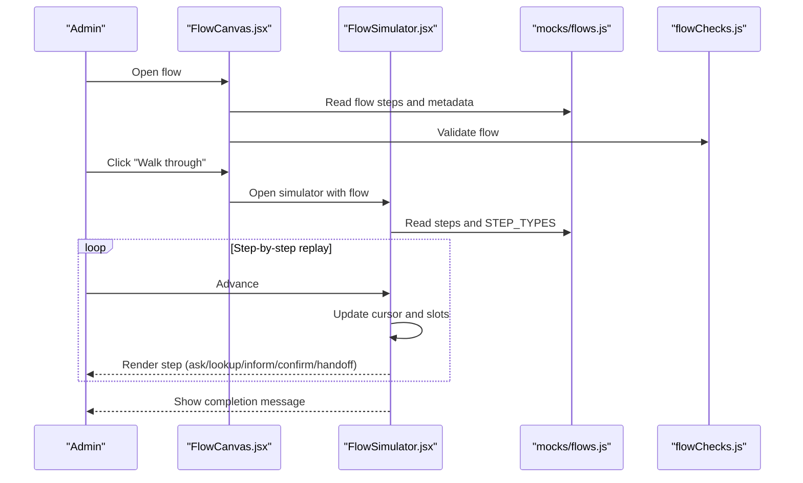
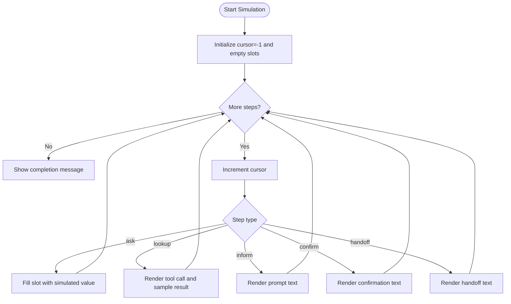
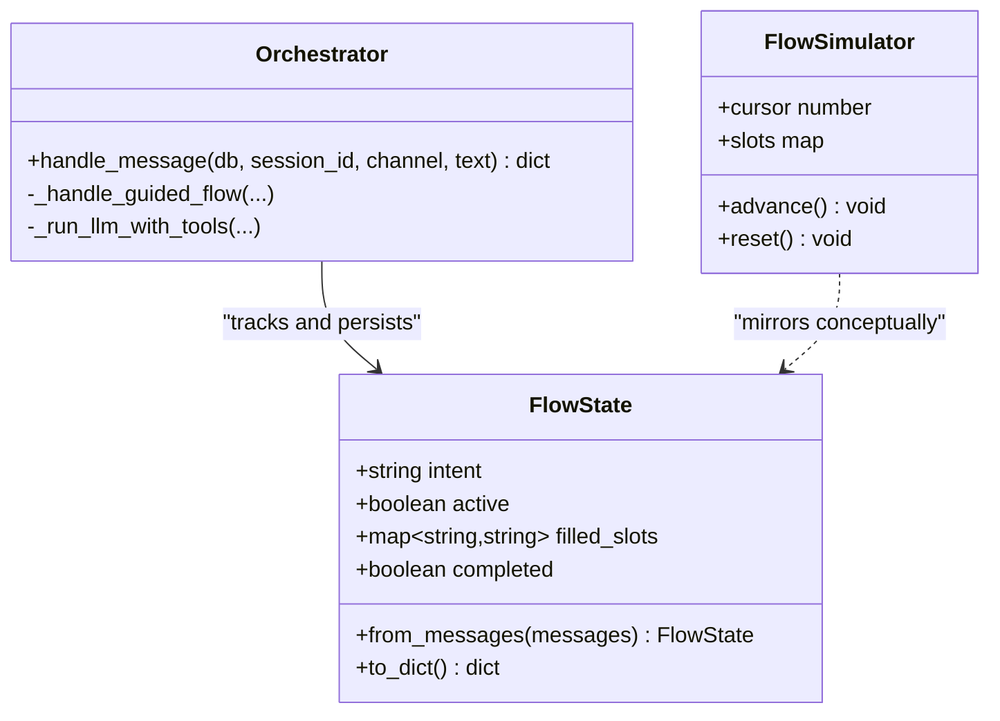
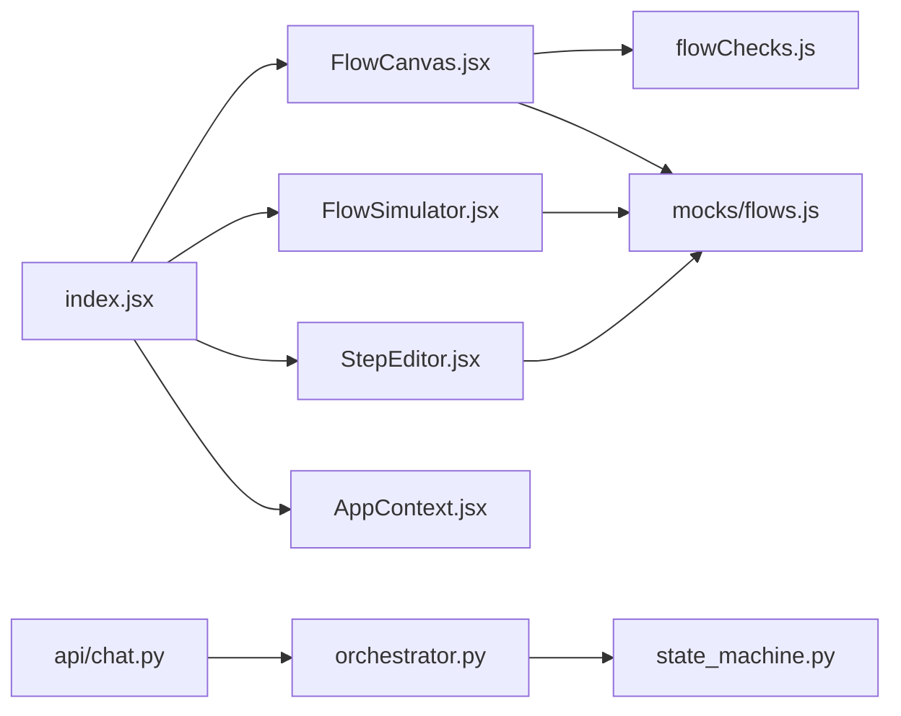

# Flow Simulator

<cite>
**Referenced Files in This Document**
- [FlowSimulator.jsx](file://src/pages/GuidedFlows/FlowSimulator.jsx)
- [flowChecks.js](file://src/pages/GuidedFlows/flowChecks.js)
- [StepEditor.jsx](file://src/pages/GuidedFlows/StepEditor.jsx)
- [FlowCanvas.jsx](file://src/pages/GuidedFlows/FlowCanvas.jsx)
- [flows.js](file://src/mocks/flows.js)
- [index.jsx](file://src/pages/GuidedFlows/index.jsx)
- [AppContext.jsx](file://src/context/AppContext.jsx)
- [orchestrator.py](file://uaea-backend/app/orchestrator/orchestrator.py)
- [state_machine.py](file://uaea-backend/app/orchestrator/state_machine.py)
- [chat.py](file://uaea-backend/app/api/chat.py)
- [test_chat_flow.py](file://uaea-backend/tests/test_chat_flow.py)
</cite>

## Table of Contents
1. Introduction
2. Project Structure
3. Core Components
4. Architecture Overview
5. Detailed Component Analysis
6. Dependency Analysis
7. Performance Considerations
8. Troubleshooting Guide
9. Conclusion

## Introduction
This document explains the Flow Simulator component and its surrounding system for testing guided flows. The simulator provides an interactive, step-by-step walkthrough that helps administrators validate flow logic, verify slot collection order, confirm tool usage, and ensure flows end with a human handoff or confirmation. It also documents how the backend orchestrator executes flows, tracks state across messages, and integrates with tools to ground responses. You will find guidance on creating test cases, reporting results, validating flows, debugging execution paths, and troubleshooting common issues.

## Project Structure
The Flow Simulator lives in the Guided Flows page and is composed of:
- A list view to select flows
- A canvas that displays steps, validation issues, and actions (simulate, publish)
- A step editor for editing individual steps
- A simulator drawer that replays the flow one step at a time
- Validation rules that prevent publishing broken flows
- Backend orchestrator and state machine that power live conversations and can be used as reference for simulation behavior

**Diagram sources**
- [index.jsx:1-152](file://src/pages/GuidedFlows/index.jsx#L1-L152)
- [FlowCanvas.jsx:1-157](file://src/pages/GuidedFlows/FlowCanvas.jsx#L1-L157)
- [StepEditor.jsx:1-161](file://src/pages/GuidedFlows/StepEditor.jsx#L1-L161)
- [FlowSimulator.jsx:1-160](file://src/pages/GuidedFlows/FlowSimulator.jsx#L1-L160)
- [flows.js:1-137](file://src/mocks/flows.js#L1-L137)
- [flowChecks.js:1-68](file://src/pages/GuidedFlows/flowChecks.js#L1-L68)
- [orchestrator.py:1-405](file://uaea-backend/app/orchestrator/orchestrator.py#L1-L405)
- [state_machine.py:1-146](file://uaea-backend/app/orchestrator/state_machine.py#L1-L146)
- [chat.py:1-115](file://uaea-backend/app/api/chat.py#L1-L115)

**Section sources**
- [index.jsx:1-152](file://src/pages/GuidedFlows/index.jsx#L1-L152)
- [FlowCanvas.jsx:1-157](file://src/pages/GuidedFlows/FlowCanvas.jsx#L1-L157)
- [StepEditor.jsx:1-161](file://src/pages/GuidedFlows/StepEditor.jsx#L1-L161)
- [FlowSimulator.jsx:1-160](file://src/pages/GuidedFlows/FlowSimulator.jsx#1-L160)
- [flows.js:1-137](file://src/mocks/flows.js#L1-L137)
- [flowChecks.js:1-68](file://src/pages/GuidedFlows/flowChecks.js#L1-L68)
- [orchestrator.py:1-405](file://uaea-backend/app/orchestrator/orchestrator.py#L1-L405)
- [state_machine.py:1-146](file://uaea-backend/app/orchestrator/state_machine.py#L1-L146)
- [chat.py:1-115](file://uaea-backend/app/api/chat.py#L1-L115)

## Core Components
- FlowSimulator: Interactive drawer that steps through a flow’s ordered steps, simulates user input for “ask” steps, shows tool calls and sample results, and highlights filled slots.
- FlowCanvas: Visualizes the flow’s steps, displays validation issues, enables moving steps, adding steps, simulating, and publishing when valid.
- StepEditor: Edits step properties based on type (ask, lookup, inform, confirm, handoff), including slot names, validation rules, tool selection, arguments, and prompts.
- flowChecks: Validates flows to ensure they are safe to publish: must end in confirm/handoff, require handoff, collect slots before use, and include grounding via tools where appropriate.
- mocks/flows: Defines example flows, step types metadata, and available tools; serves as the data model for both editor and simulator.
- AppContext: Provides global app state and mutation utilities used by the Guided Flows page to persist changes and audit them.
- Orchestrator and State Machine: Backend components that execute guided flows in real conversations, track per-conversation state, and integrate with tools and guardrails.

**Section sources**
- [FlowSimulator.jsx:1-160](file://src/pages/GuidedFlows/FlowSimulator.jsx#L1-L160)
- [FlowCanvas.jsx:1-157](file://src/pages/GuidedFlows/FlowCanvas.jsx#L1-L157)
- [StepEditor.jsx:1-161](file://src/pages/GuidedFlows/StepEditor.jsx#L1-L161)
- [flowChecks.js:1-68](file://src/pages/GuidedFlows/flowChecks.js#L1-L68)
- [flows.js:1-137](file://src/mocks/flows.js#L1-L137)
- [AppContext.jsx:1-135](file://src/context/AppContext.jsx#L1-L135)
- [orchestrator.py:1-405](file://uaea-backend/app/orchestrator/orchestrator.py#L1-L405)
- [state_machine.py:1-146](file://uaea-backend/app/orchestrator/state_machine.py#L1-L146)

## Architecture Overview
The Flow Simulator is a frontend-only walkthrough tool that mirrors the backend’s guided flow execution model. Administrators use it to:
- Replay flows step-by-step
- Validate slot collection order and tool usage
- Confirm flows terminate properly
- Inspect prompts and tool calls

In production, the backend orchestrator processes user messages, detects guided flow intents, manages per-conversation state, fills slots, executes tool calls, and enforces guardrails. The simulator uses mock data and static samples to simulate these behaviors without calling external services.

**Diagram sources**
- [FlowCanvas.jsx:1-157](file://src/pages/GuidedFlows/FlowCanvas.jsx#L1-L157)
- [FlowSimulator.jsx:1-160](file://src/pages/GuidedFlows/FlowSimulator.jsx#L1-L160)
- [flows.js:1-137](file://src/mocks/flows.js#L1-L137)
- [flowChecks.js:1-68](file://src/pages/GuidedFlows/flowChecks.js#L1-L68)

## Detailed Component Analysis

### Flow Simulator Execution Engine
The simulator advances through a flow’s steps sequentially:
- Tracks current position (cursor) and collected slots
- For “ask” steps, simulates user input and marks the corresponding slot as filled
- For “lookup” steps, renders tool call and sample result
- Displays prompts in English or Urdu based on app context
- Shows completion when all steps have been executed

**Diagram sources**
- [FlowSimulator.jsx:20-160](file://src/pages/GuidedFlows/FlowSimulator.jsx#L20-L160)

**Section sources**
- [FlowSimulator.jsx:20-160](file://src/pages/GuidedFlows/FlowSimulator.jsx#L20-L160)

### State Tracking and Real-Time Conversation Replay
- State tracking: The simulator maintains a cursor and slots map to reflect which steps have run and which values have been collected.
- Real-time replay: Each advancement updates the UI immediately, showing bot/user bubbles, tool calls, and badges for filled slots.
- Backend parallel: In production, the orchestrator persists flow state via messages and reconstructs it from history using the state machine.

**Diagram sources**
- [state_machine.py:62-146](file://uaea-backend/app/orchestrator/state_machine.py#L62-L146)
- [orchestrator.py:46-143](file://uaea-backend/app/orchestrator/orchestrator.py#L46-L143)
- [FlowSimulator.jsx:27-160](file://src/pages/GuidedFlows/FlowSimulator.jsx#L27-L160)

**Section sources**
- [state_machine.py:62-146](file://uaea-backend/app/orchestrator/state_machine.py#L62-L146)
- [orchestrator.py:46-143](file://uaea-backend/app/orchestrator/orchestrator.py#L46-L143)
- [FlowSimulator.jsx:27-160](file://src/pages/GuidedFlows/FlowSimulator.jsx#L27-L160)

### Input Simulation and Branch Testing
- Input simulation: The simulator auto-fills slots for “ask” steps to demonstrate how values propagate through the flow.
- Branch testing: While the current simulator is linear, administrators can create multiple flows to cover different branches (e.g., eligibility pass/fail, new vs repeat enrolment). Use separate flows for distinct decision paths and validate each via the canvas checks.
- Error scenario validation: Ensure flows handle missing data by requiring tool calls and ending with handoff; use flowChecks to catch ordering errors and missing validations.

**Section sources**
- [FlowSimulator.jsx:40-149](file://src/pages/GuidedFlows/FlowSimulator.jsx#L40-L149)
- [flowChecks.js:8-67](file://src/pages/GuidedFlows/flowChecks.js#L8-L67)
- [flows.js:19-116](file://src/mocks/flows.js#L19-L116)

### Debugging Tools for Flow Inspection
- FlowCanvas issues panel: Displays validation errors and warnings in real time; prevents publishing if errors exist.
- StepEditor: Edit step labels, types, slots, validation rules, tools, arguments, and bilingual prompts.
- Simulator slots panel: Shows which slots have been filled during replay.
- Tool call visualization: Lookup steps show tool name and arguments; sample results help verify expected outputs.

**Section sources**
- [FlowCanvas.jsx:26-153](file://src/pages/GuidedFlows/FlowCanvas.jsx#L26-L153)
- [StepEditor.jsx:16-161](file://src/pages/GuidedFlows/StepEditor.jsx#L16-L161)
- [FlowSimulator.jsx:71-108](file://src/pages/GuidedFlows/FlowSimulator.jsx#L71-L108)

### Test Case Creation and Result Reporting
- Frontend tests: Create flows that cover typical scenarios (admission, fee challan, result enquiry, degree application, transcript). Use the simulator to walk through each flow and verify prompts, tool calls, and termination.
- Backend tests: Use the provided chat flow tests to assert guided flow triggers, slot filling, session history retrieval, escalation creation, and admin endpoints.
- Result reporting: Publish flows only after passing validation; use the toast notifications and audit trail to record changes and confirm publication.

**Section sources**
- [test_chat_flow.py:44-176](file://uaea-backend/tests/test_chat_flow.py#L44-L176)
- [index.jsx:91-105](file://src/pages/GuidedFlows/index.jsx#L91-L105)
- [AppContext.jsx:51-103](file://src/context/AppContext.jsx#L51-L103)

### Integration with Flow Validation System
- flowChecks enforces:
  - Non-empty steps
  - Terminal step must be confirm or handoff
  - Presence of handoff
  - Ask steps must define slots and ideally validation rules
  - Slots must be collected before being used in tool arguments
  - Presence of tool calls or confirm to ground responses
- FlowCanvas displays issues and disables publish until resolved.

**Section sources**
- [flowChecks.js:8-67](file://src/pages/GuidedFlows/flowChecks.js#L8-L67)
- [FlowCanvas.jsx:26-54](file://src/pages/GuidedFlows/FlowCanvas.jsx#L26-L54)

## Dependency Analysis
The Guided Flows page composes several modules:
- index.jsx coordinates FlowList, FlowCanvas, StepEditor, FlowSimulator, and validation/publishing
- FlowCanvas depends on STEP_TYPES metadata and flowChecks
- FlowSimulator depends on STEP_TYPES and mock tool results
- StepEditor depends on STEP_TYPES and TOOLS
- AppContext provides store and mutate functions for persistence and auditing
- Backend orchestrator and state machine define the runtime behavior mirrored by the simulator

**Diagram sources**
- [index.jsx:1-152](file://src/pages/GuidedFlows/index.jsx#L1-L152)
- [FlowCanvas.jsx:1-157](file://src/pages/GuidedFlows/FlowCanvas.jsx#L1-L157)
- [StepEditor.jsx:1-161](file://src/pages/GuidedFlows/StepEditor.jsx#L1-L161)
- [FlowSimulator.jsx:1-160](file://src/pages/GuidedFlows/FlowSimulator.jsx#L1-L160)
- [flowChecks.js:1-68](file://src/pages/GuidedFlows/flowChecks.js#L1-L68)
- [flows.js:1-137](file://src/mocks/flows.js#L1-L137)
- [AppContext.jsx:1-135](file://src/context/AppContext.jsx#L1-L135)
- [orchestrator.py:1-405](file://uaea-backend/app/orchestrator/orchestrator.py#L1-L405)
- [state_machine.py:1-146](file://uaea-backend/app/orchestrator/state_machine.py#L1-L146)
- [chat.py:1-115](file://uaea-backend/app/api/chat.py#L1-L115)

**Section sources**
- [index.jsx:1-152](file://src/pages/GuidedFlows/index.jsx#L1-L152)
- [FlowCanvas.jsx:1-157](file://src/pages/GuidedFlows/FlowCanvas.jsx#L1-L157)
- [StepEditor.jsx:1-161](file://src/pages/GuidedFlows/StepEditor.jsx#L1-L161)
- [FlowSimulator.jsx:1-160](file://src/pages/GuidedFlows/FlowSimulator.jsx#L1-L160)
- [flowChecks.js:1-68](file://src/pages/GuidedFlows/flowChecks.js#L1-L68)
- [flows.js:1-137](file://src/mocks/flows.js#L1-L137)
- [AppContext.jsx:1-135](file://src/context/AppContext.jsx#L1-L135)
- [orchestrator.py:1-405](file://uaea-backend/app/orchestrator/orchestrator.py#L1-L405)
- [state_machine.py:1-146](file://uaea-backend/app/orchestrator/state_machine.py#L1-L146)
- [chat.py:1-115](file://uaea-backend/app/api/chat.py#L1-L115)

## Performance Considerations
- Simulator performance: Linear stepping over steps is efficient for typical flow sizes; avoid excessive DOM re-renders by keeping step lists small and avoiding heavy computations inside render loops.
- Validation overhead: flowChecks runs on every render; keep checks lightweight and avoid expensive operations.
- Backend orchestration: The orchestrator limits LLM rounds to prevent infinite loops; ensure tool calls are idempotent and fast.
- State persistence: Persist flow state via messages to survive restarts; minimize redundant writes.

[No sources needed since this section provides general guidance]

## Troubleshooting Guide
Common issues and resolutions:
- Flow ends without resolution: Ensure last step is confirm or handoff; add handoff if missing.
- Slot used before collection: Reorder steps so ask steps precede lookups that consume those slots.
- Missing validation: Add validation rules to ask steps to improve robustness.
- No grounding: Include tool calls or confirm steps to ensure answers are sourced from tools.
- Cannot publish: Fix all error-level issues shown in the canvas; warnings indicate potential improvements but do not block publishing.
- Simulator shows no prompts: Verify prompts are written for non-lookup steps; otherwise the step may appear blank.
- Backend flow not triggering: Check intent classification and GUIDED_FLOW_INTENTS mapping; ensure conversation history includes flow_state messages.

**Section sources**
- [flowChecks.js:8-67](file://src/pages/GuidedFlows/flowChecks.js#L8-L67)
- [FlowCanvas.jsx:145-153](file://src/pages/GuidedFlows/FlowCanvas.jsx#L145-L153)
- [FlowSimulator.jsx:98-149](file://src/pages/GuidedFlows/FlowSimulator.jsx#L98-L149)
- [orchestrator.py:80-121](file://uaea-backend/app/orchestrator/orchestrator.py#L80-L121)

## Conclusion
The Flow Simulator provides a practical, interactive way to validate guided flows before deployment. By combining a step-by-step replay engine, real-time state visualization, and strict validation rules, administrators can confidently design flows that collect required information, ground responses with tools, and terminate safely with human handoff. The backend orchestrator and state machine mirror this behavior in production, ensuring consistency between simulation and live conversations. Use the provided tests and validation tools to create robust flows, report results accurately, and maintain high-quality user experiences.

[No sources needed since this section summarizes without analyzing specific files]