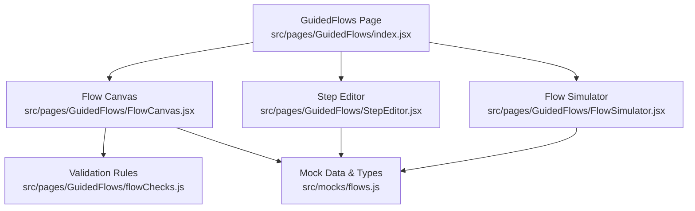
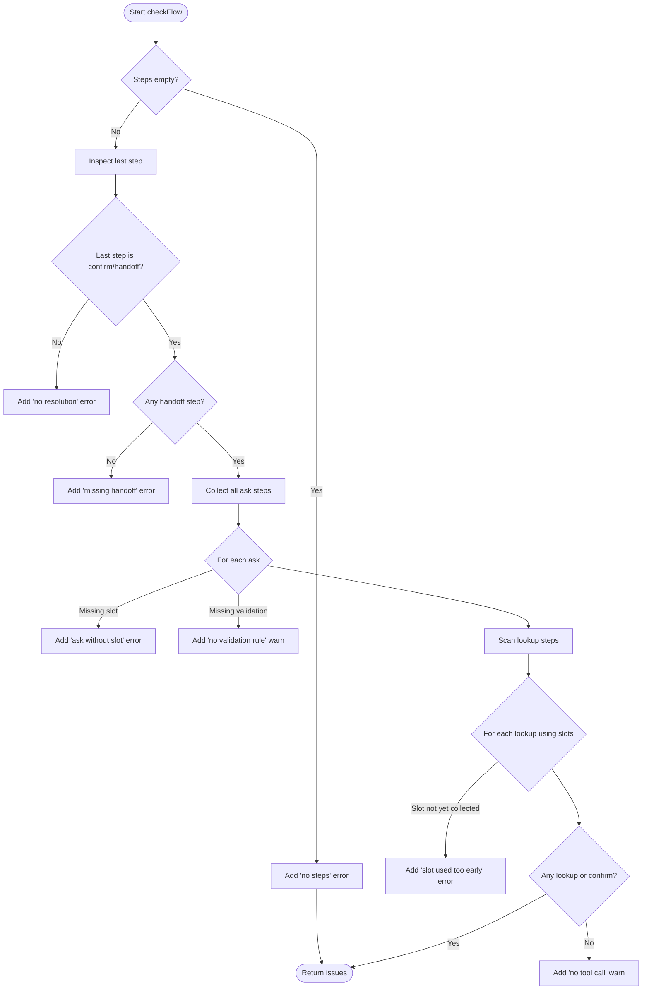
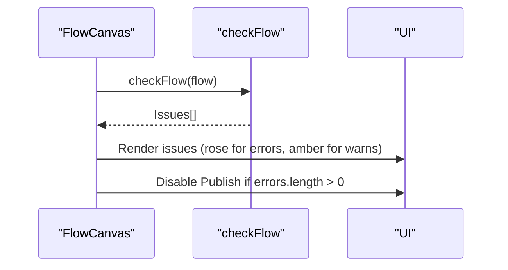
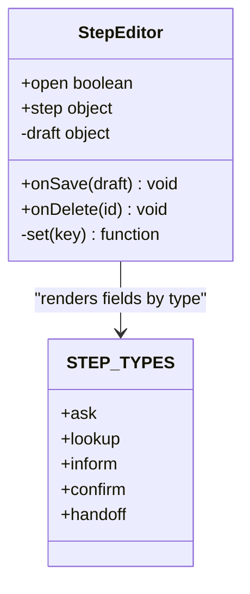
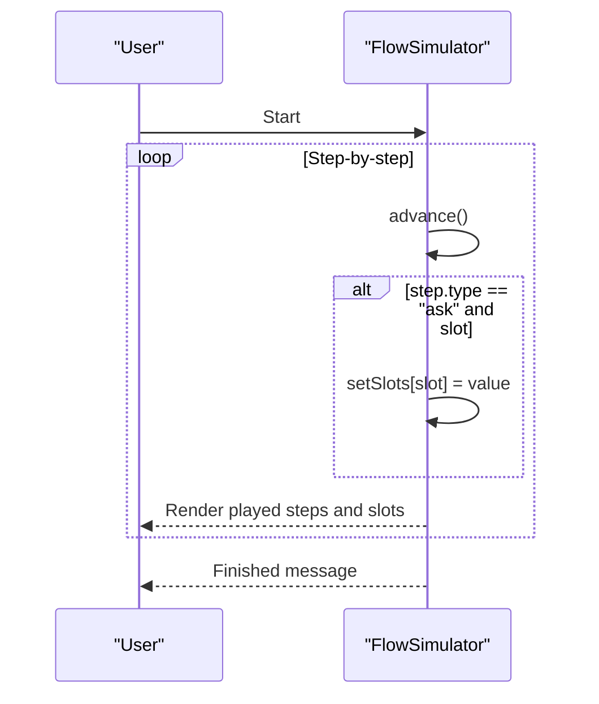
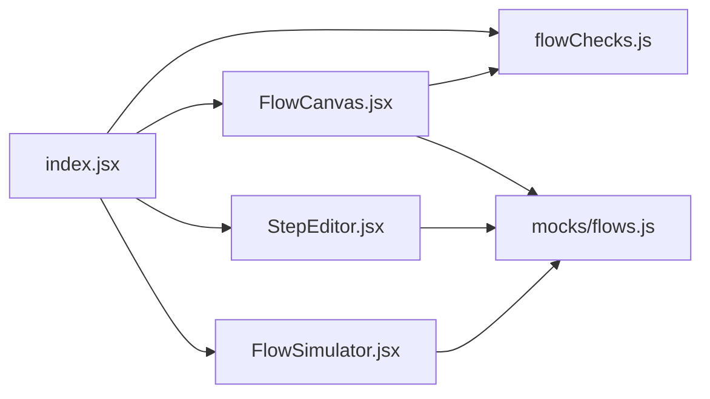

# Flow Validation

<cite>
**Referenced Files in This Document**
- [flowChecks.js](file://src/pages/GuidedFlows/flowChecks.js)
- [index.jsx](file://src/pages/GuidedFlows/index.jsx)
- [FlowCanvas.jsx](file://src/pages/GuidedFlows/FlowCanvas.jsx)
- [StepEditor.jsx](file://src/pages/GuidedFlows/StepEditor.jsx)
- [FlowSimulator.jsx](file://src/pages/GuidedFlows/FlowSimulator.jsx)
- [flows.js](file://src/mocks/flows.js)
</cite>

## Table of Contents
1. [Introduction](#introduction)
2. [Project Structure](#project-structure)
3. [Core Components](#core-components)
4. [Architecture Overview](#architecture-overview)
5. [Detailed Component Analysis](#detailed-component-analysis)
6. [Dependency Analysis](#dependency-analysis)
7. [Performance Considerations](#performance-considerations)
8. [Troubleshooting Guide](#troubleshooting-guide)
9. [Conclusion](#conclusion)

## Introduction
This document explains the flow validation system for Guided Flows used to validate multi-turn journeys before publishing. It covers syntax and structural checks, dependency analysis between steps, error detection algorithms, severity levels, location pinpointing, suggested fixes, and integration with the publish workflow. It also includes examples of common validation errors and resolutions, guidance on custom validation rules, performance considerations for large flows, and how the simulator supports debugging.

## Project Structure
The guided flow editor is implemented as a set of React components under src/pages/GuidedFlows, with validation logic centralized in a dedicated module. Mock data defines step types, tools, and sample flows.



**Diagram sources**
- [index.jsx:1-152](file://src/pages/GuidedFlows/index.jsx#L1-L152)
- [FlowCanvas.jsx:1-157](file://src/pages/GuidedFlows/FlowCanvas.jsx#L1-L157)
- [StepEditor.jsx:1-161](file://src/pages/GuidedFlows/StepEditor.jsx#L1-L161)
- [FlowSimulator.jsx:1-160](file://src/pages/GuidedFlows/FlowSimulator.jsx#L1-L160)
- [flowChecks.js:1-68](file://src/pages/GuidedFlows/flowChecks.js#L1-L68)
- [flows.js:1-137](file://src/mocks/flows.js#L1-L137)

**Section sources**
- [index.jsx:1-152](file://src/pages/GuidedFlows/index.jsx#L1-L152)
- [FlowCanvas.jsx:1-157](file://src/pages/GuidedFlows/FlowCanvas.jsx#L1-L157)
- [StepEditor.jsx:1-161](file://src/pages/GuidedFlows/StepEditor.jsx#L1-L161)
- [FlowSimulator.jsx:1-160](file://src/pages/GuidedFlows/FlowSimulator.jsx#L1-L160)
- [flowChecks.js:1-68](file://src/pages/GuidedFlows/flowChecks.js#L1-L68)
- [flows.js:1-137](file://src/mocks/flows.js#L1-L137)

## Core Components
- Validation engine: Centralized function that inspects a flow’s steps and returns issues with severity levels.
- UI integration: The canvas displays live validation results and disables publishing when errors exist.
- Step editing: Enforces required fields per step type (e.g., slot and validation rule for ask).
- Simulation: Walks through steps to verify slot collection order and tool usage before publishing.

Key responsibilities:
- Syntax and structure checks: Ensure steps are well-formed and complete.
- Dependency analysis: Validate that slots are collected before being consumed by lookup steps.
- Business rule compliance: Enforce terminal steps and human handoff requirements.
- Error reporting: Provide severity levels (error/warn), descriptive messages, and contextual hints.

**Section sources**
- [flowChecks.js:1-68](file://src/pages/GuidedFlows/flowChecks.js#L1-L68)
- [FlowCanvas.jsx:1-157](file://src/pages/GuidedFlows/FlowCanvas.jsx#L1-L157)
- [StepEditor.jsx:1-161](file://src/pages/GuidedFlows/StepEditor.jsx#L1-L161)
- [FlowSimulator.jsx:1-160](file://src/pages/GuidedFlows/FlowSimulator.jsx#L1-L160)

## Architecture Overview
The validation pipeline runs client-side during editing and again at publish time. The FlowCanvas computes issues from checkFlow and renders them inline. The publish action filters for errors only and blocks promotion if any remain. The simulator helps visualize slot dependencies and tool calls.

```mermaid
sequenceDiagram
participant U as "User"
participant P as "GuidedFlows Page<br/>index.jsx"
participant C as "FlowCanvas<br/>FlowCanvas.jsx"
participant V as "Validation<br/>flowChecks.js"
participant S as "FlowSimulator<br/>FlowSimulator.jsx"
U->>P : Open flow editor
P->>C : Render flow steps
C->>V : checkFlow(flow)
V-->>C : Issues (errors/warn)
C-->>U : Show issues; disable Publish if errors
U->>P : Click Publish
P->>V : checkFlow(flow) filter errors
alt Errors present
P-->>U : Block publish; show toast
else No errors
P->>P : Mutate status to live
P-->>U : Success toast
end
U->>S : Start simulation
S->>S : Advance step-by-step, fill slots
S-->>U : Visualize state transitions
```

**Diagram sources**
- [index.jsx:91-105](file://src/pages/GuidedFlows/index.jsx#L91-L105)
- [FlowCanvas.jsx:26-54](file://src/pages/GuidedFlows/FlowCanvas.jsx#L26-L54)
- [flowChecks.js:8-67](file://src/pages/GuidedFlows/flowChecks.js#L8-L67)
- [FlowSimulator.jsx:27-48](file://src/pages/GuidedFlows/FlowSimulator.jsx#L27-L48)

## Detailed Component Analysis

### Validation Engine: checkFlow
Purpose:
- Perform publishability checks on a flow’s steps.
- Detect missing terminal steps, missing handoff, incomplete ask steps, and out-of-order slot usage.
- Return structured issues with level and text for UI consumption.

Rules enforced:
- Empty flow: error if no steps.
- Terminal requirement: last step must be confirm or handoff; otherwise error.
- Human handoff: at least one handoff step required; otherwise error.
- Ask completeness: every ask must have a slot; otherwise error.
- Ask validation hint: every ask should have a validation rule; otherwise warn.
- Slot dependency: lookup steps cannot consume a slot before it has been collected by an earlier ask; otherwise error.
- Tool grounding hint: warn if no lookup or confirm exists (no tool call grounded in catalogue).

Complexity:
- O(n^2) worst-case due to nested iteration over asks for each lookup step where n is number of steps. For typical flows this is small; see Performance section for scaling guidance.

Error reporting:
- Severity levels: error (blocks publish), warn (advisory).
- Location pinpointing: messages reference step labels and slot names; additional context can be added by including step indices or IDs in issues.
- Suggested fixes: messages imply corrective actions (e.g., add handoff, ensure slot collected first).



**Diagram sources**
- [flowChecks.js:8-67](file://src/pages/GuidedFlows/flowChecks.js#L8-L67)

**Section sources**
- [flowChecks.js:8-67](file://src/pages/GuidedFlows/flowChecks.js#L8-L67)

### FlowCanvas Integration
Responsibilities:
- Compute issues via checkFlow and render them below the step list.
- Disable Publish button when errors exist.
- Display step metadata (type badge, slot, tool call) for clarity.

Publish gating:
- Errors block publishing; warnings do not.



**Diagram sources**
- [FlowCanvas.jsx:26-54](file://src/pages/GuidedFlows/FlowCanvas.jsx#L26-L54)
- [flowChecks.js:8-67](file://src/pages/GuidedFlows/flowChecks.js#L8-L67)

**Section sources**
- [FlowCanvas.jsx:26-54](file://src/pages/GuidedFlows/FlowCanvas.jsx#L26-L54)

### Step Editor Validation
Responsibilities:
- Present fields based on step type.
- For ask steps, require slot and encourage validation rule input.
- For lookup/confirm steps, require tool selection and arguments.

Integration with validation:
- Ensures editors collect required inputs so downstream checks pass.



**Diagram sources**
- [StepEditor.jsx:16-161](file://src/pages/GuidedFlows/StepEditor.jsx#L16-L161)
- [flows.js:118-125](file://src/mocks/flows.js#L118-L125)

**Section sources**
- [StepEditor.jsx:16-161](file://src/pages/GuidedFlows/StepEditor.jsx#L16-L161)
- [flows.js:118-125](file://src/mocks/flows.js#L118-L125)

### Flow Simulator
Purpose:
- Step through the flow to visualize state changes and slot filling.
- Confirm that lookups receive expected inputs after asks.
- Aid in diagnosing ordering issues that static checks may not fully reveal.

Behavior:
- Advances cursor through steps.
- On ask with slot, simulates filling the slot.
- Displays tool calls and sample results for lookup steps.



**Diagram sources**
- [FlowSimulator.jsx:27-48](file://src/pages/GuidedFlows/FlowSimulator.jsx#L27-L48)
- [FlowSimulator.jsx:98-149](file://src/pages/GuidedFlows/FlowSimulator.jsx#L98-L149)

**Section sources**
- [FlowSimulator.jsx:27-48](file://src/pages/GuidedFlows/FlowSimulator.jsx#L27-L48)
- [FlowSimulator.jsx:98-149](file://src/pages/GuidedFlows/FlowSimulator.jsx#L98-L149)

### Mock Data and Types
- Defines flow structures, step types, and available tools used by the editor and simulator.
- Provides example flows demonstrating valid configurations and patterns.

**Section sources**
- [flows.js:1-137](file://src/mocks/flows.js#L1-L137)

## Dependency Analysis
- FlowCanvas depends on checkFlow for validation and STEP_TYPES for rendering.
- StepEditor depends on STEP_TYPES and TOOLS to conditionally render fields.
- FlowSimulator depends on STEP_TYPES and mock tool results to simulate execution.
- index orchestrates save/publish actions and integrates validation results into UI state.



**Diagram sources**
- [FlowCanvas.jsx:1-157](file://src/pages/GuidedFlows/FlowCanvas.jsx#L1-L157)
- [StepEditor.jsx:1-161](file://src/pages/GuidedFlows/StepEditor.jsx#L1-L161)
- [FlowSimulator.jsx:1-160](file://src/pages/GuidedFlows/FlowSimulator.jsx#L1-L160)
- [flowChecks.js:1-68](file://src/pages/GuidedFlows/flowChecks.js#L1-L68)
- [flows.js:1-137](file://src/mocks/flows.js#L1-L137)
- [index.jsx:1-152](file://src/pages/GuidedFlows/index.jsx#L1-L152)

**Section sources**
- [FlowCanvas.jsx:1-157](file://src/pages/GuidedFlows/FlowCanvas.jsx#L1-L157)
- [StepEditor.jsx:1-161](file://src/pages/GuidedFlows/StepEditor.jsx#L1-L161)
- [FlowSimulator.jsx:1-160](file://src/pages/GuidedFlows/FlowSimulator.jsx#L1-L160)
- [flowChecks.js:1-68](file://src/pages/GuidedFlows/flowChecks.js#L1-L68)
- [flows.js:1-137](file://src/mocks/flows.js#L1-L137)
- [index.jsx:1-152](file://src/pages/GuidedFlows/index.jsx#L1-L152)

## Performance Considerations
- Current algorithm complexity: O(n^2) due to scanning asks for each lookup step. For typical flows (small n), this is negligible.
- Optimization opportunities:
  - Precompute a set of collected slots up to each index to reduce repeated scans.
  - Early exit on critical errors to avoid unnecessary work.
  - Memoize checkFlow results keyed by flow id or immutable snapshot to prevent recomputation on unrelated edits.
- UI responsiveness:
  - Debounce re-validation on rapid edits if needed.
  - Keep issue rendering minimal and incremental.

[No sources needed since this section provides general guidance]

## Troubleshooting Guide
Common validation errors and resolutions:
- No steps in flow:
  - Symptom: Error displayed; Publish disabled.
  - Resolution: Add at least one step; ensure final step is confirm or handoff.
- Last step not a resolution:
  - Symptom: Error indicating conversation ends without resolution.
  - Resolution: Make the last step a confirm or handoff.
- Missing handoff:
  - Symptom: Error requiring a human handoff.
  - Resolution: Add a handoff step somewhere in the flow.
- Ask without slot:
  - Symptom: Error on an ask step lacking a slot.
  - Resolution: Assign a unique slot name to the ask step.
- Ask without validation rule:
  - Symptom: Warning advising to add validation.
  - Resolution: Add a validation rule describing acceptable values.
- Slot used too early:
  - Symptom: Error stating a lookup uses a slot before it is collected.
  - Resolution: Move the ask that collects the slot before the lookup that consumes it.
- No tool call:
  - Symptom: Warning that nothing is grounded in the catalogue.
  - Resolution: Add a lookup or confirm step to ground responses.

Location pinpointing:
- Messages include step labels and slot names; consider enhancing issues to include step IDs or indices for precise navigation.

Suggested fixes:
- Each error message implies a corrective action; use the Step Editor to adjust fields accordingly.

**Section sources**
- [flowChecks.js:12-64](file://src/pages/GuidedFlows/flowChecks.js#L12-L64)
- [FlowCanvas.jsx:145-153](file://src/pages/GuidedFlows/FlowCanvas.jsx#L145-L153)

## Conclusion
The flow validation system ensures guided flows are structurally sound, business-rule compliant, and safe to publish. It combines static checks with interactive simulation to catch issues early. By enforcing terminal steps, handoffs, slot dependencies, and optional grounding, it prevents broken conversations from reaching users. The design is simple, extensible, and suitable for future enhancements such as richer diagnostics, advanced dependency graphs, and server-side validation hooks.

[No sources needed since this section summarizes without analyzing specific files]