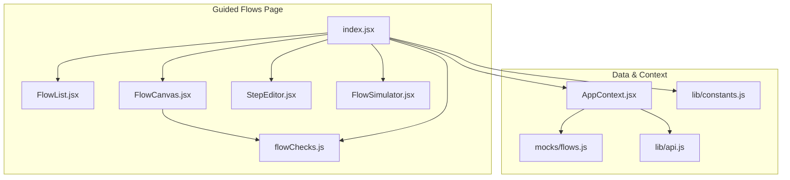
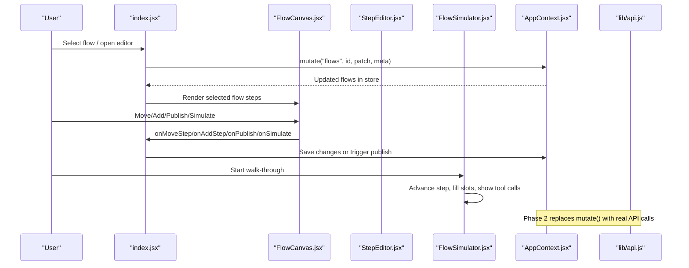
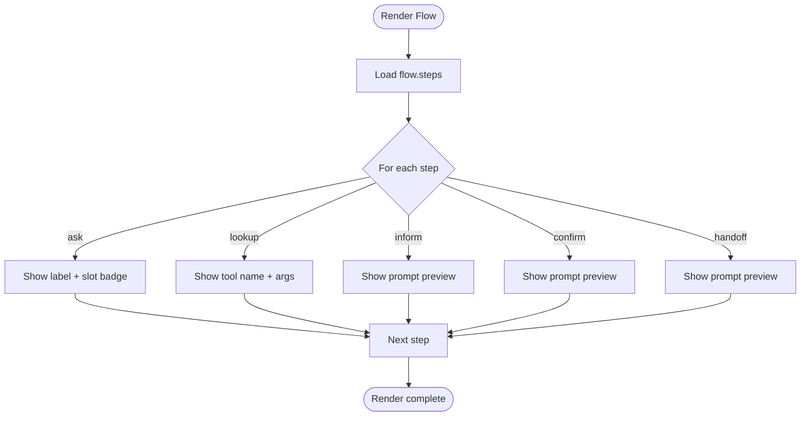
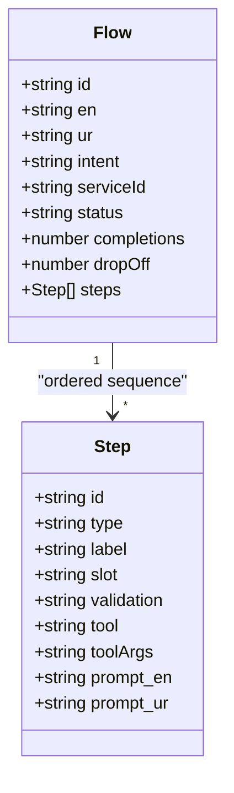
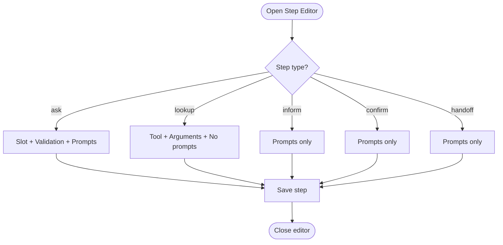
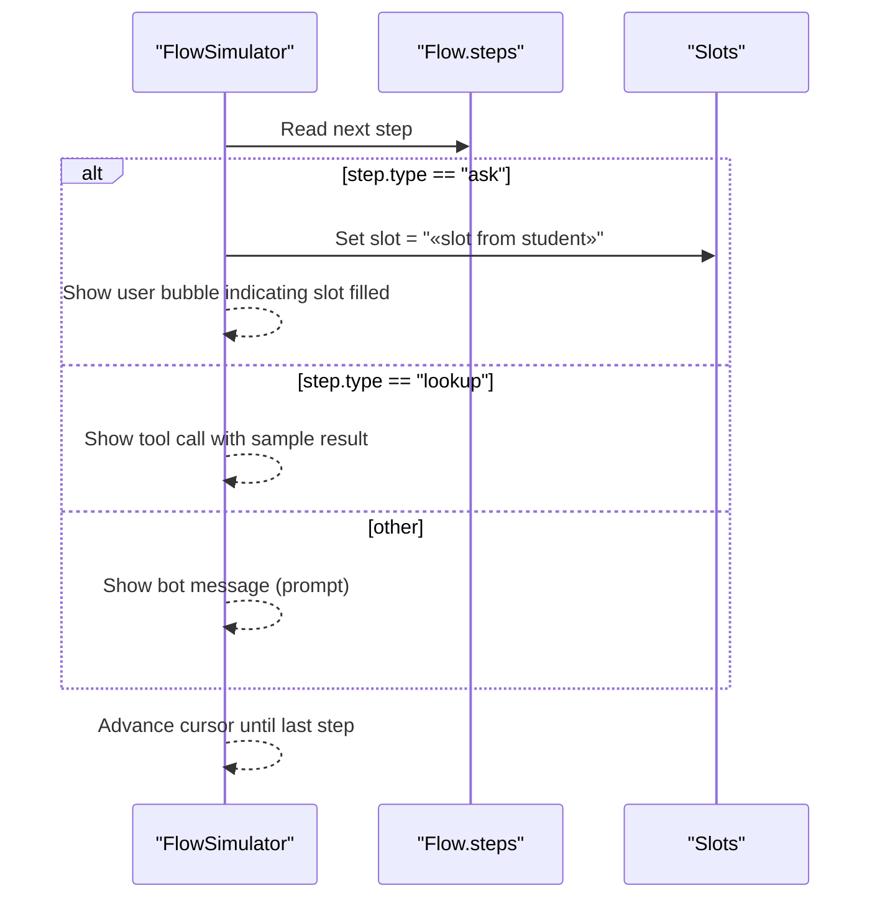
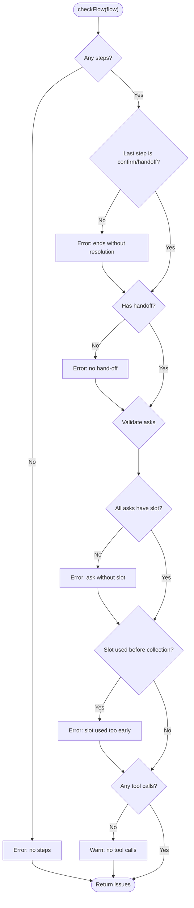
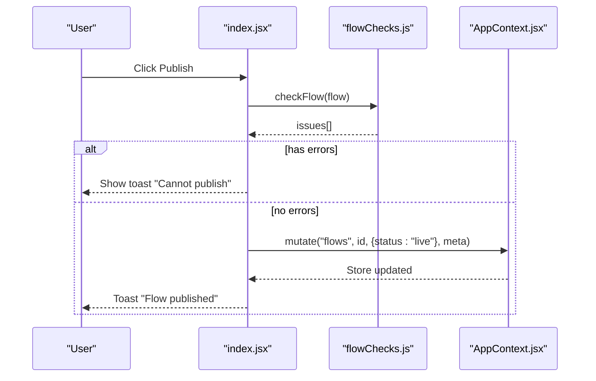
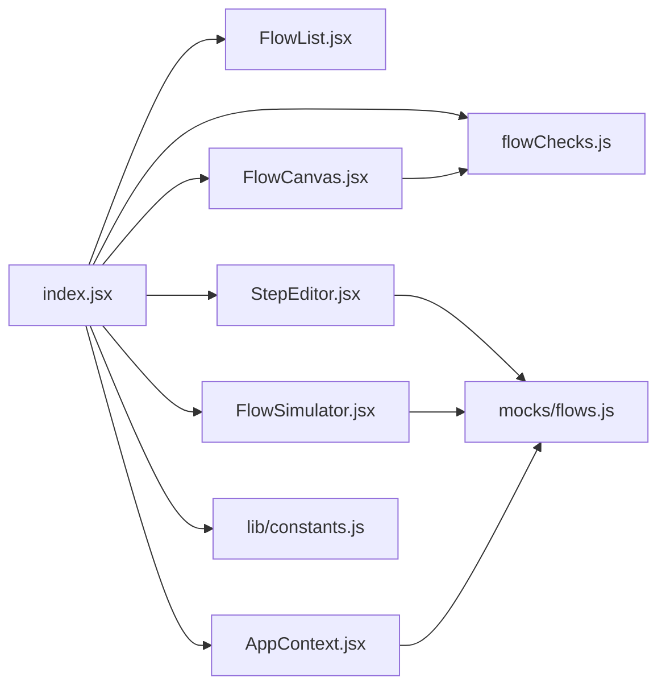
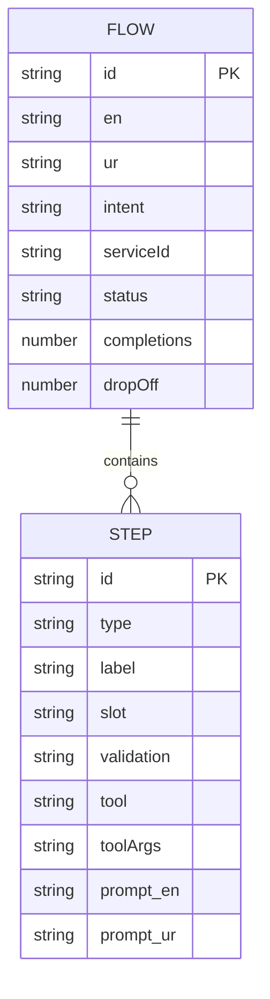

# Guided Flows Builder

<cite>
**Referenced Files in This Document**
- [index.jsx](file://src/pages/GuidedFlows/index.jsx)
- [FlowCanvas.jsx](file://src/pages/GuidedFlows/FlowCanvas.jsx)
- [StepEditor.jsx](file://src/pages/GuidedFlows/StepEditor.jsx)
- [FlowSimulator.jsx](file://src/pages/GuidedFlows/FlowSimulator.jsx)
- [flowChecks.js](file://src/pages/GuidedFlows/flowChecks.js)
- [FlowList.jsx](file://src/pages/GuidedFlows/FlowList.jsx)
- [flows.js](file://src/mocks/flows.js)
- [AppContext.jsx](file://src/context/AppContext.jsx)
- [api.js](file://src/lib/api.js)
- [constants.js](file://src/lib/constants.js)
</cite>

## Table of Contents
1. [Introduction](#introduction)
2. [Project Structure](#project-structure)
3. [Core Components](#core-components)
4. [Architecture Overview](#architecture-overview)
5. [Detailed Component Analysis](#detailed-component-analysis)
6. [Dependency Analysis](#dependency-analysis)
7. [Performance Considerations](#performance-considerations)
8. [Troubleshooting Guide](#troubleshooting-guide)
9. [Conclusion](#conclusion)
10. [Appendices](#appendices)

## Introduction
This document explains the Guided Flows Builder, a visual editor for designing multi-turn student journeys as explicit state machines. It covers:
- The visual flow canvas and step management
- Step types and connection semantics
- Step editor with variables (slots), validation rules, and tool calls
- Flow simulation to test workflows before deployment
- Validation rules that prevent publishing broken flows
- Publishing workflow and integration points for backend APIs
- Notes on versioning, collaboration, A/B testing, and monitoring based on available code

The system is intentionally linear and list-based to keep the author’s view aligned with the student experience order.

## Project Structure
Guided flows are implemented under pages/GuidedFlows with supporting data in mocks and shared context in AppContext.

**Diagram sources**
- [index.jsx:1-152](file://src/pages/GuidedFlows/index.jsx#L1-L152)
- [FlowCanvas.jsx:1-157](file://src/pages/GuidedFlows/FlowCanvas.jsx#L1-L157)
- [StepEditor.jsx:1-161](file://src/pages/GuidedFlows/StepEditor.jsx#L1-L161)
- [FlowSimulator.jsx:1-160](file://src/pages/GuidedFlows/FlowSimulator.jsx#L1-L160)
- [flowChecks.js:1-68](file://src/pages/GuidedFlows/flowChecks.js#L1-L68)
- [flows.js:1-137](file://src/mocks/flows.js#L1-L137)
- [AppContext.jsx:1-135](file://src/context/AppContext.jsx#L1-L135)
- [api.js:1-169](file://src/lib/api.js#L1-L169)
- [constants.js:1-35](file://src/lib/constants.js#L1-L35)

**Section sources**
- [index.jsx:1-152](file://src/pages/GuidedFlows/index.jsx#L1-L152)
- [flows.js:1-137](file://src/mocks/flows.js#L1-L137)
- [AppContext.jsx:1-135](file://src/context/AppContext.jsx#L1-L135)

## Core Components
- Flow list: shows all flows with status badges and summary metrics.
- Flow canvas: ordered list of steps with move controls, step metadata, and validation issues.
- Step editor: per-step configuration including type-specific fields, slots, validation, and tool calls.
- Flow simulator: interactive walkthrough that fills slots and simulates tool calls.
- Validation engine: enforces publishability rules and dependency ordering.

Key responsibilities:
- index.jsx orchestrates selection, editing, saving, publishing, and simulation toggles.
- FlowCanvas renders the current flow’s steps and exposes actions to reorder, add, simulate, and publish.
- StepEditor provides a drawer to edit step properties with conditional fields by type.
- FlowSimulator advances through steps, showing bot/user turns and tool call results.
- flowChecks validates flow structure and slot usage ordering.

**Section sources**
- [index.jsx:21-149](file://src/pages/GuidedFlows/index.jsx#L21-L149)
- [FlowCanvas.jsx:16-156](file://src/pages/GuidedFlows/FlowCanvas.jsx#L16-L156)
- [StepEditor.jsx:16-160](file://src/pages/GuidedFlows/StepEditor.jsx#L16-L160)
- [FlowSimulator.jsx:27-159](file://src/pages/GuidedFlows/FlowSimulator.jsx#L27-L159)
- [flowChecks.js:8-67](file://src/pages/GuidedFlows/flowChecks.js#L8-L67)

## Architecture Overview
The guided flows builder composes UI components around a central store provided by AppContext. Data originates from mock definitions and will be replaced by server-backed fetches in Phase 2.

**Diagram sources**
- [index.jsx:33-105](file://src/pages/GuidedFlows/index.jsx#L33-L105)
- [AppContext.jsx:69-103](file://src/context/AppContext.jsx#L69-L103)
- [api.js:1-169](file://src/lib/api.js#L1-L169)

## Detailed Component Analysis

### Visual Flow Canvas
- Displays an ordered list of steps with labels, type badges, optional slot badges, and tool call previews.
- Provides move-up/move-down controls to reorder steps.
- Shows validation issues returned by flowChecks; disables publish when errors exist.
- Integrates with FlowSimulator via a “Walk through” button.

**Diagram sources**
- [FlowCanvas.jsx:58-136](file://src/pages/GuidedFlows/FlowCanvas.jsx#L58-L136)

**Section sources**
- [FlowCanvas.jsx:16-156](file://src/pages/GuidedFlows/FlowCanvas.jsx#L16-L156)
- [flowChecks.js:8-67](file://src/pages/GuidedFlows/flowChecks.js#L8-L67)

### Node Types and Connection Semantics
Node types define how a step behaves:
- Ask: collects a value into a named slot; requires a slot and optionally a validation rule.
- Lookup: calls a grounding tool using toolArgs; no direct text output unless combined with confirm/inform.
- Inform: states known information; no tool needed.
- Confirm: reads back a checklist or summary; often paired with lookup results.
- Handoff: terminal step that passes to a human; required at the end of every flow.

Connections are implicit: the order of steps defines execution order. Slots must be collected before they are consumed by lookups.

**Diagram sources**
- [flows.js:19-116](file://src/mocks/flows.js#L19-L116)

**Section sources**
- [flows.js:9-18](file://src/mocks/flows.js#L9-L18)
- [flows.js:118-125](file://src/mocks/flows.js#L118-L125)

### Step Editor: Variables, Validation, Actions
- Type-driven form: fields change based on step type.
- Variable handling: ask steps define a slot name; this becomes a variable filled during conversation.
- Validation rules: optional but recommended; enforced by validation checks.
- Action definitions: lookup steps select a tool and provide arguments referencing slots or literals.
- Multilingual prompts: English and Urdu text fields for inform/confirm/handoff steps.

**Diagram sources**
- [StepEditor.jsx:78-156](file://src/pages/GuidedFlows/StepEditor.jsx#L78-L156)

**Section sources**
- [StepEditor.jsx:16-160](file://src/pages/GuidedFlows/StepEditor.jsx#L16-L160)
- [flows.js:118-136](file://src/mocks/flows.js#L118-L136)

### Flow Simulation: Testing Workflows Before Deployment
- Interactive walkthrough: advance one step at a time to see bot messages and user responses.
- Slot filling: ask steps automatically fill their slot with a placeholder value during simulation.
- Tool call simulation: lookup steps display a simulated result for common tools.
- Language toggle: uses app language setting to render prompts in English or Urdu.

**Diagram sources**
- [FlowSimulator.jsx:40-48](file://src/pages/GuidedFlows/FlowSimulator.jsx#L40-L48)
- [FlowSimulator.jsx:98-149](file://src/pages/GuidedFlows/FlowSimulator.jsx#L98-L149)

**Section sources**
- [FlowSimulator.jsx:27-159](file://src/pages/GuidedFlows/FlowSimulator.jsx#L27-L159)

### Flow Validation: Syntax, Dependencies, Errors
Validation ensures publishable flows:
- Must have at least one step.
- Last step must be confirm or handoff.
- Must include at least one handoff.
- Every ask must have a slot; missing validation emits a warning.
- Slots must be collected before being used in lookup toolArgs; otherwise error.
- Warns if no tool calls exist in the flow.

**Diagram sources**
- [flowChecks.js:8-67](file://src/pages/GuidedFlows/flowChecks.js#L8-L67)

**Section sources**
- [flowChecks.js:8-67](file://src/pages/GuidedFlows/flowChecks.js#L8-L67)

### Publishing Workflow
- Publish is gated by validation: errors block publishing.
- On publish, the flow status updates to live via mutate; audit entry is recorded.
- Integration point comments indicate where backend endpoints would be called in Phase 2.

**Diagram sources**
- [index.jsx:91-105](file://src/pages/GuidedFlows/index.jsx#L91-L105)
- [flowChecks.js:8-67](file://src/pages/GuidedFlows/flowChecks.js#L8-L67)
- [AppContext.jsx:69-103](file://src/context/AppContext.jsx#L69-L103)

**Section sources**
- [index.jsx:91-105](file://src/pages/GuidedFlows/index.jsx#L91-L105)

### Template Library
- Predefined flows and step types are defined in mocks/flows.js and can serve as templates for new flows.
- STEP_TYPES and TOOLS constants standardize available options across canvas and editor.

**Section sources**
- [flows.js:19-116](file://src/mocks/flows.js#L19-L116)
- [flows.js:118-136](file://src/mocks/flows.js#L118-L136)

### Version Control and Collaboration
- Audit trail: mutations record actor, timestamp, action, table, record, and changes via AppContext.logAudit.
- Role-based access: mayWrite gating prevents unauthorized edits; read-only notice shown for non-writers.
- Collaborative features like branching/merge are not present in the current codebase.

**Section sources**
- [AppContext.jsx:51-103](file://src/context/AppContext.jsx#L51-L103)
- [index.jsx:30-31](file://src/pages/GuidedFlows/index.jsx#L30-L31)
- [index.jsx:119-123](file://src/pages/GuidedFlows/index.jsx#L119-L123)

### Flow Publishing, A/B Testing, and Performance Monitoring
- Publishing: supported via status update to live; guarded by validation.
- A/B testing: not implemented in the current codebase.
- Performance monitoring: flow-level metrics (completions, drop-off) are displayed; detailed analytics endpoints exist in api.js but are not wired into the flows page yet.

**Section sources**
- [FlowList.jsx:18-47](file://src/pages/GuidedFlows/FlowList.jsx#L18-L47)
- [api.js:134-150](file://src/lib/api.js#L134-L150)

## Dependency Analysis
- index.jsx depends on FlowList, FlowCanvas, StepEditor, FlowSimulator, flowChecks, AppContext, and constants.
- FlowCanvas depends on flowChecks and STEP_TYPES metadata.
- StepEditor depends on STEP_TYPES and TOOLS metadata.
- FlowSimulator depends on STEP_TYPES and AppContext language setting.
- AppContext holds flows data and mutation logic; Phase 2 will replace mutate with real API calls.

**Diagram sources**
- [index.jsx:1-152](file://src/pages/GuidedFlows/index.jsx#L1-L152)
- [FlowCanvas.jsx:1-157](file://src/pages/GuidedFlows/FlowCanvas.jsx#L1-L157)
- [StepEditor.jsx:1-161](file://src/pages/GuidedFlows/StepEditor.jsx#L1-L161)
- [FlowSimulator.jsx:1-160](file://src/pages/GuidedFlows/FlowSimulator.jsx#L1-L160)
- [flowChecks.js:1-68](file://src/pages/GuidedFlows/flowChecks.js#L1-L68)
- [flows.js:1-137](file://src/mocks/flows.js#L1-L137)
- [AppContext.jsx:1-135](file://src/context/AppContext.jsx#L1-L135)
- [constants.js:1-35](file://src/lib/constants.js#L1-L35)

**Section sources**
- [index.jsx:1-152](file://src/pages/GuidedFlows/index.jsx#L1-L152)
- [AppContext.jsx:1-135](file://src/context/AppContext.jsx#L1-L135)

## Performance Considerations
- Rendering: FlowCanvas maps steps linearly; performance scales with number of steps. Keep flows concise and avoid excessive nested tool calls per step.
- Validation: flowChecks runs on every render; it is lightweight but should remain simple to avoid re-renders.
- State updates: use targeted mutations via AppContext.mutate to minimize re-renders.
- Simulation: FlowSimulator maintains minimal local state (cursor, slots); efficient for typical flow sizes.

[No sources needed since this section provides general guidance]

## Troubleshooting Guide
Common issues surfaced by the builder:
- Missing steps: flowChecks reports an error if there are no steps.
- Incomplete ending: last step must be confirm or handoff; otherwise error.
- Missing handoff: every flow must include a handoff step.
- Ask without slot: error; ensure every ask sets a slot.
- Missing validation: warning; add validation rules to improve robustness.
- Slot ordering: error if a lookup consumes a slot before it is collected.
- No tool calls: warning; consider adding lookups to ground answers.

Resolution steps:
- Use FlowCanvas issue panel to identify errors/warnings.
- Edit steps in StepEditor to fix missing fields or reorder steps.
- Run FlowSimulator to verify slot filling and tool call behavior.
- Re-run validation before publishing.

**Section sources**
- [flowChecks.js:8-67](file://src/pages/GuidedFlows/flowChecks.js#L8-L67)
- [FlowCanvas.jsx:145-153](file://src/pages/GuidedFlows/FlowCanvas.jsx#L145-L153)
- [StepEditor.jsx:78-156](file://src/pages/GuidedFlows/StepEditor.jsx#L78-L156)

## Conclusion
The Guided Flows Builder provides a clear, list-based interface to design reliable, multi-turn student journeys. It enforces correctness through validation, supports interactive simulation, and integrates with an audit trail and role-based permissions. While advanced features like A/B testing and deep analytics are not yet integrated, the architecture is prepared for Phase 2 server-backed persistence and richer integrations.

[No sources needed since this section summarizes without analyzing specific files]

## Appendices

### Data Model Summary
- Flow: identifies a journey with metadata and an ordered list of steps.
- Step: defines behavior (ask/lookup/inform/confirm/handoff), variables (slot), tool calls, and multilingual prompts.

**Diagram sources**
- [flows.js:19-116](file://src/mocks/flows.js#L19-L116)