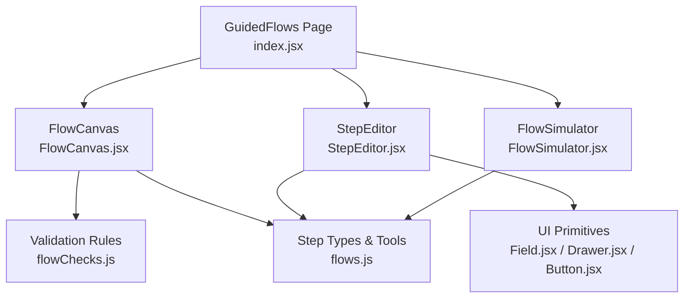
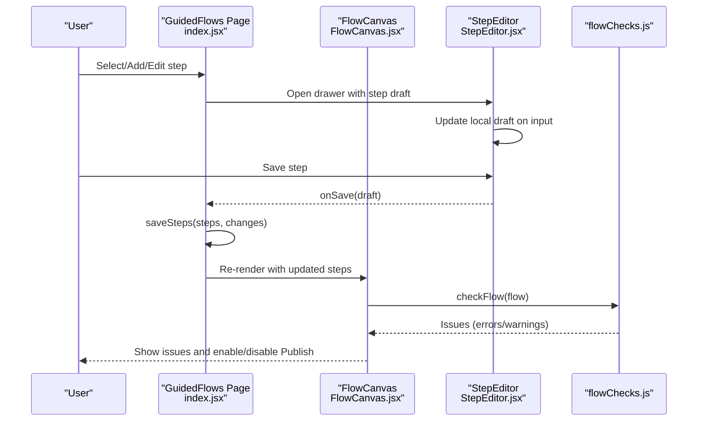
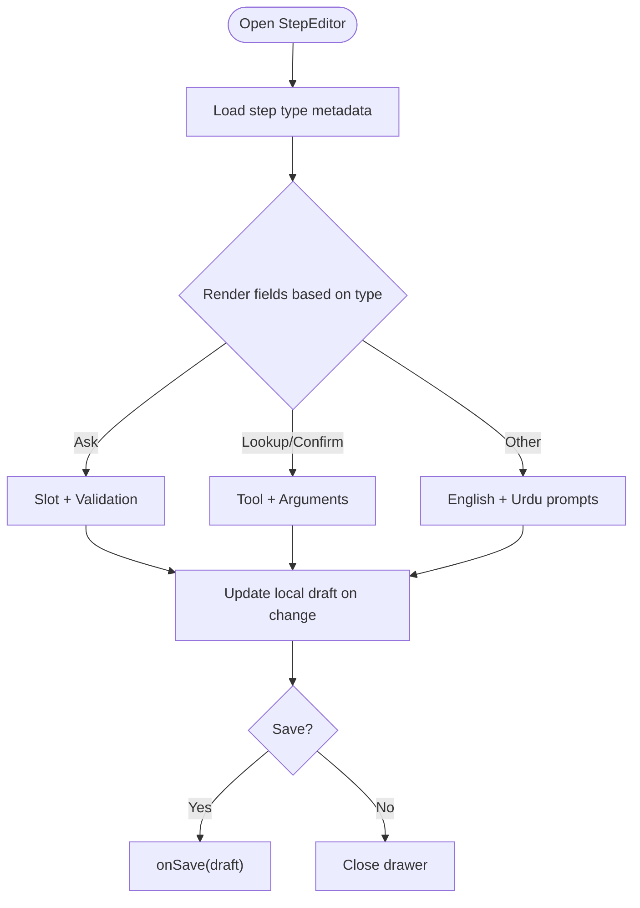
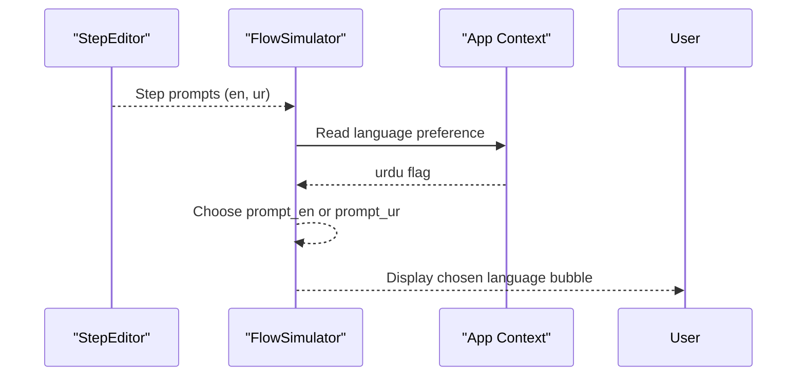
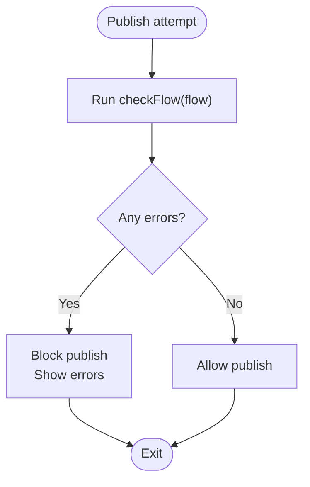
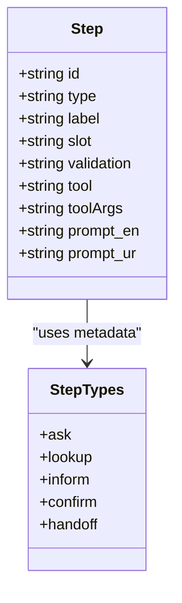
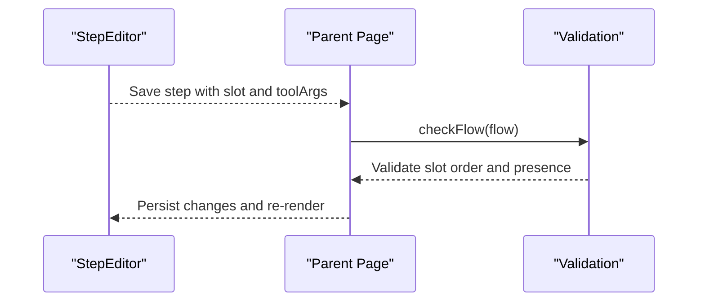
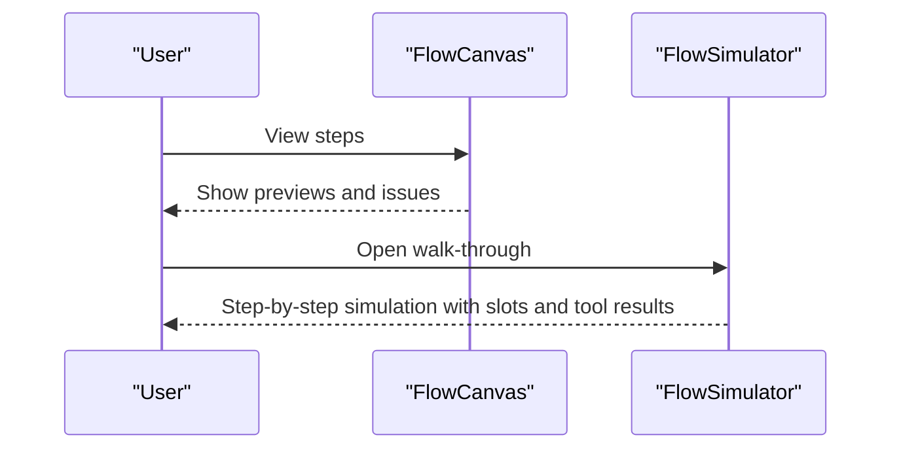
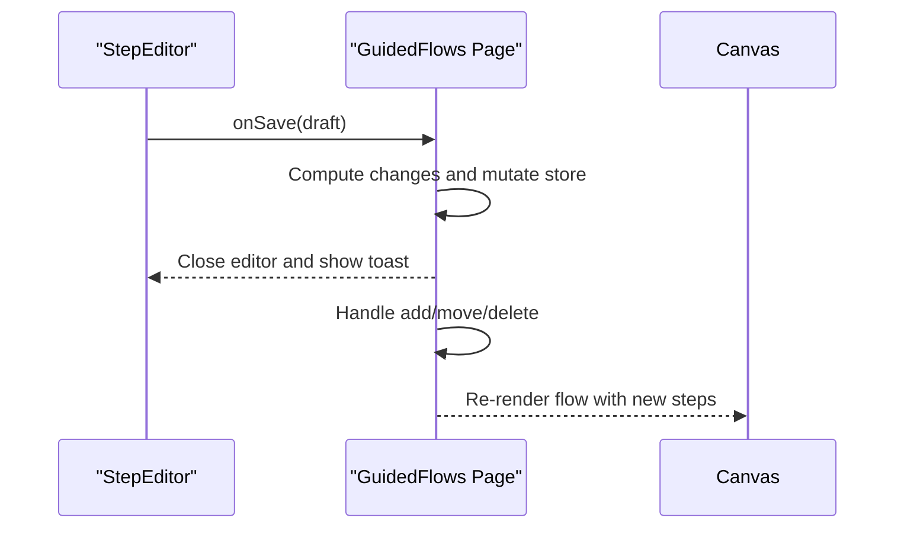
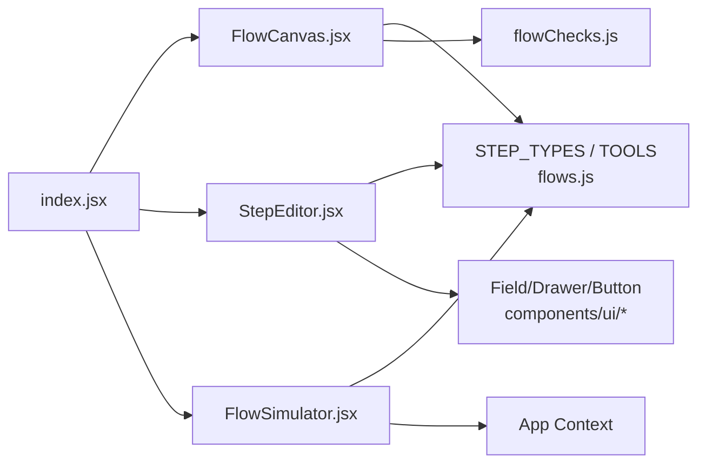

# Step Editor

<cite>
**Referenced Files in This Document**
- [StepEditor.jsx](file://src/pages/GuidedFlows/StepEditor.jsx)
- [FlowCanvas.jsx](file://src/pages/GuidedFlows/FlowCanvas.jsx)
- [index.jsx](file://src/pages/GuidedFlows/index.jsx)
- [flowChecks.js](file://src/pages/GuidedFlows/flowChecks.js)
- [flows.js](file://src/mocks/flows.js)
- [Field.jsx](file://src/components/ui/Field.jsx)
- [Drawer.jsx](file://src/components/ui/Drawer.jsx)
- [Button.jsx](file://src/components/ui/Button.jsx)
- [FlowSimulator.jsx](file://src/pages/GuidedFlows/FlowSimulator.jsx)
</cite>

## Table of Contents
1. [Introduction](#introduction)
2. [Project Structure](#project-structure)
3. [Core Components](#core-components)
4. [Architecture Overview](#architecture-overview)
5. [Detailed Component Analysis](#detailed-component-analysis)
6. [Dependency Analysis](#dependency-analysis)
7. [Performance Considerations](#performance-considerations)
8. [Troubleshooting Guide](#troubleshooting-guide)
9. [Conclusion](#conclusion)
10. [Appendices](#appendices)

## Introduction
This document explains the Step Editor component used to edit individual steps within a guided flow. It covers the form-based interface for editing prompts, validation rules, slot definitions, and tool configurations; multi-language support for English and Urdu; field validation and publish-time checks; real-time preview via the flow simulator; step types and their configuration options; complex validation patterns; variable substitution through slots; action/tool definitions; form state management; error handling; and integration with the main flow context.

## Project Structure
The Step Editor is part of the Guided Flows feature. The relevant files include:
- Step editor panel: StepEditor.jsx
- Flow canvas that lists steps and shows issues: FlowCanvas.jsx
- Parent page orchestrating state and API seams: index.jsx
- Publishability/validation rules: flowChecks.js
- Step type metadata and sample flows/tools: flows.js
- UI primitives used by the editor: Field.jsx, Drawer.jsx, Button.jsx
- Simulator for walking through flows: FlowSimulator.jsx

**Diagram sources**
- [index.jsx:1-152](file://src/pages/GuidedFlows/index.jsx#L1-L152)
- [FlowCanvas.jsx:1-157](file://src/pages/GuidedFlows/FlowCanvas.jsx#L1-L157)
- [StepEditor.jsx:1-161](file://src/pages/GuidedFlows/StepEditor.jsx#L1-L161)
- [flowChecks.js:1-68](file://src/pages/GuidedFlows/flowChecks.js#L1-L68)
- [flows.js:1-137](file://src/mocks/flows.js#L1-L137)
- [Field.jsx:1-23](file://src/components/ui/Field.jsx#L1-L23)
- [Drawer.jsx:1-33](file://src/components/ui/Drawer.jsx#L1-L33)
- [Button.jsx:1-29](file://src/components/ui/Button.jsx#L1-L29)
- [FlowSimulator.jsx:1-160](file://src/pages/GuidedFlows/FlowSimulator.jsx#L1-L160)

**Section sources**
- [index.jsx:1-152](file://src/pages/GuidedFlows/index.jsx#L1-L152)
- [FlowCanvas.jsx:1-157](file://src/pages/GuidedFlows/FlowCanvas.jsx#L1-L157)
- [StepEditor.jsx:1-161](file://src/pages/GuidedFlows/StepEditor.jsx#L1-L161)
- [flowChecks.js:1-68](file://src/pages/GuidedFlows/flowChecks.js#L1-L68)
- [flows.js:1-137](file://src/mocks/flows.js#L1-L137)

## Core Components
- StepEditor: A drawer-based form that edits a single step’s label, type, slot, validation rule, tool selection, arguments, and bilingual prompts (English and Urdu). It renders fields conditionally based on step type and disables inputs when read-only.
- FlowCanvas: Displays ordered steps, badges for type/slot, tool calls, and prompt previews. Runs validation and displays errors/warnings. Provides move/add actions and publish control gated by validation.
- GuidedFlows page (index.jsx): Holds global state for selected flow and editing step, handles adding/moving/deleting steps, saving changes, publishing, and opening the simulator. Integrates with RBAC to enforce write permissions.
- Validation (flowChecks.js): Enforces publishability constraints such as terminal step requirements, presence of handoff, ask steps having slots and validations, and ordering of slot usage before lookup consumption.
- FlowSimulator: Walks through a flow step-by-step, simulating slot filling and tool calls, showing bilingual output based on app language preference.

**Section sources**
- [StepEditor.jsx:1-161](file://src/pages/GuidedFlows/StepEditor.jsx#L1-L161)
- [FlowCanvas.jsx:1-157](file://src/pages/GuidedFlows/FlowCanvas.jsx#L1-L157)
- [index.jsx:1-152](file://src/pages/GuidedFlows/index.jsx#L1-L152)
- [flowChecks.js:1-68](file://src/pages/GuidedFlows/flowChecks.js#L1-L68)
- [FlowSimulator.jsx:1-160](file://src/pages/GuidedFlows/FlowSimulator.jsx#L1-L160)

## Architecture Overview
The Step Editor integrates tightly with the flow context managed by the parent page. When a user selects or adds a step, the parent opens the editor with the current step draft. Changes are persisted via a mutation function that updates the store and records change metadata. Validation runs both live in the canvas and at publish time. The simulator provides a real-time walkthrough to validate behavior before publishing.

**Diagram sources**
- [index.jsx:33-105](file://src/pages/GuidedFlows/index.jsx#L33-L105)
- [StepEditor.jsx:16-161](file://src/pages/GuidedFlows/StepEditor.jsx#L16-L161)
- [FlowCanvas.jsx:16-157](file://src/pages/GuidedFlows/FlowCanvas.jsx#L16-L157)
- [flowChecks.js:8-68](file://src/pages/GuidedFlows/flowChecks.js#L8-L68)

## Detailed Component Analysis

### StepEditor Form Interface
- Fields:
  - Step name: displayed on the canvas only.
  - Type: select from available step types with labels and notes sourced from metadata.
  - Ask-specific:
    - Slot name: defines the variable this step fills.
    - Validation rule: describes how the value should be validated.
  - Lookup/Confirm-specific:
    - Tool: choose from available tools.
    - Arguments: slot names or literals passed to the tool.
  - Prompts:
    - English and Urdu text areas for bilingual content.
  - Lookup note: clarifies that lookup steps do not produce words themselves; outputs must come from tool results.
- Behavior:
  - Conditional rendering based on step type.
  - Inputs disabled when mayWrite is false.
  - Footer includes Remove step, Cancel, and Save step actions when writable.

**Diagram sources**
- [StepEditor.jsx:16-161](file://src/pages/GuidedFlows/StepEditor.jsx#L16-L161)

**Section sources**
- [StepEditor.jsx:16-161](file://src/pages/GuidedFlows/StepEditor.jsx#L16-L161)
- [Field.jsx:1-23](file://src/components/ui/Field.jsx#L1-L23)
- [Drawer.jsx:1-33](file://src/components/ui/Drawer.jsx#L1-L33)
- [Button.jsx:1-29](file://src/components/ui/Button.jsx#L1-L29)

### Multi-Language Support (English and Urdu)
- Each step supports two prompt fields: English and Urdu.
- The simulator chooses which language to display based on the app’s language preference.
- The canvas shows a preview of whichever prompt is present.

**Diagram sources**
- [StepEditor.jsx:130-149](file://src/pages/GuidedFlows/StepEditor.jsx#L130-L149)
- [FlowSimulator.jsx:27-160](file://src/pages/GuidedFlows/FlowSimulator.jsx#L27-L160)

**Section sources**
- [StepEditor.jsx:130-149](file://src/pages/GuidedFlows/StepEditor.jsx#L130-L149)
- [FlowSimulator.jsx:27-160](file://src/pages/GuidedFlows/FlowSimulator.jsx#L27-L160)

### Field Validation and Publish-Time Checks
- Live validation:
  - FlowCanvas runs checkFlow on the current flow and displays issues as notes.
  - Errors prevent publishing until resolved.
- Publish-time validation:
  - Ensures last step is confirm or handoff.
  - Requires at least one handoff step.
  - All ask steps must have a slot; asks without validation generate warnings.
  - Ensures slots referenced by lookup toolArgs are collected earlier in the flow.
  - Warns if no tool call exists in the flow.

**Diagram sources**
- [FlowCanvas.jsx:16-55](file://src/pages/GuidedFlows/FlowCanvas.jsx#L16-L55)
- [flowChecks.js:8-68](file://src/pages/GuidedFlows/flowChecks.js#L8-L68)
- [index.jsx:91-105](file://src/pages/GuidedFlows/index.jsx#L91-L105)

**Section sources**
- [FlowCanvas.jsx:16-55](file://src/pages/GuidedFlows/FlowCanvas.jsx#L16-L55)
- [flowChecks.js:8-68](file://src/pages/GuidedFlows/flowChecks.js#L8-L68)
- [index.jsx:91-105](file://src/pages/GuidedFlows/index.jsx#L91-L105)

### Step Types and Configuration Options
- Ask: Collects a value into a named slot; requires slot and optional validation rule.
- Lookup: Calls a grounding tool with arguments; does not produce its own words; outputs must come from tool results.
- Inform: States something already known; uses prompts only.
- Confirm: Reads back checklist or summary; can use tool and prompts.
- Handoff: Passes to a human; always terminal.

Metadata for labels, tones, and notes is provided centrally and consumed by both canvas and editor.

**Diagram sources**
- [flows.js:118-137](file://src/mocks/flows.js#L118-L137)
- [StepEditor.jsx:63-76](file://src/pages/GuidedFlows/StepEditor.jsx#L63-L76)
- [FlowCanvas.jsx:59-105](file://src/pages/GuidedFlows/FlowCanvas.jsx#L59-L105)

**Section sources**
- [flows.js:118-137](file://src/mocks/flows.js#L118-L137)
- [StepEditor.jsx:63-76](file://src/pages/GuidedFlows/StepEditor.jsx#L63-L76)
- [FlowCanvas.jsx:59-105](file://src/pages/GuidedFlows/FlowCanvas.jsx#L59-L105)

### Variable Substitution and Action Definitions
- Slots act as variables filled by ask steps.
- Lookup steps consume slots via toolArgs, referencing slot names or literal values.
- Validation ensures slots are collected before being used by lookups.
- Actions are represented by tool calls; arguments can be combinations of slots and literals.

**Diagram sources**
- [StepEditor.jsx:78-128](file://src/pages/GuidedFlows/StepEditor.jsx#L78-L128)
- [flowChecks.js:32-57](file://src/pages/GuidedFlows/flowChecks.js#L32-L57)
- [index.jsx:67-79](file://src/pages/GuidedFlows/index.jsx#L67-L79)

**Section sources**
- [StepEditor.jsx:78-128](file://src/pages/GuidedFlows/StepEditor.jsx#L78-L128)
- [flowChecks.js:32-57](file://src/pages/GuidedFlows/flowChecks.js#L32-L57)
- [index.jsx:67-79](file://src/pages/GuidedFlows/index.jsx#L67-L79)

### Real-Time Preview Capabilities
- FlowCanvas shows a concise preview of each step’s label, type badge, slot badge, tool call, and prompt snippet.
- FlowSimulator walks through steps, showing bilingual messages and simulated tool results, helping verify behavior before publishing.

**Diagram sources**
- [FlowCanvas.jsx:59-105](file://src/pages/GuidedFlows/FlowCanvas.jsx#L59-L105)
- [FlowSimulator.jsx:27-160](file://src/pages/GuidedFlows/FlowSimulator.jsx#L27-L160)

**Section sources**
- [FlowCanvas.jsx:59-105](file://src/pages/GuidedFlows/FlowCanvas.jsx#L59-L105)
- [FlowSimulator.jsx:27-160](file://src/pages/GuidedFlows/FlowSimulator.jsx#L27-L160)

### Form State Management and Integration
- Local draft state in StepEditor mirrors the selected step; changes update the draft object.
- Saving computes changed fields and persists via the parent’s saveSteps function, which updates the store and records change metadata.
- Adding, moving, and deleting steps are handled by the parent page, which also manages open/close state of the editor and simulator.
- RBAC controls write access; when not writable, editor fields are disabled and destructive actions are hidden.

**Diagram sources**
- [StepEditor.jsx:16-161](file://src/pages/GuidedFlows/StepEditor.jsx#L16-L161)
- [index.jsx:33-89](file://src/pages/GuidedFlows/index.jsx#L33-L89)

**Section sources**
- [StepEditor.jsx:16-161](file://src/pages/GuidedFlows/StepEditor.jsx#L16-L161)
- [index.jsx:33-89](file://src/pages/GuidedFlows/index.jsx#L33-L89)

### Error Handling
- Validation issues are surfaced in FlowCanvas as notes; errors block publishing.
- Publishing validates again and prevents promotion if errors exist.
- Toast notifications inform users of successful saves and removals.
- Read-only mode prevents accidental edits and hides destructive actions.

**Section sources**
- [FlowCanvas.jsx:145-153](file://src/pages/GuidedFlows/FlowCanvas.jsx#L145-L153)
- [index.jsx:91-105](file://src/pages/GuidedFlows/index.jsx#L91-L105)
- [index.jsx:119-123](file://src/pages/GuidedFlows/index.jsx#L119-L123)

## Dependency Analysis
- StepEditor depends on:
  - STEP_TYPES and TOOLS metadata for rendering options and descriptions.
  - UI primitives for consistent form controls and layout.
- FlowCanvas depends on:
  - STEP_TYPES for badges and labels.
  - flowChecks for validation and issue reporting.
- Parent page depends on:
  - RBAC for permission checks.
  - Store mutation for persistence and audit trails.
- FlowSimulator depends on:
  - STEP_TYPES for labels and tones.
  - App context for language preference.

**Diagram sources**
- [StepEditor.jsx:1-161](file://src/pages/GuidedFlows/StepEditor.jsx#L1-L161)
- [FlowCanvas.jsx:1-157](file://src/pages/GuidedFlows/FlowCanvas.jsx#L1-L157)
- [index.jsx:1-152](file://src/pages/GuidedFlows/index.jsx#L1-L152)
- [flows.js:118-137](file://src/mocks/flows.js#L118-L137)
- [flowChecks.js:1-68](file://src/pages/GuidedFlows/flowChecks.js#L1-L68)
- [Field.jsx:1-23](file://src/components/ui/Field.jsx#L1-L23)
- [Drawer.jsx:1-33](file://src/components/ui/Drawer.jsx#L1-L33)
- [Button.jsx:1-29](file://src/components/ui/Button.jsx#L1-L29)
- [FlowSimulator.jsx:1-160](file://src/pages/GuidedFlows/FlowSimulator.jsx#L1-L160)

**Section sources**
- [StepEditor.jsx:1-161](file://src/pages/GuidedFlows/StepEditor.jsx#L1-L161)
- [FlowCanvas.jsx:1-157](file://src/pages/GuidedFlows/FlowCanvas.jsx#L1-L157)
- [index.jsx:1-152](file://src/pages/GuidedFlows/index.jsx#L1-L152)
- [flows.js:118-137](file://src/mocks/flows.js#L118-L137)
- [flowChecks.js:1-68](file://src/pages/GuidedFlows/flowChecks.js#L1-L68)

## Performance Considerations
- Minimal re-renders: StepEditor maintains local draft state and only triggers parent updates on save.
- Validation runs on render in FlowCanvas but is lightweight; consider memoization if flows grow large.
- Simulator avoids heavy computations; it steps through steps sequentially and uses sample results for tool calls.

[No sources needed since this section provides general guidance]

## Troubleshooting Guide
- Cannot publish:
  - Check FlowCanvas issues; ensure last step is confirm or handoff and at least one handoff exists.
  - Ensure all ask steps have slots and validation rules.
  - Verify slots used in lookup toolArgs are collected earlier in the flow.
- Missing prompts:
  - Add English or Urdu prompts for non-lookup steps; lookups rely on tool results.
- Read-only mode:
  - If fields are disabled, verify role permissions; write actions require appropriate rights.
- Slot order issues:
  - Use FlowSimulator to walk through the flow and confirm slots are filled before being consumed.

**Section sources**
- [FlowCanvas.jsx:145-153](file://src/pages/GuidedFlows/FlowCanvas.jsx#L145-L153)
- [flowChecks.js:8-68](file://src/pages/GuidedFlows/flowChecks.js#L8-L68)
- [StepEditor.jsx:78-156](file://src/pages/GuidedFlows/StepEditor.jsx#L78-L156)
- [index.jsx:119-123](file://src/pages/GuidedFlows/index.jsx#L119-L123)

## Conclusion
The Step Editor provides a focused, type-aware form for editing flow steps with bilingual prompts, validation rules, and tool configurations. Integrated validation and a simulator help ensure flows are correct and safe before publishing. The design emphasizes clarity, safety, and maintainability by centralizing step metadata and enforcing publishability constraints.

[No sources needed since this section summarizes without analyzing specific files]

## Appendices

### Step Types Reference
- Ask: Collects a value into a named slot; supports validation rules.
- Lookup: Calls a grounding tool; outputs derived from tool results.
- Inform: States known information using prompts.
- Confirm: Reads back summaries or checklists; may use tools and prompts.
- Handoff: Terminal step that passes to a human.

**Section sources**
- [flows.js:118-137](file://src/mocks/flows.js#L118-L137)

### Example Patterns
- Complex validation pattern:
  - Define validation rules describing acceptable values or constraints for slots.
  - Use FlowSimulator to verify that validation logic aligns with expected user inputs.
- Variable substitution:
  - Fill slots via ask steps; reference them in lookup toolArgs to pass variables to tools.
- Action definitions:
  - Configure tool and arguments for lookup steps to perform grounded actions.

**Section sources**
- [StepEditor.jsx:78-128](file://src/pages/GuidedFlows/StepEditor.jsx#L78-L128)
- [flowChecks.js:32-57](file://src/pages/GuidedFlows/flowChecks.js#L32-L57)
- [FlowSimulator.jsx:27-160](file://src/pages/GuidedFlows/FlowSimulator.jsx#L27-L160)