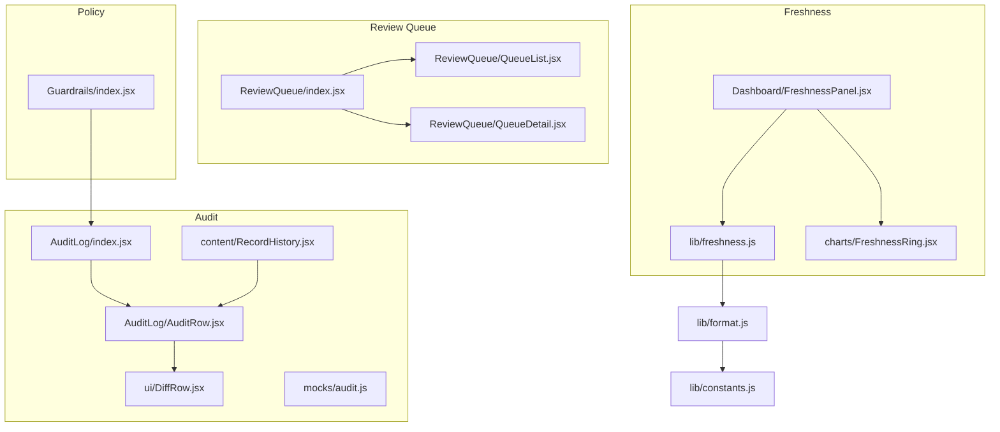
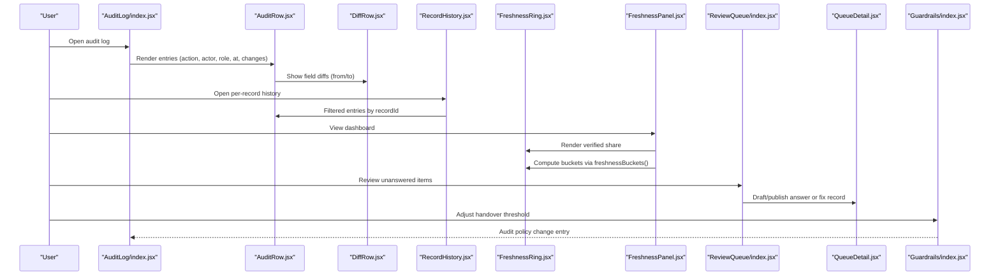
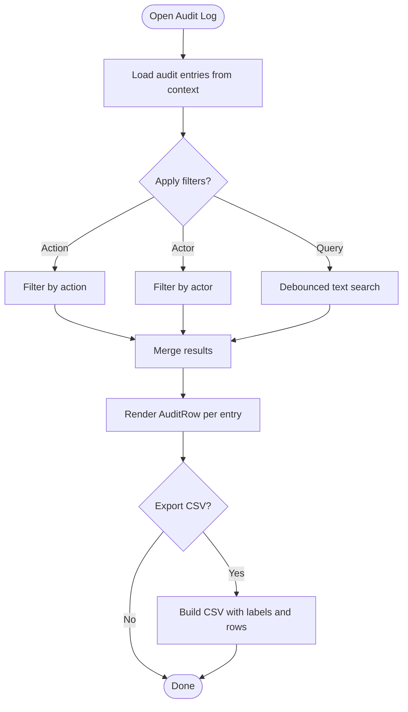
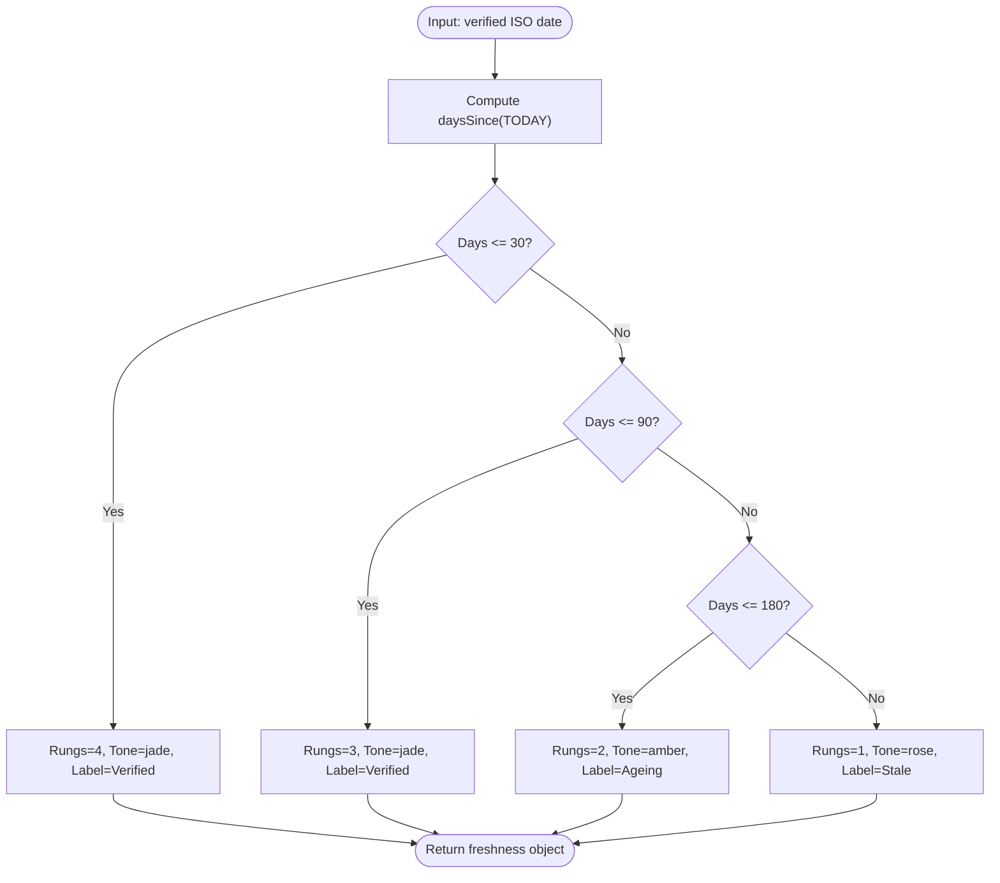
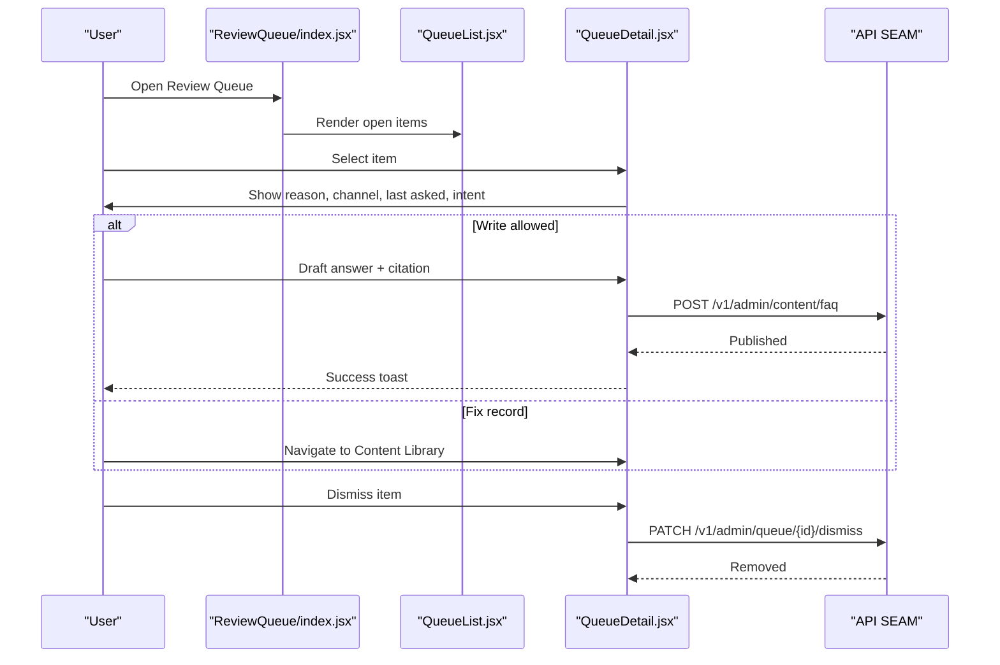
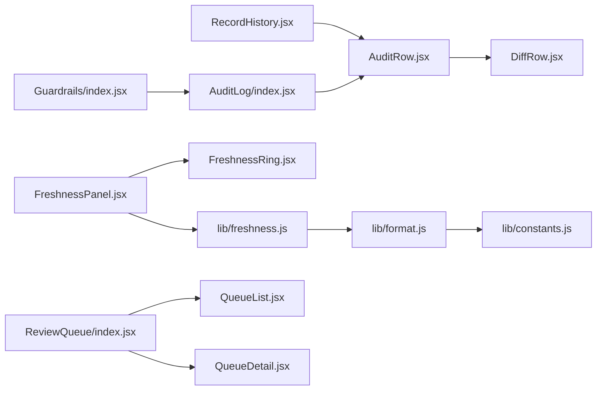

# Quality Assurance & Audit

<cite>
**Referenced Files in This Document**
- [AuditLog/index.jsx](file://src/pages/AuditLog/index.jsx)
- [AuditLog/AuditRow.jsx](file://src/pages/AuditLog/AuditRow.jsx)
- [ui/DiffRow.jsx](file://src/components/ui/DiffRow.jsx)
- [lib/freshness.js](file://src/lib/freshness.js)
- [charts/FreshnessRing.jsx](file://src/components/charts/FreshnessRing.jsx)
- [Dashboard/FreshnessPanel.jsx](file://src/pages/Dashboard/FreshnessPanel.jsx)
- [ReviewQueue/index.jsx](file://src/pages/ReviewQueue/index.jsx)
- [ReviewQueue/QueueList.jsx](file://src/pages/ReviewQueue/QueueList.jsx)
- [ReviewQueue/QueueDetail.jsx](file://src/pages/ReviewQueue/QueueDetail.jsx)
- [content/RecordHistory.jsx](file://src/components/content/RecordHistory.jsx)
- [mocks/audit.js](file://src/mocks/audit.js)
- [lib/constants.js](file://src/lib/constants.js)
- [lib/format.js](file://src/lib/format.js)
- [Guardrails/index.jsx](file://src/pages/Guardrails/index.jsx)
</cite>

## Table of Contents
1. Introduction
2. Project Structure
3. Core Components
4. Architecture Overview
5. Detailed Component Analysis
6. Dependency Analysis
7. Performance Considerations
8. Troubleshooting Guide
9. Conclusion

## Introduction
This document explains the quality assurance and audit logging systems implemented in the console. It covers:
- Audit log viewer with change tracking, user attribution, and timestamp recording
- Freshness tracking that monitors content accuracy and expiration dates
- Diff comparison tools for reviewing changes between versions
- Verification workflows including approval chains, sign-off processes, and compliance checks
- Automated quality checks, scoring algorithms, and reporting dashboards
- Retention policies, data archival, and compliance reporting

The system is designed to ensure that every fact presented to students is traceable, verifiable, and current.

## Project Structure
Quality and audit features are distributed across pages, components, and utilities:
- Audit log viewer and per-record history live under pages/AuditLog and components/content
- Freshness metrics and visualization live under lib/freshness.js and components/charts
- Review queue for unresolved questions lives under pages/ReviewQueue
- Guardrails configuration (policy controls) lives under pages/Guardrails
- Shared UI for diffs and formatting utilities live under components/ui and lib/*

**Diagram sources**
- [AuditLog/index.jsx:1-150](file://src/pages/AuditLog/index.jsx#L1-L150)
- [AuditLog/AuditRow.jsx:1-57](file://src/pages/AuditLog/AuditRow.jsx#L1-L57)
- [ui/DiffRow.jsx:1-15](file://src/components/ui/DiffRow.jsx#L1-L15)
- [content/RecordHistory.jsx:1-58](file://src/components/content/RecordHistory.jsx#L1-L58)
- [mocks/audit.js:1-22](file://src/mocks/audit.js#L1-L22)
- [lib/freshness.js:1-37](file://src/lib/freshness.js#L1-L37)
- [charts/FreshnessRing.jsx:1-66](file://src/components/charts/FreshnessRing.jsx#L1-L66)
- [Dashboard/FreshnessPanel.jsx:1-74](file://src/pages/Dashboard/FreshnessPanel.jsx#L1-L74)
- [ReviewQueue/index.jsx:1-103](file://src/pages/ReviewQueue/index.jsx#L1-L103)
- [ReviewQueue/QueueList.jsx:1-46](file://src/pages/ReviewQueue/QueueList.jsx#L1-L46)
- [ReviewQueue/QueueDetail.jsx:1-128](file://src/pages/ReviewQueue/QueueDetail.jsx#L1-L128)
- [Guardrails/index.jsx:1-120](file://src/pages/Guardrails/index.jsx#L1-L120)
- [lib/format.js:1-32](file://src/lib/format.js#L1-L32)
- [lib/constants.js:1-35](file://src/lib/constants.js#L1-L35)

**Section sources**
- [AuditLog/index.jsx:1-150](file://src/pages/AuditLog/index.jsx#L1-L150)
- [lib/freshness.js:1-37](file://src/lib/freshness.js#L1-L37)
- [Dashboard/FreshnessPanel.jsx:1-74](file://src/pages/Dashboard/FreshnessPanel.jsx#L1-L74)
- [ReviewQueue/index.jsx:1-103](file://src/pages/ReviewQueue/index.jsx#L1-L103)
- [Guardrails/index.jsx:1-120](file://src/pages/Guardrails/index.jsx#L1-L120)

## Core Components
- Audit log viewer: Append-only, filterable list of actions with actor, role, timestamp, table, record, and field-level changes. Supports CSV export for compliance.
- Per-record history: A drawer showing all changes for a single record using the same append-only trail.
- Freshness tracker: Computes verification age into tiers (verified, ageing, stale) based on days since last human check; aggregates counts for dashboard ring.
- Review queue: Surfaces unanswered or low-confidence questions; allows publishing answers or fixing source records; integrates with RBAC.
- Guardrails: Policy settings (e.g., confidence thresholds) that influence when assistant hands over to humans; changes are audited.
- Diff tool: Reusable component rendering old vs new values for consistent change presentation.

**Section sources**
- [AuditLog/index.jsx:1-150](file://src/pages/AuditLog/index.jsx#L1-L150)
- [AuditLog/AuditRow.jsx:1-57](file://src/pages/AuditLog/AuditRow.jsx#L1-L57)
- [content/RecordHistory.jsx:1-58](file://src/components/content/RecordHistory.jsx#L1-L58)
- [lib/freshness.js:1-37](file://src/lib/freshness.js#L1-L37)
- [charts/FreshnessRing.jsx:1-66](file://src/components/charts/FreshnessRing.jsx#L1-L66)
- [Dashboard/FreshnessPanel.jsx:1-74](file://src/pages/Dashboard/FreshnessPanel.jsx#L1-L74)
- [ReviewQueue/index.jsx:1-103](file://src/pages/ReviewQueue/index.jsx#L1-L103)
- [ReviewQueue/QueueList.jsx:1-46](file://src/pages/ReviewQueue/QueueList.jsx#L1-L46)
- [ReviewQueue/QueueDetail.jsx:1-128](file://src/pages/ReviewQueue/QueueDetail.jsx#L1-L128)
- [Guardrails/index.jsx:1-120](file://src/pages/Guardrails/index.jsx#L1-L120)
- [ui/DiffRow.jsx:1-15](file://src/components/ui/DiffRow.jsx#L1-L15)

## Architecture Overview
The QA and audit architecture centers on an append-only audit trail and freshness metrics that drive dashboards and alerts. The review queue feeds back into content updates and policy tuning.

**Diagram sources**
- [AuditLog/index.jsx:1-150](file://src/pages/AuditLog/index.jsx#L1-L150)
- [AuditLog/AuditRow.jsx:1-57](file://src/pages/AuditLog/AuditRow.jsx#L1-L57)
- [ui/DiffRow.jsx:1-15](file://src/components/ui/DiffRow.jsx#L1-L15)
- [content/RecordHistory.jsx:1-58](file://src/components/content/RecordHistory.jsx#L1-L58)
- [charts/FreshnessRing.jsx:1-66](file://src/components/charts/FreshnessRing.jsx#L1-L66)
- [Dashboard/FreshnessPanel.jsx:1-74](file://src/pages/Dashboard/FreshnessPanel.jsx#L1-L74)
- [ReviewQueue/index.jsx:1-103](file://src/pages/ReviewQueue/index.jsx#L1-L103)
- [ReviewQueue/QueueDetail.jsx:1-128](file://src/pages/ReviewQueue/QueueDetail.jsx#L1-L128)
- [Guardrails/index.jsx:1-120](file://src/pages/Guardrails/index.jsx#L1-L120)

## Detailed Component Analysis

### Audit Log Viewer
- Purpose: Provide an immutable, searchable, filterable view of all changes with who, what, when, and where.
- Key behaviors:
  - Filters by action type and actor; debounced full-text search across record, actor, and table fields.
  - Renders each entry with badge-labeled action, record name, timestamp, and field-level diffs.
  - Exports filtered rows to CSV with labels for timestamp, actor, role, action, table, record, and changes summary.
  - Displays footer noting append-only nature and row counts.
- Data model highlights:
  - Each entry includes id, at (timestamp), actor, role, action, table, recordId, record, and changes array with field/from/to.
  - Mock seed provides realistic sample entries for development.

**Diagram sources**
- [AuditLog/index.jsx:1-150](file://src/pages/AuditLog/index.jsx#L1-L150)
- [AuditLog/AuditRow.jsx:1-57](file://src/pages/AuditLog/AuditRow.jsx#L1-L57)
- [mocks/audit.js:1-22](file://src/mocks/audit.js#L1-L22)

**Section sources**
- [AuditLog/index.jsx:1-150](file://src/pages/AuditLog/index.jsx#L1-L150)
- [AuditLog/AuditRow.jsx:1-57](file://src/pages/AuditLog/AuditRow.jsx#L1-L57)
- [mocks/audit.js:1-22](file://src/mocks/audit.js#L1-L22)

### Per-Record History Drawer
- Purpose: Show the complete change history for a specific record, ensuring consistency with the global audit log.
- Behavior:
  - Filters audit entries by recordId.
  - Shows last verification metadata and ladder indicator.
  - Uses compact AuditRow rendering for dense timelines.

**Section sources**
- [content/RecordHistory.jsx:1-58](file://src/components/content/RecordHistory.jsx#L1-L58)
- [AuditLog/AuditRow.jsx:1-57](file://src/pages/AuditLog/AuditRow.jsx#L1-L57)

### Diff Comparison Tool
- Purpose: Present field-level changes consistently across save previews and audit logs.
- Behavior:
  - Renders field label, old value (struck through), and new value side-by-side.
  - Used by AuditRow to visualize changes.

**Section sources**
- [ui/DiffRow.jsx:1-15](file://src/components/ui/DiffRow.jsx#L1-L15)
- [AuditLog/AuditRow.jsx:1-57](file://src/pages/AuditLog/AuditRow.jsx#L1-L57)

### Freshness Tracking System
- Purpose: Enforce governance by measuring how recently a human verified each record against source documents.
- Algorithm:
  - Computes days since last verification using a pinned TODAY constant.
  - Assigns tier and tone:
    - 0–30 days: Verified (jade)
    - 31–90 days: Verified (jade)
    - 91–180 days: Ageing (amber)
    - 181+ days: Stale (rose)
  - Aggregates counts per tone for dashboard ring.
- Dashboard integration:
  - FreshnessPanel computes buckets and lists up to five most overdue records with navigation to catalogue.

**Diagram sources**
- [lib/freshness.js:1-37](file://src/lib/freshness.js#L1-L37)
- [lib/format.js:1-32](file://src/lib/format.js#L1-L32)
- [lib/constants.js:1-35](file://src/lib/constants.js#L1-L35)

**Section sources**
- [lib/freshness.js:1-37](file://src/lib/freshness.js#L1-L37)
- [Dashboard/FreshnessPanel.jsx:1-74](file://src/pages/Dashboard/FreshnessPanel.jsx#L1-L74)
- [charts/FreshnessRing.jsx:1-66](file://src/components/charts/FreshnessRing.jsx#L1-L66)
- [lib/format.js:1-32](file://src/lib/format.js#L1-L32)
- [lib/constants.js:1-35](file://src/lib/constants.js#L1-L35)

### Review Queue and Approval Workflow
- Purpose: Surface gaps where the assistant could not answer confidently; enable content growth loop.
- Behaviors:
  - Lists open items sorted by recency with confidence badges and ask counts.
  - Detail pane shows user question and bot response; supports drafting and publishing answers or navigating to fix source records.
  - Dismissal removes item locally until it reappears if asked again.
  - RBAC gates write operations.

**Diagram sources**
- [ReviewQueue/index.jsx:1-103](file://src/pages/ReviewQueue/index.jsx#L1-L103)
- [ReviewQueue/QueueList.jsx:1-46](file://src/pages/ReviewQueue/QueueList.jsx#L1-L46)
- [ReviewQueue/QueueDetail.jsx:1-128](file://src/pages/ReviewQueue/QueueDetail.jsx#L1-L128)

**Section sources**
- [ReviewQueue/index.jsx:1-103](file://src/pages/ReviewQueue/index.jsx#L1-L103)
- [ReviewQueue/QueueList.jsx:1-46](file://src/pages/ReviewQueue/QueueList.jsx#L1-L46)
- [ReviewQueue/QueueDetail.jsx:1-128](file://src/pages/ReviewQueue/QueueDetail.jsx#L1-L128)

### Guardrails and Compliance Checks
- Purpose: Define rules controlling assistant behavior (e.g., block ungrounded answers, require citations, enforce handover thresholds).
- Integration:
  - Changes to guardrail settings are written to the audit log alongside content changes, treating policy changes as high-impact events.
  - Threshold slider adjusts confidence level below which the assistant offers a human.

**Section sources**
- [Guardrails/index.jsx:1-120](file://src/pages/Guardrails/index.jsx#L1-L120)
- [AuditLog/index.jsx:1-150](file://src/pages/AuditLog/index.jsx#L1-L150)

## Dependency Analysis
Key dependencies and relationships:
- AuditLog depends on AppContext for audit entries and uses shared UI components (TableToolbar, Button, EmptyState) and utilities (CSV export, constants).
- AuditRow composes Badge and DiffRow to render changes consistently.
- RecordHistory filters the global audit trail by recordId and renders compact AuditRow entries.
- FreshnessPanel consumes freshness logic and visualizes via FreshnessRing; relies on format utilities and constants.
- ReviewQueue coordinates QueueList and QueueDetail, integrating RBAC and toast feedback.
- Guardrails interacts with AppContext to log policy changes to the audit trail.

**Diagram sources**
- [AuditLog/index.jsx:1-150](file://src/pages/AuditLog/index.jsx#L1-L150)
- [AuditLog/AuditRow.jsx:1-57](file://src/pages/AuditLog/AuditRow.jsx#L1-L57)
- [ui/DiffRow.jsx:1-15](file://src/components/ui/DiffRow.jsx#L1-L15)
- [content/RecordHistory.jsx:1-58](file://src/components/content/RecordHistory.jsx#L1-L58)
- [Dashboard/FreshnessPanel.jsx:1-74](file://src/pages/Dashboard/FreshnessPanel.jsx#L1-L74)
- [charts/FreshnessRing.jsx:1-66](file://src/components/charts/FreshnessRing.jsx#L1-L66)
- [lib/freshness.js:1-37](file://src/lib/freshness.js#L1-L37)
- [lib/format.js:1-32](file://src/lib/format.js#L1-L32)
- [lib/constants.js:1-35](file://src/lib/constants.js#L1-L35)
- [ReviewQueue/index.jsx:1-103](file://src/pages/ReviewQueue/index.jsx#L1-L103)
- [ReviewQueue/QueueList.jsx:1-46](file://src/pages/ReviewQueue/QueueList.jsx#L1-L46)
- [ReviewQueue/QueueDetail.jsx:1-128](file://src/pages/ReviewQueue/QueueDetail.jsx#L1-L128)
- [Guardrails/index.jsx:1-120](file://src/pages/Guardrails/index.jsx#L1-L120)

**Section sources**
- [AuditLog/index.jsx:1-150](file://src/pages/AuditLog/index.jsx#L1-L150)
- [Dashboard/FreshnessPanel.jsx:1-74](file://src/pages/Dashboard/FreshnessPanel.jsx#L1-L74)
- [ReviewQueue/index.jsx:1-103](file://src/pages/ReviewQueue/index.jsx#L1-L103)
- [Guardrails/index.jsx:1-120](file://src/pages/Guardrails/index.jsx#L1-L120)

## Performance Considerations
- Debounced search in the audit log reduces re-renders during typing.
- Memoization of actors list and filtered rows prevents unnecessary recalculations.
- Freshness computations aggregate once per panel render using useMemo.
- CSV export builds strings from filtered rows only, minimizing payload size.
- Rendering diff rows is lightweight; avoid deep nesting in large histories by using compact mode in drawers.

[No sources needed since this section provides general guidance]

## Troubleshooting Guide
Common issues and resolutions:
- No audit entries appear:
  - Ensure the app context supplies audit entries; verify mock seed is loaded in development.
  - Confirm filters are not excluding all entries; use reset filters option.
- CSV export blocked:
  - Browser may block downloads in sandboxed frames; try outside restricted environments.
- Freshness panel shows unexpected tones:
  - Verify the verified timestamps and that TODAY constant aligns with expected period.
  - Check that records include valid verified dates and that format utilities parse them correctly.
- Review queue items persist after dismissal:
  - Items return if students keep asking; this is expected behavior.
- Guardrail changes not reflected:
  - Ensure you have write permissions; confirm changes are logged to audit trail.

**Section sources**
- [AuditLog/index.jsx:1-150](file://src/pages/AuditLog/index.jsx#L1-L150)
- [mocks/audit.js:1-22](file://src/mocks/audit.js#L1-L22)
- [Dashboard/FreshnessPanel.jsx:1-74](file://src/pages/Dashboard/FreshnessPanel.jsx#L1-L74)
- [lib/format.js:1-32](file://src/lib/format.js#L1-L32)
- [lib/constants.js:1-35](file://src/lib/constants.js#L1-L35)
- [ReviewQueue/index.jsx:1-103](file://src/pages/ReviewQueue/index.jsx#L1-L103)
- [Guardrails/index.jsx:1-120](file://src/pages/Guardrails/index.jsx#L1-L120)

## Conclusion
The console implements a robust QA and audit system centered on an append-only audit trail, freshness-driven governance, and a review workflow that closes knowledge gaps. Together, these features provide transparency, accountability, and actionable insights for maintaining accurate, compliant student-facing information.

[No sources needed since this section summarizes without analyzing specific files]