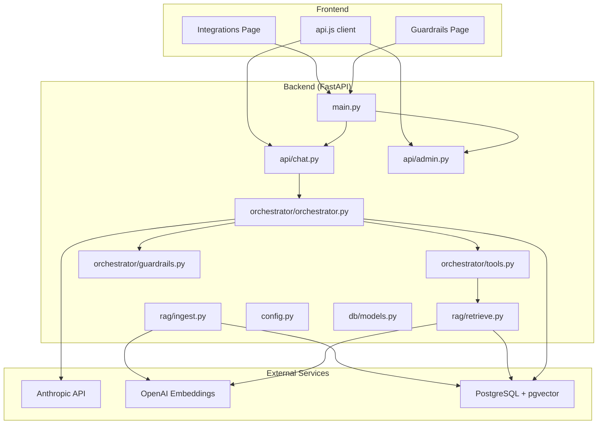
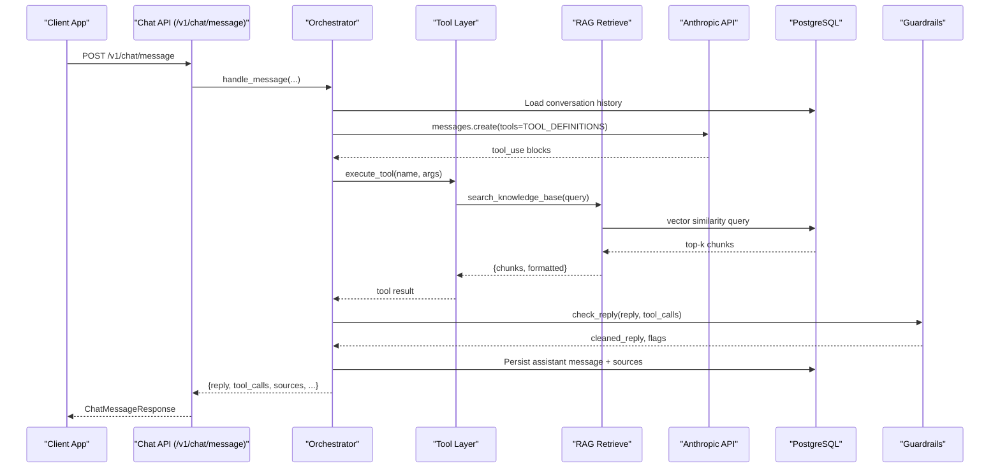
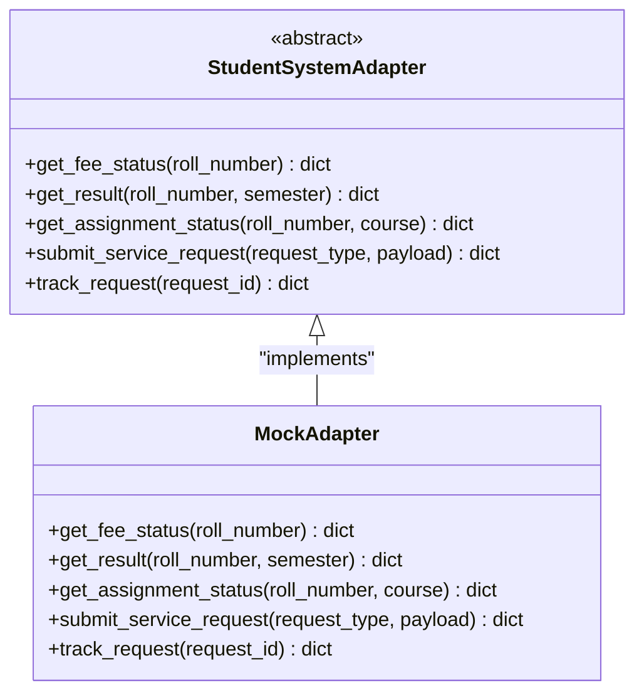
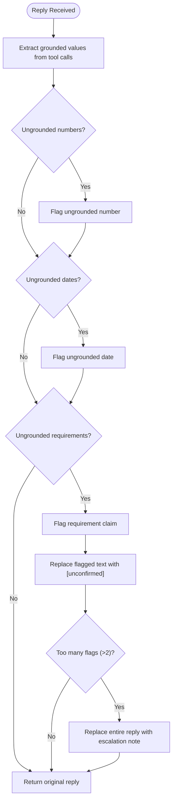
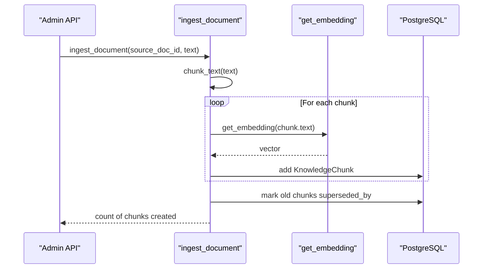
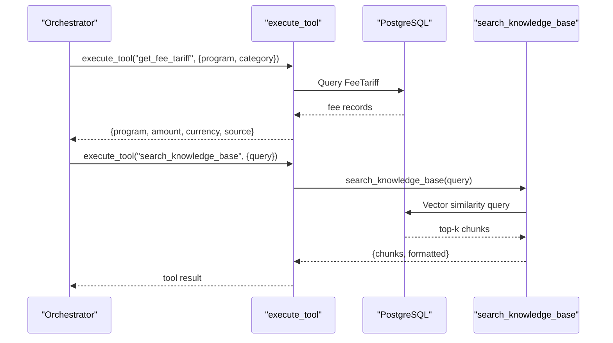
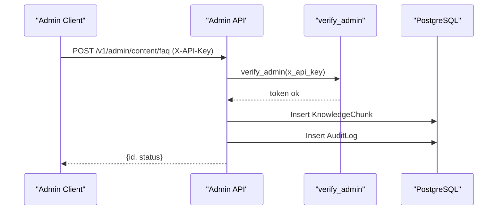
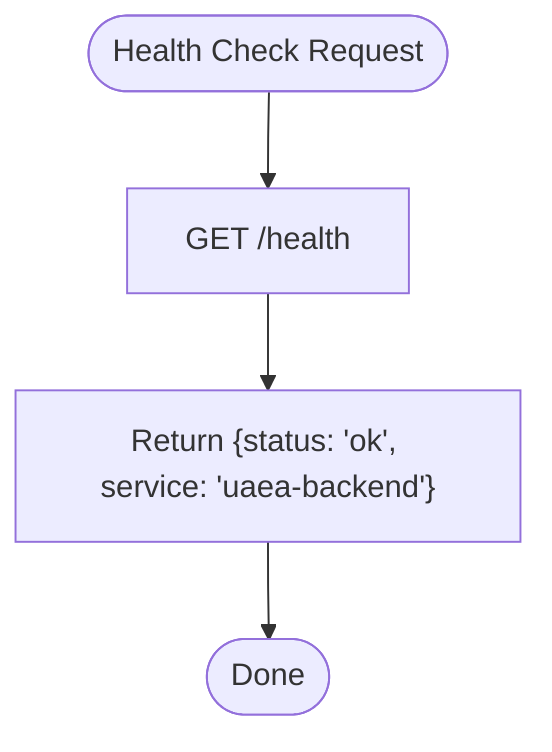
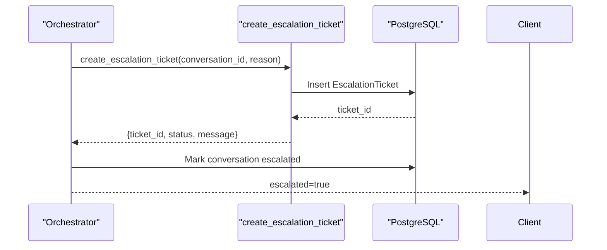
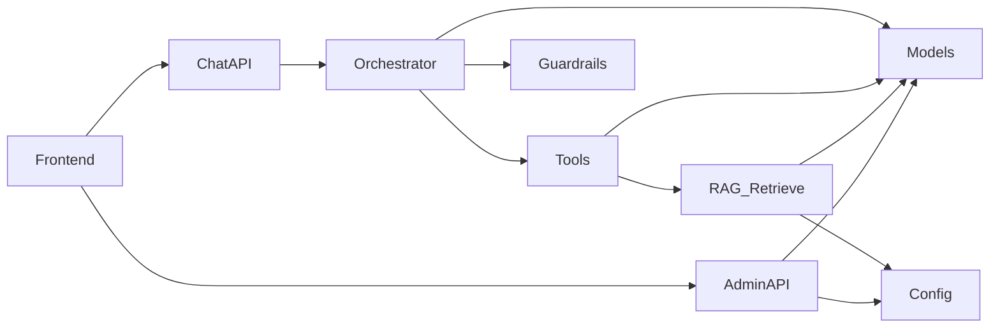

# System Integrations & Configuration

<cite>
**Referenced Files in This Document**
- [base.py](file://uaea-backend/app/adapters/base.py)
- [mock_adapter.py](file://uaea-backend/app/adapters/mock_adapter.py)
- [guardrails.py](file://uaea-backend/app/orchestrator/guardrails.py)
- [ingest.py](file://uaea-backend/app/rag/ingest.py)
- [retrieve.py](file://uaea-backend/app/rag/retrieve.py)
- [config.py](file://uaea-backend/app/config.py)
- [tools.py](file://uaea-backend/app/orchestrator/tools.py)
- [orchestrator.py](file://uaea-backend/app/orchestrator/orchestrator.py)
- [models.py](file://uaea-backend/app/db/models.py)
- [admin.py](file://uaea-backend/app/api/admin.py)
- [chat.py](file://uaea-backend/app/api/chat.py)
- [main.py](file://uaea-backend/app/main.py)
- [index.jsx](file://src/pages/Integrations/index.jsx)
- [AdapterCard.jsx](file://src/pages/Integrations/AdapterCard.jsx)
- [Guardrails index.jsx](file://src/pages/Guardrails/index.jsx)
- [AnswerRules.jsx](file://src/pages/Guardrails/AnswerRules.jsx)
- [api.js](file://src/lib/api.js)
</cite>

## Table of Contents
1. [Introduction](#introduction)
2. [Project Structure](#project-structure)
3. [Core Components](#core-components)
4. [Architecture Overview](#architecture-overview)
5. [Detailed Component Analysis](#detailed-component-analysis)
6. [Dependency Analysis](#dependency-analysis)
7. [Performance Considerations](#performance-considerations)
8. [Troubleshooting Guide](#troubleshooting-guide)
9. [Conclusion](#conclusion)
10. [Appendices](#appendices)

## Introduction
This document explains how the system integrates external services, manages configuration, and enforces safety policies for a RAG-enabled assistant. It covers:
- Adapter management interface for connecting external services and data sources
- Guardrail configuration with answer rules, safety filters, and policy enforcement
- Document ingestion and processing pipeline for RAG integration
- API key management, connection testing, and health monitoring
- Webhook-like event handling via tool calls and escalation tickets
- Security considerations, rate limiting, and performance optimization

## Project Structure
The backend is a FastAPI service with modular layers:
- Adapters define an abstract interface for external systems; a mock adapter provides test data
- Orchestrator coordinates message processing, tool execution, and guardrails
- RAG modules handle chunking, embedding, storage, and retrieval
- Admin and chat APIs expose endpoints for conversation and administration
- Configuration centralizes secrets and runtime settings
- Frontend pages provide UIs for integrations and guardrails

**Diagram sources**
- [main.py:75-86](file://uaea-backend/app/main.py#L75-L86)
- [chat.py:21-39](file://uaea-backend/app/api/chat.py#L21-L39)
- [admin.py:67-94](file://uaea-backend/app/api/admin.py#L67-L94)
- [orchestrator.py:46-143](file://uaea-backend/app/orchestrator/orchestrator.py#L46-L143)
- [tools.py:18-87](file://uaea-backend/app/orchestrator/tools.py#L18-L87)
- [guardrails.py:74-119](file://uaea-backend/app/orchestrator/guardrails.py#L74-L119)
- [ingest.py:75-122](file://uaea-backend/app/rag/ingest.py#L75-L122)
- [retrieve.py:32-96](file://uaea-backend/app/rag/retrieve.py#L32-L96)
- [config.py:6-37](file://uaea-backend/app/config.py#L6-L37)
- [models.py:126-139](file://uaea-backend/app/db/models.py#L126-L139)

**Section sources**
- [main.py:1-104](file://uaea-backend/app/main.py#L1-L104)
- [config.py:1-38](file://uaea-backend/app/config.py#L1-L38)

## Core Components
- Adapter Interface: Abstract contract for external systems; current implementation uses a mock adapter to decouple flows from University IT.
- Tool Layer: Exposes database-backed tools (fees, deadlines, departments, checklists) and RAG search to the LLM.
- Guardrails: Post-LLM safety filter that strips ungrounded numbers, dates, and requirements unless grounded by tool results.
- RAG Pipeline: Ingests documents into chunks, generates embeddings, stores vectors, and retrieves top-k similar chunks with basic reranking.
- Configuration: Centralized settings for database, LLM, embeddings, CORS, rate limits, and admin keys.
- Admin API: Secured endpoints for content creation and analytics, requiring an API key or bearer token.
- Frontend Integration UI: Allows activation and health checks of adapters; shows implemented methods vs interface.
- Frontend Guardrails UI: Lets authorized users toggle answer rules and adjust handover thresholds and model selection.

**Section sources**
- [base.py:11-31](file://uaea-backend/app/adapters/base.py#L11-L31)
- [mock_adapter.py:12-56](file://uaea-backend/app/adapters/mock_adapter.py#L12-L56)
- [tools.py:18-235](file://uaea-backend/app/orchestrator/tools.py#L18-L235)
- [guardrails.py:16-119](file://uaea-backend/app/orchestrator/guardrails.py#L16-L119)
- [ingest.py:18-145](file://uaea-backend/app/rag/ingest.py#L18-L145)
- [retrieve.py:17-96](file://uaea-backend/app/rag/retrieve.py#L17-L96)
- [config.py:6-37](file://uaea-backend/app/config.py#L6-L37)
- [admin.py:31-48](file://uaea-backend/app/api/admin.py#L31-L48)
- [index.jsx:18-99](file://src/pages/Integrations/index.jsx#L18-L99)
- [AdapterCard.jsx:20-95](file://src/pages/Integrations/AdapterCard.jsx#L20-L95)
- [Guardrails index.jsx:17-165](file://src/pages/Guardrails/index.jsx#L17-L165)
- [AnswerRules.jsx:5-67](file://src/pages/Guardrails/AnswerRules.jsx#L5-L67)

## Architecture Overview
The chat flow normalizes input, classifies intent, optionally runs guided flows, then invokes the LLM with tools. Tool results ground facts. A guardrail step cleans any unverified claims before persisting and returning the response.

**Diagram sources**
- [chat.py:21-39](file://uaea-backend/app/api/chat.py#L21-L39)
- [orchestrator.py:46-143](file://uaea-backend/app/orchestrator/orchestrator.py#L46-L143)
- [tools.py:218-235](file://uaea-backend/app/orchestrator/tools.py#L218-L235)
- [retrieve.py:32-96](file://uaea-backend/app/rag/retrieve.py#L32-L96)
- [guardrails.py:74-119](file://uaea-backend/app/orchestrator/guardrails.py#L74-L119)
- [models.py:144-178](file://uaea-backend/app/db/models.py#L144-L178)

## Detailed Component Analysis

### Adapter Management Interface
- Purpose: Provide a stable abstraction over external university systems so orchestrator and flows never depend on concrete implementations.
- Interface: Defines async methods for fee status, results, assignment status, generic service requests, and request tracking.
- Mock Implementation: Returns realistic canned responses for end-to-end testing without live dependencies.
- Frontend Integration UI: Displays active adapter, health status, implemented methods, and allows activation. Health checks simulate latency and report status.

**Diagram sources**
- [base.py:11-31](file://uaea-backend/app/adapters/base.py#L11-L31)
- [mock_adapter.py:12-56](file://uaea-backend/app/adapters/mock_adapter.py#L12-L56)

**Section sources**
- [base.py:1-32](file://uaea-backend/app/adapters/base.py#L1-L32)
- [mock_adapter.py:1-61](file://uaea-backend/app/adapters/mock_adapter.py#L1-L61)
- [index.jsx:18-99](file://src/pages/Integrations/index.jsx#L18-L99)
- [AdapterCard.jsx:20-95](file://src/pages/Integrations/AdapterCard.jsx#L20-L95)

### Guardrail Configuration and Policy Enforcement
- Answer Rules: Toggleable policies including blocking ungrounded numbers, requiring citations, blocking outcome promises, declining academic dishonesty requests, refusing personal record lookups without verification, and showing verification dates.
- Safety Filter: Scans LLM replies for ungrounded numbers, dates, and requirement phrases; replaces them with placeholders or escalates if too many ungrounded claims are detected.
- Frontend Controls: Adjust handover threshold and select conversational model; changes are audited and applied immediately to new conversations.

**Diagram sources**
- [guardrails.py:51-119](file://uaea-backend/app/orchestrator/guardrails.py#L51-L119)

**Section sources**
- [guardrails.py:1-120](file://uaea-backend/app/orchestrator/guardrails.py#L1-L120)
- [Guardrails index.jsx:17-165](file://src/pages/Guardrails/index.jsx#L17-L165)
- [AnswerRules.jsx:5-67](file://src/pages/Guardrails/AnswerRules.jsx#L5-L67)

### RAG Document Ingestion and Retrieval
- Ingestion: Splits documents into overlapping chunks preserving section headers, generates embeddings (or zero vectors in dev mode), stores chunks with metadata, and marks old versions as superseded.
- Retrieval: Embeds queries, performs cosine similarity search using pgvector, applies a simple rerank boost for matching section terms, and formats results for the LLM.
- Admin Content Creation: Creates FAQ chunks directly via admin endpoint, embedding and storing them for retrieval.

**Diagram sources**
- [ingest.py:75-122](file://uaea-backend/app/rag/ingest.py#L75-L122)
- [ingest.py:18-31](file://uaea-backend/app/rag/ingest.py#L18-L31)
- [admin.py:67-94](file://uaea-backend/app/api/admin.py#L67-L94)
- [models.py:126-139](file://uaea-backend/app/db/models.py#L126-L139)

**Section sources**
- [ingest.py:1-145](file://uaea-backend/app/rag/ingest.py#L1-L145)
- [retrieve.py:1-97](file://uaea-backend/app/rag/retrieve.py#L1-L97)
- [admin.py:67-94](file://uaea-backend/app/api/admin.py#L67-L94)

### Tool Layer and External Data Access
- Tools: Provide structured access to departments, fees, deadlines, document checklists, escalation creation, and knowledge base search.
- Execution: Orchestrator dispatches tool calls based on LLM tool_use blocks, collects results, and feeds them back into the conversation context.
- RAG Integration: The knowledge base search tool delegates to retrieve module for vector similarity search.

**Diagram sources**
- [tools.py:92-235](file://uaea-backend/app/orchestrator/tools.py#L92-L235)
- [retrieve.py:32-96](file://uaea-backend/app/rag/retrieve.py#L32-L96)
- [models.py:73-118](file://uaea-backend/app/db/models.py#L73-L118)

**Section sources**
- [tools.py:1-235](file://uaea-backend/app/orchestrator/tools.py#L1-L235)

### API Key Management and Admin Endpoints
- Authentication: Admin routes require X-API-Key or Authorization Bearer token matching configured admin_api_key.
- Endpoints: Create FAQ chunks, create fee tariffs, retrieve intent analytics, and list unanswered queries.
- Audit Logging: All admin writes are recorded with actor, action, table, record id, and detail.

**Diagram sources**
- [admin.py:31-48](file://uaea-backend/app/api/admin.py#L31-L48)
- [admin.py:67-94](file://uaea-backend/app/api/admin.py#L67-L94)
- [models.py:200-211](file://uaea-backend/app/db/models.py#L200-L211)

**Section sources**
- [admin.py:1-161](file://uaea-backend/app/api/admin.py#L1-L161)
- [config.py:27-32](file://uaea-backend/app/config.py#L27-L32)

### Connection Testing and Health Monitoring
- Health Endpoint: Simple GET /health returns service status.
- Adapter Health Checks: Frontend triggers simulated health checks per adapter, reporting latency and status; indicates when credentials are missing.
- Rate Limiting: Global IP-based limiter configured via slowapi; custom handler returns 429 with details.

**Diagram sources**
- [main.py:82-86](file://uaea-backend/app/main.py#L82-L86)

**Section sources**
- [main.py:25-58](file://uaea-backend/app/main.py#L25-L58)
- [index.jsx:27-55](file://src/pages/Integrations/index.jsx#L27-L55)
- [AdapterCard.jsx:69-90](file://src/pages/Integrations/AdapterCard.jsx#L69-L90)

### Webhook-like Event Handling and Error Recovery
- Tool-driven Events: Creating escalation tickets acts as an outbound event to human workflows; tracked in DB and surfaced in conversation state.
- Error Recovery: Orchestrator handles LLM API errors gracefully, offering fallback messaging and escalation paths; low-confidence intents are queued for review.
- Unanswered Queue: Low-confidence queries are persisted for staff attention.

**Diagram sources**
- [tools.py:200-215](file://uaea-backend/app/orchestrator/tools.py#L200-L215)
- [orchestrator.py:123-130](file://uaea-backend/app/orchestrator/orchestrator.py#L123-L130)
- [models.py:183-195](file://uaea-backend/app/db/models.py#L183-L195)

**Section sources**
- [orchestrator.py:229-318](file://uaea-backend/app/orchestrator/orchestrator.py#L229-L318)
- [orchestrator.py:367-383](file://uaea-backend/app/orchestrator/orchestrator.py#L367-L383)

## Dependency Analysis
Key dependencies and relationships:
- Orchestrator depends on tools, guardrails, and models; it also interacts with external LLM provider.
- Tools depend on models for database operations and delegate to RAG retrieve for knowledge searches.
- RAG modules depend on config for embedding settings and models for schema.
- Admin API depends on config for authentication and models for persistence.
- Frontend pages depend on api.js client and interact with backend routers.

**Diagram sources**
- [orchestrator.py:17-25](file://uaea-backend/app/orchestrator/orchestrator.py#L17-L25)
- [tools.py:11-14](file://uaea-backend/app/orchestrator/tools.py#L11-L14)
- [retrieve.py:7-12](file://uaea-backend/app/rag/retrieve.py#L7-L12)
- [admin.py:14-23](file://uaea-backend/app/api/admin.py#L14-L23)
- [chat.py:10-16](file://uaea-backend/app/api/chat.py#L10-L16)
- [api.js:12-169](file://src/lib/api.js#L12-L169)

**Section sources**
- [orchestrator.py:1-405](file://uaea-backend/app/orchestrator/orchestrator.py#L1-L405)
- [tools.py:1-235](file://uaea-backend/app/orchestrator/tools.py#L1-L235)
- [retrieve.py:1-97](file://uaea-backend/app/rag/retrieve.py#L1-L97)
- [admin.py:1-161](file://uaea-backend/app/api/admin.py#L1-L161)
- [chat.py:1-115](file://uaea-backend/app/api/chat.py#L1-L115)
- [api.js:1-169](file://src/lib/api.js#L1-L169)

## Performance Considerations
- Embedding Optimization: Use appropriate dimensions and models; consider caching embeddings for repeated content.
- Chunking Strategy: Overlapping chunks preserve context; tune chunk_size and overlap for accuracy vs cost.
- Retrieval Efficiency: Leverage pgvector indexing; limit top_k to reduce payload size and improve latency.
- Rate Limiting: Configure per-IP and per-session limits to protect backend resources.
- LLM Rounds: Cap tool-call loops to prevent excessive rounds; ensure efficient tool design to minimize calls.

[No sources needed since this section provides general guidance]

## Troubleshooting Guide
Common issues and resolutions:
- Missing Credentials: Adapter health checks indicate not configured; configure endpoints/service accounts accordingly.
- Admin Access Denied: Ensure correct X-API-Key or Authorization header matches configured admin_api_key.
- No Relevant Documents: RAG retrieval returns empty; verify ingestion completed and chunks are not superseded.
- Rate Limit Exceeded: Backend returns 429; reduce request frequency or adjust limits.
- Low Confidence Queries: Check unanswered queue and refine intent classification or content coverage.

**Section sources**
- [index.jsx:27-55](file://src/pages/Integrations/index.jsx#L27-L55)
- [admin.py:31-48](file://uaea-backend/app/api/admin.py#L31-L48)
- [retrieve.py:58-59](file://uaea-backend/app/rag/retrieve.py#L58-L59)
- [main.py:51-58](file://uaea-backend/app/main.py#L51-L58)
- [orchestrator.py:367-383](file://uaea-backend/app/orchestrator/orchestrator.py#L367-L383)

## Conclusion
The system provides a robust integration layer through a clear adapter interface, comprehensive guardrails for safety, and a scalable RAG pipeline for knowledge-grounded responses. Configuration is centralized, admin endpoints are secured, and frontend controls enable operational visibility and control. With careful tuning of embeddings, chunking, and retrieval parameters, the system balances accuracy, performance, and security.

[No sources needed since this section summarizes without analyzing specific files]

## Appendices

### Configuration Keys Summary
- Database URLs: Async and sync connections
- LLM Keys: Anthropic API key
- Embeddings: Provider, API key, model, dimensions
- CORS: Allowed origins
- Rate Limits: Per IP and per session
- Admin Key: API key for admin endpoints
- App Environment and Log Level

**Section sources**
- [config.py:6-37](file://uaea-backend/app/config.py#L6-L37)

### Frontend API Client Usage
- Base URL configurable via environment variable
- Methods for chat, lookup, and admin operations
- Error handling throws descriptive messages

**Section sources**
- [api.js:12-169](file://src/lib/api.js#L12-L169)