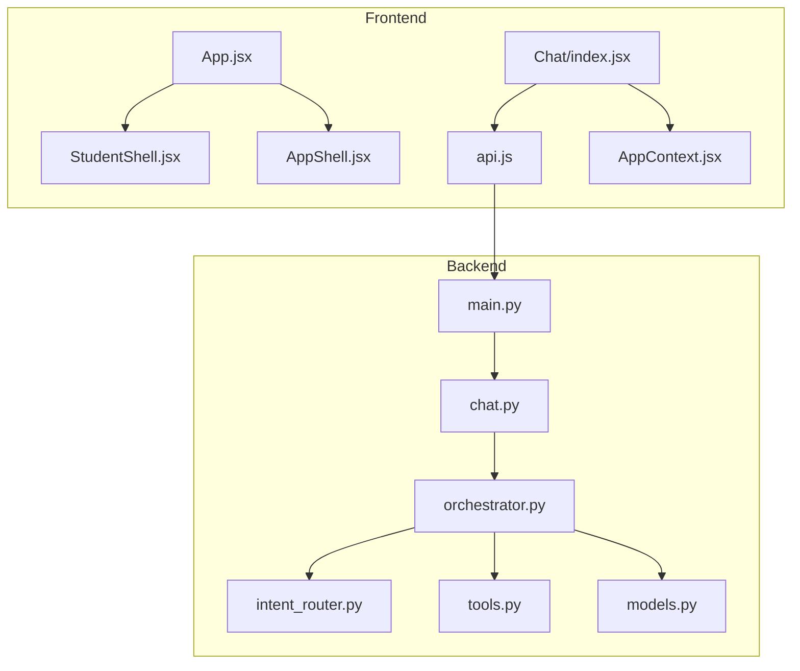
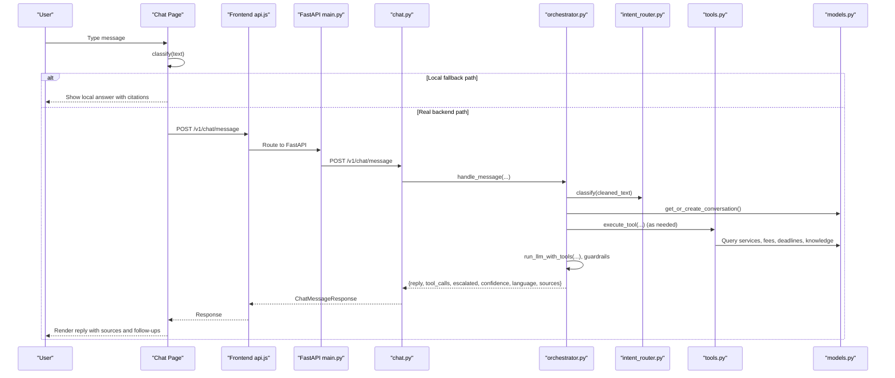
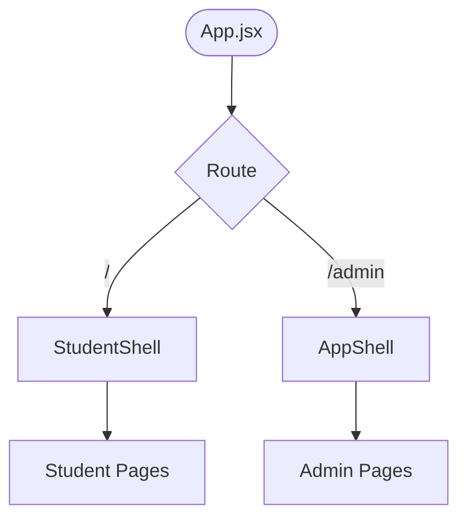
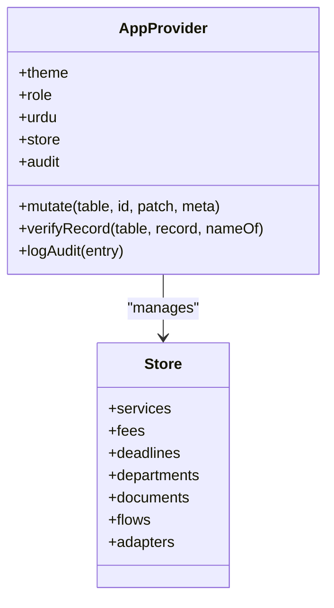
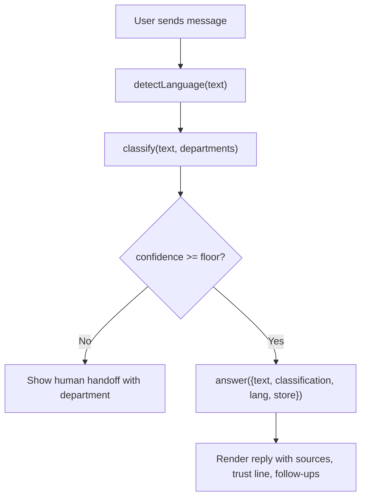
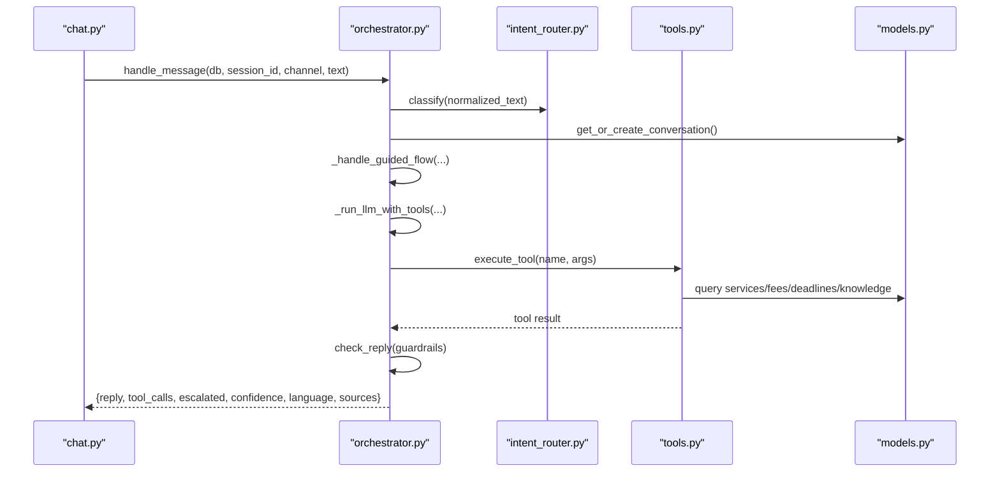
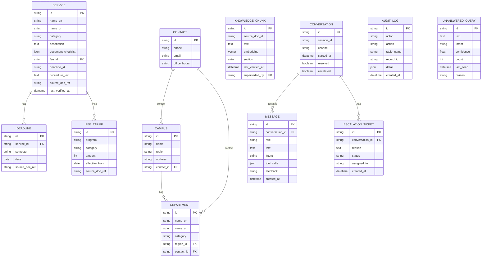
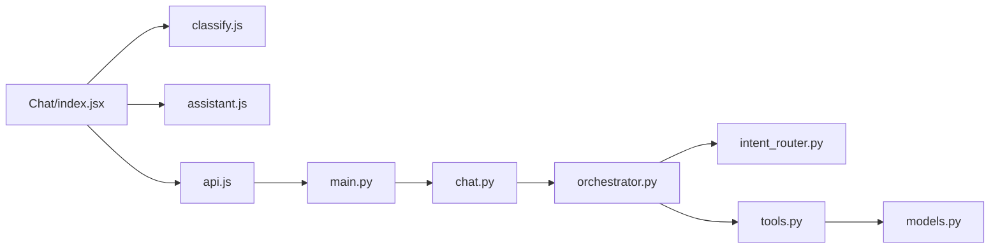

# Architecture Overview

<cite>
**Referenced Files in This Document**
- [App.jsx](file://src/App.jsx)
- [AppShell.jsx](file://src/components/layout/AppShell.jsx)
- [StudentShell.jsx](file://src/components/student/StudentShell.jsx)
- [AppContext.jsx](file://src/context/AppContext.jsx)
- [api.js](file://src/lib/api.js)
- [classify.js](file://src/lib/classify.js)
- [assistant.js](file://src/lib/assistant.js)
- [Chat/index.jsx](file://src/pages/student/Chat/index.jsx)
- [main.py](file://uaea-backend/app/main.py)
- [chat.py](file://uaea-backend/app/api/chat.py)
- [orchestrator.py](file://uaea-backend/app/orchestrator/orchestrator.py)
- [intent_router.py](file://uaea-backend/app/orchestrator/intent_router.py)
- [tools.py](file://uaea-backend/app/orchestrator/tools.py)
- [models.py](file://uaea-backend/app/db/models.py)
</cite>

## Table of Contents
1. [Introduction](#introduction)
2. [Project Structure](#project-structure)
3. [Core Components](#core-components)
4. [Architecture Overview](#architecture-overview)
5. [Detailed Component Analysis](#detailed-component-analysis)
6. [Dependency Analysis](#dependency-analysis)
7. [Performance Considerations](#performance-considerations)
8. [Troubleshooting Guide](#troubleshooting-guide)
9. [Conclusion](#conclusion)

## Introduction
This document describes the UAEA Console architecture with a dual-interface design: a student-facing portal and an admin console that share a unified data layer. The system enforces governance-first principles by grounding every factual answer in verified sources, routing low-confidence queries to humans, and maintaining auditability across both interfaces. It explains the component hierarchy (AppShell for admin, StudentShell for students), state management via React Context with centralized mutation patterns, and the end-to-end message processing pipeline from user input through intent classification to response generation on both frontend and backend sides.

## Project Structure
The application is split into two main parts:
- Frontend (React + Vite): Provides two shells—student and admin—and routes pages under each shell. Shared context holds theme, role, store, mutations, and audit log.
- Backend (FastAPI): Exposes chat, lookup, and admin APIs. Orchestrates messages through normalization, intent classification, guided flows, LLM tool calls, guardrails, and persistence.

**Diagram sources**
- [App.jsx:24-63](file://src/App.jsx#L24-L63)
- [AppShell.jsx:9-48](file://src/components/layout/AppShell.jsx#L9-L48)
- [StudentShell.jsx:6-24](file://src/components/student/StudentShell.jsx#L6-L24)
- [Chat/index.jsx:20-29](file://src/pages/student/Chat/index.jsx#L20-L29)
- [api.js:1-169](file://src/lib/api.js#L1-L169)
- [main.py:38-79](file://uaea-backend/app/main.py#L38-L79)
- [chat.py:18-115](file://uaea-backend/app/api/chat.py#L18-L115)
- [orchestrator.py:46-143](file://uaea-backend/app/orchestrator/orchestrator.py#L46-L143)
- [intent_router.py:65-103](file://uaea-backend/app/orchestrator/intent_router.py#L65-L103)
- [tools.py:18-235](file://uaea-backend/app/orchestrator/tools.py#L18-L235)
- [models.py:142-228](file://uaea-backend/app/db/models.py#L142-L228)

**Section sources**
- [App.jsx:24-63](file://src/App.jsx#L24-L63)
- [main.py:38-79](file://uaea-backend/app/main.py#L38-L79)

## Core Components
- Dual shells:
  - Admin shell (AppShell) provides sidebar, topbar, command palette, and page outlet.
  - Student shell (StudentShell) provides header, footer (hidden on chat), and page outlet.
- Routing:
  - Root routes host the student portal; /admin hosts the staff console. Both read the same catalogue so edits in admin immediately affect what students see.
- State management:
  - AppContext exposes theme, role, language preference, store (services, fees, deadlines, departments, documents, flows, adapters), mutate, verifyRecord, audit trail, and current user.
  - Centralized mutate supports create/update/delete semantics and logs changes to the audit trail.

**Section sources**
- [AppShell.jsx:9-48](file://src/components/layout/AppShell.jsx#L9-L48)
- [StudentShell.jsx:6-24](file://src/components/student/StudentShell.jsx#L6-L24)
- [App.jsx:24-63](file://src/App.jsx#L24-L63)
- [AppContext.jsx:24-135](file://src/context/AppContext.jsx#L24-L135)

## Architecture Overview
The system follows a governance-first approach:
- Every factual statement must be grounded in a tool result or verified source.
- Low-confidence intents are surfaced to human support rather than guessed.
- All mutations are audited and traceable.
- The assistant may only present fees, deadlines, or document requirements returned by tools.

**Diagram sources**
- [Chat/index.jsx:62-138](file://src/pages/student/Chat/index.jsx#L62-L138)
- [api.js:42-69](file://src/lib/api.js#L42-L69)
- [main.py:75-79](file://uaea-backend/app/main.py#L75-L79)
- [chat.py:21-39](file://uaea-backend/app/api/chat.py#L21-L39)
- [orchestrator.py:46-143](file://uaea-backend/app/orchestrator/orchestrator.py#L46-L143)
- [intent_router.py:65-103](file://uaea-backend/app/orchestrator/intent_router.py#L65-L103)
- [tools.py:218-235](file://uaea-backend/app/orchestrator/tools.py#L218-L235)
- [models.py:142-228](file://uaea-backend/app/db/models.py#L142-L228)

## Detailed Component Analysis

### Shell Components and Routing
- AppShell:
  - Owns chrome state (sidebar collapsed, mobile drawer, command palette).
  - Uses Outlet to render admin pages.
  - Integrates hotkeys and theme from AppContext.
- StudentShell:
  - Renders header, main area, and conditional footer (hidden on chat).
  - Uses Outlet to render student pages.
- Routing:
  - Student routes at root (/).
  - Admin routes under /admin.
  - Both share the same catalogue data model, ensuring consistency between portals.

**Diagram sources**
- [App.jsx:34-63](file://src/App.jsx#L34-L63)
- [StudentShell.jsx:8-24](file://src/components/student/StudentShell.jsx#L8-L24)
- [AppShell.jsx:14-48](file://src/components/layout/AppShell.jsx#L14-L48)

**Section sources**
- [App.jsx:34-63](file://src/App.jsx#L34-L63)
- [StudentShell.jsx:8-24](file://src/components/student/StudentShell.jsx#L8-L24)
- [AppShell.jsx:14-48](file://src/components/layout/AppShell.jsx#L14-L48)

### State Management with React Context
- AppProvider:
  - Holds theme, role, urdu toggle, store (services, fees, deadlines, departments, documents, flows, adapters), and audit entries.
  - Exposes mutate(table, id, patch, meta) for centralized mutations:
    - id === null → create
    - patch === null → delete
    - otherwise → update
  - Logs all mutations to an append-only audit trail with actor, timestamp, action, table, recordId, and changes.
  - Provides verifyRecord to mark items verified today by the signed-in user.
- Governance impact:
  - Centralized mutations ensure consistent schema updates and complete auditability.
  - Phase 2 plan replaces mutate with server calls without changing consumers.

**Diagram sources**
- [AppContext.jsx:34-135](file://src/context/AppContext.jsx#L34-L135)

**Section sources**
- [AppContext.jsx:24-135](file://src/context/AppContext.jsx#L24-L135)

### Message Processing Pipeline (Frontend)
- Chat page flow:
  - Detect language and classify text locally using keyword scoring.
  - If confidence below threshold, offer human handoff instead of guessing.
  - Compose answer from tool results and store data, citing sources and showing freshness.
  - Provide follow-up suggestions based on intent.
- API seam:
  - When integrated, the classify/answer pair is replaced by a single POST to /v1/chat/message.

**Diagram sources**
- [Chat/index.jsx:62-138](file://src/pages/student/Chat/index.jsx#L62-L138)
- [classify.js:18-57](file://src/lib/classify.js#L18-L57)
- [classify.js:195-269](file://src/lib/classify.js#L195-L269)
- [assistant.js:128-317](file://src/lib/assistant.js#L128-L317)

**Section sources**
- [Chat/index.jsx:20-29](file://src/pages/student/Chat/index.jsx#L20-L29)
- [Chat/index.jsx:62-138](file://src/pages/student/Chat/index.jsx#L62-L138)
- [classify.js:18-57](file://src/lib/classify.js#L18-L57)
- [classify.js:195-269](file://src/lib/classify.js#L195-L269)
- [assistant.js:128-317](file://src/lib/assistant.js#L128-L317)

### Message Processing Pipeline (Backend)
- Orchestrator steps:
  - Normalize and detect language.
  - Classify intent with deterministic rules.
  - Get or create conversation and persist user message.
  - Handle guided flows (slot-filling) when applicable.
  - Call LLM with tool definitions; execute tools in a loop up to a max round limit.
  - Apply guardrails to the final reply.
  - Persist assistant message, track flow state, and handle escalation/unanswered tracking.
- Tools:
  - Provide official lookups for departments, fee tariffs, deadlines, document checklists, and knowledge base search.
  - Create escalation tickets when necessary.
- Persistence:
  - Conversations, messages, escalation tickets, knowledge chunks, and audit-related structures are modeled in SQLAlchemy.

**Diagram sources**
- [chat.py:21-39](file://uaea-backend/app/api/chat.py#L21-L39)
- [orchestrator.py:46-143](file://uaea-backend/app/orchestrator/orchestrator.py#L46-L143)
- [intent_router.py:65-103](file://uaea-backend/app/orchestrator/intent_router.py#L65-L103)
- [tools.py:218-235](file://uaea-backend/app/orchestrator/tools.py#L218-L235)
- [models.py:142-228](file://uaea-backend/app/db/models.py#L142-L228)

**Section sources**
- [chat.py:21-39](file://uaea-backend/app/api/chat.py#L21-L39)
- [orchestrator.py:46-143](file://uaea-backend/app/orchestrator/orchestrator.py#L46-L143)
- [intent_router.py:65-103](file://uaea-backend/app/orchestrator/intent_router.py#L65-L103)
- [tools.py:18-235](file://uaea-backend/app/orchestrator/tools.py#L18-L235)
- [models.py:142-228](file://uaea-backend/app/db/models.py#L142-L228)

### Data Models and Relationships
Key entities include Contact, Campus, Department, Service, FeeTariff, Deadline, KnowledgeChunk, Conversation, Message, EscalationTicket, AuditLog, and UnansweredQuery. Relationships enforce referential integrity and enable rich queries for the orchestrator and admin features.

**Diagram sources**
- [models.py:30-228](file://uaea-backend/app/db/models.py#L30-L228)

**Section sources**
- [models.py:30-228](file://uaea-backend/app/db/models.py#L30-L228)

## Dependency Analysis
- Frontend dependencies:
  - Chat page depends on classify, assistant, and api modules.
  - Shells depend on AppContext for theme and store.
  - api.js centralizes HTTP calls to backend endpoints.
- Backend dependencies:
  - main.py mounts routers and middleware (CORS, rate limiting).
  - chat.py delegates to orchestrator for end-to-end processing.
  - orchestrator coordinates normalizer, intent router, state machine, tools, and guardrails.
  - tools implement data access to models and RAG retrieval.
  - models define the database schema used throughout.

**Diagram sources**
- [Chat/index.jsx:62-138](file://src/pages/student/Chat/index.jsx#L62-L138)
- [api.js:42-69](file://src/lib/api.js#L42-L69)
- [main.py:75-79](file://uaea-backend/app/main.py#L75-L79)
- [chat.py:21-39](file://uaea-backend/app/api/chat.py#L21-L39)
- [orchestrator.py:46-143](file://uaea-backend/app/orchestrator/orchestrator.py#L46-L143)
- [intent_router.py:65-103](file://uaea-backend/app/orchestrator/intent_router.py#L65-L103)
- [tools.py:218-235](file://uaea-backend/app/orchestrator/tools.py#L218-L235)
- [models.py:142-228](file://uaea-backend/app/db/models.py#L142-L228)

**Section sources**
- [api.js:1-169](file://src/lib/api.js#L1-L169)
- [main.py:38-79](file://uaea-backend/app/main.py#L38-L79)
- [chat.py:18-115](file://uaea-backend/app/api/chat.py#L18-L115)
- [orchestrator.py:46-143](file://uaea-backend/app/orchestrator/orchestrator.py#L46-L143)

## Performance Considerations
- Rate limiting:
  - Per-IP limiter configured in the backend; per-session logic exists for chat endpoints.
- LLM rounds:
  - Maximum rounds capped to prevent runaway loops; fallback escalates if exhausted.
- Database queries:
  - Tools use targeted queries with fuzzy matching where appropriate; relationships are joined efficiently.
- Frontend latency simulation:
  - Chat page simulates latency to make the classify → look up → answer sequence observable during development.

[No sources needed since this section provides general guidance]

## Troubleshooting Guide
- Low-confidence queries:
  - Frontend shows human handoff when classifier confidence is below threshold.
  - Backend tracks unanswered queries for review and improvement.
- API errors:
  - Frontend throws descriptive errors from non-OK responses; consider checking CORS and environment variables for API URL.
- Escalations:
  - Backend creates escalation tickets when requested or when tool execution indicates inability to resolve.
- Auditability:
  - Use the admin audit log to trace mutations and understand who changed what and when.

**Section sources**
- [Chat/index.jsx:80-110](file://src/pages/student/Chat/index.jsx#L80-L110)
- [orchestrator.py:367-383](file://uaea-backend/app/orchestrator/orchestrator.py#L367-L383)
- [api.js:16-31](file://src/lib/api.js#L16-L31)
- [chat.py:88-115](file://uaea-backend/app/api/chat.py#L88-L115)
- [AppContext.jsx:51-103](file://src/context/AppContext.jsx#L51-L103)

## Conclusion
The UAEA Console implements a governance-first architecture with clear separation between student and admin interfaces while sharing a unified data layer. State is centrally managed with explicit mutation patterns and comprehensive auditing. The message pipeline ensures answers are grounded in verified sources, with robust fallbacks to human support when confidence is low. The backend orchestrator coordinates normalization, classification, guided flows, LLM tool usage, guardrails, and persistence, providing a reliable and auditable system for university student services.