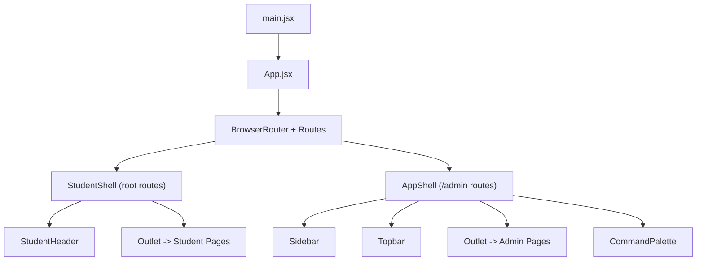
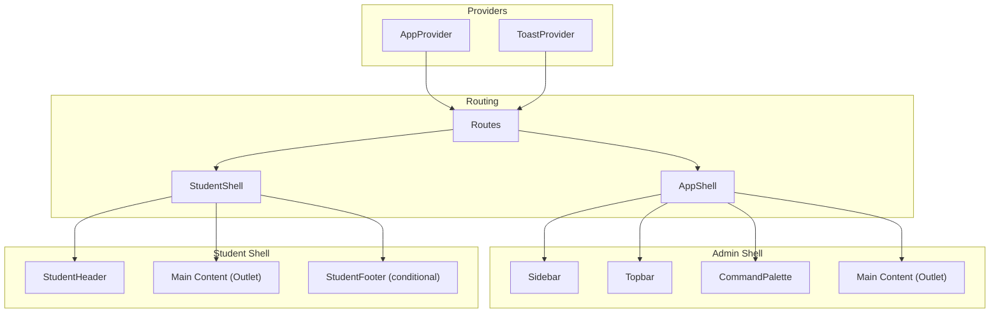
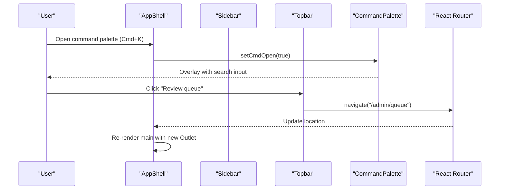
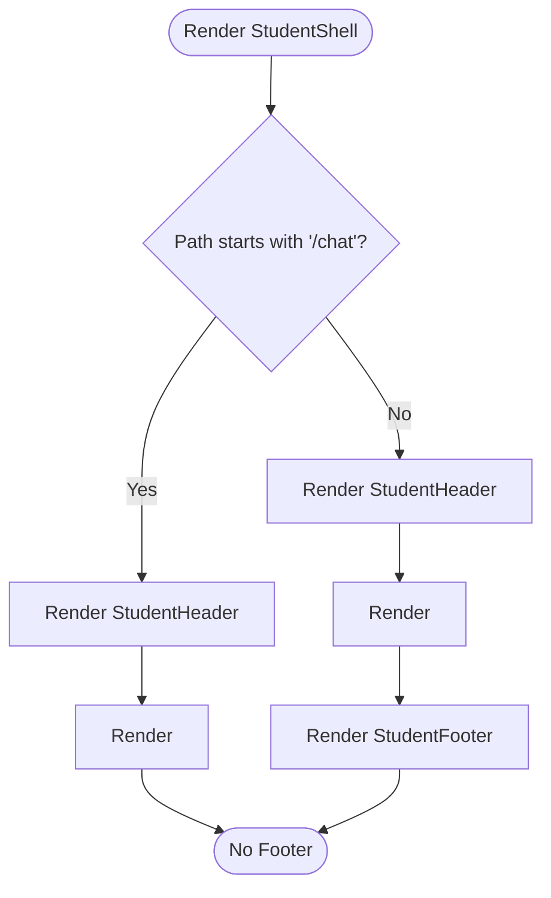
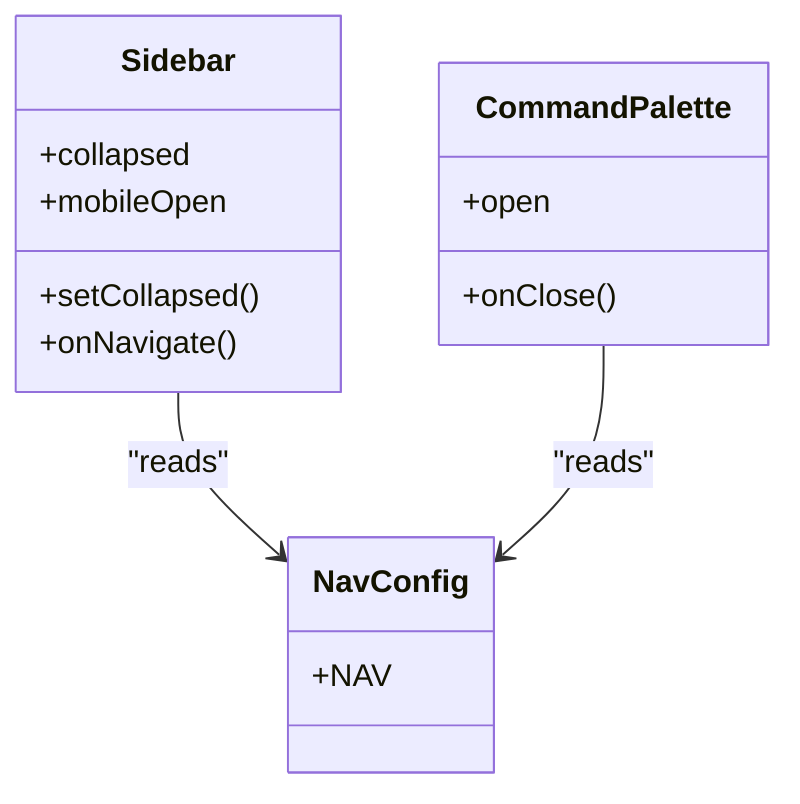
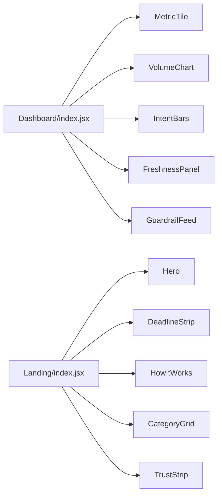
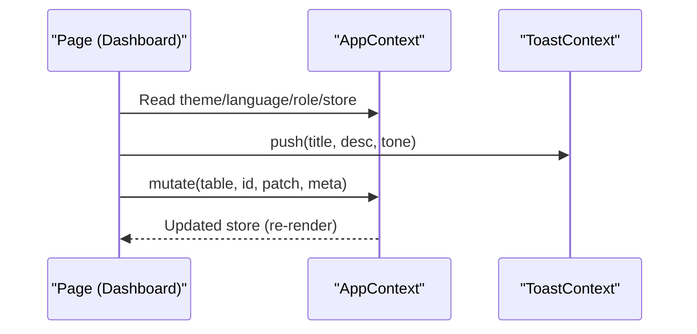
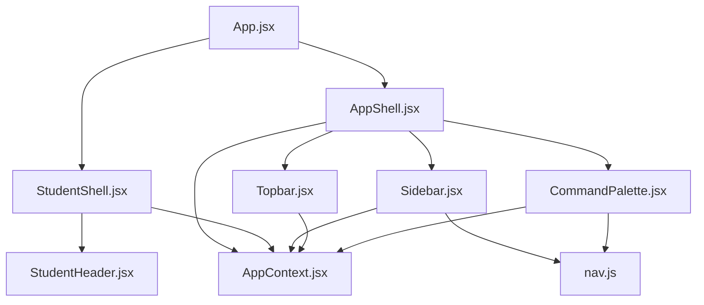

# Component Hierarchy and Structure

<cite>
**Referenced Files in This Document**
- [main.jsx](file://src/main.jsx)
- [App.jsx](file://src/App.jsx)
- [AppShell.jsx](file://src/components/layout/AppShell.jsx)
- [StudentShell.jsx](file://src/components/student/StudentShell.jsx)
- [Sidebar.jsx](file://src/components/layout/Sidebar.jsx)
- [Topbar.jsx](file://src/components/layout/Topbar.jsx)
- [CommandPalette.jsx](file://src/components/layout/CommandPalette.jsx)
- [nav.js](file://src/components/layout/nav.js)
- [StudentHeader.jsx](file://src/components/student/StudentHeader.jsx)
- [AppContext.jsx](file://src/context/AppContext.jsx)
- [ToastContext.jsx](file://src/context/ToastContext.jsx)
- [Dashboard/index.jsx](file://src/pages/Dashboard/index.jsx)
- [Landing/index.jsx](file://src/pages/student/Landing/index.jsx)
- [Button.jsx](file://src/components/ui/Button.jsx)
- [useHotkey.js](file://src/hooks/useHotkey.js)
</cite>

## Table of Contents
1. Introduction
2. Project Structure
3. Core Components
4. Architecture Overview
5. Detailed Component Analysis
6. Dependency Analysis
7. Performance Considerations
8. Troubleshooting Guide
9. Conclusion

## Introduction
This document explains the React component hierarchy and structure for both the admin console and the student portal. It focuses on the shell component pattern using AppShell for the admin interface and StudentShell for the student portal, how pages are composed within these shells, navigation flows, state management via contexts, and performance techniques used throughout the application.

## Project Structure
The application is bootstrapped by a root entry that renders providers and routing. Two top-level shells wrap distinct user journeys:
- Admin console under /admin with AppShell providing Sidebar, Topbar, and a command palette.
- Student portal at the root path with StudentShell providing a header, main content area, and an optional footer.

**Diagram sources**
- [main.jsx:1-11](file://src/main.jsx#L1-L11)
- [App.jsx:1-70](file://src/App.jsx#L1-L70)
- [AppShell.jsx:1-49](file://src/components/layout/AppShell.jsx#L1-L49)
- [StudentShell.jsx:1-25](file://src/components/student/StudentShell.jsx#L1-L25)

**Section sources**
- [main.jsx:1-11](file://src/main.jsx#L1-L11)
- [App.jsx:1-70](file://src/App.jsx#L1-L70)

## Core Components
- AppShell: The admin frame that owns chrome state (sidebar collapse, mobile drawer, command palette). It renders Sidebar, Topbar, and an Outlet for admin pages. It uses a key on the main element to reset scroll and local page state on route changes.
- StudentShell: The student frame that renders StudentHeader, a main content area, and conditionally hides the footer when on chat routes.
- Contexts: AppContext provides theme, language, role, store data, mutation helpers, audit log, and current user. ToastContext provides a push-based toast system.
- Navigation: Admin navigation is defined centrally in nav.js and consumed by Sidebar and CommandPalette.

Key responsibilities:
- Shells own layout chrome and global UI toggles; pages own business state.
- Contexts centralize cross-cutting concerns (theme, i18n, RBAC, data mutations, notifications).
- Routing composes pages into shells via nested routes.

**Section sources**
- [AppShell.jsx:1-49](file://src/components/layout/AppShell.jsx#L1-L49)
- [StudentShell.jsx:1-25](file://src/components/student/StudentShell.jsx#L1-L25)
- [AppContext.jsx:1-135](file://src/context/AppContext.jsx#L1-L135)
- [ToastContext.jsx:1-33](file://src/context/ToastContext.jsx#L1-L33)
- [nav.js:1-49](file://src/components/layout/nav.js#L1-L49)

## Architecture Overview
The app follows a shell-based architecture with two parallel experiences sharing a single data layer.

**Diagram sources**
- [App.jsx:1-70](file://src/App.jsx#L1-L70)
- [AppShell.jsx:1-49](file://src/components/layout/AppShell.jsx#L1-L49)
- [StudentShell.jsx:1-25](file://src/components/student/StudentShell.jsx#L1-L25)
- [AppContext.jsx:1-135](file://src/context/AppContext.jsx#L1-L135)
- [ToastContext.jsx:1-33](file://src/context/ToastContext.jsx#L1-L33)

## Detailed Component Analysis

### AppShell (Admin Shell)
- Purpose: Frame for all admin pages. Owns sidebar collapse, mobile drawer, and command palette state. Renders Topbar and a scrollable main area with an Outlet for child routes. Uses a key on the main element tied to the pathname to reset per-page state and scroll position on navigation.
- Key behaviors:
  - Hotkey support for opening the command palette.
  - Mobile responsive behavior via a backdrop and drawer toggle.
  - Theme applied via context.

**Diagram sources**
- [AppShell.jsx:1-49](file://src/components/layout/AppShell.jsx#L1-L49)
- [Topbar.jsx:1-51](file://src/components/layout/Topbar.jsx#L1-L51)
- [CommandPalette.jsx:1-122](file://src/components/layout/CommandPalette.jsx#L1-L122)
- [useHotkey.js:1-20](file://src/hooks/useHotkey.js#L1-L20)

**Section sources**
- [AppShell.jsx:1-49](file://src/components/layout/AppShell.jsx#L1-L49)
- [Topbar.jsx:1-51](file://src/components/layout/Topbar.jsx#L1-L51)
- [CommandPalette.jsx:1-122](file://src/components/layout/CommandPalette.jsx#L1-L122)
- [useHotkey.js:1-20](file://src/hooks/useHotkey.js#L1-L20)

### StudentShell (Student Portal)
- Purpose: Frame for student-facing pages. Renders StudentHeader, a main content area, and conditionally hides the footer on chat routes to keep the composer pinned.
- Behavior: Detects chat routes to suppress the footer and ensures consistent theming via context.

**Diagram sources**
- [StudentShell.jsx:1-25](file://src/components/student/StudentShell.jsx#L1-L25)

**Section sources**
- [StudentShell.jsx:1-25](file://src/components/student/StudentShell.jsx#L1-L25)

### Sidebar and Navigation
- Centralized navigation configuration in nav.js groups items by intent and exposes icons, labels, and paths.
- Sidebar renders grouped navigation links, supports collapsed/mobile states, and includes a user menu to switch roles for previewing access levels.
- CommandPalette builds commands from nav.js and filters actions based on role permissions.

**Diagram sources**
- [Sidebar.jsx:1-109](file://src/components/layout/Sidebar.jsx#L1-L109)
- [CommandPalette.jsx:1-122](file://src/components/layout/CommandPalette.jsx#L1-L122)
- [nav.js:1-49](file://src/components/layout/nav.js#L1-L49)

**Section sources**
- [Sidebar.jsx:1-109](file://src/components/layout/Sidebar.jsx#L1-L109)
- [CommandPalette.jsx:1-122](file://src/components/layout/CommandPalette.jsx#L1-L122)
- [nav.js:1-49](file://src/components/layout/nav.js#L1-L49)

### Topbar
- Provides quick actions: open mobile nav, open command palette, language toggle, theme toggle, and shortcuts to Review Queue and Audit Log.
- Uses context for theme and language, and router for navigation.

**Section sources**
- [Topbar.jsx:1-51](file://src/components/layout/Topbar.jsx#L1-L51)

### StudentHeader
- Renders logo, primary navigation links, language toggle, theme toggle, and a link to the staff console.
- Reads language and theme from context.

**Section sources**
- [StudentHeader.jsx:1-64](file://src/components/student/StudentHeader.jsx#L1-L64)

### Page Composition Examples
- Dashboard (admin): Composes metric tiles, charts, panels, and export functionality. Demonstrates loading skeletons and chart rendering patterns.
- Landing (student): Composes hero, deadlines, how-it-works, categories, and trust strip sections.

**Diagram sources**
- [Dashboard/index.jsx:1-151](file://src/pages/Dashboard/index.jsx#L1-L151)
- [Landing/index.jsx:1-25](file://src/pages/student/Landing/index.jsx#L1-L25)

**Section sources**
- [Dashboard/index.jsx:1-151](file://src/pages/Dashboard/index.jsx#L1-L151)
- [Landing/index.jsx:1-25](file://src/pages/student/Landing/index.jsx#L1-L25)

### State Hoisting and Prop Drilling Patterns
- Global state lives in AppContext (theme, language, role, store, mutations, audit, user). Consumers use hooks to read/write without prop drilling.
- Local chrome state (sidebar, mobile drawer, command palette) is hoisted in AppShell to avoid re-renders in pages.
- Page-specific state remains in page components (e.g., dashboard range selection, loading flags), keeping shells focused on layout.

**Diagram sources**
- [AppContext.jsx:1-135](file://src/context/AppContext.jsx#L1-L135)
- [ToastContext.jsx:1-33](file://src/context/ToastContext.jsx#L1-L33)
- [Dashboard/index.jsx:1-151](file://src/pages/Dashboard/index.jsx#L1-L151)

**Section sources**
- [AppContext.jsx:1-135](file://src/context/AppContext.jsx#L1-L135)
- [ToastContext.jsx:1-33](file://src/context/ToastContext.jsx#L1-L33)
- [Dashboard/index.jsx:1-151](file://src/pages/Dashboard/index.jsx#L1-L151)

### Layout System Summary
- Admin: Sidebar (navigation, role switching), Topbar (actions, shortcuts), Main (scrollable outlet), CommandPalette (global search/actions).
- Student: StudentHeader (links, controls), Main (outlet), StudentFooter (hidden on chat).

**Section sources**
- [AppShell.jsx:1-49](file://src/components/layout/AppShell.jsx#L1-L49)
- [Sidebar.jsx:1-109](file://src/components/layout/Sidebar.jsx#L1-L109)
- [Topbar.jsx:1-51](file://src/components/layout/Topbar.jsx#L1-L51)
- [CommandPalette.jsx:1-122](file://src/components/layout/CommandPalette.jsx#L1-L122)
- [StudentShell.jsx:1-25](file://src/components/student/StudentShell.jsx#L1-L25)
- [StudentHeader.jsx:1-64](file://src/components/student/StudentHeader.jsx#L1-L64)

## Dependency Analysis
- Routing drives composition: App.jsx defines nested routes that mount either StudentShell or AppShell, then render pages via Outlet.
- Shells depend on contexts for shared UI state and on routing for navigation.
- Admin navigation is centralized in nav.js and consumed by Sidebar and CommandPalette, ensuring consistency.
- UI primitives like Button encapsulate common behaviors (loading/disabled states) to reduce duplication across pages.

**Diagram sources**
- [App.jsx:1-70](file://src/App.jsx#L1-L70)
- [AppShell.jsx:1-49](file://src/components/layout/AppShell.jsx#L1-L49)
- [StudentShell.jsx:1-25](file://src/components/student/StudentShell.jsx#L1-L25)
- [Sidebar.jsx:1-109](file://src/components/layout/Sidebar.jsx#L1-L109)
- [Topbar.jsx:1-51](file://src/components/layout/Topbar.jsx#L1-L51)
- [CommandPalette.jsx:1-122](file://src/components/layout/CommandPalette.jsx#L1-L122)
- [nav.js:1-49](file://src/components/layout/nav.js#L1-L49)
- [StudentHeader.jsx:1-64](file://src/components/student/StudentHeader.jsx#L1-L64)
- [AppContext.jsx:1-135](file://src/context/AppContext.jsx#L1-L135)

**Section sources**
- [App.jsx:1-70](file://src/App.jsx#L1-L70)
- [nav.js:1-49](file://src/components/layout/nav.js#L1-L49)
- [AppContext.jsx:1-135](file://src/context/AppContext.jsx#L1-L135)

## Performance Considerations
- Route-keyed main element: AppShell keys the main container on the pathname to reset scroll and local page state on navigation, avoiding stale UI state between pages.
- Conditional rendering: StudentShell hides the footer on chat routes to optimize layout and interaction.
- Memoization: CommandPalette computes commands with useMemo to avoid unnecessary recalculations on each render.
- Loading states: Pages use skeletons and controlled loading flags to prevent layout shifts and improve perceived performance.
- Lightweight UI primitives: Button encapsulates disabled/loading logic to minimize per-call overhead.

[No sources needed since this section provides general guidance]

## Troubleshooting Guide
- Missing provider errors: Using AppContext or ToastContext outside their providers throws explicit errors. Ensure App.jsx wraps the app with both providers.
- Command palette not responding: Verify hotkey handler is registered and that Escape closes the overlay. Confirm that the command list is not empty due to role-based filtering.
- Sidebar not closing on mobile: Ensure onNavigate is passed to Sidebar and that it triggers mobileOpen state updates.
- Theme/language not applying: Confirm that data-theme is set on the root wrapper and that consumers read from context.

**Section sources**
- [AppContext.jsx:1-135](file://src/context/AppContext.jsx#L1-L135)
- [ToastContext.jsx:1-33](file://src/context/ToastContext.jsx#L1-L33)
- [CommandPalette.jsx:1-122](file://src/components/layout/CommandPalette.jsx#L1-L122)
- [useHotkey.js:1-20](file://src/hooks/useHotkey.js#L1-L20)
- [Sidebar.jsx:1-109](file://src/components/layout/Sidebar.jsx#L1-L109)

## Conclusion
The application uses a clear shell-based architecture with AppShell for the admin console and StudentShell for the student portal. Shared state is centralized in contexts, while shells manage chrome-level concerns and pages focus on domain logic. Navigation is declarative via nested routes, and reusable UI primitives standardize interactions. These patterns promote maintainability, readability, and performance across both interfaces.