# Data Flow and Processing Pipeline

<cite>
**Referenced Files in This Document**
- [main.py](file://uaea-backend/app/main.py)
- [chat.py](file://uaea-backend/app/api/chat.py)
- [orchestrator.py](file://uaea-backend/app/orchestrator/orchestrator.py)
- [normalizer.py](file://uaea-backend/app/orchestrator/normalizer.py)
- [intent_router.py](file://uaea-backend/app/orchestrator/intent_router.py)
- [state_machine.py](file://uaea-backend/app/orchestrator/state_machine.py)
- [tools.py](file://uaea-backend/app/orchestrator/tools.py)
- [guardrails.py](file://uaea-backend/app/orchestrator/guardrails.py)
- [models.py](file://uaea-backend/app/db/models.py)
- [schemas.py](file://uaea-backend/app/schemas.py)
- [api.js](file://src/lib/api.js)
- [classify.js](file://src/lib/classify.js)
- [assistant.js](file://src/lib/assistant.js)
- [Chat index.jsx](file://src/pages/student/Chat/index.jsx)
</cite>

## Table of Contents
1. Introduction
2. Project Structure
3. Core Components
4. Architecture Overview
5. Detailed Component Analysis
6. Dependency Analysis
7. Performance Considerations
8. Troubleshooting Guide
9. Conclusion

## Introduction
This document explains the end-to-end data flow and processing pipeline for the UAEA student assistant, from user input to response generation. It covers normalization, intent classification, routing, guided flows, orchestration with tool execution, guardrail validation, persistence, error handling, retries, and fallback strategies. It also shows how frontend components interact with backend services and how real-time updates and asynchronous operations are handled.

## Project Structure
The system is split into a React frontend and a FastAPI backend:
- Frontend:
  - Chat UI composes messages, performs local classification (for demo), and can call the backend API for full pipeline execution.
  - Utilities normalize text, detect language, and compose grounded answers based on tool results.
- Backend:
  - API layer exposes chat endpoints and lookup endpoints.
  - Orchestrator coordinates normalization, classification, stateful guided flows, LLM tool calls, and guardrails.
  - Tools query databases or external systems and return structured results.
  - Guardrails ensure factual claims are grounded in tool outputs.
  - Models define persistent entities like conversations, messages, tickets, and knowledge chunks.

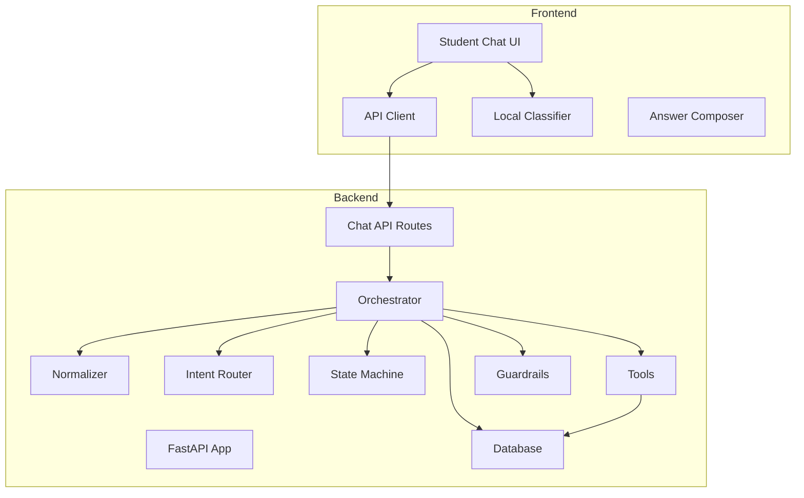

**Diagram sources**
- [main.py:40-79](file://uaea-backend/app/main.py#L40-L79)
- [chat.py:21-39](file://uaea-backend/app/api/chat.py#L21-L39)
- [orchestrator.py:46-143](file://uaea-backend/app/orchestrator/orchestrator.py#L46-L143)
- [tools.py:18-87](file://uaea-backend/app/orchestrator/tools.py#L18-L87)
- [api.js:42-69](file://src/lib/api.js#L42-L69)

**Section sources**
- [main.py:40-79](file://uaea-backend/app/main.py#L40-L79)
- [chat.py:21-39](file://uaea-backend/app/api/chat.py#L21-L39)
- [api.js:42-69](file://src/lib/api.js#L42-L69)

## Core Components
- Normalization and sanitization: cleans and normalizes user input, detects language, and strips injection patterns.
- Intent classification: deterministic keyword-based classifier that assigns an intent and confidence score.
- Guided flows: state machine drives multi-turn slot-filling for complex intents like admission and fee challan.
- Orchestration: central coordinator that persists messages, manages conversation context, runs LLM tool loops, and applies guardrails.
- Tools: database-backed functions for fees, deadlines, checklists, department lookups, escalation creation, and knowledge base search.
- Guardrails: post-processing step that validates factual claims against tool results and replaces ungrounded content.
- Persistence: conversations, messages, tickets, and unanswered queries stored in relational DB; RAG chunks supported via vector embeddings.
- API contracts: Pydantic schemas define request/response shapes for chat and lookup endpoints.

**Section sources**
- [normalizer.py:29-66](file://uaea-backend/app/orchestrator/normalizer.py#L29-L66)
- [intent_router.py:65-103](file://uaea-backend/app/orchestrator/intent_router.py#L65-L103)
- [state_machine.py:16-59](file://uaea-backend/app/orchestrator/state_machine.py#L16-L59)
- [orchestrator.py:46-143](file://uaea-backend/app/orchestrator/orchestrator.py#L46-L143)
- [tools.py:92-235](file://uaea-backend/app/orchestrator/tools.py#L92-L235)
- [guardrails.py:74-120](file://uaea-backend/app/orchestrator/guardrails.py#L74-L120)
- [models.py:144-228](file://uaea-backend/app/db/models.py#L144-L228)
- [schemas.py:81-122](file://uaea-backend/app/schemas.py#L81-L122)

## Architecture Overview
The message pipeline proceeds through these stages:
1. Input normalization and sanitization.
2. Intent classification with confidence scoring.
3. Conversation retrieval or creation.
4. Guided flow state management and slot-filling.
5. LLM invocation with tool definitions; iterative tool execution until final reply or max rounds.
6. Guardrail validation to ensure all factual claims are grounded.
7. Persistence of user and assistant messages, plus flow state and escalation flags.
8. Response assembly including sources and metadata.

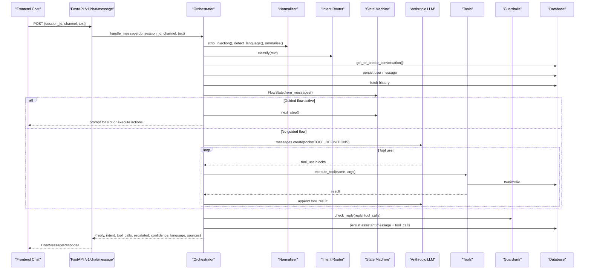

**Diagram sources**
- [chat.py:21-39](file://uaea-backend/app/api/chat.py#L21-L39)
- [orchestrator.py:46-143](file://uaea-backend/app/orchestrator/orchestrator.py#L46-L143)
- [tools.py:218-235](file://uaea-backend/app/orchestrator/tools.py#L218-L235)
- [guardrails.py:74-120](file://uaea-backend/app/orchestrator/guardrails.py#L74-L120)
- [models.py:144-178](file://uaea-backend/app/db/models.py#L144-L178)

## Detailed Component Analysis

### Normalization and Language Detection
- Strips common prompt-injection patterns to protect the system.
- Normalizes Roman Urdu variants and punctuation for robust matching.
- Detects language (English, Roman Urdu, Urdu script) to guide response language.

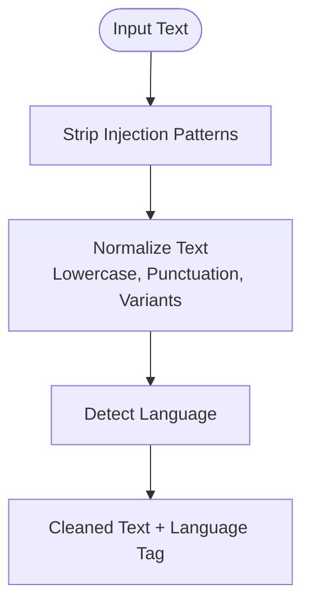

**Diagram sources**
- [normalizer.py:29-66](file://uaea-backend/app/orchestrator/normalizer.py#L29-L66)

**Section sources**
- [normalizer.py:29-66](file://uaea-backend/app/orchestrator/normalizer.py#L29-L66)

### Intent Classification and Routing
- Deterministic keyword scoring classifies user input into intents with confidence.
- Low-confidence cases route to human assistance or unanswered queue.
- Frontend mirrors this logic for immediate feedback and suggestions.

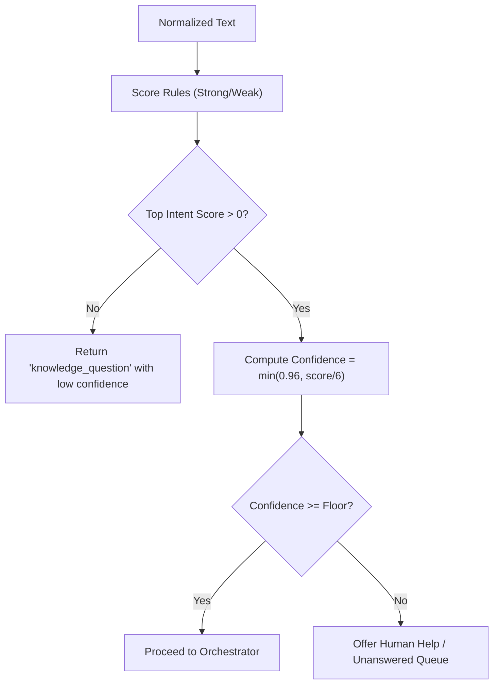

**Diagram sources**
- [intent_router.py:65-103](file://uaea-backend/app/orchestrator/intent_router.py#L65-L103)
- [classify.js:201-269](file://src/lib/classify.js#L201-L269)

**Section sources**
- [intent_router.py:65-103](file://uaea-backend/app/orchestrator/intent_router.py#L65-L103)
- [classify.js:201-269](file://src/lib/classify.js#L201-L269)

### Guided Flows and State Machine
- Multi-step flows collect slots (e.g., programme, campus) before executing actions.
- State persisted via message history; survives restarts.
- Supports flows for admission, fee challan, and degree application.

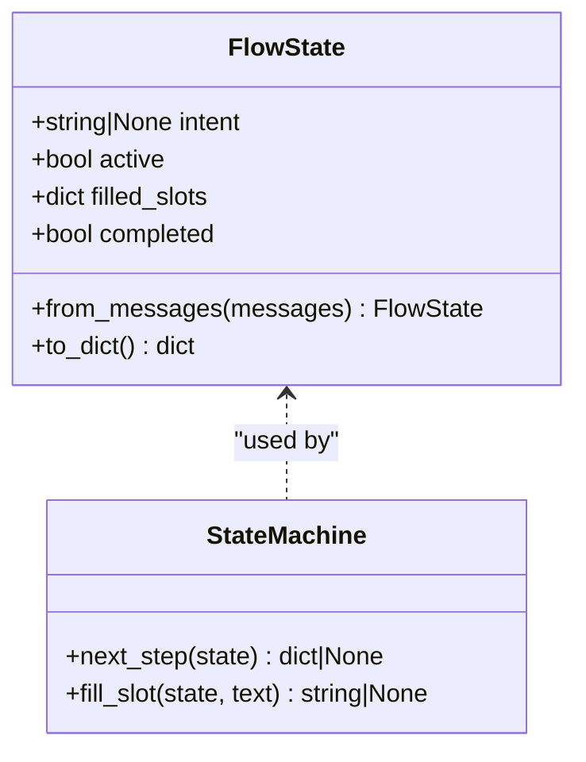

**Diagram sources**
- [state_machine.py:62-146](file://uaea-backend/app/orchestrator/state_machine.py#L62-L146)

**Section sources**
- [state_machine.py:16-59](file://uaea-backend/app/orchestrator/state_machine.py#L16-L59)
- [state_machine.py:62-146](file://uaea-backend/app/orchestrator/state_machine.py#L62-L146)

### Orchestration and LLM Tool Loop
- Orchestrator coordinates normalization, classification, state, tools, and guardrails.
- LLM tool-use loop executes multiple rounds up to a maximum, appending tool results back to the model.
- Escalation flag set when create_escalation_ticket is used or when rounds exhausted without resolution.

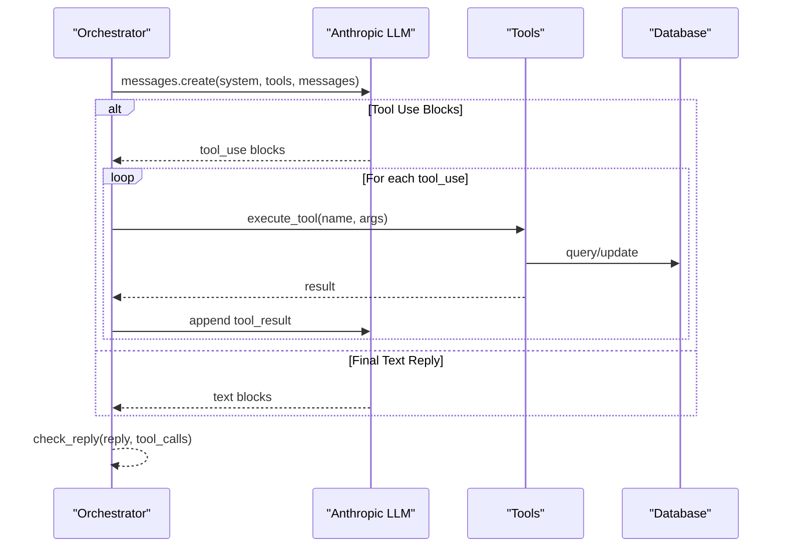

**Diagram sources**
- [orchestrator.py:229-318](file://uaea-backend/app/orchestrator/orchestrator.py#L229-L318)
- [tools.py:218-235](file://uaea-backend/app/orchestrator/tools.py#L218-L235)

**Section sources**
- [orchestrator.py:229-318](file://uaea-backend/app/orchestrator/orchestrator.py#L229-L318)

### Tool Execution and Data Access
- Tools provide access to departments, fees, deadlines, document checklists, escalation creation, and knowledge base search.
- Each tool returns structured results with source references for citation and grounding.

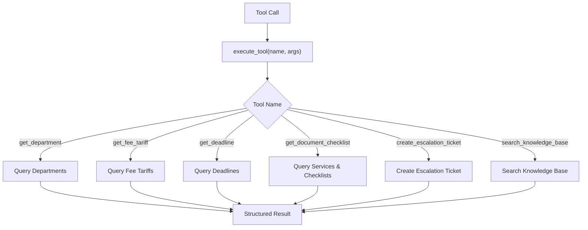

**Diagram sources**
- [tools.py:18-87](file://uaea-backend/app/orchestrator/tools.py#L18-L87)
- [tools.py:92-235](file://uaea-backend/app/orchestrator/tools.py#L92-L235)

**Section sources**
- [tools.py:92-235](file://uaea-backend/app/orchestrator/tools.py#L92-L235)

### Guardrail Validation
- Scans LLM reply for numbers, dates, and document requirements.
- Cross-checks against tool call results; replaces ungrounded claims with placeholders or escalates if too many issues.
- Logs warnings for auditability.

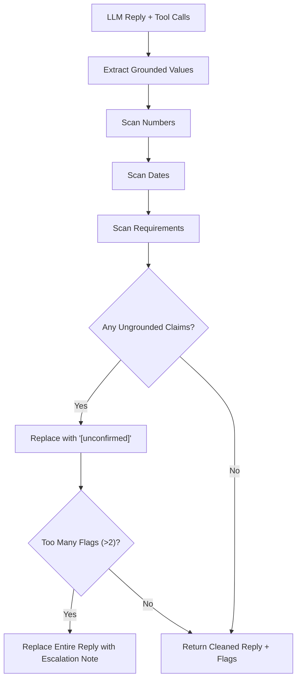

**Diagram sources**
- [guardrails.py:74-120](file://uaea-backend/app/orchestrator/guardrails.py#L74-L120)

**Section sources**
- [guardrails.py:74-120](file://uaea-backend/app/orchestrator/guardrails.py#L74-L120)

### Persistence and Data Models
- Conversations group messages per session; messages store role, text, intent, tool_calls, and timestamps.
- Escalation tickets link to conversations; unanswered queries track low-confidence inputs.
- Knowledge chunks support vector search for RAG.

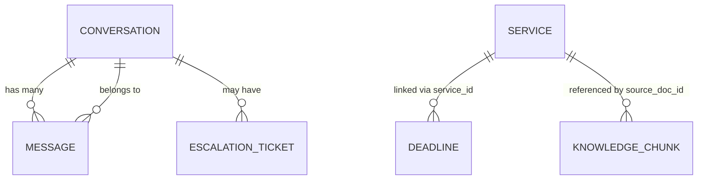

**Diagram sources**
- [models.py:144-228](file://uaea-backend/app/db/models.py#L144-L228)

**Section sources**
- [models.py:144-228](file://uaea-backend/app/db/models.py#L144-L228)

### Frontend Integration and Real-Time Updates
- The student chat UI displays messages, simulates thinking states, and offers follow-up suggestions.
- Local classification provides immediate feedback; backend API can replace it for full pipeline execution.
- API client abstracts HTTP calls and error handling for chat, sessions, escalations, and lookups.

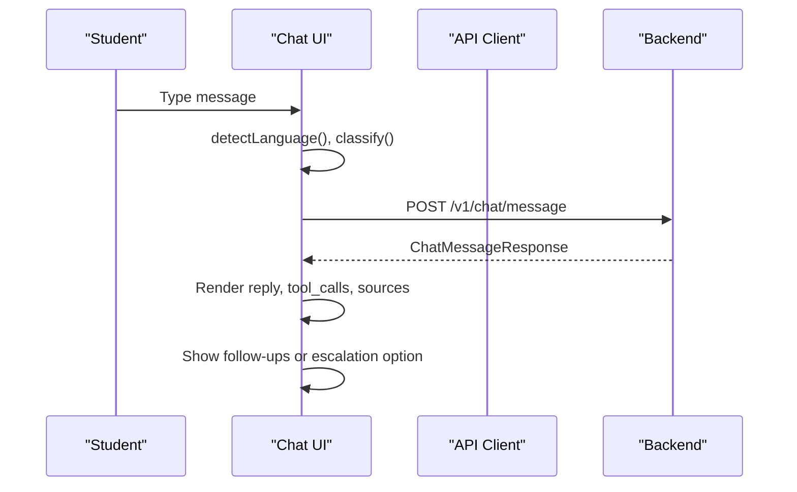

**Diagram sources**
- [Chat index.jsx:62-138](file://src/pages/student/Chat/index.jsx#L62-L138)
- [api.js:42-69](file://src/lib/api.js#L42-L69)
- [chat.py:21-39](file://uaea-backend/app/api/chat.py#L21-L39)

**Section sources**
- [Chat index.jsx:62-138](file://src/pages/student/Chat/index.jsx#L62-L138)
- [api.js:42-69](file://src/lib/api.js#L42-L69)

## Dependency Analysis
- The orchestrator depends on normalizer, intent router, state machine, tools, and guardrails.
- Tools depend on database models and optionally RAG retrieval.
- API routes depend on orchestrator and schemas for validation.
- Frontend depends on API client and local utilities for classification and answer composition.

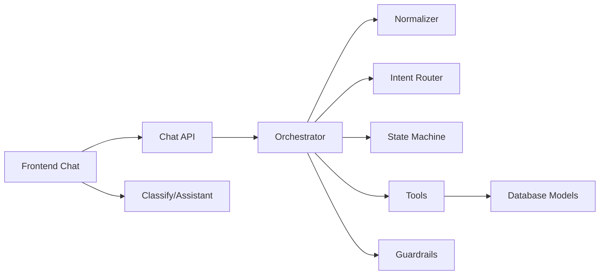

**Diagram sources**
- [main.py:40-79](file://uaea-backend/app/main.py#L40-L79)
- [chat.py:21-39](file://uaea-backend/app/api/chat.py#L21-L39)
- [orchestrator.py:46-143](file://uaea-backend/app/orchestrator/orchestrator.py#L46-L143)
- [tools.py:218-235](file://uaea-backend/app/orchestrator/tools.py#L218-L235)
- [api.js:42-69](file://src/lib/api.js#L42-L69)

**Section sources**
- [main.py:40-79](file://uaea-backend/app/main.py#L40-L79)
- [chat.py:21-39](file://uaea-backend/app/api/chat.py#L21-L39)
- [orchestrator.py:46-143](file://uaea-backend/app/orchestrator/orchestrator.py#L46-L143)
- [tools.py:218-235](file://uaea-backend/app/orchestrator/tools.py#L218-L235)
- [api.js:42-69](file://src/lib/api.js#L42-L69)

## Performance Considerations
- Limit LLM rounds to prevent excessive latency and token usage.
- Cache or limit message history sent to the LLM to reduce payload size.
- Use deterministic classification to avoid unnecessary LLM calls in simple cases.
- Batch tool calls where possible and minimize database round-trips.
- Apply rate limiting at the API layer to protect resources.

[No sources needed since this section provides general guidance]

## Troubleshooting Guide
Common issues and handling strategies:
- API errors: The API client throws descriptive errors; ensure correct base URL and headers.
- Rate limits: Global and per-session rate limiting configured; responses include details.
- LLM failures: Orchestrator catches API errors and returns a friendly fallback message.
- Exhausted rounds: If tool loops exceed max rounds, escalate to staff.
- Unanswered queries: Low-confidence inputs tracked for review and improvement.
- Escalation: Create tickets directly from tools or manually via API.

**Section sources**
- [api.js:16-31](file://src/lib/api.js#L16-L31)
- [main.py:51-58](file://uaea-backend/app/main.py#L51-L58)
- [orchestrator.py:255-318](file://uaea-backend/app/orchestrator/orchestrator.py#L255-L318)
- [orchestrator.py:367-383](file://uaea-backend/app/orchestrator/orchestrator.py#L367-L383)
- [chat.py:88-115](file://uaea-backend/app/api/chat.py#L88-L115)

## Conclusion
The UAEA pipeline ensures reliable, grounded responses by combining normalization, deterministic classification, guided flows, orchestrated LLM tool use, and strict guardrails. Persistence and escalation mechanisms provide resilience and traceability. The frontend integrates smoothly with the backend while offering immediate feedback and clear pathways to human assistance when needed.

[No sources needed since this section summarizes without analyzing specific files]