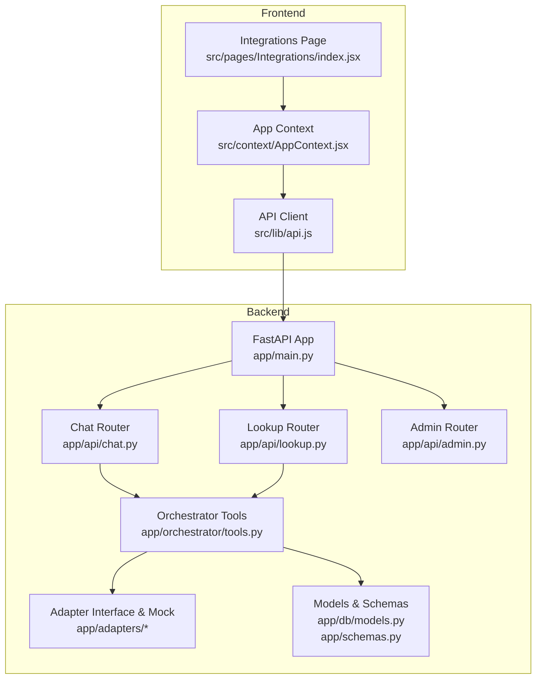
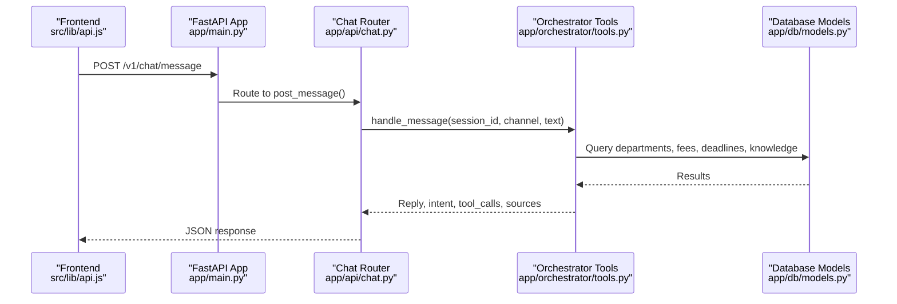
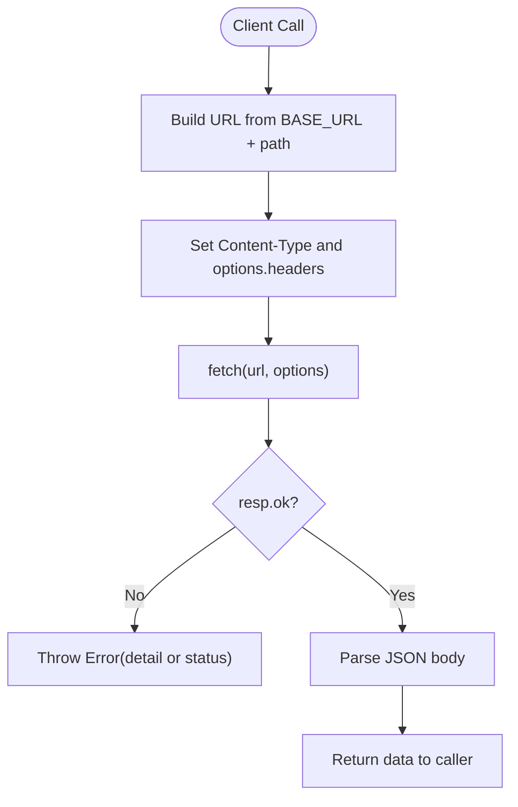
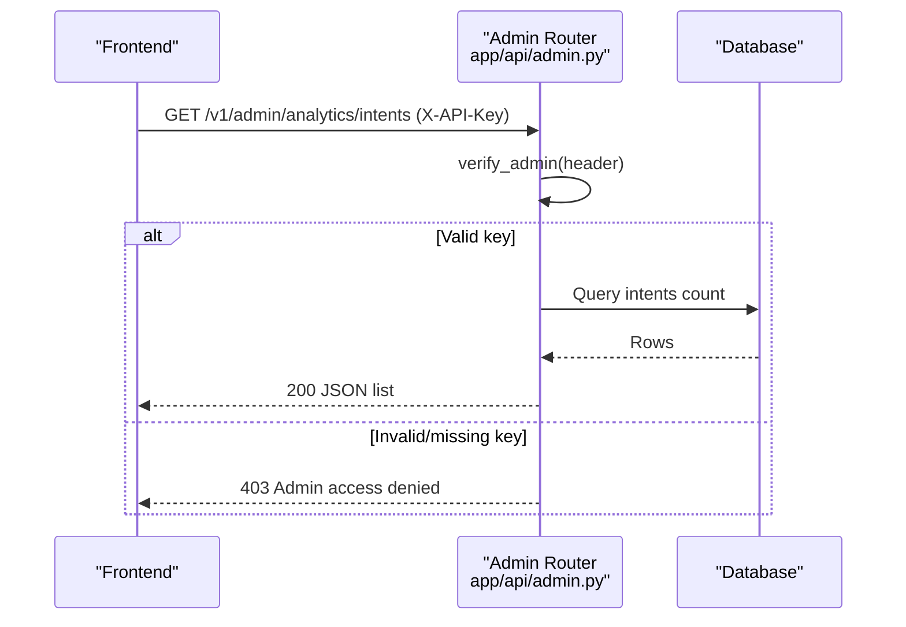
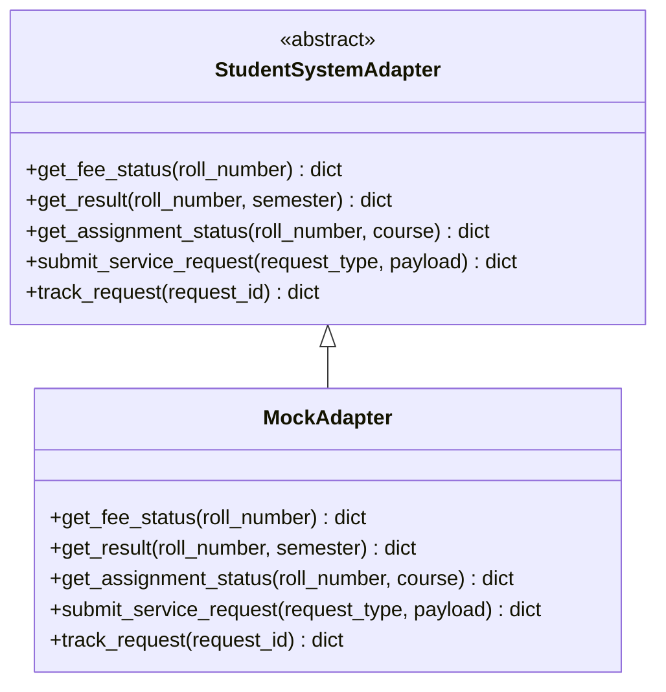
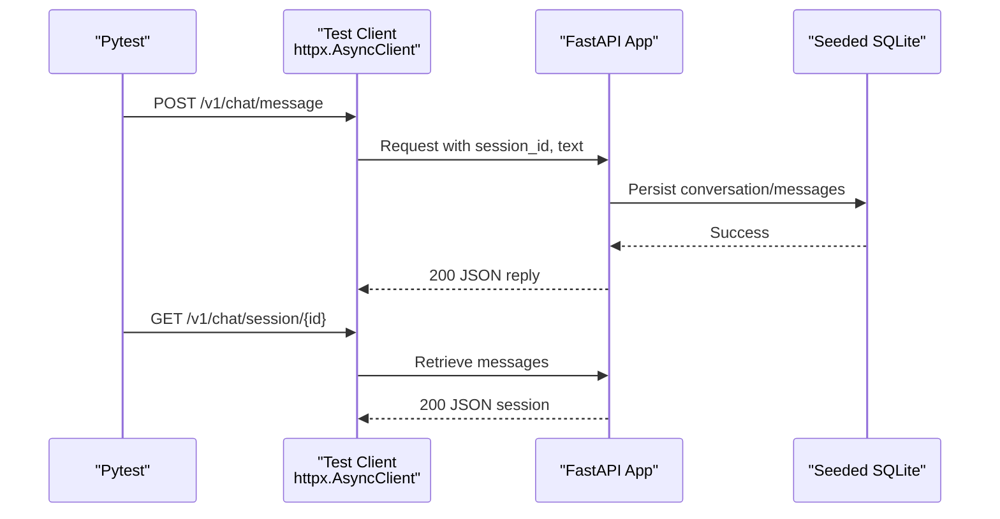
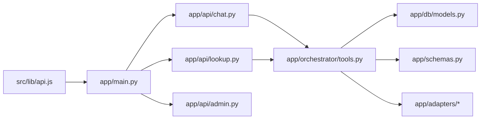

# Integration Patterns and APIs

<cite>
**Referenced Files in This Document**
- [main.py](file://uaea-backend/app/main.py)
- [config.py](file://uaea-backend/app/config.py)
- [chat.py](file://uaea-backend/app/api/chat.py)
- [lookup.py](file://uaea-backend/app/api/lookup.py)
- [admin.py](file://uaea-backend/app/api/admin.py)
- [base.py](file://uaea-backend/app/adapters/base.py)
- [mock_adapter.py](file://uaea-backend/app/adapters/mock_adapter.py)
- [tools.py](file://uaea-backend/app/orchestrator/tools.py)
- [models.py](file://uaea-backend/app/db/models.py)
- [schemas.py](file://uaea-backend/app/schemas.py)
- [api.js](file://src/lib/api.js)
- [AppContext.jsx](file://src/context/AppContext.jsx)
- [index.jsx](file://src/pages/Integrations/index.jsx)
- [adapters.js](file://src/mocks/adapters.js)
- [conftest.py](file://uaea-backend/tests/conftest.py)
- [test_chat_flow.py](file://uaea-backend/tests/test_chat_flow.py)
</cite>

## Table of Contents
1. Introduction
2. Project Structure
3. Core Components
4. Architecture Overview
5. Detailed Component Analysis
6. Dependency Analysis
7. Performance Considerations
8. Troubleshooting Guide
9. Conclusion
10. Appendices

## Introduction
This document explains the integration patterns used by the UAEA Console system to connect the frontend with the backend, including RESTful API design, authentication, session management, adapter-based integrations, error handling, rate limiting, API versioning, and testing strategies. It focuses on how new services can be plugged into the system through a consistent adapter interface and how client-server interactions are structured for chat, lookup, and admin operations.

## Project Structure
The system is split into:
- Frontend (React): UI components, context state, and an API client module that calls the backend.
- Backend (FastAPI): Routers for chat, lookup, and admin; database models and schemas; orchestrator tools; adapters for external systems; configuration and middleware.

**Diagram sources**
- [main.py:40-79](file://uaea-backend/app/main.py#L40-L79)
- [chat.py:18-39](file://uaea-backend/app/api/chat.py#L18-L39)
- [lookup.py:23-103](file://uaea-backend/app/api/lookup.py#L23-L103)
- [admin.py:26-48](file://uaea-backend/app/api/admin.py#L26-L48)
- [tools.py:18-87](file://uaea-backend/app/orchestrator/tools.py#L18-L87)
- [base.py:11-31](file://uaea-backend/app/adapters/base.py#L11-L31)
- [models.py:144-178](file://uaea-backend/app/db/models.py#L144-L178)
- [schemas.py:81-122](file://uaea-backend/app/schemas.py#L81-L122)
- [api.js:12-47](file://src/lib/api.js#L12-L47)
- [AppContext.jsx:24-33](file://src/context/AppContext.jsx#L24-L33)
- [index.jsx:10-17](file://src/pages/Integrations/index.jsx#L10-L17)

**Section sources**
- [main.py:40-79](file://uaea-backend/app/main.py#L40-L79)
- [api.js:12-47](file://src/lib/api.js#L12-L47)
- [AppContext.jsx:24-33](file://src/context/AppContext.jsx#L24-L33)

## Core Components
- REST API layer: FastAPI routers expose versioned endpoints under /v1 for chat, lookup, and admin.
- Authentication: Admin endpoints require an API key or bearer token via header verification.
- Session management: Chat sessions are persisted as conversations with messages; escalation tickets are tracked per conversation.
- Adapter pattern: An abstract StudentSystemAdapter defines methods for external systems; a mock implementation provides testable behavior without live dependencies.
- Orchestration tools: The orchestrator uses tool definitions to call DB-backed functions and RAG retrieval.
- Configuration: Centralized settings for database, LLM/embedding providers, CORS, rate limits, and environment toggles.

**Section sources**
- [chat.py:18-39](file://uaea-backend/app/api/chat.py#L18-L39)
- [admin.py:29-48](file://uaea-backend/app/api/admin.py#L29-L48)
- [models.py:144-195](file://uaea-backend/app/db/models.py#L144-L195)
- [base.py:11-31](file://uaea-backend/app/adapters/base.py#L11-L31)
- [mock_adapter.py:12-60](file://uaea-backend/app/adapters/mock_adapter.py#L12-L60)
- [tools.py:18-87](file://uaea-backend/app/orchestrator/tools.py#L18-L87)
- [config.py:6-37](file://uaea-backend/app/config.py#L6-L37)

## Architecture Overview
The frontend communicates with the backend using a centralized API client. Requests are routed to versioned endpoints that enforce CORS and rate limiting. Admin routes enforce API key authentication. Chat flows persist sessions and messages, while lookup endpoints serve reference data. Orchestrator tools coordinate DB queries and optional external adapters.

**Diagram sources**
- [api.js:42-47](file://src/lib/api.js#L42-L47)
- [main.py:40-79](file://uaea-backend/app/main.py#L40-L79)
- [chat.py:21-39](file://uaea-backend/app/api/chat.py#L21-L39)
- [tools.py:218-235](file://uaea-backend/app/orchestrator/tools.py#L218-L235)
- [models.py:144-178](file://uaea-backend/app/db/models.py#L144-L178)

## Detailed Component Analysis

### RESTful API Design Patterns
- Versioning: All endpoints are prefixed with /v1 to support future evolution without breaking clients.
- Resource-oriented paths: /v1/chat, /v1/lookup, /v1/admin group related functionality.
- Request/response contracts: Pydantic schemas define strict shapes for requests and responses, enabling automatic validation and OpenAPI documentation.
- Consistent error handling: HTTP exceptions return structured JSON errors; rate limit exceeded returns 429 with details.

Examples:
- Chat message submission and session retrieval
- Lookup endpoints for departments, fee tariffs, deadlines, and document checklists
- Admin endpoints protected by API key/bearer token

**Section sources**
- [chat.py:21-39](file://uaea-backend/app/api/chat.py#L21-L39)
- [lookup.py:26-103](file://uaea-backend/app/api/lookup.py#L26-L103)
- [admin.py:67-125](file://uaea-backend/app/api/admin.py#L67-L125)
- [schemas.py:81-122](file://uaea-backend/app/schemas.py#L81-L122)
- [main.py:51-58](file://uaea-backend/app/main.py#L51-L58)

### Client-Server Interaction Patterns
- Centralized API client: The frontend uses a single module to build URLs, set headers, and handle errors uniformly.
- Base URL configuration: Controlled via environment variable with a sensible default for local development.
- Error propagation: Non-OK responses throw errors with server-provided detail when available.

**Diagram sources**
- [api.js:16-31](file://src/lib/api.js#L16-L31)

**Section sources**
- [api.js:12-31](file://src/lib/api.js#L12-L31)

### Authentication Mechanisms and Session Management
- Admin authentication: Endpoints under /v1/admin verify either X-API-Key or Authorization Bearer token against configured admin key. Unauthorized requests receive 403.
- Chat sessions: Each conversation is stored with a unique session_id; messages are appended to the conversation and can be retrieved by session_id.
- Escalation tickets: Created per conversation when needed; associated with the conversation ID and marked open.

**Diagram sources**
- [admin.py:29-48](file://uaea-backend/app/api/admin.py#L29-L48)
- [admin.py:130-144](file://uaea-backend/app/api/admin.py#L130-L144)

**Section sources**
- [admin.py:29-48](file://uaea-backend/app/api/admin.py#L29-L48)
- [chat.py:42-85](file://uaea-backend/app/api/chat.py#L42-L85)
- [models.py:144-195](file://uaea-backend/app/db/models.py#L144-L195)

### Adapter Pattern for External Integrations
- Abstract interface: StudentSystemAdapter defines methods for fee status, results, assignment status, service request submission, and request tracking.
- Mock implementation: Provides realistic canned responses for Phase 1, enabling end-to-end flow testing without external dependencies.
- Future integrations: CMS, OAS, and LMS adapters are planned and documented in the frontend adapter registry, ensuring a consistent swap mechanism.

**Diagram sources**
- [base.py:11-31](file://uaea-backend/app/adapters/base.py#L11-L31)
- [mock_adapter.py:12-60](file://uaea-backend/app/adapters/mock_adapter.py#L12-L60)

**Section sources**
- [base.py:11-31](file://uaea-backend/app/adapters/base.py#L11-L31)
- [mock_adapter.py:12-60](file://uaea-backend/app/adapters/mock_adapter.py#L12-L60)
- [adapters.js:10-63](file://src/mocks/adapters.js#L10-L63)

### Error Handling Strategies
- Rate limiting: Global limiter based on remote address; custom handler returns 429 with detail.
- Per-session middleware: Placeholder for per-session chat rate limiting; IP-based limiter already active.
- Validation errors: Pydantic schemas enforce input shape; FastAPI returns structured errors automatically.
- Not found handling: Explicit 404 for missing sessions or active conversations.

**Section sources**
- [main.py:25-58](file://uaea-backend/app/main.py#L25-L58)
- [main.py:89-99](file://uaea-backend/app/main.py#L89-L99)
- [chat.py:42-55](file://uaea-backend/app/api/chat.py#L42-L55)

### Rate Limiting
- IP-based limiter: Configured via SlowAPI with key function returning remote address.
- Settings: Rate limits defined in configuration for per-IP and per-session usage.
- Custom handler: Returns standardized JSON error on 429.

**Section sources**
- [main.py:25-58](file://uaea-backend/app/main.py#L25-L58)
- [config.py:23-25](file://uaea-backend/app/config.py#L23-L25)

### API Versioning Approaches
- Path-based versioning: All endpoints use /v1 prefix to allow future versions without disrupting existing clients.
- Schema stability: Pydantic models ensure consistent response shapes across updates.

**Section sources**
- [chat.py:18-39](file://uaea-backend/app/api/chat.py#L18-L39)
- [lookup.py:23-103](file://uaea-backend/app/api/lookup.py#L23-L103)
- [admin.py:26-161](file://uaea-backend/app/api/admin.py#L26-L161)

### Common Integration Scenarios

#### LLM Provider Integration
- Tool definitions: The orchestrator registers tools like search_knowledge_base, get_department, get_fee_tariff, get_deadline, get_document_checklist, create_escalation_ticket.
- Execution: execute_tool dispatches to implementations backed by DB or RAG retrieval.
- Configuration: Embedding provider and model settings are centralized in configuration.

**Section sources**
- [tools.py:18-87](file://uaea-backend/app/orchestrator/tools.py#L18-L87)
- [tools.py:218-235](file://uaea-backend/app/orchestrator/tools.py#L218-L235)
- [config.py:11-18](file://uaea-backend/app/config.py#L11-L18)

#### Database Connections
- Models: SQLAlchemy declarative base with relationships for contacts, campuses, departments, services, deadlines, knowledge chunks, conversations, messages, escalation tickets, audit logs, and unanswered queries.
- Sessions: Async sessions provided via dependency injection; tests override with seeded SQLite engine.

**Section sources**
- [models.py:32-228](file://uaea-backend/app/db/models.py#L32-L228)
- [conftest.py:48-78](file://uaea-backend/tests/conftest.py#L48-L78)

#### Third-Party Service Calls
- Adapters: Abstract interface allows plugging in CMS, OAS, LMS adapters; mock adapter currently supplies realistic data.
- Registry: Frontend documents available adapters and their phases/status for operational visibility.

**Section sources**
- [base.py:11-31](file://uaea-backend/app/adapters/base.py#L11-L31)
- [mock_adapter.py:12-60](file://uaea-backend/app/adapters/mock_adapter.py#L12-L60)
- [adapters.js:18-63](file://src/mocks/adapters.js#L18-L63)

### Testing Strategies and Mock Implementations
- Test fixtures: In-memory SQLite database with seed data; dependency overrides inject test sessions into the app.
- Chat flow tests: End-to-end assertions for guided flows, session history, escalation creation, small talk classification, and admin auth checks.
- Mock LLM responses: Tests patch external LLM calls to avoid real API dependencies during CI runs.

**Diagram sources**
- [conftest.py:179-190](file://uaea-backend/tests/conftest.py#L179-L190)
- [test_chat_flow.py:44-100](file://uaea-backend/tests/test_chat_flow.py#L44-L100)

**Section sources**
- [conftest.py:17-78](file://uaea-backend/tests/conftest.py#L17-L78)
- [conftest.py:81-176](file://uaea-backend/tests/conftest.py#L81-L176)
- [test_chat_flow.py:44-176](file://uaea-backend/tests/test_chat_flow.py#L44-L176)

## Dependency Analysis
The backend composes routers, tools, models, and adapters. The frontend depends on the API client and context provider.

**Diagram sources**
- [api.js:12-47](file://src/lib/api.js#L12-L47)
- [main.py:40-79](file://uaea-backend/app/main.py#L40-L79)
- [chat.py:18-39](file://uaea-backend/app/api/chat.py#L18-L39)
- [lookup.py:23-103](file://uaea-backend/app/api/lookup.py#L23-L103)
- [admin.py:26-48](file://uaea-backend/app/api/admin.py#L26-L48)
- [tools.py:218-235](file://uaea-backend/app/orchestrator/tools.py#L218-L235)
- [models.py:144-178](file://uaea-backend/app/db/models.py#L144-L178)
- [schemas.py:81-122](file://uaea-backend/app/schemas.py#L81-L122)
- [base.py:11-31](file://uaea-backend/app/adapters/base.py#L11-L31)

**Section sources**
- [main.py:40-79](file://uaea-backend/app/main.py#L40-L79)
- [tools.py:218-235](file://uaea-backend/app/orchestrator/tools.py#L218-L235)

## Performance Considerations
- Rate limiting: Protects endpoints from abuse; tune per-IP and per-session limits via configuration.
- Database queries: Use indexed fields (e.g., program, category) and selective joins to minimize load.
- Asynchronous I/O: Async sessions and async handlers improve throughput under concurrent chat traffic.
- Caching: Consider caching frequent lookups (departments, fee tariffs) if read-heavy workloads emerge.

[No sources needed since this section provides general guidance]

## Troubleshooting Guide
- 429 Rate Limit Exceeded: Check global limiter settings and adjust thresholds; inspect per-session middleware for chat-specific throttling.
- 403 Admin Access Denied: Ensure X-API-Key or Authorization Bearer matches configured admin key.
- 404 Session Not Found: Verify session_id exists and conversation is active before escalation.
- CORS Errors: Confirm allowed origins match frontend base URL; development mode may allow all origins if configured.

**Section sources**
- [main.py:51-58](file://uaea-backend/app/main.py#L51-L58)
- [admin.py:29-48](file://uaea-backend/app/api/admin.py#L29-L48)
- [chat.py:42-55](file://uaea-backend/app/api/chat.py#L42-L55)
- [main.py:61-73](file://uaea-backend/app/main.py#L61-L73)

## Conclusion
The UAEA Console integrates frontend and backend through a clean, versioned REST API with strong typing, robust authentication for admin operations, and persistent session management. The adapter pattern enables seamless integration with external university systems while maintaining testability via mocks. Rate limiting, CORS, and structured error handling provide a resilient foundation. Testing strategies ensure reliability and safety during development and CI.

[No sources needed since this section summarizes without analyzing specific files]

## Appendices

### API Surface Summary
- Chat: POST /v1/chat/message, GET /v1/chat/session/{session_id}, POST /v1/chat/escalate
- Lookup: GET /v1/lookup/departments, GET /v1/lookup/fee-tariff, GET /v1/lookup/deadlines, GET /v1/lookup/document-checklist
- Admin: POST /v1/admin/content/faq, POST /v1/admin/content/fee-tariff, GET /v1/admin/analytics/intents, GET /v1/admin/queue/unanswered

**Section sources**
- [chat.py:21-115](file://uaea-backend/app/api/chat.py#L21-L115)
- [lookup.py:26-103](file://uaea-backend/app/api/lookup.py#L26-L103)
- [admin.py:67-161](file://uaea-backend/app/api/admin.py#L67-L161)

### Frontend Adapter Registry
- Documents available adapters, phases, and statuses; supports activation and health checks in the console UI.

**Section sources**
- [adapters.js:10-63](file://src/mocks/adapters.js#L10-L63)
- [index.jsx:10-17](file://src/pages/Integrations/index.jsx#L10-L17)