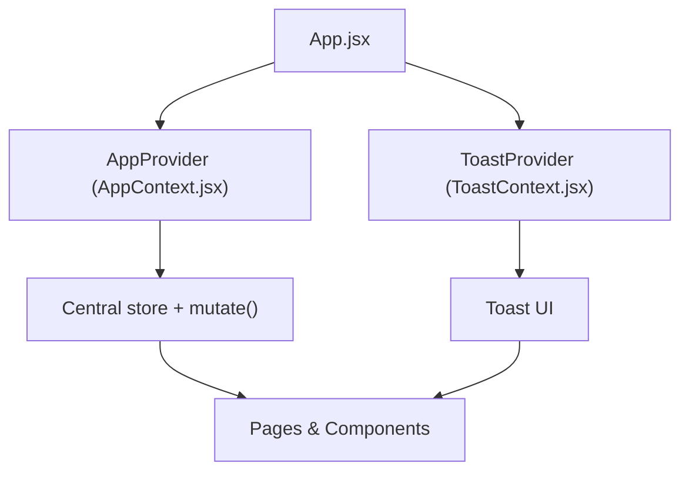
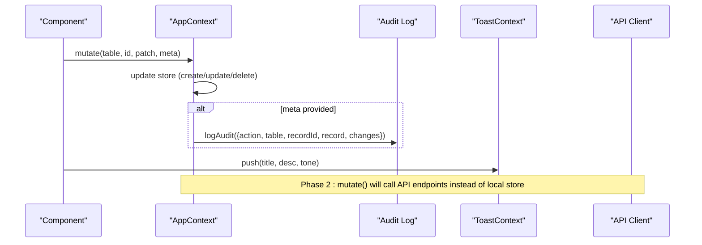
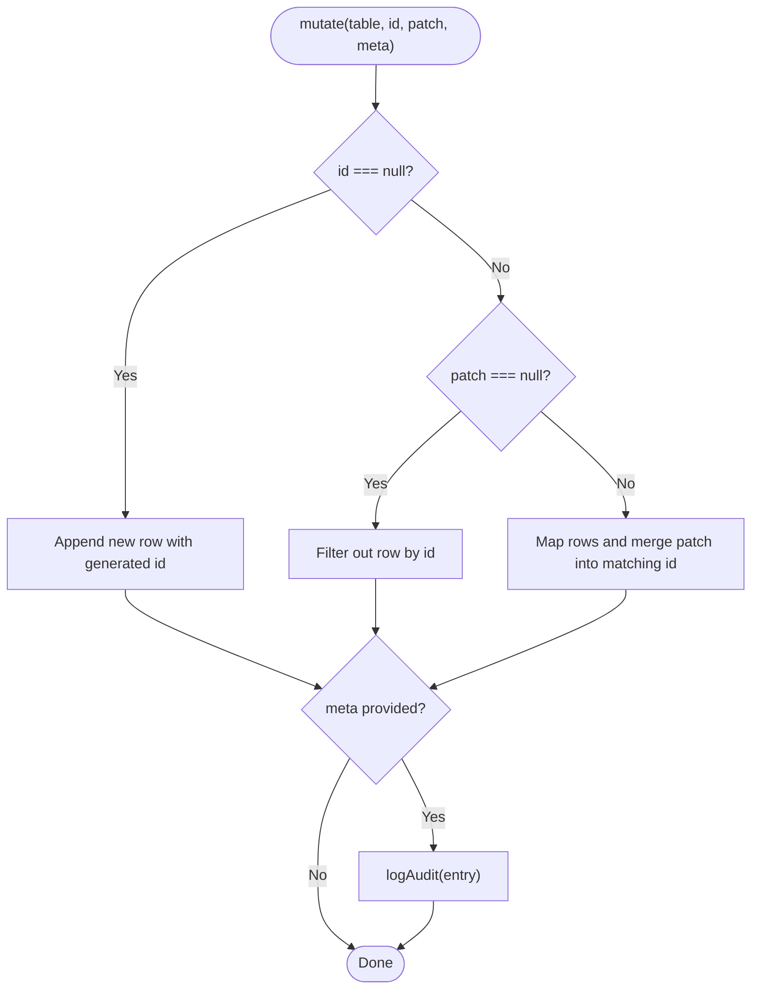
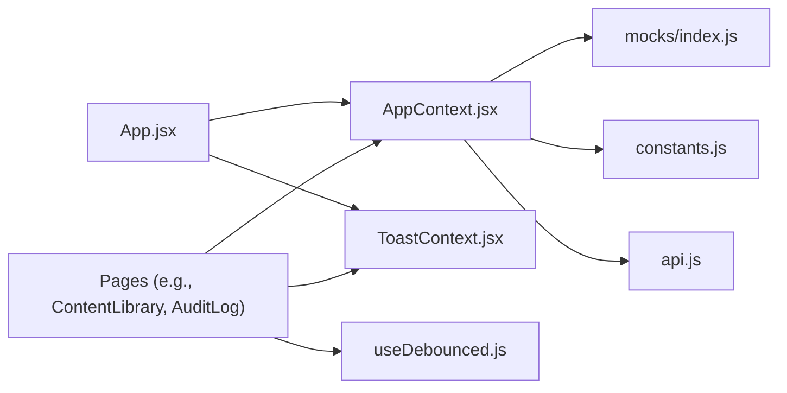

# State Management Architecture

<cite>
**Referenced Files in This Document**
- [AppContext.jsx](file://src/context/AppContext.jsx)
- [ToastContext.jsx](file://src/context/ToastContext.jsx)
- [useDebounced.js](file://src/hooks/useDebounced.js)
- [api.js](file://src/lib/api.js)
- [constants.js](file://src/lib/constants.js)
- [index.js (mocks)](file://src/mocks/index.js)
- [App.jsx](file://src/App.jsx)
- [ContentLibrary/index.jsx](file://src/pages/ContentLibrary/index.jsx)
- [AuditLog/index.jsx](file://src/pages/AuditLog/index.jsx)
- [Sidebar.jsx](file://src/components/layout/Sidebar.jsx)
</cite>

## Table of Contents
1. Introduction
2. Project Structure
3. Core Components
4. Architecture Overview
5. Detailed Component Analysis
6. Dependency Analysis
7. Performance Considerations
8. Troubleshooting Guide
9. Conclusion

## Introduction
This document explains the state management architecture of the UAEA Console with a focus on:
- Centralized state via React Context API using AppContext as the single source of truth
- A centralized mutation pattern through a single mutate() function to keep data changes consistent and auditable
- User feedback and notifications via ToastContext
- Data fetching patterns, caching strategies, and error handling
- Custom hooks such as useDebounced for performance optimization
- Strategies for synchronizing frontend state with backend state, including optimistic updates and conflict resolution
- Common state management patterns and troubleshooting approaches

The design intentionally isolates all mutations to one place so that future migration to server-backed state can be done by rewriting only the central mutate() without touching UI components.

## Project Structure
At runtime, the application wraps the entire tree with providers that expose shared state and utilities:
- AppProvider provides theme, role, locale, store, audit log, and the central mutate() API seam
- ToastProvider exposes a push() function for user-facing notifications
- Pages and components consume state via useApp() and useToast(), and perform mutations exclusively through mutate()

**Diagram sources**
- [App.jsx:35-67](file://src/App.jsx#L35-L67)
- [AppContext.jsx:34-134](file://src/context/AppContext.jsx#L34-L134)
- [ToastContext.jsx:13-31](file://src/context/ToastContext.jsx#L13-L31)

**Section sources**
- [App.jsx:35-67](file://src/App.jsx#L35-L67)

## Core Components
- AppContext: Provides global UI settings (theme, role, language), the central store (tables like services, fees, deadlines, departments, documents, flows, adapters), an append-only audit log, and the single mutate() entry point for all state changes. It also exposes verifyRecord() to mark records verified today.
- ToastContext: Provides a simple push(title, description, tone) API to show transient notifications that auto-dismiss after a short delay.
- useDebounced: Delays fast-changing values (e.g., search input) to reduce re-renders and downstream work.

Key responsibilities:
- Centralization: All state mutations go through mutate() to ensure consistency and auditability
- Separation of concerns: UI state (theme, role, language) is separate from domain data (store tables)
- Observability: Every mutation can be recorded in the audit log when metadata is provided
- Feedback: ToastContext ensures users receive immediate, actionable feedback

**Section sources**
- [AppContext.jsx:16-134](file://src/context/AppContext.jsx#L16-L134)
- [ToastContext.jsx:1-33](file://src/context/ToastContext.jsx#L1-33)
- [useDebounced.js:1-12](file://src/hooks/useDebounced.js#L1-L12)

## Architecture Overview
The console uses a provider-based context architecture:
- Providers wrap the app to supply shared state and actions
- Components read state via hooks and trigger mutations via mutate()
- The API client module is available for Phase 2 integration; currently, mutate() operates on local store

**Diagram sources**
- [AppContext.jsx:79-103](file://src/context/AppContext.jsx#L79-L103)
- [ToastContext.jsx:16-20](file://src/context/ToastContext.jsx#L16-L20)
- [api.js:16-31](file://src/lib/api.js#L16-L31)

## Detailed Component Analysis

### AppContext: Centralized State and Mutations
- Single source of truth: store holds multiple tables (services, fees, deadlines, departments, documents, flows, adapters) initialized from mocks
- Mutation contract:
  - Create: mutate(table, null, patch, meta)
  - Update: mutate(table, id, patch, meta)
  - Delete: mutate(table, id, null, meta)
- Audit trail: When meta is provided, logAudit appends an immutable entry with actor, timestamp, action, table, recordId, and changes
- Verification helper: verifyRecord marks a record verified today under the current user

Common usage patterns:
- Content editing pages call mutate() for create/update/delete and pass meta to capture changes
- Role switching triggers toast notifications for UX feedback
- Search inputs are debounced before filtering or fetching

**Diagram sources**
- [AppContext.jsx:79-103](file://src/context/AppContext.jsx#L79-L103)
- [AppContext.jsx:52-67](file://src/context/AppContext.jsx#L52-L67)

**Section sources**
- [AppContext.jsx:34-134](file://src/context/AppContext.jsx#L34-L134)

### ToastContext: User Feedback and Notifications
- Exposes a single push(title, description, tone) function
- Each toast gets a unique id and auto-dismisses after a fixed delay
- Renders a list of active toasts at the root level

Typical usage:
- After successful mutations, show success toasts
- On errors or blocked actions, show warning/error toasts

**Section sources**
- [ToastContext.jsx:1-33](file://src/context/ToastContext.jsx#L1-L33)

### useDebounced: Performance Optimization
- Debounces rapidly changing values (e.g., search input) to reduce re-renders and expensive computations
- Used across pages to debounce raw query strings before filtering or network calls

Usage examples:
- Content library search
- Audit log search
- Student directory and services search

**Section sources**
- [useDebounced.js:1-12](file://src/hooks/useDebounced.js#L1-L12)
- [ContentLibrary/index.jsx:30-31](file://src/pages/ContentLibrary/index.jsx#L30-L31)
- [AuditLog/index.jsx:26-27](file://src/pages/AuditLog/index.jsx#L26-L27)

### Data Fetching, Caching, and Error Handling
- API client:
  - Centralized fetch wrapper enforces JSON content type and throws typed errors with details
  - Provides chat, lookup, and admin endpoints
- Current state:
  - mutate() operates on local store initialized from mocks
  - Comments indicate Phase 2 will replace mutate() internals with server calls while keeping the same interface
- Caching strategy:
  - Local store acts as cache for tables until server integration
  - Debouncing reduces redundant operations during user input
- Error handling:
  - API errors throw with detail messages
  - UI surfaces errors via toasts and user-friendly messages

Integration points:
- Pages import api functions for chat and lookups
- Future mutate() implementation will call these endpoints and reconcile responses with local store

**Section sources**
- [api.js:16-31](file://src/lib/api.js#L16-L31)
- [api.js:42-166](file://src/lib/api.js#L42-L166)
- [AppContext.jsx:24-33](file://src/context/AppContext.jsx#L24-L33)

### State Synchronization, Optimistic Updates, and Conflict Resolution
- Optimistic updates:
  - mutate() immediately updates local store, providing instant UI feedback
  - For Phase 2, wrap mutate() with try/catch around API calls; if the server fails, revert the change and show an error toast
- Conflict resolution:
  - Use server-provided IDs and timestamps to detect conflicts
  - On conflict, refresh affected tables and prompt the user to review changes
- Auditability:
  - Pass meta to logAudit to record intent, actor, and field-level changes
  - Keep audit entries append-only for compliance and traceability

Example flow:
- User edits a record → mutate() applies locally → API call → on success, confirm with toast → on failure, rollback and notify

[No sources needed since this section describes conceptual synchronization strategies]

### Common State Management Patterns
- Centralized mutation:
  - All writes go through mutate() with a consistent signature
  - Example: creating, updating, deleting records in the content library
- Read-through store:
  - Components read directly from store via useApp()
  - Filtering/sorting computed locally with useMemo
- Notification-driven UX:
  - Show toasts for success, warnings, and errors
- Role-based access:
  - Role state controls visibility and permissions
  - Switching roles triggers feedback via toast

Examples:
- Content creation/update/delete in ContentLibrary
- Role switching in Sidebar
- Search filtering with debounced queries

**Section sources**
- [ContentLibrary/index.jsx:96-113](file://src/pages/ContentLibrary/index.jsx#L96-L113)
- [Sidebar.jsx:58-66](file://src/components/layout/Sidebar.jsx#L58-L66)
- [AuditLog/index.jsx:24-27](file://src/pages/AuditLog/index.jsx#L24-L27)

## Dependency Analysis
The following diagram shows how key modules depend on each other:

**Diagram sources**
- [App.jsx:35-67](file://src/App.jsx#L35-L67)
- [AppContext.jsx:1-15](file://src/context/AppContext.jsx#L1-L15)
- [ContentLibrary/index.jsx:1-20](file://src/pages/ContentLibrary/index.jsx#L1-L20)
- [AuditLog/index.jsx:1-12](file://src/pages/AuditLog/index.jsx#L1-L12)

**Section sources**
- [App.jsx:35-67](file://src/App.jsx#L35-L67)
- [AppContext.jsx:1-15](file://src/context/AppContext.jsx#L1-L15)

## Performance Considerations
- Debounce user input to minimize re-renders and expensive filters
- Compute derived data with memoization where appropriate
- Keep mutations atomic and minimal to avoid unnecessary re-renders
- In Phase 2, batch server requests and coalesce updates to reduce network overhead
- Avoid deep object cloning beyond what is necessary in mutate()

[No sources needed since this section provides general guidance]

## Troubleshooting Guide
- Missing provider:
  - If useApp() or useToast() is used outside their respective providers, an error is thrown. Ensure AppProvider and ToastProvider wrap the app tree.
- Unexpected state not updating:
  - Verify you are calling mutate() rather than mutating store fields directly
  - Confirm that the correct table name and id are passed
- Audit log not recording changes:
  - Ensure meta is provided with action, record, and changes when calling mutate()
- API errors:
  - The API client throws with detail messages; catch and display via toasts
  - Validate environment variables for base URL configuration

**Section sources**
- [AppContext.jsx:18-22](file://src/context/AppContext.jsx#L18-L22)
- [ToastContext.jsx:7-11](file://src/context/ToastContext.jsx#L7-L11)
- [api.js:16-31](file://src/lib/api.js#L16-L31)

## Conclusion
The UAEA Console employs a clean, centralized state management approach:
- AppContext serves as the single source of truth with a unified mutate() interface
- ToastContext provides consistent user feedback
- useDebounced improves responsiveness for interactive features
- The design supports a smooth transition to server-backed state by confining API integration to the central layer
- Audit logging ensures traceability and compliance

By adhering to these patterns, teams can maintain consistency, improve performance, and scale the application confidently.