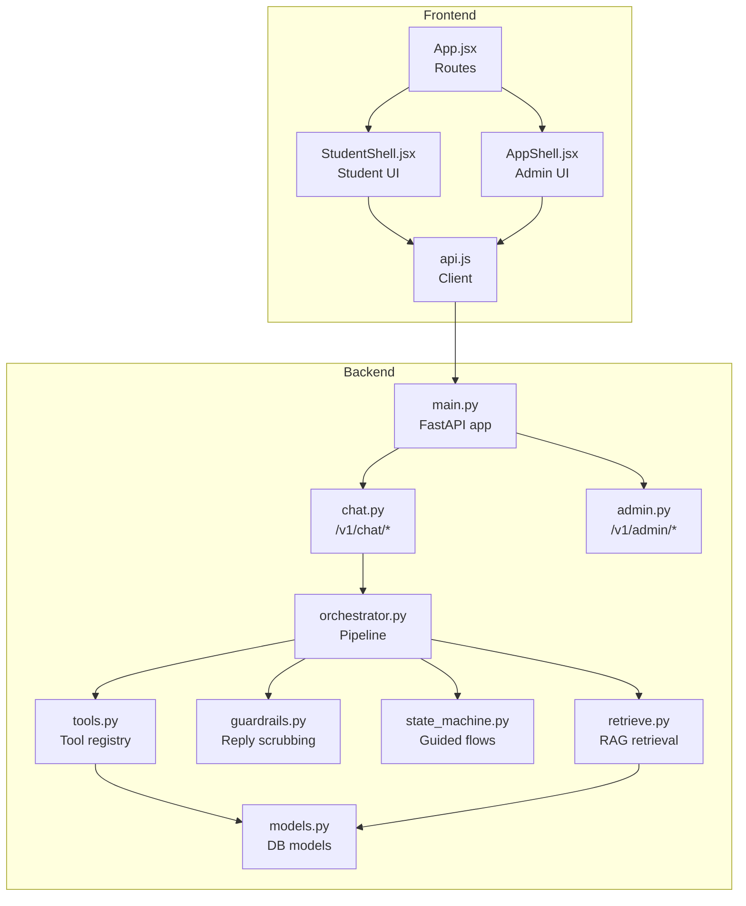
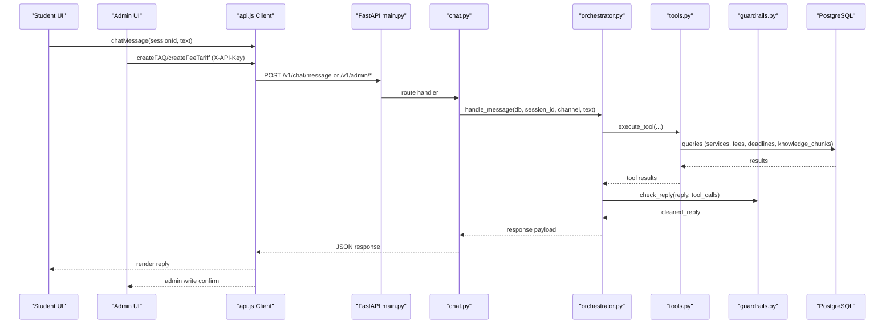
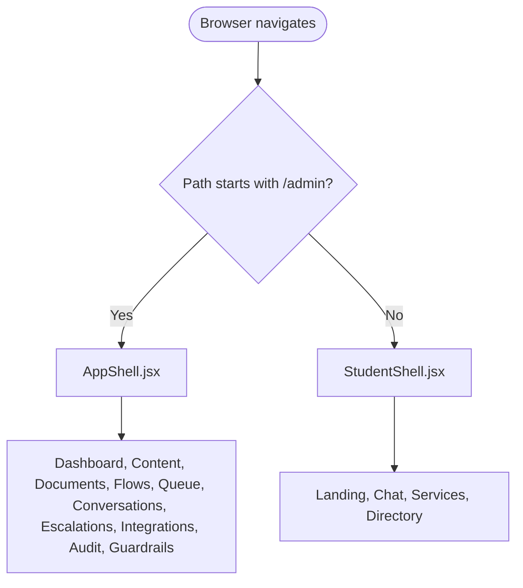
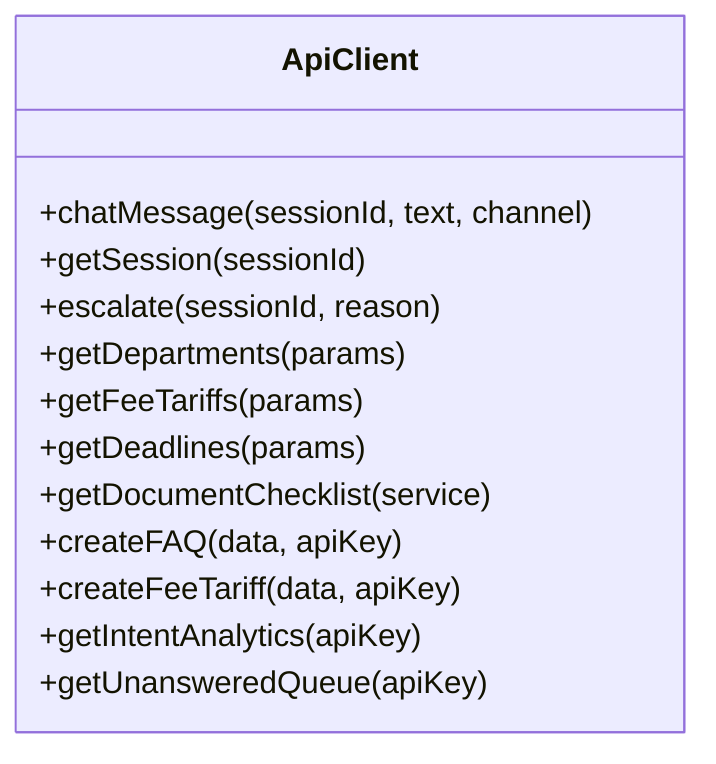
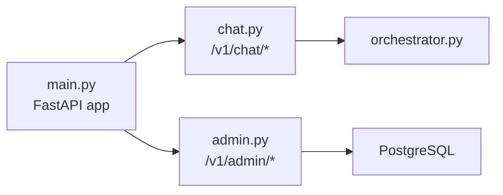
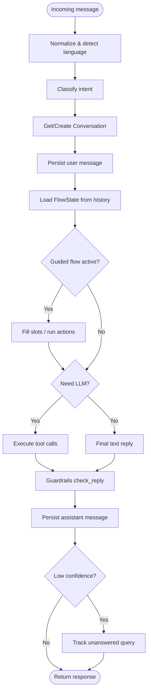
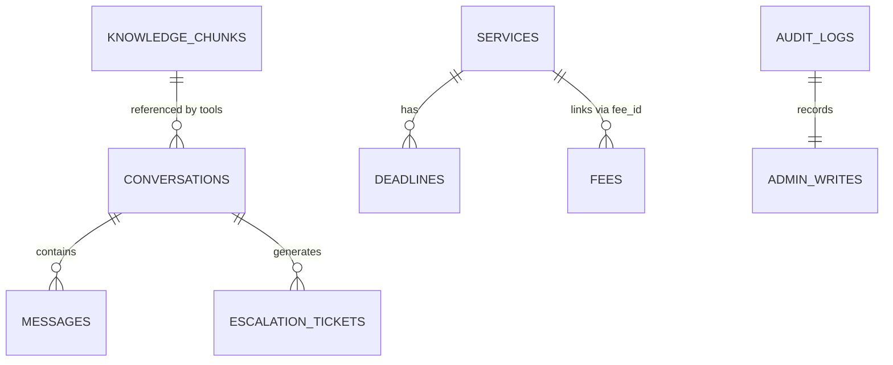
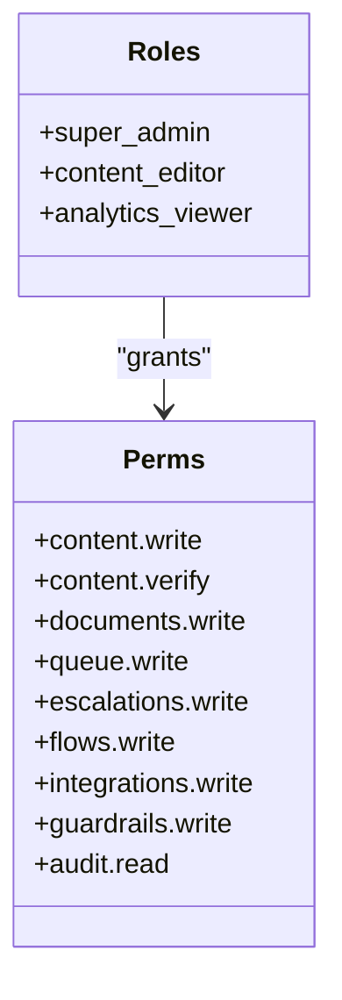
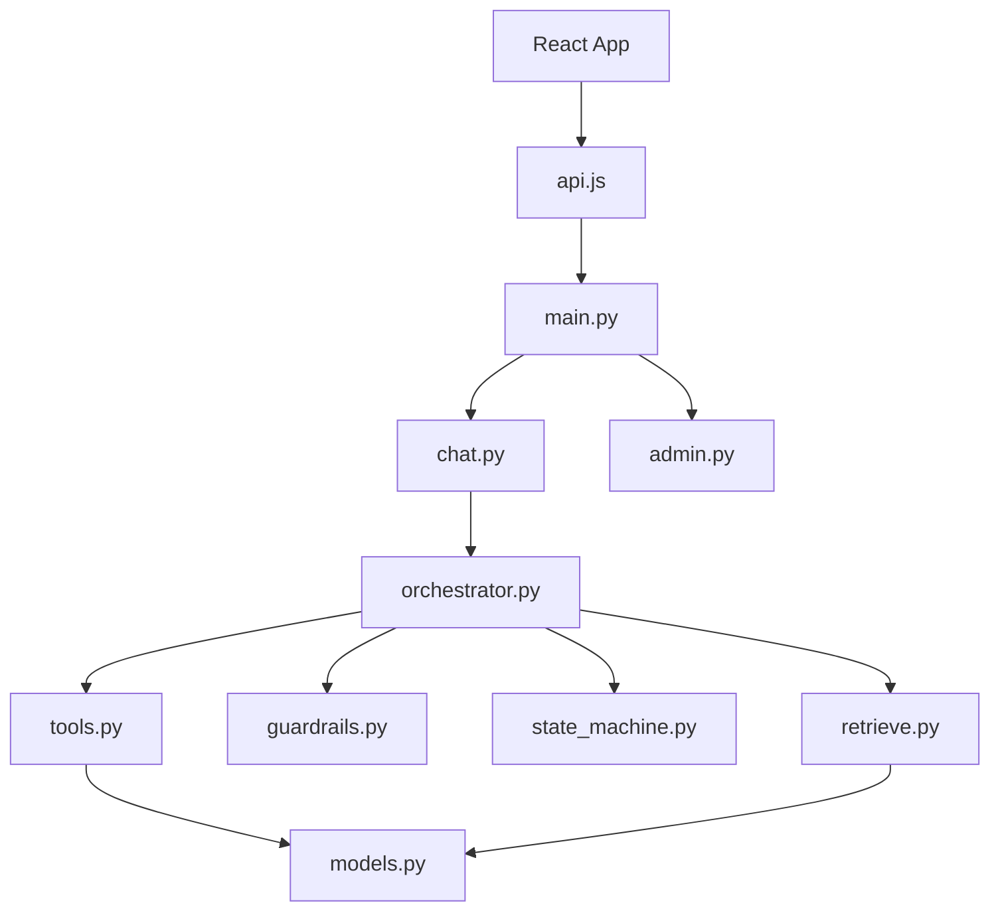

# System Design Principles

<cite>
**Referenced Files in This Document**
- [App.jsx](file://src/App.jsx)
- [AppShell.jsx](file://src/components/layout/AppShell.jsx)
- [StudentShell.jsx](file://src/components/student/StudentShell.jsx)
- [api.js](file://src/lib/api.js)
- [rbac.js](file://src/lib/rbac.js)
- [main.py](file://uaea-backend/app/main.py)
- [config.py](file://uaea-backend/app/config.py)
- [chat.py](file://uaea-backend/app/api/chat.py)
- [admin.py](file://uaea-backend/app/api/admin.py)
- [schemas.py](file://uaea-backend/app/schemas.py)
- [models.py](file://uaea-backend/app/db/models.py)
- [orchestrator.py](file://uaea-backend/app/orchestrator/orchestrator.py)
- [tools.py](file://uaea-backend/app/orchestrator/tools.py)
- [guardrails.py](file://uaea-backend/app/orchestrator/guardrails.py)
- [state_machine.py](file://uaea-backend/app/orchestrator/state_machine.py)
- [retrieve.py](file://uaea-backend/app/rag/retrieve.py)
</cite>

## Table of Contents
1. Introduction
2. Project Structure
3. Core Components
4. Architecture Overview
5. Detailed Component Analysis
6. Dependency Analysis
7. Performance Considerations
8. Troubleshooting Guide
9. Conclusion

## Introduction
This document explains the UAEA Console system design with a dual-interface pattern: a student-facing portal and an admin console that share a unified data layer. The system follows a governance-first approach, ensuring that all assistant responses are grounded in verified data through a strict pipeline (normalization, intent classification, guided flows, tool execution, guardrails). It separates concerns across presentation (React), business logic (FastAPI orchestrator pipeline), and persistence (PostgreSQL with pgvector for RAG). Architectural patterns include MVC-style routing, service-layer orchestration, and pipeline processing. The design emphasizes security boundaries (admin API key), scalability (rate limiting, async I/O, vector search), and extensibility (tool registry, flow definitions, RBAC).

## Project Structure
The frontend is a React application with two shells:
- Student shell at root routes (/) for students to interact with the assistant and explore services.
- Admin shell under /admin for staff to manage content, review queues, analytics, and guardrails.

Both shells consume the same backend APIs, ensuring consistency between what students see and what admins configure.

**Diagram sources**
- [App.jsx:24-63](file://src/App.jsx#L24-L63)
- [AppShell.jsx:9-45](file://src/components/layout/AppShell.jsx#L9-L45)
- [StudentShell.jsx:6-20](file://src/components/student/StudentShell.jsx#L6-L20)
- [api.js:1-169](file://src/lib/api.js#L1-L169)
- [main.py:40-79](file://uaea-backend/app/main.py#L40-L79)
- [chat.py:21-85](file://uaea-backend/app/api/chat.py#L21-L85)
- [admin.py:67-160](file://uaea-backend/app/api/admin.py#L67-L160)
- [orchestrator.py:46-143](file://uaea-backend/app/orchestrator/orchestrator.py#L46-L143)
- [tools.py:18-87](file://uaea-backend/app/orchestrator/tools.py#L18-L87)
- [guardrails.py:74-119](file://uaea-backend/app/orchestrator/guardrails.py#L74-L119)
- [state_machine.py:16-59](file://uaea-backend/app/orchestrator/state_machine.py#L16-L59)
- [retrieve.py:32-96](file://uaea-backend/app/rag/retrieve.py#L32-L96)
- [models.py:124-228](file://uaea-backend/app/db/models.py#L124-L228)

**Section sources**
- [App.jsx:24-63](file://src/App.jsx#L24-L63)
- [AppShell.jsx:9-45](file://src/components/layout/AppShell.jsx#L9-L45)
- [StudentShell.jsx:6-20](file://src/components/student/StudentShell.jsx#L6-L20)
- [api.js:1-169](file://src/lib/api.js#L1-L169)
- [main.py:40-79](file://uaea-backend/app/main.py#L40-L79)

## Core Components
- Dual interfaces: Student shell provides chat, services, directory; Admin shell provides dashboard, content library, documents, flows, queue, conversations, escalations, integrations, audit, guardrails.
- Unified data layer: Both sides read/write against the same PostgreSQL database via FastAPI endpoints.
- Governance-first pipeline: Every chat message passes through normalization, intent classification, guided flow state machine, LLM tool calls, and guardrail scrubbing before reply.
- Separation of concerns:
  - Presentation: React components and shells.
  - Business logic: Orchestrator pipeline and tools.
  - Persistence: SQLAlchemy models and pgvector-backed knowledge chunks.

**Section sources**
- [App.jsx:24-63](file://src/App.jsx#L24-L63)
- [orchestrator.py:46-143](file://uaea-backend/app/orchestrator/orchestrator.py#L46-L143)
- [models.py:124-228](file://uaea-backend/app/db/models.py#L124-L228)

## Architecture Overview
The system uses MVC-like separation:
- Controllers: FastAPI routers (chat, admin).
- Services: Orchestrator pipeline and tools.
- Models: SQLAlchemy models for DB entities.
- Views: React shells and pages.

Security boundaries:
- Public chat endpoints for students.
- Admin endpoints protected by API key header.
- Rate limiting per IP and optional per-session middleware.

Extensibility points:
- Tool registry for new capabilities.
- Flow definitions for new guided journeys.
- RAG retrieval with configurable embedding provider.

**Diagram sources**
- [api.js:42-69](file://src/lib/api.js#L42-L69)
- [api.js:115-149](file://src/lib/api.js#L115-L149)
- [main.py:77-79](file://uaea-backend/app/main.py#L77-L79)
- [chat.py:21-39](file://uaea-backend/app/api/chat.py#L21-L39)
- [orchestrator.py:46-143](file://uaea-backend/app/orchestrator/orchestrator.py#L46-L143)
- [tools.py:218-234](file://uaea-backend/app/orchestrator/tools.py#L218-L234)
- [guardrails.py:74-119](file://uaea-backend/app/orchestrator/guardrails.py#L74-L119)
- [models.py:124-228](file://uaea-backend/app/db/models.py#L124-L228)

## Detailed Component Analysis

### Dual-Interface Routing and Shells
- App.jsx defines two route groups: student routes at root and admin routes under /admin. Each group uses its own shell component to frame the experience.
- StudentShell renders header/footer and conditionally hides footer on chat to keep composer pinned.
- AppShell renders sidebar, topbar, command palette, and page outlet for admin features.

**Diagram sources**
- [App.jsx:40-61](file://src/App.jsx#L40-L61)
- [AppShell.jsx:14-45](file://src/components/layout/AppShell.jsx#L14-L45)
- [StudentShell.jsx:8-20](file://src/components/student/StudentShell.jsx#L8-L20)

**Section sources**
- [App.jsx:24-63](file://src/App.jsx#L24-L63)
- [AppShell.jsx:9-45](file://src/components/layout/AppShell.jsx#L9-L45)
- [StudentShell.jsx:6-20](file://src/components/student/StudentShell.jsx#L6-L20)

### API Client and Security Boundaries
- api.js centralizes all HTTP calls to the backend, including chat, lookup, and admin endpoints.
- Admin endpoints require X-API-Key header; client wraps these with adminHeaders.
- Error handling throws descriptive errors from non-ok responses.

**Diagram sources**
- [api.js:16-31](file://src/lib/api.js#L16-L31)
- [api.js:42-149](file://src/lib/api.js#L42-L149)

**Section sources**
- [api.js:1-169](file://src/lib/api.js#L1-L169)
- [admin.py:31-48](file://uaea-backend/app/api/admin.py#L31-L48)

### Backend Application and Routers
- main.py configures CORS, rate limiter, lifespan, and mounts routers for chat, lookup, and admin.
- chat.py exposes /v1/chat endpoints for messaging, session retrieval, and escalation.
- admin.py exposes /v1/admin endpoints for content writes, analytics, and queue reads, guarded by verify_admin.

**Diagram sources**
- [main.py:40-79](file://uaea-backend/app/main.py#L40-L79)
- [chat.py:21-115](file://uaea-backend/app/api/chat.py#L21-L115)
- [admin.py:67-160](file://uaea-backend/app/api/admin.py#L67-L160)

**Section sources**
- [main.py:40-79](file://uaea-backend/app/main.py#L40-L79)
- [chat.py:21-115](file://uaea-backend/app/api/chat.py#L21-L115)
- [admin.py:31-48](file://uaea-backend/app/api/admin.py#L31-L48)

### Orchestrator Pipeline (Governance-First)
- handle_message normalizes input, detects language, classifies intent, manages conversation state, runs guided flows, executes LLM tool calls, applies guardrails, persists messages, tracks unanswered queries, and returns structured response.
- State machine drives guided flows with slot-filling and action steps.
- Tools provide deterministic access to services, fees, deadlines, document checklists, escalation creation, and knowledge base search.
- Guardrails strip ungrounded numbers/dates/requirements and can escalate if too many violations.

**Diagram sources**
- [orchestrator.py:46-143](file://uaea-backend/app/orchestrator/orchestrator.py#L46-L143)
- [state_machine.py:62-146](file://uaea-backend/app/orchestrator/state_machine.py#L62-L146)
- [tools.py:18-87](file://uaea-backend/app/orchestrator/tools.py#L18-L87)
- [guardrails.py:74-119](file://uaea-backend/app/orchestrator/guardrails.py#L74-L119)

**Section sources**
- [orchestrator.py:46-143](file://uaea-backend/app/orchestrator/orchestrator.py#L46-L143)
- [state_machine.py:16-59](file://uaea-backend/app/orchestrator/state_machine.py#L16-L59)
- [tools.py:92-234](file://uaea-backend/app/orchestrator/tools.py#L92-L234)
- [guardrails.py:74-119](file://uaea-backend/app/orchestrator/guardrails.py#L74-L119)

### Data Layer and RAG
- Models define entities for departments, campuses, services, fees, deadlines, knowledge chunks (with pgvector), conversations, messages, escalation tickets, audit logs, and unanswered queries.
- RAG retrieve performs vector similarity search using pgvector cosine distance and basic reranking by section overlap.

**Diagram sources**
- [models.py:71-140](file://uaea-backend/app/db/models.py#L71-L140)
- [models.py:144-228](file://uaea-backend/app/db/models.py#L144-L228)
- [retrieve.py:32-96](file://uaea-backend/app/rag/retrieve.py#L32-L96)

**Section sources**
- [models.py:71-228](file://uaea-backend/app/db/models.py#L71-L228)
- [retrieve.py:32-96](file://uaea-backend/app/rag/retrieve.py#L32-L96)

### Role-Based Access Control (UI)
- rbac.js defines roles and permissions for UI gating. While not a server-side enforcement, it outlines the permission map intended for Phase 2 middleware.

**Diagram sources**
- [rbac.js:10-50](file://src/lib/rbac.js#L10-L50)

**Section sources**
- [rbac.js:1-51](file://src/lib/rbac.js#L1-L51)

## Dependency Analysis
- Frontend depends on api.js to call backend endpoints.
- Backend main.py includes routers for chat, lookup, admin.
- Orchestrator depends on tools, state machine, guardrails, and RAG retrieval.
- Tools depend on DB models for deterministic data access.
- Admin endpoints depend on verify_admin for authorization.

**Diagram sources**
- [api.js:1-169](file://src/lib/api.js#L1-L169)
- [main.py:77-79](file://uaea-backend/app/main.py#L77-L79)
- [chat.py:21-39](file://uaea-backend/app/api/chat.py#L21-L39)
- [orchestrator.py:46-143](file://uaea-backend/app/orchestrator/orchestrator.py#L46-L143)
- [tools.py:218-234](file://uaea-backend/app/orchestrator/tools.py#L218-L234)
- [guardrails.py:74-119](file://uaea-backend/app/orchestrator/guardrails.py#L74-L119)
- [state_machine.py:62-146](file://uaea-backend/app/orchestrator/state_machine.py#L62-L146)
- [retrieve.py:32-96](file://uaea-backend/app/rag/retrieve.py#L32-L96)
- [models.py:124-228](file://uaea-backend/app/db/models.py#L124-L228)

**Section sources**
- [main.py:77-79](file://uaea-backend/app/main.py#L77-L79)
- [orchestrator.py:46-143](file://uaea-backend/app/orchestrator/orchestrator.py#L46-L143)
- [tools.py:218-234](file://uaea-backend/app/orchestrator/tools.py#L218-L234)

## Performance Considerations
- Async I/O: FastAPI and async SQLAlchemy reduce latency for DB and external LLM calls.
- Rate limiting: Per-IP limiter configured; per-session middleware placeholder exists for chat endpoints.
- Vector search: pgvector cosine similarity with LIMIT top_k; optional rerank by section overlap improves relevance without heavy compute.
- LLM rounds: Max rounds capped to prevent runaway loops; fallback escalation when exhausted.
- Caching opportunities: Consider caching frequent lookups (departments, fees) and embedding vectors where appropriate.

[No sources needed since this section provides general guidance]

## Troubleshooting Guide
- Admin access denied: Ensure X-API-Key matches configured admin_api_key; otherwise 403 is returned.
- Rate limit exceeded: Requests exceeding per-IP limits return 429 with detail.
- No relevant documents: RAG returns empty chunks; verify embeddings and ingestion; check superseded_by flags.
- Low-confidence queries: Tracked in unanswered queue; review in admin to improve classifier or add knowledge.
- Tool errors: Tools return error dicts; orchestrator surfaces them in tool_calls; guardrails may replace ungrounded claims.

**Section sources**
- [admin.py:31-48](file://uaea-backend/app/api/admin.py#L31-L48)
- [main.py:51-58](file://uaea-backend/app/main.py#L51-L58)
- [retrieve.py:58-59](file://uaea-backend/app/rag/retrieve.py#L58-L59)
- [orchestrator.py:367-383](file://uaea-backend/app/orchestrator/orchestrator.py#L367-L383)
- [guardrails.py:74-119](file://uaea-backend/app/orchestrator/guardrails.py#L74-L119)

## Conclusion
UAEA Console implements a robust dual-interface architecture with a governance-first pipeline that ensures trustworthy, grounded responses. Clear separation between presentation, orchestration, and persistence enables maintainability and scalability. Security boundaries protect admin operations, while extensibility points (tools, flows, RAG) allow continuous improvement. The design supports both student engagement and administrative oversight over a shared, consistent dataset.

[No sources needed since this section summarizes without analyzing specific files]