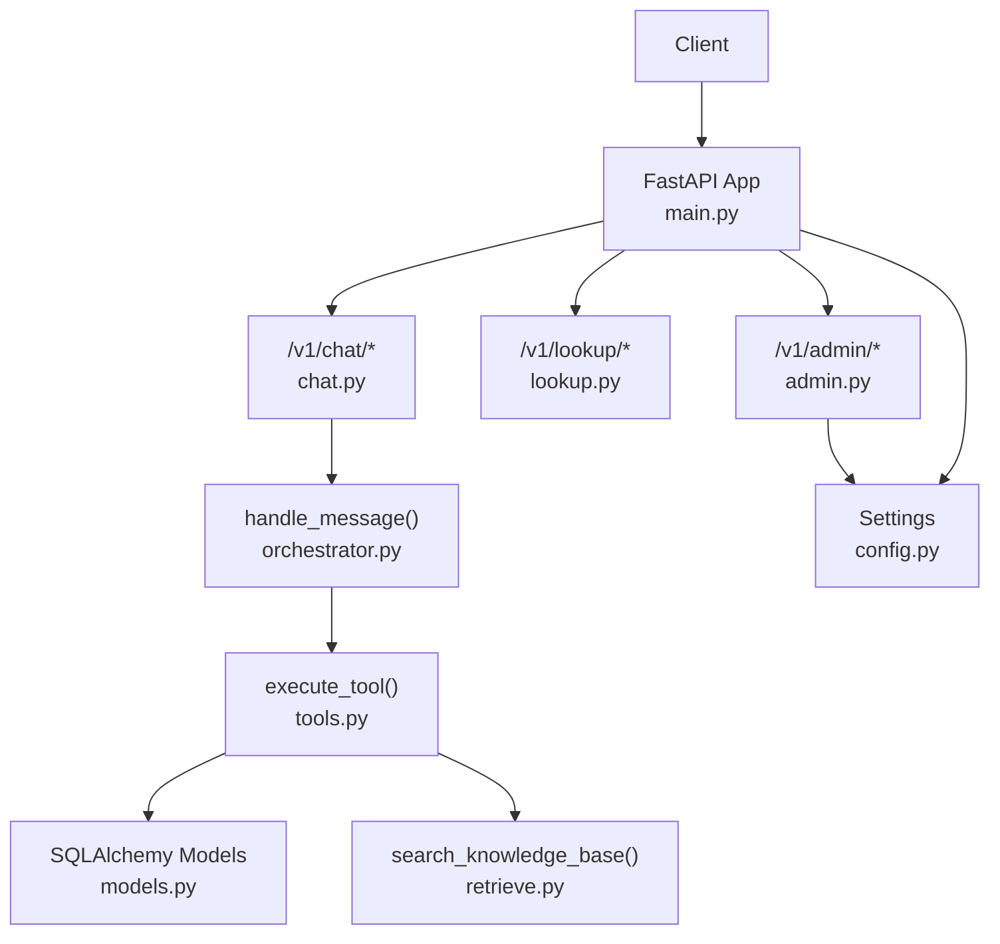
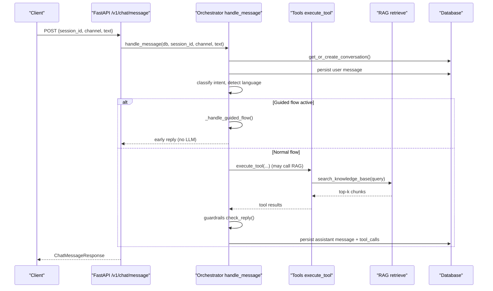
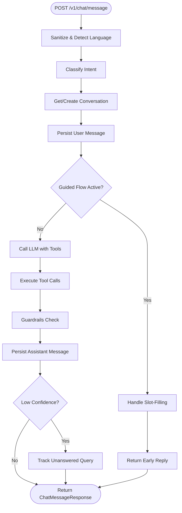
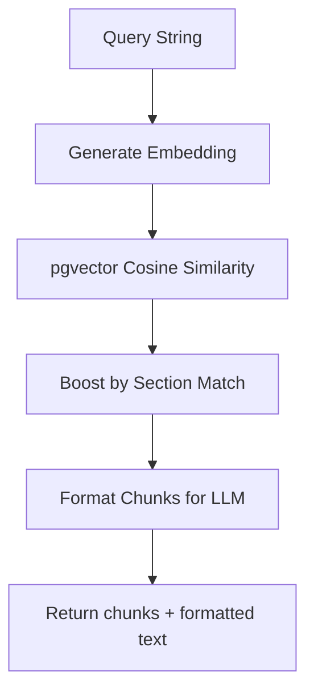
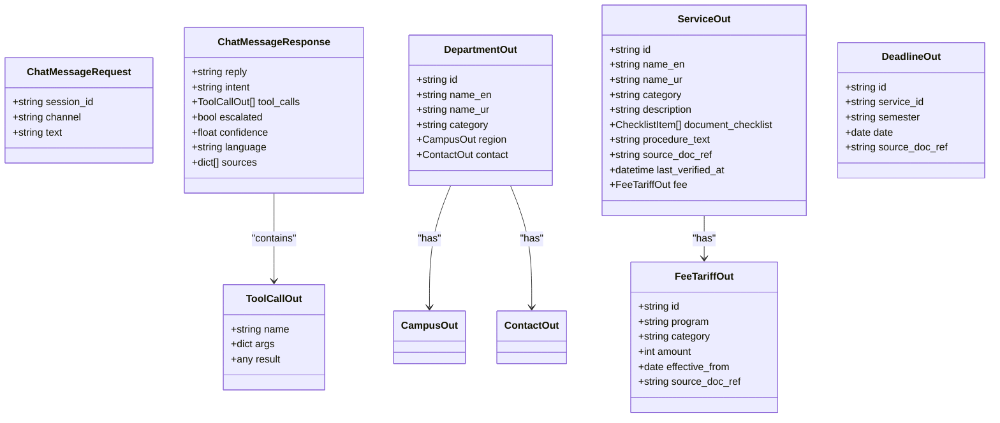
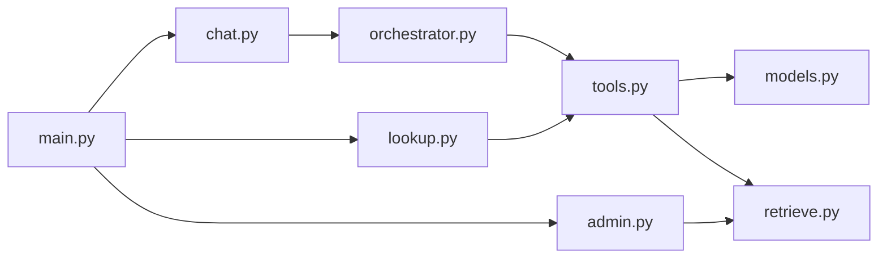

# API Design

<cite>
**Referenced Files in This Document**
- [main.py](file://uaea-backend/app/main.py)
- [chat.py](file://uaea-backend/app/api/chat.py)
- [lookup.py](file://uaea-backend/app/api/lookup.py)
- [admin.py](file://uaea-backend/app/api/admin.py)
- [schemas.py](file://uaea-backend/app/schemas.py)
- [models.py](file://uaea-backend/app/db/models.py)
- [orchestrator.py](file://uaea-backend/app/orchestrator/orchestrator.py)
- [tools.py](file://uaea-backend/app/orchestrator/tools.py)
- [retrieve.py](file://uaea-backend/app/rag/retrieve.py)
- [config.py](file://uaea-backend/app/config.py)
</cite>

## Table of Contents
1. Introduction
2. Project Structure
3. Core Components
4. Architecture Overview
5. Detailed Component Analysis
6. Dependency Analysis
7. Performance Considerations
8. Troubleshooting Guide
9. Conclusion

## Introduction
This document describes the FastAPI backend API design for the UAEA system. It covers all RESTful endpoints under /v1/chat, /v1/lookup, and /v1/admin, including request/response schemas, authentication methods, error handling patterns, rate limiting, and the data transformation pipeline from client requests to database operations. It also provides examples of common API calls, status codes, and error responses.

## Project Structure
The backend is organized into:
- Application entrypoint with middleware (CORS, rate limiting), lifespan, and router mounting
- API routers for chat, lookup, and admin features
- Pydantic schemas for validation and serialization
- SQLAlchemy models for persistence
- Orchestrator that coordinates intent classification, guided flows, LLM tool calls, guardrails, and persistence
- RAG retrieval for vector-based knowledge search
- Configuration via environment variables

**Diagram sources**
- [main.py:40-79](file://uaea-backend/app/main.py#L40-L79)
- [chat.py:18-115](file://uaea-backend/app/api/chat.py#L18-L115)
- [lookup.py:23-104](file://uaea-backend/app/api/lookup.py#L23-L104)
- [admin.py:26-161](file://uaea-backend/app/api/admin.py#L26-L161)
- [orchestrator.py:46-143](file://uaea-backend/app/orchestrator/orchestrator.py#L46-L143)
- [tools.py:18-235](file://uaea-backend/app/orchestrator/tools.py#L18-L235)
- [retrieve.py:32-97](file://uaea-backend/app/rag/retrieve.py#L32-L97)
- [config.py:6-38](file://uaea-backend/app/config.py#L6-L38)

**Section sources**
- [main.py:1-104](file://uaea-backend/app/main.py#L1-L104)

## Core Components
- FastAPI app with CORS and rate limiting middleware; health endpoint at /health
- Chat API: message processing, session retrieval, escalation
- Lookup API: departments, fee tariffs, deadlines, document checklists
- Admin API: content management (FAQ, fee tariffs), analytics, unanswered queue
- Schemas: Pydantic models for strict request/response validation
- Database: PostgreSQL with pgvector for embeddings
- Orchestrator: end-to-end flow for chat messages (normalize, classify, state machine, LLM tools, guardrails)
- RAG: vector similarity search over knowledge chunks

**Section sources**
- [schemas.py:1-178](file://uaea-backend/app/schemas.py#L1-L178)
- [models.py:18-228](file://uaea-backend/app/db/models.py#L18-L228)
- [orchestrator.py:46-143](file://uaea-backend/app/orchestrator/orchestrator.py#L46-L143)

## Architecture Overview
The chat message pipeline:
1. Request arrives at /v1/chat/message
2. Input sanitization, language detection, normalization
3. Intent classification and confidence scoring
4. Conversation lifecycle management (get or create)
5. Guided flow slot-filling if applicable
6. LLM call with tool definitions; execute tool calls iteratively
7. Guardrail checks to remove ungrounded claims
8. Persist assistant reply and metadata
9. Return structured response

**Diagram sources**
- [chat.py:21-39](file://uaea-backend/app/api/chat.py#L21-L39)
- [orchestrator.py:46-143](file://uaea-backend/app/orchestrator/orchestrator.py#L46-L143)
- [tools.py:218-235](file://uaea-backend/app/orchestrator/tools.py#L218-L235)
- [retrieve.py:32-97](file://uaea-backend/app/rag/retrieve.py#L32-L97)

## Detailed Component Analysis

### Authentication and Authorization
- Admin endpoints require an API key or bearer token via header verification. A stub implementation checks against a configured admin API key.
- Public endpoints (/v1/chat, /v1/lookup) do not enforce authentication in this version.

Authentication method:
- Header X-API-Key or Authorization: Bearer <token>
- Validation compares token to settings.admin_api_key

Error behavior:
- Missing or invalid token returns 403 with a descriptive detail.

**Section sources**
- [admin.py:31-48](file://uaea-backend/app/api/admin.py#L31-L48)
- [config.py:27-28](file://uaea-backend/app/config.py#L27-L28)

### Rate Limiting
- IP-based rate limiting is enabled using slowapi with Limiter keyed by remote address.
- A per-session rate limit placeholder exists for /v1/chat/message POST but is not enforced yet.
- Custom exception handler returns 429 with a JSON detail when limits are exceeded.

Configuration:
- Rate limits defined in settings (per IP and per session).

**Section sources**
- [main.py:25-58](file://uaea-backend/app/main.py#L25-L58)
- [config.py:23-25](file://uaea-backend/app/config.py#L23-L25)

### Error Handling Patterns
- HTTPException used for explicit errors (e.g., 404 session not found, 403 admin denied).
- RateLimitExceeded handled globally to return 429 JSON.
- Orchestrator handles external LLM errors gracefully and may escalate conversation.

Common statuses:
- 200 OK on success
- 400 Bad Request for invalid payloads (Pydantic validation)
- 403 Forbidden for unauthorized admin access
- 404 Not Found for missing resources
- 429 Too Many Requests when rate limited

**Section sources**
- [chat.py:42-55](file://uaea-backend/app/api/chat.py#L42-L55)
- [admin.py:31-48](file://uaea-backend/app/api/admin.py#L31-L48)
- [main.py:51-58](file://uaea-backend/app/main.py#L51-L58)
- [orchestrator.py:255-271](file://uaea-backend/app/orchestrator/orchestrator.py#L255-L271)

### Schema Validation and Data Transformation
- All endpoints use Pydantic models for input validation and output serialization.
- Response models ensure consistent structure and types across APIs.
- Database models map to tables; schemas convert ORM objects to JSON-compatible structures.

Key models:
- ChatMessageRequest, ChatMessageResponse, EscalateRequest, EscalateResponse, SessionOut
- DepartmentOut, FeeTariffOut, DeadlineOut, ServiceOut
- FAQCreate, FeeTariffCreate, AdminWriteResponse, IntentCount, UnansweredQueryOut

Transformation pipeline:
- Client payload validated by Pydantic
- Orchestrator processes and persists Message/Conversation entities
- Tool results converted to standardized dicts
- Responses serialized to schema-defined structures

**Section sources**
- [schemas.py:11-178](file://uaea-backend/app/schemas.py#L11-L178)
- [models.py:144-179](file://uaea-backend/app/db/models.py#L144-L179)
- [chat.py:21-39](file://uaea-backend/app/api/chat.py#L21-L39)
- [lookup.py:26-104](file://uaea-backend/app/api/lookup.py#L26-L104)
- [admin.py:67-125](file://uaea-backend/app/api/admin.py#L67-L125)

### Endpoints

#### Chat API
- POST /v1/chat/message
  - Purpose: Send a chat message and receive assistant reply with optional tool calls and metadata.
  - Request body: ChatMessageRequest (session_id, channel, text)
  - Response: ChatMessageResponse (reply, intent, tool_calls, escalated, confidence, language, sources)
  - Behavior: Orchestrates normalization, intent classification, guided flows, LLM tool execution, guardrails, persistence.
  - Status codes: 200 on success; 429 if rate limited; 400 on invalid payload.

- GET /v1/chat/session/{session_id}
  - Purpose: Retrieve full conversation history for a session.
  - Path param: session_id
  - Response: SessionOut (id, session_id, channel, started_at, resolved, escalated, messages[])
  - Status codes: 200 on success; 404 if session not found.

- POST /v1/chat/escalate
  - Purpose: Create an escalation ticket for an active conversation.
  - Request body: EscalateRequest (session_id, reason)
  - Response: EscalateResponse (ticket_id, status)
  - Status codes: 200 on success; 404 if no active conversation.

Example calls:
- POST /v1/chat/message
  - Request: {"session_id": "sess_1", "channel": "web", "text": "What is the fee for BS Computer Science?"}
  - Response: {"reply": "...", "intent": "fee_tariff", "tool_calls": [{"name": "get_fee_tariff", "args": {"program": "BS Computer Science"}, "result": {...}}], "escalated": false, "confidence": 0.92, "language": "en", "sources": [...]}

**Section sources**
- [chat.py:21-115](file://uaea-backend/app/api/chat.py#L21-L115)
- [schemas.py:81-122](file://uaea-backend/app/schemas.py#L81-L122)
- [orchestrator.py:46-143](file://uaea-backend/app/orchestrator/orchestrator.py#L46-L143)

#### Lookup API
- GET /v1/lookup/departments
  - Query params: region (optional), query (optional)
  - Response: list[DepartmentOut]
  - Filters: by campus region and fuzzy search on name_en/name_ur/category

- GET /v1/lookup/fee-tariff
  - Query params: program (optional), category (optional)
  - Response: list[FeeTariffOut]
  - Filters: fuzzy match on program and category

- GET /v1/lookup/deadlines
  - Query params: service (optional)
  - Response: list[DeadlineOut]
  - Filters: join with services and fuzzy match on service name

- GET /v1/lookup/document-checklist
  - Query params: service (required)
  - Response: dict with checklist items, procedure, source, last_verified
  - Uses shared tool function for consistency with LLM tool calls

Example calls:
- GET /v1/lookup/departments?region=Karachi&query=Computer
- GET /v1/lookup/fee-tariff?program=BS%20Computer%20Science&category=Semester%20(new)
- GET /v1/lookup/deadlines?service=Admission%20%26%20Enrolment
- GET /v1/lookup/document-checklist?service=Degree%20Application

**Section sources**
- [lookup.py:26-104](file://uaea-backend/app/api/lookup.py#L26-L104)
- [schemas.py:13-77](file://uaea-backend/app/schemas.py#L13-L77)
- [tools.py:92-198](file://uaea-backend/app/orchestrator/tools.py#L92-L198)

#### Admin API
- POST /v1/admin/content/faq
  - Purpose: Create/update a FAQ knowledge chunk; embeds and stores via RAG pipeline.
  - Request body: FAQCreate (source_doc_id, text, section)
  - Response: AdminWriteResponse (id, status)
  - Auth: Requires valid admin API key or bearer token.

- POST /v1/admin/content/fee-tariff
  - Purpose: Create a fee tariff entry.
  - Request body: FeeTariffCreate (program, category, amount, effective_from, source_doc_ref)
  - Response: AdminWriteResponse (id, status)
  - Auth: Requires valid admin API key or bearer token.

- GET /v1/admin/analytics/intents
  - Purpose: Counts of messages grouped by intent.
  - Response: list[IntentCount]
  - Auth: Requires valid admin API key or bearer token.

- GET /v1/admin/queue/unanswered
  - Purpose: Queue of low-confidence or unanswered queries.
  - Response: list[UnansweredQueryOut]
  - Auth: Requires valid admin API key or bearer token.

Example calls:
- POST /v1/admin/content/faq
  - Headers: X-API-Key: <your-admin-key>
  - Request: {"source_doc_id": "doc_123", "text": "Tuition fees are payable online...", "section": "Fees"}
  - Response: {"id": "chunk_uuid", "status": "ok"}

- GET /v1/admin/analytics/intents
  - Headers: Authorization: Bearer <your-admin-token>
  - Response: [{"intent": "fee_tariff", "count": 120}, ...]

**Section sources**
- [admin.py:67-161](file://uaea-backend/app/api/admin.py#L67-L161)
- [schemas.py:126-167](file://uaea-backend/app/schemas.py#L126-L167)

### Data Flow and Processing Logic

#### Chat Message Processing Flow

**Diagram sources**
- [orchestrator.py:46-143](file://uaea-backend/app/orchestrator/orchestrator.py#L46-L143)
- [tools.py:218-235](file://uaea-backend/app/orchestrator/tools.py#L218-L235)
- [guardrails.py:74-120](file://uaea-backend/app/orchestrator/guardrails.py#L74-L120)

#### RAG Retrieval Flow

**Diagram sources**
- [retrieve.py:17-97](file://uaea-backend/app/rag/retrieve.py#L17-L97)

### Class Relationships (Schemas and Models)

**Diagram sources**
- [schemas.py:13-122](file://uaea-backend/app/schemas.py#L13-L122)

## Dependency Analysis
- main.py mounts routers and configures CORS/rate limiting
- chat.py depends on orchestrator.handle_message and schemas
- lookup.py depends on tools functions and schemas
- admin.py depends on RAG ingest/embedding and schemas
- orchestrator depends on normalizer, intent_router, state_machine, tools, guardrails
- tools depend on database models and RAG retrieve
- retrieve depends on pgvector and OpenAI embeddings

**Diagram sources**
- [main.py:75-79](file://uaea-backend/app/main.py#L75-L79)
- [chat.py:18-115](file://uaea-backend/app/api/chat.py#L18-L115)
- [lookup.py:23-104](file://uaea-backend/app/api/lookup.py#L23-L104)
- [admin.py:26-161](file://uaea-backend/app/api/admin.py#L26-L161)
- [orchestrator.py:46-143](file://uaea-backend/app/orchestrator/orchestrator.py#L46-L143)
- [tools.py:18-235](file://uaea-backend/app/orchestrator/tools.py#L18-L235)
- [retrieve.py:32-97](file://uaea-backend/app/rag/retrieve.py#L32-L97)

**Section sources**
- [main.py:75-79](file://uaea-backend/app/main.py#L75-L79)
- [orchestrator.py:46-143](file://uaea-backend/app/orchestrator/orchestrator.py#L46-L143)

## Performance Considerations
- Use async database sessions to avoid blocking I/O.
- Limit message history sent to LLM to reduce token usage and latency.
- Employ pgvector cosine similarity for efficient semantic search.
- Apply rate limiting to protect endpoints under load.
- Cache frequently accessed lookups if needed (not implemented here).
- Ensure proper indexing on high-frequency query fields (e.g., session_id, program, category).

[No sources needed since this section provides general guidance]

## Troubleshooting Guide
Common issues and resolutions:
- 403 Admin access denied: Verify X-API-Key or Authorization header matches configured admin_api_key.
- 404 Session not found: Ensure session_id exists and conversation is not resolved.
- 429 Rate limit exceeded: Reduce request frequency or adjust rate_limit_per_ip in settings.
- LLM API errors: Orchestrator returns fallback replies; check anthropic_api_key configuration.
- No relevant documents: RAG returns empty chunks; verify knowledge base ingestion and embeddings.

**Section sources**
- [admin.py:31-48](file://uaea-backend/app/api/admin.py#L31-L48)
- [chat.py:42-55](file://uaea-backend/app/api/chat.py#L42-L55)
- [main.py:51-58](file://uaea-backend/app/main.py#L51-L58)
- [orchestrator.py:255-271](file://uaea-backend/app/orchestrator/orchestrator.py#L255-L271)
- [retrieve.py:58-60](file://uaea-backend/app/rag/retrieve.py#L58-L60)

## Conclusion
The UAEA backend provides a robust set of RESTful APIs for chat interactions, administrative operations, and reference lookups. Strict schema validation ensures reliable data exchange, while the orchestrator integrates intent classification, guided flows, LLM tool calls, and guardrails to deliver safe and accurate responses. Rate limiting and authentication mechanisms protect sensitive endpoints. The architecture supports scalable retrieval via pgvector and maintains clear separation between API layers, business logic, and persistence.

[No sources needed since this section summarizes without analyzing specific files]