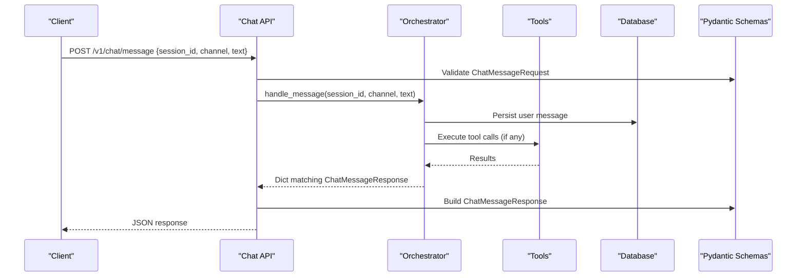
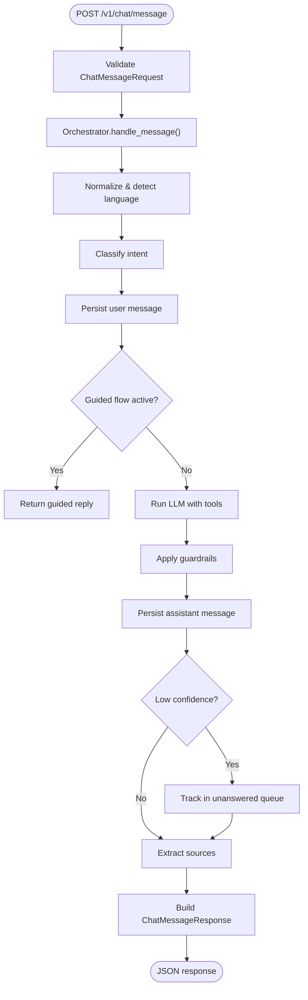
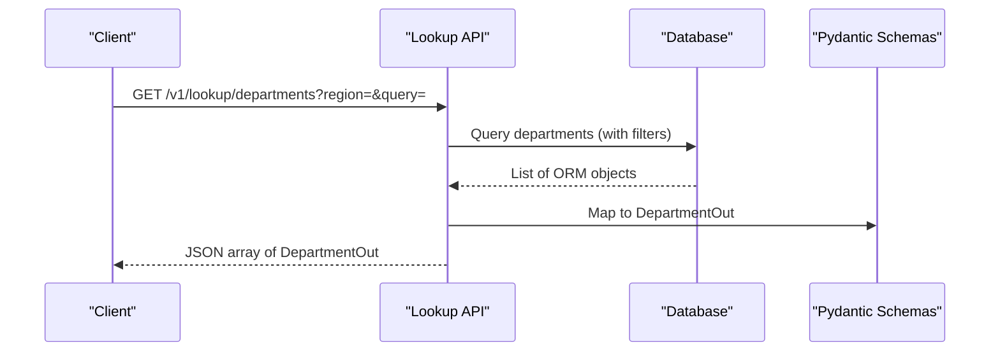
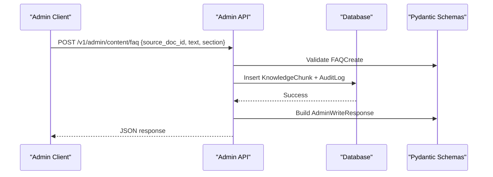
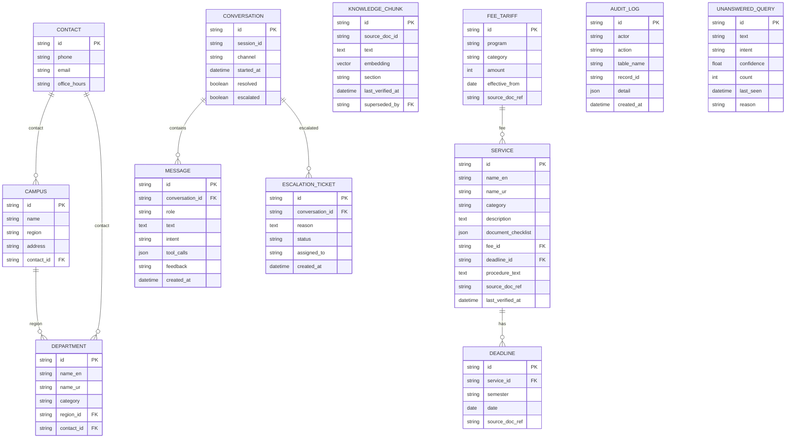
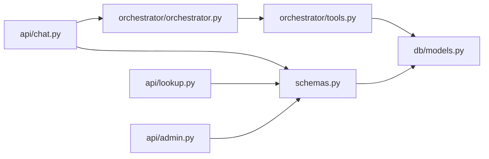

# API Schemas

<cite>
**Referenced Files in This Document**
- [schemas.py](file://uaea-backend/app/schemas.py)
- [chat.py](file://uaea-backend/app/api/chat.py)
- [lookup.py](file://uaea-backend/app/api/lookup.py)
- [admin.py](file://uaea-backend/app/api/admin.py)
- [models.py](file://uaea-backend/app/db/models.py)
- [orchestrator.py](file://uaea-backend/app/orchestrator/orchestrator.py)
- [tools.py](file://uaea-backend/app/orchestrator/tools.py)
- [main.py](file://uaea-backend/app/main.py)
</cite>

## Table of Contents
1. [Introduction](#introduction)
2. [Project Structure](#project-structure)
3. [Core Components](#core-components)
4. [Architecture Overview](#architecture-overview)
5. [Detailed Component Analysis](#detailed-component-analysis)
6. [Dependency Analysis](#dependency-analysis)
7. [Performance Considerations](#performance-considerations)
8. [Troubleshooting Guide](#troubleshooting-guide)
9. [Conclusion](#conclusion)
10. [Appendices](#appendices)

## Introduction
This document provides comprehensive schema documentation for all Pydantic models used in API requests and responses across the UAEA backend. It covers validation rules, field constraints, default values, relationships between models, serialization behavior, error messages, and a strategy for schema evolution and versioning to maintain backward compatibility.

## Project Structure
The schemas are centralized in a single module and consumed by FastAPI routers for chat, lookup, and admin endpoints. The orchestrator returns dictionaries that conform to response schemas, while tools return domain-specific payloads that are serialized into standard response shapes.

```mermaid
graph TB
subgraph "FastAPI Routers"
Chat["Chat Router"]
Lookup["Lookup Router"]
Admin["Admin Router"]
end
subgraph "Schemas"
Schemas["Pydantic Models<br/>Request/Response"]
end
subgraph "Orchestrator & Tools"
Orchestrator["Orchestrator"]
Tools["Tool Implementations"]
end
subgraph "Database Models"
DBModels["SQLAlchemy Models"]
end
Chat --> Schemas
Lookup --> Schemas
Admin --> Schemas
Chat --> Orchestrator
Orchestrator --> Tools
Tools --> DBModels
Schemas --> DBModels
```

**Diagram sources**
- [chat.py:21-89](file://uaea-backend/app/api/chat.py#L21-L89)
- [lookup.py:26-103](file://uaea-backend/app/api/lookup.py#L26-L103)
- [admin.py:67-160](file://uaea-backend/app/api/admin.py#L67-L160)
- [schemas.py:11-178](file://uaea-backend/app/schemas.py#L11-L178)
- [orchestrator.py:46-143](file://uaea-backend/app/orchestrator/orchestrator.py#L46-L143)
- [tools.py:18-235](file://uaea-backend/app/orchestrator/tools.py#L18-L235)
- [models.py:30-228](file://uaea-backend/app/db/models.py#L30-L228)

**Section sources**
- [schemas.py:1-178](file://uaea-backend/app/schemas.py#L1-L178)
- [chat.py:1-115](file://uaea-backend/app/api/chat.py#L1-L115)
- [lookup.py:1-104](file://uaea-backend/app/api/lookup.py#L1-L104)
- [admin.py:1-161](file://uaea-backend/app/api/admin.py#L1-L161)

## Core Components
This section documents each Pydantic model with its purpose, fields, constraints, defaults, and relationships.

### Lookup Domain Models
- ContactOut
  - Purpose: Response shape for contact details.
  - Fields: id (string), phone (optional string), email (optional string), office_hours (optional string).
  - Serialization: from_attributes enabled to map ORM objects.
  - Relationships: Referenced by CampusOut and DepartmentOut.

- CampusOut
  - Purpose: Response shape for campus info.
  - Fields: id (string), name (string), region (string), address (optional string), contact (optional ContactOut).
  - Serialization: from_attributes enabled.
  - Relationships: Contains optional ContactOut.

- DepartmentOut
  - Purpose: Response shape for department info.
  - Fields: id (string), name_en (string), name_ur (optional string), category (string), region (optional CampusOut), contact (optional ContactOut).
  - Serialization: from_attributes enabled.
  - Relationships: Optional nested CampusOut and ContactOut.

- FeeTariffOut
  - Purpose: Response shape for fee tariff entries.
  - Fields: id (string), program (string), category (string), amount (integer), effective_from (date), source_doc_ref (optional string).
  - Serialization: from_attributes enabled.

- ChecklistItem
  - Purpose: Item in a service’s document checklist.
  - Fields: en (string), ur (optional string), copy (boolean, default False).

- ServiceOut
  - Purpose: Response shape for services.
  - Fields: id (string), name_en (string), name_ur (optional string), category (string), description (optional string), document_checklist (list of ChecklistItem, default []), procedure_text (optional string), source_doc_ref (optional string), last_verified_at (optional datetime), fee (optional FeeTariffOut).
  - Serialization: from_attributes enabled.
  - Relationships: Optional nested FeeTariffOut; contains list of ChecklistItem.

- DeadlineOut
  - Purpose: Response shape for deadlines.
  - Fields: id (string), service_id (string), semester (string), date (date), source_doc_ref (optional string).
  - Serialization: from_attributes enabled.

**Section sources**
- [schemas.py:11-77](file://uaea-backend/app/schemas.py#L11-L77)
- [models.py:30-122](file://uaea-backend/app/db/models.py#L30-L122)

### Chat Domain Models
- ChatMessageRequest
  - Purpose: Request payload for sending a message.
  - Fields: session_id (string), channel (string, default "web"), text (string).
  - Validation: Required fields enforced by Pydantic.

- ToolCallOut
  - Purpose: Represents a tool call result in responses.
  - Fields: name (string), args (optional dict), result (any, default None).

- ChatMessageResponse
  - Purpose: Standardized response for chat messages.
  - Fields: reply (string), intent (optional string), tool_calls (list of ToolCallOut, default []), escalated (boolean, default False), confidence (float, default 0.0), language (string, default "en"), sources (list of dicts, default []).
  - Serialization: Used as response_model for /v1/chat/message.

- EscalateRequest
  - Purpose: Request to escalate a conversation.
  - Fields: session_id (string), reason (string).

- EscalateResponse
  - Purpose: Response after escalation creation.
  - Fields: ticket_id (string), status (string, default "open").

- SessionOut
  - Purpose: Response shape for retrieving full conversation history.
  - Fields: id (string), session_id (string), channel (string), started_at (datetime), resolved (boolean, default False), escalated (boolean, default False), messages (list of dicts, default []).
  - Serialization: from_attributes enabled.

**Section sources**
- [schemas.py:79-122](file://uaea-backend/app/schemas.py#L79-L122)
- [chat.py:21-89](file://uaea-backend/app/api/chat.py#L21-L89)
- [orchestrator.py:46-143](file://uaea-backend/app/orchestrator/orchestrator.py#L46-L143)

### Admin Domain Models
- FAQCreate
  - Purpose: Create or update a FAQ knowledge chunk.
  - Fields: source_doc_id (string), text (string), section (optional string).

- FAQOut
  - Purpose: Response shape for FAQ chunks.
  - Fields: id (string), source_doc_id (string), text (string), section (optional string), last_verified_at (optional datetime).
  - Serialization: from_attributes enabled.

- FeeTariffCreate
  - Purpose: Create or update a fee tariff entry via admin.
  - Fields: program (string), category (string), amount (integer), effective_from (date), source_doc_ref (optional string).

- AdminWriteResponse
  - Purpose: Generic success response for admin writes.
  - Fields: id (string), status (string, default "ok").

- IntentCount
  - Purpose: Aggregated intent analytics.
  - Fields: intent (string), count (integer).

- UnansweredQueryOut
  - Purpose: Response shape for unanswered queries queue.
  - Fields: id (string), text (string), intent (optional string), confidence (optional float), count (integer, default 1), reason (optional string).
  - Serialization: from_attributes enabled.

**Section sources**
- [schemas.py:124-167](file://uaea-backend/app/schemas.py#L124-L167)
- [admin.py:67-160](file://uaea-backend/app/api/admin.py#L67-L160)

### RAG Retrieval Model
- ChunkResult
  - Purpose: Represents a retrieved knowledge chunk.
  - Fields: id (string), text (string), source_doc_id (string), section (optional string), score (float), last_verified_at (optional datetime).

**Section sources**
- [schemas.py:169-178](file://uaea-backend/app/schemas.py#L169-L178)

## Architecture Overview
The API uses Pydantic models to validate incoming requests and serialize outgoing responses. The chat flow integrates an orchestrator that processes messages, calls tools, and returns structured responses conforming to ChatMessageResponse. Lookup endpoints expose read-only data using DepartmentOut, FeeTariffOut, DeadlineOut, and ServiceOut. Admin endpoints handle content management and analytics using their respective request/response models.



**Diagram sources**
- [chat.py:21-39](file://uaea-backend/app/api/chat.py#L21-L39)
- [orchestrator.py:46-143](file://uaea-backend/app/orchestrator/orchestrator.py#L46-L143)
- [tools.py:218-235](file://uaea-backend/app/orchestrator/tools.py#L218-L235)
- [schemas.py:81-101](file://uaea-backend/app/schemas.py#L81-L101)

## Detailed Component Analysis

### Chat Message Flow
- Input validation: ChatMessageRequest enforces required fields and defaults channel to "web".
- Processing: Orchestrator normalizes input, classifies intent, manages guided flows, calls LLM with tools, applies guardrails, persists assistant message, tracks low-confidence queries, and extracts sources.
- Output serialization: ChatMessageResponse is constructed with reply, intent, tool_calls, escalated flag, confidence, language, and sources.



**Diagram sources**
- [chat.py:21-39](file://uaea-backend/app/api/chat.py#L21-L39)
- [orchestrator.py:46-143](file://uaea-backend/app/orchestrator/orchestrator.py#L46-L143)
- [schemas.py:81-101](file://uaea-backend/app/schemas.py#L81-L101)

**Section sources**
- [chat.py:21-39](file://uaea-backend/app/api/chat.py#L21-L39)
- [orchestrator.py:46-143](file://uaea-backend/app/orchestrator/orchestrator.py#L46-L143)
- [schemas.py:81-101](file://uaea-backend/app/schemas.py#L81-L101)

### Lookup Endpoints
- Departments: Supports filtering by region and search query; returns list[DepartmentOut].
- Fee Tariffs: Supports filtering by program and category; returns list[FeeTariffOut].
- Deadlines: Supports filtering by service; returns list[DeadlineOut].
- Document Checklist: Uses shared tool function to return checklist items for a service.



**Diagram sources**
- [lookup.py:26-53](file://uaea-backend/app/api/lookup.py#L26-L53)
- [schemas.py:13-38](file://uaea-backend/app/schemas.py#L13-L38)
- [models.py:55-69](file://uaea-backend/app/db/models.py#L55-L69)

**Section sources**
- [lookup.py:26-103](file://uaea-backend/app/api/lookup.py#L26-L103)
- [schemas.py:13-77](file://uaea-backend/app/schemas.py#L13-L77)
- [models.py:55-122](file://uaea-backend/app/db/models.py#L55-L122)

### Admin Endpoints
- FAQ Creation: Validates FAQCreate, embeds text, stores KnowledgeChunk, audits write, returns AdminWriteResponse.
- Fee Tariff Creation: Validates FeeTariffCreate, stores FeeTariff, audits write, returns AdminWriteResponse.
- Intent Analytics: Returns list[IntentCount] aggregated from messages.
- Unanswered Queue: Returns list[UnansweredQueryOut] ordered by frequency.



**Diagram sources**
- [admin.py:67-94](file://uaea-backend/app/api/admin.py#L67-L94)
- [schemas.py:126-152](file://uaea-backend/app/schemas.py#L126-L152)
- [models.py:124-140](file://uaea-backend/app/db/models.py#L124-L140)

**Section sources**
- [admin.py:67-160](file://uaea-backend/app/api/admin.py#L67-L160)
- [schemas.py:126-167](file://uaea-backend/app/schemas.py#L126-L167)
- [models.py:124-228](file://uaea-backend/app/db/models.py#L124-L228)

### Data Models Diagram


**Diagram sources**
- [models.py:30-228](file://uaea-backend/app/db/models.py#L30-L228)

## Dependency Analysis
- Schemas depend on SQLAlchemy models for mapping via from_attributes where applicable.
- Chat endpoints depend on orchestrator and tools to produce structured responses.
- Lookup endpoints depend on database queries and return standardized output models.
- Admin endpoints enforce RBAC stubs and audit logging, returning consistent write responses.



**Diagram sources**
- [schemas.py:1-178](file://uaea-backend/app/schemas.py#L1-L178)
- [chat.py:1-115](file://uaea-backend/app/api/chat.py#L1-L115)
- [lookup.py:1-104](file://uaea-backend/app/api/lookup.py#L1-L104)
- [admin.py:1-161](file://uaea-backend/app/api/admin.py#L1-L161)
- [orchestrator.py:1-405](file://uaea-backend/app/orchestrator/orchestrator.py#L1-L405)
- [tools.py:1-235](file://uaea-backend/app/orchestrator/tools.py#L1-L235)
- [models.py:1-228](file://uaea-backend/app/db/models.py#L1-L228)

**Section sources**
- [schemas.py:1-178](file://uaea-backend/app/schemas.py#L1-L178)
- [chat.py:1-115](file://uaea-backend/app/api/chat.py#L1-L115)
- [lookup.py:1-104](file://uaea-backend/app/api/lookup.py#L1-L104)
- [admin.py:1-161](file://uaea-backend/app/api/admin.py#L1-L161)
- [orchestrator.py:1-405](file://uaea-backend/app/orchestrator/orchestrator.py#L1-L405)
- [tools.py:1-235](file://uaea-backend/app/orchestrator/tools.py#L1-L235)
- [models.py:1-228](file://uaea-backend/app/db/models.py#L1-L228)

## Performance Considerations
- Use from_attributes on response models to efficiently map ORM objects without manual conversion overhead.
- Limit message history to recent entries in orchestrator to reduce memory usage during LLM calls.
- Index frequently queried fields (e.g., department category, fee tariff program) to improve lookup performance.
- Avoid unnecessary joins; use lazy loading or explicit joins only when needed.

[No sources needed since this section provides general guidance]

## Troubleshooting Guide
Common errors and handling:
- Missing required fields in request bodies: FastAPI returns 422 validation errors with details about missing or invalid fields.
- Rate limiting: Custom handler returns 429 with a structured detail message.
- Not found scenarios: Endpoints raise HTTPException with 404 and descriptive detail.
- Admin access denied: Unauthorized attempts return 403 with a clear message.

Recommendations:
- Always include required fields in requests (e.g., session_id, text for chat; program/category for fee tariffs).
- Check response status codes and parse detail messages for debugging.
- For chat sessions, ensure session_id is unique per client session to avoid cross-talk.

**Section sources**
- [main.py:53-58](file://uaea-backend/app/main.py#L53-L58)
- [chat.py:42-55](file://uaea-backend/app/api/chat.py#L42-L55)
- [admin.py:31-48](file://uaea-backend/app/api/admin.py#L31-L48)

## Conclusion
The UAEA backend employs a clean separation of concerns with centralized Pydantic schemas ensuring consistent validation and serialization across chat, lookup, and admin APIs. The orchestrator and tools provide robust processing logic, while database models define the persistent structure. Following the schema evolution strategy outlined below will help maintain backward compatibility as the system grows.

[No sources needed since this section summarizes without analyzing specific files]

## Appendices

### Example Payloads and Validation Behavior
- Valid ChatMessageRequest:
  - Includes session_id and text; channel defaults to "web".
- Invalid ChatMessageRequest:
  - Missing session_id or text triggers 422 validation error with field-level details.
- Valid EscalateRequest:
  - Includes session_id and reason; returns EscalateResponse with ticket_id and status.
- Invalid EscalateRequest:
  - Missing fields trigger 422 validation error.

Serialization behavior:
- Response models use from_attributes where applicable to map ORM objects directly.
- Lists and optional fields default to empty lists or None when not provided.

Error messages:
- FastAPI automatically generates detailed validation error messages for malformed requests.
- Custom handlers provide structured error responses for rate limits and authorization failures.

**Section sources**
- [schemas.py:81-122](file://uaea-backend/app/schemas.py#L81-L122)
- [main.py:53-58](file://uaea-backend/app/main.py#L53-L58)

### Schema Evolution Strategy and Versioning Approach
To maintain backward compatibility:
- Prefer additive changes: Add new optional fields rather than removing or renaming existing ones.
- Use default values for new fields to ensure older clients continue functioning.
- Introduce versioned endpoints (e.g., /v1/, /v2/) when breaking changes are necessary.
- Deprecate old fields gradually with warnings before removal.
- Maintain strict validation rules to catch regressions early.
- Document schema changes in release notes and update client integration guides.

[No sources needed since this section provides general guidance]