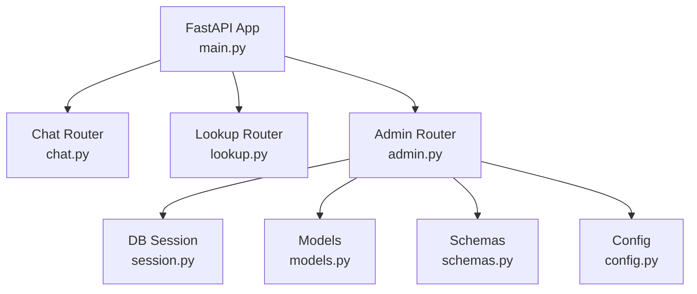
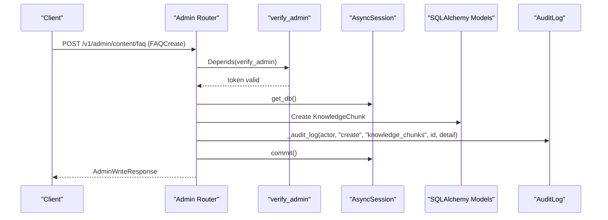
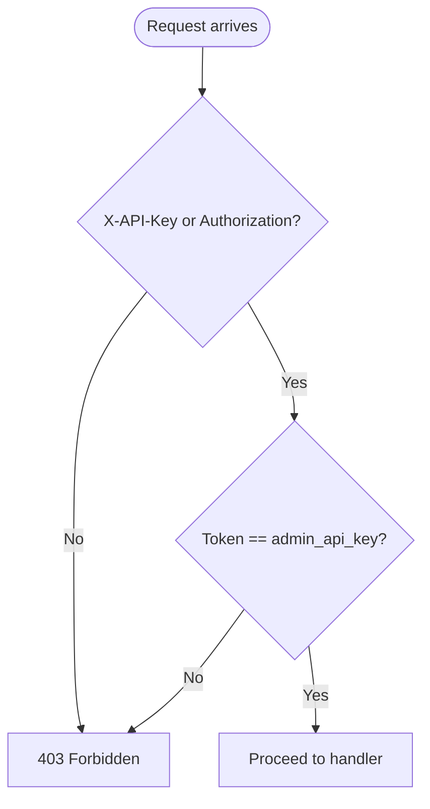
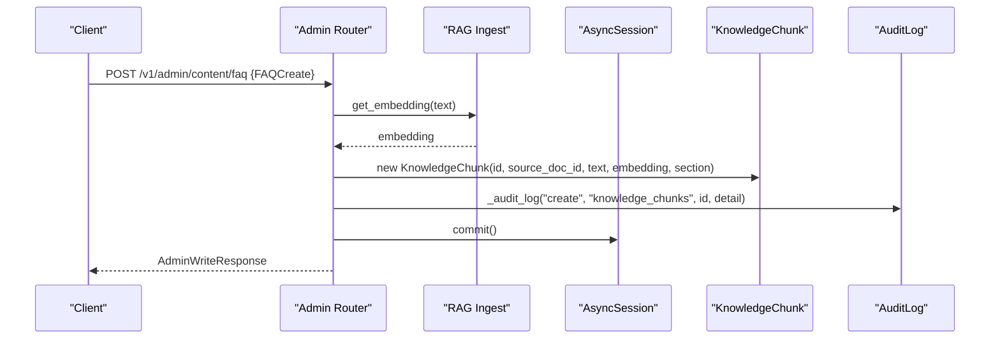
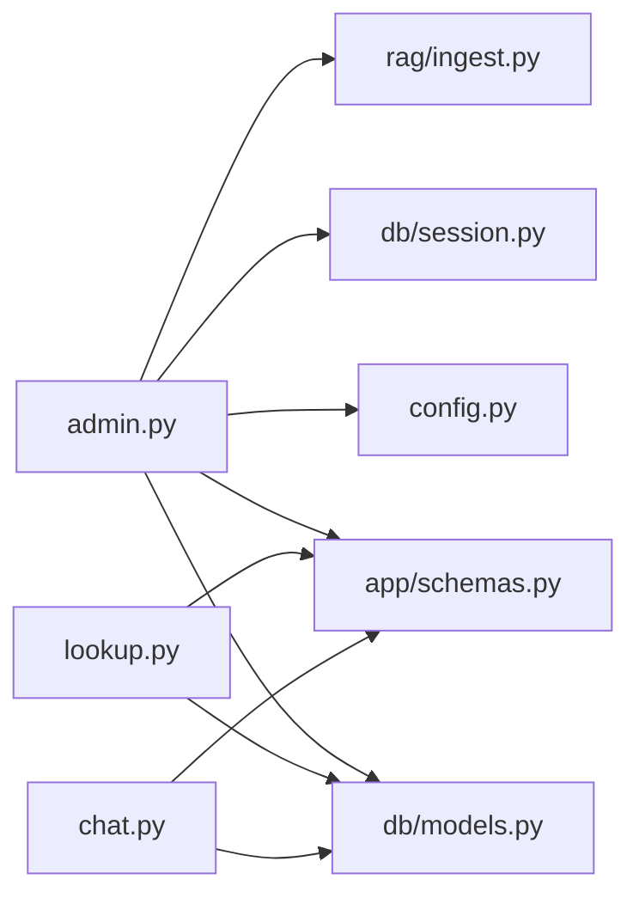

# Admin API

<cite>
**Referenced Files in This Document**
- [admin.py](file://uaea-backend/app/api/admin.py)
- [lookup.py](file://uaea-backend/app/api/lookup.py)
- [chat.py](file://uaea-backend/app/api/chat.py)
- [main.py](file://uaea-backend/app/main.py)
- [schemas.py](file://uaea-backend/app/schemas.py)
- [models.py](file://uaea-backend/app/db/models.py)
- [session.py](file://uaea-backend/app/db/session.py)
- [config.py](file://uaea-backend/app/config.py)
- [rbac.js](file://src/lib/rbac.js)
- [api.js](file://src/lib/api.js)
</cite>

## Table of Contents
1. [Introduction](#introduction)
2. [Project Structure](#project-structure)
3. [Core Components](#core-components)
4. [Architecture Overview](#architecture-overview)
5. [Detailed Component Analysis](#detailed-component-analysis)
6. [Dependency Analysis](#dependency-analysis)
7. [Performance Considerations](#performance-considerations)
8. [Troubleshooting Guide](#troubleshooting-guide)
9. [Conclusion](#conclusion)
10. [Appendices](#appendices)

## Introduction
This document provides comprehensive API documentation for administrative endpoints and related data operations in the UAEA backend. It covers:
- Authentication and authorization for admin routes using an API key or bearer token (RBAC stub).
- CRUD-like operations for content management, including services, fees, deadlines, departments, and conversations.
- Search and filtering capabilities on lookup endpoints.
- Audit logging integration for admin writes.
- Data validation via Pydantic schemas.
- Examples of administrative workflows such as content updates, user management, and system configuration changes.

Note: Some administrative write endpoints are currently implemented as single-item create operations; bulk endpoints are not present in the current codebase.

## Project Structure
The backend is a FastAPI application that mounts three routers: chat, lookup, and admin. The admin router enforces authentication via a dependency and integrates with SQLAlchemy models and Pydantic schemas for request/response validation.

**Diagram sources**
- [main.py:75-79](file://uaea-backend/app/main.py#L75-L79)
- [admin.py:14-26](file://uaea-backend/app/api/admin.py#L14-L26)
- [lookup.py:13-23](file://uaea-backend/app/api/lookup.py#L13-L23)
- [chat.py:10-18](file://uaea-backend/app/api/chat.py#L10-L18)

**Section sources**
- [main.py:1-104](file://uaea-backend/app/main.py#L1-L104)
- [admin.py:1-161](file://uaea-backend/app/api/admin.py#L1-L161)
- [lookup.py:1-104](file://uaea-backend/app/api/lookup.py#L1-L104)
- [chat.py:1-115](file://uaea-backend/app/api/chat.py#L1-L115)

## Core Components
- Admin authentication: verify_admin dependency checks X-API-Key or Authorization header against configured admin_api_key.
- Audit logging: _audit_log helper records actor, action, table_name, record_id, and detail JSON for admin writes.
- Content creation: POST /v1/admin/content/faq and POST /v1/admin/content/fee-tariff create knowledge chunks and fee tariffs respectively.
- Analytics and queue: GET /v1/admin/analytics/intents and GET /v1/admin/queue/unanswered provide read-only admin insights.
- Lookup endpoints: GET /v1/lookup/departments, /fee-tariff, /deadlines support filtering by query parameters.
- Chat endpoints: POST /v1/chat/message, GET /v1/chat/session/{session_id}, POST /v1/chat/escalate manage conversations and escalations.

**Section sources**
- [admin.py:29-48](file://uaea-backend/app/api/admin.py#L29-L48)
- [admin.py:51-63](file://uaea-backend/app/api/admin.py#L51-L63)
- [admin.py:67-125](file://uaea-backend/app/api/admin.py#L67-L125)
- [admin.py:128-161](file://uaea-backend/app/api/admin.py#L128-L161)
- [lookup.py:26-104](file://uaea-backend/app/api/lookup.py#L26-L104)
- [chat.py:21-115](file://uaea-backend/app/api/chat.py#L21-L115)

## Architecture Overview
The admin API uses FastAPI dependencies to enforce access control before executing handlers. Handlers validate inputs with Pydantic schemas, interact with SQLAlchemy models through async sessions, and persist changes while writing audit logs.

**Diagram sources**
- [admin.py:67-94](file://uaea-backend/app/api/admin.py#L67-L94)
- [admin.py:29-48](file://uaea-backend/app/api/admin.py#L29-L48)
- [models.py:126-140](file://uaea-backend/app/db/models.py#L126-L140)
- [models.py:200-212](file://uaea-backend/app/db/models.py#L200-L212)

## Detailed Component Analysis

### Authentication and Authorization
- Admin routes require either:
  - Header X-API-Key set to the configured admin_api_key, or
  - Header Authorization: Bearer <token> equal to admin_api_key.
- If missing or invalid, a 403 Forbidden response is returned.
- Role-based permissions are defined in the frontend RBAC module; server-side enforcement per role is marked as Phase 2.

**Diagram sources**
- [admin.py:29-48](file://uaea-backend/app/api/admin.py#L29-L48)
- [config.py:27-28](file://uaea-backend/app/config.py#L27-L28)

**Section sources**
- [admin.py:29-48](file://uaea-backend/app/api/admin.py#L29-L48)
- [config.py:1-38](file://uaea-backend/app/config.py#L1-L38)
- [rbac.js:10-50](file://src/lib/rbac.js#L10-L50)

### Content Management Endpoints

#### Create FAQ Knowledge Chunk
- Endpoint: POST /v1/admin/content/faq
- Request body schema: FAQCreate (source_doc_id, text, section optional)
- Behavior: Generates embedding, creates KnowledgeChunk, writes audit log, commits transaction.
- Response: AdminWriteResponse (id, status)

**Diagram sources**
- [admin.py:67-94](file://uaea-backend/app/api/admin.py#L67-L94)
- [schemas.py:126-139](file://uaea-backend/app/schemas.py#L126-L139)
- [models.py:126-140](file://uaea-backend/app/db/models.py#L126-L140)
- [models.py:200-212](file://uaea-backend/app/db/models.py#L200-L212)

**Section sources**
- [admin.py:67-94](file://uaea-backend/app/api/admin.py#L67-L94)
- [schemas.py:126-139](file://uaea-backend/app/schemas.py#L126-L139)
- [models.py:126-140](file://uaea-backend/app/db/models.py#L126-L140)

#### Create Fee Tariff
- Endpoint: POST /v1/admin/content/fee-tariff
- Request body schema: FeeTariffCreate (program, category, amount, effective_from, source_doc_ref optional)
- Behavior: Creates FeeTariff, writes audit log, commits transaction.
- Response: AdminWriteResponse (id, status)

**Section sources**
- [admin.py:99-125](file://uaea-backend/app/api/admin.py#L99-L125)
- [schemas.py:141-147](file://uaea-backend/app/schemas.py#L141-L147)
- [models.py:73-82](file://uaea-backend/app/db/models.py#L73-L82)
- [models.py:200-212](file://uaea-backend/app/db/models.py#L200-L212)

### Analytics and Queue Endpoints

#### Intent Analytics
- Endpoint: GET /v1/admin/analytics/intents
- Behavior: Counts messages grouped by intent where role=user and intent is not null, ordered by count descending.
- Response: list[IntentCount]

**Section sources**
- [admin.py:128-144](file://uaea-backend/app/api/admin.py#L128-L144)
- [schemas.py:154-157](file://uaea-backend/app/schemas.py#L154-L157)

#### Unanswered Queries Queue
- Endpoint: GET /v1/admin/queue/unanswered
- Behavior: Returns UnansweredQuery records ordered by count descending.
- Response: list[UnansweredQueryOut]

**Section sources**
- [admin.py:149-161](file://uaea-backend/app/api/admin.py#L149-L161)
- [schemas.py:159-167](file://uaea-backend/app/schemas.py#L159-L167)
- [models.py:216-228](file://uaea-backend/app/db/models.py#L216-L228)

### Lookup Endpoints (Search and Filtering)

#### Departments
- Endpoint: GET /v1/lookup/departments
- Query params: region (filters by campus region), query (fuzzy search across name_en, name_ur, category)
- Response: list[DepartmentOut]

**Section sources**
- [lookup.py:26-53](file://uaea-backend/app/api/lookup.py#L26-L53)
- [schemas.py:30-38](file://uaea-backend/app/schemas.py#L30-L38)
- [models.py:57-69](file://uaea-backend/app/db/models.py#L57-L69)

#### Fee Tariffs
- Endpoint: GET /v1/lookup/fee-tariff
- Query params: program (fuzzy match), category (fuzzy match)
- Response: list[FeeTariffOut]

**Section sources**
- [lookup.py:56-71](file://uaea-backend/app/api/lookup.py#L56-L71)
- [schemas.py:40-48](file://uaea-backend/app/schemas.py#L40-L48)
- [models.py:73-82](file://uaea-backend/app/db/models.py#L73-L82)

#### Deadlines
- Endpoint: GET /v1/lookup/deadlines
- Query params: service (filters by service name via join)
- Response: list[DeadlineOut]

**Section sources**
- [lookup.py:74-90](file://uaea-backend/app/api/lookup.py#L74-L90)
- [schemas.py:70-77](file://uaea-backend/app/schemas.py#L70-L77)
- [models.py:108-122](file://uaea-backend/app/db/models.py#L108-L122)

### Conversations and Escalations

#### Send Message
- Endpoint: POST /v1/chat/message
- Request: ChatMessageRequest (session_id, channel default web, text)
- Behavior: Orchestrates message handling and returns assistant reply with metadata.
- Response: ChatMessageResponse

**Section sources**
- [chat.py:21-39](file://uaea-backend/app/api/chat.py#L21-L39)
- [schemas.py:81-101](file://uaea-backend/app/schemas.py#L81-L101)

#### Get Session
- Endpoint: GET /v1/chat/session/{session_id}
- Behavior: Retrieves conversation and its messages ordered by created_at.
- Response: SessionOut

**Section sources**
- [chat.py:42-85](file://uaea-backend/app/api/chat.py#L42-L85)
- [schemas.py:113-122](file://uaea-backend/app/schemas.py#L113-L122)
- [models.py:144-179](file://uaea-backend/app/db/models.py#L144-L179)

#### Escalate
- Endpoint: POST /v1/chat/escalate
- Request: EscalateRequest (session_id, reason)
- Behavior: Creates escalation ticket and marks conversation escalated.
- Response: EscalateResponse

**Section sources**
- [chat.py:88-115](file://uaea-backend/app/api/chat.py#L88-L115)
- [schemas.py:103-111](file://uaea-backend/app/schemas.py#L103-L111)
- [models.py:183-196](file://uaea-backend/app/db/models.py#L183-L196)

## Dependency Analysis
- Admin router depends on:
  - Config for admin_api_key
  - DB session factory for async database access
  - Models for entities (KnowledgeChunk, FeeTariff, Message, UnansweredQuery, AuditLog)
  - Schemas for input/output validation
  - RAG ingest for embeddings
- Lookup router depends on:
  - Models for Department, FeeTariff, Deadline, Service, Campus
  - Schemas for output serialization
- Chat router depends on:
  - Models for Conversation, Message, EscalationTicket
  - Orchestrator for message handling

**Diagram sources**
- [admin.py:14-24](file://uaea-backend/app/api/admin.py#L14-L24)
- [lookup.py:13-21](file://uaea-backend/app/api/lookup.py#L13-L21)
- [chat.py:10-16](file://uaea-backend/app/api/chat.py#L10-L16)

**Section sources**
- [admin.py:14-24](file://uaea-backend/app/api/admin.py#L14-L24)
- [lookup.py:13-21](file://uaea-backend/app/api/lookup.py#L13-L21)
- [chat.py:10-16](file://uaea-backend/app/api/chat.py#L10-L16)

## Performance Considerations
- Database connections: Async engine configured with pool_size and max_overflow to handle concurrent requests efficiently.
- Rate limiting: Global IP-based rate limiter integrated via slowapi; per-session rate limiting middleware placeholder exists for chat endpoints.
- Query optimization: Lookup endpoints use selective joins and ILIKE filters; consider indexing frequently filtered columns if needed.
- Embeddings: FAQ creation calls external embedding provider; ensure timeouts and retries are handled at the RAG layer.

**Section sources**
- [session.py:7-8](file://uaea-backend/app/db/session.py#L7-L8)
- [main.py:25-27](file://uaea-backend/app/main.py#L25-L27)
- [main.py:91-99](file://uaea-backend/app/main.py#L91-L99)
- [lookup.py:33-53](file://uaea-backend/app/api/lookup.py#L33-L53)

## Troubleshooting Guide
- 403 Forbidden on admin endpoints: Ensure X-API-Key or Authorization header matches configured admin_api_key.
- 404 Not Found on chat session: Verify session_id exists and is active.
- Validation errors: Check request payloads against Pydantic schemas; required fields must be provided.
- Audit logs: Confirm admin writes include actor, action, table_name, record_id, and detail for traceability.

Common error responses:
- 403: Invalid or missing admin credentials
- 404: Resource not found (e.g., session)
- 429: Rate limit exceeded

**Section sources**
- [admin.py:29-48](file://uaea-backend/app/api/admin.py#L29-L48)
- [chat.py:42-56](file://uaea-backend/app/api/chat.py#L42-L56)
- [main.py:51-58](file://uaea-backend/app/main.py#L51-L58)

## Conclusion
The admin API provides secure, audited content management and analytics capabilities with robust authentication and validation. While some CRUD operations are implemented as single-item creates, bulk operations are not yet available. Lookup endpoints offer flexible search and filtering for departments, fees, and deadlines. Conversations and escalations are supported via chat endpoints. Future enhancements should include full RBAC enforcement server-side, additional CRUD endpoints for services and departments, and bulk operation endpoints.

## Appendices

### Administrative Workflows

#### Content Update Workflow (FAQ)
- Steps:
  - Prepare FAQCreate payload with source_doc_id, text, and optional section.
  - Send POST /v1/admin/content/faq with X-API-Key header.
  - Receive AdminWriteResponse with chunk id.
  - Review audit log entry for the actor and action.

**Section sources**
- [admin.py:67-94](file://uaea-backend/app/api/admin.py#L67-L94)
- [schemas.py:126-139](file://uaea-backend/app/schemas.py#L126-L139)

#### User Management Workflow (Conceptual)
- Current state: No explicit user management endpoints exist in the backend.
- Recommendation: Implement endpoints for creating/updating users with roles mapped to PERMS from rbac.js, enforcing server-side permission checks.

#### System Configuration Changes
- Configuration values are loaded from environment variables via Settings class.
- Example settings include database_url, embedding_provider, cors_origins, rate_limit_per_ip, admin_api_key.
- Changes require restarting the service to apply.

**Section sources**
- [config.py:1-38](file://uaea-backend/app/config.py#L1-L38)

### Frontend Integration Notes
- Admin endpoints are called from the frontend with X-API-Key header.
- RBAC permissions gate UI actions; server-side enforcement is planned for Phase 2.

**Section sources**
- [api.js:108-150](file://src/lib/api.js#L108-L150)
- [rbac.js:10-50](file://src/lib/rbac.js#L10-L50)