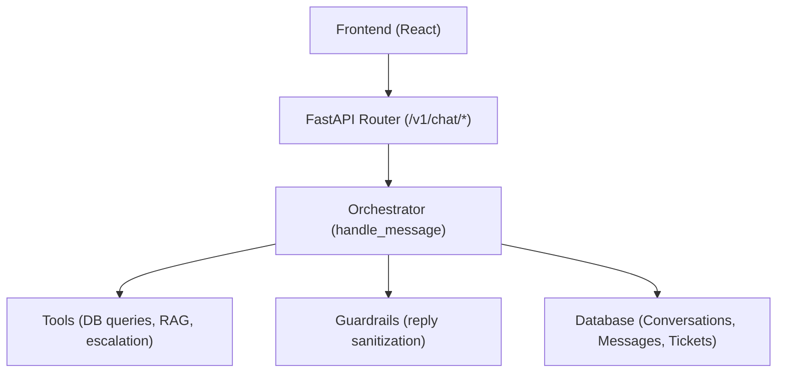
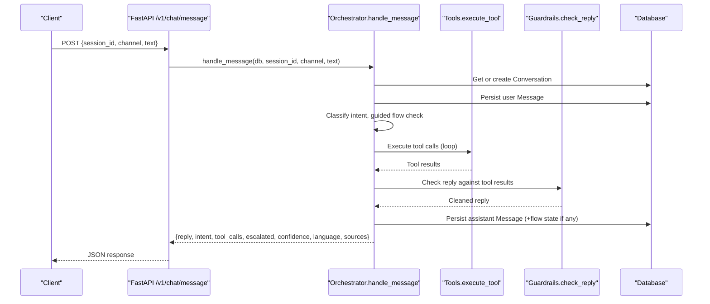
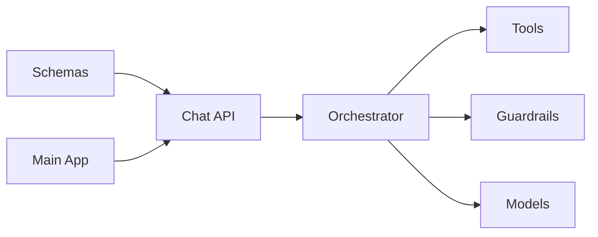

# Chat API

<cite>
**Referenced Files in This Document**
- [chat.py](file://uaea-backend/app/api/chat.py)
- [schemas.py](file://uaea-backend/app/schemas.py)
- [orchestrator.py](file://uaea-backend/app/orchestrator/orchestrator.py)
- [tools.py](file://uaea-backend/app/orchestrator/tools.py)
- [intent_router.py](file://uaea-backend/app/orchestrator/intent_router.py)
- [guardrails.py](file://uaea-backend/app/orchestrator/guardrails.py)
- [models.py](file://uaea-backend/app/db/models.py)
- [main.py](file://uaea-backend/app/main.py)
- [api.js](file://src/lib/api.js)
- [Chat index.jsx](file://src/pages/student/Chat/index.jsx)
</cite>

## Table of Contents
1. [Introduction](#introduction)
2. [Project Structure](#project-structure)
3. [Core Components](#core-components)
4. [Architecture Overview](#architecture-overview)
5. [Detailed Component Analysis](#detailed-component-analysis)
6. [Dependency Analysis](#dependency-analysis)
7. [Performance Considerations](#performance-considerations)
8. [Troubleshooting Guide](#troubleshooting-guide)
9. [Conclusion](#conclusion)
10. [Appendices](#appendices)

## Introduction
This document provides detailed API documentation for the Chat endpoints that power the student-facing chat experience. It covers:
- POST /v1/chat/message: send a message and receive an AI response, including intent classification, tool calls, sources, language, confidence, and escalation flags.
- GET /v1/chat/session/{session_id}: retrieve full conversation history with message formatting and metadata.
- POST /v1/chat/escalate: create an escalation ticket for a conversation.

It also documents authentication requirements, error handling patterns, rate limiting considerations, and practical examples of common chat workflows.

## Project Structure
The Chat API is implemented in the FastAPI backend under uaea-backend/app/api/chat.py and uses Pydantic schemas from app/schemas.py. The orchestrator (app/orchestrator/orchestrator.py) coordinates normalization, intent classification, guided flows, LLM tool use, guardrails, and persistence. Data models are defined in app/db/models.py. Rate limiting and CORS are configured in app/main.py. The frontend client lives in src/lib/api.js and demonstrates how to call these endpoints.

**Diagram sources**
- [chat.py:21-39](file://uaea-backend/app/api/chat.py#L21-L39)
- [orchestrator.py:46-143](file://uaea-backend/app/orchestrator/orchestrator.py#L46-L143)
- [tools.py:18-87](file://uaea-backend/app/orchestrator/tools.py#L18-L87)
- [guardrails.py:74-119](file://uaea-backend/app/orchestrator/guardrails.py#L74-L119)
- [models.py:144-195](file://uaea-backend/app/db/models.py#L144-L195)

**Section sources**
- [chat.py:1-115](file://uaea-backend/app/api/chat.py#L1-L115)
- [schemas.py:81-122](file://uaea-backend/app/schemas.py#L81-L122)
- [main.py:40-79](file://uaea-backend/app/main.py#L40-L79)

## Core Components
- POST /v1/chat/message: Accepts a session-scoped message and returns a structured reply with intent, tool calls, escalation flag, confidence, language, and sources.
- GET /v1/chat/session/{session_id}: Returns the latest open conversation for a session along with all messages and metadata.
- POST /v1/chat/escalate: Creates an escalation ticket linked to the active conversation for a session.

Request/response schemas are defined in Pydantic models and enforced by FastAPI.

**Section sources**
- [chat.py:21-115](file://uaea-backend/app/api/chat.py#L21-L115)
- [schemas.py:81-122](file://uaea-backend/app/schemas.py#L81-L122)

## Architecture Overview
End-to-end flow for a single message:
1. Request validation via Pydantic schemas.
2. Input sanitization and language detection.
3. Intent classification using a rules-based router.
4. Conversation retrieval or creation.
5. Guided flow slot-filling when applicable.
6. LLM invocation with tool definitions; execution of tool calls in a loop up to a maximum number of rounds.
7. Guardrail checks to remove ungrounded claims.
8. Persistence of user and assistant messages, optional flow state, and escalation flags.
9. Response assembly with intent, tool calls, confidence, language, and sources.

**Diagram sources**
- [orchestrator.py:46-143](file://uaea-backend/app/orchestrator/orchestrator.py#L46-L143)
- [tools.py:218-235](file://uaea-backend/app/orchestrator/tools.py#L218-L235)
- [guardrails.py:74-119](file://uaea-backend/app/orchestrator/guardrails.py#L74-L119)
- [chat.py:21-39](file://uaea-backend/app/api/chat.py#L21-L39)

## Detailed Component Analysis

### POST /v1/chat/message
- Purpose: Send a chat message and receive an AI response.
- Path: POST /v1/chat/message
- Authentication: Not required for this endpoint.
- Request body fields:
  - session_id: string — unique identifier for the user’s session/conversation.
  - channel: string — defaults to "web".
  - text: string — the user’s message.
- Response fields:
  - reply: string — assistant’s final answer after guardrails.
  - intent: string | null — classified intent.
  - tool_calls: array of {name, args, result} — tools executed during processing.
  - escalated: boolean — true if the system decided to escalate.
  - confidence: float — classifier confidence score.
  - language: string — detected language used for reply.
  - sources: array of objects — source references extracted from tool results.

Processing highlights:
- Input sanitization and language detection occur before classification.
- Guided flows may short-circuit the LLM path to collect slots step-by-step.
- LLM tool-use loop executes multiple tool calls per turn, capped at a maximum number of rounds.
- Guardrails strip ungrounded numbers/dates/requirements not backed by tool results.
- Low-confidence non-guided intents are tracked for review.

Error handling:
- If the LLM provider returns an error, a friendly fallback reply is returned without escalating.
- Database errors will surface as HTTP exceptions from SQLAlchemy/FastAPI.

Rate limiting:
- Global IP-based rate limiting is enabled; per-session limits are scaffolded but not enforced in code.

Practical example:
- Frontend usage is demonstrated in the client module.

**Section sources**
- [chat.py:21-39](file://uaea-backend/app/api/chat.py#L21-L39)
- [schemas.py:81-100](file://uaea-backend/app/schemas.py#L81-L100)
- [orchestrator.py:46-143](file://uaea-backend/app/orchestrator/orchestrator.py#L46-L143)
- [tools.py:218-235](file://uaea-backend/app/orchestrator/tools.py#L218-L235)
- [guardrails.py:74-119](file://uaea-backend/app/orchestrator/guardrails.py#L74-L119)
- [main.py:89-99](file://uaea-backend/app/main.py#L89-L99)
- [api.js:42-47](file://src/lib/api.js#L42-L47)

### GET /v1/chat/session/{session_id}
- Purpose: Retrieve the latest open conversation for a session and its full message history.
- Path: GET /v1/chat/session/{session_id}
- Authentication: Not required for this endpoint.
- Path parameter:
  - session_id: string — identifies the conversation.
- Response fields:
  - id: string — internal conversation ID.
  - session_id: string — same as input.
  - channel: string — channel used for the conversation.
  - started_at: datetime — when the conversation began.
  - resolved: boolean — whether the conversation was marked resolved.
  - escalated: boolean — whether escalation occurred.
  - messages: array of message objects:
    - id: string
    - role: string ("user", "assistant", "tool", "system")
    - text: string
    - intent: string | null
    - tool_calls: array of {name, args, result}
    - feedback: string | null
    - created_at: string (ISO timestamp)

Behavior:
- Retrieves the most recent open conversation for the given session_id.
- Fetches all messages ordered by creation time.
- Returns 404 if no active conversation exists for the session.

**Section sources**
- [chat.py:42-85](file://uaea-backend/app/api/chat.py#L42-L85)
- [schemas.py:113-122](file://uaea-backend/app/schemas.py#L113-L122)
- [models.py:144-178](file://uaea-backend/app/db/models.py#L144-L178)
- [api.js:54-56](file://src/lib/api.js#L54-L56)

### POST /v1/chat/escalate
- Purpose: Create an escalation ticket for a conversation.
- Path: POST /v1/chat/escalate
- Authentication: Not required for this endpoint.
- Request body fields:
  - session_id: string — identifies the conversation.
  - reason: string — explanation for escalation.
- Response fields:
  - ticket_id: string — newly created ticket ID.
  - status: string — always "open" on creation.

Behavior:
- Finds the latest open conversation for the session.
- Creates an EscalationTicket and marks the conversation as escalated.
- Returns 404 if no active conversation exists for the session.

Note:
- An alternative escalation path exists via tool calls within the orchestrator, which can automatically create tickets and set the escalated flag.

**Section sources**
- [chat.py:88-115](file://uaea-backend/app/api/chat.py#L88-L115)
- [schemas.py:103-110](file://uaea-backend/app/schemas.py#L103-L110)
- [models.py:183-195](file://uaea-backend/app/db/models.py#L183-L195)
- [tools.py:200-215](file://uaea-backend/app/orchestrator/tools.py#L200-L215)
- [api.js:64-69](file://src/lib/api.js#L64-L69)

### Session Management
- Sessions are represented by Conversation records keyed by session_id.
- Each message belongs to a Conversation and includes role, text, intent, tool_calls, and timestamps.
- The orchestrator creates or reuses the latest open conversation for a session_id.
- Escalation and resolution flags are stored on the Conversation.

**Section sources**
- [models.py:144-178](file://uaea-backend/app/db/models.py#L144-L178)
- [orchestrator.py:321-341](file://uaea-backend/app/orchestrator/orchestrator.py#L321-L341)

### Intent Classification Results
- Intent classification uses a deterministic keyword-based router.
- Supported intents include admission, fee_challan, fee_tariff, result, degree, transcript, department_lookup, small_talk, and knowledge_question.
- Confidence is computed based on strong and weak keyword matches.
- Guided flows are triggered for specific intents to collect additional information step-by-step.

**Section sources**
- [intent_router.py:14-62](file://uaea-backend/app/orchestrator/intent_router.py#L14-L62)
- [intent_router.py:65-103](file://uaea-backend/app/orchestrator/intent_router.py#L65-L103)
- [orchestrator.py:61-91](file://uaea-backend/app/orchestrator/orchestrator.py#L61-L91)

### Tool Calls
- Tools available to the LLM include:
  - search_knowledge_base
  - get_department
  - get_fee_tariff
  - get_deadline
  - get_document_checklist
  - create_escalation_ticket
- Tool definitions specify names, descriptions, and input schemas.
- Tool execution is dispatched by name and returns structured results.
- Tool results are persisted with assistant messages and included in responses.

**Section sources**
- [tools.py:18-87](file://uaea-backend/app/orchestrator/tools.py#L18-L87)
- [tools.py:218-235](file://uaea-backend/app/orchestrator/tools.py#L218-L235)
- [orchestrator.py:229-318](file://uaea-backend/app/orchestrator/orchestrator.py#L229-L318)

### Escalation Handling
- Automatic escalation:
  - When the LLM decides to create an escalation ticket via tool calls, the orchestrator sets escalated=true and persists the ticket.
  - Exhaustion of tool-call rounds triggers a fallback reply and escalates.
- Manual escalation:
  - Clients can call POST /v1/chat/escalate to create a ticket and mark the conversation as escalated.

**Section sources**
- [orchestrator.py:282-318](file://uaea-backend/app/orchestrator/orchestrator.py#L282-L318)
- [chat.py:88-115](file://uaea-backend/app/api/chat.py#L88-L115)
- [tools.py:200-215](file://uaea-backend/app/orchestrator/tools.py#L200-L215)

### Authentication Requirements
- Chat endpoints do not require authentication headers.
- Admin endpoints (outside the scope of this document) require an API key via X-API-Key header.

**Section sources**
- [api.js:108-150](file://src/lib/api.js#L108-L150)

### Error Handling Patterns
- 404 Not Found:
  - GET /v1/chat/session/{session_id} returns 404 when no active conversation exists.
  - POST /v1/chat/escalate returns 404 when no active conversation exists.
- 429 Too Many Requests:
  - Global rate limit exceeded returns a structured JSON error with detail.
- LLM provider errors:
  - Orchestrator catches API errors and returns a friendly fallback reply without escalating.

**Section sources**
- [chat.py:42-56](file://uaea-backend/app/api/chat.py#L42-L56)
- [chat.py:88-103](file://uaea-backend/app/api/chat.py#L88-L103)
- [main.py:51-58](file://uaea-backend/app/main.py#L51-L58)
- [orchestrator.py:255-271](file://uaea-backend/app/orchestrator/orchestrator.py#L255-L271)

### Rate Limiting Considerations
- Global rate limiting is enabled using an IP-based limiter.
- Per-session rate limiting middleware is present but currently does not enforce limits in code.
- Clients should implement retry logic with exponential backoff for 429 responses.

**Section sources**
- [main.py:25-58](file://uaea-backend/app/main.py#L25-L58)
- [main.py:89-99](file://uaea-backend/app/main.py#L89-L99)

### Practical Examples and Common Workflows

#### Example: Sending a message and receiving a response
- Frontend client sends a POST request with session_id, channel, and text.
- Backend processes through normalization, classification, guided flows, LLM tool use, guardrails, and persistence.
- Response includes reply, intent, tool_calls, escalated, confidence, language, and sources.

**Section sources**
- [api.js:42-47](file://src/lib/api.js#L42-L47)
- [chat.py:21-39](file://uaea-backend/app/api/chat.py#L21-L39)
- [orchestrator.py:46-143](file://uaea-backend/app/orchestrator/orchestrator.py#L46-L143)

#### Example: Retrieving conversation history
- Frontend calls GET /v1/chat/session/{session_id}.
- Backend returns the latest open conversation and all messages with metadata.

**Section sources**
- [api.js:54-56](file://src/lib/api.js#L54-L56)
- [chat.py:42-85](file://uaea-backend/app/api/chat.py#L42-L85)

#### Example: Creating an escalation ticket
- Frontend calls POST /v1/chat/escalate with session_id and reason.
- Backend creates a ticket and marks the conversation as escalated.

**Section sources**
- [api.js:64-69](file://src/lib/api.js#L64-L69)
- [chat.py:88-115](file://uaea-backend/app/api/chat.py#L88-L115)

#### Example: Guided flow workflow
- For intents like admission, fee challan, or degree, the orchestrator initiates a guided flow to collect required slots.
- The assistant prompts for missing information step-by-step before executing actions and returning a summary.

**Section sources**
- [intent_router.py:61-62](file://uaea-backend/app/orchestrator/intent_router.py#L61-L62)
- [orchestrator.py:80-91](file://uaea-backend/app/orchestrator/orchestrator.py#L80-L91)
- [orchestrator.py:146-226](file://uaea-backend/app/orchestrator/orchestrator.py#L146-L226)

## Dependency Analysis
The Chat API depends on several components:
- Schemas define strict request/response contracts.
- Orchestrator coordinates normalization, classification, guided flows, LLM tool use, guardrails, and persistence.
- Tools provide data access and side effects (e.g., creating tickets).
- Models define database tables for conversations, messages, and tickets.
- Main application configures CORS, rate limiting, and mounts routers.

**Diagram sources**
- [schemas.py:81-122](file://uaea-backend/app/schemas.py#L81-L122)
- [chat.py:21-115](file://uaea-backend/app/api/chat.py#L21-L115)
- [orchestrator.py:46-143](file://uaea-backend/app/orchestrator/orchestrator.py#L46-L143)
- [tools.py:18-87](file://uaea-backend/app/orchestrator/tools.py#L18-L87)
- [guardrails.py:74-119](file://uaea-backend/app/orchestrator/guardrails.py#L74-L119)
- [models.py:144-195](file://uaea-backend/app/db/models.py#L144-L195)
- [main.py:40-79](file://uaea-backend/app/main.py#L40-L79)

**Section sources**
- [schemas.py:81-122](file://uaea-backend/app/schemas.py#L81-L122)
- [chat.py:21-115](file://uaea-backend/app/api/chat.py#L21-L115)
- [orchestrator.py:46-143](file://uaea-backend/app/orchestrator/orchestrator.py#L46-L143)
- [tools.py:18-87](file://uaea-backend/app/orchestrator/tools.py#L18-L87)
- [guardrails.py:74-119](file://uaea-backend/app/orchestrator/guardrails.py#L74-L119)
- [models.py:144-195](file://uaea-backend/app/db/models.py#L144-L195)
- [main.py:40-79](file://uaea-backend/app/main.py#L40-L79)

## Performance Considerations
- LLM tool-use loop is capped at a maximum number of rounds to prevent excessive latency.
- Message history passed to the LLM is truncated to the last 20 messages to control context size.
- Guardrails operate post-reply to minimize impact on response time while ensuring factual grounding.
- Database queries are optimized with appropriate ordering and limits.

[No sources needed since this section provides general guidance]

## Troubleshooting Guide
Common issues and resolutions:
- 404 Not Found on session retrieval or escalation:
  - Ensure the session_id corresponds to an active (non-resolved) conversation.
- 429 Too Many Requests:
  - Implement retries with backoff; reduce request frequency.
- Unexpected replies or missing details:
  - Check tool_calls in the response to verify data retrieval.
  - Review guardrails logs for ungrounded claims being stripped.
- Low confidence responses:
  - Inspect intent and confidence in the response; consider prompting for clarification or escalating.

**Section sources**
- [chat.py:42-56](file://uaea-backend/app/api/chat.py#L42-L56)
- [chat.py:88-103](file://uaea-backend/app/api/chat.py#L88-L103)
- [main.py:51-58](file://uaea-backend/app/main.py#L51-L58)
- [guardrails.py:74-119](file://uaea-backend/app/orchestrator/guardrails.py#L74-L119)
- [orchestrator.py:123-129](file://uaea-backend/app/orchestrator/orchestrator.py#L123-L129)

## Conclusion
The Chat API provides a robust, secure, and extensible interface for student interactions. It integrates intent classification, guided flows, LLM tool use, and guardrails to deliver accurate, grounded responses. Session management and escalation mechanisms ensure continuity and human handoff when necessary. Clients can rely on well-defined schemas and predictable error handling to build responsive and reliable chat experiences.

[No sources needed since this section summarizes without analyzing specific files]

## Appendices

### API Endpoints Summary

- POST /v1/chat/message
  - Request: {session_id, channel?, text}
  - Response: {reply, intent?, tool_calls[], escalated?, confidence?, language?, sources[]}
  - Errors: 429 (rate limit), provider errors handled gracefully

- GET /v1/chat/session/{session_id}
  - Response: {id, session_id, channel, started_at, resolved?, escalated?, messages[]}
  - Errors: 404 if no active conversation

- POST /v1/chat/escalate
  - Request: {session_id, reason}
  - Response: {ticket_id, status="open"}
  - Errors: 404 if no active conversation

**Section sources**
- [schemas.py:81-122](file://uaea-backend/app/schemas.py#L81-L122)
- [chat.py:21-115](file://uaea-backend/app/api/chat.py#L21-L115)

### Frontend Integration Notes
- Base URL configuration via environment variable.
- Unified request helper throws errors with detail from API responses.
- Chat UI demonstrates sending messages and displaying classification, tool traces, and escalation options.

**Section sources**
- [api.js:1-69](file://src/lib/api.js#L1-L69)
- [Chat index.jsx:62-138](file://src/pages/student/Chat/index.jsx#L62-L138)