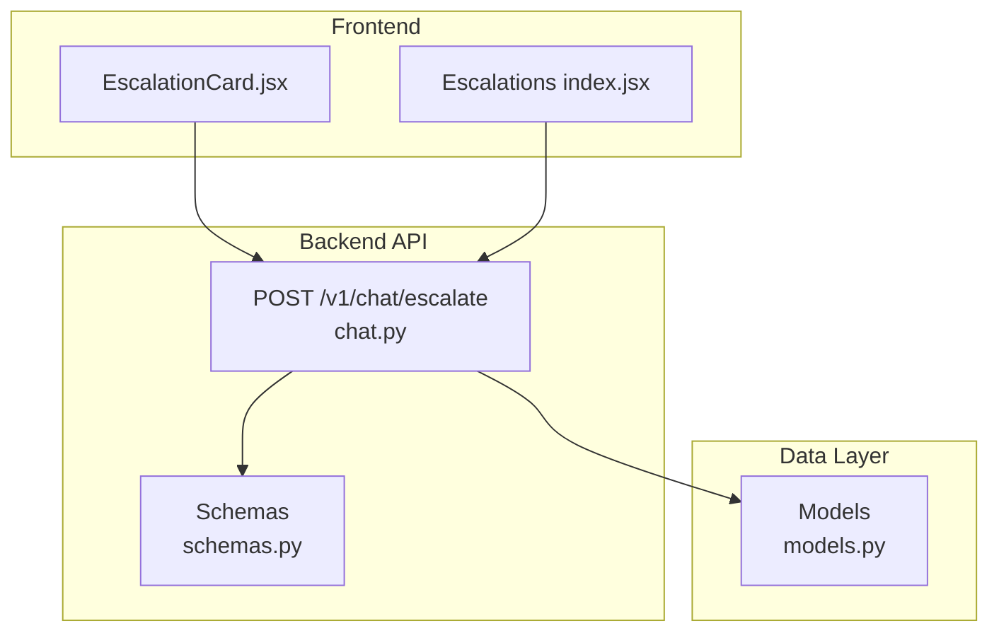
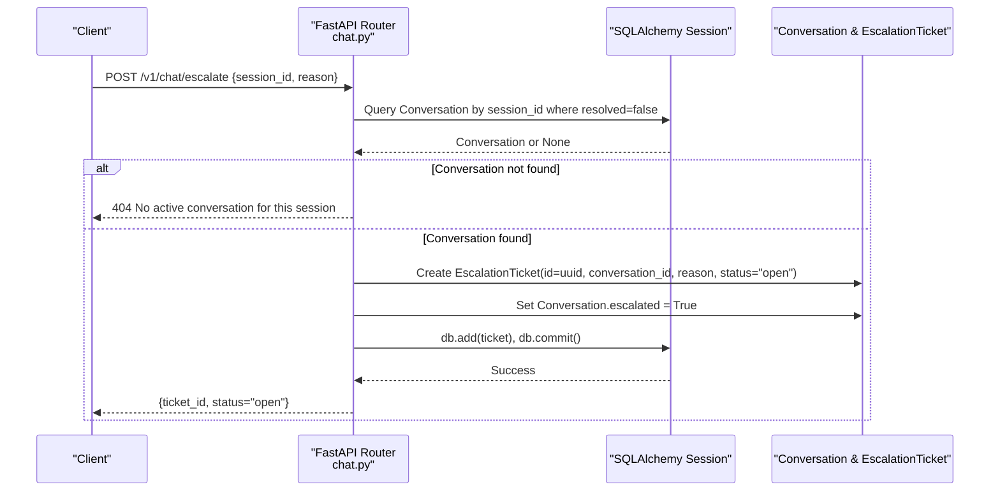
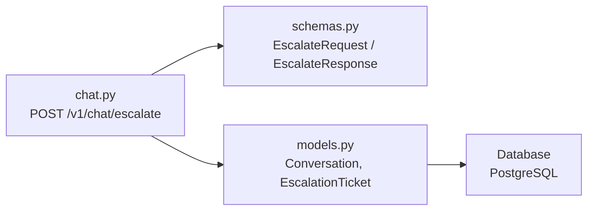

# Escalation Handling Endpoint

<cite>
**Referenced Files in This Document**
- [chat.py](file://uaea-backend/app/api/chat.py)
- [schemas.py](file://uaea-backend/app/schemas.py)
- [models.py](file://uaea-backend/app/db/models.py)
- [EscalationCard.jsx](file://src/pages/student/Chat/EscalationCard.jsx)
- [index.jsx](file://src/pages/Escalations/index.jsx)
</cite>

## Table of Contents
1. [Introduction](#introduction)
2. [Project Structure](#project-structure)
3. [Core Components](#core-components)
4. [Architecture Overview](#architecture-overview)
5. [Detailed Component Analysis](#detailed-component-analysis)
6. [Dependency Analysis](#dependency-analysis)
7. [Performance Considerations](#performance-considerations)
8. [Troubleshooting Guide](#troubleshooting-guide)
9. [Conclusion](#conclusion)
10. [Appendices](#appendices)

## Introduction
This document provides detailed documentation for the POST /v1/chat/escalate endpoint. It explains how to create escalation tickets from a chat session, including request and response schemas, the end-to-end workflow (conversation validation, ticket creation with unique IDs, conversation state updates), database transaction behavior, error handling, and integration points with the admin dashboard and notification systems. It also includes practical examples of when escalations are triggered from user interface actions, automated system triggers, or manual admin interventions.

## Project Structure
The escalation feature spans backend API routes, data models, and Pydantic schemas, as well as frontend components that display escalation prompts and manage tickets in an admin-like view.

**Diagram sources**
- [chat.py:88-114](file://uaea-backend/app/api/chat.py#L88-L114)
- [schemas.py:103-110](file://uaea-backend/app/schemas.py#L103-L110)
- [models.py:144-195](file://uaea-backend/app/db/models.py#L144-L195)
- [EscalationCard.jsx:1-42](file://src/pages/student/Chat/EscalationCard.jsx#L1-L42)
- [index.jsx:1-167](file://src/pages/Escalations/index.jsx#L1-L167)

**Section sources**
- [chat.py:88-114](file://uaea-backend/app/api/chat.py#L88-L114)
- [schemas.py:103-110](file://uaea-backend/app/schemas.py#L103-L110)
- [models.py:144-195](file://uaea-backend/app/db/models.py#L144-L195)
- [EscalationCard.jsx:1-42](file://src/pages/student/Chat/EscalationCard.jsx#L1-L42)
- [index.jsx:1-167](file://src/pages/Escalations/index.jsx#L1-L167)

## Core Components
- Endpoint: POST /v1/chat/escalate creates an escalation ticket for an active conversation.
- Request schema: EscalateRequest requires session_id and reason.
- Response schema: EscalateResponse returns ticket_id and status.
- Data models: Conversation, Message, and EscalationTicket define persistence structures and relationships.

Key responsibilities:
- Validate that the conversation exists and is not resolved.
- Create an EscalationTicket with a unique UUID and initial status.
- Mark the conversation as escalated.
- Persist changes within a single database session commit.

**Section sources**
- [chat.py:88-114](file://uaea-backend/app/api/chat.py#L88-L114)
- [schemas.py:103-110](file://uaea-backend/app/schemas.py#L103-L110)
- [models.py:144-195](file://uaea-backend/app/db/models.py#L144-L195)

## Architecture Overview
The escalation flow validates the target conversation, creates a ticket, updates conversation state, and commits all changes atomically.

**Diagram sources**
- [chat.py:88-114](file://uaea-backend/app/api/chat.py#L88-L114)
- [models.py:144-195](file://uaea-backend/app/db/models.py#L144-L195)

## Detailed Component Analysis

### POST /v1/chat/escalate
- Purpose: Create an escalation ticket for an active conversation and mark it as escalated.
- Request body:
  - session_id: string; identifies the conversation to escalate.
  - reason: string; describes why the escalation was created.
- Response body:
  - ticket_id: string; unique identifier of the created ticket.
  - status: string; initial status is "open".

Workflow details:
- Conversation validation:
  - The endpoint queries for the most recent Conversation matching the provided session_id that is not resolved.
  - If no such conversation exists, it returns a 404 error indicating there is no active conversation for the session.
- Ticket creation:
  - A new EscalationTicket is created with a generated UUID id, linked to the conversation via conversation_id, populated with the provided reason, and initialized with status "open".
- Conversation state update:
  - The Conversation record’s escalated flag is set to True to reflect that the conversation has been escalated.
- Database transaction management:
  - Both the ticket insertion and conversation update are added to the same SQLAlchemy session and committed together, ensuring atomicity.

Error handling:
- Missing or inactive conversation: Returns HTTP 404 with a descriptive detail message.
- Database constraints: Any constraint violations during insert/update will propagate as server errors; consider adding explicit checks or retries if needed.
- Transaction rollback: In case of exceptions during commit, the session should be rolled back to maintain consistency.

Integration points:
- Admin dashboard: The Escalations page lists tickets and allows status updates via a separate admin endpoint (not part of this route).
- Notification systems: After successful creation, you can integrate external notifications (email, Slack, etc.) using the returned ticket_id and reason.

Examples of triggering escalations:
- User interface action: A student clicks “Talk to a person” in the chat UI, which calls POST /v1/chat/escalate with the current session_id and a reason derived from context.
- Automated system trigger: Orchestrator logic detects low confidence or unresolved intent and programmatically escalates by calling the endpoint.
- Manual admin intervention: An admin reviews a conversation and escalates it by invoking the endpoint with the relevant session_id and reason.

**Section sources**
- [chat.py:88-114](file://uaea-backend/app/api/chat.py#L88-L114)
- [schemas.py:103-110](file://uaea-backend/app/schemas.py#L103-L110)
- [models.py:144-195](file://uaea-backend/app/db/models.py#L144-L195)

### Request and Response Schemas
- EscalateRequest:
  - session_id: string; required.
  - reason: string; required.
- EscalateResponse:
  - ticket_id: string; unique ID of the created ticket.
  - status: string; default "open".

These schemas enforce input validation and standardize responses across clients.

**Section sources**
- [schemas.py:103-110](file://uaea-backend/app/schemas.py#L103-L110)

### Data Models and Relationships
- Conversation:
  - Fields include session_id, channel, started_at, resolved, escalated.
  - Messages are related via a one-to-many relationship.
- EscalationTicket:
  - Fields include id (UUID), conversation_id (FK to Conversation), reason, status, assigned_to, created_at.
  - Linked to Conversation via conversation_id.

Relationships ensure that each ticket belongs to exactly one conversation and that escalation state is tracked on the conversation.

**Section sources**
- [models.py:144-195](file://uaea-backend/app/db/models.py#L144-L195)

### Frontend Integration Points
- Student chat UI:
  - EscalationCard displays guidance to contact a department when the assistant cannot answer safely. While it does not directly call the escalation endpoint, it represents the user-facing moment where escalation may be initiated.
- Admin Escalations view:
  - Lists tickets and supports status transitions via a separate admin endpoint. This complements the creation endpoint by enabling lifecycle management after tickets are created.

**Section sources**
- [EscalationCard.jsx:1-42](file://src/pages/student/Chat/EscalationCard.jsx#L1-L42)
- [index.jsx:1-167](file://src/pages/Escalations/index.jsx#L1-L167)

## Dependency Analysis
The escalation endpoint depends on FastAPI routing, Pydantic schemas for validation, and SQLAlchemy models for persistence.

**Diagram sources**
- [chat.py:88-114](file://uaea-backend/app/api/chat.py#L88-L114)
- [schemas.py:103-110](file://uaea-backend/app/schemas.py#L103-L110)
- [models.py:144-195](file://uaea-backend/app/db/models.py#L144-L195)

**Section sources**
- [chat.py:88-114](file://uaea-backend/app/api/chat.py#L88-L114)
- [schemas.py:103-110](file://uaea-backend/app/schemas.py#L103-L110)
- [models.py:144-195](file://uaea-backend/app/db/models.py#L144-L195)

## Performance Considerations
- Index usage: Ensure indexes exist on Conversation.session_id and EscalationTicket.conversation_id to optimize lookups and joins.
- Minimal writes: Only two writes per escalation (ticket insert and conversation update) reduce overhead.
- Concurrency: Use database-level constraints and transactions to prevent duplicate tickets for the same conversation at the same time.
- Asynchronous I/O: The endpoint uses async SQLAlchemy sessions; ensure connection pooling is appropriately sized for expected load.

[No sources needed since this section provides general guidance]

## Troubleshooting Guide
Common issues and resolutions:
- Inactive or missing conversation:
  - Symptom: 404 error with detail indicating no active conversation for the session.
  - Resolution: Verify that the session_id corresponds to a Conversation with resolved=false. Check session creation flows and ensure the conversation is still active.
- Database constraint violations:
  - Symptom: Server error during ticket creation or conversation update.
  - Resolution: Inspect foreign key constraints (e.g., conversation_id must reference an existing Conversation). Add defensive checks before writing or handle errors gracefully.
- Transaction rollback scenarios:
  - Symptom: Partial writes due to exceptions during commit.
  - Resolution: Wrap operations in try/except blocks and roll back the session on failure to maintain consistency. Log errors for observability.

Integration troubleshooting:
- Admin dashboard visibility:
  - Ensure the admin endpoint used to list and update tickets is correctly wired to the same database and reflects newly created tickets promptly.
- Notifications:
  - If integrating external notifications, verify webhook endpoints and retry policies to avoid missed alerts.

**Section sources**
- [chat.py:88-114](file://uaea-backend/app/api/chat.py#L88-L114)
- [models.py:144-195](file://uaea-backend/app/db/models.py#L144-L195)

## Conclusion
The POST /v1/chat/escalate endpoint provides a robust mechanism to escalate conversations by creating tickets and marking conversations as escalated. It enforces input validation, ensures data integrity through atomic commits, and integrates with both student-facing and admin-facing workflows. Proper error handling and performance tuning will help maintain reliability under load.

[No sources needed since this section summarizes without analyzing specific files]

## Appendices

### Example Workflows
- User-initiated escalation:
  - A student sees “Talk to a person” and triggers escalation from the chat UI. The client sends POST /v1/chat/escalate with session_id and reason. The server responds with ticket_id and status.
- Automated escalation:
  - Orchestrator logic determines insufficient confidence or unresolved intent and calls the escalation endpoint programmatically.
- Manual admin escalation:
  - An admin reviews a conversation and escalates it by invoking the endpoint with the appropriate session_id and reason.

[No sources needed since this section provides conceptual examples]