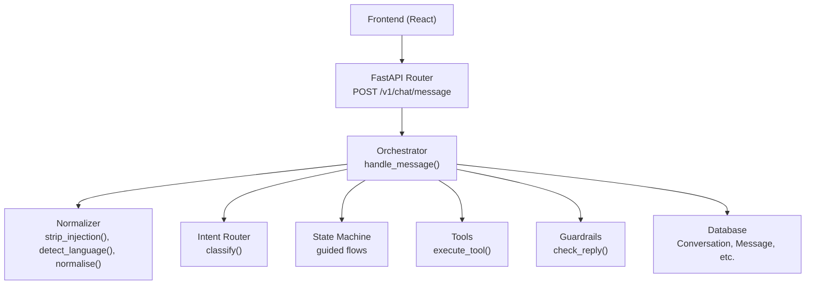
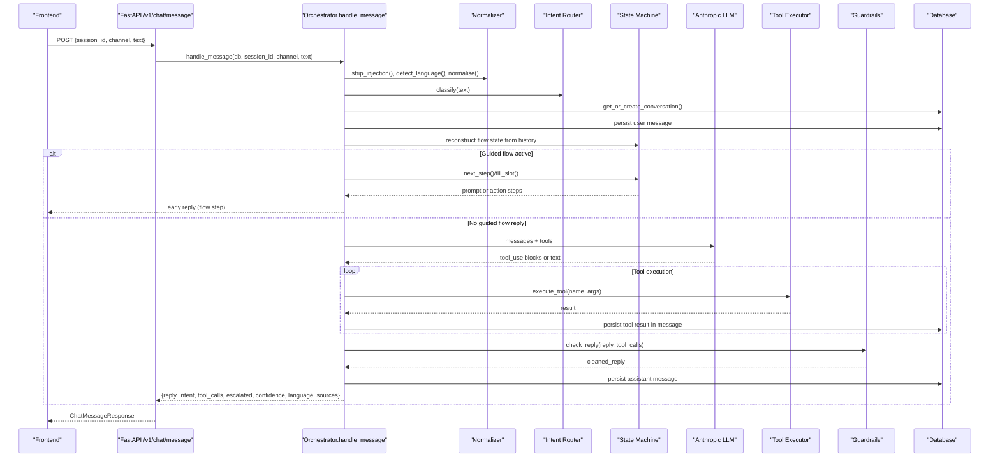
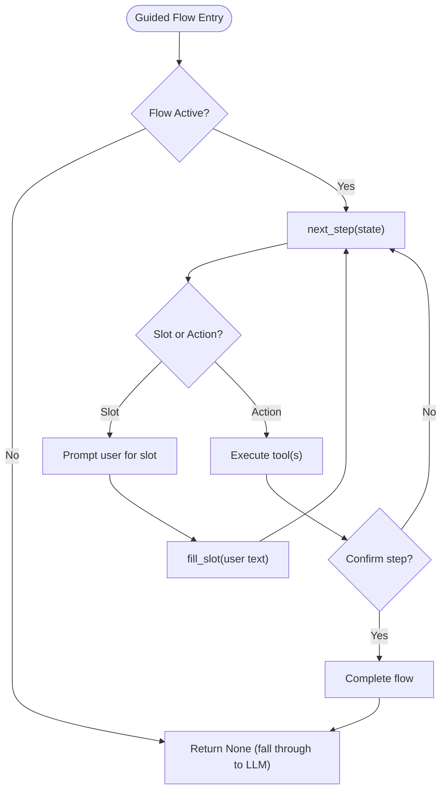
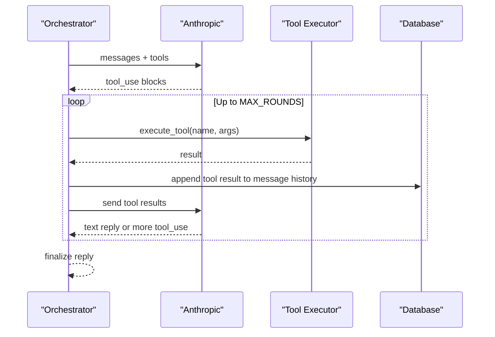
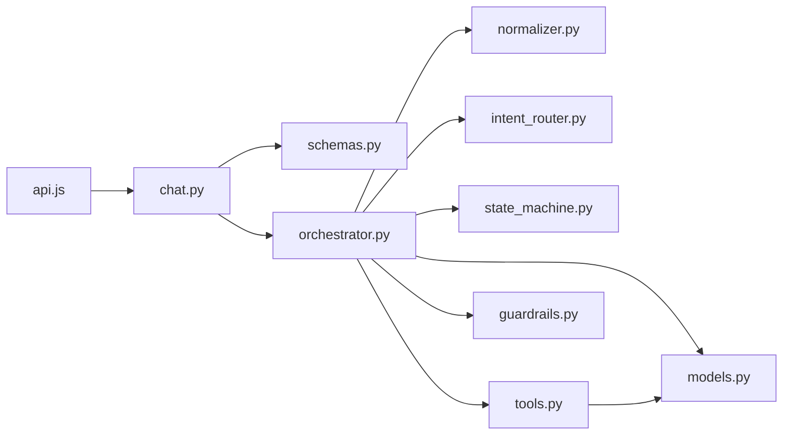

# Message Processing Endpoint

<cite>
**Referenced Files in This Document**
- [chat.py](file://uaea-backend/app/api/chat.py)
- [schemas.py](file://uaea-backend/app/schemas.py)
- [orchestrator.py](file://uaea-backend/app/orchestrator/orchestrator.py)
- [normalizer.py](file://uaea-backend/app/orchestrator/normalizer.py)
- [intent_router.py](file://uaea-backend/app/orchestrator/intent_router.py)
- [tools.py](file://uaea-backend/app/orchestrator/tools.py)
- [state_machine.py](file://uaea-backend/app/orchestrator/state_machine.py)
- [guardrails.py](file://uaea-backend/app/orchestrator/guardrails.py)
- [models.py](file://uaea-backend/app/db/models.py)
- [api.js](file://src/lib/api.js)
</cite>

## Table of Contents
1. [Introduction](#introduction)
2. [Project Structure](#project-structure)
3. [Core Components](#core-components)
4. [Architecture Overview](#architecture-overview)
5. [Detailed Component Analysis](#detailed-component-analysis)
6. [Dependency Analysis](#dependency-analysis)
7. [Performance Considerations](#performance-considerations)
8. [Troubleshooting Guide](#troubleshooting-guide)
9. [Conclusion](#conclusion)

## Introduction
This document provides detailed API documentation for the POST /v1/chat/message endpoint that powers the student chat assistant. It explains the request schema, response structure, and the end-to-end message processing pipeline including normalization, intent classification, guided flow handling, LLM orchestration with tool calls, guardrail enforcement, and source citation extraction. It also includes practical workflow examples, error handling patterns, rate limiting considerations, and authentication notes based on the codebase.

## Project Structure
The endpoint is implemented in a FastAPI router and delegates to an orchestrator that coordinates normalization, intent classification, stateful guided flows, LLM tool execution, guardrails, and persistence. The frontend communicates via a small API client module.

**Diagram sources**
- [chat.py:21-39](file://uaea-backend/app/api/chat.py#L21-L39)
- [orchestrator.py:46-143](file://uaea-backend/app/orchestrator/orchestrator.py#L46-L143)
- [normalizer.py:29-66](file://uaea-backend/app/orchestrator/normalizer.py#L29-L66)
- [intent_router.py:65-103](file://uaea-backend/app/orchestrator/intent_router.py#L65-L103)
- [state_machine.py:16-59](file://uaea-backend/app/orchestrator/state_machine.py#L16-L59)
- [tools.py:18-87](file://uaea-backend/app/orchestrator/tools.py#L18-L87)
- [guardrails.py:74-120](file://uaea-backend/app/orchestrator/guardrails.py#L74-L120)
- [models.py:144-178](file://uaea-backend/app/db/models.py#L144-L178)

**Section sources**
- [chat.py:21-39](file://uaea-backend/app/api/chat.py#L21-L39)
- [api.js:42-47](file://src/lib/api.js#L42-L47)

## Core Components
- Request schema: ChatMessageRequest with session_id, channel (default "web"), and text.
- Response schema: ChatMessageResponse with reply, intent, tool_calls array, escalated flag, confidence score, language detection, and sources list.
- Orchestration: handle_message performs input sanitization, language detection, normalization, intent classification, conversation management, guided flow handling, LLM tool loops, guardrails, persistence, and source extraction.
- Tools: search_knowledge_base, get_department, get_fee_tariff, get_deadline, get_document_checklist, create_escalation_ticket.
- Guardrails: post-LLM reply scrubbing to remove ungrounded numbers/dates/requirements not backed by tool results.
- Persistence: Conversation and Message models store user and assistant messages, intents, tool calls, and metadata.

**Section sources**
- [schemas.py:81-101](file://uaea-backend/app/schemas.py#L81-L101)
- [orchestrator.py:46-143](file://uaea-backend/app/orchestrator/orchestrator.py#L46-L143)
- [tools.py:18-87](file://uaea-backend/app/orchestrator/tools.py#L18-L87)
- [guardrails.py:74-120](file://uaea-backend/app/orchestrator/guardrails.py#L74-L120)
- [models.py:144-178](file://uaea-backend/app/db/models.py#L144-L178)

## Architecture Overview
The endpoint follows a deterministic pipeline:
1. Sanitize and normalize input; detect language.
2. Classify intent using keyword rules.
3. Get or create a conversation for the session.
4. Persist user message with intent.
5. Reconstruct guided flow state from history; if applicable, handle slot-filling steps.
6. If no guided flow reply, call the LLM with tools; execute tool calls in rounds up to a maximum.
7. Apply guardrails to clean the final reply.
8. Persist assistant message and optional flow state; mark escalation if needed.
9. Extract sources from tool call results and return the structured response.

**Diagram sources**
- [chat.py:21-39](file://uaea-backend/app/api/chat.py#L21-L39)
- [orchestrator.py:46-143](file://uaea-backend/app/orchestrator/orchestrator.py#L46-L143)
- [tools.py:218-235](file://uaea-backend/app/orchestrator/tools.py#L218-L235)
- [guardrails.py:74-120](file://uaea-backend/app/orchestrator/guardrails.py#L74-L120)
- [models.py:144-178](file://uaea-backend/app/db/models.py#L144-L178)

## Detailed Component Analysis

### Request Schema
- session_id: string identifying the conversation/session.
- channel: string indicating the client channel; defaults to "web".
- text: string containing the user message.

These fields are validated by the Pydantic model used by the endpoint.

**Section sources**
- [schemas.py:81-85](file://uaea-backend/app/schemas.py#L81-L85)
- [chat.py:21-39](file://uaea-backend/app/api/chat.py#L21-L39)
- [api.js:42-47](file://src/lib/api.js#L42-L47)

### Response Structure
- reply: string assistant response after guardrail cleaning.
- intent: string intent label determined by the classifier.
- tool_calls: array of objects with name, args, and result for each tool executed during this turn.
- escalated: boolean indicating whether an escalation ticket was created or required.
- confidence: float representing classifier confidence.
- language: string detected language ("en", "roman", or "ur").
- sources: array of source references extracted from tool call results for citations.

**Section sources**
- [schemas.py:87-101](file://uaea-backend/app/schemas.py#L87-L101)
- [orchestrator.py:132-143](file://uaea-backend/app/orchestrator/orchestrator.py#L132-L143)

### Message Processing Pipeline

#### Input Normalization and Language Detection
- strip_injection removes common prompt injection patterns.
- detect_language returns "ur" for Urdu script, "roman" for Roman Urdu markers, otherwise "en".
- normalise lowercases, strips punctuation, and folds Roman Urdu variants to improve matching.

**Section sources**
- [normalizer.py:29-66](file://uaea-backend/app/orchestrator/normalizer.py#L29-L66)

#### Intent Classification
- Keyword-based classifier scores strong and weak matches per rule set.
- Returns intent, label, confidence, service_id, and matched keywords.
- Falls back to knowledge_question when no rule matches.

**Section sources**
- [intent_router.py:14-62](file://uaea-backend/app/orchestrator/intent_router.py#L14-L62)
- [intent_router.py:65-103](file://uaea-backend/app/orchestrator/intent_router.py#L65-L103)

#### Guided Flow Handling
- For intents in GUIDED_FLOW_INTENTS, a state machine drives slot collection and actions.
- Steps can be slot prompts or actions like get_fee_tariff, get_deadline, get_document_checklist.
- When all slots are filled and actions complete, control falls through to LLM for final summary.

**Diagram sources**
- [state_machine.py:16-59](file://uaea-backend/app/orchestrator/state_machine.py#L16-L59)
- [state_machine.py:94-146](file://uaea-backend/app/orchestrator/state_machine.py#L94-L146)
- [orchestrator.py:146-227](file://uaea-backend/app/orchestrator/orchestrator.py#L146-L227)

**Section sources**
- [state_machine.py:16-59](file://uaea-backend/app/orchestrator/state_machine.py#L16-L59)
- [state_machine.py:94-146](file://uaea-backend/app/orchestrator/state_machine.py#L94-L146)
- [orchestrator.py:80-91](file://uaea-backend/app/orchestrator/orchestrator.py#L80-L91)
- [orchestrator.py:146-227](file://uaea-backend/app/orchestrator/orchestrator.py#L146-L227)

#### LLM Orchestration and Tool Execution
- Builds message history (last 20 messages), sends to Anthropic with tool definitions.
- Executes tool calls in a loop up to MAX_ROUNDS; accumulates results and tracks escalations.
- On exhaustion without text, escalates and returns a fallback message.

**Diagram sources**
- [orchestrator.py:229-318](file://uaea-backend/app/orchestrator/orchestrator.py#L229-L318)
- [tools.py:218-235](file://uaea-backend/app/orchestrator/tools.py#L218-L235)

**Section sources**
- [orchestrator.py:229-318](file://uaea-backend/app/orchestrator/orchestrator.py#L229-L318)
- [tools.py:18-87](file://uaea-backend/app/orchestrator/tools.py#L18-L87)

#### Guardrails and Source Extraction
- Scans reply for numbers, dates, and requirement phrases; checks against grounded values from tool results.
- Replaces ungrounded claims with "[unconfirmed]" or escalates if too many issues.
- Extracts sources from tool call results for citation display.

**Section sources**
- [guardrails.py:30-120](file://uaea-backend/app/orchestrator/guardrails.py#L30-L120)
- [orchestrator.py:386-404](file://uaea-backend/app/orchestrator/orchestrator.py#L386-L404)

### Practical Workflows

#### Service Inquiry
- User asks about a department or campus contact.
- Intent: department_lookup.
- Tool: get_department.
- Response includes contact details and office hours; sources include department records.

**Section sources**
- [intent_router.py:48-53](file://uaea-backend/app/orchestrator/intent_router.py#L48-L53)
- [tools.py:92-123](file://uaea-backend/app/orchestrator/tools.py#L92-L123)

#### Fee Calculation
- User asks fee amount for a program.
- Intent: fee_tariff.
- Tool: get_fee_tariff returns program, category, amount, currency, effective date, and source reference.
- Guardrails ensure only tool-backed amounts are presented.

**Section sources**
- [intent_router.py:21-26](file://uaea-backend/app/orchestrator/intent_router.py#L21-L26)
- [tools.py:125-153](file://uaea-backend/app/orchestrator/tools.py#L125-L153)
- [guardrails.py:30-120](file://uaea-backend/app/orchestrator/guardrails.py#L30-L120)

#### Deadline Check
- User asks about deadlines for a service.
- Intent: admission or related service.
- Tool: get_deadline returns semester, date, and source reference.
- Sources included for citation.

**Section sources**
- [intent_router.py:27-32](file://uaea-backend/app/orchestrator/intent_router.py#L27-L32)
- [tools.py:155-179](file://uaea-backend/app/orchestrator/tools.py#L155-L179)

#### Guided Flow Interaction (Admission)
- User triggers admission flow.
- State machine collects programme and campus slots.
- Actions retrieve fee tariff, deadline, and document checklist.
- Final summary provided by LLM with tool-backed data.

**Section sources**
- [state_machine.py:16-31](file://uaea-backend/app/orchestrator/state_machine.py#L16-L31)
- [orchestrator.py:80-91](file://uaea-backend/app/orchestrator/orchestrator.py#L80-L91)
- [orchestrator.py:146-227](file://uaea-backend/app/orchestrator/orchestrator.py#L146-L227)

## Dependency Analysis
- API layer depends on schemas and orchestrator.
- Orchestrator depends on normalizer, intent router, state machine, tools, guardrails, and database models.
- Tools depend on database models and RAG retrieval for knowledge base search.
- Frontend API client calls the endpoint and handles errors generically.

**Diagram sources**
- [chat.py:21-39](file://uaea-backend/app/api/chat.py#L21-L39)
- [orchestrator.py:46-143](file://uaea-backend/app/orchestrator/orchestrator.py#L46-L143)
- [tools.py:218-235](file://uaea-backend/app/orchestrator/tools.py#L218-L235)
- [api.js:42-47](file://src/lib/api.js#L42-L47)

**Section sources**
- [chat.py:21-39](file://uaea-backend/app/api/chat.py#L21-L39)
- [orchestrator.py:46-143](file://uaea-backend/app/orchestrator/orchestrator.py#L46-L143)
- [tools.py:218-235](file://uaea-backend/app/orchestrator/tools.py#L218-L235)
- [api.js:42-47](file://src/lib/api.js#L42-L47)

## Performance Considerations
- LLM rounds are capped at MAX_ROUNDS to prevent excessive tool-call loops.
- Message history is truncated to the last 20 messages to reduce payload size.
- Database queries use indexed fields where appropriate (e.g., session_id, program).
- Guardrails operate on final replies to minimize overhead.

[No sources needed since this section provides general guidance]

## Troubleshooting Guide
- Low-confidence queries are tracked in an unanswered queue for review.
- Unanswered or ambiguous inputs may trigger escalation via create_escalation_ticket.
- LLM API errors are caught and return a friendly fallback message.
- Guardrails replace ungrounded claims with "[unconfirmed]" or escalate if too many issues occur.
- Frontend treats non-OK responses as generic API errors with detail parsing.

**Section sources**
- [orchestrator.py:367-384](file://uaea-backend/app/orchestrator/orchestrator.py#L367-L384)
- [orchestrator.py:264-271](file://uaea-backend/app/orchestrator/orchestrator.py#L264-L271)
- [guardrails.py:100-120](file://uaea-backend/app/orchestrator/guardrails.py#L100-L120)
- [api.js:16-31](file://src/lib/api.js#L16-L31)

## Conclusion
The POST /v1/chat/message endpoint implements a robust, safety-focused chat pipeline that normalizes input, classifies intent, supports guided flows, executes tools to ground answers, enforces guardrails, and persists full conversation context. Responses include rich metadata such as intent, confidence, language, tool calls, escalation status, and sources for transparency and traceability.