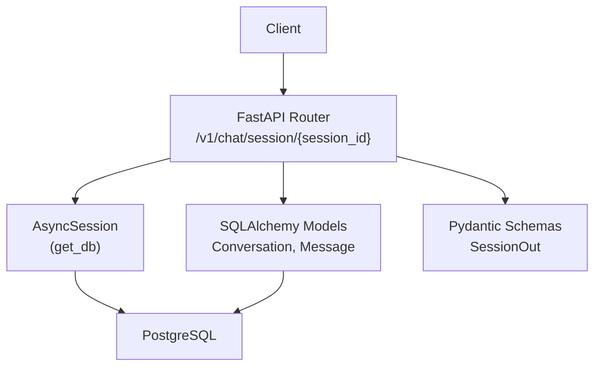
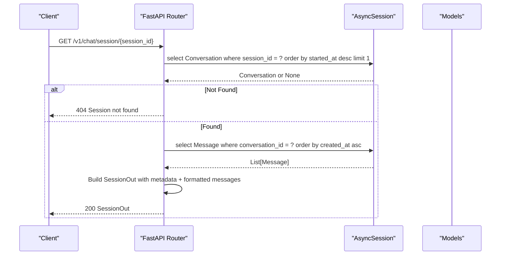
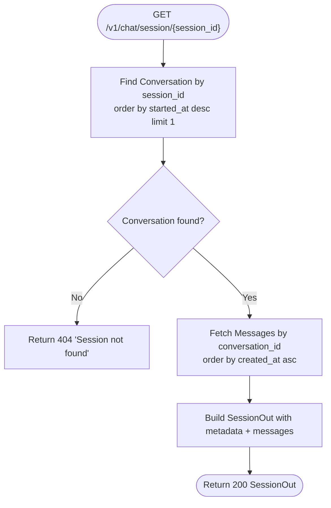
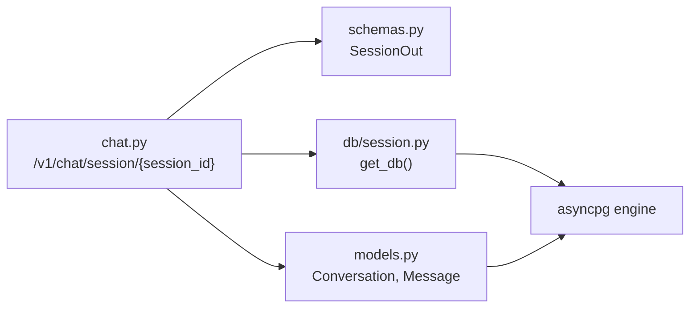

# Session Retrieval Endpoint

<cite>
**Referenced Files in This Document**
- [chat.py](file://uaea-backend/app/api/chat.py)
- [schemas.py](file://uaea-backend/app/schemas.py)
- [models.py](file://uaea-backend/app/db/models.py)
- [session.py](file://uaea-backend/app/db/session.py)
- [test_chat_flow.py](file://uaea-backend/tests/test_chat_flow.py)
</cite>

## Table of Contents
1. [Introduction](#introduction)
2. [Project Structure](#project-structure)
3. [Core Components](#core-components)
4. [Architecture Overview](#architecture-overview)
5. [Detailed Component Analysis](#detailed-component-analysis)
6. [Dependency Analysis](#dependency-analysis)
7. [Performance Considerations](#performance-considerations)
8. [Troubleshooting Guide](#troubleshooting-guide)
9. [Conclusion](#conclusion)
10. [Appendices](#appendices)

## Introduction
This document specifies the GET /v1/chat/session/{session_id} endpoint used to retrieve a complete conversation history for a given session. It explains path parameter validation, response schema (conversation metadata, state flags, and message history), retrieval and ordering logic, formatting details, usage examples (audit, debugging, replay), error handling for invalid sessions, and database query optimizations.

## Project Structure
The endpoint is implemented in the FastAPI chat router, uses Pydantic schemas for response modeling, and queries SQLAlchemy models backed by an async PostgreSQL engine. Tests demonstrate expected behavior for retrieving session history.

**Diagram sources**
- [chat.py:42-85](file://uaea-backend/app/api/chat.py#L42-L85)
- [schemas.py:113-122](file://uaea-backend/app/schemas.py#L113-L122)
- [models.py:144-178](file://uaea-backend/app/db/models.py#L144-L178)
- [session.py:7-13](file://uaea-backend/app/db/session.py#L7-L13)

**Section sources**
- [chat.py:1-115](file://uaea-backend/app/api/chat.py#L1-L115)
- [schemas.py:1-178](file://uaea-backend/app/schemas.py#L1-L178)
- [models.py:1-228](file://uaea-backend/app/db/models.py#L1-L228)
- [session.py:1-14](file://uaea-backend/app/db/session.py#L1-L14)
- [test_chat_flow.py:83-101](file://uaea-backend/tests/test_chat_flow.py#L83-L101)

## Core Components
- Endpoint handler: Retrieves the latest Conversation for the provided session_id, then fetches all associated Messages ordered by creation time.
- Response model: SessionOut defines the shape of the returned JSON, including conversation metadata, state flags, and messages array.
- Data models: Conversation and Message define persisted fields and relationships.
- Database session: AsyncSession provides connection pooling and transactional context.

Key responsibilities:
- Validate session existence and return 404 if not found.
- Order messages chronologically using created_at.
- Format each message with role, text, intent, tool_calls, feedback, and timestamp.

**Section sources**
- [chat.py:42-85](file://uaea-backend/app/api/chat.py#L42-L85)
- [schemas.py:113-122](file://uaea-backend/app/schemas.py#L113-L122)
- [models.py:144-178](file://uaea-backend/app/db/models.py#L144-L178)
- [session.py:7-13](file://uaea-backend/app/db/session.py#L7-L13)

## Architecture Overview
The endpoint performs two sequential database queries:
1. Find the most recent Conversation matching the session_id.
2. Retrieve all Messages for that Conversation, ordered by created_at ascending.

**Diagram sources**
- [chat.py:42-85](file://uaea-backend/app/api/chat.py#L42-L85)
- [models.py:144-178](file://uaea-backend/app/db/models.py#L144-L178)

## Detailed Component Analysis

### Path Parameter: session_id
- Type: string
- Purpose: Identifies the conversation session to retrieve.
- Validation:
  - The endpoint expects a non-empty string. If no Conversation exists for the given session_id, the endpoint returns HTTP 404 with detail “Session not found”.
  - No explicit UUID format validation is enforced at the route level; any string can be passed. Consumers should ensure they pass valid session identifiers generated by the system.
- Behavior on missing session:
  - Raises HTTPException with status_code 404 and detail “Session not found”.

**Section sources**
- [chat.py:42-55](file://uaea-backend/app/api/chat.py#L42-L55)

### Response Schema: SessionOut
The response is modeled by SessionOut and includes:
- id: string — internal Conversation identifier
- session_id: string — client-facing session identifier
- channel: string — channel used for the conversation (e.g., “web”)
- started_at: datetime — when the conversation began
- resolved: boolean — whether the conversation was marked resolved
- escalated: boolean — whether the conversation was escalated
- messages: array of message objects — full message history

Each message object contains:
- id: string — message identifier
- role: string — one of user, assistant, tool, system
- text: string|null — message content
- intent: string|null — detected intent
- tool_calls: array — tool call records (name, args, result)
- feedback: string|null — optional feedback tag
- created_at: string — ISO-like timestamp string representation

Notes:
- Timestamps are serialized as strings in the response.
- tool_calls defaults to an empty list when absent.

**Section sources**
- [schemas.py:113-122](file://uaea-backend/app/schemas.py#L113-L122)
- [chat.py:66-85](file://uaea-backend/app/api/chat.py#L66-L85)
- [models.py:144-178](file://uaea-backend/app/db/models.py#L144-L178)

### Message Retrieval and Ordering
- The endpoint first selects the latest Conversation for the given session_id using started_at descending and limit 1.
- Then it retrieves all Messages for that Conversation ordered by created_at ascending to preserve chronological order.
- This ensures the message history reflects the exact sequence of interactions.

**Diagram sources**
- [chat.py:45-64](file://uaea-backend/app/api/chat.py#L45-L64)
- [chat.py:66-85](file://uaea-backend/app/api/chat.py#L66-L85)

**Section sources**
- [chat.py:45-64](file://uaea-backend/app/api/chat.py#L45-L64)

### Error Handling
- Missing session: Returns HTTP 404 with detail “Session not found”.
- Database errors: Propagate as server errors (not explicitly handled in this endpoint).
- Input validation: No strict UUID validation; rely on application-level guarantees for session_id values.

**Section sources**
- [chat.py:54-55](file://uaea-backend/app/api/chat.py#L54-L55)

### Usage Examples
- Audit purposes: Retrieve full conversation history to review user interactions and agent responses for compliance and quality assurance.
- Debugging conversations: Inspect roles, intents, tool calls, and timestamps to trace issues in orchestration or tool execution.
- Conversation replay: Use the ordered messages to reconstruct the conversation flow in another environment or UI.

Example request:
- GET /v1/chat/session/{session_id}

Expected success response fields:
- id, session_id, channel, started_at, resolved, escalated, messages[]

Example failure:
- 404 when session_id does not correspond to any Conversation.

Validation reference:
- Tests assert that after sending a message, fetching the session returns 200 with the correct session_id and at least one message.

**Section sources**
- [test_chat_flow.py:83-101](file://uaea-backend/tests/test_chat_flow.py#L83-L101)

## Dependency Analysis
- FastAPI router depends on:
  - SQLAlchemy async session via get_db dependency
  - SQLAlchemy models for Conversation and Message
  - Pydantic schema SessionOut for response serialization
- Database configuration and connection pooling are managed by the async engine and session factory.

**Diagram sources**
- [chat.py:42-85](file://uaea-backend/app/api/chat.py#L42-L85)
- [schemas.py:113-122](file://uaea-backend/app/schemas.py#L113-L122)
- [models.py:144-178](file://uaea-backend/app/db/models.py#L144-L178)
- [session.py:7-13](file://uaea-backend/app/db/session.py#L7-L13)

**Section sources**
- [chat.py:42-85](file://uaea-backend/app/api/chat.py#L42-L85)
- [schemas.py:113-122](file://uaea-backend/app/schemas.py#L113-L122)
- [models.py:144-178](file://uaea-backend/app/db/models.py#L144-L178)
- [session.py:7-13](file://uaea-backend/app/db/session.py#L7-L13)

## Performance Considerations
- Query optimization:
  - Conversation lookup uses an index on session_id and orders by started_at desc with limit 1 to efficiently find the latest session.
  - Message retrieval orders by created_at to maintain chronological order without in-memory sorting.
- Indexing recommendations:
  - Ensure indexes exist on conversations.session_id and messages.conversation_id for fast joins and lookups.
  - An index on messages.created_at can improve ordering performance for large histories.
- Pagination:
  - For very long conversations, consider adding pagination parameters (e.g., cursor or offset) to reduce payload size and improve latency.
- Connection pool:
  - The async engine uses a configured pool_size and max_overflow to handle concurrent requests efficiently.

[No sources needed since this section provides general guidance based on observed implementation]

## Troubleshooting Guide
Common issues and resolutions:
- 404 Session not found:
  - Cause: session_id does not match any existing Conversation.
  - Resolution: Verify the session_id used matches the one created during message exchange. Check upstream services that generate or forward session identifiers.
- Empty messages array:
  - Cause: Conversation exists but has no messages yet.
  - Resolution: Confirm that at least one message was sent to create the conversation history.
- Unexpected timestamp format:
  - Cause: Timestamps are serialized as strings in the response.
  - Resolution: Parse created_at as a datetime string in the client.

Operational checks:
- Database connectivity: Ensure the async engine URL and credentials are correctly configured.
- Index health: Verify indexes on session_id and conversation_id exist and are up to date.

**Section sources**
- [chat.py:54-55](file://uaea-backend/app/api/chat.py#L54-L55)
- [session.py:7-13](file://uaea-backend/app/db/session.py#L7-L13)

## Conclusion
The GET /v1/chat/session/{session_id} endpoint provides a reliable way to retrieve a full conversation history for audit, debugging, and replay scenarios. It validates session existence, returns structured metadata and state flags, and delivers a chronologically ordered message history with rich formatting. Proper indexing and optional pagination can further optimize performance for large datasets.

## Appendices

### API Definition Summary
- Method: GET
- Path: /v1/chat/session/{session_id}
- Path parameter:
  - session_id: string (required)
- Success response: SessionOut
  - Fields: id, session_id, channel, started_at, resolved, escalated, messages[]
  - Each message: id, role, text, intent, tool_calls[], feedback, created_at
- Error responses:
  - 404: Session not found

**Section sources**
- [chat.py:42-85](file://uaea-backend/app/api/chat.py#L42-L85)
- [schemas.py:113-122](file://uaea-backend/app/schemas.py#L113-L122)