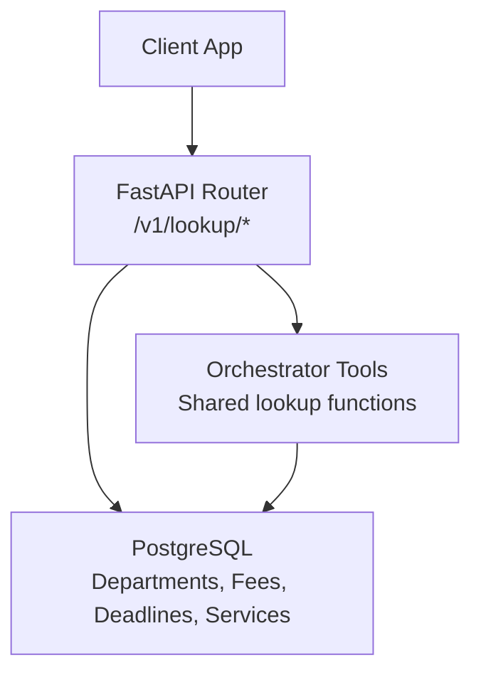
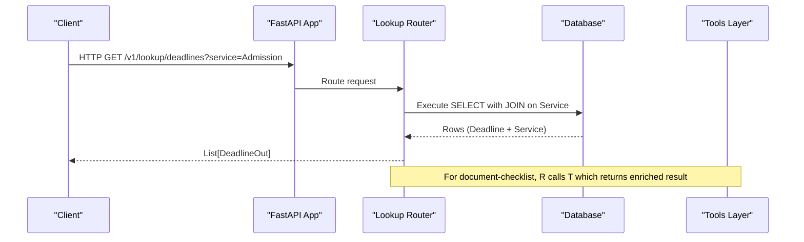
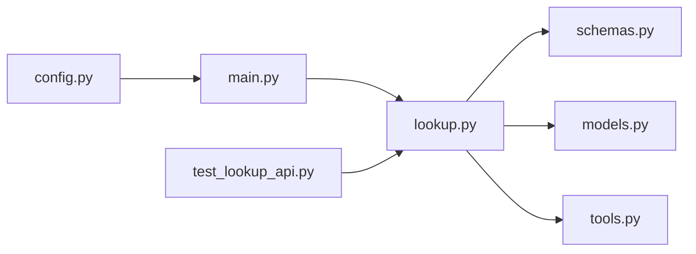

# Lookup API

<cite>
**Referenced Files in This Document**
- [lookup.py](file://uaea-backend/app/api/lookup.py)
- [schemas.py](file://uaea-backend/app/schemas.py)
- [models.py](file://uaea-backend/app/db/models.py)
- [tools.py](file://uaea-backend/app/orchestrator/tools.py)
- [seed.py](file://uaea-backend/app/db/seed.py)
- [main.py](file://uaea-backend/app/main.py)
- [config.py](file://uaea-backend/app/config.py)
- [api.js](file://src/lib/api.js)
- [test_lookup_api.py](file://uaea-backend/tests/test_lookup_api.py)
</cite>

## Table of Contents
1. [Introduction](#introduction)
2. [Project Structure](#project-structure)
3. [Core Components](#core-components)
4. [Architecture Overview](#architecture-overview)
5. [Detailed Component Analysis](#detailed-component-analysis)
6. [Dependency Analysis](#dependency-analysis)
7. [Performance Considerations](#performance-considerations)
8. [Troubleshooting Guide](#troubleshooting-guide)
9. [Conclusion](#conclusion)
10. [Appendices](#appendices)

## Introduction
This document provides detailed API documentation for the lookup endpoints that retrieve reference data for services, departments, fees, deadlines, and related entities. It covers query parameters, filtering options, response formats, error behavior, caching strategies, performance considerations, and rate limiting policies. It also includes practical examples for common scenarios such as service discovery, department contact retrieval, and deadline checking.

## Project Structure
The lookup functionality is implemented in the backend FastAPI application under the /v1/lookup namespace. Endpoints are defined in a dedicated router module, with Pydantic schemas defining responses and SQLAlchemy models backing the database. A shared tooling layer (used by both the LLM orchestrator and the public API) encapsulates business logic for retrieving structured information.

**Diagram sources**
- [lookup.py:1-104](file://uaea-backend/app/api/lookup.py#L1-L104)
- [tools.py:92-197](file://uaea-backend/app/orchestrator/tools.py#L92-L197)
- [models.py:30-122](file://uaea-backend/app/db/models.py#L30-L122)

**Section sources**
- [lookup.py:1-104](file://uaea-backend/app/api/lookup.py#L1-L104)
- [schemas.py:13-77](file://uaea-backend/app/schemas.py#L13-L77)
- [models.py:30-122](file://uaea-backend/app/db/models.py#L30-L122)

## Core Components
- Endpoints:
  - GET /v1/lookup/departments
  - GET /v1/lookup/fee-tariff
  - GET /v1/lookup/deadlines
  - GET /v1/lookup/document-checklist
- Response schemas define the shape of returned data for each endpoint.
- Database models define tables and relationships used by queries.
- Shared tools provide consistent lookup logic reused by the orchestrator and API.

**Section sources**
- [lookup.py:26-103](file://uaea-backend/app/api/lookup.py#L26-L103)
- [schemas.py:13-77](file://uaea-backend/app/schemas.py#L13-L77)
- [models.py:30-122](file://uaea-backend/app/db/models.py#L30-L122)
- [tools.py:92-197](file://uaea-backend/app/orchestrator/tools.py#L92-L197)

## Architecture Overview
The lookup API exposes read-only endpoints that query the database using SQLAlchemy and return JSON responses validated by Pydantic schemas. Some endpoints delegate to shared tools for richer results (e.g., document checklist). The application configures CORS and global rate limiting via middleware.

**Diagram sources**
- [lookup.py:74-90](file://uaea-backend/app/api/lookup.py#L74-L90)
- [lookup.py:93-103](file://uaea-backend/app/api/lookup.py#L93-L103)
- [tools.py:155-197](file://uaea-backend/app/orchestrator/tools.py#L155-L197)

## Detailed Component Analysis

### Endpoint: GET /v1/lookup/departments
- Purpose: List departments, optionally filtered by region or search query.
- Query Parameters:
  - region: Optional string; filters departments by campus region (case-insensitive substring match).
  - query: Optional string; filters departments by name_en, name_ur, or category (case-insensitive substring match).
- Response: Array of DepartmentOut objects. Each object includes:
  - id, name_en, name_ur, category
  - region: CampusOut (id, name, region, address, contact)
  - contact: ContactOut (phone, email, office_hours)
- Filtering Logic:
  - If region provided, joins campuses and filters by region substring.
  - If query provided, matches across multiple fields.
- Sorting: Not implemented; order is unspecified.
- Error Handling: Returns empty array when no matching region exists.

Example usage (frontend helper):
- getDepartments({ region: "Islamabad" })
- getDepartments({ query: "Admission" })

**Section sources**
- [lookup.py:26-53](file://uaea-backend/app/api/lookup.py#L26-L53)
- [schemas.py:13-38](file://uaea-backend/app/schemas.py#L13-L38)
- [models.py:30-69](file://uaea-backend/app/db/models.py#L30-L69)
- [api.js:77-80](file://src/lib/api.js#L77-L80)
- [test_lookup_api.py:8-38](file://uaea-backend/tests/test_lookup_api.py#L8-L38)

### Endpoint: GET /v1/lookup/fee-tariff
- Purpose: List fee tariffs, optionally filtered by program and category.
- Query Parameters:
  - program: Optional string; filters by program substring (case-insensitive).
  - category: Optional string; filters by category substring (case-insensitive).
- Response: Array of FeeTariffOut objects. Each object includes:
  - id, program, category, amount, effective_from, source_doc_ref
- Filtering Logic:
  - Applies substring matches independently for program and category.
- Sorting: Not implemented; order is unspecified.

Example usage:
- getFeeTariffs({ program: "BS Computer Science" })
- getFeeTariffs({ category: "Semester (new)" })

**Section sources**
- [lookup.py:56-71](file://uaea-backend/app/api/lookup.py#L56-L71)
- [schemas.py:40-48](file://uaea-backend/app/schemas.py#L40-L48)
- [models.py:73-82](file://uaea-backend/app/db/models.py#L73-L82)
- [api.js:86-89](file://src/lib/api.js#L86-L89)
- [test_lookup_api.py:41-63](file://uaea-backend/tests/test_lookup_api.py#L41-L63)

### Endpoint: GET /v1/lookup/deadlines
- Purpose: List deadlines, optionally filtered by service name.
- Query Parameters:
  - service: Optional string; filters deadlines by joining with Service and matching service name_en substring (case-insensitive).
- Response: Array of DeadlineOut objects. Each object includes:
  - id, service_id, semester, date, source_doc_ref
- Filtering Logic:
  - Joins Service table and applies substring filter on service name_en.
- Sorting: Not implemented; order is unspecified.

Example usage:
- getDeadlines({ service: "Admission" })

**Section sources**
- [lookup.py:74-90](file://uaea-backend/app/api/lookup.py#L74-L90)
- [schemas.py:70-77](file://uaea-backend/app/schemas.py#L70-L77)
- [models.py:86-122](file://uaea-backend/app/db/models.py#L86-L122)
- [api.js:95-98](file://src/lib/api.js#L95-L98)
- [test_lookup_api.py:66-82](file://uaea-backend/tests/test_lookup_api.py#L66-L82)

### Endpoint: GET /v1/lookup/document-checklist
- Purpose: Retrieve the required documents and procedure for a specific service.
- Query Parameters:
  - service: Required string; matches service name_en substring (case-insensitive).
- Response: Object containing:
  - service: matched service name
  - checklist: list of items with en, ur, copy flags
  - procedure: optional procedure text
  - source: source document reference
  - last_verified: optional timestamp string
- Behavior:
  - Uses shared tool function to find the service and return associated checklist and metadata.
  - Returns an error object if no matching service is found.

Example usage:
- getDocumentChecklist("Admission")
- getDocumentChecklist("Degree Application")

**Section sources**
- [lookup.py:93-103](file://uaea-backend/app/api/lookup.py#L93-L103)
- [tools.py:181-197](file://uaea-backend/app/orchestrator/tools.py#L181-L197)
- [api.js:104-106](file://src/lib/api.js#L104-L106)
- [test_lookup_api.py:85-103](file://uaea-backend/tests/test_lookup_api.py#L85-L103)

### Data Models and Schemas
- ContactOut: Represents contact details (phone, email, office_hours).
- CampusOut: Represents campus info including nested contact.
- DepartmentOut: Department with nested region (CampusOut) and contact.
- FeeTariffOut: Fee tariff entry with program, category, amount, effective_from, source_doc_ref.
- ServiceOut: Service with nested fee and document_checklist (used internally by orchestrator).
- DeadlineOut: Deadline linked to a service with semester and date.

These schemas ensure consistent serialization of responses and enable type-safe client consumption.

**Section sources**
- [schemas.py:13-77](file://uaea-backend/app/schemas.py#L13-L77)
- [models.py:30-122](file://uaea-backend/app/db/models.py#L30-L122)

### Example Scenarios
- Service Discovery:
  - Use GET /v1/lookup/deadlines?service=Admission to confirm upcoming deadlines for admission-related services.
- Department Contact Retrieval:
  - Use GET /v1/lookup/departments?region=Islamabad to list departments at a specific campus and inspect their contact details.
- Fee Lookup:
  - Use GET /v1/lookup/fee-tariff?program=BS%20Computer%20Science&category=Semester%20(new) to retrieve current semester fees.
- Document Checklist:
  - Use GET /v1/lookup/document-checklist?service=Degree%20Application to obtain required documents and procedures for degree issuance.

**Section sources**
- [lookup.py:26-103](file://uaea-backend/app/api/lookup.py#L26-L103)
- [api.js:77-106](file://src/lib/api.js#L77-L106)
- [test_lookup_api.py:8-103](file://uaea-backend/tests/test_lookup_api.py#L8-L103)

## Dependency Analysis
- Endpoints depend on:
  - SQLAlchemy models for Departments, Campuses, Fees, Services, Deadlines.
  - Pydantic schemas for response validation.
  - Shared tools for complex lookups (document checklist).
- The main app mounts routers and applies global middleware (CORS, rate limiting).
- Tests validate expected behavior against seeded data.

**Diagram sources**
- [lookup.py:1-104](file://uaea-backend/app/api/lookup.py#L1-L104)
- [schemas.py:13-77](file://uaea-backend/app/schemas.py#L13-L77)
- [models.py:30-122](file://uaea-backend/app/db/models.py#L30-L122)
- [tools.py:92-197](file://uaea-backend/app/orchestrator/tools.py#L92-L197)
- [main.py:40-79](file://uaea-backend/app/main.py#L40-L79)
- [config.py:20-26](file://uaea-backend/app/config.py#L20-L26)
- [test_lookup_api.py:1-112](file://uaea-backend/tests/test_lookup_api.py#L1-L112)

**Section sources**
- [main.py:40-79](file://uaea-backend/app/main.py#L40-L79)
- [config.py:20-26](file://uaea-backend/app/config.py#L20-L26)

## Performance Considerations
- Query Efficiency:
  - Substring matching uses SQL LIKE with ilike; consider indexing frequently searched columns (e.g., service.name_en, fee_tariff.program) for large datasets.
  - Join operations (deadlines join services) can be optimized with appropriate indexes on foreign keys.
- Pagination:
  - No pagination is implemented; clients should limit result sets via targeted filters to avoid large payloads.
- Caching:
  - No in-memory caching is configured in the application; consider adding Redis-based caching for hot reference data (departments, fees) if read volume is high.
- Rate Limiting:
  - Global per-IP rate limiting is enabled via SlowAPI; default policy is configurable through settings.
  - Per-session rate limiting middleware exists but currently targets chat endpoints; it does not apply to lookup endpoints.

[No sources needed since this section provides general guidance]

## Troubleshooting Guide
- Common Issues:
  - Empty Results:
    - Ensure query parameters match existing data; use substring matching semantics.
    - Verify seed data has been loaded into the database.
  - Unexpected Errors:
    - Check network connectivity and base URL configuration in the frontend.
    - Validate that required parameters are present (e.g., service for document-checklist).
- Error Responses:
  - Rate Limit Exceeded:
    - 429 status with detail message indicating exceeded limits.
  - Tool Errors:
    - When a service is not found for document-checklist, the response includes an error field describing the issue.
- Debugging Tips:
  - Use health check endpoint to verify service availability.
  - Inspect logs for database connection issues or slow queries.

**Section sources**
- [main.py:53-58](file://uaea-backend/app/main.py#L53-L58)
- [tools.py:122-197](file://uaea-backend/app/orchestrator/tools.py#L122-L197)
- [test_lookup_api.py:107-112](file://uaea-backend/tests/test_lookup_api.py#L107-L112)

## Conclusion
The lookup API provides straightforward, filterable access to essential university reference data. It leverages shared tools for consistency and robustness, with clear response schemas and test coverage. While basic filtering is supported, additional features like sorting, pagination, and caching can enhance scalability and user experience. Rate limiting protects the service from excessive traffic, and the modular architecture allows future extensions.

[No sources needed since this section summarizes without analyzing specific files]

## Appendices

### API Reference Summary
- GET /v1/lookup/departments
  - Query params: region, query
  - Response: list[DepartmentOut]
- GET /v1/lookup/fee-tariff
  - Query params: program, category
  - Response: list[FeeTariffOut]
- GET /v1/lookup/deadlines
  - Query params: service
  - Response: list[DeadlineOut]
- GET /v1/lookup/document-checklist
  - Query params: service (required)
  - Response: { service, checklist, procedure, source, last_verified }

**Section sources**
- [lookup.py:26-103](file://uaea-backend/app/api/lookup.py#L26-L103)
- [schemas.py:13-77](file://uaea-backend/app/schemas.py#L13-L77)

### Frontend Integration
- All lookup endpoints are wrapped in helper functions in the frontend API client for easy consumption.
- Base URL is configurable via environment variables.

**Section sources**
- [api.js:77-106](file://src/lib/api.js#L77-L106)

### Seed Data
- Seeded data includes contacts, campuses, departments, fee tariffs, services, deadlines, knowledge chunks, and unanswered queries for demonstration and testing.

**Section sources**
- [seed.py:26-157](file://uaea-backend/app/db/seed.py#L26-L157)