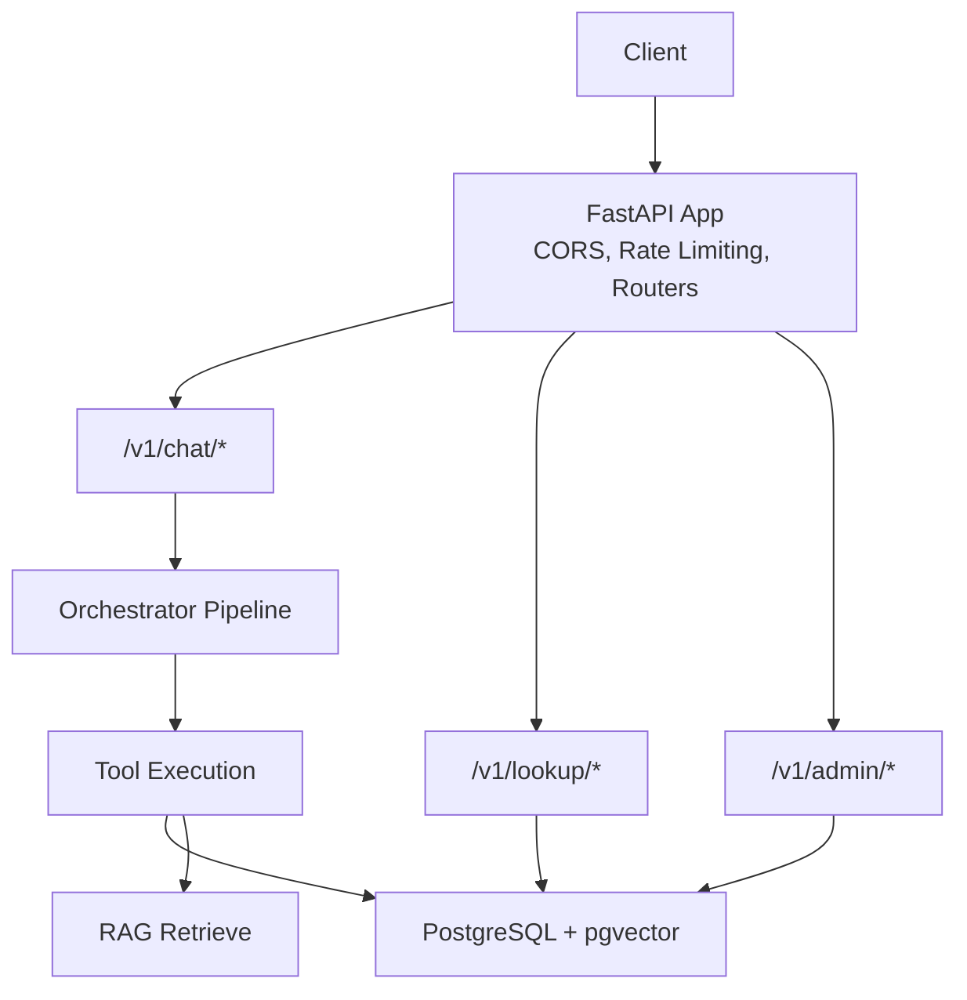
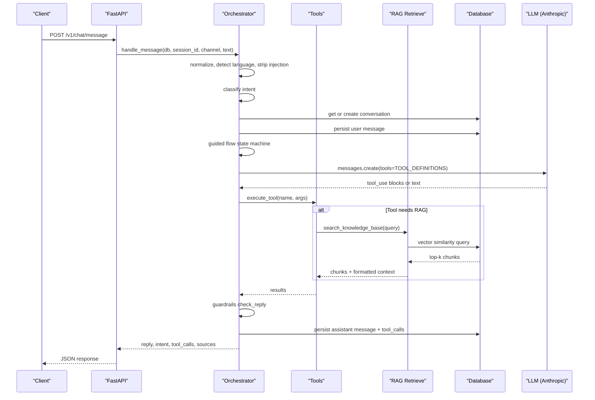
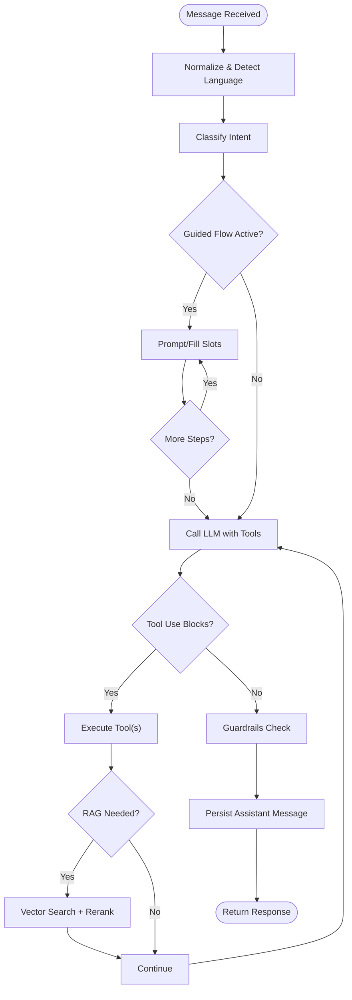
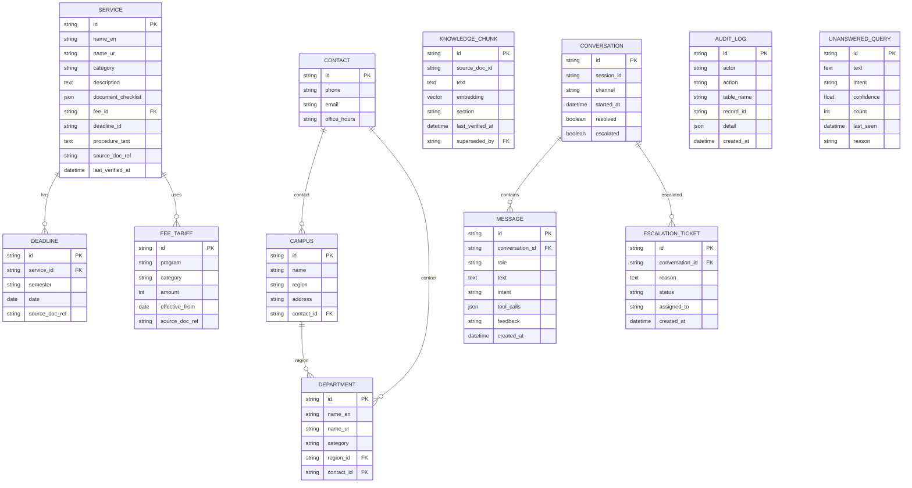
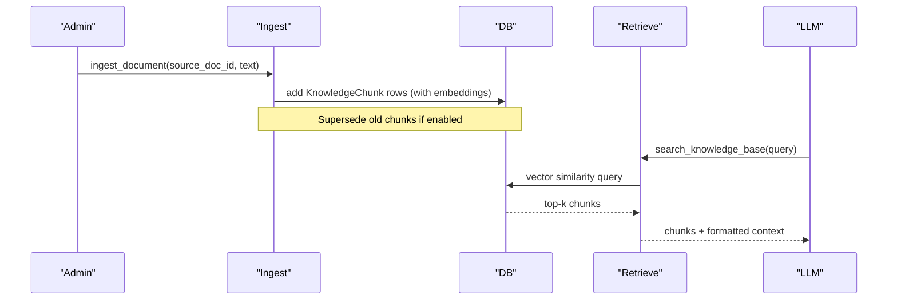
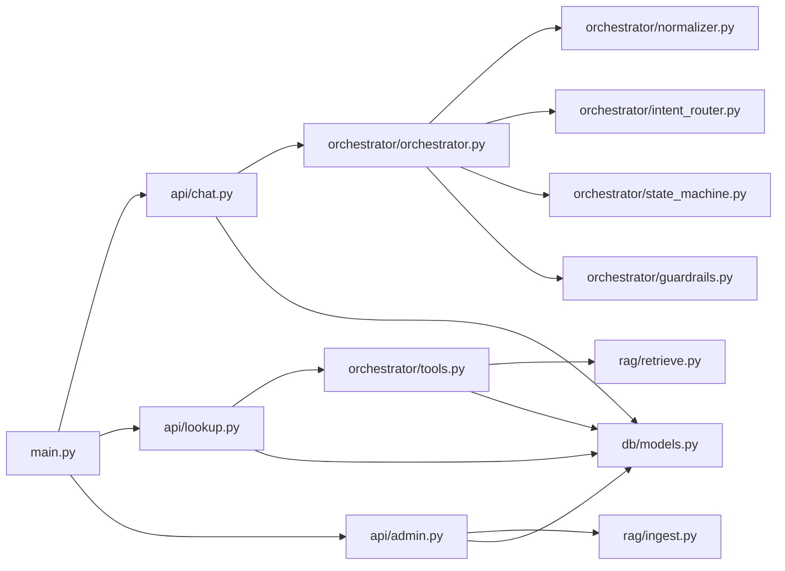

# Backend Architecture

<cite>
**Referenced Files in This Document**
- [main.py](file://uaea-backend/app/main.py)
- [config.py](file://uaea-backend/app/config.py)
- [schemas.py](file://uaea-backend/app/schemas.py)
- [models.py](file://uaea-backend/app/db/models.py)
- [session.py](file://uaea-backend/app/db/session.py)
- [chat.py](file://uaea-backend/app/api/chat.py)
- [lookup.py](file://uaea-backend/app/api/lookup.py)
- [admin.py](file://uaea-backend/app/api/admin.py)
- [orchestrator.py](file://uaea-backend/app/orchestrator/orchestrator.py)
- [normalizer.py](file://uaea-backend/app/orchestrator/normalizer.py)
- [intent_router.py](file://uaea-backend/app/orchestrator/intent_router.py)
- [state_machine.py](file://uaea-backend/app/orchestrator/state_machine.py)
- [tools.py](file://uaea-backend/app/orchestrator/tools.py)
- [guardrails.py](file://uaea-backend/app/orchestrator/guardrails.py)
- [retrieve.py](file://uaea-backend/app/rag/retrieve.py)
- [ingest.py](file://uaea-backend/app/rag/ingest.py)
- [test_chat_flow.py](file://uaea-backend/tests/test_chat_flow.py)
- [conftest.py](file://uaea-backend/tests/conftest.py)
</cite>

## Table of Contents
1. [Introduction](#introduction)
2. [Project Structure](#project-structure)
3. [Core Components](#core-components)
4. [Architecture Overview](#architecture-overview)
5. [Detailed Component Analysis](#detailed-component-analysis)
6. [Dependency Analysis](#dependency-analysis)
7. [Performance Considerations](#performance-considerations)
8. [Troubleshooting Guide](#troubleshooting-guide)
9. [Conclusion](#conclusion)
10. [Appendices](#appendices)

## Introduction
This document describes the backend architecture of a Python FastAPI application that powers a university student-services assistant. It covers RESTful API endpoints for chat, lookup, and administrative operations; an orchestrator pipeline that normalizes input, classifies intent, manages guided flows, executes tools (including RAG retrieval), and generates safe responses; a SQLAlchemy ORM database layer with models for conversations, messages, services, and audit logs; and operational concerns such as error handling, authentication middleware, rate limiting, testing strategies, scalability, and deployment.

## Project Structure
The backend is organized under uaea-backend/app with clear separation of concerns:
- API routes: chat, lookup, admin
- Orchestrator: normalization, intent classification, state machine, tool execution, guardrails
- Database: SQLAlchemy models and async session management
- RAG: ingestion and retrieval using pgvector embeddings
- Configuration: environment-driven settings
- Tests: integration tests with mocked LLM calls and seeded test data

**Diagram sources**
- [main.py:40-79](file://uaea-backend/app/main.py#L40-L79)
- [chat.py:18-115](file://uaea-backend/app/api/chat.py#L18-L115)
- [lookup.py:23-104](file://uaea-backend/app/api/lookup.py#L23-L104)
- [admin.py:26-161](file://uaea-backend/app/api/admin.py#L26-L161)
- [orchestrator.py:46-143](file://uaea-backend/app/orchestrator/orchestrator.py#L46-L143)
- [tools.py:18-235](file://uaea-backend/app/orchestrator/tools.py#L18-L235)
- [retrieve.py:32-97](file://uaea-backend/app/rag/retrieve.py#L32-L97)
- [models.py:124-228](file://uaea-backend/app/db/models.py#L124-L228)

**Section sources**
- [main.py:1-104](file://uaea-backend/app/main.py#L1-L104)
- [config.py:1-38](file://uaea-backend/app/config.py#L1-L38)

## Core Components
- Application bootstrap and middleware: CORS, rate limiting, lifespan logging, health endpoint, router mounting.
- API layers:
  - Chat: message submission, session history, escalation.
  - Lookup: departments, fee tariffs, deadlines, document checklists.
  - Admin: content writes (FAQ, fee tariffs), analytics, unanswered queue, protected by API key.
- Orchestrator: end-to-end message processing pipeline with normalization, intent classification, guided flow state machine, LLM tool-calling loop, guardrails, and persistence.
- Database: async SQLAlchemy engine and session; models for contacts, campuses, departments, services, deadlines, knowledge chunks (pgvector), conversations, messages, escalation tickets, audit logs, and unanswered queries.
- RAG: chunking, embedding via OpenAI, storage with version supersession; retrieval via cosine similarity and simple reranking.

**Section sources**
- [main.py:18-86](file://uaea-backend/app/main.py#L18-L86)
- [chat.py:21-115](file://uaea-backend/app/api/chat.py#L21-L115)
- [lookup.py:26-104](file://uaea-backend/app/api/lookup.py#L26-L104)
- [admin.py:31-161](file://uaea-backend/app/api/admin.py#L31-L161)
- [orchestrator.py:46-143](file://uaea-backend/app/orchestrator/orchestrator.py#L46-L143)
- [models.py:30-228](file://uaea-backend/app/db/models.py#L30-L228)
- [retrieve.py:32-97](file://uaea-backend/app/rag/retrieve.py#L32-L97)
- [ingest.py:75-122](file://uaea-backend/app/rag/ingest.py#L75-L122)

## Architecture Overview
The system follows a layered architecture:
- HTTP Layer: FastAPI app with CORS and rate limiting; routers mount chat, lookup, and admin endpoints.
- Business Layer: Orchestrator coordinates normalization, intent routing, guided flows, LLM tool calls, and guardrails.
- Data Layer: Async SQLAlchemy sessions access PostgreSQL with pgvector for semantic search.
- External Integrations: Anthropic LLM for response generation; OpenAI embeddings for RAG.

**Diagram sources**
- [chat.py:21-39](file://uaea-backend/app/api/chat.py#L21-L39)
- [orchestrator.py:46-143](file://uaea-backend/app/orchestrator/orchestrator.py#L46-L143)
- [tools.py:218-235](file://uaea-backend/app/orchestrator/tools.py#L218-L235)
- [retrieve.py:32-97](file://uaea-backend/app/rag/retrieve.py#L32-L97)
- [models.py:144-178](file://uaea-backend/app/db/models.py#L144-L178)

## Detailed Component Analysis

### RESTful API Design
- Chat endpoints:
  - POST /v1/chat/message: Accepts session_id, channel, text; returns assistant reply, intent, tool_calls, escalation flag, confidence, language, and sources.
  - GET /v1/chat/session/{session_id}: Returns full conversation history for a session.
  - POST /v1/chat/escalate: Creates an escalation ticket for an active conversation.
- Lookup endpoints:
  - GET /v1/lookup/departments: Filter by region and free-text query.
  - GET /v1/lookup/fee-tariff: Filter by program and category.
  - GET /v1/lookup/deadlines: Filter by service name.
  - GET /v1/lookup/document-checklist: Uses the same function as LLM tool to ensure consistency.
- Admin endpoints (protected by API key):
  - POST /v1/admin/content/faq: Create/update FAQ chunk with embedding and audit log.
  - POST /v1/admin/content/fee-tariff: Create fee tariff entry with audit log.
  - GET /v1/admin/analytics/intents: Counts grouped by intent.
  - GET /v1/admin/queue/unanswered: Queue of low-confidence or unanswered queries.

Request/response schemas are defined centrally for validation and documentation.

**Section sources**
- [chat.py:21-115](file://uaea-backend/app/api/chat.py#L21-L115)
- [lookup.py:26-104](file://uaea-backend/app/api/lookup.py#L26-L104)
- [admin.py:31-161](file://uaea-backend/app/api/admin.py#L31-L161)
- [schemas.py:11-178](file://uaea-backend/app/schemas.py#L11-L178)

### Orchestrator Pipeline
The orchestrator processes each message through:
- Normalization: Roman Urdu folding, punctuation cleanup, prompt-injection stripping, and language detection.
- Intent classification: Deterministic keyword-based classifier with strong/weak rules and confidence scoring.
- Guided flows: State machine drives slot-filling for admission, fee challan, and degree flows; persists intermediate state via tool messages.
- LLM tool-calling loop: Calls Anthropic with tool definitions; executes tools iteratively up to a maximum round limit; collects tool results and escalates when needed.
- Guardrails: Post-processing to remove ungrounded numbers, dates, and requirements not backed by tool results; replaces with placeholders or escalates if too many violations.
- Persistence: Saves user and assistant messages, tool call traces, and flow state; tracks low-confidence queries in an unanswered queue.

**Diagram sources**
- [orchestrator.py:46-143](file://uaea-backend/app/orchestrator/orchestrator.py#L46-L143)
- [normalizer.py:29-66](file://uaea-backend/app/orchestrator/normalizer.py#L29-L66)
- [intent_router.py:65-103](file://uaea-backend/app/orchestrator/intent_router.py#L65-L103)
- [state_machine.py:16-146](file://uaea-backend/app/orchestrator/state_machine.py#L16-L146)
- [tools.py:218-235](file://uaea-backend/app/orchestrator/tools.py#L218-L235)
- [guardrails.py:74-120](file://uaea-backend/app/orchestrator/guardrails.py#L74-L120)

**Section sources**
- [orchestrator.py:46-143](file://uaea-backend/app/orchestrator/orchestrator.py#L46-L143)
- [normalizer.py:29-66](file://uaea-backend/app/orchestrator/normalizer.py#L29-L66)
- [intent_router.py:65-103](file://uaea-backend/app/orchestrator/intent_router.py#L65-L103)
- [state_machine.py:16-146](file://uaea-backend/app/orchestrator/state_machine.py#L16-L146)
- [guardrails.py:74-120](file://uaea-backend/app/orchestrator/guardrails.py#L74-L120)

### Database Layer (SQLAlchemy ORM)
Key entities and relationships:
- Contact, Campus, Department: department contact info and campus mapping.
- Service, FeeTariff, Deadline: service catalog with associated fees and deadlines.
- KnowledgeChunk: vector-enabled knowledge base with section metadata and version supersession.
- Conversation, Message: per-session conversation history with roles, intents, tool calls, and timestamps.
- EscalationTicket: human handoff records linked to conversations.
- AuditLog: immutable record of admin actions.
- UnansweredQuery: queue of low-confidence or unresolved queries.

**Diagram sources**
- [models.py:30-228](file://uaea-backend/app/db/models.py#L30-L228)

**Section sources**
- [models.py:30-228](file://uaea-backend/app/db/models.py#L30-L228)
- [session.py:1-14](file://uaea-backend/app/db/session.py#L1-L14)

### RAG System
- Ingestion:
  - Chunk documents into sections with overlap; generate embeddings via OpenAI; store with source metadata and version supersession.
- Retrieval:
  - Compute query embedding; perform cosine similarity search using pgvector; apply lightweight reranking based on section header overlap; return top-k chunks with formatted context for the LLM.

**Diagram sources**
- [ingest.py:75-122](file://uaea-backend/app/rag/ingest.py#L75-L122)
- [retrieve.py:32-97](file://uaea-backend/app/rag/retrieve.py#L32-L97)
- [models.py:124-140](file://uaea-backend/app/db/models.py#L124-L140)

**Section sources**
- [ingest.py:18-145](file://uaea-backend/app/rag/ingest.py#L18-L145)
- [retrieve.py:17-97](file://uaea-backend/app/rag/retrieve.py#L17-L97)

### Error Handling Patterns
- Rate limiting: Global IP-based limiter with custom 429 handler; optional per-session middleware placeholder for future use.
- Admin auth: Header-based API key verification; returns 403 on invalid key.
- LLM errors: Graceful fallback messaging when Anthropic API errors occur.
- Guardrails: Replace ungrounded claims with placeholders; escalate if too many violations.
- Not found: Explicit 404 for missing sessions.

**Section sources**
- [main.py:51-58](file://uaea-backend/app/main.py#L51-L58)
- [admin.py:31-48](file://uaea-backend/app/api/admin.py#L31-L48)
- [orchestrator.py:256-271](file://uaea-backend/app/orchestrator/orchestrator.py#L256-L271)
- [guardrails.py:74-120](file://uaea-backend/app/orchestrator/guardrails.py#L74-L120)
- [chat.py:42-55](file://uaea-backend/app/api/chat.py#L42-L55)

### Authentication Middleware
- Admin endpoints require X-API-Key or Authorization Bearer token matching configured admin key; otherwise 403.
- Public endpoints rely on CORS and rate limiting; no per-request auth required.

**Section sources**
- [admin.py:31-48](file://uaea-backend/app/api/admin.py#L31-L48)
- [config.py:27-28](file://uaea-backend/app/config.py#L27-L28)

### Rate Limiting Implementation
- IP-based limiter mounted at app level; configurable via settings.
- Custom exception handler returns structured 429 responses.
- Placeholder per-session middleware for chat message throttling.

**Section sources**
- [main.py:25-27](file://uaea-backend/app/main.py#L25-L27)
- [main.py:51-58](file://uaea-backend/app/main.py#L51-L58)
- [main.py:89-99](file://uaea-backend/app/main.py#L89-L99)
- [config.py:23-25](file://uaea-backend/app/config.py#L23-L25)

### Testing Strategies
- Integration tests validate chat flows, session history, escalation, small talk classification, admin auth, and prompt injection stripping.
- Test fixtures set up an in-memory SQLite database, override Vector type for compatibility, seed reference data, and inject a test DB session into the app.
- LLM calls are mocked to avoid external dependencies during tests.

**Section sources**
- [test_chat_flow.py:1-176](file://uaea-backend/tests/test_chat_flow.py#L1-L176)
- [conftest.py:17-191](file://uaea-backend/tests/conftest.py#L17-L191)

## Dependency Analysis
High-level module dependencies:
- main.py mounts routers from chat, lookup, admin and configures CORS/rate limiting.
- chat.py depends on orchestrator.handle_message and db session.
- lookup.py reuses orchestrator tools for consistent behavior between UI and LLM.
- admin.py integrates RAG ingestion and audit logging.
- orchestrator.py composes normalizer, intent_router, state_machine, tools, and guardrails.
- tools.py dispatches to DB-backed functions and RAG retrieve.
- rag modules depend on config and models.

**Diagram sources**
- [main.py:75-79](file://uaea-backend/app/main.py#L75-L79)
- [chat.py:10-17](file://uaea-backend/app/api/chat.py#L10-L17)
- [lookup.py:13-21](file://uaea-backend/app/api/lookup.py#L13-L21)
- [admin.py:14-24](file://uaea-backend/app/api/admin.py#L14-L24)
- [orchestrator.py:17-25](file://uaea-backend/app/orchestrator/orchestrator.py#L17-L25)
- [tools.py:11-24](file://uaea-backend/app/orchestrator/tools.py#L11-L24)
- [retrieve.py:7-13](file://uaea-backend/app/rag/retrieve.py#L7-L13)
- [models.py:1-20](file://uaea-backend/app/db/models.py#L1-L20)

**Section sources**
- [main.py:75-79](file://uaea-backend/app/main.py#L75-L79)
- [orchestrator.py:17-25](file://uaea-backend/app/orchestrator/orchestrator.py#L17-L25)
- [tools.py:11-24](file://uaea-backend/app/orchestrator/tools.py#L11-L24)

## Performance Considerations
- Database:
  - Async engine with connection pooling; consider tuning pool_size and max_overflow for high concurrency.
  - Indexes on frequently filtered fields (e.g., department category, fee_tariff program).
  - pgvector queries benefit from appropriate indexing strategies on the vector column.
- LLM:
  - Limit message history to recent turns to reduce payload size and latency.
  - Cap tool-call rounds to prevent runaway loops.
- RAG:
  - Embedding dimensionality and model choice affect accuracy and cost; tune top_k and rerank thresholds.
  - Chunk size and overlap balance recall vs. performance.
- API:
  - Rate limiting protects against abuse; consider per-session limits for chat endpoints.
  - Cache frequent lookups (e.g., departments) if read-heavy.

[No sources needed since this section provides general guidance]

## Troubleshooting Guide
Common issues and resolutions:
- 429 Rate Limit Exceeded: Adjust rate_limit_per_ip or implement per-session throttling; verify client request patterns.
- 403 Admin Access Denied: Ensure correct X-API-Key or Authorization header matches configured admin key.
- No Relevant Documents Found: Verify ingestion completed successfully; check embeddings exist and supersession flags; adjust query terms or chunking strategy.
- Low Confidence Responses: Review intent rules and normalization; consider expanding weak/strong keywords or integrating ML classifier.
- LLM API Errors: Inspect logs for Anthropic errors; fallback messages are returned; retry or scale out requests.

**Section sources**
- [main.py:51-58](file://uaea-backend/app/main.py#L51-L58)
- [admin.py:31-48](file://uaea-backend/app/api/admin.py#L31-L48)
- [retrieve.py:58-59](file://uaea-backend/app/rag/retrieve.py#L58-L59)
- [orchestrator.py:256-271](file://uaea-backend/app/orchestrator/orchestrator.py#L256-L271)

## Conclusion
The backend implements a robust, modular architecture combining deterministic intent routing, guided flows, and LLM-powered tool use with grounded responses enforced by guardrails. The database layer supports rich relational data and semantic search via pgvector. Operational features include CORS, rate limiting, admin authentication, and comprehensive testing. Scalability can be improved through connection pooling, caching, and optimized RAG retrieval. Deployment should isolate services (app, database, LLM/embeddings providers) and configure secrets securely.

[No sources needed since this section summarizes without analyzing specific files]

## Appendices

### API Reference Summary
- Chat:
  - POST /v1/chat/message: Submit user message; returns assistant reply, intent, tool_calls, escalation, confidence, language, sources.
  - GET /v1/chat/session/{session_id}: Retrieve conversation history.
  - POST /v1/chat/escalate: Create escalation ticket for active conversation.
- Lookup:
  - GET /v1/lookup/departments: List departments with optional filters.
  - GET /v1/lookup/fee-tariff: List fee tariffs with optional filters.
  - GET /v1/lookup/deadlines: List deadlines with optional filters.
  - GET /v1/lookup/document-checklist: Get checklist for a service.
- Admin (requires API key):
  - POST /v1/admin/content/faq: Create/update FAQ chunk with embedding.
  - POST /v1/admin/content/fee-tariff: Create fee tariff entry.
  - GET /v1/admin/analytics/intents: Intent counts.
  - GET /v1/admin/queue/unanswered: Unanswered query queue.

**Section sources**
- [chat.py:21-115](file://uaea-backend/app/api/chat.py#L21-L115)
- [lookup.py:26-104](file://uaea-backend/app/api/lookup.py#L26-L104)
- [admin.py:67-161](file://uaea-backend/app/api/admin.py#L67-L161)
- [schemas.py:11-178](file://uaea-backend/app/schemas.py#L11-L178)