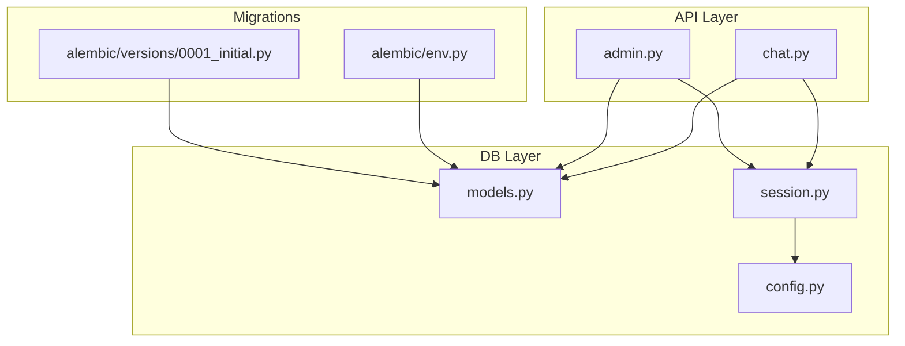
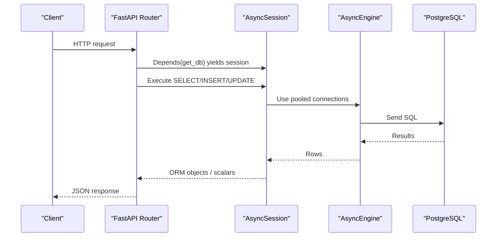
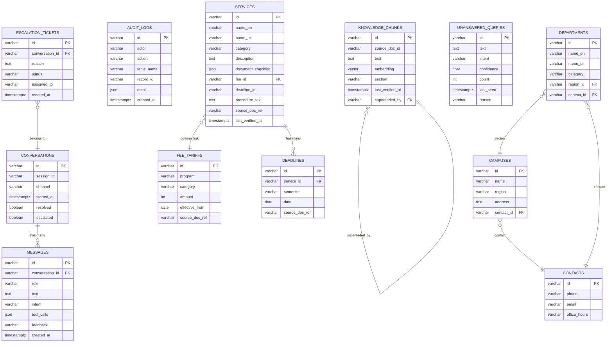
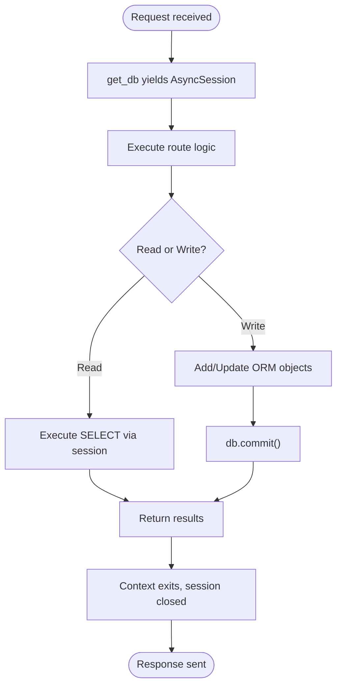
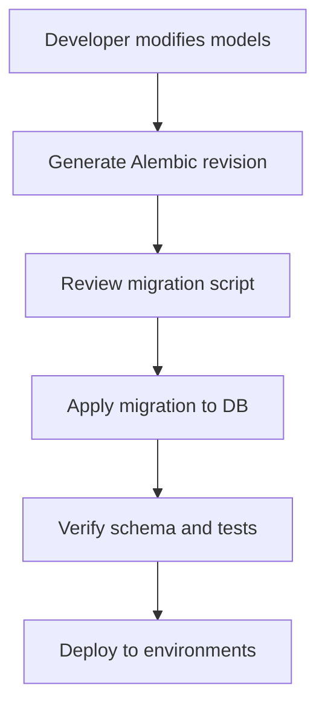
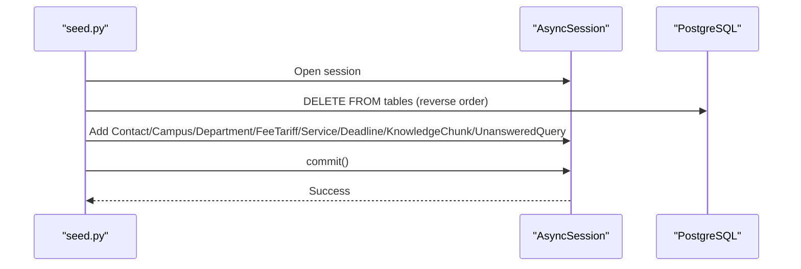
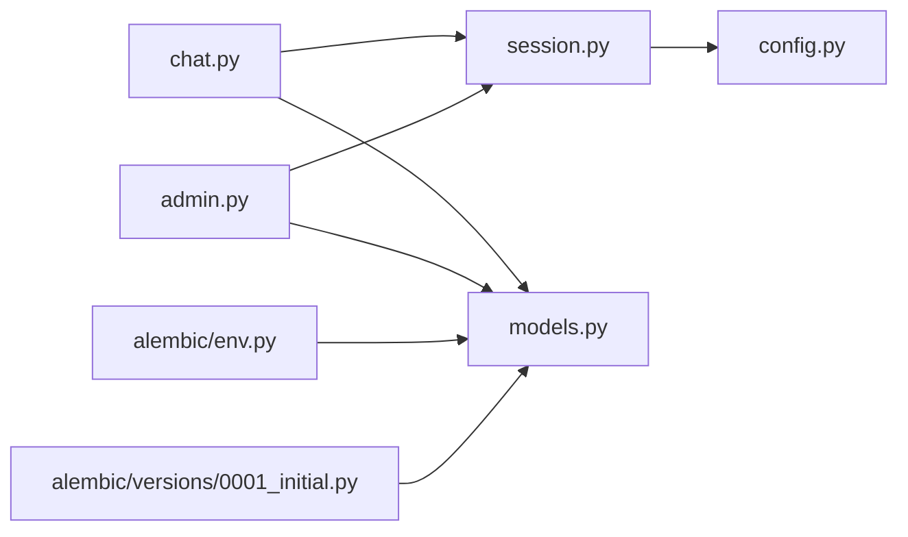

# Database Layer

<cite>
**Referenced Files in This Document**
- [models.py](file://uaea-backend/app/db/models.py)
- [session.py](file://uaea-backend/app/db/session.py)
- [seed.py](file://uaea-backend/app/db/seed.py)
- [config.py](file://uaea-backend/app/config.py)
- [env.py](file://uaea-backend/alembic/env.py)
- [0001_initial.py](file://uaea-backend/alembic/versions/0001_initial.py)
- [chat.py](file://uaea-backend/app/api/chat.py)
- [admin.py](file://uaea-backend/app/api/admin.py)
</cite>

## Table of Contents
1. [Introduction](#introduction)
2. [Project Structure](#project-structure)
3. [Core Components](#core-components)
4. [Architecture Overview](#architecture-overview)
5. [Detailed Component Analysis](#detailed-component-analysis)
6. [Dependency Analysis](#dependency-analysis)
7. [Performance Considerations](#performance-considerations)
8. [Troubleshooting Guide](#troubleshooting-guide)
9. [Conclusion](#conclusion)

## Introduction
This document describes the database layer implemented with SQLAlchemy ORM and PostgreSQL (including pgvector). It covers all core entities, relationships, constraints, indexing strategy, session management, connection pooling, transaction handling, Alembic migrations, seed data, and performance considerations for large datasets. The focus is on Conversation, Message, Service, FeeTariff, Deadline, and AuditLog, while also documenting related entities that participate in queries and relationships.

## Project Structure
The backend database layer resides under uaea-backend:
- Models and base definitions: app/db/models.py
- Async engine and session factory: app/db/session.py
- Seed script for demo data: app/db/seed.py
- Configuration (database URLs, embedding dimensions): app/config.py
- Alembic environment and migration scripts: alembic/env.py, alembic/versions/0001_initial.py
- API usage of DB models: app/api/chat.py, app/api/admin.py

**Diagram sources**
- [chat.py:1-115](file://uaea-backend/app/api/chat.py#L1-L115)
- [admin.py:1-161](file://uaea-backend/app/api/admin.py#L1-L161)
- [models.py:1-228](file://uaea-backend/app/db/models.py#L1-L228)
- [session.py:1-14](file://uaea-backend/app/db/session.py#L1-L14)
- [config.py:1-38](file://uaea-backend/app/config.py#L1-L38)
- [env.py:1-44](file://uaea-backend/alembic/env.py#L1-L44)
- [0001_initial.py:1-180](file://uaea-backend/alembic/versions/0001_initial.py#L1-L180)

**Section sources**
- [models.py:1-228](file://uaea-backend/app/db/models.py#L1-L228)
- [session.py:1-14](file://uaea-backend/app/db/session.py#L1-L14)
- [config.py:1-38](file://uaea-backend/app/config.py#L1-L38)
- [env.py:1-44](file://uaea-backend/alembic/env.py#L1-L44)
- [0001_initial.py:1-180](file://uaea-backend/alembic/versions/0001_initial.py#L1-L180)
- [chat.py:1-115](file://uaea-backend/app/api/chat.py#L1-L115)
- [admin.py:1-161](file://uaea-backend/app/api/admin.py#L1-L161)

## Core Components
- Base declarative model and helpers: Base class, UUID generator, timestamp defaults.
- Entities: Contact, Campus, Department, FeeTariff, Service, Deadline, KnowledgeChunk, Conversation, Message, EscalationTicket, UnansweredQuery, AuditLog.
- Session and engine: async engine with connection pool and session maker; FastAPI dependency to yield sessions.
- Migrations: Alembic env uses sync psycopg2 URL from settings; registers metadata via Base.metadata; initial migration creates tables and indexes.
- Seed data: deterministic demo dataset across multiple tables.

Key responsibilities:
- Define schema and relationships in models.
- Provide async DB access via get_db dependency.
- Manage migrations and versioning with Alembic.
- Populate initial data for development/demo.

**Section sources**
- [models.py:18-228](file://uaea-backend/app/db/models.py#L18-L228)
- [session.py:1-14](file://uaea-backend/app/db/session.py#L1-L14)
- [env.py:1-44](file://uaea-backend/alembic/env.py#L1-L44)
- [0001_initial.py:17-180](file://uaea-backend/alembic/versions/0001_initial.py#L17-L180)
- [seed.py:1-203](file://uaea-backend/app/db/seed.py#L1-L203)

## Architecture Overview
The application uses an async SQLAlchemy stack with PostgreSQL. FastAPI endpoints depend on a shared AsyncSession provided by get_db. Models define relationships and constraints. Alembic manages schema evolution using the same Base metadata. Seed script populates realistic data for development.

**Diagram sources**
- [chat.py:21-85](file://uaea-backend/app/api/chat.py#L21-L85)
- [admin.py:67-125](file://uaea-backend/app/api/admin.py#L67-L125)
- [session.py:1-14](file://uaea-backend/app/db/session.py#L1-L14)
- [config.py:6-18](file://uaea-backend/app/config.py#L6-L18)

## Detailed Component Analysis

### Entity Model Relationships and Constraints
The following diagram maps the primary entities requested and their relationships as defined in the models.

**Diagram sources**
- [models.py:30-228](file://uaea-backend/app/db/models.py#L30-L228)
- [0001_initial.py:21-163](file://uaea-backend/alembic/versions/0001_initial.py#L21-L163)

#### Key entity details and indexing
- Conversation
  - Primary key: id (UUID string)
  - Index: session_id for fast lookup by session
  - Timestamps: started_at with server default now()
  - Flags: resolved, escalated booleans
  - Relationship: one-to-many with Message (ordered by created_at)
- Message
  - Foreign key: conversation_id references conversations(id) with CASCADE delete
  - Fields: role, text, intent, tool_calls (JSON), feedback, created_at
  - No explicit index on conversation_id; rely on join performance or add index if needed for high-volume reads
- Service
  - Index: category for filtering services by category
  - Optional foreign key: fee_id references fee_tariffs(id)
  - Optional field: deadline_id (no FK constraint enforced at DB level)
  - Timestamp: last_verified_at with server default now()
  - Relationship: joined relationship to FeeTariff
- FeeTariff
  - Index: program for lookups by program
  - Fields: category, amount, effective_from, source_doc_ref
- Deadline
  - Foreign key: service_id references services(id)
  - Fields: semester, date, source_doc_ref
  - Relationship: joined relationship to Service
- AuditLog
  - Fields: actor, action, table_name, record_id, detail (JSON), created_at
  - Used to record admin writes and changes
- Additional entities used in queries and seeding:
  - KnowledgeChunk: includes pgvector embedding column and self-referencing superseded_by
  - EscalationTicket: links to Conversation, has index on conversation_id
  - UnansweredQuery: tracks low-confidence or unresolved queries
  - Contact, Campus, Department: organizational reference data

**Section sources**
- [models.py:71-122](file://uaea-backend/app/db/models.py#L71-L122)
- [models.py:144-179](file://uaea-backend/app/db/models.py#L144-L179)
- [models.py:183-211](file://uaea-backend/app/db/models.py#L183-L211)
- [0001_initial.py:51-151](file://uaea-backend/alembic/versions/0001_initial.py#L51-L151)

### Session Management, Connection Pooling, and Transactions
- Engine and session factory
  - Async engine created with pool_size=20 and max_overflow=10
  - expire_on_commit=False to avoid unnecessary refreshes after commits
- Dependency injection
  - get_db yields an AsyncSession per request using async context manager
  - Ensures proper lifecycle: open at start of request, close at end
- Transaction handling
  - Each request runs within its own session scope
  - Writes are committed explicitly where needed (e.g., escalation, admin writes)
  - Reads use select statements without explicit transactions

**Diagram sources**
- [session.py:1-14](file://uaea-backend/app/db/session.py#L1-L14)
- [chat.py:88-115](file://uaea-backend/app/api/chat.py#L88-L115)
- [admin.py:67-125](file://uaea-backend/app/api/admin.py#L67-L125)

**Section sources**
- [session.py:1-14](file://uaea-backend/app/db/session.py#L1-L14)
- [chat.py:21-115](file://uaea-backend/app/api/chat.py#L21-L115)
- [admin.py:67-125](file://uaea-backend/app/api/admin.py#L67-L125)

### Migration Strategy with Alembic
- Environment configuration
  - Uses sync psycopg2 URL from settings.database_url_sync
  - Registers Base.metadata so migrations reflect current models
- Initial migration
  - Creates all tables, indexes, and enables pgvector extension
  - Defines foreign keys and server defaults
- Operational notes
  - Run migrations against the target database using Alembic CLI
  - Ensure pgvector extension is enabled before creating vector columns

**Diagram sources**
- [env.py:1-44](file://uaea-backend/alembic/env.py#L1-L44)
- [0001_initial.py:17-180](file://uaea-backend/alembic/versions/0001_initial.py#L17-L180)

**Section sources**
- [env.py:1-44](file://uaea-backend/alembic/env.py#L1-L44)
- [0001_initial.py:17-180](file://uaea-backend/alembic/versions/0001_initial.py#L17-L180)

### Seed Data Management
- Purpose: populate realistic demo data for development and testing
- Scope: contacts, campuses, departments, fee tariffs, services, deadlines, knowledge chunks, unanswered queries
- Behavior: clears tables in reverse dependency order before inserting seed records
- Execution: run as a module or script; uses async session to commit

**Diagram sources**
- [seed.py:160-196](file://uaea-backend/app/db/seed.py#L160-L196)

**Section sources**
- [seed.py:1-203](file://uaea-backend/app/db/seed.py#L1-L203)

### Query Optimization Patterns
Observed patterns in API usage:
- Filtering and ordering
  - Conversations queried by session_id with limit(1) and ordered by started_at desc
  - Messages fetched per conversation ordered by created_at
- Aggregations
  - Intent analytics grouped by message.intent with counts
- Index utilization
  - session_id indexed on conversations
  - category indexed on services
  - program indexed on fee_tariffs
  - conversation_id indexed on escalation_tickets
- Recommendations for large datasets
  - Add index on messages.conversation_id if frequent joins/filtering by conversation occur
  - Consider partial indexes for common filters (e.g., role='user')
  - Use pagination for large result sets (e.g., messages list)
  - For vector similarity search on knowledge_chunks, create appropriate HNSW or IVFFlat indexes based on query patterns

**Section sources**
- [chat.py:42-85](file://uaea-backend/app/api/chat.py#L42-L85)
- [admin.py:130-144](file://uaea-backend/app/api/admin.py#L130-L144)
- [0001_initial.py:61-139](file://uaea-backend/alembic/versions/0001_initial.py#L61-L139)

## Dependency Analysis
High-level dependencies between components:

**Diagram sources**
- [chat.py:1-115](file://uaea-backend/app/api/chat.py#L1-L115)
- [admin.py:1-161](file://uaea-backend/app/api/admin.py#L1-L161)
- [session.py:1-14](file://uaea-backend/app/db/session.py#L1-L14)
- [config.py:1-38](file://uaea-backend/app/config.py#L1-L38)
- [env.py:1-44](file://uaea-backend/alembic/env.py#L1-L44)
- [0001_initial.py:1-180](file://uaea-backend/alembic/versions/0001_initial.py#L1-L180)

**Section sources**
- [chat.py:1-115](file://uaea-backend/app/api/chat.py#L1-L115)
- [admin.py:1-161](file://uaea-backend/app/api/admin.py#L1-L161)
- [session.py:1-14](file://uaea-backend/app/db/session.py#L1-L14)
- [config.py:1-38](file://uaea-backend/app/config.py#L1-L38)
- [env.py:1-44](file://uaea-backend/alembic/env.py#L1-L44)
- [0001_initial.py:1-180](file://uaea-backend/alembic/versions/0001_initial.py#L1-L180)

## Performance Considerations
- Connection pooling
  - pool_size=20 and max_overflow=10 provide concurrency headroom; tune based on workload and DB capacity
- Expire-on-commit behavior
  - expire_on_commit=False reduces redundant refreshes; beneficial for read-heavy flows
- Indexing strategy
  - Existing indexes: conversations.session_id, services.category, fee_tariffs.program, escalation_tickets.conversation_id
  - Consider adding indexes on messages.conversation_id and messages.role if frequently filtered/joined
- Large datasets
  - Use pagination for lists (e.g., messages)
  - Prefer selective queries with WHERE clauses and LIMIT
  - For vector similarity on knowledge_chunks, configure pgvector indexes (HNSW/IVFFlat) aligned with query patterns
- Transaction boundaries
  - Keep transactions short; commit only when necessary to reduce lock contention
- Bulk operations
  - For seeding or batch updates, consider bulk inserts/updates to minimize round trips

[No sources needed since this section provides general guidance]

## Troubleshooting Guide
Common issues and checks:
- Missing pgvector extension
  - Ensure CREATE EXTENSION IF NOT EXISTS vector is applied before using vector columns
  - Refer to initial migration which enables the extension
- Session not closing properly
  - Verify get_db context manager is used; FastAPI dependency ensures cleanup
- Unexpected cascading deletes
  - Messages have CASCADE delete on conversation deletion; ensure business logic accounts for this
- Admin write audit logs
  - Confirm _audit_log helper is called for writes to maintain traceability
- Seed data conflicts
  - Seed script clears tables in reverse dependency order; ensure no external processes insert concurrently during seeding

**Section sources**
- [0001_initial.py:17-20](file://uaea-backend/alembic/versions/0001_initial.py#L17-L20)
- [session.py:11-13](file://uaea-backend/app/db/session.py#L11-L13)
- [models.py:162-179](file://uaea-backend/app/db/models.py#L162-L179)
- [admin.py:53-63](file://uaea-backend/app/api/admin.py#L53-L63)
- [seed.py:167-173](file://uaea-backend/app/db/seed.py#L167-L173)

## Conclusion
The database layer is built on a robust async SQLAlchemy stack with clear separation of concerns: models define schema and relationships, session management centralizes connection and transaction handling, Alembic governs migrations, and seed data supports development workflows. The existing indexing strategy targets common query paths, and additional indexes can be added as workloads evolve. For large-scale deployments, monitor connection pool usage, refine indexes, and apply pagination and bulk operations where appropriate.

[No sources needed since this section summarizes without analyzing specific files]