# External Integrations

<cite>
**Referenced Files in This Document**
- [base.py](file://uaea-backend/app/adapters/base.py)
- [mock_adapter.py](file://uaea-backend/app/adapters/mock_adapter.py)
- [config.py](file://uaea-backend/app/config.py)
- [main.py](file://uaea-backend/app/main.py)
- [tools.py](file://uaea-backend/app/orchestrator/tools.py)
- [orchestrator.py](file://uaea-backend/app/orchestrator/orchestrator.py)
- [chat.py](file://uaea-backend/app/api/chat.py)
- [lookup.py](file://uaea-backend/app/api/lookup.py)
- [admin.py](file://uaea-backend/app/api/admin.py)
- [adapters.js](file://src/mocks/adapters.js)
- [Integrations/index.jsx](file://src/pages/Integrations/index.jsx)
- [Integrations/AdapterCard.jsx](file://src/pages/Integrations/AdapterCard.jsx)
- [test_chat_flow.py](file://uaea-backend/tests/test_chat_flow.py)
</cite>

## Table of Contents
1. [Introduction](#introduction)
2. [Project Structure](#project-structure)
3. [Core Components](#core-components)
4. [Architecture Overview](#architecture-overview)
5. [Detailed Component Analysis](#detailed-component-analysis)
6. [Dependency Analysis](#dependency-analysis)
7. [Performance Considerations](#performance-considerations)
8. [Troubleshooting Guide](#troubleshooting-guide)
9. [Conclusion](#conclusion)
10. [Appendices](#appendices)

## Introduction
This document explains the adapter pattern used to integrate external services into the system. It covers:
- The base adapter interface that all integrations must implement
- The mock adapter implementation for development and testing
- Configuration management for external dependencies
- How to implement custom adapters for new integrations
- Authentication and authorization patterns
- API rate limiting and error handling strategies
- Examples of integrating third-party services
- Testing strategies for external dependencies

The design ensures that business logic (orchestrator, flows, UI) depends only on a stable interface, not on concrete providers. This makes it possible to swap implementations (e.g., from mock to real APIs) without rewriting core logic.

## Project Structure
External integration points are primarily implemented in the backend under app/adapters and referenced by orchestrator tools and admin/UI components. The frontend exposes an Integrations page to visualize and manage active adapters.

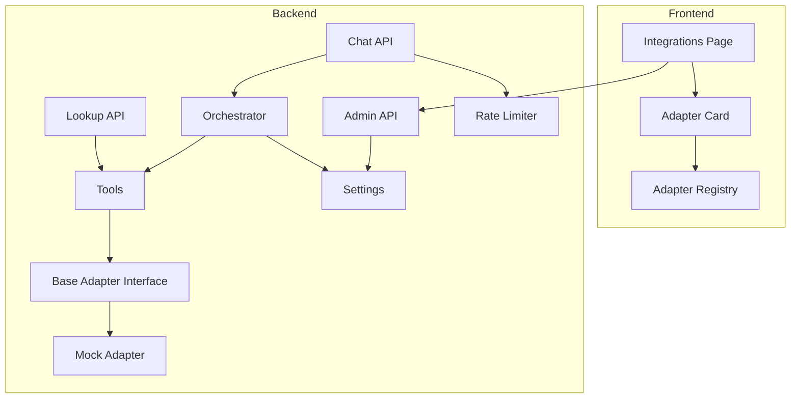

**Diagram sources**
- [Integrations/index.jsx:1-99](file://src/pages/Integrations/index.jsx#L1-L99)
- [Integrations/AdapterCard.jsx:1-96](file://src/pages/Integrations/AdapterCard.jsx#L1-L96)
- [adapters.js:1-64](file://src/mocks/adapters.js#L1-L64)
- [chat.py:1-115](file://uaea-backend/app/api/chat.py#L1-L115)
- [lookup.py:1-104](file://uaea-backend/app/api/lookup.py#L1-L104)
- [admin.py:1-161](file://uaea-backend/app/api/admin.py#L1-L161)
- [orchestrator.py:1-405](file://uaea-backend/app/orchestrator/orchestrator.py#L1-L405)
- [tools.py:1-235](file://uaea-backend/app/orchestrator/tools.py#L1-L235)
- [base.py:1-32](file://uaea-backend/app/adapters/base.py#L1-L32)
- [mock_adapter.py:1-61](file://uaea-backend/app/adapters/mock_adapter.py#L1-L61)
- [config.py:1-38](file://uaea-backend/app/config.py#L1-L38)
- [main.py:1-104](file://uaea-backend/app/main.py#L1-L104)

**Section sources**
- [Integrations/index.jsx:1-99](file://src/pages/Integrations/index.jsx#L1-L99)
- [adapters.js:1-64](file://src/mocks/adapters.js#L1-L64)
- [main.py:1-104](file://uaea-backend/app/main.py#L1-L104)

## Core Components
- Base adapter interface defines the contract for external integrations.
- Mock adapter provides deterministic responses for development and tests.
- Settings centralizes configuration for databases, LLMs, embeddings, CORS, rate limits, and admin keys.
- Orchestrator and tools coordinate message processing and tool execution; they depend on the adapter interface rather than concrete providers.
- Admin API enforces authentication via API key or bearer token.
- Frontend Integrations page visualizes adapter status and capabilities.

Key responsibilities:
- Decouple business logic from external systems through a stable interface
- Provide safe defaults and mocks for local development
- Centralize configuration and environment variables
- Enforce access control on administrative endpoints
- Expose operational visibility for integrations

**Section sources**
- [base.py:1-32](file://uaea-backend/app/adapters/base.py#L1-L32)
- [mock_adapter.py:1-61](file://uaea-backend/app/adapters/mock_adapter.py#L1-L61)
- [config.py:1-38](file://uaea-backend/app/config.py#L1-L38)
- [orchestrator.py:1-405](file://uaea-backend/app/orchestrator/orchestrator.py#L1-L405)
- [tools.py:1-235](file://uaea-backend/app/orchestrator/tools.py#L1-L235)
- [admin.py:1-161](file://uaea-backend/app/api/admin.py#L1-L161)
- [Integrations/index.jsx:1-99](file://src/pages/Integrations/index.jsx#L1-L99)

## Architecture Overview
The system uses an adapter pattern to abstract external services behind a common interface. The orchestrator invokes tools which may call adapters. The frontend displays adapter metadata and allows activation of different adapters.

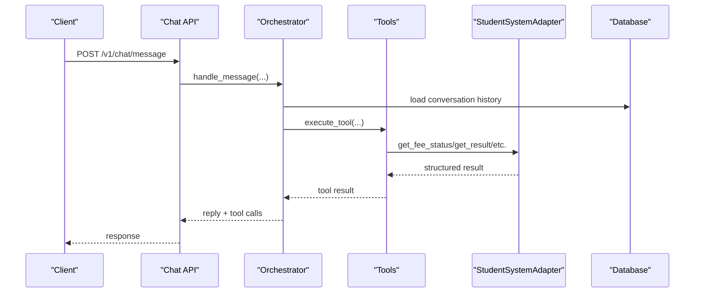

**Diagram sources**
- [chat.py:21-39](file://uaea-backend/app/api/chat.py#L21-L39)
- [orchestrator.py:46-143](file://uaea-backend/app/orchestrator/orchestrator.py#L46-L143)
- [tools.py:218-235](file://uaea-backend/app/orchestrator/tools.py#L218-L235)
- [base.py:11-31](file://uaea-backend/app/adapters/base.py#L11-L31)

## Detailed Component Analysis

### Base Adapter Interface
The base adapter defines the contract for student system integrations. All orchestrator/tool code should depend on this interface, never on concrete adapters.

- Methods include retrieving fee status, results, assignment status, submitting service requests, and tracking requests.
- Each method is asynchronous and returns a structured dictionary.

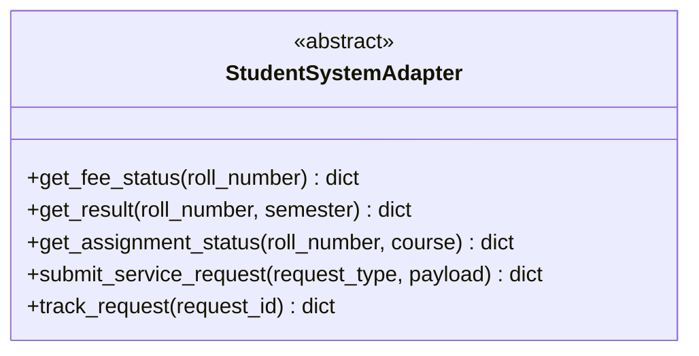

**Diagram sources**
- [base.py:11-31](file://uaea-backend/app/adapters/base.py#L11-L31)

**Section sources**
- [base.py:1-32](file://uaea-backend/app/adapters/base.py#L1-L32)

### Mock Adapter Implementation
The mock adapter implements the base interface with canned responses suitable for end-to-end testing without external dependencies.

- Provides realistic but static data for fees, results, assignments, service requests, and request tracking.
- Exposes a singleton instance for dependency injection.

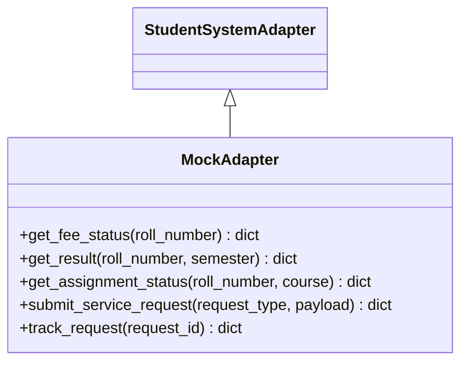

**Diagram sources**
- [mock_adapter.py:12-56](file://uaea-backend/app/adapters/mock_adapter.py#L12-L56)
- [base.py:11-31](file://uaea-backend/app/adapters/base.py#L11-L31)

**Section sources**
- [mock_adapter.py:1-61](file://uaea-backend/app/adapters/mock_adapter.py#L1-L61)

### Configuration Management
Configuration is centralized using Pydantic settings loaded from environment variables and .env files.

- Database URLs for async and sync clients
- LLM provider keys and models
- Embedding provider settings
- CORS origins
- Rate limiting policies
- Admin API key
- App environment and log level

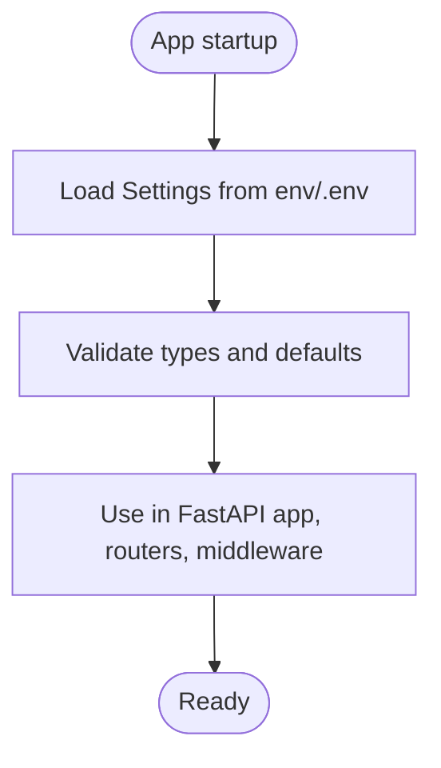

**Diagram sources**
- [config.py:6-37](file://uaea-backend/app/config.py#L6-L37)
- [main.py:15-23](file://uaea-backend/app/main.py#L15-L23)

**Section sources**
- [config.py:1-38](file://uaea-backend/app/config.py#L1-L38)
- [main.py:1-104](file://uaea-backend/app/main.py#L1-L104)

### Orchestrator and Tool Integration
The orchestrator processes messages, manages guided flows, and executes tools. Tools encapsulate operations like looking up departments, fees, deadlines, and checklists. While current tools query the database, the architecture supports extending them to call adapters when needed.

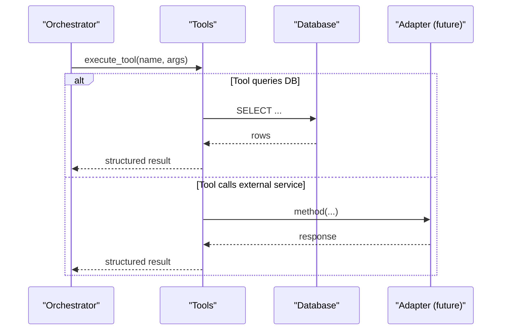

**Diagram sources**
- [orchestrator.py:229-318](file://uaea-backend/app/orchestrator/orchestrator.py#L229-L318)
- [tools.py:218-235](file://uaea-backend/app/orchestrator/tools.py#L218-L235)

**Section sources**
- [orchestrator.py:1-405](file://uaea-backend/app/orchestrator/orchestrator.py#L1-L405)
- [tools.py:1-235](file://uaea-backend/app/orchestrator/tools.py#L1-L235)

### Authentication and Authorization
Admin endpoints require verification via API key or bearer token.

- verify_admin reads X-API-Key or Authorization header
- Compares against configured admin_api_key
- Raises HTTP 403 if invalid

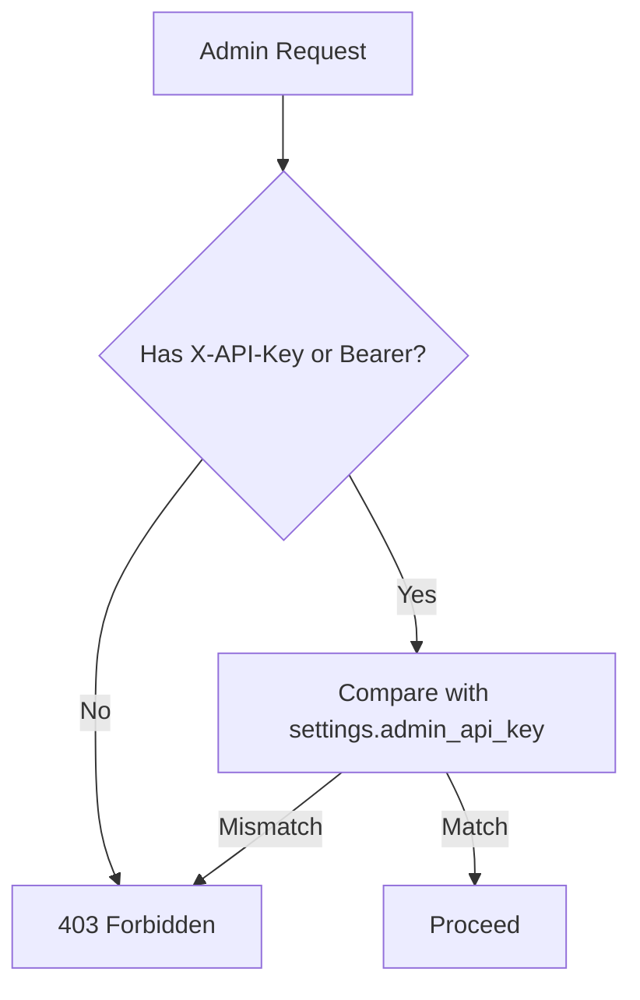

**Diagram sources**
- [admin.py:31-48](file://uaea-backend/app/api/admin.py#L31-L48)
- [config.py:27-28](file://uaea-backend/app/config.py#L27-L28)

**Section sources**
- [admin.py:1-161](file://uaea-backend/app/api/admin.py#L1-L161)
- [config.py:1-38](file://uaea-backend/app/config.py#L1-L38)

### API Rate Limiting
Rate limiting is applied at the application level using a limiter keyed by remote address. A custom handler returns 429 when exceeded.

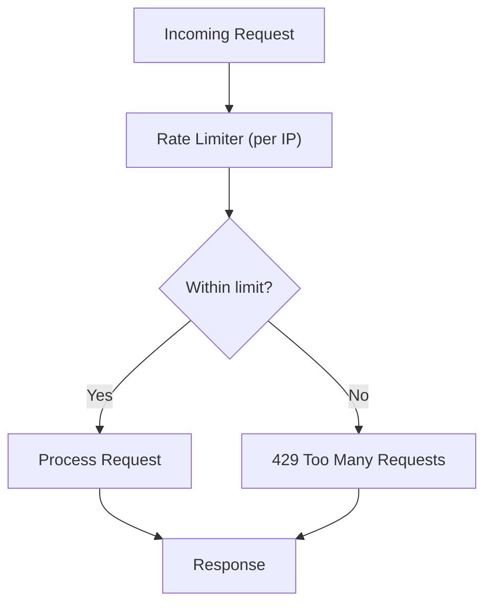

**Diagram sources**
- [main.py:25-58](file://uaea-backend/app/main.py#L25-L58)
- [config.py:23-25](file://uaea-backend/app/config.py#L23-L25)

**Section sources**
- [main.py:1-104](file://uaea-backend/app/main.py#L1-L104)
- [config.py:1-38](file://uaea-backend/app/config.py#L1-L38)

### Error Handling and Retry Logic
- Orchestrator catches LLM API errors and returns a graceful fallback message.
- Tools return structured error dictionaries when data is not found.
- For external adapters, recommended practices include:
  - Implement retries with exponential backoff for transient failures
  - Distinguish between client errors (4xx) and server errors (5xx)
  - Surface meaningful user messages while logging detailed diagnostics
  - Add circuit breakers for downstream services to prevent cascading failures

[No sources needed since this section provides general guidance]

### Implementing Custom Adapters
To add a new integration:
- Create a new class implementing the base adapter interface
- Implement all required methods with consistent return shapes
- Handle authentication securely (e.g., API keys, OAuth tokens)
- Add configuration entries for credentials and endpoints
- Wire the adapter into the orchestrator/tools where appropriate
- Update the frontend adapter registry to reflect capabilities and phase

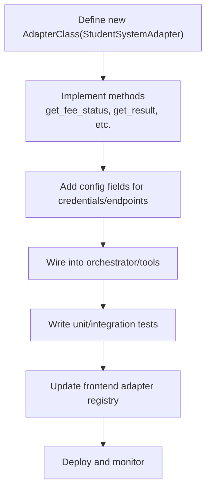

**Diagram sources**
- [base.py:11-31](file://uaea-backend/app/adapters/base.py#L11-L31)
- [config.py:6-37](file://uaea-backend/app/config.py#L6-L37)
- [tools.py:218-235](file://uaea-backend/app/orchestrator/tools.py#L218-L235)
- [adapters.js:10-63](file://src/mocks/adapters.js#L10-L63)

**Section sources**
- [base.py:1-32](file://uaea-backend/app/adapters/base.py#L1-L32)
- [config.py:1-38](file://uaea-backend/app/config.py#L1-L38)
- [tools.py:1-235](file://uaea-backend/app/orchestrator/tools.py#L1-L235)
- [adapters.js:1-64](file://src/mocks/adapters.js#L1-L64)

### Third-Party Service Integration Examples
- CMS/OAS/LMS adapters can be added following the same interface pattern
- Use environment variables for secrets and endpoints
- Return standardized payloads to keep orchestrator logic unchanged
- Track latency and health status in the frontend adapter registry

[No sources needed since this section provides general guidance]

### Testing Strategies for External Dependencies
- Use MockAdapter for end-to-end tests without hitting real APIs
- Mock LLM responses in tests to avoid external dependencies
- Assert structured outputs and error paths
- Verify admin authentication behavior with valid and invalid keys

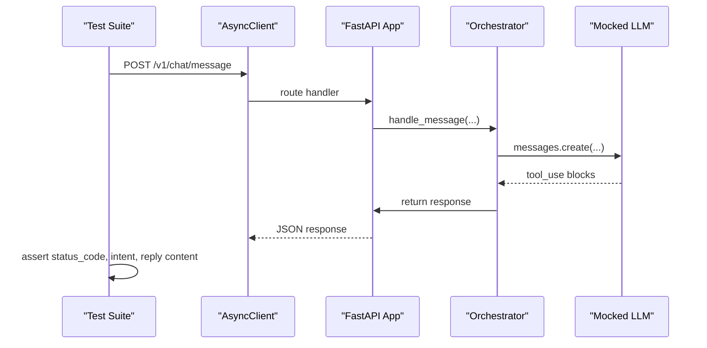

**Diagram sources**
- [test_chat_flow.py:44-176](file://uaea-backend/tests/test_chat_flow.py#L44-L176)
- [chat.py:21-39](file://uaea-backend/app/api/chat.py#L21-L39)
- [orchestrator.py:229-318](file://uaea-backend/app/orchestrator/orchestrator.py#L229-L318)

**Section sources**
- [test_chat_flow.py:1-176](file://uaea-backend/tests/test_chat_flow.py#L1-L176)

## Dependency Analysis
The system decouples business logic from external providers via the adapter interface. Tools currently rely on the database but can be extended to call adapters. The frontend adapter registry documents available integrations and their implementation status.

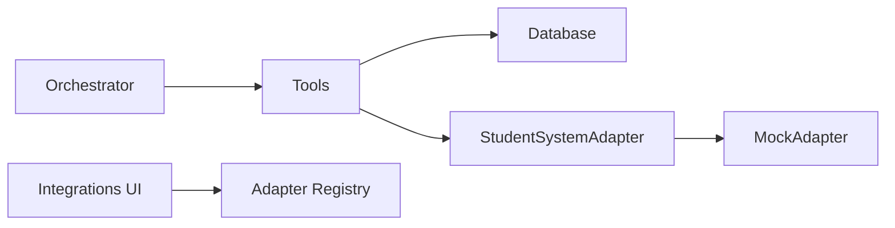

**Diagram sources**
- [orchestrator.py:229-318](file://uaea-backend/app/orchestrator/orchestrator.py#L229-L318)
- [tools.py:218-235](file://uaea-backend/app/orchestrator/tools.py#L218-L235)
- [base.py:11-31](file://uaea-backend/app/adapters/base.py#L11-L31)
- [mock_adapter.py:12-56](file://uaea-backend/app/adapters/mock_adapter.py#L12-L56)
- [adapters.js:10-63](file://src/mocks/adapters.js#L10-L63)

**Section sources**
- [tools.py:1-235](file://uaea-backend/app/orchestrator/tools.py#L1-L235)
- [adapters.js:1-64](file://src/mocks/adapters.js#L1-L64)

## Performance Considerations
- Use connection pooling for database and external API clients
- Cache frequent lookups (e.g., department lists, fee tariffs) where appropriate
- Apply rate limiting per IP and consider per-session limits for chat endpoints
- Monitor adapter latency and health; surface metrics in the Integrations UI
- Avoid unnecessary retries for idempotent operations; use exponential backoff for transient errors

[No sources needed since this section provides general guidance]

## Troubleshooting Guide
Common issues and resolutions:
- Admin endpoints returning 403: ensure correct X-API-Key or Authorization header matches settings.admin_api_key
- Rate limit exceeded: adjust rate_limit_per_ip and rate_limit_per_session in settings; investigate traffic spikes
- LLM API errors: orchestrator returns a friendly fallback; check logs and retry later
- Adapter not configured: frontend shows “Not configured”; set credentials and activate the adapter

**Section sources**
- [admin.py:31-48](file://uaea-backend/app/api/admin.py#L31-L48)
- [main.py:51-58](file://uaea-backend/app/main.py#L51-L58)
- [orchestrator.py:264-271](file://uaea-backend/app/orchestrator/orchestrator.py#L264-L271)
- [Integrations/index.jsx:27-55](file://src/pages/Integrations/index.jsx#L27-L55)

## Conclusion
The adapter pattern cleanly separates external integrations from core logic, enabling flexible, testable, and maintainable integrations. With a well-defined interface, robust configuration, and clear authentication and rate limiting, teams can add new services incrementally while preserving stability. The frontend Integrations UI provides visibility into adapter status and capabilities, supporting smooth transitions from mock to production integrations.

[No sources needed since this section summarizes without analyzing specific files]

## Appendices

### Frontend Adapter Registry and UI
The frontend maintains a registry of adapters with metadata such as target system, phase, active status, and implemented methods. The Integrations page renders cards showing health, latency, and actions to activate or check adapters.

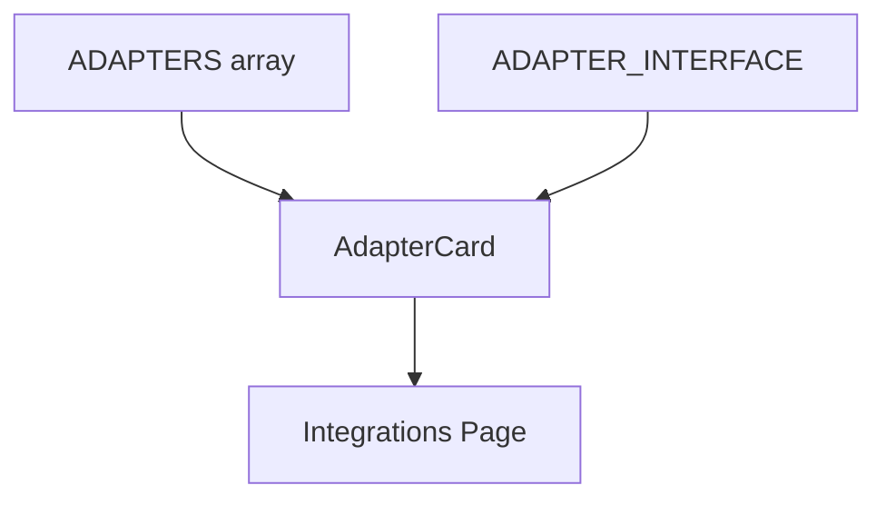

**Diagram sources**
- [adapters.js:10-63](file://src/mocks/adapters.js#L10-L63)
- [Integrations/AdapterCard.jsx:1-96](file://src/pages/Integrations/AdapterCard.jsx#L1-L96)
- [Integrations/index.jsx:1-99](file://src/pages/Integrations/index.jsx#L1-L99)

**Section sources**
- [adapters.js:1-64](file://src/mocks/adapters.js#L1-L64)
- [Integrations/AdapterCard.jsx:1-96](file://src/pages/Integrations/AdapterCard.jsx#L1-L96)
- [Integrations/index.jsx:1-99](file://src/pages/Integrations/index.jsx#L1-L99)