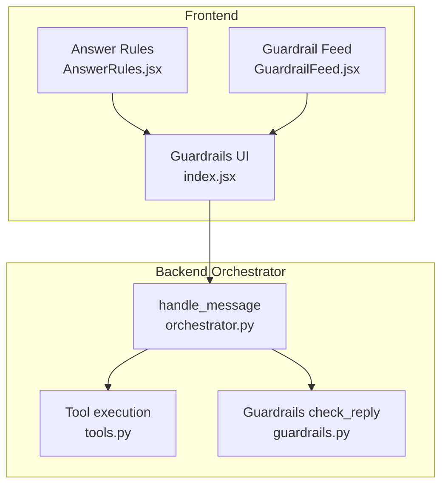
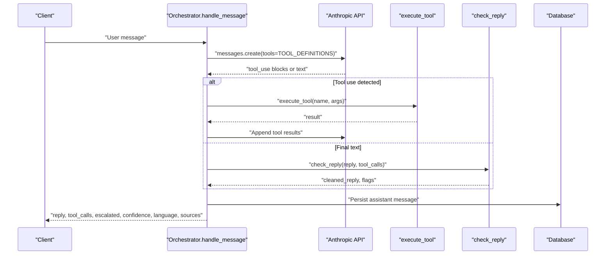
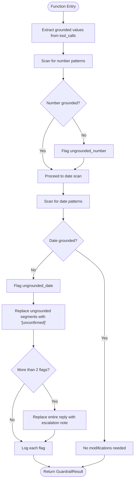
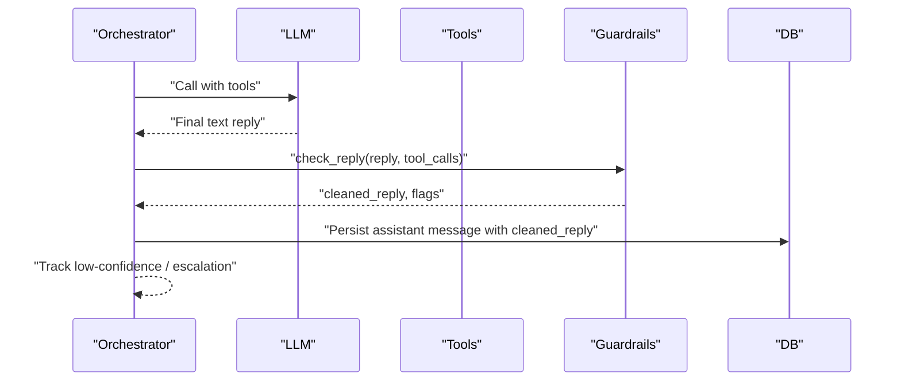
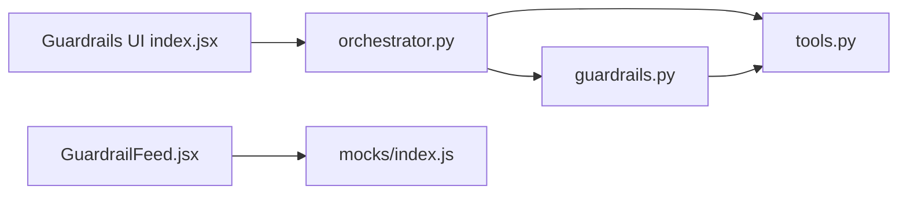

# Guardrail System

<cite>
**Referenced Files in This Document**
- [guardrails.py](file://uaea-backend/app/orchestrator/guardrails.py)
- [orchestrator.py](file://uaea-backend/app/orchestrator/orchestrator.py)
- [tools.py](file://uaea-backend/app/orchestrator/tools.py)
- [test_guardrails.py](file://uaea-backend/tests/test_guardrails.py)
- [index.jsx](file://src/pages/Guardrails/index.jsx)
- [AnswerRules.jsx](file://src/pages/Guardrails/AnswerRules.jsx)
- [GuardrailFeed.jsx](file://src/pages/Dashboard/GuardrailFeed.jsx)
- [index.js](file://src/mocks/index.js)
</cite>

## Table of Contents
1. Introduction
2. Project Structure
3. Core Components
4. Architecture Overview
5. Detailed Component Analysis
6. Dependency Analysis
7. Performance Considerations
8. Troubleshooting Guide
9. Conclusion
10. Appendices

## Introduction
This document explains the guardrail validation system that ensures response quality and compliance before messages are delivered to users. It covers validation rules, content filtering mechanisms, fact-checking against tool results, policy enforcement, and how violations are handled and logged. The system is designed to prevent hallucination by allowing only information obtained from tool calls to reach students, while maintaining appropriate tone and format.

## Project Structure
The guardrail system spans both backend orchestration and frontend configuration:
- Backend orchestrates message processing, executes tools, and runs guardrails on LLM output.
- Frontend provides a configurable UI for answer rules, handover thresholds, and model selection, with audit logging for changes.
- Dashboard displays guardrail activity for monitoring.

**Diagram sources**
- [orchestrator.py:46-143](file://uaea-backend/app/orchestrator/orchestrator.py#L46-L143)
- [tools.py:18-87](file://uaea-backend/app/orchestrator/tools.py#L18-L87)
- [guardrails.py:74-119](file://uaea-backend/app/orchestrator/guardrails.py#L74-L119)
- [index.jsx:17-70](file://src/pages/Guardrails/index.jsx#L17-L70)
- [AnswerRules.jsx:5-36](file://src/pages/Guardrails/AnswerRules.jsx#L5-L36)
- [GuardrailFeed.jsx:11-44](file://src/pages/Dashboard/GuardrailFeed.jsx#L11-L44)

**Section sources**
- [orchestrator.py:46-143](file://uaea-backend/app/orchestrator/orchestrator.py#L46-L143)
- [index.jsx:17-70](file://src/pages/Guardrails/index.jsx#L17-L70)

## Core Components
- Guardrail checker: Scans LLM replies for ungrounded numbers, dates, and requirement claims; replaces or escalates when not backed by tool results.
- Orchestrator: Integrates normalization, intent classification, guided flows, tool execution, and guardrails into a single pipeline per user message.
- Tools: Provide authoritative data (fees, deadlines, departments, document checklists, knowledge base search) used as grounding sources.
- Frontend configuration: Allows administrators to toggle answer rules, set handover thresholds, and select models; logs all changes to an audit trail.
- Monitoring: Displays guardrail activity events to help detect drift in source documents.

**Section sources**
- [guardrails.py:16-27](file://uaea-backend/app/orchestrator/guardrails.py#L16-L27)
- [orchestrator.py:29-43](file://uaea-backend/app/orchestrator/orchestrator.py#L29-L43)
- [tools.py:18-87](file://uaea-backend/app/orchestrator/tools.py#L18-L87)
- [index.jsx:23-36](file://src/pages/Guardrails/index.jsx#L23-L36)
- [GuardrailFeed.jsx:6-10](file://src/pages/Dashboard/GuardrailFeed.jsx#L6-L10)

## Architecture Overview
End-to-end flow for each user message:
1. Input sanitization and language detection.
2. Intent classification and optional guided flow handling.
3. LLM call with tool definitions; execute tool calls iteratively.
4. Guardrail validation on final LLM reply using tool results as ground truth.
5. Persist assistant message with cleaned reply and tool traces.
6. Track low-confidence queries and escalation state.
7. Return reply, intent, tool calls, escalation flag, confidence, language, and sources.

**Diagram sources**
- [orchestrator.py:46-143](file://uaea-backend/app/orchestrator/orchestrator.py#L46-L143)
- [orchestrator.py:229-318](file://uaea-backend/app/orchestrator/orchestrator.py#L229-L318)
- [guardrails.py:74-119](file://uaea-backend/app/orchestrator/guardrails.py#L74-L119)
- [tools.py:218-234](file://uaea-backend/app/orchestrator/tools.py#L218-L234)

## Detailed Component Analysis

### Guardrail Checker: Fact-Grounding and Content Filtering
Responsibilities:
- Extract grounded values from tool call results recursively.
- Detect factual claims via patterns for numbers and dates.
- Replace ungrounded claims with placeholders or escalate if too many violations occur.
- Log warnings for each flagged claim.

Key behaviors:
- Numbers: Matches currency formats and bare large numbers; checks presence in grounded values.
- Dates: Matches multiple date formats; normalizes separators for comparison.
- Escalation: If more than two ungrounded claims are found, replace entire reply with an escalation note.
- Logging: Each violation is logged with kind and matched text.

**Diagram sources**
- [guardrails.py:51-72](file://uaea-backend/app/orchestrator/guardrails.py#L51-L72)
- [guardrails.py:74-119](file://uaea-backend/app/orchestrator/guardrails.py#L74-L119)

**Section sources**
- [guardrails.py:30-46](file://uaea-backend/app/orchestrator/guardrails.py#L30-L46)
- [guardrails.py:51-72](file://uaea-backend/app/orchestrator/guardrails.py#L51-L72)
- [guardrails.py:74-119](file://uaea-backend/app/orchestrator/guardrails.py#L74-L119)

### Orchestrator Integration: Where Guardrails Fit
- The orchestrator enforces a strict system prompt instructing the LLM to never quote fees, deadlines, or document requirements unless obtained via tool calls in the current turn.
- After LLM produces a final text reply, the orchestrator runs guardrails and persists the cleaned reply along with tool traces.
- Low-confidence intents are tracked; escalation state is preserved.

**Diagram sources**
- [orchestrator.py:29-43](file://uaea-backend/app/orchestrator/orchestrator.py#L29-L43)
- [orchestrator.py:93-143](file://uaea-backend/app/orchestrator/orchestrator.py#L93-L143)
- [guardrails.py:74-119](file://uaea-backend/app/orchestrator/guardrails.py#L74-L119)

**Section sources**
- [orchestrator.py:29-43](file://uaea-backend/app/orchestrator/orchestrator.py#L29-L43)
- [orchestrator.py:93-143](file://uaea-backend/app/orchestrator/orchestrator.py#L93-L143)

### Tools: Ground Truth Sources
- Tools provide authoritative answers for fees, deadlines, departments, document checklists, and knowledge base retrieval.
- Results include structured fields such as amounts, dates, and source references, which become the grounding set for guardrails.

Examples of tool capabilities:
- Fee lookup returns program, amount, currency, effective_from, and source reference.
- Deadline lookup returns service, semester, date, and source reference.
- Document checklist returns items, procedure, source, and last verified timestamp.
- Knowledge base search returns chunks with source metadata.

**Section sources**
- [tools.py:18-87](file://uaea-backend/app/orchestrator/tools.py#L18-L87)
- [tools.py:125-197](file://uaea-backend/app/orchestrator/tools.py#L125-L197)
- [tools.py:218-234](file://uaea-backend/app/orchestrator/tools.py#L218-L234)

### Frontend Configuration: Answer Rules and Thresholds
- Administrators can toggle answer rules that govern behavior before any reply leaves the system.
- Handover threshold controls when the assistant offers human assistance based on confidence.
- Model selection allows switching conversational layers while facts remain sourced from tools.
- All configuration changes are audited with detailed change records.

Configurable rules:
- Block ungrounded numbers/dates/requirements.
- Require citations on knowledge answers.
- Block outcome promises.
- Decline academic dishonesty requests.
- Refuse personal record lookups without authentication.
- Show verification dates beside facts.

Threshold and model:
- Confidence threshold slider determines escalation frequency.
- Active model selector influences conversation layer only.

Audit logging:
- Changes to threshold and model are recorded with field-level diffs.
- Rule toggles are captured as updates to the answer rules set.

**Section sources**
- [index.jsx:23-36](file://src/pages/Guardrails/index.jsx#L23-L36)
- [index.jsx:44-70](file://src/pages/Guardrails/index.jsx#L44-L70)
- [AnswerRules.jsx:5-36](file://src/pages/Guardrails/AnswerRules.jsx#L5-L36)

### Monitoring: Guardrail Activity Feed
- The dashboard shows recent guardrail events, helping identify rising counts of ungrounded numbers that may indicate source document drift.
- Events are displayed with contextual icons and timestamps.

**Section sources**
- [GuardrailFeed.jsx:6-10](file://src/pages/Dashboard/GuardrailFeed.jsx#L6-L10)
- [GuardrailFeed.jsx:11-44](file://src/pages/Dashboard/GuardrailFeed.jsx#L11-L44)
- [index.js:18](file://src/mocks/index.js#L18)

## Dependency Analysis
Guardrails depend on tool results to validate factual claims. The orchestrator coordinates this dependency chain, ensuring that only grounded information reaches users.

**Diagram sources**
- [orchestrator.py:46-143](file://uaea-backend/app/orchestrator/orchestrator.py#L46-L143)
- [tools.py:218-234](file://uaea-backend/app/orchestrator/tools.py#L218-L234)
- [guardrails.py:51-72](file://uaea-backend/app/orchestrator/guardrails.py#L51-L72)
- [index.jsx:17-70](file://src/pages/Guardrails/index.jsx#L17-L70)
- [GuardrailFeed.jsx:11-44](file://src/pages/Dashboard/GuardrailFeed.jsx#L11-L44)
- [index.js:18](file://src/mocks/index.js#L18)

**Section sources**
- [orchestrator.py:46-143](file://uaea-backend/app/orchestrator/orchestrator.py#L46-L143)
- [guardrails.py:51-72](file://uaea-backend/app/orchestrator/guardrails.py#L51-L72)
- [tools.py:218-234](file://uaea-backend/app/orchestrator/tools.py#L218-L234)

## Performance Considerations
- Pattern scanning is linear over reply length; regex operations are efficient for typical message sizes.
- Grounded value extraction traverses nested structures once per tool call result; complexity scales with result size.
- Replacement logic sorts flags in reverse order to avoid index shifts; minimal overhead.
- Escalation replacement triggers only when multiple ungrounded claims are detected, limiting heavy transformations.

[No sources needed since this section provides general guidance]

## Troubleshooting Guide
Common issues and resolutions:
- Rising ungrounded number count: Indicates source documents may have drifted; review tool outputs and update catalogue entries.
- Excessive escalations: Adjust handover threshold or improve tool coverage for missing data.
- Missing citations: Ensure knowledge base search returns source metadata; enable require citation rule.
- Audit discrepancies: Verify configuration changes were saved and logged; confirm role permissions for writing guardrails.

Validation examples:
- Grounded number passes unchanged when present in tool results.
- Ungrounded number is stripped and flagged.
- Ungrounded date is stripped and flagged.
- Multiple ungrounded claims trigger full reply replacement with escalation note.
- Clean replies without numbers/dates pass without modification.

**Section sources**
- [test_guardrails.py:7-31](file://uaea-backend/tests/test_guardrails.py#L7-L31)
- [test_guardrails.py:34-64](file://uaea-backend/tests/test_guardrails.py#L34-L64)
- [test_guardrails.py:67-87](file://uaea-backend/tests/test_guardrails.py#L67-L87)

## Conclusion
The guardrail system enforces strict grounding of factual claims by cross-checking LLM output against tool results, preventing hallucination of university-specific facts. It replaces unverified content with safe placeholders or escalates when necessary, while providing administrative controls and monitoring to maintain response quality and compliance. The combination of backend validation, tool-based grounding, and frontend configuration ensures reliable, auditable, and user-safe interactions.

[No sources needed since this section summarizes without analyzing specific files]

## Appendices

### Validation Rules Reference
- Block ungrounded numbers/dates/requirements: Ensures all factual claims trace back to successful tool lookups.
- Require citation: Forces replies to name source documents and sections when drawing from knowledge bases.
- Block outcome promises: Prevents guarantees; uses published ranges instead.
- Decline academic dishonesty: Redirects requests for assignment/exam writing to tutor support.
- Refuse unauthenticated personal lookups: Protects privacy until authentication is implemented.
- Show verified date: Appends last-checked timestamps to fees, deadlines, and checklists.

**Section sources**
- [AnswerRules.jsx:5-36](file://src/pages/Guardrails/AnswerRules.jsx#L5-L36)

### Configuration Options
- Handover threshold: Slider between 40% and 90%; affects escalation frequency.
- Active model: Selects conversational layer; does not affect fact sourcing.
- Answer rules toggles: Enable/disable specific policies applied before replies leave the system.

**Section sources**
- [index.jsx:23-36](file://src/pages/Guardrails/index.jsx#L23-L36)
- [index.jsx:92-159](file://src/pages/Guardrails/index.jsx#L92-L159)

### Violation Handling and Logging
- Flags: Each violation is recorded with kind, matched text, and position.
- Replacements: Ungrounded segments replaced with placeholder; entire reply replaced if too many violations.
- Logging: Warnings emitted per flag for observability.
- Audit: Configuration changes logged with field-level diffs.

**Section sources**
- [guardrails.py:16-27](file://uaea-backend/app/orchestrator/guardrails.py#L16-L27)
- [guardrails.py:100-119](file://uaea-backend/app/orchestrator/guardrails.py#L100-L119)
- [index.jsx:44-70](file://src/pages/Guardrails/index.jsx#L44-L70)