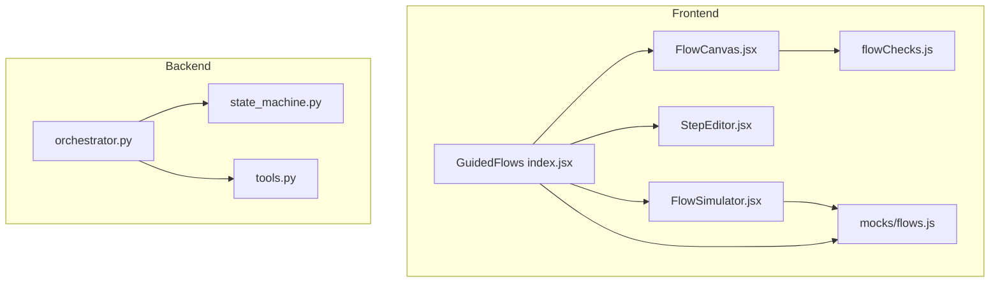
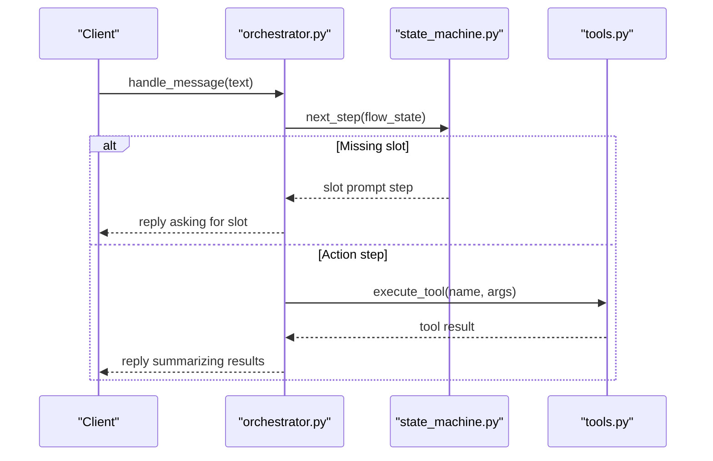
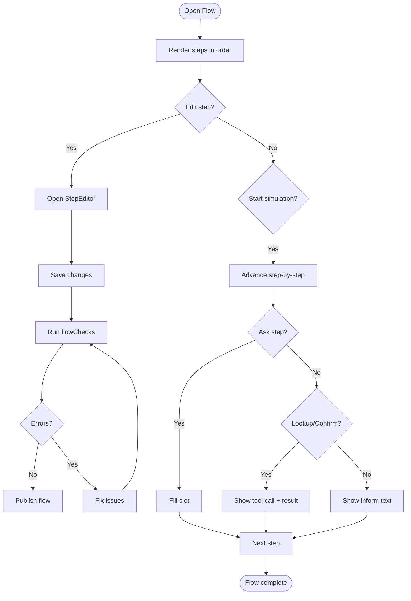
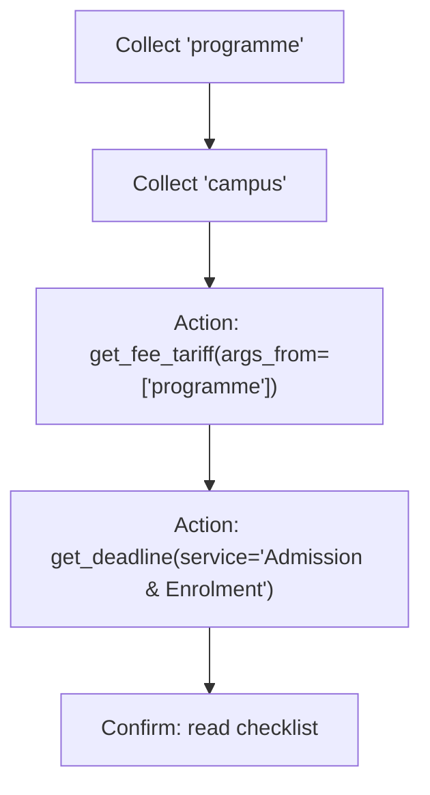
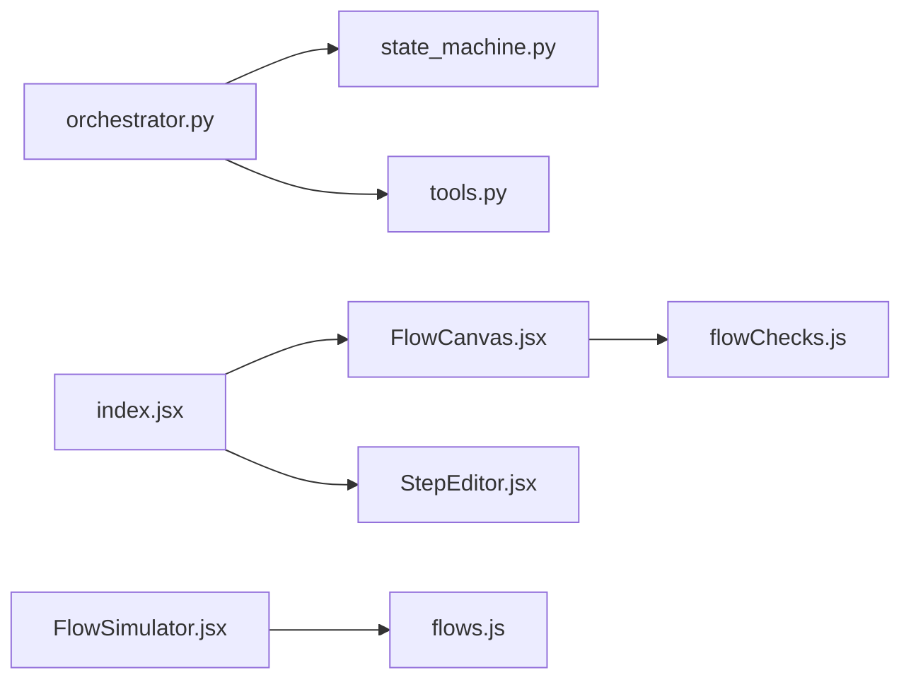

# Flow Definitions and Structure

<cite>
**Referenced Files in This Document**
- [state_machine.py](file://uaea-backend/app/orchestrator/state_machine.py)
- [orchestrator.py](file://uaea-backend/app/orchestrator/orchestrator.py)
- [tools.py](file://uaea-backend/app/orchestrator/tools.py)
- [flows.js](file://src/mocks/flows.js)
- [index.jsx](file://src/pages/GuidedFlows/index.jsx)
- [FlowCanvas.jsx](file://src/pages/GuidedFlows/FlowCanvas.jsx)
- [StepEditor.jsx](file://src/pages/GuidedFlows/StepEditor.jsx)
- [flowChecks.js](file://src/pages/GuidedFlows/flowChecks.js)
- [FlowSimulator.jsx](file://src/pages/GuidedFlows/FlowSimulator.jsx)
</cite>

## Table of Contents
1. Introduction
2. Project Structure
3. Core Components
4. Architecture Overview
5. Detailed Component Analysis
6. Dependency Analysis
7. Performance Considerations
8. Troubleshooting Guide
9. Conclusion

## Introduction
This document explains how guided flows are defined and executed across the frontend editor and backend orchestrator. It covers:
- How flows are declared with metadata (name, service_id), slot requirements, and step sequences
- The step types used to model multi-turn journeys deterministically
- How slots are declared and consumed during execution
- Examples from existing flow definitions for admission, fee challan, and degree application
- Validation rules that ensure publishable flows end with a resolution or handoff

## Project Structure
The guided flow system spans two layers:
- Frontend editor and simulator: defines and visualizes flows as ordered step lists, validates them, and simulates execution
- Backend orchestrator: runs flows per conversation using a state machine, collects slots, executes actions, and integrates with tools

**Diagram sources**
- [index.jsx:22-148](file://src/pages/GuidedFlows/index.jsx#L22-L148)
- [FlowCanvas.jsx:16-156](file://src/pages/GuidedFlows/FlowCanvas.jsx#L16-L156)
- [StepEditor.jsx:16-160](file://src/pages/GuidedFlows/StepEditor.jsx#L16-L160)
- [flowChecks.js:8-67](file://src/pages/GuidedFlows/flowChecks.js#L8-L67)
- [FlowSimulator.jsx:27-159](file://src/pages/GuidedFlows/FlowSimulator.jsx#L27-L159)
- [flows.js:19-116](file://src/mocks/flows.js#L19-L116)
- [state_machine.py:16-59](file://uaea-backend/app/orchestrator/state_machine.py#L16-L59)
- [orchestrator.py:46-143](file://uaea-backend/app/orchestrator/orchestrator.py#L46-L143)
- [tools.py:18-87](file://uaea-backend/app/orchestrator/tools.py#L18-L87)

**Section sources**
- [index.jsx:22-148](file://src/pages/GuidedFlows/index.jsx#L22-L148)
- [state_machine.py:16-59](file://uaea-backend/app/orchestrator/state_machine.py#L16-L59)

## Core Components
- Flow definitions (backend): A dictionary keyed by intent contains name, service_id, slots, and an ordered steps list. Steps can be slot prompts, action calls, or confirmations.
- Flow definitions (frontend): An array of flow objects with id, labels, intent, serviceId, status, and steps. Each step has type, label, optional slot, validation, tool/toolArgs, and prompts.
- Step types:
  - ask: Collects a value into a named slot before continuing
  - lookup/action: Executes a grounding tool; answers must come from its result
  - inform: States something already known; no tool needed
  - confirm: Reads back checklist or summary
  - handoff: Terminal step offering human assistance
- Slot management: Slots are declared in flow metadata and collected via ask steps. Actions consume slots either directly or via arguments derived from slots.
- Validation: Publishability checks enforce that flows end with confirm/handoff, include at least one handoff, collect required slots before use, and ideally call tools for grounded answers.

**Section sources**
- [state_machine.py:16-59](file://uaea-backend/app/orchestrator/state_machine.py#L16-L59)
- [flows.js:19-116](file://src/mocks/flows.js#L19-L116)
- [flowChecks.js:8-67](file://src/pages/GuidedFlows/flowChecks.js#L8-L67)

## Architecture Overview
The runtime flow is driven by the backend orchestrator, which:
- Classifies intent and starts a guided flow if matched
- Uses a per-conversation state machine to determine the next step
- Prompts for missing slots, then executes action steps to gather data
- Integrates with tools to fetch fees, deadlines, checklists, departments, and knowledge base content
- Persists flow state in message history so it survives restarts

**Diagram sources**
- [orchestrator.py:46-143](file://uaea-backend/app/orchestrator/orchestrator.py#L46-L143)
- [state_machine.py:94-145](file://uaea-backend/app/orchestrator/state_machine.py#L94-L145)
- [tools.py:218-235](file://uaea-backend/app/orchestrator/tools.py#L218-L235)

## Detailed Component Analysis

### Backend Flow Definitions (FLOW_DEFINITIONS)
- Location: backend state machine module
- Structure:
  - Keyed by intent string
  - Fields:
    - name: Human-readable title
    - service_id: Service identifier
    - slots: Ordered list of slot names to collect
    - steps: Ordered sequence of steps
      - Slot collection steps: {"slot": "...", "prompt": "..."}
      - Action steps: {"action": "<tool>", "args_from": [...], ...}
      - Confirmation steps: {"action": "confirm", "text": "..."}
- Execution logic:
  - next_step returns the first unfilled slot prompt or the next executable action when all required args are available
  - fill_slot assigns user input to the next unfilled slot in order
  - Flow completes when all steps are processed

Examples included:
- Admission flow: collects programme and campus, then calls fee tariff, deadline, and document checklist tools, followed by confirmation
- Fee Challan flow: collects programme and enrolment type, then calls fee tariff and deadline tools, followed by confirmation
- Degree Application flow: calls document checklist, fee tariff, and deadline tools, followed by confirmation

**Section sources**
- [state_machine.py:16-59](file://uaea-backend/app/orchestrator/state_machine.py#L16-L59)
- [state_machine.py:94-145](file://uaea-backend/app/orchestrator/state_machine.py#L94-L145)

### Frontend Flow Editor and Simulator
- Flow list and selection: The Guided Flows page loads flows from store and allows selecting a flow to edit or simulate
- Flow canvas: Displays steps in order, shows step type badges, slot badges, and tool invocations; supports moving steps, adding steps, and publishing
- Step editor: Permits editing step fields based on type:
  - ask: slot name and validation rule
  - lookup/confirm: tool selection and arguments
  - inform/ask/confirm: bilingual prompts (English and Urdu)
- Validation: flowChecks enforces publishability constraints such as ending with confirm/handoff, presence of handoff, slot usage ordering, and tool usage recommendations
- Simulator: Walks through steps, fills slots, and displays tool calls with sample results to validate flow behavior

**Diagram sources**
- [index.jsx:22-148](file://src/pages/GuidedFlows/index.jsx#L22-L148)
- [FlowCanvas.jsx:16-156](file://src/pages/GuidedFlows/FlowCanvas.jsx#L16-L156)
- [StepEditor.jsx:16-160](file://src/pages/GuidedFlows/StepEditor.jsx#L16-L160)
- [flowChecks.js:8-67](file://src/pages/GuidedFlows/flowChecks.js#L8-L67)
- [FlowSimulator.jsx:27-159](file://src/pages/GuidedFlows/FlowSimulator.jsx#L27-L159)

**Section sources**
- [index.jsx:22-148](file://src/pages/GuidedFlows/index.jsx#L22-L148)
- [FlowCanvas.jsx:16-156](file://src/pages/GuidedFlows/FlowCanvas.jsx#L16-L156)
- [StepEditor.jsx:16-160](file://src/pages/GuidedFlows/StepEditor.jsx#L16-L160)
- [flowChecks.js:8-67](file://src/pages/GuidedFlows/flowChecks.js#L8-L67)
- [FlowSimulator.jsx:27-159](file://src/pages/GuidedFlows/FlowSimulator.jsx#L27-L159)

### Slot Declaration and Usage
- Backend:
  - Slots are declared in flow metadata under slots
  - ask steps define slot and prompt; fill_slot assigns values in order
  - Action steps may reference slots via args_from; next_step ensures all referenced slots are filled before executing
- Frontend:
  - ask steps have slot and validation fields
  - lookup/confirm steps may reference slots in toolArgs
  - flowChecks verifies that any slot used in toolArgs appears earlier than the lookup step

**Diagram sources**
- [state_machine.py:16-59](file://uaea-backend/app/orchestrator/state_machine.py#L16-L59)
- [state_machine.py:94-145](file://uaea-backend/app/orchestrator/state_machine.py#L94-L145)
- [flowChecks.js:32-57](file://src/pages/GuidedFlows/flowChecks.js#L32-L57)

**Section sources**
- [state_machine.py:16-59](file://uaea-backend/app/orchestrator/state_machine.py#L16-L59)
- [state_machine.py:94-145](file://uaea-backend/app/orchestrator/state_machine.py#L94-L145)
- [flowChecks.js:32-57](file://src/pages/GuidedFlows/flowChecks.js#L32-L57)

### Step Types and Semantics
- ask: Prompts for a slot; validated by flowChecks to include a slot and optionally a validation rule
- lookup/action: Executes a tool; must not fabricate facts; relies on tool results
- inform: Presents known information without tool calls
- confirm: Summarizes or reads back checklists; often follows tool calls
- handoff: Terminal step offering human assistance; required by validation

**Section sources**
- [flows.js:118-125](file://src/mocks/flows.js#L118-L125)
- [flowChecks.js:17-30](file://src/pages/GuidedFlows/flowChecks.js#L17-L30)

### Example Flows
- Admission flow:
  - Metadata: name, service_id, slots ["programme", "campus"]
  - Steps: collect slots, call fee tariff/deadline/checklist tools, confirm
- Fee Challan flow:
  - Metadata: name, service_id, slots ["programme", "enrolment_type"]
  - Steps: collect slots, call fee tariff/deadline tools, confirm
- Degree Application flow:
  - Metadata: name, service_id, empty slots
  - Steps: call checklist/fee/deadline tools, confirm

**Section sources**
- [state_machine.py:16-59](file://uaea-backend/app/orchestrator/state_machine.py#L16-L59)
- [flows.js:19-116](file://src/mocks/flows.js#L19-L116)

### Tools Integration
- Tool definitions expose schemas for knowledge base search, department lookup, fee tariff, deadline, document checklist, escalation ticket creation
- Execute function dispatches tool calls and returns structured results
- Orchestrator loops tool calls up to a maximum rounds limit and persists tool results in message history

**Section sources**
- [tools.py:18-87](file://uaea-backend/app/orchestrator/tools.py#L18-L87)
- [tools.py:218-235](file://uaea-backend/app/orchestrator/tools.py#L218-L235)
- [orchestrator.py:229-318](file://uaea-backend/app/orchestrator/orchestrator.py#L229-L318)

## Dependency Analysis
- Orchestrator depends on:
  - Intent router to identify guided flow intents
  - State machine to compute next step and manage slots
  - Tools to fetch authoritative data and create tickets
- Frontend depends on:
  - Mocks for step types and tools metadata
  - Validation module for publishability checks
  - UI components for rendering and editing flows

**Diagram sources**
- [orchestrator.py:46-143](file://uaea-backend/app/orchestrator/orchestrator.py#L46-L143)
- [state_machine.py:94-145](file://uaea-backend/app/orchestrator/state_machine.py#L94-L145)
- [tools.py:218-235](file://uaea-backend/app/orchestrator/tools.py#L218-L235)
- [index.jsx:22-148](file://src/pages/GuidedFlows/index.jsx#L22-L148)
- [FlowCanvas.jsx:16-156](file://src/pages/GuidedFlows/FlowCanvas.jsx#L16-L156)
- [StepEditor.jsx:16-160](file://src/pages/GuidedFlows/StepEditor.jsx#L16-L160)
- [flowChecks.js:8-67](file://src/pages/GuidedFlows/flowChecks.js#L8-L67)
- [FlowSimulator.jsx:27-159](file://src/pages/GuidedFlows/FlowSimulator.jsx#L27-L159)
- [flows.js:19-116](file://src/mocks/flows.js#L19-L116)

**Section sources**
- [orchestrator.py:46-143](file://uaea-backend/app/orchestrator/orchestrator.py#L46-L143)
- [state_machine.py:94-145](file://uaea-backend/app/orchestrator/state_machine.py#L94-L145)
- [tools.py:218-235](file://uaea-backend/app/orchestrator/tools.py#L218-L235)
- [index.jsx:22-148](file://src/pages/GuidedFlows/index.jsx#L22-L148)
- [FlowCanvas.jsx:16-156](file://src/pages/GuidedFlows/FlowCanvas.jsx#L16-L156)
- [StepEditor.jsx:16-160](file://src/pages/GuidedFlows/StepEditor.jsx#L16-L160)
- [flowChecks.js:8-67](file://src/pages/GuidedFlows/flowChecks.js#L8-L67)
- [FlowSimulator.jsx:27-159](file://src/pages/GuidedFlows/FlowSimulator.jsx#L27-L159)
- [flows.js:19-116](file://src/mocks/flows.js#L19-L116)

## Performance Considerations
- Limit tool-call rounds to prevent excessive LLM loops; the orchestrator caps rounds to avoid long processing times
- Keep flows linear and minimal to reduce conversation turns and improve responsiveness
- Prefer targeted tool calls with precise arguments to minimize retries and errors
- Use confirm steps to consolidate tool results into a single response rather than multiple fragmented replies

[No sources needed since this section provides general guidance]

## Troubleshooting Guide
Common issues detected by validation:
- Flow ends without confirm/handoff: Ensure last step is confirm or handoff
- No handoff present: Add a terminal handoff step to offer human assistance
- Ask step without slot: Every ask must specify a slot to fill
- Missing validation on ask: Add a validation rule to constrain inputs
- Slot used before collection: Reorder steps so that any slot referenced in toolArgs is collected earlier
- No tool calls: Add lookup/confirm steps to ground answers in official data

Operational tips:
- Use the simulator to walk through flows and verify slot filling order and tool invocation points
- Check the flow canvas for errors and warnings before publishing
- Confirm that tool arguments correctly reference slots or literals

**Section sources**
- [flowChecks.js:8-67](file://src/pages/GuidedFlows/flowChecks.js#L8-L67)
- [FlowSimulator.jsx:27-159](file://src/pages/GuidedFlows/FlowSimulator.jsx#L27-L159)

## Conclusion
Guided flows provide deterministic, auditable journeys for student services by combining explicit step sequences with slot-based state management and grounded tool calls. The frontend editor enables safe authoring and validation, while the backend orchestrator executes flows reliably within conversations. By following the defined patterns for slots, steps, and validations, teams can build robust flows like admission, fee challan, and degree application that consistently deliver accurate, source-backed responses and clear handoff paths.

[No sources needed since this section summarizes without analyzing specific files]