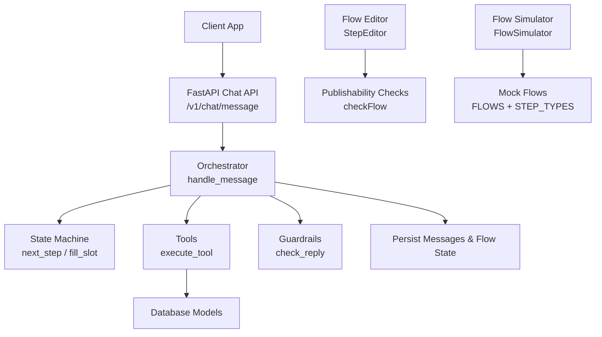
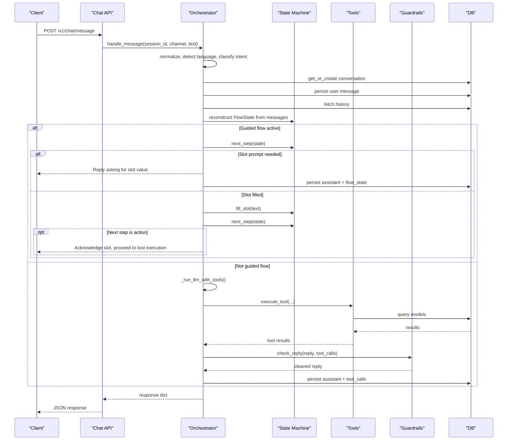
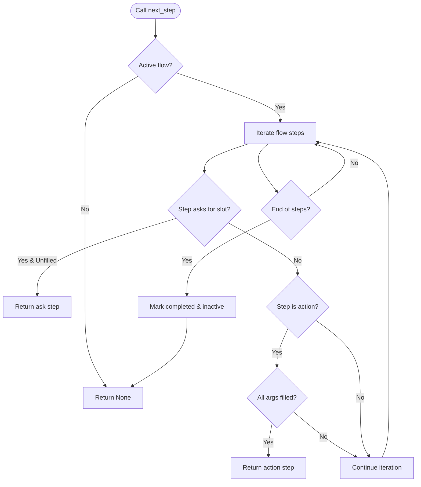
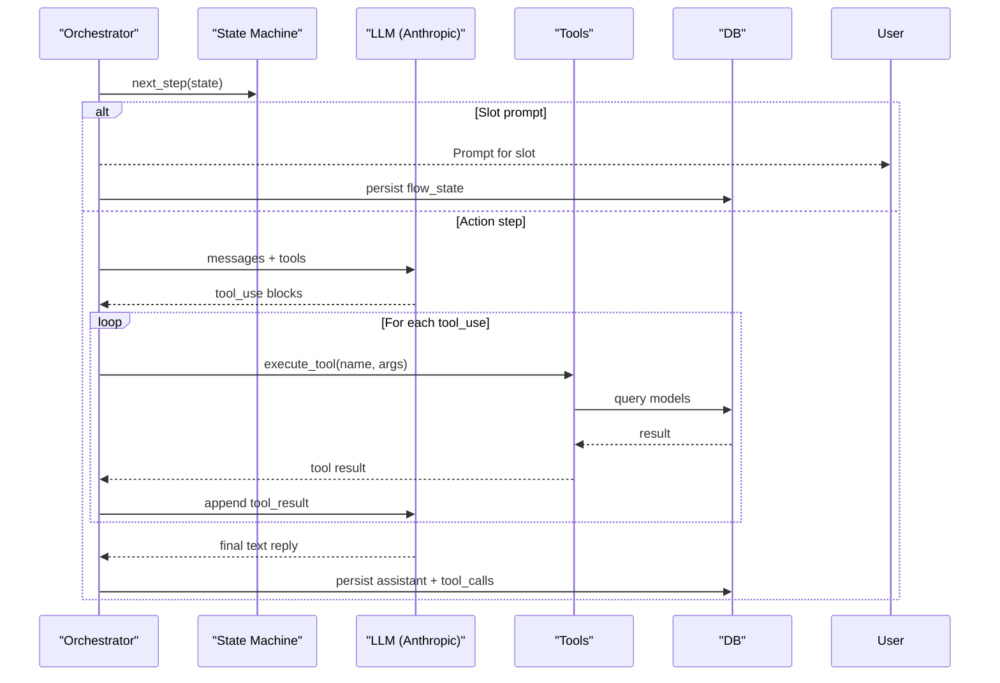
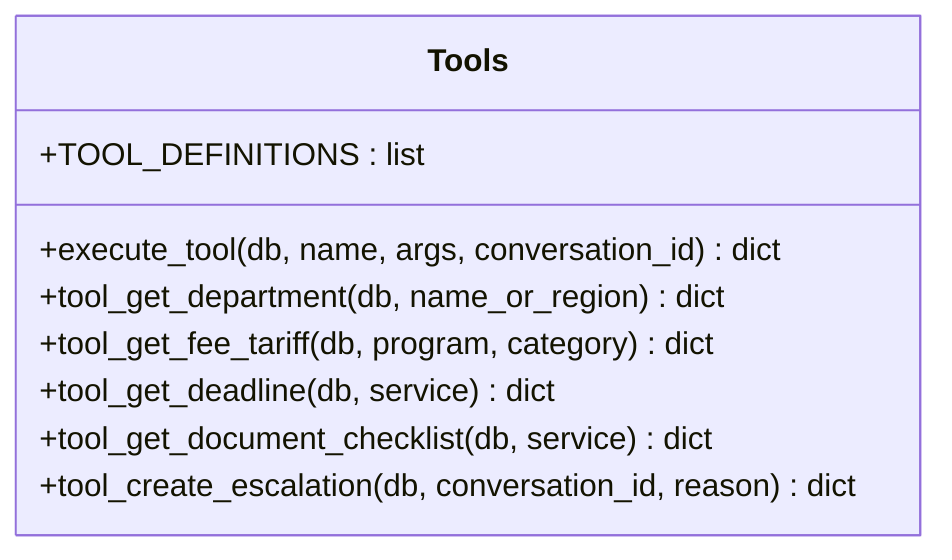
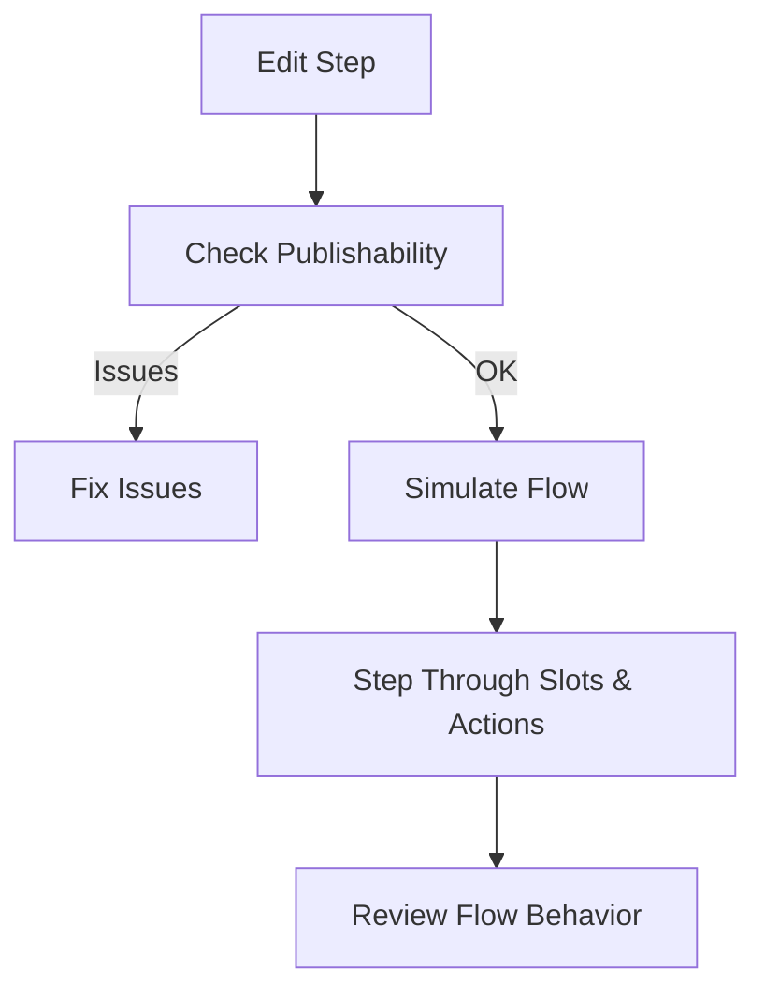
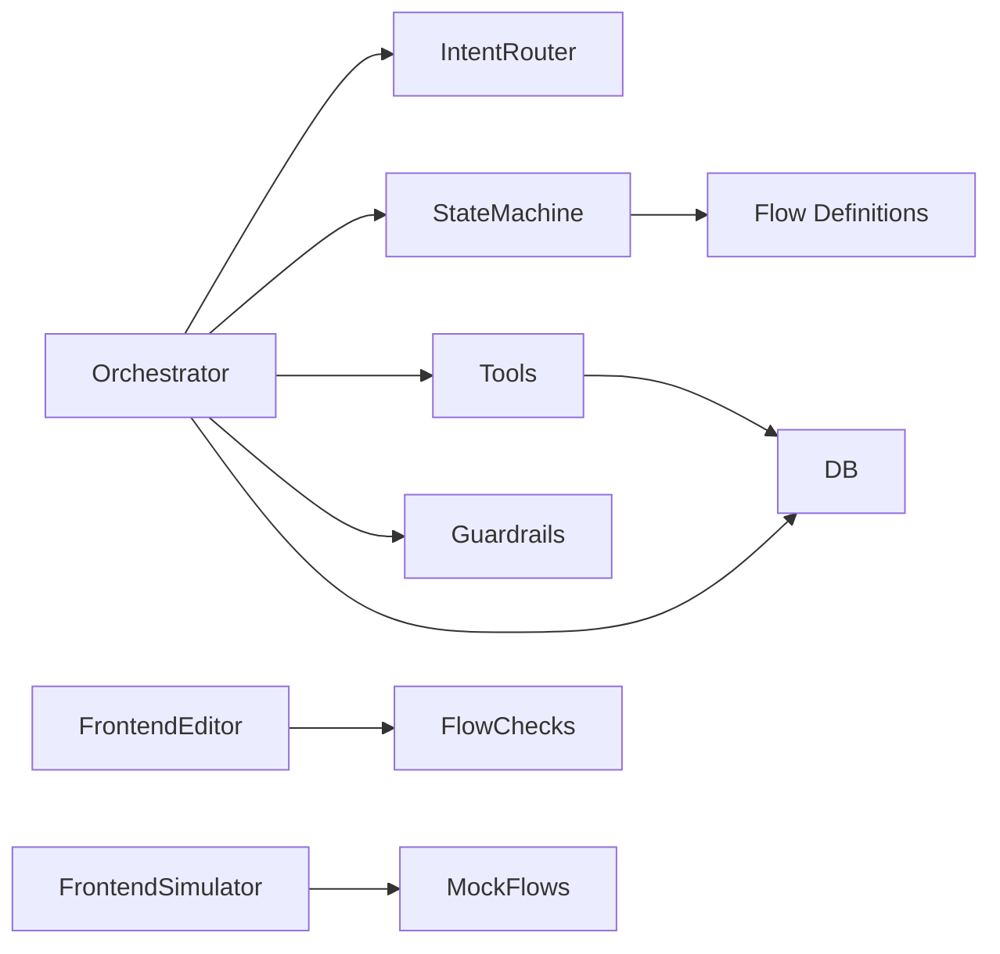

# Flow Execution Lifecycle

<cite>
**Referenced Files in This Document**
- [orchestrator.py](file://uaea-backend/app/orchestrator/orchestrator.py)
- [state_machine.py](file://uaea-backend/app/orchestrator/state_machine.py)
- [tools.py](file://uaea-backend/app/orchestrator/tools.py)
- [intent_router.py](file://uaea-backend/app/orchestrator/intent_router.py)
- [chat.py](file://uaea-backend/app/api/chat.py)
- [flows.js](file://src/mocks/flows.js)
- [flowChecks.js](file://src/pages/GuidedFlows/flowChecks.js)
- [FlowSimulator.jsx](file://src/pages/GuidedFlows/FlowSimulator.jsx)
- [StepEditor.jsx](file://src/pages/GuidedFlows/StepEditor.jsx)
- [test_chat_flow.py](file://uaea-backend/tests/test_chat_flow.py)
</cite>

## Table of Contents
1. [Introduction](#introduction)
2. [Project Structure](#project-structure)
3. [Core Components](#core-components)
4. [Architecture Overview](#architecture-overview)
5. [Detailed Component Analysis](#detailed-component-analysis)
6. [Dependency Analysis](#dependency-analysis)
7. [Performance Considerations](#performance-considerations)
8. [Troubleshooting Guide](#troubleshooting-guide)
9. [Conclusion](#conclusion)
10. [Appendices](#appendices)

## Introduction
This document explains the flow execution lifecycle for guided conversations, focusing on how the system determines the next step and fills slots from user input. It covers:
- How next_step selects the next action or prompt based on filled slots
- How fill_slot captures user input into slot variables
- How the orchestrator coordinates state transitions, tool calls, and final replies
- How flows are validated before publishing to prevent incomplete or broken journeys
- Examples of multi-turn flows, error handling, and integration with tools for data retrieval

## Project Structure
The flow execution spans both backend orchestration and frontend authoring/simulation:
- Backend orchestrates message processing, guided flows, tool execution, guardrails, and persistence
- Frontend provides a simulator and editor to visualize and validate flows during development

**Diagram sources**
- [chat.py:21-39](file://uaea-backend/app/api/chat.py#L21-L39)
- [orchestrator.py:46-143](file://uaea-backend/app/orchestrator/orchestrator.py#L46-L143)
- [state_machine.py:94-146](file://uaea-backend/app/orchestrator/state_machine.py#L94-L146)
- [tools.py:218-235](file://uaea-backend/app/orchestrator/tools.py#L218-L235)
- [flowChecks.js:8-67](file://src/pages/GuidedFlows/flowChecks.js#L8-L67)
- [FlowSimulator.jsx:27-159](file://src/pages/GuidedFlows/FlowSimulator.jsx#L27-L159)
- [flows.js:19-137](file://src/mocks/flows.js#L19-L137)

**Section sources**
- [chat.py:21-39](file://uaea-backend/app/api/chat.py#L21-L39)
- [orchestrator.py:46-143](file://uaea-backend/app/orchestrator/orchestrator.py#L46-L143)
- [state_machine.py:94-146](file://uaea-backend/app/orchestrator/state_machine.py#L94-L146)
- [tools.py:218-235](file://uaea-backend/app/orchestrator/tools.py#L218-L235)
- [flowChecks.js:8-67](file://src/pages/GuidedFlows/flowChecks.js#L8-L67)
- [FlowSimulator.jsx:27-159](file://src/pages/GuidedFlows/FlowSimulator.jsx#L27-L159)
- [flows.js:19-137](file://src/mocks/flows.js#L19-L137)

## Core Components
- Orchestrator: End-to-end message handler that integrates intent classification, guided flow management, LLM tool loops, guardrails, and persistence.
- State Machine: Defines per-intent flows, tracks active state and filled slots, and computes the next step or completion.
- Tools: Declares tool schemas and implementations for retrieving fees, deadlines, checklists, departments, knowledge base, and creating escalation tickets.
- Intent Router: Deterministic classifier that maps messages to intents, including guided flow intents.
- Frontend Flow Authoring: Editor and simulator to design, validate, and walk through flows; publishability checks enforce safe flows.

Key responsibilities:
- Determine next step: next_step scans flow steps to find the first unfilled slot or executable action whose arguments are satisfied.
- Fill slot: fill_slot assigns user text to the next unfilled slot defined by the flow.
- Execute actions: when all required args are available, the orchestrator proceeds to tool execution via the LLM tool loop.
- Completion: when no more steps remain, the flow is marked completed and inactive; the LLM produces the final reply using gathered tool results.

**Section sources**
- [orchestrator.py:46-143](file://uaea-backend/app/orchestrator/orchestrator.py#L46-L143)
- [state_machine.py:16-126](file://uaea-backend/app/orchestrator/state_machine.py#L16-L126)
- [tools.py:18-235](file://uaea-backend/app/orchestrator/tools.py#L18-L235)
- [intent_router.py:61-103](file://uaea-backend/app/orchestrator/intent_router.py#L61-L103)
- [flowChecks.js:8-67](file://src/pages/GuidedFlows/flowChecks.js#L8-L67)
- [FlowSimulator.jsx:27-159](file://src/pages/GuidedFlows/FlowSimulator.jsx#L27-L159)

## Architecture Overview
The guided flow lifecycle begins when a user message triggers an intent recognized as a guided flow. The orchestrator initializes or resumes flow state, prompts for missing slots, fills them, and then executes tool-backed actions until completion.

**Diagram sources**
- [chat.py:21-39](file://uaea-backend/app/api/chat.py#L21-L39)
- [orchestrator.py:46-143](file://uaea-backend/app/orchestrator/orchestrator.py#L46-L143)
- [state_machine.py:94-146](file://uaea-backend/app/orchestrator/state_machine.py#L94-L146)
- [tools.py:218-235](file://uaea-backend/app/orchestrator/tools.py#L218-L235)

## Detailed Component Analysis

### State Machine: next_step and fill_slot
- next_step:
  - Returns None if flow is not active or has no intent
  - Iterates flow steps:
    - If step collects a slot not yet filled, return that step to prompt the user
    - If step is an action, verify all required args are either in filled_slots or provided inline; if so, return the action step for execution
  - When all steps complete, marks flow completed and inactive
- fill_slot:
  - Finds the next unfilled slot defined by the flow and assigns the user’s text to it
  - Returns the slot name filled or None if no slot applies

**Diagram sources**
- [state_machine.py:94-126](file://uaea-backend/app/orchestrator/state_machine.py#L94-L126)

**Section sources**
- [state_machine.py:94-146](file://uaea-backend/app/orchestrator/state_machine.py#L94-L146)

### Orchestrator: Guided Flow Handling and Tool Integration
- Message handling pipeline:
  - Sanitize and normalize input, detect language
  - Classify intent; if guided flow intent and not active, initialize flow state
  - Persist user message and fetch history
  - Reconstruct flow state from history
  - Handle guided flow:
    - If next_step returns a slot prompt, respond immediately and persist flow state
    - If next_step returns an action, allow LLM tool loop to execute tools and produce final reply
  - Run guardrails on LLM reply
  - Persist assistant message and tool calls
  - Track low-confidence queries and escalate if needed
- Tool loop:
  - Calls LLM with tool definitions
  - Executes tool calls, accumulates results, handles escalation
  - Limits rounds to avoid infinite loops

**Diagram sources**
- [orchestrator.py:146-318](file://uaea-backend/app/orchestrator/orchestrator.py#L146-L318)
- [tools.py:218-235](file://uaea-backend/app/orchestrator/tools.py#L218-L235)

**Section sources**
- [orchestrator.py:46-143](file://uaea-backend/app/orchestrator/orchestrator.py#L46-L143)
- [orchestrator.py:146-318](file://uaea-backend/app/orchestrator/orchestrator.py#L146-L318)
- [tools.py:18-235](file://uaea-backend/app/orchestrator/tools.py#L18-L235)

### Tools: Data Retrieval and Escalation
- Tool definitions declare schemas for search_knowledge_base, get_department, get_fee_tariff, get_deadline, get_document_checklist, create_escalation_ticket
- Implementations query database models (FeeTariff, Deadline, Service, Department, EscalationTicket) and return structured results with source references
- execute_tool dispatches by tool name and supports RAG retrieval via search_knowledge_base

**Diagram sources**
- [tools.py:18-235](file://uaea-backend/app/orchestrator/tools.py#L18-L235)

**Section sources**
- [tools.py:18-235](file://uaea-backend/app/orchestrator/tools.py#L18-L235)

### Intent Routing and Flow Activation
- Intent router classifies messages into intents, including guided flow intents
- GUIDED_FLOW_INTENTS defines which intents activate the state machine
- Orchestrator initializes flow state when a guided flow intent is detected and the flow is not already active

**Section sources**
- [intent_router.py:61-103](file://uaea-backend/app/orchestrator/intent_router.py#L61-L103)
- [orchestrator.py:80-91](file://uaea-backend/app/orchestrator/orchestrator.py#L80-L91)

### Frontend Flow Authoring and Simulation
- StepEditor allows editing step types, slots, validation rules, tools, and arguments
- flowChecks enforces publishability: last step must be confirm/handoff, every flow must have handoff, ask steps must fill slots, lookups must not use slots before collection, and flows should include tool calls for grounded answers
- FlowSimulator walks through a flow step-by-step, simulating slot filling and tool calls for visualization

**Diagram sources**
- [StepEditor.jsx:16-161](file://src/pages/GuidedFlows/StepEditor.jsx#L16-L161)
- [flowChecks.js:8-67](file://src/pages/GuidedFlows/flowChecks.js#L8-L67)
- [FlowSimulator.jsx:27-159](file://src/pages/GuidedFlows/FlowSimulator.jsx#L27-L159)
- [flows.js:19-137](file://src/mocks/flows.js#L19-L137)

**Section sources**
- [StepEditor.jsx:16-161](file://src/pages/GuidedFlows/StepEditor.jsx#L16-L161)
- [flowChecks.js:8-67](file://src/pages/GuidedFlows/flowChecks.js#L8-L67)
- [FlowSimulator.jsx:27-159](file://src/pages/GuidedFlows/FlowSimulator.jsx#L27-L159)
- [flows.js:19-137](file://src/mocks/flows.js#L19-L137)

## Dependency Analysis
- Orchestrator depends on:
  - Intent router for classification
  - State machine for guided flow logic
  - Tools for data retrieval and escalation
  - Guardrails for reply sanitization
  - Database for persistence
- State machine depends on flow definitions and filled slots
- Tools depend on database models and optional RAG retrieval
- Frontend components depend on mock flows and step metadata for simulation and editing

**Diagram sources**
- [orchestrator.py:46-143](file://uaea-backend/app/orchestrator/orchestrator.py#L46-L143)
- [state_machine.py:16-126](file://uaea-backend/app/orchestrator/state_machine.py#L16-L126)
- [tools.py:218-235](file://uaea-backend/app/orchestrator/tools.py#L218-L235)
- [flowChecks.js:8-67](file://src/pages/GuidedFlows/flowChecks.js#L8-L67)
- [FlowSimulator.jsx:27-159](file://src/pages/GuidedFlows/FlowSimulator.jsx#L27-L159)
- [flows.js:19-137](file://src/mocks/flows.js#L19-L137)

**Section sources**
- [orchestrator.py:46-143](file://uaea-backend/app/orchestrator/orchestrator.py#L46-L143)
- [state_machine.py:16-126](file://uaea-backend/app/orchestrator/state_machine.py#L16-L126)
- [tools.py:218-235](file://uaea-backend/app/orchestrator/tools.py#L218-L235)
- [flowChecks.js:8-67](file://src/pages/GuidedFlows/flowChecks.js#L8-L67)
- [FlowSimulator.jsx:27-159](file://src/pages/GuidedFlows/FlowSimulator.jsx#L27-L159)
- [flows.js:19-137](file://src/mocks/flows.js#L19-L137)

## Performance Considerations
- Limit LLM rounds to prevent excessive tool call loops; the orchestrator caps rounds to balance responsiveness and completeness
- Minimize database queries by batching tool executions where possible; current implementation executes each tool call sequentially within a round
- Use efficient history truncation (last 20 messages) to reduce payload size and improve latency
- Ensure slot validation and flow checks run at edit time to catch issues early, reducing runtime errors

[No sources needed since this section provides general guidance]

## Troubleshooting Guide
Common issues and resolutions:
- Flow ends without resolution:
  - Ensure last step is confirm or handoff; editor checks enforce this
  - Verify every path includes a handoff step
- Slot used before collection:
  - Lookup steps must not reference slots that appear later; editor checks flag ordering issues
- No tool calls in flow:
  - Add lookup or confirm steps to ground responses in catalogue data
- Low confidence or unanswered queries:
  - Orchestrator tracks low-confidence intents; consider adding clarifying questions or escalating
- Tool call errors:
  - Tools return structured errors; orchestrator surfaces honest responses and can escalate via create_escalation_ticket
- API errors:
  - Orchestrator catches Anthropic API errors and offers fallback messaging

**Section sources**
- [flowChecks.js:8-67](file://src/pages/GuidedFlows/flowChecks.js#L8-L67)
- [orchestrator.py:255-318](file://uaea-backend/app/orchestrator/orchestrator.py#L255-L318)
- [tools.py:218-235](file://uaea-backend/app/orchestrator/tools.py#L218-L235)

## Conclusion
The guided flow lifecycle combines deterministic state management with flexible tool-driven data retrieval. next_step ensures correct sequencing of prompts and actions based on filled slots, while fill_slot captures user input reliably. The orchestrator ties these together with robust error handling, guardrails, and persistence. Frontend tools enable authors to design, validate, and simulate flows safely before deployment.

[No sources needed since this section summarizes without analyzing specific files]

## Appendices

### Example Flow Execution Scenarios
- Admission flow:
  - Triggered by intent; prompts for programme and campus
  - After slots filled, executes tool calls for eligibility, deadline, fee, and checklist
  - Confirms summary and offers human handoff
- Fee challan flow:
  - Prompts for programme and enrolment type
  - Executes tool calls for amount and due date
  - Explains payment process and offers escalation
- Degree application flow:
  - Prompts for graduating semester
  - Executes tool calls for deadline, fee, and checklist
  - States processing time and offers handoff

**Section sources**
- [flows.js:19-137](file://src/mocks/flows.js#L19-L137)
- [test_chat_flow.py:44-81](file://uaea-backend/tests/test_chat_flow.py#L44-L81)

### Error Handling During Execution
- Missing slots:
  - next_step returns ask step until all required slots are filled
- Tool failures:
  - Tools return error dicts; orchestrator surfaces honest replies and may escalate
- API timeouts or errors:
  - Orchestrator catches exceptions and provides fallback messaging
- Incomplete flows:
  - Editor checks prevent promotion of flows ending mid-conversation

**Section sources**
- [state_machine.py:94-146](file://uaea-backend/app/orchestrator/state_machine.py#L94-L146)
- [orchestrator.py:255-318](file://uaea-backend/app/orchestrator/orchestrator.py#L255-L318)
- [flowChecks.js:8-67](file://src/pages/GuidedFlows/flowChecks.js#L8-L67)