# Guided Flow System

<cite>
**Referenced Files in This Document**
- [index.jsx](file://src/pages/GuidedFlows/index.jsx)
- [FlowCanvas.jsx](file://src/pages/GuidedFlows/FlowCanvas.jsx)
- [StepEditor.jsx](file://src/pages/GuidedFlows/StepEditor.jsx)
- [flowChecks.js](file://src/pages/GuidedFlows/flowChecks.js)
- [flows.js](file://src/mocks/flows.js)
- [state_machine.py](file://uaea-backend/app/orchestrator/state_machine.py)
- [intent_router.py](file://uaea-backend/app/orchestrator/intent_router.py)
- [orchestrator.py](file://uaea-backend/app/orchestrator/orchestrator.py)
- [tools.py](file://uaea-backend/app/orchestrator/tools.py)
- [chat.py](file://uaea-backend/app/api/chat.py)
- [models.py](file://uaea-backend/app/db/models.py)
- [Chat index.jsx](file://src/pages/student/Chat/index.jsx)
</cite>

## Table of Contents
1. Introduction
2. Project Structure
3. Core Components
4. Architecture Overview
5. Detailed Component Analysis
6. Dependency Analysis
7. Performance Considerations
8. Troubleshooting Guide
9. Conclusion

## Introduction
This document explains the guided flow state machine that manages multi-step conversation workflows for student services. It covers how flows are defined, how user inputs fill slots, how steps progress deterministically, and how state persists across messages. It also documents intent-triggered activation, slot validation rules enforced by the editor, error handling during execution, and integration with tool calls that retrieve authoritative data (fees, deadlines, checklists).

## Project Structure
The guided flow system spans a frontend editor and a backend orchestrator:
- Frontend: A visual editor to author flows, validate them before publishing, simulate step-by-step execution, and manage step order and prompts.
- Backend: An intent router classifies incoming messages into guided flow intents; a per-conversation state machine drives slot collection and action execution; tools fetch grounded data from the database; results are persisted as message history so state survives restarts.

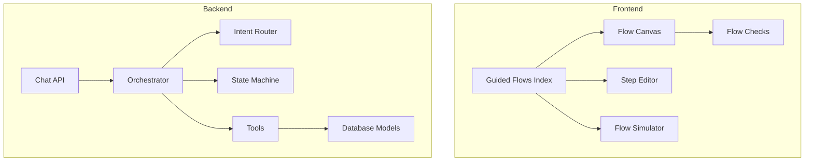

**Diagram sources**
- [index.jsx:21-149](file://src/pages/GuidedFlows/index.jsx#L21-L149)
- [FlowCanvas.jsx:16-156](file://src/pages/GuidedFlows/FlowCanvas.jsx#L16-L156)
- [StepEditor.jsx:16-160](file://src/pages/GuidedFlows/StepEditor.jsx#L16-L160)
- [flowChecks.js:8-67](file://src/pages/GuidedFlows/flowChecks.js#L8-L67)
- [chat.py:21-39](file://uaea-backend/app/api/chat.py#L21-L39)
- [orchestrator.py:46-143](file://uaea-backend/app/orchestrator/orchestrator.py#L46-L143)
- [intent_router.py:65-102](file://uaea-backend/app/orchestrator/intent_router.py#L65-L102)
- [state_machine.py:16-146](file://uaea-backend/app/orchestrator/state_machine.py#L16-L146)
- [tools.py:18-235](file://uaea-backend/app/orchestrator/tools.py#L18-L235)
- [models.py:144-178](file://uaea-backend/app/db/models.py#L144-L178)

**Section sources**
- [index.jsx:21-149](file://src/pages/GuidedFlows/index.jsx#L21-L149)
- [FlowCanvas.jsx:16-156](file://src/pages/GuidedFlows/FlowCanvas.jsx#L16-L156)
- [step_editor.jsx:16-160](file://src/pages/GuidedFlows/StepEditor.jsx#L16-L160)
- [flow_checks.js:8-67](file://src/pages/GuidedFlows/flowChecks.js#L8-L67)
- [chat_api.py:21-39](file://uaea-backend/app/api/chat.py#L21-L39)
- [orchestrator.py:46-143](file://uaea-backend/app/orchestrator/orchestrator.py#L46-L143)
- [intent_router.py:65-102](file://uaea-backend/app/orchestrator/intent_router.py#L65-L102)
- [state_machine.py:16-146](file://uaea-backend/app/orchestrator/state_machine.py#L16-L146)
- [tools.py:18-235](file://uaea-backend/app/orchestrator/tools.py#L18-L235)
- [models.py:144-178](file://uaea-backend/app/db/models.py#L144-L178)

## Core Components
- Flow definitions: Declarative sequences of steps that collect slots, call tools, confirm outcomes, or hand off to humans.
- Step types: ask (collect slot), lookup (call tool), inform (state known info), confirm (read back summary), handoff (terminal human transfer).
- Slot-filling: Deterministic progression through unfilled slots before executing actions.
- State persistence: Per-conversation state stored via special tool-call-like messages so it survives restarts.
- Validation: Editor checks enforce publishability (e.g., must end in confirm/handoff, must have handoff, slots used before lookups must be collected earlier).
- Tool integration: Grounded answers come from tools like fee tariff, deadline, checklist retrieval, department lookup, knowledge base search, and escalation creation.

**Section sources**
- [flows.js:19-116](file://src/mocks/flows.js#L19-L116)
- [flowChecks.js:8-67](file://src/pages/GuidedFlows/flowChecks.js#L8-L67)
- [state_machine.py:16-146](file://uaea-backend/app/orchestrator/state_machine.py#L16-L146)
- [tools.py:18-235](file://uaea-backend/app/orchestrator/tools.py#L18-L235)

## Architecture Overview
End-to-end flow for a user message:
1. The chat API receives a message and delegates to the orchestrator.
2. The orchestrator normalizes text, detects language, and classifies intent.
3. If the intent is a guided flow and no flow is active, a new flow state is started.
4. The state machine determines the next step: prompt for an unfilled slot or execute an action.
5. For slot prompts, the assistant replies immediately and persists flow state.
6. When all slots are filled, the orchestrator runs LLM tool calls to gather data and produce a final response.
7. Guardrails clean and validate the reply; sources are extracted from tool results.

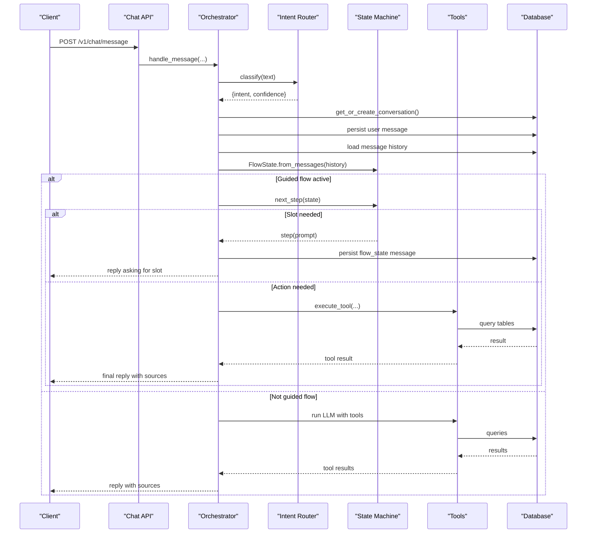

**Diagram sources**
- [chat.py:21-39](file://uaea-backend/app/api/chat.py#L21-L39)
- [orchestrator.py:46-143](file://uaea-backend/app/orchestrator/orchestrator.py#L46-L143)
- [intent_router.py:65-102](file://uaea-backend/app/orchestrator/intent_router.py#L65-L102)
- [state_machine.py:70-146](file://uaea-backend/app/orchestrator/state_machine.py#L70-L146)
- [tools.py:218-235](file://uaea-backend/app/orchestrator/tools.py#L218-L235)
- [models.py:144-178](file://uaea-backend/app/db/models.py#L144-L178)

## Detailed Component Analysis

### Flow Definition Structure
- Each flow has an intent key, service identifier, list of required slots, and ordered steps.
- Steps can:
  - Collect a slot with a prompt and optional validation rule.
  - Call a tool with arguments derived from slots or literals.
  - Confirm or summarize results.
  - Hand off to a human (terminal).
- Example flows include admission, fee challan, degree application, result enquiry, and transcript/PRC.

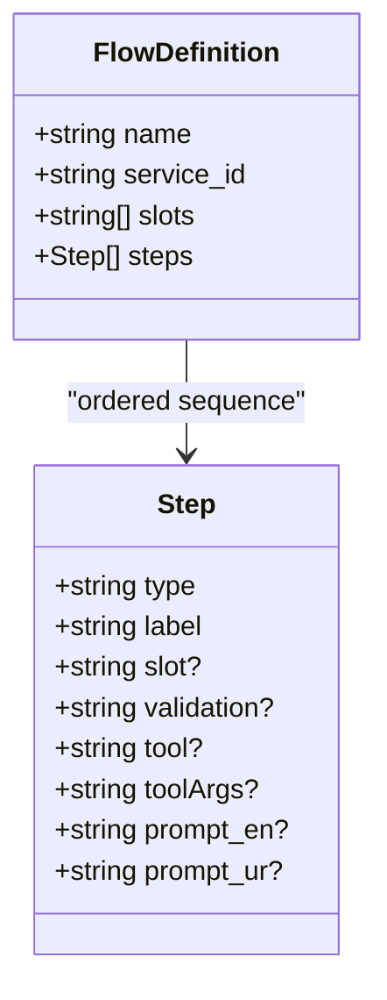

**Diagram sources**
- [state_machine.py:16-59](file://uaea-backend/app/orchestrator/state_machine.py#L16-L59)
- [flows.js:19-116](file://src/mocks/flows.js#L19-L116)

**Section sources**
- [state_machine.py:16-59](file://uaea-backend/app/orchestrator/state_machine.py#L16-L59)
- [flows.js:19-116](file://src/mocks/flows.js#L19-L116)

### Slot-Filling Mechanisms
- The state machine tracks filled slots per conversation.
- On each turn, if a slot is missing, the orchestrator asks for it using the step’s prompt.
- User input fills the next unfilled slot; subsequent turns continue until all slots are collected.
- Once slots are complete, the orchestrator proceeds to action steps and tool calls.

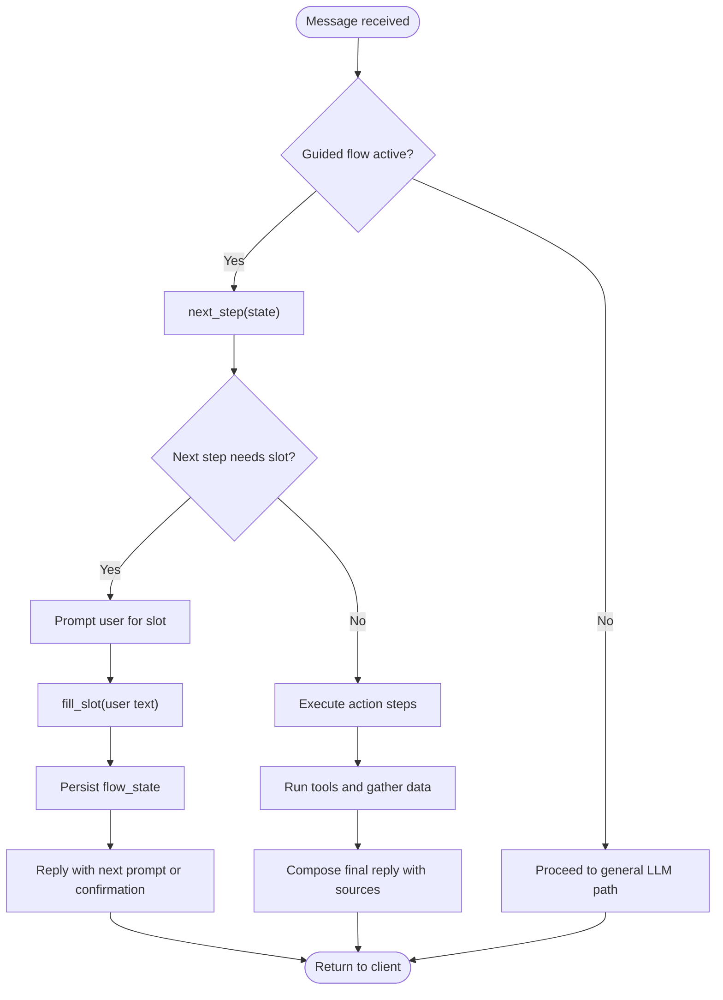

**Diagram sources**
- [orchestrator.py:146-227](file://uaea-backend/app/orchestrator/orchestrator.py#L146-L227)
- [state_machine.py:94-146](file://uaea-backend/app/orchestrator/state_machine.py#L94-L146)

**Section sources**
- [orchestrator.py:146-227](file://uaea-backend/app/orchestrator/orchestrator.py#L146-L227)
- [state_machine.py:94-146](file://uaea-backend/app/orchestrator/state_machine.py#L94-L146)

### Step Progression Logic
- The state machine scans the flow definition steps in order:
  - If a step defines a slot not yet filled, return that step to prompt the user.
  - If a step defines an action, ensure all required args are available (from slots or literals); if so, return the action step for execution.
  - If no more steps apply, mark the flow completed and inactive.
- The orchestrator uses this to decide whether to ask for a slot, execute tools, or finalize the response.

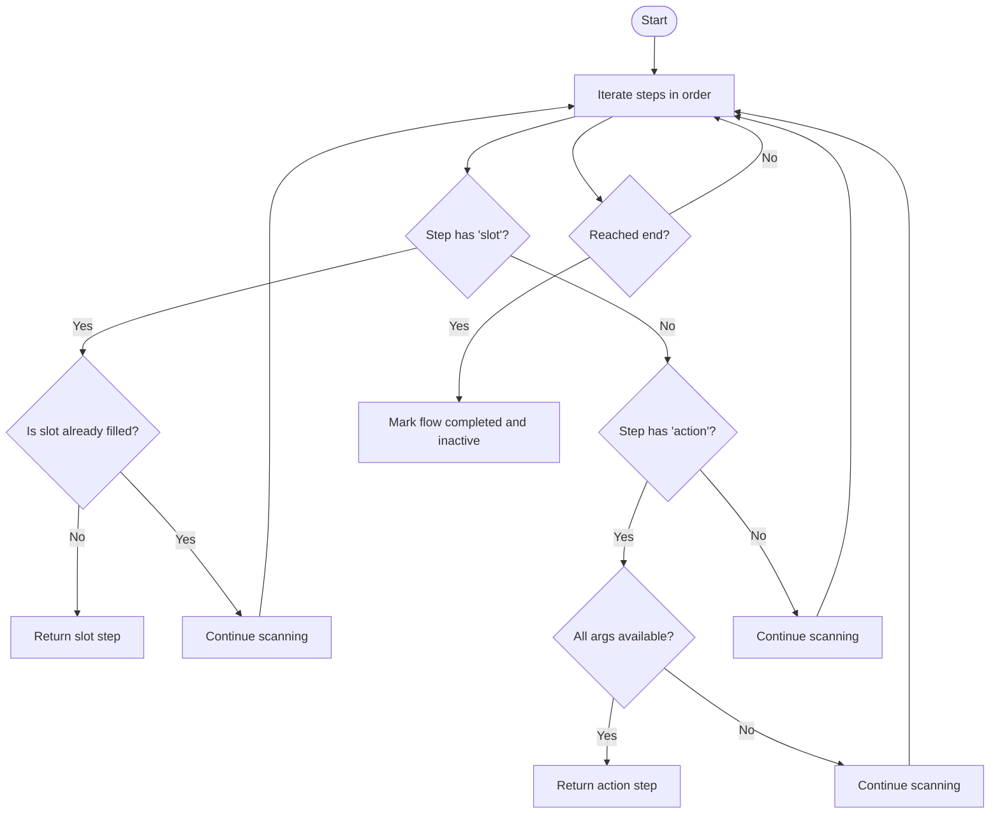

**Diagram sources**
- [state_machine.py:94-126](file://uaea-backend/app/orchestrator/state_machine.py#L94-L126)

**Section sources**
- [state_machine.py:94-126](file://uaea-backend/app/orchestrator/state_machine.py#L94-L126)

### State Persistence
- Flow state is persisted as a special tool-call-like message attached to the conversation history.
- On startup, the state machine reconstructs current state by scanning past messages for flow_state entries.
- This ensures continuity across restarts and enables resuming flows mid-conversation.

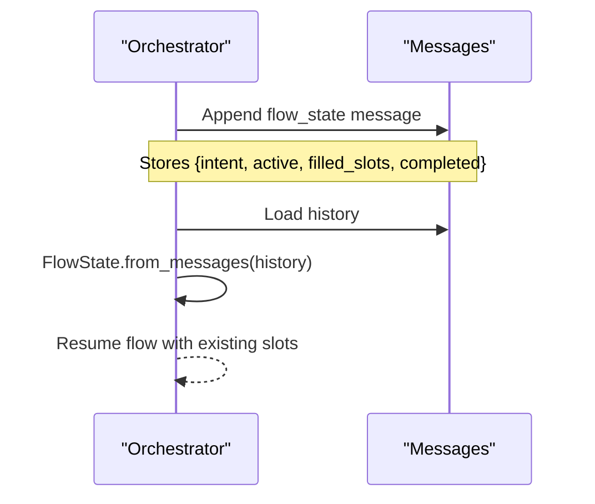

**Diagram sources**
- [orchestrator.py:112-121](file://uaea-backend/app/orchestrator/orchestrator.py#L112-L121)
- [state_machine.py:70-91](file://uaea-backend/app/orchestrator/state_machine.py#L70-L91)
- [models.py:162-178](file://uaea-backend/app/db/models.py#L162-L178)

**Section sources**
- [orchestrator.py:112-121](file://uaea-backend/app/orchestrator/orchestrator.py#L112-L121)
- [state_machine.py:70-91](file://uaea-backend/app/orchestrator/state_machine.py#L70-L91)
- [models.py:162-178](file://uaea-backend/app/db/models.py#L162-L178)

### How Flows Are Triggered by Intents
- The intent router classifies user input into intents using keyword rules.
- Certain intents are designated as guided flows; when detected and no flow is active, the orchestrator starts a new flow instance for that conversation.
- Non-guided intents proceed through the standard LLM tool-calling path.

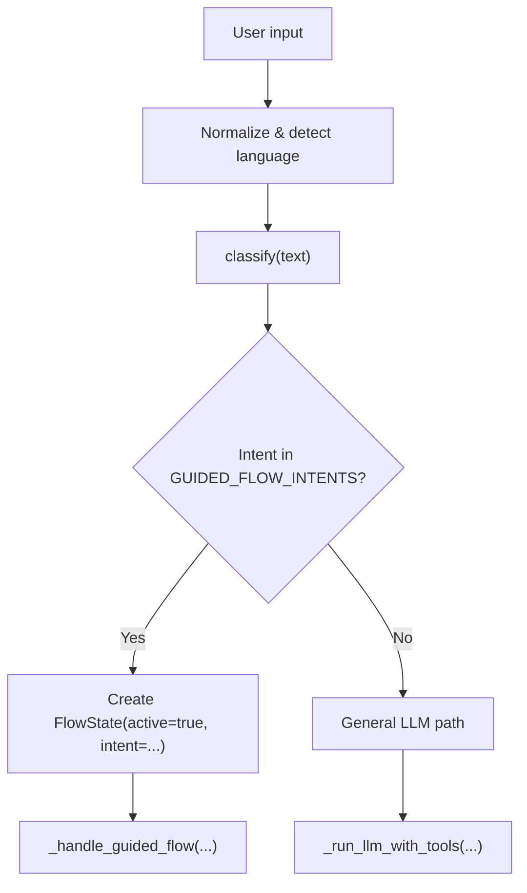

**Diagram sources**
- [intent_router.py:61-102](file://uaea-backend/app/orchestrator/intent_router.py#L61-L102)
- [orchestrator.py:61-91](file://uaea-backend/app/orchestrator/orchestrator.py#L61-L91)

**Section sources**
- [intent_router.py:61-102](file://uaea-backend/app/orchestrator/intent_router.py#L61-L102)
- [orchestrator.py:61-91](file://uaea-backend/app/orchestrator/orchestrator.py#L61-L91)

### User Input Validation and Storage
- The editor enforces validation rules on ask steps:
  - Every ask must define a slot.
  - Slots should have validation rules (warns if missing).
  - Slots referenced by lookup steps must appear earlier in the flow than their usage.
- At runtime, slot values are stored in the flow state and reused for subsequent tool calls.

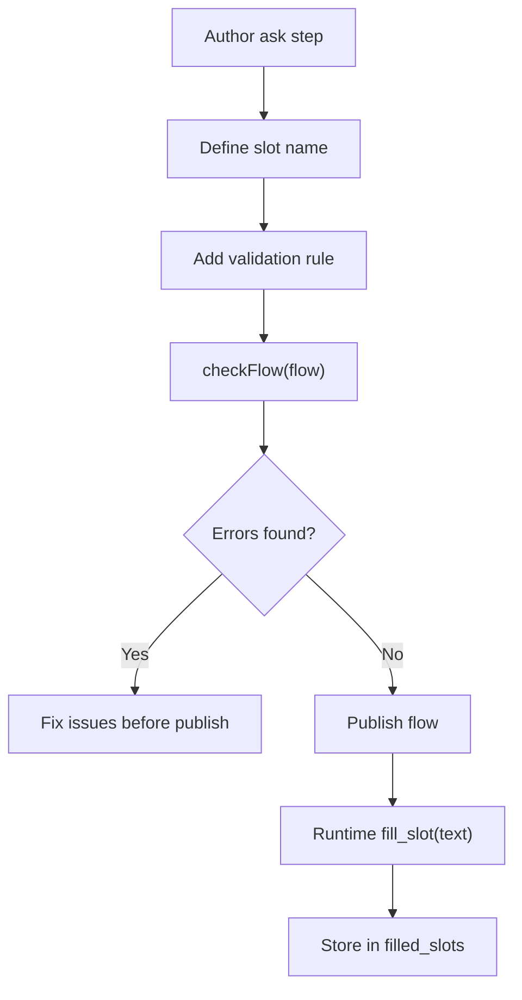

**Diagram sources**
- [StepEditor.jsx:78-99](file://src/pages/GuidedFlows/StepEditor.jsx#L78-L99)
- [flowChecks.js:32-57](file://src/pages/GuidedFlows/flowChecks.js#L32-L57)
- [state_machine.py:128-146](file://uaea-backend/app/orchestrator/state_machine.py#L128-L146)

**Section sources**
- [StepEditor.jsx:78-99](file://src/pages/GuidedFlows/StepEditor.jsx#L78-L99)
- [flowChecks.js:32-57](file://src/pages/GuidedFlows/flowChecks.js#L32-L57)
- [state_machine.py:128-146](file://uaea-backend/app/orchestrator/state_machine.py#L128-L146)

### Error Handling During Flow Execution
- Editor-level errors prevent publishing broken flows (e.g., last step not confirm/handoff, missing handoff, slots used before collection).
- Runtime errors:
  - Tool failures return structured error responses; the orchestrator instructs the model to be honest and offer escalation.
  - API errors are caught and converted to friendly fallback replies.
  - Low-confidence non-guided intents are tracked for review.

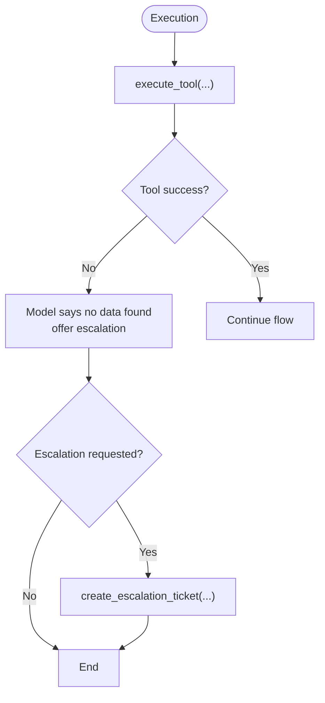

**Diagram sources**
- [flowChecks.js:12-30](file://src/pages/GuidedFlows/flowChecks.js#L12-L30)
- [orchestrator.py:255-318](file://uaea-backend/app/orchestrator/orchestrator.py#L255-L318)
- [tools.py:200-215](file://uaea-backend/app/orchestrator/tools.py#L200-L215)

**Section sources**
- [flowChecks.js:12-30](file://src/pages/GuidedFlows/flowChecks.js#L12-L30)
- [orchestrator.py:255-318](file://uaea-backend/app/orchestrator/orchestrator.py#L255-L318)
- [tools.py:200-215](file://uaea-backend/app/orchestrator/tools.py#L200-L215)

### Integration with Tool Calls for Data Retrieval
- Tools provide authoritative data:
  - Fee tariffs: program and category matching with currency and source references.
  - Deadlines: service-specific due dates with semester and source references.
  - Document checklists: service-specific required items and procedures.
  - Department lookup: contact details and campus information.
  - Knowledge base search: RAG-backed chunks with citations.
  - Escalation ticket creation: persistent handoff records.
- The orchestrator executes tool calls in a loop up to a maximum round limit, appending results to message history for the LLM to compose grounded replies.

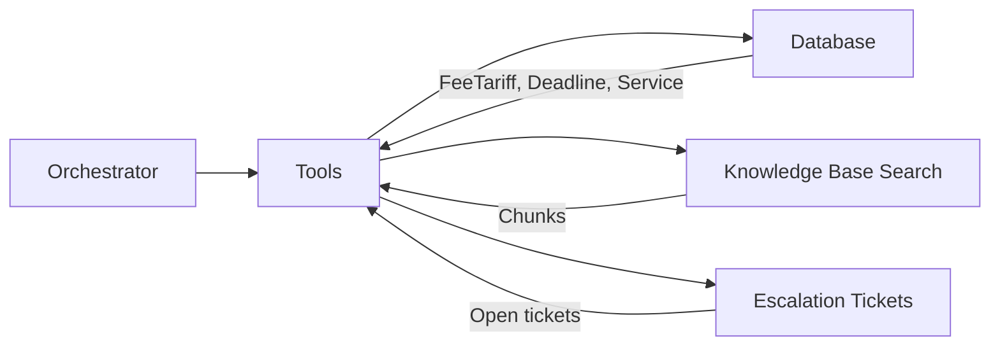

**Diagram sources**
- [tools.py:18-235](file://uaea-backend/app/orchestrator/tools.py#L18-L235)
- [models.py:71-121](file://uaea-backend/app/db/models.py#L71-L121)

**Section sources**
- [tools.py:18-235](file://uaea-backend/app/orchestrator/tools.py#L18-L235)
- [models.py:71-121](file://uaea-backend/app/db/models.py#L71-L121)

### Frontend Flow Authoring and Simulation
- Flow canvas displays steps, shows tool integrations, and highlights issues discovered by flow checks.
- Step editor exposes fields based on step type:
  - Ask: slot name and validation rule.
  - Lookup/Confirm: tool selection and arguments.
  - Inform/Handoff: prompts in multiple languages.
- Flow simulator walks through steps, simulating slot filling and tool calls to verify correctness before publishing.

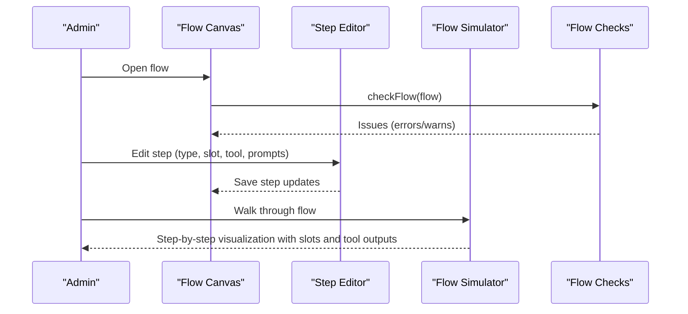

**Diagram sources**
- [FlowCanvas.jsx:16-156](file://src/pages/GuidedFlows/FlowCanvas.jsx#L16-L156)
- [StepEditor.jsx:16-160](file://src/pages/GuidedFlows/StepEditor.jsx#L16-L160)
- [flowChecks.js:8-67](file://src/pages/GuidedFlows/flowChecks.js#L8-L67)
- [FlowSimulator.jsx:27-159](file://src/pages/GuidedFlows/FlowSimulator.jsx#L27-L159)

**Section sources**
- [FlowCanvas.jsx:16-156](file://src/pages/GuidedFlows/FlowCanvas.jsx#L16-L156)
- [StepEditor.jsx:16-160](file://src/pages/GuidedFlows/StepEditor.jsx#L16-L160)
- [flowChecks.js:8-67](file://src/pages/GuidedFlows/flowChecks.js#L8-L67)
- [FlowSimulator.jsx:27-159](file://src/pages/GuidedFlows/FlowSimulator.jsx#L27-L159)

## Dependency Analysis
- Orchestrator depends on:
  - Intent router for deterministic classification.
  - State machine for guided flow control.
  - Tools for data retrieval and escalation.
  - Database models for conversations, messages, and entities.
- Frontend components depend on mock flow definitions and step metadata for UI rendering and simulation.

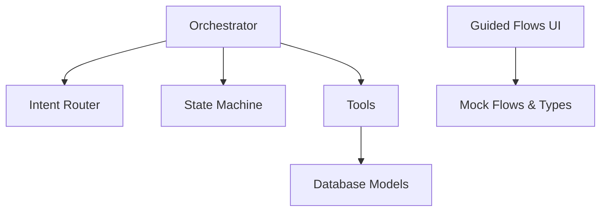

**Diagram sources**
- [orchestrator.py:1-405](file://uaea-backend/app/orchestrator/orchestrator.py#L1-L405)
- [intent_router.py:1-103](file://uaea-backend/app/orchestrator/intent_router.py#L1-L103)
- [state_machine.py:1-146](file://uaea-backend/app/orchestrator/state_machine.py#L1-L146)
- [tools.py:1-235](file://uaea-backend/app/orchestrator/tools.py#L1-L235)
- [models.py:1-228](file://uaea-backend/app/db/models.py#L1-L228)
- [flows.js:1-137](file://src/mocks/flows.js#L1-L137)

**Section sources**
- [orchestrator.py:1-405](file://uaea-backend/app/orchestrator/orchestrator.py#L1-L405)
- [intent_router.py:1-103](file://uaea-backend/app/orchestrator/intent_router.py#L1-L103)
- [state_machine.py:1-146](file://uaea-backend/app/orchestrator/state_machine.py#L1-L146)
- [tools.py:1-235](file://uaea-backend/app/orchestrator/tools.py#L1-L235)
- [models.py:1-228](file://uaea-backend/app/db/models.py#L1-L228)
- [flows.js:1-137](file://src/mocks/flows.js#L1-L137)

## Performance Considerations
- Limit LLM rounds to avoid excessive tool loops; the orchestrator caps at a fixed maximum.
- Keep message history bounded when sending to the LLM to reduce token usage.
- Prefer deterministic slot collection before invoking tools to minimize unnecessary calls.
- Use targeted tool arguments (slots) to improve match accuracy and reduce retries.

[No sources needed since this section provides general guidance]

## Troubleshooting Guide
- Editor cannot publish:
  - Ensure the last step is confirm or handoff.
  - Include at least one handoff step.
  - Validate that every ask has a slot and preferably a validation rule.
  - Verify that any slot used in a lookup appears earlier in the flow than its use.
- Flow stalls without resolution:
  - Check that all required slots are collected before action steps.
  - Confirm tool arguments reference correct slot names or literals.
- Unexpected behavior after restart:
  - Verify flow_state messages exist in conversation history; they enable state reconstruction.
- Tool errors:
  - Inspect tool results for error fields; the model should respond honestly and offer escalation.
  - Use escalation tickets for unresolved cases.

**Section sources**
- [flowChecks.js:12-67](file://src/pages/GuidedFlows/flowChecks.js#L12-L67)
- [orchestrator.py:255-318](file://uaea-backend/app/orchestrator/orchestrator.py#L255-L318)
- [tools.py:200-235](file://uaea-backend/app/orchestrator/tools.py#L200-L235)

## Conclusion
The guided flow system replaces improvisational multi-turn conversations with explicit, verifiable state machines. Flows are authored visually, validated rigorously, and executed deterministically by collecting slots and calling tools for grounded answers. State persists across messages and restarts, ensuring reliable handoffs and consistent user experiences. The combination of editor-time checks and runtime safeguards minimizes errors and keeps responses accurate and traceable to official sources.

[No sources needed since this section summarizes without analyzing specific files]