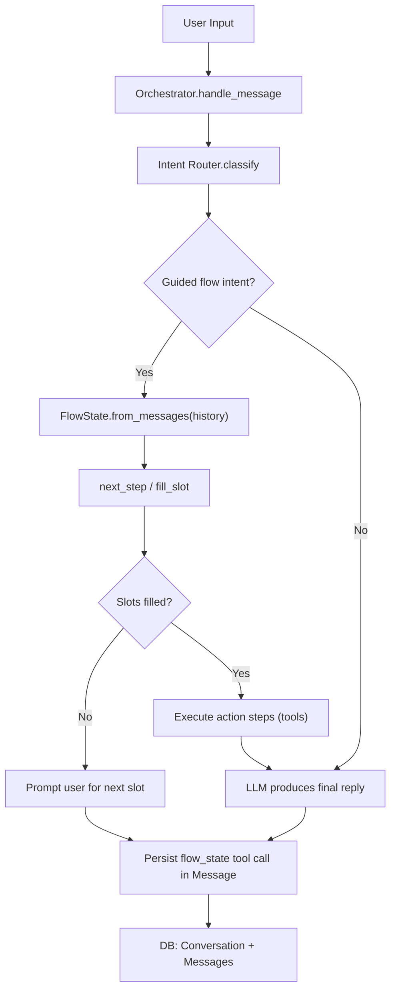
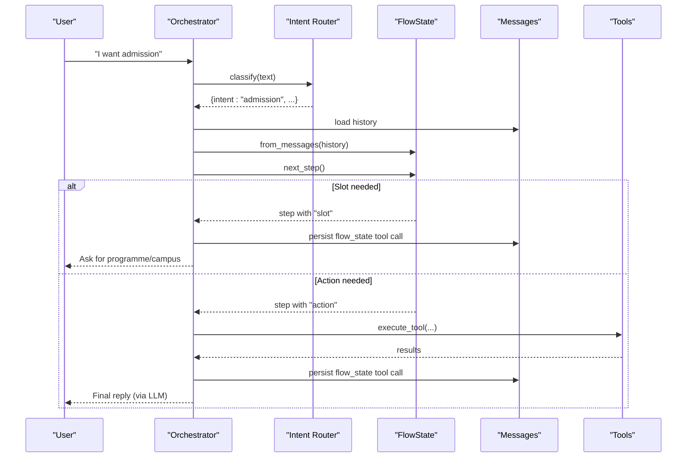
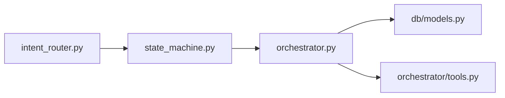

# State Machine Implementation

<cite>
**Referenced Files in This Document**
- [state_machine.py](file://uaea-backend/app/orchestrator/state_machine.py)
- [intent_router.py](file://uaea-backend/app/orchestrator/intent_router.py)
- [orchestrator.py](file://uaea-backend/app/orchestrator/orchestrator.py)
- [models.py](file://uaea-backend/app/db/models.py)
- [tools.py](file://uaea-backend/app/orchestrator/tools.py)
- [test_chat_flow.py](file://uaea-backend/tests/test_chat_flow.py)
</cite>

## Table of Contents
1. [Introduction](#introduction)
2. [Project Structure](#project-structure)
3. [Core Components](#core-components)
4. [Architecture Overview](#architecture-overview)
5. [Detailed Component Analysis](#detailed-component-analysis)
6. [Dependency Analysis](#dependency-analysis)
7. [Performance Considerations](#performance-considerations)
8. [Troubleshooting Guide](#troubleshooting-guide)
9. [Conclusion](#conclusion)
10. [Appendices](#appendices)

## Introduction
This document explains the FlowState class and the guided flow state machine used by the assistant to manage multi-turn conversations for university services such as Admission, Fee Challan, and Degree Application. It covers how intent, active status, filled_slots, and completion status are tracked; how state is reconstructed from conversation history via from_messages; how it is serialized with to_dict; and how persistence through Conversation/Message records ensures state survives restarts. It also includes examples of state transitions and management patterns observed in the codebase.

## Project Structure
The state machine lives under the orchestrator module and integrates with:
- Intent classification to determine whether a conversation should enter a guided flow
- Message persistence to store and reconstruct flow state across turns
- Tool execution to gather service data once slots are filled
- Guardrails to sanitize final replies

**Diagram sources**
- [orchestrator.py:46-143](file://uaea-backend/app/orchestrator/orchestrator.py#L46-L143)
- [state_machine.py:62-146](file://uaea-backend/app/orchestrator/state_machine.py#L62-L146)
- [models.py:144-178](file://uaea-backend/app/db/models.py#L144-L178)

**Section sources**
- [orchestrator.py:46-143](file://uaea-backend/app/orchestrator/orchestrator.py#L46-L143)
- [state_machine.py:14-146](file://uaea-backend/app/orchestrator/state_machine.py#L14-L146)
- [models.py:144-178](file://uaea-backend/app/db/models.py#L144-L178)

## Core Components
- FlowState: Dataclass representing current guided flow state per conversation, including intent, active flag, filled_slots map, and completed flag.
- next_step: Determines the next step (slot prompt or action execution) based on flow definition and filled slots.
- fill_slot: Attempts to fill the next unfilled slot from user input text.
- Orchestrator integration: Reconstructs FlowState from message history, persists state changes via tool calls stored in messages, and coordinates guided flow prompts and tool executions.

Key responsibilities:
- Track which guided flow is active and what has been collected so far
- Decide when to ask for more information versus executing actions
- Persist state in a durable way using conversation history

**Section sources**
- [state_machine.py:62-146](file://uaea-backend/app/orchestrator/state_machine.py#L62-L146)
- [orchestrator.py:80-121](file://uaea-backend/app/orchestrator/orchestrator.py#L80-L121)

## Architecture Overview
The guided flow lifecycle:
1. User sends a message
2. Orchestrator classifies intent
3. If intent belongs to a guided flow and no flow is active, start one
4. Load persisted flow state from message history
5. Use next_step to decide whether to prompt for a slot or execute an action
6. Persist flow state after each turn via a tool call embedded in a Message record
7. When all slots are filled, execute required tools and let the LLM produce a final response

**Diagram sources**
- [orchestrator.py:46-143](file://uaea-backend/app/orchestrator/orchestrator.py#L46-L143)
- [state_machine.py:94-146](file://uaea-backend/app/orchestrator/state_machine.py#L94-L146)
- [models.py:162-178](file://uaea-backend/app/db/models.py#L162-L178)

## Detailed Component Analysis

### FlowState class
- Fields:
  - intent: The selected guided flow identifier (e.g., "admission")
  - active: Whether the flow is currently running
  - filled_slots: Map of slot names to values collected so far
  - completed: Whether the flow has finished successfully
- Methods:
  - from_messages(messages): Scans message history for tool_calls named "flow_state" and restores the latest state snapshot
  - to_dict(): Serializes current state into a dictionary for persistence

Complexity:
- from_messages iterates over messages and their tool_calls; time complexity O(N*M) where N is number of messages and M is average tool_calls per message
- to_dict is O(1)

Error handling:
- Gracefully handles missing fields by using defaults; if no flow_state tool calls exist, returns an empty FlowState

**Section sources**
- [state_machine.py:62-91](file://uaea-backend/app/orchestrator/state_machine.py#L62-L91)

### next_step(state)
Determines the next step for an active flow:
- If no active flow or no intent, returns None
- Looks up flow definition by intent
- Iterates steps:
  - For slot steps: if the slot is not filled, return that step to prompt the user
  - For action steps: if all args_from are available in filled_slots or hardcoded in the step, return that step to execute
- If all steps complete, marks flow as completed and inactive, returns None

Complexity:
- O(S) where S is number of steps in the flow definition

Edge cases:
- Unknown intent returns None
- Missing args_for action prevents execution until slots are filled

**Section sources**
- [state_machine.py:94-125](file://uaea-backend/app/orchestrator/state_machine.py#L94-L125)

### fill_slot(state, text)
Attempts to fill the next unfilled slot:
- Validates active flow and intent
- Finds first unfilled slot in flow definition order
- Stores trimmed text into filled_slots and returns slot name
- Returns None if no slot can be filled

Complexity:
- O(K) where K is number of slots defined for the flow

**Section sources**
- [state_machine.py:128-146](file://uaea-backend/app/orchestrator/state_machine.py#L128-L146)

### Persistence mechanism via Conversation/Message
- Conversation stores session metadata and links to ordered messages
- Message stores role, text, intent, and tool_calls (JSON)
- Flow state is persisted by appending a tool call named "flow_state" with the serialized state dict into a Message record
- On subsequent turns, from_messages scans all messages to rebuild the latest FlowState

Data model highlights:
- Conversation: id, session_id, channel, timestamps, flags
- Message: id, conversation_id, role, text, intent, tool_calls, feedback, created_at

**Section sources**
- [models.py:144-178](file://uaea-backend/app/db/models.py#L144-L178)
- [orchestrator.py:112-121](file://uaea-backend/app/orchestrator/orchestrator.py#L112-L121)

### State reconstruction and serialization
- Reconstruction: from_messages reads tool_calls from all messages, finds entries with name "flow_state", and applies result fields to FlowState
- Serialization: to_dict outputs intent, active, filled_slots, completed

Usage in orchestrator:
- After starting or updating a guided flow, the orchestrator persists a tool call with the current FlowState.to_dict()
- History retrieval loads messages and converts them to dicts for both LLM context and state reconstruction

**Section sources**
- [state_machine.py:70-91](file://uaea-backend/app/orchestrator/state_machine.py#L70-L91)
- [orchestrator.py:80-121](file://uaea-backend/app/orchestrator/orchestrator.py#L80-L121)

### Guided flow definitions and steps
- FLOW_DEFINITIONS maps intent identifiers to structured flows with:
  - name and service_id
  - slots list defining required inputs
  - steps sequence mixing slot prompts and action executions
- Steps can:
  - Prompt for a specific slot
  - Execute tools with arguments derived from filled_slots or static values
  - Confirm completion

Examples include:
- Admission & Enrolment: collects programme and campus, then executes tools for fee tariff, deadline, and document checklist
- Fee Challan: collects programme and enrolment type, then fetches fee and deadline
- Degree Application: directly executes tools without collecting slots

**Section sources**
- [state_machine.py:16-59](file://uaea-backend/app/orchestrator/state_machine.py#L16-L59)

### Integration with intent routing
- GUIDED_FLOW_INTENTS enumerates intents eligible for guided flows
- Orchestrator starts a new flow when classified intent matches this set and no flow is active

**Section sources**
- [intent_router.py:61-62](file://uaea-backend/app/orchestrator/intent_router.py#L61-L62)
- [orchestrator.py:84-87](file://uaea-backend/app/orchestrator/orchestrator.py#L84-L87)

### Tool execution during guided flows
- Once slots are filled, orchestrator falls through to LLM with tools enabled
- Tools like get_fee_tariff, get_deadline, get_document_checklist are executed and results included in the conversation
- Escalation tool creates tickets when necessary

**Section sources**
- [tools.py:18-87](file://uaea-backend/app/orchestrator/tools.py#L18-L87)
- [orchestrator.py:229-318](file://uaea-backend/app/orchestrator/orchestrator.py#L229-L318)

## Dependency Analysis
High-level dependencies:
- state_machine depends on FLOW_DEFINITIONS and intent_router.GUIDED_FLOW_INTENTS
- orchestrator imports FlowState, next_step, fill_slot, and uses models for persistence
- tools provides external integrations invoked by guided flows

**Diagram sources**
- [state_machine.py:11-12](file://uaea-backend/app/orchestrator/state_machine.py#L11-L12)
- [orchestrator.py:17-25](file://uaea-backend/app/orchestrator/orchestrator.py#L17-L25)
- [models.py:144-178](file://uaea-backend/app/db/models.py#L144-L178)
- [tools.py:18-87](file://uaea-backend/app/orchestrator/tools.py#L18-L87)

**Section sources**
- [state_machine.py:11-12](file://uaea-backend/app/orchestrator/state_machine.py#L11-L12)
- [orchestrator.py:17-25](file://uaea-backend/app/orchestrator/orchestrator.py#L17-L25)

## Performance Considerations
- Message history scanning in from_messages scales with conversation length; consider limiting to recent messages if conversations grow large
- next_step and fill_slot operate over small fixed-size structures (steps and slots), so they are efficient
- Persisting flow_state tool calls on every turn adds minimal overhead but ensures durability
- Tool execution may involve database queries; batching or caching could improve performance for repeated lookups

[No sources needed since this section provides general guidance]

## Troubleshooting Guide
Common issues and diagnostics:
- Flow does not start:
  - Ensure intent is in GUIDED_FLOW_INTENTS and no existing flow is active
  - Verify message history contains no conflicting flow_state snapshots
- Slots not filling:
  - Check that user input is passed to fill_slot and that slot names match flow definition
  - Confirm next_step returns a slot step before attempting action execution
- State not surviving restarts:
  - Confirm that flow_state tool calls are being appended to Message.tool_calls and committed to the database
  - Validate that from_messages correctly locates these tool_calls in history

Relevant code paths:
- Starting flow and persisting state
- Reconstructing state from history
- Executing guided flow steps

**Section sources**
- [orchestrator.py:80-121](file://uaea-backend/app/orchestrator/orchestrator.py#L80-L121)
- [state_machine.py:70-91](file://uaea-backend/app/orchestrator/state_machine.py#L70-L91)

## Conclusion
The FlowState class and its supporting functions provide a robust, persistent state machine for guided conversations. By encoding flow definitions declaratively and tracking state through message history, the system ensures reliable multi-turn interactions that survive restarts. The orchestrator ties together intent classification, state management, tool execution, and guardrails to deliver consistent, accurate responses for university services.

[No sources needed since this section summarizes without analyzing specific files]

## Appendices

### Example state transitions
- Start Admission flow:
  - Intent becomes "admission", active=True, filled_slots={}
  - next_step returns slot "programme"
  - User provides programme → filled_slots={"programme": "..."}
  - next_step returns slot "campus"
  - User provides campus → filled_slots={"programme": "...", "campus": "..."}
  - next_step returns action steps → tools executed → flow completes
- Completion:
  - completed=True, active=False

These transitions are validated by tests that simulate triggering the flow and filling slots.

**Section sources**
- [test_chat_flow.py:44-81](file://uaea-backend/tests/test_chat_flow.py#L44-L81)
- [state_machine.py:94-146](file://uaea-backend/app/orchestrator/state_machine.py#L94-L146)