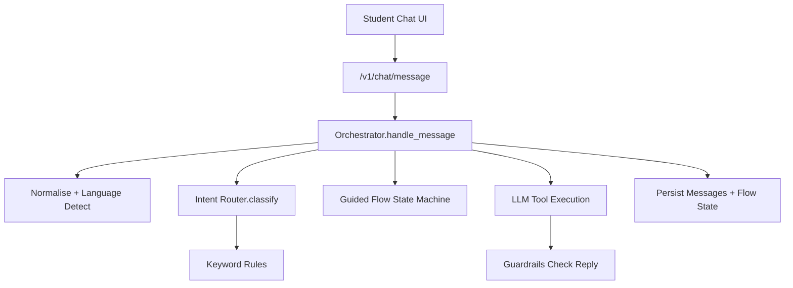
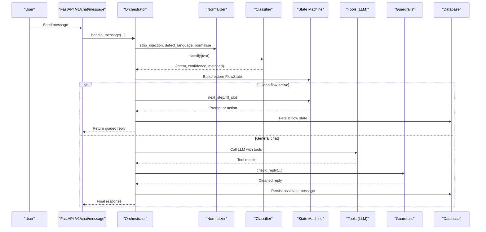
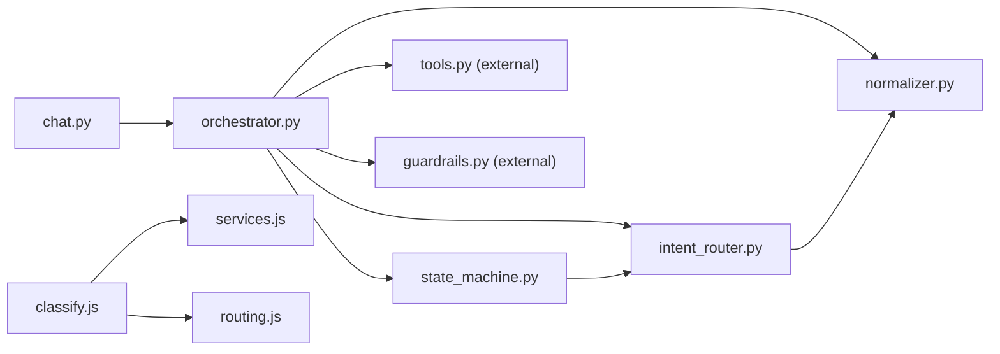

# Intent Classification

<cite>
**Referenced Files in This Document**
- [classify.js](file://src/lib/classify.js)
- [intent_router.py](file://uaea-backend/app/orchestrator/intent_router.py)
- [normalizer.py](file://uaea-backend/app/orchestrator/normalizer.py)
- [orchestrator.py](file://uaea-backend/app/orchestrator/orchestrator.py)
- [state_machine.py](file://uaea-backend/app/orchestrator/state_machine.py)
- [chat.py](file://uaea-backend/app/api/chat.py)
- [services.js](file://src/mocks/services.js)
- [routing.js](file://src/mocks/routing.js)
- [RoutingCard.jsx](file://src/pages/student/Chat/RoutingCard.jsx)
</cite>

## Table of Contents
1. Introduction
2. Project Structure
3. Core Components
4. Architecture Overview
5. Detailed Component Analysis
6. Dependency Analysis
7. Performance Considerations
8. Troubleshooting Guide
9. Conclusion
10. Appendices

## Introduction
This document explains the intent classification system that determines user query types using keyword-based scoring algorithms. It covers:
- How queries are normalized and scored
- Confidence calculation and thresholds
- Mapping intents to processing paths (guided flows vs general chat)
- Supported intent categories, thresholds, and ambiguous query handling
- Examples and configuration points for thresholds and guided flow integration

The system is deterministic and rule-based, designed to be fast, transparent, and easy to evolve into a trained classifier later without changing surrounding code.

## Project Structure
At a high level:
- Frontend normalizer and classifier live in JavaScript for quick iteration and demonstration.
- Backend normalizer and classifier live in Python and integrate with an orchestrator pipeline that routes to guided flows or LLM tool use.
- Guided flows are defined declaratively and driven by a state machine.
- The API exposes endpoints that trigger the full pipeline.

**Diagram sources**
- [chat.py:21-39](file://uaea-backend/app/api/chat.py#L21-L39)
- [orchestrator.py:46-143](file://uaea-backend/app/orchestrator/orchestrator.py#L46-L143)
- [intent_router.py:65-102](file://uaea-backend/app/orchestrator/intent_router.py#L65-L102)
- [state_machine.py:16-59](file://uaea-backend/app/orchestrator/state_machine.py#L16-L59)

**Section sources**
- [chat.py:21-39](file://uaea-backend/app/api/chat.py#L21-L39)
- [orchestrator.py:46-143](file://uaea-backend/app/orchestrator/orchestrator.py#L46-L143)

## Core Components
- Normalization and language detection:
  - Lowercasing, punctuation stripping, Roman Urdu variant folding, and injection protection.
- Keyword-based classifier:
  - Strong and weak keywords per intent; scores computed by counting matches; confidence derived from top score.
- Guided flow state machine:
  - Declarative steps with slots and actions; persists state via messages.
- Orchestrator pipeline:
  - Sanitize → normalize → classify → guided flow → LLM tools → guardrails → persist.
- Routing and service mapping:
  - Intents map to services and departments for display and routing.

**Section sources**
- [normalizer.py:29-66](file://uaea-backend/app/orchestrator/normalizer.py#L29-L66)
- [intent_router.py:14-102](file://uaea-backend/app/orchestrator/intent_router.py#L14-L102)
- [state_machine.py:16-146](file://uaea-backend/app/orchestrator/state_machine.py#L16-L146)
- [orchestrator.py:46-143](file://uaea-backend/app/orchestrator/orchestrator.py#L46-L143)
- [services.js:10-309](file://src/mocks/services.js#L10-L309)
- [routing.js:11-18](file://src/mocks/routing.js#L11-L18)

## Architecture Overview
End-to-end message flow:

**Diagram sources**
- [chat.py:21-39](file://uaea-backend/app/api/chat.py#L21-L39)
- [orchestrator.py:46-143](file://uaea-backend/app/orchestrator/orchestrator.py#L46-L143)
- [intent_router.py:65-102](file://uaea-backend/app/orchestrator/intent_router.py#L65-L102)
- [state_machine.py:94-146](file://uaea-backend/app/orchestrator/state_machine.py#L94-L146)

## Detailed Component Analysis

### Normalization and Language Detection
- Normalization:
  - Lowercases text, removes punctuation, collapses whitespace, and folds common Roman Urdu variants to canonical forms before scoring.
- Language detection:
  - Detects Urdu script, Roman Urdu via function words, otherwise English.
- Injection protection:
  - Strips common prompt-injection patterns to improve safety.

These steps ensure robust matching across spelling variations and languages.

**Section sources**
- [normalizer.py:9-36](file://uaea-backend/app/orchestrator/normalizer.py#L9-L36)
- [normalizer.py:39-49](file://uaea-backend/app/orchestrator/normalizer.py#L39-L49)
- [normalizer.py:52-66](file://uaea-backend/app/orchestrator/normalizer.py#L52-L66)

### Keyword-Based Classifier
- Scoring algorithm:
  - Each intent has strong and weak keyword lists.
  - Strong hits add more points than weak hits.
  - Scores are summed per rule; rules are sorted by score then by number of strong hits.
- Confidence calculation:
  - Confidence = min(0.96, top_score / 6). A score of 6 corresponds to two strong hits or one strong plus three supporting terms.
- Unknown queries:
  - If no rule matches, returns a knowledge question intent with low confidence.
- Frontend classifier:
  - Mirrors backend behavior with additional category and department mapping for UI display.

Supported intents include admission, fee_challan, fee_tariff, result, degree, transcript, department_lookup, small_talk, and others depending on the environment.

**Section sources**
- [intent_router.py:14-59](file://uaea-backend/app/orchestrator/intent_router.py#L14-L59)
- [intent_router.py:65-102](file://uaea-backend/app/orchestrator/intent_router.py#L65-L102)
- [classify.js:63-190](file://src/lib/classify.js#L63-L190)
- [classify.js:195-269](file://src/lib/classify.js#L195-L269)

### Guided Flows and State Machine
- Declarative flow definitions:
  - Each flow defines name, slots, and ordered steps (slot prompts and actions).
- State persistence:
  - Flow state is stored in conversation history via tool calls so it survives restarts.
- Slot filling:
  - When a flow is active, the system asks for missing slots and fills them from user input.
- Action execution:
  - Once all required arguments are available, actions run to gather data; then control may return to LLM for final summary.

Flows supported include admission, fee challan, and degree application.

**Section sources**
- [state_machine.py:16-59](file://uaea-backend/app/orchestrator/state_machine.py#L16-L59)
- [state_machine.py:94-146](file://uaea-backend/app/orchestrator/state_machine.py#L94-L146)
- [orchestrator.py:146-227](file://uaea-backend/app/orchestrator/orchestrator.py#L146-L227)

### Orchestrator Pipeline and Thresholds
- Pipeline steps:
  - Sanitize input, detect language, normalize, classify, manage guided flows, call LLM with tools, apply guardrails, persist messages and flow state.
- Low-confidence handling:
  - Queries with confidence below a threshold and not part of guided flows are tracked as unanswered for review.
- Escalation:
  - If tool calls create escalation tickets or if rounds exhaust without a clean reply, the conversation is marked escalated.

Thresholds:
- Backend uses a floor of 0.5 for classifier decisions in some contexts and tracks low-confidence below 0.4 for unanswered queueing.
- Frontend displays a warning when confidence falls below its own floor constant.

**Section sources**
- [orchestrator.py:46-143](file://uaea-backend/app/orchestrator/orchestrator.py#L46-L143)
- [orchestrator.py:367-383](file://uaea-backend/app/orchestrator/orchestrator.py#L367-L383)
- [intent_router.py:10-12](file://uaea-backend/app/orchestrator/intent_router.py#L10-L12)
- [classify.js:268-269](file://src/lib/classify.js#L268-L269)
- [RoutingCard.jsx:1-43](file://src/pages/student/Chat/RoutingCard.jsx#L1-L43)

### Service and Department Mapping
- Services catalogue:
  - Defines service IDs, names, categories, procedures, and checklists used by tools and UI.
- Category-to-department mapping:
  - Maps service categories to department IDs for routing and display.
- Intent to service mapping:
  - Classifiers associate intents with service IDs; frontend also resolves category and department for visualization.

**Section sources**
- [services.js:10-309](file://src/mocks/services.js#L10-L309)
- [routing.js:11-18](file://src/mocks/routing.js#L11-L18)
- [classify.js:245-250](file://src/lib/classify.js#L245-L250)

## Dependency Analysis
Key dependencies and relationships:

**Diagram sources**
- [chat.py:21-39](file://uaea-backend/app/api/chat.py#L21-L39)
- [orchestrator.py:46-143](file://uaea-backend/app/orchestrator/orchestrator.py#L46-L143)
- [intent_router.py:65-102](file://uaea-backend/app/orchestrator/intent_router.py#L65-L102)
- [state_machine.py:94-146](file://uaea-backend/app/orchestrator/state_machine.py#L94-L146)
- [classify.js:195-269](file://src/lib/classify.js#L195-L269)

**Section sources**
- [chat.py:21-39](file://uaea-backend/app/api/chat.py#L21-L39)
- [orchestrator.py:46-143](file://uaea-backend/app/orchestrator/orchestrator.py#L46-L143)
- [intent_router.py:65-102](file://uaea-backend/app/orchestrator/intent_router.py#L65-L102)
- [state_machine.py:94-146](file://uaea-backend/app/orchestrator/state_machine.py#L94-L146)
- [classify.js:195-269](file://src/lib/classify.js#L195-L269)

## Performance Considerations
- Deterministic keyword scoring is O(n*m) where n is number of rules and m is average keyword list length; this is lightweight and predictable.
- Normalization reduces false negatives by consolidating spelling variants early.
- Guided flows short-circuit complex LLM calls for structured tasks, reducing latency and token usage.
- Conversation history is truncated to recent messages for LLM context to limit overhead.

[No sources needed since this section provides general guidance]

## Troubleshooting Guide
Common issues and how to diagnose:
- Low confidence responses:
  - Check normalization and keyword coverage; consider adding weak/strong terms or adjusting thresholds.
  - Frontend shows a warning when below its confidence floor.
- Ambiguous queries:
  - If multiple intents score similarly, alternatives may be offered; refine rule ordering and keyword sets.
- Guided flow not starting:
  - Ensure intent is in the set of guided flow intents and that flow state is not already active.
- Unanswered queue growth:
  - Review low-confidence logs and update rules or thresholds accordingly.

**Section sources**
- [RoutingCard.jsx:1-43](file://src/pages/student/Chat/RoutingCard.jsx#L1-L43)
- [orchestrator.py:123-125](file://uaea-backend/app/orchestrator/orchestrator.py#L123-L125)
- [intent_router.py:90-92](file://uaea-backend/app/orchestrator/intent_router.py#L90-L92)

## Conclusion
The intent classification system uses a transparent, deterministic keyword-scoring approach with robust normalization and clear confidence metrics. It integrates seamlessly with guided flows for structured tasks and falls back to LLM-powered general chat for open-ended questions. Thresholds and rules are centralized and configurable, enabling iterative improvement and safe deployment.

[No sources needed since this section summarizes without analyzing specific files]

## Appendices

### Supported Intent Categories
- Admission & Enrolment
- Fee Tariff
- Fee Challan
- Result
- Degree Application
- Transcript
- Department Lookup
- Small Talk
- Additional academic and certification intents as defined in the rules

**Section sources**
- [intent_router.py:14-59](file://uaea-backend/app/orchestrator/intent_router.py#L14-L59)
- [classify.js:63-190](file://src/lib/classify.js#L63-L190)

### Confidence Thresholds
- Backend classifier floor: 0.5
- Unanswered tracking threshold: below 0.4 for non-guided intents
- Frontend confidence floor: displayed as a warning threshold

**Section sources**
- [intent_router.py:10-12](file://uaea-backend/app/orchestrator/intent_router.py#L10-L12)
- [orchestrator.py:123-125](file://uaea-backend/app/orchestrator/orchestrator.py#L123-L125)
- [classify.js:268-269](file://src/lib/classify.js#L268-L269)
- [RoutingCard.jsx:1-43](file://src/pages/student/Chat/RoutingCard.jsx#L1-L43)

### Handling Ambiguous Queries
- Alternative suggestions:
  - When the top two intents are close in score, alternatives are provided to the student.
- Rule ordering:
  - More specific rules appear earlier to prioritize precise matches.

**Section sources**
- [classify.js:260-265](file://src/lib/classify.js#L260-L265)
- [intent_router.py:87-92](file://uaea-backend/app/orchestrator/intent_router.py#L87-L92)

### Integration with Guided Flow System
- Triggering flows:
  - Certain intents automatically start guided flows with slot collection and action execution.
- State persistence:
  - Flow state is persisted via tool calls in message history.

**Section sources**
- [intent_router.py:61-62](file://uaea-backend/app/orchestrator/intent_router.py#L61-L62)
- [state_machine.py:16-59](file://uaea-backend/app/orchestrator/state_machine.py#L16-L59)
- [orchestrator.py:80-91](file://uaea-backend/app/orchestrator/orchestrator.py#L80-L91)

### Example Classification Scenarios
- Scenario: Asking about fee challan location
  - Expected intent: fee_challan
  - Likely strong/weak matches: challan, bank, payment
  - Outcome: Guided flow may start to collect programme and enrolment type, then provide instructions.
- Scenario: Asking about admission deadlines
  - Expected intent: admission
  - Likely strong/weak matches: admission, last date, form
  - Outcome: Guided flow collects programme and campus, then retrieves deadlines and documents.
- Scenario: General greeting
  - Expected intent: small_talk
  - Outcome: General chat response via LLM.

**Section sources**
- [intent_router.py:14-59](file://uaea-backend/app/orchestrator/intent_router.py#L14-L59)
- [state_machine.py:16-59](file://uaea-backend/app/orchestrator/state_machine.py#L16-L59)
- [routing.js:67-76](file://src/mocks/routing.js#L67-L76)