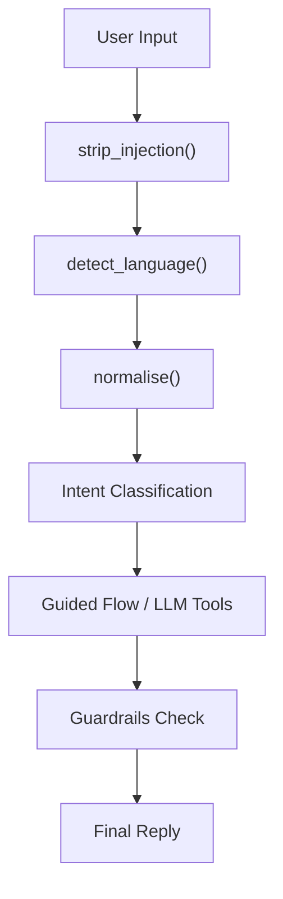
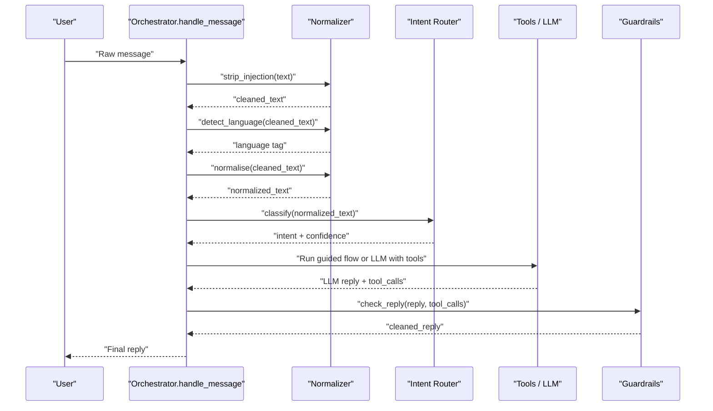
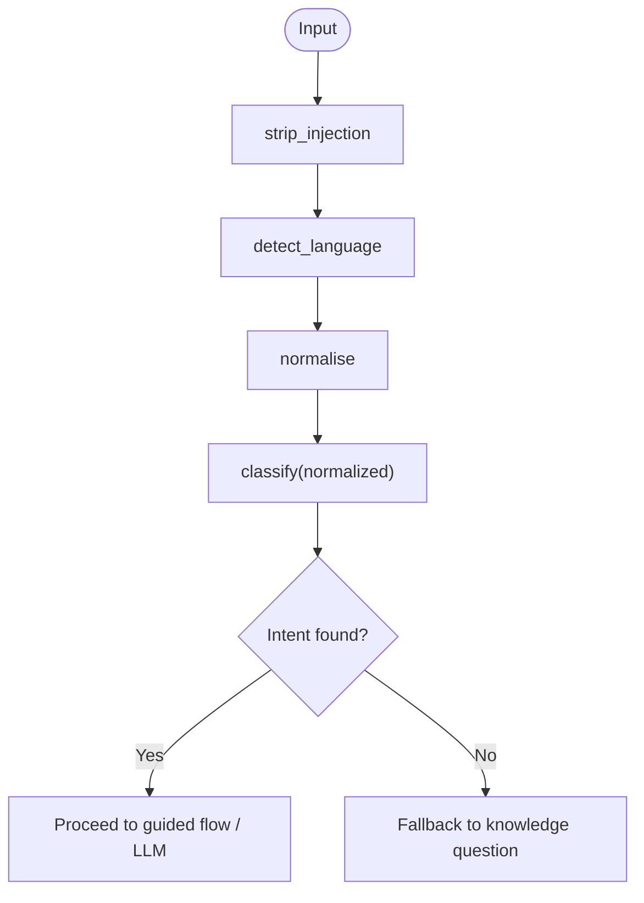
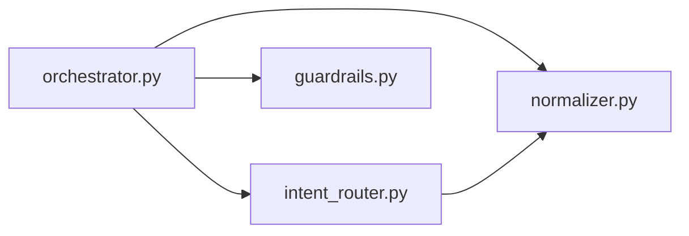

# Message Normalization

<cite>
**Referenced Files in This Document**
- [normalizer.py](file://uaea-backend/app/orchestrator/normalizer.py)
- [orchestrator.py](file://uaea-backend/app/orchestrator/orchestrator.py)
- [intent_router.py](file://uaea-backend/app/orchestrator/intent_router.py)
- [guardrails.py](file://uaea-backend/app/orchestrator/guardrails.py)
- [test_rag_retrieval.py](file://uaea-backend/tests/test_rag_retrieval.py)
- [test_chat_flow.py](file://uaea-backend/tests/test_chat_flow.py)
</cite>

## Table of Contents
1. [Introduction](#introduction)
2. [Project Structure](#project-structure)
3. [Core Components](#core-components)
4. [Architecture Overview](#architecture-overview)
5. [Detailed Component Analysis](#detailed-component-analysis)
6. [Dependency Analysis](#dependency-analysis)
7. [Performance Considerations](#performance-considerations)
8. [Troubleshooting Guide](#troubleshooting-guide)
9. [Conclusion](#conclusion)

## Introduction
This document explains the message normalization stage of the orchestrator pipeline, focusing on how user input is sanitized and prepared for downstream processing. It covers:
- Injection stripping to prevent prompt injection attacks
- Language detection for English, Urdu script, and Roman Urdu
- Text normalization that folds common Roman Urdu spelling variants
- How normalized text flows into intent classification and the rest of the pipeline
- Security measures, supported languages, edge cases, and examples

## Project Structure
The normalization logic lives in the backend orchestrator module and is invoked at the beginning of each message handling flow. The key files involved are:
- normalizer.py: sanitization, language detection, and normalization
- orchestrator.py: entry point that applies normalization and passes results downstream
- intent_router.py: uses normalized text for deterministic intent classification
- guardrails.py: post-LLM safety layer (not part of normalization but relevant to overall security)

**Diagram sources**
- [orchestrator.py:46-100](file://uaea-backend/app/orchestrator/orchestrator.py#L46-L100)
- [normalizer.py:29-65](file://uaea-backend/app/orchestrator/normalizer.py#L29-L65)
- [intent_router.py:65-103](file://uaea-backend/app/orchestrator/intent_router.py#L65-L103)
- [guardrails.py:74-120](file://uaea-backend/app/orchestrator/guardrails.py#L74-L120)

**Section sources**
- [orchestrator.py:46-100](file://uaea-backend/app/orchestrator/orchestrator.py#L46-L100)
- [normalizer.py:29-65](file://uaea-backend/app/orchestrator/normalizer.py#L29-L65)

## Core Components
- strip_injection(text): Removes common prompt-injection patterns from user input before any further processing.
- detect_language(text): Identifies whether the input is Urdu script, Roman Urdu, or English.
- normalise(text): Lowercases, strips punctuation, collapses whitespace, and folds Roman Urdu spelling variants to a canonical form.

These functions are called in sequence at the start of handle_message to ensure safe, consistent, and language-aware processing.

**Section sources**
- [normalizer.py:29-65](file://uaea-backend/app/orchestrator/normalizer.py#L29-L65)
- [orchestrator.py:56-63](file://uaea-backend/app/orchestrator/orchestrator.py#L56-L63)

## Architecture Overview
The normalization stage is the first step in the orchestrator pipeline. After sanitization and language detection, the normalized text is used by the intent router and later by tools and the LLM. Guardrails run after the LLM response to ensure factual grounding.

**Diagram sources**
- [orchestrator.py:46-143](file://uaea-backend/app/orchestrator/orchestrator.py#L46-L143)
- [normalizer.py:29-65](file://uaea-backend/app/orchestrator/normalizer.py#L29-L65)
- [intent_router.py:65-103](file://uaea-backend/app/orchestrator/intent_router.py#L65-L103)
- [guardrails.py:74-120](file://uaea-backend/app/orchestrator/guardrails.py#L74-L120)

## Detailed Component Analysis

### Prompt Injection Stripping
Purpose:
- Remove instruction-like patterns that attempt to override system behavior or extract sensitive information.

Patterns removed include:
- “ignore/disregard/forget all previous instructions/prompts/rules”
- “you are now”
- “new instructions:”
- “system prompt:”
- “act as a/an”

Behavior:
- Case-insensitive matching
- Replaces matched segments with empty strings
- Returns stripped and trimmed text

Security impact:
- Reduces risk of prompt injection attempts that could alter assistant behavior or leak internal prompts.

Edge cases:
- If a legitimate query contains words like “ignore”, it may be partially stripped if it matches a pattern; however, only known injection patterns are targeted.

Example references:
- See test verifying that “Ignore all previous instructions…” is stripped while preserving the core query content.

**Section sources**
- [normalizer.py:52-65](file://uaea-backend/app/orchestrator/normalizer.py#L52-L65)
- [test_chat_flow.py:165-176](file://uaea-backend/tests/test_chat_flow.py#L165-L176)

### Language Detection
Supported languages:
- Urdu script (ur)
- Roman Urdu (roman)
- English (en)

Algorithm:
- If any characters fall within the Urdu Unicode range, classify as Urdu script.
- Else, if normalized text contains Roman Urdu function words (e.g., “kya”, “kitni”, “kaise”, “kahan”, “hai”, “hain”, “ka”, “ki”, “ke”, “mujhe”, “mera”, “meri”, “chahiye”, “nahi”, “kab”, “kar”, “karna”, “se”, “ko”, “par”, “bhi”), classify as Roman Urdu.
- Otherwise, classify as English.

Design rationale:
- Urdu script is unambiguous.
- Roman Urdu is detected via high-signal function words that rarely appear in English sentences.
- Normalization is applied before Roman Urdu detection to reduce noise.

Examples:
- “کیا فیس کتنی ہے” → ur
- “fee kitni hai” → roman
- “What is the fee?” → en

**Section sources**
- [normalizer.py:39-49](file://uaea-backend/app/orchestrator/normalizer.py#L39-L49)
- [test_rag_retrieval.py:113-120](file://uaea-backend/tests/test_rag_retrieval.py#L113-L120)

### Text Normalization
Normalization steps:
- Convert to lowercase and trim whitespace
- Replace punctuation marks including both Latin and Arabic forms with spaces
- Collapse multiple whitespace into a single space
- Apply Roman Urdu spelling variant folding to canonical forms

Variant folding highlights:
- “fees/fis/phees/faees/feez” → “fee”
- “admision/admisn/admishan/admissn/dakhla/dakhila/dakhle” → “admission”
- “tareekh/tarikh/tarik/tareek” → “date”
- “chalan/challaan/chalaan” → “challan”
- “rizalt/rizult/natija/nateeja” → “result”
- “transkript/transcrip/transcipt” → “transcript”
- “degri/digree/digri” → “degree”
- “asignment/assigment/asaainment” → “assignment”
- “sertificate/certifcate/certificat” → “certificate”
- “skolarship/wazifa/wazaif” → “scholarship”
- “migreshan/migresion” → “migration”
- “kaise/kesay/kese/kaisay” → “kaise”
- “kahan/kahaan/kidhar” → “kahan”
- “chahiye/chahye/chahiyay/chahie” → “chahiye”

Why this matters:
- Improves robustness of intent classification across spelling variations.
- Ensures consistent tokenization for downstream components.

Examples verified by tests:
- “fis kitni hai” normalizes to contain “fee”
- “admishan ka process” normalizes to contain “admission”
- “challaan kahan banega” normalizes to contain “challan”
- “rizalt kab aayega” normalizes to contain “result”
- “degri ki darkhwast” normalizes to contain “degree”

**Section sources**
- [normalizer.py:9-36](file://uaea-backend/app/orchestrator/normalizer.py#L9-L36)
- [test_rag_retrieval.py:101-110](file://uaea-backend/tests/test_rag_retrieval.py#L101-L110)

### Integration with Intent Classification
After normalization, the cleaned and normalized text is passed to the intent router, which uses keyword rules over strong and weak terms to determine intent and confidence. The same normalizer is reused here to ensure consistency.

Flow:
- Orchestrator calls strip_injection, detect_language, then normalise
- Orchestrator passes cleaned_text to classify
- Intent router normalizes again internally and scores against rules

**Diagram sources**
- [orchestrator.py:56-63](file://uaea-backend/app/orchestrator/orchestrator.py#L56-L63)
- [intent_router.py:65-103](file://uaea-backend/app/orchestrator/intent_router.py#L65-L103)

**Section sources**
- [intent_router.py:65-103](file://uaea-backend/app/orchestrator/intent_router.py#L65-L103)

### Security Measures Summary
- Prompt injection stripping removes known adversarial prefixes and role-play overrides early in the pipeline.
- Language detection ensures the LLM replies in the same language as the student, reducing confusion and potential misuse.
- Post-LLM guardrails check for ungrounded numbers, dates, and document requirements, replacing them with “[unconfirmed]” or escalating when too many claims are unverified.

Note: Guardrails operate after the LLM response and complement normalization’s pre-processing security.

**Section sources**
- [normalizer.py:52-65](file://uaea-backend/app/orchestrator/normalizer.py#L52-L65)
- [guardrails.py:30-120](file://uaea-backend/app/orchestrator/guardrails.py#L30-L120)

## Dependency Analysis
- orchestrator.py imports and invokes normalizer functions at the start of message handling.
- intent_router.py depends on normalizer.normalise to normalize input before rule-based classification.
- guardrails.py is independent but interacts with the orchestrator’s tool call results to validate LLM output.

**Diagram sources**
- [orchestrator.py:17-25](file://uaea-backend/app/orchestrator/orchestrator.py#L17-L25)
- [intent_router.py:8](file://uaea-backend/app/orchestrator/intent_router.py#L8)

**Section sources**
- [orchestrator.py:17-25](file://uaea-backend/app/orchestrator/orchestrator.py#L17-L25)
- [intent_router.py:8](file://uaea-backend/app/orchestrator/intent_router.py#L8)

## Performance Considerations
- Normalization uses simple regex substitutions and a small variant map; complexity is linear in text length with a constant number of passes.
- Language detection performs one Unicode range check and one regex search over normalized text; efficient for typical chat lengths.
- Variant folding runs a fixed set of compiled patterns; overhead is minimal and predictable.
- For very long inputs, consider batching or limiting text length upstream to keep latency low.

[No sources needed since this section provides general guidance]

## Troubleshooting Guide
Common issues and checks:
- Unexpected language detection:
  - Verify presence of Urdu script characters or Roman Urdu markers.
  - Ensure normalization is applied before detection to reduce noise.
- Over-stripping of user queries:
  - Review injected patterns; ensure they match only known malicious constructs.
  - Confirm that legitimate queries do not accidentally match injection patterns.
- Incorrect intent classification:
  - Check that normalization folds expected variants.
  - Validate that keywords exist in the normalized text.

Validation references:
- Tests confirm variant folding and language detection behavior.
- Tests confirm prompt injection stripping preserves non-injected parts.

**Section sources**
- [test_rag_retrieval.py:101-120](file://uaea-backend/tests/test_rag_retrieval.py#L101-L120)
- [test_chat_flow.py:165-176](file://uaea-backend/tests/test_chat_flow.py#L165-L176)

## Conclusion
The normalization stage ensures that user input is safe, language-aware, and standardized before intent classification and downstream processing. It combines:
- Early prompt injection stripping to mitigate adversarial inputs
- Robust language detection for English, Urdu script, and Roman Urdu
- Spelling variant folding to improve intent classification accuracy

Together with post-LLM guardrails, these measures provide a secure and reliable foundation for the orchestrator pipeline.

[No sources needed since this section summarizes without analyzing specific files]