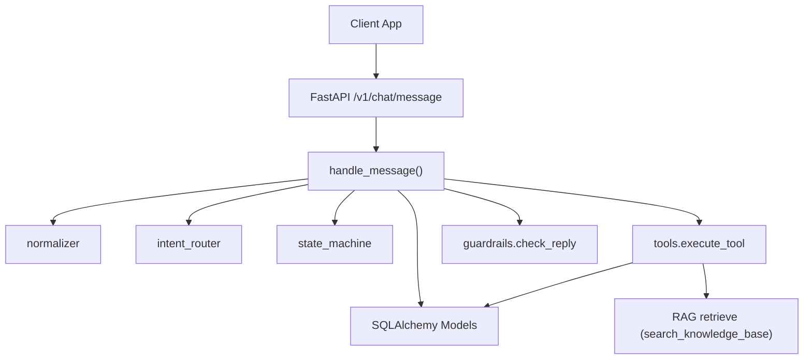
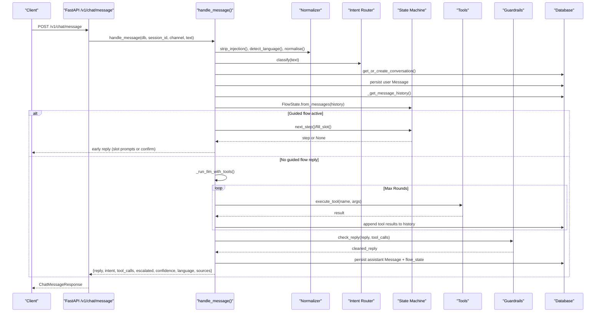
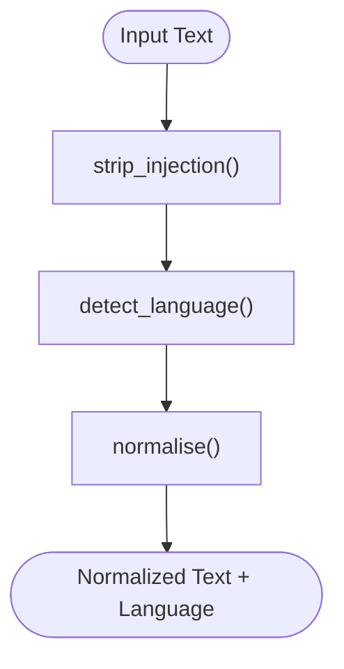
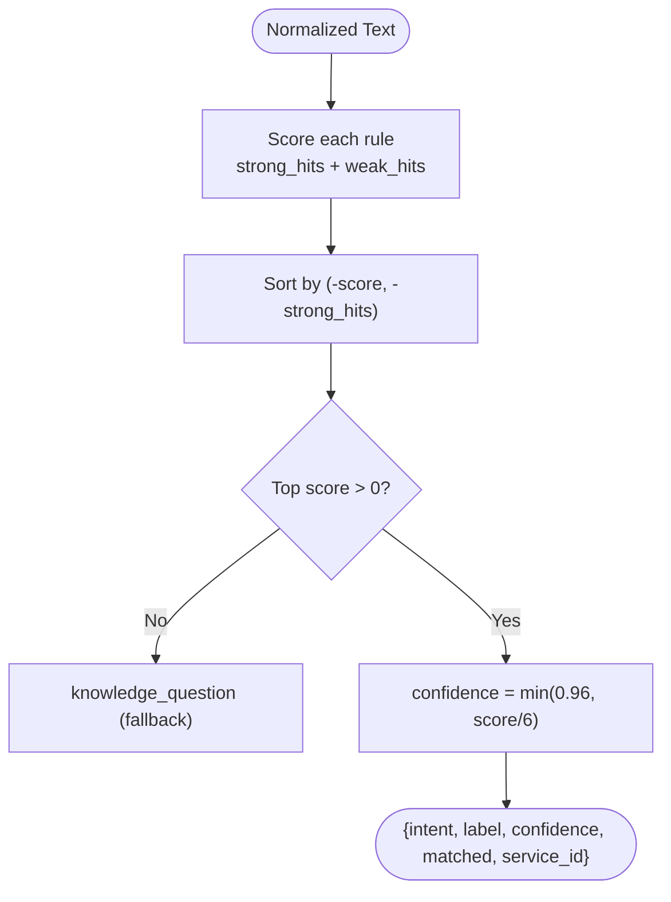
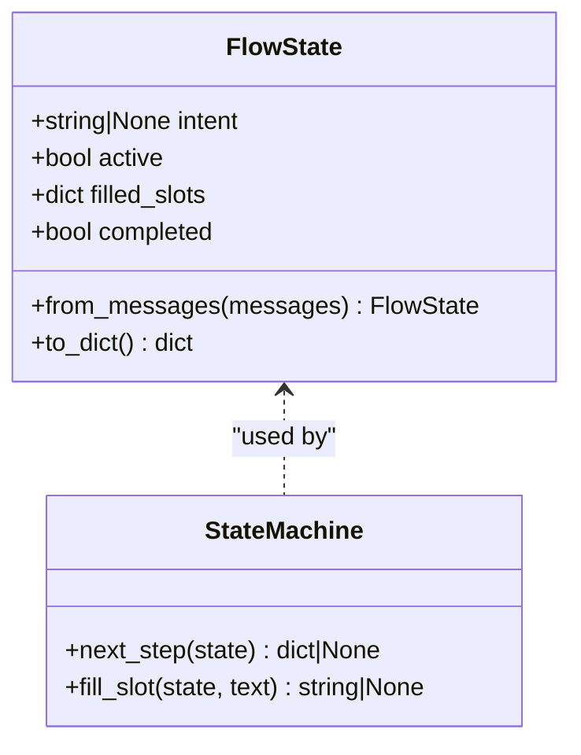
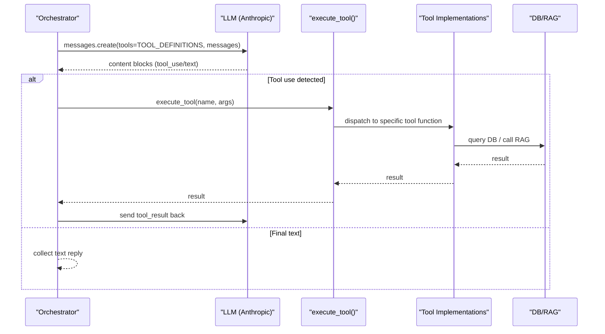
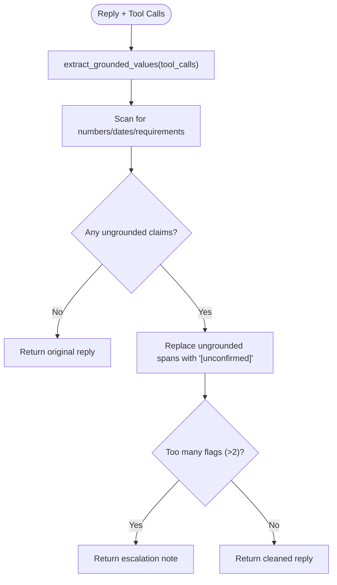
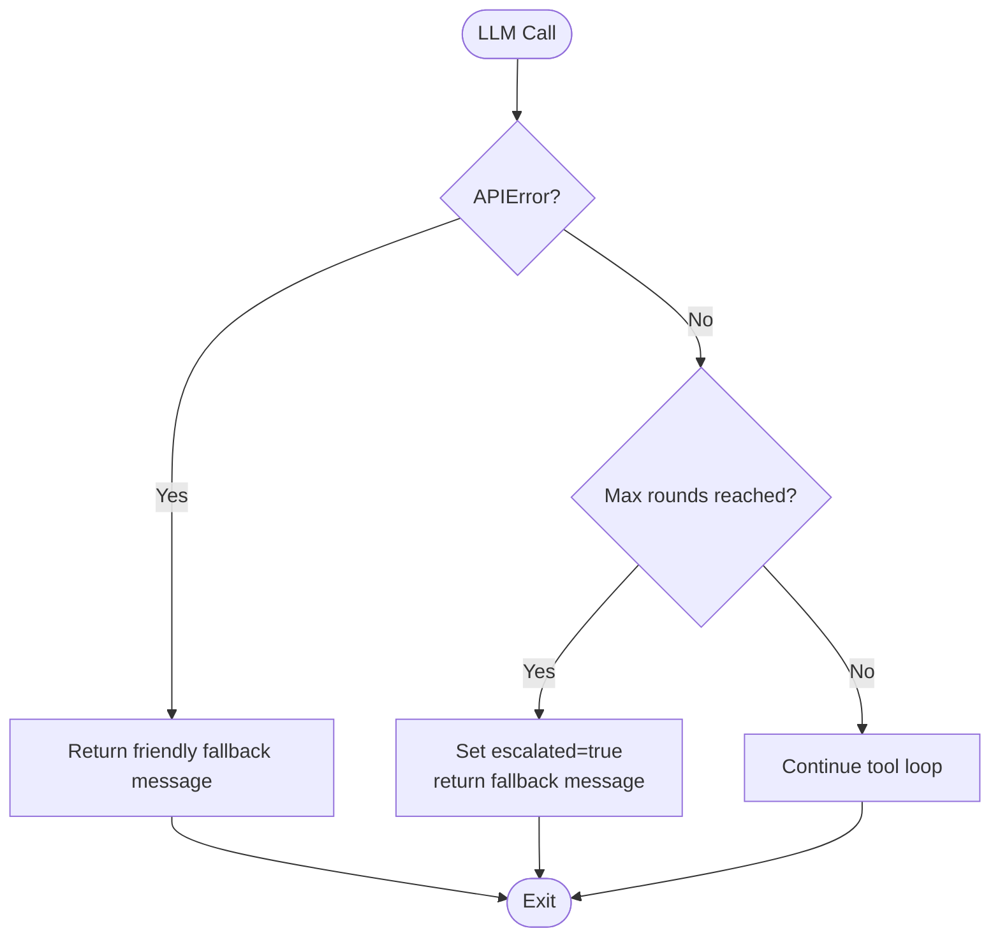
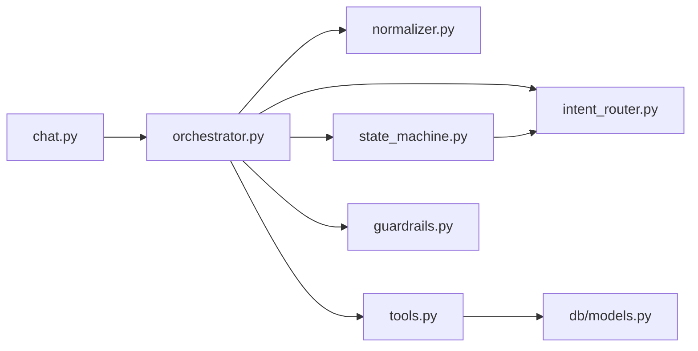

# Orchestrator Pipeline

<cite>
**Referenced Files in This Document**
- [orchestrator.py](file://uaea-backend/app/orchestrator/orchestrator.py)
- [normalizer.py](file://uaea-backend/app/orchestrator/normalizer.py)
- [intent_router.py](file://uaea-backend/app/orchestrator/intent_router.py)
- [tools.py](file://uaea-backend/app/orchestrator/tools.py)
- [guardrails.py](file://uaea-backend/app/orchestrator/guardrails.py)
- [state_machine.py](file://uaea-backend/app/orchestrator/state_machine.py)
- [chat.py](file://uaea-backend/app/api/chat.py)
- [models.py](file://uaea-backend/app/db/models.py)
- [config.py](file://uaea-backend/app/config.py)
- [main.py](file://uaea-backend/app/main.py)
</cite>

## Table of Contents
1. [Introduction](#introduction)
2. [Project Structure](#project-structure)
3. [Core Components](#core-components)
4. [Architecture Overview](#architecture-overview)
5. [Detailed Component Analysis](#detailed-component-analysis)
6. [Dependency Analysis](#dependency-analysis)
7. [Performance Considerations](#performance-considerations)
8. [Troubleshooting Guide](#troubleshooting-guide)
9. [Conclusion](#conclusion)
10. [Appendices](#appendices)

## Introduction
This document explains the complete message processing workflow implemented by the orchestrator pipeline. It covers:
- Normalization of user input (including Roman Urdu folding and injection protection)
- Intent classification using keyword scoring
- Guided flows via a state machine for slot-filling and step execution
- Tool execution framework for external service calls (database lookups, RAG search, escalation)
- Response generation with guardrail validation to prevent hallucinated facts
- Error handling and recovery mechanisms, including retry loops and escalation paths
- Examples for custom tool development, guardrail configuration, and flow definition patterns

## Project Structure
The backend is organized around an API layer that routes chat requests into the orchestrator pipeline. The orchestrator composes several modules: normalizer, intent router, state machine, tools, and guardrails. Data persistence uses SQLAlchemy models for conversations, messages, services, deadlines, fee tariffs, departments, knowledge chunks, and escalation tickets.

**Diagram sources**
- [chat.py:21-39](file://uaea-backend/app/api/chat.py#L21-L39)
- [orchestrator.py:46-143](file://uaea-backend/app/orchestrator/orchestrator.py#L46-L143)
- [tools.py:218-235](file://uaea-backend/app/orchestrator/tools.py#L218-L235)
- [models.py:144-178](file://uaea-backend/app/db/models.py#L144-L178)

**Section sources**
- [main.py:38-79](file://uaea-backend/app/main.py#L38-L79)
- [chat.py:21-39](file://uaea-backend/app/api/chat.py#L21-L39)

## Core Components
- Normalizer: Cleans text, detects language, folds Roman Urdu variants, and strips prompt-injection patterns.
- Intent Router: Deterministic keyword-based classifier producing intent, confidence, matched keywords, and optional service mapping.
- State Machine: Manages guided flows (admission, fee challan, degree), tracks slots, and determines next steps or completion.
- Tools: Declares tool schemas for the LLM and implements database-backed functions for fees, deadlines, checklists, department lookup, escalation, and knowledge base search.
- Guardrails: Post-processing step that validates factual claims against tool results and replaces ungrounded numbers/dates/requirements.

**Section sources**
- [normalizer.py:29-66](file://uaea-backend/app/orchestrator/normalizer.py#L29-L66)
- [intent_router.py:14-103](file://uaea-backend/app/orchestrator/intent_router.py#L14-L103)
- [state_machine.py:16-146](file://uaea-backend/app/orchestrator/state_machine.py#L16-L146)
- [tools.py:18-235](file://uaea-backend/app/orchestrator/tools.py#L18-L235)
- [guardrails.py:30-120](file://uaea-backend/app/orchestrator/guardrails.py#L30-L120)

## Architecture Overview
End-to-end flow for each incoming message:
1. API receives request and delegates to handle_message.
2. Input normalization and language detection.
3. Intent classification via keyword scoring.
4. Conversation retrieval or creation; persist user message.
5. Guided flow state reconstruction; if active, handle slot-filling and step execution.
6. If not handled by guided flow, call LLM with tool definitions; execute tool calls iteratively up to a maximum number of rounds.
7. Apply guardrails to clean reply based on grounded values from tool results.
8. Persist assistant response and any flow state; track low-confidence queries; mark escalation if needed.
9. Return structured response with reply, intent, tool calls, escalation flag, confidence, language, and sources.

**Diagram sources**
- [chat.py:21-39](file://uaea-backend/app/api/chat.py#L21-L39)
- [orchestrator.py:46-143](file://uaea-backend/app/orchestrator/orchestrator.py#L46-L143)
- [state_machine.py:94-146](file://uaea-backend/app/orchestrator/state_machine.py#L94-L146)
- [tools.py:218-235](file://uaea-backend/app/orchestrator/tools.py#L218-L235)
- [guardrails.py:74-120](file://uaea-backend/app/orchestrator/guardrails.py#L74-L120)

## Detailed Component Analysis

### Normalization Stage
- Strips common prompt-injection patterns to protect system instructions.
- Detects language (Urdu script, Roman Urdu markers, English).
- Normalizes text by lowercasing, removing punctuation, collapsing whitespace, and applying variant folding for Roman Urdu terms.

**Diagram sources**
- [normalizer.py:52-66](file://uaea-backend/app/orchestrator/normalizer.py#L52-L66)
- [normalizer.py:39-49](file://uaea-backend/app/orchestrator/normalizer.py#L39-L49)
- [normalizer.py:29-36](file://uaea-backend/app/orchestrator/normalizer.py#L29-L36)

**Section sources**
- [normalizer.py:29-66](file://uaea-backend/app/orchestrator/normalizer.py#L29-L66)

### Intent Classification System (Keyword Scoring)
- Uses strong and weak keyword rules per intent category.
- Scores matches, sorts by score and strong hits, computes confidence capped at a threshold.
- Returns intent, label, confidence, matched keywords, and optional service_id.

**Diagram sources**
- [intent_router.py:65-103](file://uaea-backend/app/orchestrator/intent_router.py#L65-L103)

**Section sources**
- [intent_router.py:14-103](file://uaea-backend/app/orchestrator/intent_router.py#L14-L103)

### Guided Flows and State Machine
- Defines flows for admission, fee challan, and degree with slots and steps.
- Reconstructs flow state from message history via persisted flow_state tool calls.
- Determines next step: prompt for unfilled slots, execute actions when all args are available, or complete flow.

**Diagram sources**
- [state_machine.py:62-91](file://uaea-backend/app/orchestrator/state_machine.py#L62-L91)
- [state_machine.py:94-146](file://uaea-backend/app/orchestrator/state_machine.py#L94-L146)

**Section sources**
- [state_machine.py:16-146](file://uaea-backend/app/orchestrator/state_machine.py#L16-L146)
- [orchestrator.py:146-227](file://uaea-backend/app/orchestrator/orchestrator.py#L146-L227)

### Tool Execution Framework
- Declares tool schemas for the LLM (search_knowledge_base, get_department, get_fee_tariff, get_deadline, get_document_checklist, create_escalation_ticket).
- Implements tool functions backed by SQLAlchemy models and RAG retrieval.
- Central dispatcher execute_tool maps names to implementations.

**Diagram sources**
- [orchestrator.py:229-318](file://uaea-backend/app/orchestrator/orchestrator.py#L229-L318)
- [tools.py:18-87](file://uaea-backend/app/orchestrator/tools.py#L18-L87)
- [tools.py:92-235](file://uaea-backend/app/orchestrator/tools.py#L92-L235)

**Section sources**
- [tools.py:18-235](file://uaea-backend/app/orchestrator/tools.py#L18-L235)
- [orchestrator.py:229-318](file://uaea-backend/app/orchestrator/orchestrator.py#L229-L318)

### Response Generation with Guardrail Validation
- Extracts grounded values from tool call results.
- Scans reply for numbers, dates, and requirement phrases.
- Replaces ungrounded claims with placeholders; if too many, returns an escalation note.

**Diagram sources**
- [guardrails.py:51-120](file://uaea-backend/app/orchestrator/guardrails.py#L51-L120)

**Section sources**
- [guardrails.py:30-120](file://uaea-backend/app/orchestrator/guardrails.py#L30-L120)

### Error Handling and Recovery Mechanisms
- LLM API errors return a friendly fallback message without crashing the pipeline.
- Exhaustion of maximum rounds triggers escalation messaging.
- Low-confidence intents are tracked in an unanswered queue for review.
- Rate limiting is enforced at the application level with a dedicated handler.

**Diagram sources**
- [orchestrator.py:255-318](file://uaea-backend/app/orchestrator/orchestrator.py#L255-L318)
- [main.py:51-58](file://uaea-backend/app/main.py#L51-L58)

**Section sources**
- [orchestrator.py:255-318](file://uaea-backend/app/orchestrator/orchestrator.py#L255-L318)
- [main.py:51-58](file://uaea-backend/app/main.py#L51-L58)

## Dependency Analysis
Key dependencies and relationships:
- API depends on orchestrator.handle_message.
- Orchestrator depends on normalizer, intent_router, state_machine, tools, guardrails.
- Tools depend on SQLAlchemy models and optionally RAG retrieval.
- State machine depends on intent_router constants for guided flow intents.
- Configuration centralizes environment settings (database URL, API keys, CORS, rate limits).

**Diagram sources**
- [chat.py:21-39](file://uaea-backend/app/api/chat.py#L21-L39)
- [orchestrator.py:17-25](file://uaea-backend/app/orchestrator/orchestrator.py#L17-L25)
- [tools.py:11-15](file://uaea-backend/app/orchestrator/tools.py#L11-L15)
- [state_machine.py:11-11](file://uaea-backend/app/orchestrator/state_machine.py#L11-L11)

**Section sources**
- [orchestrator.py:17-25](file://uaea-backend/app/orchestrator/orchestrator.py#L17-L25)
- [tools.py:11-15](file://uaea-backend/app/orchestrator/tools.py#L11-L15)
- [state_machine.py:11-11](file://uaea-backend/app/orchestrator/state_machine.py#L11-L11)

## Performance Considerations
- Limiting message history to last 20 messages reduces payload size and cost.
- Maximum rounds cap tool-call loops to prevent runaway interactions.
- Keyword-based intent classification avoids ML inference latency.
- Database queries are targeted and indexed where appropriate (e.g., program, category).
- RAG retrieval is invoked only when requested by tools, minimizing unnecessary calls.

[No sources needed since this section provides general guidance]

## Troubleshooting Guide
Common issues and resolutions:
- LLM API error: The pipeline returns a friendly fallback message; verify API key and connectivity.
- Too many tool rounds: Indicates complex multi-step resolution; consider simplifying flows or improving tool precision.
- Unanswered queries: Check the unanswered queue for low-confidence intents and update rules or add new keywords.
- Rate limit exceeded: Adjust rate limits or investigate client usage patterns.

**Section sources**
- [orchestrator.py:255-318](file://uaea-backend/app/orchestrator/orchestrator.py#L255-L318)
- [orchestrator.py:367-383](file://uaea-backend/app/orchestrator/orchestrator.py#L367-L383)
- [main.py:51-58](file://uaea-backend/app/main.py#L51-L58)

## Conclusion
The orchestrator pipeline provides a robust, deterministic, and safe message processing workflow for student-services chat. It combines normalization, keyword-based intent classification, guided flows, tool-driven data retrieval, and guardrail validation to ensure accurate, traceable responses while gracefully handling errors and escalating when necessary.

[No sources needed since this section summarizes without analyzing specific files]

## Appendices

### Custom Tool Development Pattern
To add a new tool:
- Define a tool schema in TOOL_DEFINITIONS with name, description, and input_schema.
- Implement a function that performs the required operation (e.g., DB query, external API call).
- Register the tool in execute_tool’s dispatch logic.
- Ensure results include source references for grounding and citation display.

**Section sources**
- [tools.py:18-87](file://uaea-backend/app/orchestrator/tools.py#L18-L87)
- [tools.py:218-235](file://uaea-backend/app/orchestrator/tools.py#L218-L235)

### Guardrail Configuration Patterns
- Configure thresholds and behaviors via application settings and UI controls.
- Use guardrail checks to enforce policy compliance (no ungrounded numbers/dates/requirements).
- Log guardrail flags for auditing and continuous improvement.

**Section sources**
- [guardrails.py:30-120](file://uaea-backend/app/orchestrator/guardrails.py#L30-L120)
- [config.py:6-38](file://uaea-backend/app/config.py#L6-L38)

### Flow Definition Patterns
- Define flows in FLOW_DEFINITIONS with slots and steps.
- Use slot prompts to collect required information from users.
- Chain actions to gather data (fees, deadlines, checklists) before confirming completion.
- Persist flow state via tool calls to maintain continuity across conversation turns.

**Section sources**
- [state_machine.py:16-59](file://uaea-backend/app/orchestrator/state_machine.py#L16-L59)
- [state_machine.py:94-146](file://uaea-backend/app/orchestrator/state_machine.py#L94-L146)
- [orchestrator.py:146-227](file://uaea-backend/app/orchestrator/orchestrator.py#L146-L227)