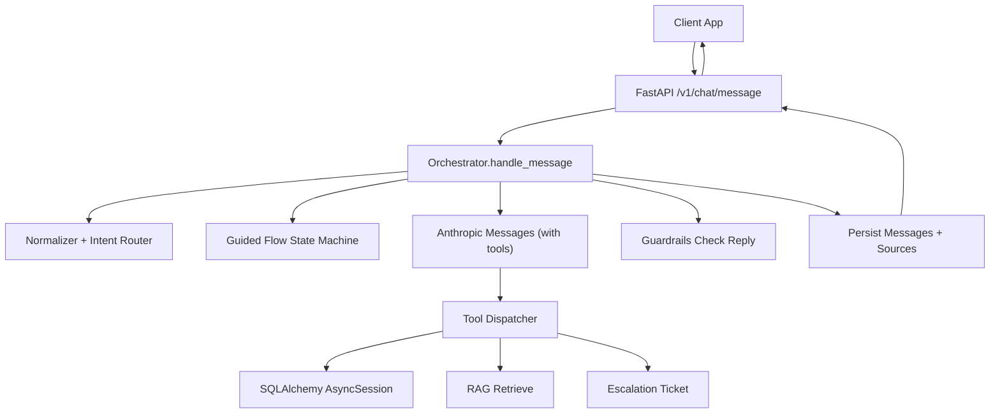
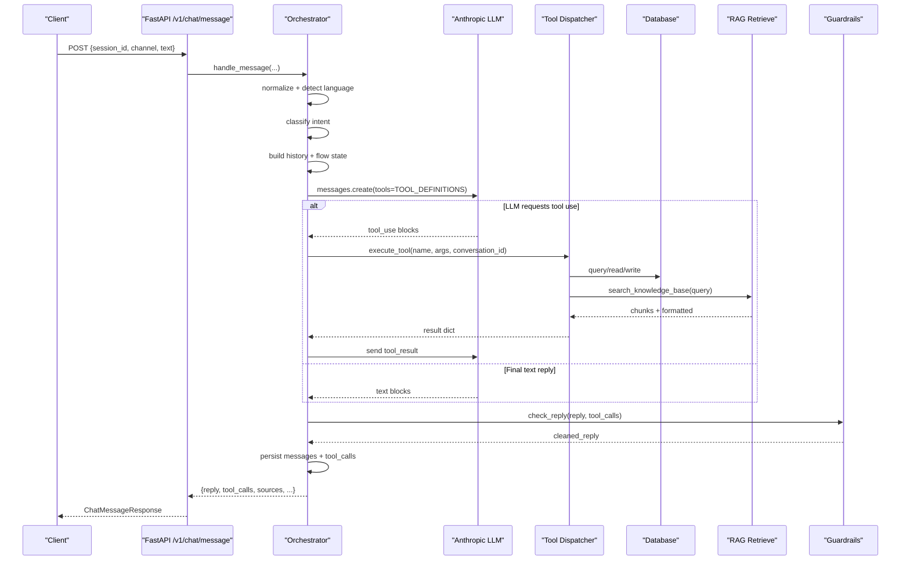
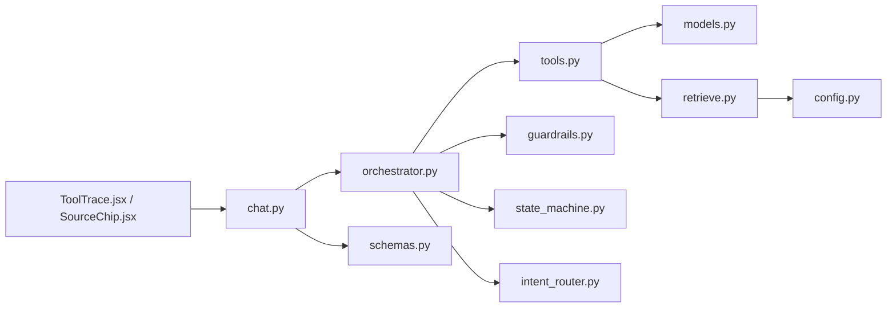

# Tool Execution Framework

<cite>
**Referenced Files in This Document**
- [tools.py](file://uaea-backend/app/orchestrator/tools.py)
- [orchestrator.py](file://uaea-backend/app/orchestrator/orchestrator.py)
- [chat.py](file://uaea-backend/app/api/chat.py)
- [retrieve.py](file://uaea-backend/app/rag/retrieve.py)
- [base.py](file://uaea-backend/app/adapters/base.py)
- [mock_adapter.py](file://uaea-backend/app/adapters/mock_adapter.py)
- [models.py](file://uaea-backend/app/db/models.py)
- [schemas.py](file://uaea-backend/app/schemas.py)
- [guardrails.py](file://uaea-backend/app/orchestrator/guardrails.py)
- [intent_router.py](file://uaea-backend/app/orchestrator/intent_router.py)
- [state_machine.py](file://uaea-backend/app/orchestrator/state_machine.py)
- [config.py](file://uaea-backend/app/config.py)
- [ToolTrace.jsx](file://src/pages/student/Chat/ToolTrace.jsx)
- [SourceChip.jsx](file://src/pages/student/Chat/SourceChip.jsx)
</cite>

## Table of Contents
1. [Introduction](#introduction)
2. [Project Structure](#project-structure)
3. [Core Components](#core-components)
4. [Architecture Overview](#architecture-overview)
5. [Detailed Component Analysis](#detailed-component-analysis)
6. [Dependency Analysis](#dependency-analysis)
7. [Performance Considerations](#performance-considerations)
8. [Troubleshooting Guide](#troubleshooting-guide)
9. [Conclusion](#conclusion)
10. [Appendices](#appendices)

## Introduction
This document explains the extensible tool execution framework that enables the LLM to call external services and retrieve data during a conversation. It covers:
- Tool registration and parameter schemas
- Parameter validation and dispatching
- Execution context (database session, conversation ID)
- Result formatting and source attribution
- Built-in tools for database queries, RAG retrieval, and escalation handling
- Custom tool development patterns
- Integration with conversation context and guardrails

The framework is designed so that every factual claim in the assistant’s reply can be traced back to a tool result and a source reference, minimizing hallucinations and improving trust.

## Project Structure
At a high level, the backend exposes a chat API that routes user messages through an orchestrator. The orchestrator normalizes input, classifies intent, manages guided flows, calls the LLM with tool definitions, executes tool calls, applies guardrails, persists messages, and returns a response including tool traces and sources. Tools read from the database or call RAG retrieval; escalation tools create tickets. The frontend displays tool traces and source chips for transparency.

**Diagram sources**
- [chat.py:21-39](file://uaea-backend/app/api/chat.py#L21-L39)
- [orchestrator.py:46-143](file://uaea-backend/app/orchestrator/orchestrator.py#L46-L143)
- [tools.py:18-87](file://uaea-backend/app/orchestrator/tools.py#L18-L87)
- [retrieve.py:32-96](file://uaea-backend/app/rag/retrieve.py#L32-L96)
- [guardrails.py:74-119](file://uaea-backend/app/orchestrator/guardrails.py#L74-L119)

**Section sources**
- [chat.py:21-39](file://uaea-backend/app/api/chat.py#L21-L39)
- [orchestrator.py:46-143](file://uaea-backend/app/orchestrator/orchestrator.py#L46-L143)

## Core Components
- Tool definitions and dispatcher: Declares tool schemas and maps tool names to implementations.
- Orchestrator: End-to-end message handler that integrates normalization, intent classification, guided flows, LLM tool calls, guardrails, persistence, and source extraction.
- RAG retrieval: Vector similarity search over knowledge chunks with optional reranking.
- Adapters: Abstract interface for student system integrations; mock implementation for testing.
- Models and schemas: Database models and Pydantic request/response types.
- Guardrails: Post-processing to strip ungrounded numbers/dates/requirements from replies.
- Frontend trace and source UI: Displays tool usage and source citations under answers.

**Section sources**
- [tools.py:18-235](file://uaea-backend/app/orchestrator/tools.py#L18-L235)
- [orchestrator.py:46-405](file://uaea-backend/app/orchestrator/orchestrator.py#L46-L405)
- [retrieve.py:17-96](file://uaea-backend/app/rag/retrieve.py#L17-L96)
- [base.py:11-32](file://uaea-backend/app/adapters/base.py#L11-L32)
- [mock_adapter.py:12-61](file://uaea-backend/app/adapters/mock_adapter.py#L12-L61)
- [models.py:18-228](file://uaea-backend/app/db/models.py#L18-L228)
- [schemas.py:81-178](file://uaea-backend/app/schemas.py#L81-L178)
- [guardrails.py:74-119](file://uaea-backend/app/orchestrator/guardrails.py#L74-L119)
- [ToolTrace.jsx:9-29](file://src/pages/student/Chat/ToolTrace.jsx#L9-L29)
- [SourceChip.jsx:12-39](file://src/pages/student/Chat/SourceChip.jsx#L12-L39)

## Architecture Overview
The tool execution framework follows a layered architecture:
- API layer: FastAPI endpoints accept requests and return structured responses.
- Orchestrator layer: Coordinates pipeline steps and maintains conversation state.
- Tool layer: Declarative tool schemas plus a dispatcher that executes implementations against the database or external systems.
- Data layer: SQLAlchemy async sessions for reading/writing; pgvector for semantic search.
- Guardrails layer: Ensures replies are grounded in tool results before returning to clients.

**Diagram sources**
- [chat.py:21-39](file://uaea-backend/app/api/chat.py#L21-L39)
- [orchestrator.py:229-318](file://uaea-backend/app/orchestrator/orchestrator.py#L229-L318)
- [tools.py:218-235](file://uaea-backend/app/orchestrator/tools.py#L218-L235)
- [retrieve.py:32-96](file://uaea-backend/app/rag/retrieve.py#L32-L96)
- [guardrails.py:74-119](file://uaea-backend/app/orchestrator/guardrails.py#L74-L119)

## Detailed Component Analysis

### Tool Registration System
Tools are registered via a list of declarative schemas that include name, description, and input_schema. The orchestrator passes these schemas to the LLM so it can request tool calls with validated parameters.

Key aspects:
- Each tool has a strict JSON Schema describing required and optional parameters.
- The dispatcher maps tool names to async functions that receive an AsyncSession and arguments.
- Unknown tools return an error response, preventing undefined behavior.

Examples of built-in tools:
- search_knowledge_base: Retrieves relevant knowledge chunks using vector similarity.
- get_department: Looks up department/campus contact details.
- get_fee_tariff: Returns official fee amounts with currency and source.
- get_deadline: Returns service deadlines with source references.
- get_document_checklist: Returns required documents and procedures for a service.
- create_escalation_ticket: Creates a human handoff ticket.

Parameter validation:
- Validation is enforced by the LLM provider based on the provided input_schema.
- The dispatcher extracts arguments safely with defaults to avoid missing keys.

Error handling:
- If a tool cannot find data, it returns a structured error dict with a message.
- Unknown tool names return a clear error indicating the tool is not recognized.

**Section sources**
- [tools.py:18-87](file://uaea-backend/app/orchestrator/tools.py#L18-L87)
- [tools.py:218-235](file://uaea-backend/app/orchestrator/tools.py#L218-L235)

### Tool Implementations and Execution Context
Each tool receives an AsyncSession for database access and may also receive a conversation_id for auditability or linking actions to conversations.

Execution flow:
- The orchestrator calls execute_tool with the tool name, arguments, and conversation_id.
- The dispatcher selects the appropriate function and executes it asynchronously.
- Results are serialized into dicts and appended to the tool_calls list for later grounding and source extraction.

Built-in tool behaviors:
- Department lookup matches by English/Urdu names and region fields, returning contact info and campus details.
- Fee tariff lookup performs fuzzy matching on program names and optional category filtering, returning amount, currency, effective date, and source.
- Deadline lookup joins services and deadlines, returning semester and date with source.
- Document checklist lookup returns items, procedure text, and last verified timestamp.
- Escalation ticket creation inserts a new ticket with status open and returns a confirmation message.

Context integration:
- Conversation ID is passed to escalation creation to link tickets to conversations.
- All tool results include source references where applicable for citation display.

**Section sources**
- [tools.py:92-216](file://uaea-backend/app/orchestrator/tools.py#L92-L216)
- [tools.py:218-235](file://uaea-backend/app/orchestrator/tools.py#L218-L235)
- [models.py:144-195](file://uaea-backend/app/db/models.py#L144-L195)

### RAG Retrieval Tool
The RAG tool provides semantic search over knowledge chunks stored in the database with pgvector embeddings.

Process:
- Generate query embedding via configured provider (OpenAI).
- Execute SQL with cosine similarity operator to fetch top-k chunks.
- Apply basic reranking by boosting chunks whose section headers match query terms.
- Return structured chunks with scores, sections, and verification timestamps.

Output format:
- chunks: list of scored results with id, source_doc_id, text, section, score, last_verified_at.
- formatted: concatenated string suitable for LLM consumption.
- count: number of retrieved chunks.

Integration:
- Exposed as a tool named search_knowledge_base.
- Source references are extracted by the orchestrator for citation display.

**Section sources**
- [retrieve.py:17-96](file://uaea-backend/app/rag/retrieve.py#L17-L96)
- [models.py:126-140](file://uaea-backend/app/db/models.py#L126-L140)

### Escalation Handling
Escalation tools enable handing off complex or unresolved queries to staff.

Behavior:
- create_escalation_ticket creates a new ticket linked to a conversation with reason and open status.
- The orchestrator marks the conversation as escalated when this tool is used.
- An alternative endpoint allows manual escalation via API.

Result formatting:
- Returns ticket_id, status, and a friendly message to inform the user.

Integration:
- The orchestrator tracks escalation flags and updates conversation state accordingly.

**Section sources**
- [tools.py:200-216](file://uaea-backend/app/orchestrator/tools.py#L200-L216)
- [orchestrator.py:127-129](file://uaea-backend/app/orchestrator/orchestrator.py#L127-L129)
- [chat.py:88-115](file://uaea-backend/app/api/chat.py#L88-L115)
- [models.py:183-195](file://uaea-backend/app/db/models.py#L183-L195)

### Custom Tool Development Patterns
To add a new tool:
- Define a schema entry in TOOL_DEFINITIONS with name, description, and input_schema.
- Implement an async function that accepts AsyncSession and typed arguments, returning a dict.
- Add a mapping in execute_tool to route the tool name to the implementation.
- Ensure results include source references where applicable for attribution.
- Test with the orchestrator loop to verify tool call execution and grounding.

Best practices:
- Validate inputs at the schema level; provide safe defaults in the dispatcher.
- Handle errors gracefully by returning structured error dicts.
- Include source metadata to support citation display and freshness checks.
- Keep tool functions focused and asynchronous to avoid blocking.

**Section sources**
- [tools.py:18-87](file://uaea-backend/app/orchestrator/tools.py#L18-L87)
- [tools.py:218-235](file://uaea-backend/app/orchestrator/tools.py#L218-L235)

### Conversation Context and Guided Flows
The orchestrator integrates tool execution with conversation context:
- Message history is maintained and passed to the LLM to preserve context.
- Guided flows collect slots (e.g., programme, campus) and then trigger tool calls to gather information.
- Flow state is persisted via tool_calls containing flow_state snapshots.

Flow lifecycle:
- Detect intent and start guided flow if applicable.
- Prompt for missing slots and fill them from user input.
- Execute action steps to call tools and assemble final summary.
- Persist flow state and return intermediate replies as needed.

**Section sources**
- [orchestrator.py:80-91](file://uaea-backend/app/orchestrator/orchestrator.py#L80-L91)
- [orchestrator.py:146-227](file://uaea-backend/app/orchestrator/orchestrator.py#L146-L227)
- [state_machine.py:16-59](file://uaea-backend/app/orchestrator/state_machine.py#L16-L59)
- [state_machine.py:94-146](file://uaea-backend/app/orchestrator/state_machine.py#L94-L146)

### Guardrails and Source Attribution
After the LLM drafts a reply, guardrails scan for ungrounded claims:
- Numbers, dates, and requirement phrases are detected via regex patterns.
- Claims are cross-checked against values extracted from tool call results.
- Unverified claims are replaced with placeholders or the entire reply is replaced with an escalation note if too many issues are found.

Source extraction:
- The orchestrator collects source references from tool call results, including RAG chunk sources.
- These sources are returned to the client for display as badges or notes.

Frontend integration:
- ToolTrace component shows collapsed “How I found this” with tool names, arguments, and results.
- SourceChip component displays source badges and freshness warnings.

**Section sources**
- [guardrails.py:74-119](file://uaea-backend/app/orchestrator/guardrails.py#L74-L119)
- [orchestrator.py:386-405](file://uaea-backend/app/orchestrator/orchestrator.py#L386-L405)
- [ToolTrace.jsx:9-29](file://src/pages/student/Chat/ToolTrace.jsx#L9-L29)
- [SourceChip.jsx:12-39](file://src/pages/student/Chat/SourceChip.jsx#L12-L39)

## Dependency Analysis
The framework exhibits clear separation of concerns:
- API depends on orchestrator for business logic.
- Orchestrator depends on normalizer, intent router, state machine, tools, and guardrails.
- Tools depend on database models and optionally RAG retrieval.
- RAG retrieval depends on configuration for embedding provider and dimensions.
- Frontend components depend on API responses to render tool traces and sources.

**Diagram sources**
- [chat.py:21-39](file://uaea-backend/app/api/chat.py#L21-L39)
- [orchestrator.py:46-143](file://uaea-backend/app/orchestrator/orchestrator.py#L46-L143)
- [tools.py:18-235](file://uaea-backend/app/orchestrator/tools.py#L18-L235)
- [retrieve.py:17-96](file://uaea-backend/app/rag/retrieve.py#L17-L96)
- [config.py:6-38](file://uaea-backend/app/config.py#L6-L38)
- [schemas.py:81-178](file://uaea-backend/app/schemas.py#L81-L178)
- [ToolTrace.jsx:9-29](file://src/pages/student/Chat/ToolTrace.jsx#L9-L29)
- [SourceChip.jsx:12-39](file://src/pages/student/Chat/SourceChip.jsx#L12-L39)

**Section sources**
- [chat.py:21-39](file://uaea-backend/app/api/chat.py#L21-L39)
- [orchestrator.py:46-143](file://uaea-backend/app/orchestrator/orchestrator.py#L46-L143)
- [tools.py:18-235](file://uaea-backend/app/orchestrator/tools.py#L18-L235)
- [retrieve.py:17-96](file://uaea-backend/app/rag/retrieve.py#L17-L96)
- [config.py:6-38](file://uaea-backend/app/config.py#L6-L38)
- [schemas.py:81-178](file://uaea-backend/app/schemas.py#L81-L178)

## Performance Considerations
- Tool loops are bounded by MAX_ROUNDS to prevent excessive LLM calls per message.
- Database queries use efficient SQL with indexes where applicable (e.g., programs, services).
- RAG retrieval uses pgvector cosine similarity and limits results to top-k to reduce latency.
- Embedding generation is cached conceptually by limiting dimensions and reusing model calls; ensure provider rate limits are respected.
- Guardrails operate on short strings and simple regex patterns, keeping post-processing fast.

[No sources needed since this section provides general guidance]

## Troubleshooting Guide
Common issues and strategies:
- LLM API errors: The orchestrator catches API exceptions and returns a graceful fallback message, optionally prompting escalation.
- No tool results: Tools return structured error dicts; guardrails will mark ungrounded claims and may escalate if too many issues exist.
- Missing source references: Ensure tool implementations include source fields; the orchestrator extracts sources only when present.
- High confidence but wrong intent: Review intent rules and keywords; adjust strong/weak weights if necessary.
- Stale data: Use last_verified_at to warn users about potentially outdated information; consider refreshing ingestion pipelines.

**Section sources**
- [orchestrator.py:255-271](file://uaea-backend/app/orchestrator/orchestrator.py#L255-L271)
- [guardrails.py:100-119](file://uaea-backend/app/orchestrator/guardrails.py#L100-L119)
- [tools.py:122-198](file://uaea-backend/app/orchestrator/tools.py#L122-L198)
- [intent_router.py:65-103](file://uaea-backend/app/orchestrator/intent_router.py#L65-L103)

## Conclusion
The tool execution framework provides a robust, extensible foundation for enabling the LLM to call external services and retrieve authoritative data. By combining declarative tool schemas, a centralized dispatcher, RAG retrieval, escalation handling, and guardrails, the system ensures that assistant replies are grounded, traceable, and trustworthy. The modular design supports custom tool development and integrates seamlessly with conversation context and source attribution for a transparent user experience.

[No sources needed since this section summarizes without analyzing specific files]

## Appendices

### Example Tool Definition and Schema
- search_knowledge_base: Accepts a query string; returns chunks with scores and sources.
- get_department: Accepts name_or_region; returns contact and campus details.
- get_fee_tariff: Accepts program and optional category; returns amount, currency, effective date, and source.
- get_deadline: Accepts service; returns semester and date with source.
- get_document_checklist: Accepts service; returns checklist items, procedure, and verification timestamp.
- create_escalation_ticket: Accepts conversation_id and reason; returns ticket confirmation.

**Section sources**
- [tools.py:18-87](file://uaea-backend/app/orchestrator/tools.py#L18-L87)

### Error Handling Strategies
- Structured error dicts from tools indicate failures clearly.
- Guardrails replace ungrounded claims and escalate when necessary.
- API endpoints raise HTTP exceptions for invalid sessions or resources.

**Section sources**
- [tools.py:122-198](file://uaea-backend/app/orchestrator/tools.py#L122-L198)
- [guardrails.py:100-119](file://uaea-backend/app/orchestrator/guardrails.py#L100-L119)
- [chat.py:42-56](file://uaea-backend/app/api/chat.py#L42-L56)

### Frontend Integration Notes
- ToolTrace displays collapsed tool usage with names, arguments, and results.
- SourceChip shows source badges and freshness warnings based on verification timestamps.

**Section sources**
- [ToolTrace.jsx:9-29](file://src/pages/student/Chat/ToolTrace.jsx#L9-L29)
- [SourceChip.jsx:12-39](file://src/pages/student/Chat/SourceChip.jsx#L12-L39)